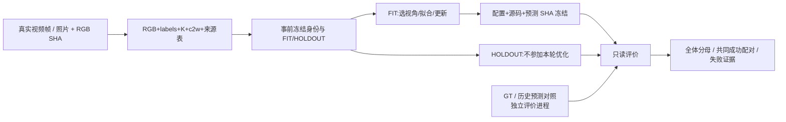

# 数据流、来源与评价隔离

| 阶段 | 输入 | 输出与固定身份 |
| --- | --- | --- |
| RGB/Mask 绑定 | 原始来源、缓存图、冻结分割 | group/video/frame/source_id、解码尺寸、RGB/Mask SHA、预处理版本 |
| DXY adapter | 同坐标 RGB 与 0/1/2 labels、已知环内径 | 官方候选像素 center/basis、P/Q/Ring 质量与状态；失败显式 null |
| 视角 | 图像质量、Mask、方向或可见表面 proxy | 选择清单、权重、方向块、目标与 support 图、排除原因、留出 |
| Camera | K、Ring CAD、轮廓/RGB 对应 | native T 与坐标系标签、资格、不确定性；替代候选独立文件 |
| HERO | 固定 target+support RGB、K/T、官方权重 | native Z/mm、原生 K、RGB 父 SHA、推理回执；保留原深度 |
| Raw / cleaning | native Z、labels、K/T | 原 XYZ/F/uv/ID、条件四状态；清理为派生资产，保留 raw |
| Body | FIT 的 E1 几何或 E2 Mask、同模型/预算/先验 | 各初值结果、未收敛原因、选择资格、最终预测；不借历史 Body 补值 |
| 更新 | 已授权的冻结 Body/原生 HERO | 提案、逐次接受/拒绝、回滚、Guard、完整轨迹；当前修复未执行 |
| 评价 | 已冻结预测、同组同帧目标、可用的独立 GT | FIT/held 分开，所有失败；GT 状态、历史融合对照标签；错误图 |

## 三种选视角不是一个算法

015：清晰度、Mask 完整度、细长 skeleton proxy、Ring 遮挡与方向 max-min；最多 8 FIT。历史方向原点依赖旧 Body 中心，当前 repair 改用 Ring 原点并登记适配。
016：方向簇配额、固定 HERO 锚、最小 3° 间隔；质量/时间/角度兼顾；方向块等质量权重。不是 MAX 表面积目标。
MAX：先冻结相机，再依据 source-tagged 0.2mm/法向 bin 的可见表面 proxy 近贪心选择 target；HERO 的 3 个 support 另按 RGB 匹配/极线/视差选择，不能用 target 得分代替。
源码、指标与限制见 T10–T13 和[模块卡](../registry/REUSABLE_MODULES.md)。

## FIT/HOLDOUT 的实际含义

保留每个任务自己的角色和旧任务角色，禁止重命名后假装从未使用。当前 repair 四组 004 各 8 FIT；HOLDOUT 为 G01=9、G03=4、G05=5、G06=5，共 23 张，共同成功配对按 4 物理组解释。独立 005 池：G01 6 FIT/2 held，G03 4 FIT/2 held；G01/G05 照片与 G05 单帧 005 均不拟合、null/NaN，不合并相机坐标。

这些来源历史上属于 HERO FIT 库存，上游 RGB 地图/相机可能使用相关图像；本轮留出是条件性留出，不能声称完全外部独立。重复 RGB（75 来源只有 74 唯一 RGB）及 target/support 共享父 RGB 必须记录，权重不能假设独立。详情：
[角色冻结](../../experiments/TASK-E4-BODY-GUIDED-HERO-DXY-REPAIR-001/config/BODY_FIT_VIEWS.json)、
[输入身份](../../experiments/TASK-E4-BODY-GUIDED-HERO-DXY-REPAIR-001/config/SOURCE_BINDING.json)。

## 失败和统计

数值输出成功与测量正确分别报告。独立覆盖率以目标物理组为分母，不用帧/提案数扩大样本；历史回退为 0。测量任务须报告中位绝对相对误差、MAE、p95、最大误差及共同独立成功组配对；无真实 GT 时这些真实尺寸指标为 NOT_EVALUABLE，不能用 IoU/px 误差替代。推断背面、Ring 接触未知边界和可观察轮廓分层标记。
