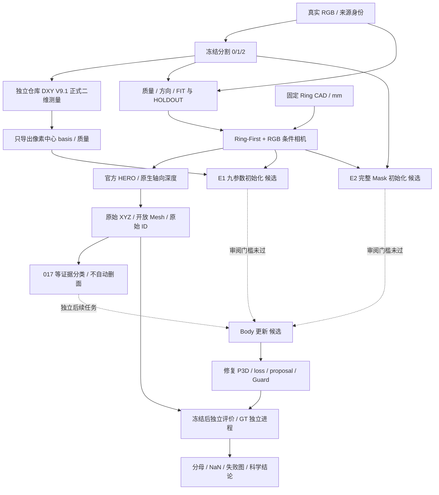

# 系统边界与模块关系

入口：[PROJECT_HOME](../PROJECT_HOME.md)。具体函数及双维状态见[注册表](../registry/TECHNICAL_ROUTE_MATRIX.md)。

DXY 仓库 `zheng1524/new-polyp-dxy` 只读；其正式视频等权中位测量与本项目三维建模各自承担结果来源。不得把 DXY 毫米输出或历史 V2/S0 直径作为三维尺度/失败回退。当前适配只导出像素几何，没有读取/保存 DXY 毫米结果。

主线允许 Ring-First、官方 HERO、点云和开放 Mesh；没有已认证的通用完整闭合重建器。Ring 永远来自 CAD，点云 Ring 显示不能解释为 Ring 重建。Body 先验用于研究，不自动覆盖原始 HERO 或成为 GT。

## 可复用工程与研究候选

| 层 | 可核验能力 | 科研边界 |
| --- | --- | --- |
| 输入 | DXY T01–T03、冻结分割 T02、身份核验 T18 | 候选边界不是解剖真轮廓 |
| 视角 | 015 T10、016 T11、MAX T12/T13 | 三目标并列，保护各自旧留出和上游关联 |
| 公制几何 | CAD T16、相机 T14/T15、021 T17 | 相机为条件候选；跨视频不由单视频资格推出 |
| 深度/表面 | HERO T19/T20、四状态 T21/T22、清理 T23 | 轴向原深度可追溯，TRUSTED 不等于 GT；不自动融合 |
| 主体 | T04–T09、T27 | 参数化可执行；当前 E1/E2 各 0/4 完整验收 |
| 优化 | T24–T34 | renderer 已验证，具体更新结论 MIXED |
| 评价/显示 | T35–T38、T43 | GT 最佳刚体只属评价；渲染一致性非真实三维精度 |

直接工程复用仍须满足冻结环境、输入数据契约和模块依赖；历史源码大量采用星号导入、绝对路径与任务级 R/ROOT，不是可独立 pip 安装的共享库。本轮只定位，不把代码复制到 src。相关治理见[资产政策](../registry/ASSET_MANAGEMENT_POLICY.md)。

## 证据入口

[当前 E1/E2 报告](../../experiments/TASK-E4-BODY-GUIDED-HERO-DXY-REPAIR-001/TECHNICAL_REPORT.md)、
[018 原生 HERO 报告](../../experiments/TASK-E4-HERO-BODY-ADAPT-018/TECHNICAL_REPORT.md)、
[014 主体更新报告](../../experiments/TASK-E4-PYTORCH3D-014/TECHNICAL_REPORT.md)、
[E4 路线图](../PHASE_E4_RESEARCH_ROADMAP.md)。
