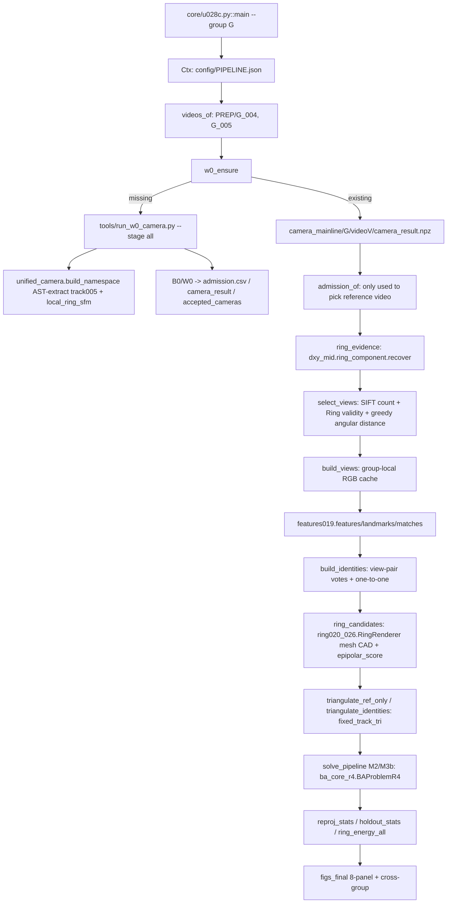

# CURRENT_IMPLEMENTATION_MAP

**Task:** ring-first-3d consolidated audit, first round (audit only)
**Workspace HEAD:** `8b0c166ef5a2310bcdacbc4eae68198ad6530edc`
**Branch:** `exp/TASK-E4-W0-CROSSVIDEO-028-CORRECTIVE-FINAL`
**Date:** 2026-11-23
**Code changes in this round:** none. This document is based on source reading, Serena symbol inventory, hash checks, and small read-only verification commands.

---

## 1. Executive verdict

The 028-CORRECTIVE-FINAL experiment is a **single group-agnostic code path** and its 309 recorded output hashes match the working tree, but it is **not a valid cross-video camera route yet**.

The three blocking facts are:

1. **The camera admission gate is bypassed.** The route reads `camera_result.npz` (all W0 cameras) and never reads `accepted_cameras.npz` or `admission_status`. G06 has **0 ACCEPT cameras in video 005**, yet the route produced a `GEOMETRY_OK` summary. G01 and G05 have **0 ACCEPT cameras in both videos**. Only G03 has ACCEPT on both sides (6 + 16).
2. **The entry is not runnable from its own declared environment.** `u028c.py` imports `fixed_track_tri`, which lives in `027-CORRECTIVE-R6/core`, but the module only inserts `027-CORRECTIVE-R6/replay` into `sys.path`. Running it standalone fails with `ModuleNotFoundError`. The recorded reproduction command silently supplies the missing path via an external `PYTHONPATH`.
3. **The joint BA is not converged, and the report's comparison is therefore not a method comparison.** Both G03 and G06 old/new pipelines stop at `success=false`, `nfev=20`, with 27/18 parameters. H moves 11-22 degrees during those 20 evaluations. The old/new FIT/HOLDOUT differences are partial-step differences, not converged solutions.

In addition, the H candidate is **yaw-grid quantized**: `ring_candidates` optimizes a Ring-only objective (yaw-invariant), while the epipolar term is used only to score candidates. The recorded H initial rotations are exactly `45.000°` (G03) and `180.000°` (G06) — grid points, not 6-DoF refinements. G06 selects the 180° Ring-symmetry branch and fails holdout at ~195 px.

**Milestone position:** M1 is engineering-implemented and G03/005 regression-verified but **NOT_FROZEN** (manifest closure and registry gaps). M2/M3/M4 exist only as research candidates. M5 (local camera correction) is absent.

---

## 2. Actual call chain (028-CORRECTIVE-FINAL)



### 2.1 What is actually imported

| Module | Path actually imported | Canonical / formal module | Verdict |
|---|---|---|---|
| Ring geometry | `027-CORRECTIVE-R6/replay/ring020_026.py` (mesh CAD, pytorch3d/open3d) | `src/ring_first_3d/mainline/native/camera.py::torus_contours` (analytic torus) | **BYPASS** (D29) |
| RGB tracking | `features019.py` from R6 replay | frozen `track005.py` (single-video) | **BYPASS of track005** (cross-video is a different capability; status unregistered) |
| BA | `ba_core_r4.py` (028) | frozen `local_ring_sfm.py::BA` | **BYPASS**; joint H+X is a real GAP, but no approval record |
| Triangulation | `fixed_track_tri.py` from R6 **core** | 019 per-track code | reuse of historical code; import path undeclared (D17) |
| Admission | `camera_result.npz` only | `camera_admission.py` + `accepted_cameras.npz` | **BYPASS** (D16) |
| W0 camera | `tools/run_w0_camera.py` when cache missing | same | reuse (good) |
| DXY Ring observation | `/home/liu/new-polyp-dxy/.../ring_component.py` | same read-only external | reuse (good) |
| Epipolar math | inline `F = K_other^-T [t]x R K_ref^-1` | `camera_mainline/code/geometry_1dof.py::fundamental/sampson` | **duplicate** (D24) |

### 2.2 Group/video admission reality

From `camera_mainline/*/video*/admission.csv` and `028/runs/G06/w0/*/admission.csv`:

| Group | Video | ACCEPT | QUARANTINE | INSUFFICIENT_EVIDENCE | Usable cross-video geometry? |
|---|---|---:|---:|---:|---|
| G01 | 004 | 0 | 16 | 0 | no |
| G01 | 005 | 0 | 16 | 0 | no |
| G03 | 004 | **6** | 10 | 0 | yes (with 005) |
| G03 | 005 | **16** | 0 | 0 | yes |
| G05 | 004 | 0 | 3 | 13 | no |
| G05 | 005 | 0 | 0 | 16 | no |
| G06 | 004 | **8** | 3 | 5 | only one side |
| G06 | 005 | **0** | 0 | 16 | no |

028 selected views (from `frozen_views.json`):

| Group/video | Selected views | ACCEPT among selected |
|---|---|---:|
| G01/004 | 489,126,308 | 0/3 |
| G01/005 | 298,57,174 | 0/3 |
| G03/004 | 202,161,385,key02_327 | **2/4** |
| G03/005 | 128,215,70,157 | 4/4 |
| G06/004 | 173,414,new_r00,326 | **1/4** |
| G06/005 | 330,428,565,467 | **0/4** |

This is the single most important audit result: **the cross-video results for G01/G06 are computed from cameras the frozen gate rejected.** G05 was never run, although prepared data exists.

There is direct precedent for the correct status: the 026 route (commit `f6fdd9e9`) already returned `BLOCKED_BY_W0_ADMISSION` for G01/G05 when the W0 gate produced no ACCEPT cameras. 028 replaced that outcome with `INSUFFICIENT_EVIDENCE` (G01) and `GEOMETRY_OK` (G06), which is a status regression, not a new scientific finding.

---

## 3. Stage-by-stage contract

| Stage | Actual implementation | Input | Output | Gate enforced? | Status |
|---|---|---|---|---|---|
| Input | `unified_camera` reads `PREPARED.json` | 005 prepared caches | views + K + caches | no hash in manifest | implicit contract (D26) |
| Ring observation | `dxy_mid.recover` | labels/RGB | I/O/C + quality | read-only external | reusable |
| Single-video camera | `run_w0_camera.py` | prepared + tracks + Ring | B0/W0 + admission | yes inside W0 | verified G03 |
| Camera quality | `camera_admission.py` | per-view metrics | 4 statuses | **not consumed by 028** | bypassed (D16) |
| Cross-video match | `features019.matches` | two views | index pairs + MAGSAC | none | historical candidate |
| View selection | `u028c.select_views` | SIFT + Ring | 4 views/video | **no** | single-video only |
| Identity | `u028c.build_identities` | matches + landmark maps | IDENTITIES.csv | 2-view minimum not required | weak support |
| Triangulation | `fixed_track_tri` | tracks + cameras | X + reproj | no failure handling | latent NaN/index bug (D22) |
| H init | `u028c.ring_candidates` | Ring + FIT corr. | H | epi only scores | grid-quantized (D21) |
| H+X BA | `ba_core_r4` M3b | FIT obs + X0 + H | H, X | none | non-converged (D19) |
| Evaluation | `reproj_stats/holdout_stats` | H, X, split | median/p90/neg | HOLDOUT not optimized | status overclaim (D20) |
| Manifest | `RUN_MANIFEST.json` | outputs | sha256 | 309/309 match | G01 has no manifest |

---

## 4. Verification actually performed

| Check | Command / method | Result |
|---|---|---|
| 028 manifest vs working tree | sha256 of 309 recorded outputs | **309/309 match, 0 mismatch, 0 missing** |
| New routes YAML parse | `yaml.safe_load(docs/registry/routes.yaml)` | 20 routes, 12 candidate / 8 exploring, 0 confirmed / 0 frozen |
| Standalone 028 entry | `python core/u028c.py --group G03 --max-views 4` | **ModuleNotFoundError: fixed_track_tri** |
| Documented-PYTHONPATH entry | same with R6/core + R6/replay + runtime/p3d + src | `--help` works |
| 028 tests, bare | `python tests/test_final_math.py` | **3 PASS / 1 SKIP** (test injects R6/core itself) |
| 028 tests, full PYTHONPATH | same | 3 PASS / 1 SKIP |
| G03 005 W0 regression | `camera_mainline/G03/video005/quality_summary.json` | ring 0.828765, held median 0.980167, p95 3.209369, 16/16 ACCEPT |
| G03 004 admission | `admission.csv` | 6 ACCEPT / 10 QUARANTINE |
| G06 005 admission | `028/runs/G06/w0/video005/admission.csv` | 0 ACCEPT / 16 INSUFFICIENT_EVIDENCE |
| H initialization | `runs/G03|G06/ba/*.npz` | H_init rot = 45.000° / 180.000° exactly |
| H movement in BA | `H @ inv(H_initial)` | G03 new 12.97°, G06 new 11.15°, G06 old 21.30° in 20 evals |
| BA convergence | `OLD_VS_NEW.csv` | G03/G06: success=false, nfev=20, n_params=27/18 |
| Hidden write | `TASK-015/runs/G06_004/tracks_source.txt` | `generated_by_pipeline`; dir untracked, created 2026-11-23 19:35 |

---

## 5. Defect register (continues D01-D15 from 028)

IDs D01-D15 are retained from `EXECUTION_DEFECT_REGISTER.md`. New findings start at D16. Severity: P0 blocks any freeze/claim; P1 blocks a clean route; P2 cleanup.

| # | Defect | Severity | Class | Evidence | Impact |
|---|---|---|---|---|---|
| D16 | **Camera admission bypass** | P0 | IMPLEMENTATION_ERROR | `u028c.py:68-70` reads `camera_result.npz`; no reference to `accepted_cameras.npz` or `admission_status`; selected views table above | G06 `GEOMETRY_OK` is invalid under policy; G01/G05/G06 should be BLOCKED_BY_W0_ADMISSION |
| D17 | **Undeclared import path** | P0 | IMPLEMENTATION_ERROR | `u028c.py:17-21` inserts R6/replay, not R6/core; `fixed_track_tri.py` only in R6/core; standalone run fails | entry not reproducible from declared code; documented command needs external PYTHONPATH |
| D18 | **Config not executed** | P1 | IMPLEMENTATION_ERROR | `PIPELINE.json` budget 60/60, yaw 30; `u028c.py:585` yaw=45/nfev=15; `:589-596` budget=40; `:554` seed=2028; `:379-386` rgb_mode='huber' | cannot reproduce from config; M3b budget 60→40→20/20 |
| D19 | **Joint BA non-convergence** | P0 | OPTIMIZATION_NOT_CONVERGED | `OLD_VS_NEW.csv`: nfev=20, n_params=27/18, success=false; H moves 11-21° | no solution; old/new comparison invalid |
| D20 | **Status conflation** | P0 | GEOMETRY_VALIDATION_FAILED | `u028c.py:616` sets GEOMETRY_OK if FIT medians finite; G06 SUMMARY GEOMETRY_OK with holdout 194.5 px | execution success overclaims geometry validity |
| D21 | **H yaw grid quantization / symmetry branch** | P0 | IMPLEMENTATION_ERROR + METHOD | `ring_candidates` objective has Ring only (`:294-298`); epi only scores (`:303-305`); H_init = 45.000°/180.000° | H is a grid point, not 6-DoF; G06 picks 180° symmetry; old/new biased |
| D22 | **Triangulation failure unhandled** | P1 | IMPLEMENTATION_ERROR | `fixed_track_tri.triangulate_tracks` has no finite/None checks; `_tri_one` None check is dead; positional X | NaN can enter BA; skipped identity shifts X indices |
| D23 | **Ring objective vs evaluation mismatch** | P1 | GEOMETRY_VALIDATION_FAILED | BA `geom` from H_init (`:367-373`); `ring_vector` recomputes segments at C (`:267-270`); T05 skipped (D11) | reported Ring energy not proven equal to BA objective |
| D24 | **Duplicate geometry/residual code** | P2 | CONTRACT_GAP | `features019.py`, `geometry_1dof.py`, `u028c.py`, `shared_se3.py` each implement F/Sampson; `ring_vector` re-implements `ring_energy.ring_residuals` | drift risk; unify at boundary |
| D25 | **Hidden cross-task writes** | P1 | IMPLEMENTATION_ERROR | `run_w0_camera.py:100` fixed TASK-015 run dir; 028 G06 wrote `TASK-015/runs/G06_004/005` (untracked) | cross-task contamination; per-run isolation broken |
| D26 | **M1 manifest closure incomplete** | P1 | CONTRACT_GAP | `manifest.prepared=null`; `tracks_sha256` points outside export; `observations/` not exported; `CAMERA_PIPELINE` stages ≠ CLI stages | M1 cannot be frozen/reproduced in a clean directory |
| D27 | **Registry coverage gap** | P1 | CONTRACT_GAP | `registry/routes.yaml` has 2 routes, no W0; `docs/registry/routes.yaml` did not exist; `registry_check.py` reads root only; `EXPERIMENT_INDEX.csv` has no 026-028 | no formal composition; freeze impossible |
| D28 | **Tests mask the entry defect** | P1 | IMPLEMENTATION_ERROR | `test_final_math.py:9-11` inserts R6/core; no admission/config/integration test | 3 PASS / 1 SKIP overstates readiness |
| D29 | **Two Ring geometry definitions** | P1 | CONTRACT_GAP | native torus vs ring020_026 mesh CAD; 010 reported ~1.3 px outer offset | M1 and M2-M3 not composable without a decision |
| D30 | **Weak identity evidence / G05 not run** | P2 | INSUFFICIENT_EVIDENCE | G03 10 ids, 5 with 1 view pair; G06 6 ids, 5 with 1 view pair; G05 0 ACCEPT and not run | low statistical power; only G03 potentially admissible |
| D31 | **Reference-video rule undocumented** | P2 | CONTRACT_GAP | `u028c.py:546` picks ref by (n_ACCEPT, n_landmarks, -video); `CAMERA_PIPELINE.ref_rule` is within-video | cross-video reference decision is not in any contract |
| D32 | **D10/D14/D15 carried forward** | P2 | Process | D10 provenance migration; D14 W0 replay not exercised; D15 no clean rerun | must be closed or explicitly waived before freeze |

### 5.1 Why D16 is not "just a missing filter"

The formal entry already produces two distinct artifacts:

- `camera_result.npz` — all W0 cameras, with an `admission_status` array and `source_arm='W0'`.
- `accepted_cameras.npz` — only `ACCEPT` cameras.

The 028 route chose the first and ignored the second. This is a contract violation, not a downstream data shortage. The correct behavior is to restrict geometry to `accepted_cameras.npz`, and if either video has zero ACCEPT cameras, emit `BLOCKED_BY_W0_ADMISSION` and stop.

### 5.2 Why D19 invalidates the old/new comparison

The report compares old vs new FIT/HOLDOUT. But:

- Both end at `success=false` after 20 evaluations for 27 (G03) or 18 (G06) parameters.
- G03 new starts at 45.0° and the joint solve moves H by 12.97°; old starts at 54.3° and moves 0.39°. The two routes are at different distances from their starting points.
- G06 old moves H by 21.30°; new by 11.15°; both remain near the 180° branch.
- The reported FIT/HOLDOUT values are evaluations of partial steps.

Therefore `OLD_NEW_COMPARISON = MIXED` is not a method result. It must be recorded as `OPTIMIZATION_NOT_CONVERGED`, and no old/new scientific conclusion may be drawn.

### 5.3 Why D21 is not fixed by changing a threshold

`ring_candidates` does:

```python
for yaw in grid:
    H0 = exp_se3([0,0,0, 0,0,yaw])
    def f(t):
        H = exp_se3(t) @ H0
        return concat([ring_vector(C=H@cam) for cam in other_views])
    r = least_squares(f, zeros(6), max_nfev=15)
    ep = epipolar_score(...)      # only used to rank candidates
    score = lam_ring*ring_e + lam_epi*ep['epi']
```

The optimized objective is Ring residual only. The Ring is rotationally symmetric about its axis, so it cannot determine yaw; 027-R6 already recorded "Ring yaw unidentifiable: 45/60/90 converge to same H". The epipolar term is a post-hoc ranker. The result is a grid search over yaw with a Ring-only local refinement, and the recorded initial rotations confirm it: 45.000° / 180.000°.

Adding epipolar to the optimized objective, or replacing this with the 020 yaw+SE3 route, is a **method change** and belongs to the next development phase (M3), not this consolidation round.

---

## 6. What is correct and should be retained

1. **One group-agnostic entry.** `u028c.py --group <G>` has no `if group ==` branch; the differences are input paths, K, CAD, selected views and reference video.
2. **H direction is single and explicit.** `H` maps other→reference (`C_other_world = H @ C_other_W0`), and T07 asserts it is applied once. No double application was found.
3. **FIT/HOLDOUT isolation is real at the code path level.** `rows_fit` drives H candidates / triangulation / BA; `rows_ho` is only used in `holdout_stats`, which triangulates from reference observations and predicts the other video. No holdout row is passed to the optimizer.
4. **The epipolar F formula is now correct.** `F = K_other^-T [t]x R K_ref^-1` with `T = inv(C_other) @ C_ref`; T02 passes for true correspondence and a 5° error; the swapped-order identity passes.
5. **The 309 recorded output hashes match the working tree.** No manifest drift inside 028-FINAL.
6. **The W0 single-video entry is real.** `tools/run_w0_camera.py` is the single entry, uses the frozen `track005` and `local_ring_sfm` through `unified_camera`, and reproduces G03/005 at 16/16 ACCEPT with ring 0.828765 / held 0.980167 / p95 3.209369.
7. **The admission policy is frozen and implemented.** `camera_admission.py` has no per-group branches and applies the frozen thresholds; G03/005 16/16 ACCEPT is a real regression.
8. **Ring I/C/O residual construction is mathematically explicit.** `ring_energy.ring_residuals` maps weighted Huber means to residuals exactly (`0.5*sum(r^2) == lam*E`), and empty edges return `None` rather than zero.

---

## 7. Milestone position

| Milestone | Capability | What exists | Status |
|---|---|---|---|
| **M1** | input, Ring geometry, single-video camera, camera quality | `rf-w0-camera@1`, native torus, DXY observation, frozen tracks/BA, admission | **IMPLEMENTED + ENGINEERING_VERIFIED (G03); NOT_FROZEN** (D26, D27) |
| **M2** | cross-video matching, view selection, 2D identity | `features019`, 028 selector/identity | **PROTOTYPE; NOT_FROZEN** (D16, D30) |
| **M3** | cross-video H initialization | 028 Ring+epi grid; 020 yaw+SE3 G03 fixture | **TWO DIVERGENT PROTOTYPES; NOT_FROZEN** (D21) |
| **M4** | H + X joint optimization | 028 `ba_core_r4` M3b | **PROTOTYPE; FAILED_FOR_CURRENT_REQUIREMENT (non-converged)** (D19); formally a GAP vs frozen BA |
| **M5** | Joint BA with local camera correction | `camvar` supports released cameras, but 028 always passes `[]` | **GAP; not implemented** |

**Answer to "how far have we got":** M1 is engineering-complete on G03 but not frozen. M2-M4 are single-experiment prototypes with correctness and gate defects. M5 does not exist. No module is currently eligible for `frozen`.

---

## 8. What would make M1 freezeable

M1 is the only near-term freeze candidate. It needs:

1. **Provenance closure** — `manifest.prepared` must hash `PREPARED.json` + view caches; `tracks_sha256` and Ring observations must be copied into the exported output; the manifest must record the export closure (D26).
2. **Stage contract alignment** — either implement `--stage prepare|ring|tracks` or remove them from `CAMERA_PIPELINE.yaml`; document `camera_result.npz` vs `accepted_cameras.npz` (D26).
3. **Clean-directory smoke** — run G03/005 from a fresh output directory and reproduce the three regression values, with no writes into another task's folder (D25).
4. **Registry migration** — make `docs/registry/routes.yaml` authoritative (or formally keep root `registry/`), add `modules.yaml`/`pipeline.yaml`, and make `registry_check.py` validate the chosen file (D27).
5. **Test that calls the production entry** — a smoke test that does not inject undeclared paths and asserts the manifest closure (D28).

Until then M1 is `READY_FOR_FREEZE_PENDING`, not `frozen`.

---

## 9. Decisions required from the human

1. Approve the route composition table in `docs/audit/ROUTE_COMPOSITION_PLAN.md`.
2. Approve M1 as the only freeze target this round, with the four closure tasks above.
3. Approve the limited 028 correctness fixes (admission, config, convergence status, triangulation failure, Ring residual dedup) and explicitly **not** the H objective change.
4. Confirm that G01/G05/G06 will be reported as `BLOCKED_BY_W0_ADMISSION` and will not be tuned per group.
5. Confirm that the 028 old/new comparison is reclassified `OPTIMIZATION_NOT_CONVERGED`, not `MIXED`.
6. Confirm the registry migration path and that no historical asset will be deleted.
