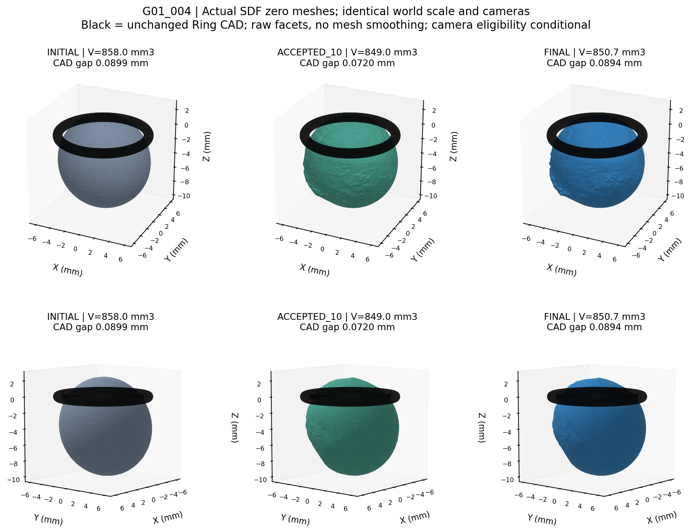
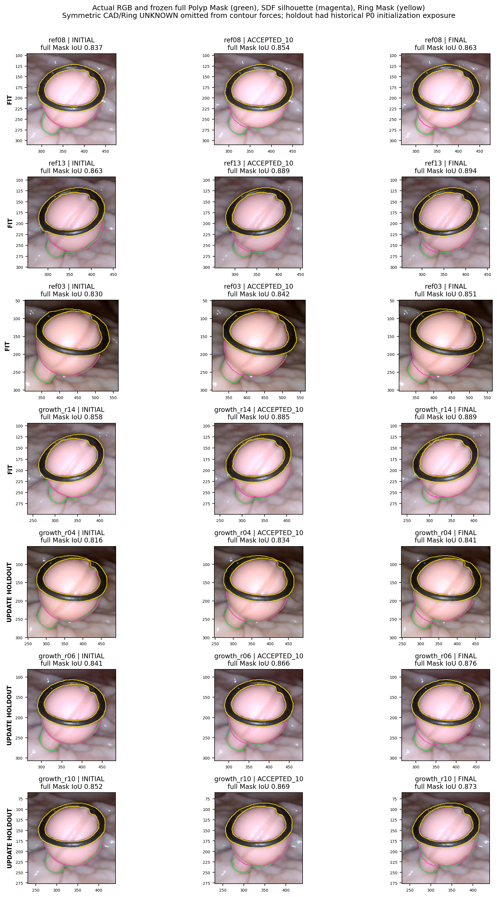
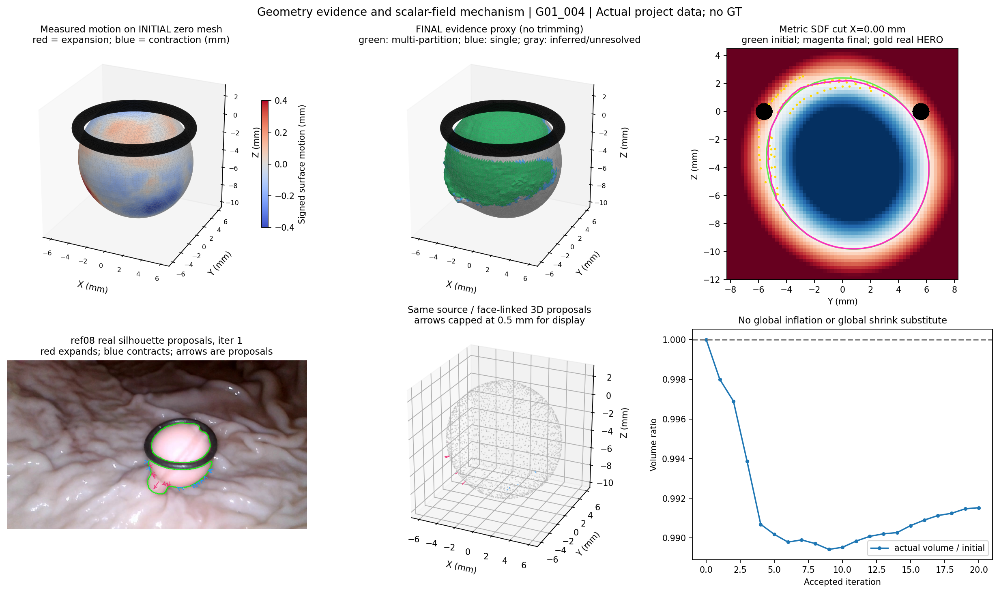
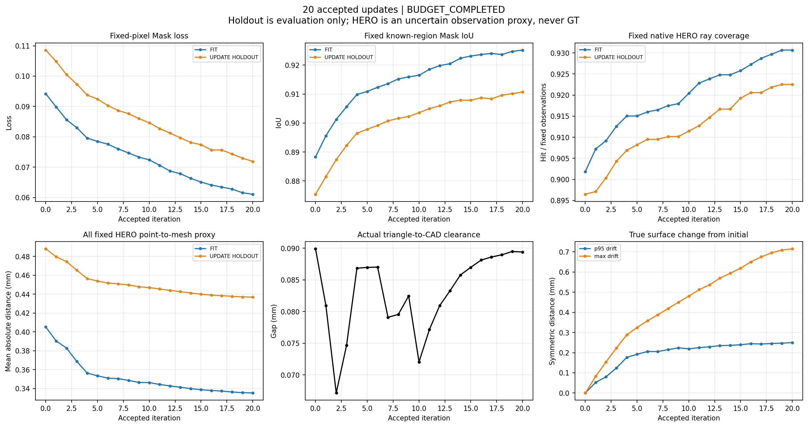

# E4-SDF-EVOLUTION-001 技术报告

本轮在 G01_004 上完成单病例、单共享公制水平集试跑。以保守椭球为起点，四个互补视角驱动更新，三个视角只做更新阶段验证。首轮发现法向导数和HERO物理距离合同缺陷，已完整封存；修正后保持全部数值参数不变，完成20轮、20次安全接受，正式演化核心运行102.0秒。七视角完整原始Mask平均IoU从0.8426提高至0.8695，固定HERO射线命中从3224增至3323/3584。Ring无检出穿透，固定保护点的真实Mesh距离满足0.3mm限制。但局部粗糙度增加、部分深度解释退化，约61.9%的表面积缺乏本协议观测支持，尚不能认证为稳定、光滑且真实的完整主体。结论为机制试跑通过、形状质量验收未完成；不自动提高分辨率、做消融或推广其他病例。

## 结论与任务范围

**MECHANISM_PASS_SHAPE_QUALITY_INCOMPLETE**。证明了统一标量场可根据真实多视角轮廓进行局部扩张和收缩，且多轮安全改善，不再依赖逐顶点/FFD更新。没有证明无尖锐局部或隐藏表面真实；不把本结果纳入已验收主线。研究者所要求的“稳定连续且符合真实观测主体”只有部分得到支持。

仅G01_004，一个共享场；无消融，无其他病例，无GT/Oracle，无新HERO、网络训练、Visual Hull、FFD、FlexiCubes。原始相机、CAD、HERO、Mask、Type-2、DXY和历史工作树保持不变。

## 输入、坐标和留出依赖

实际基线为 R1 `local_results/G01_004/P0.npz` 的保守E2椭球，不读FFD结果生成新预测。原P0全三角面Ring间隙0.082401mm；转为SDF再提取后的初始间隙0.089902mm。网格化表面误差MAE0.001105mm、p95 0.008618mm、最大0.020699mm，单独计入，不把初始网格化变化当学习收益。

| 来源 | 分区 | 本轮角色 | 保留的Camera Gate资格 |
|---|---|---|---|
| G01_004_ref08 | G01_video004_B3 | 更新 | INSUFFICIENT_EVIDENCE |
| G01_004_ref13 | G01_video004_B5 | 更新 | INSUFFICIENT_EVIDENCE |
| G01_004_ref03 | G01_video004_B2 | 更新 | INSUFFICIENT_EVIDENCE |
| G01_004_growth_r14 | G01_video004_B4 | 更新 | INSUFFICIENT_EVIDENCE |
| G01_004_growth_r04 | G01_video004_B3 | 仅更新阶段验证 | INSUFFICIENT_EVIDENCE |
| G01_004_growth_r06 | G01_video004_B3 | 仅更新阶段验证 | INSUFFICIENT_EVIDENCE |
| G01_004_growth_r10 | G01_video004_B5 | 仅更新阶段验证 | INSUFFICIENT_EVIDENCE |

七者仅条件性研究入组，不能称相机严格认证。原保守P0曾使用全部七视角，因此三个验证视角有历史初始化依赖；不是从初始化开始的独立泛化验证。HERO上游RGB亦部分共享，四拟合来源权重按上游集合Jaccard相关性归一，不把共享输入当独立统计证据。验证来源不进入更新残差、锚点、约束、权重、停止或选模。

所有三维数据为Ring锚定世界坐标mm；相机是冻结c2w，射线未单位化，交点参数为轴向Z(mm)，不得误当沿射线距离。归档RGB/Mask为640×360，原生深度640×352，沿用中心保持K映射。优化固定Mask为320×180，Mask语义和半像素映射沿用已冻结数据；正式全原始Mask另在640×360原坐标评价。Ring Mask和CAD足迹联合UNKNOWN，对预测和目标对称处理，不把Ring边界当负证据。完整原始Mask的未扣UNKNOWN IoU也单独保留。

输入与源码SHA见 [FROZEN_INPUTS](assets_index/FROZEN_INPUTS.json)、[IMPLEMENTATION_FREEZE](metrics/IMPLEMENTATION_FREEZE.json)，当前冻结输入审计全部一致。没有跨视频坐标混用。

## 实现、版本与数值合同

67³、h=0.25mm，共300,763节点，窄带约7.1万活动标量变量；不是7.1万个自由顶点。Open3D0.19对封闭起点计算内负外正SDF，三线性插值，scikit-image0.25.2 Lewiner marching cubes提取真实零面。所有Mesh保留原提取顶点/三角面，仅统一整体朝向；没有平滑、删面、补洞。GLB按米导出、PLY按毫米。

轮廓点记录来源/面ID/世界坐标/法向/像素对应，使用δP=−δφ n/|∇φ|与相机投影Jacobian构造稀疏线性关系。双向轮廓项按来源和方向归一，Huber稳健；跨UNKNOWN、距离过大或符号不相容的对应不施力。SciPy1.15.3的TRF+LSMR协调轮廓、HERO软位置、初始场先验、H1、弯曲与Eikonal。数据冲突仍可能未解决，不做强行平均或按视频挑参。

每轮场修正±0.075mm，真实双向顶点到三角面位移≤0.125mm，总场偏离初始≤0.75mm；CAD及HERO约束通过三线性凸组合的充分盒界限制方向，再检查真实候选Mesh。末轮亦必须满足保护点的真实距离，而非仅满足|φ|。接受依据固定像素/固定正负类质量的训练Mask目标和HERO/先验；命中率只做固定分母评价，不充当可微损失。实际误差改善决定1/0.5/0.25回溯尺度。

没有逐轮重新距离化，因此最终是**公制近似SDF/水平集**，不能宣称全域严格|∇φ|=1或C1连续。三线性场为C0，在网格面处法向不唯一；修正版固定采用所选单元的解析单侧导数。该近似及提取离散化仍是局部粗糙来源候选。

预检查11项全部通过：坐标/三线性/实际场梯度差分、真实相机Jacobian、P0网格化及Ring、控制扩张收缩、通用轮廓+非恒定场求解方向、初始约束、零力恒等。控制球仅用于数值测试，不进入真实预测。详见 [NUMERICAL_PREFLIGHT](metrics/NUMERICAL_PREFLIGHT.json)。

首版代码 `6b4db1a` 的场导数与物理保护缺陷及无效事后诊断均保留；修正版正式代码 `3a5e8bd`，冻结后无求解源码修改。详见 [IMPLEMENTATION_CORRECTION](IMPLEMENTATION_CORRECTION.md)。首轮不是另一个实验臂，且不能根据首轮外观改配置或择优输出；最终一律采用修正版最后安全场。

## 多轮运行与真实几何

- 修正版完成20轮预算，每轮均接受一次：20个接受、17个缩放候选拒绝，合计37个候选；无多数拒绝停机。CPU正式运行102.013秒，不含环境/数值测试、图和事后审计。
- 拒绝原因（可重叠）：{'TRUE_SURFACE_STEP': 9, 'PROTECTED_HERO_ACTUAL_MESH_DISTANCE': 14, 'MULTIPLE_COMPONENTS': 1}。末轮完整步长出现极小独立分量/位移或HERO越界，0.25尺度接受；未删除小分量来制造PASS。
- 稀疏求解器20次中12次满足最优性，8次达到预设12次TRF上限；后者只是有界近似解，未冒称精确全局收敛。候选仍须通过实际目标下降和物理检查。

| 指标 | 初始SDF零面 | 修正版最终零面 |
|---|---:|---:|
| 固定训练目标 | 0.143998 | 0.088853 |
| 七视角完整原始Mask平均IoU（未扣UNKNOWN） | 0.842598 | 0.869545 |
| 七视角双向有效轮廓均值（原图px，按来源平均） | 6.6440 | 4.8870 |
| 固定原生首层命中/3584 | 3224 | 3323 |
| 固定原生未命中/3584 | 360 | 261 |
| 体积mm³（非真实体积认证） | 857.9979 | 850.7281 |
| 实体Ring最小间隙mm | 0.089902 | 0.089400 |
| 邻面法向夹角p95/最大（度） | 4.861 / 8.857 | 13.969 / 111.512 |

初始10510个零面顶点上，以实际最终Mesh符号距离>0.005mm判断，有2695点位于扩张区域、6240点位于收缩区域，其余近乎不变。这是几何运动证据，不是正确性标签。真实双向P0表面漂移中位0.0196mm、p95 0.2501mm、最大0.7154mm。体积比0.991527，没有用全局膨胀/收缩替代局部拟合。

三个更新留出视角平均固定Mask损失为初始的0.662101，原生覆盖为初始的1.029049，通过运行前1.05和0.98门槛；但有历史P0依赖，不能据此声称独立测试通过。

## 逐参考真实图像和深度

下表IoU使用完整640×360原始Polyp Mask，未扣UNKNOWN；轮廓距离使用对称UNKNOWN后有效边界，单位原图px。首层深度是HERO代理而非GT，只有命中处可算误差，未命中保留固定分母。

| 来源 | 角色 | 全Mask IoU 初→终 | 轮廓均值px 初→终 | 命中/512 初→终 | 首层深度MAE mm 初→终 |
|---|---|---:|---:|---:|---:|
| ref08 | 拟合 | 0.8375→0.8633 | 6.091→4.773 | 461→476 | 0.8437→0.8058 |
| ref13 | 拟合 | 0.8632→0.8944 | 5.381→3.501 | 471→486 | 0.4229→0.3607 |
| ref03 | 拟合 | 0.8296→0.8506 | 7.961→6.418 | 443→461 | 0.1998→0.1725 |
| growth_r14 | 拟合 | 0.8584→0.8889 | 5.268→3.449 | 472→483 | 0.7334→0.7365 |
| growth_r04 | 更新留出 | 0.8159→0.8411 | 8.180→5.883 | 450→466 | 0.2342→0.2684 |
| growth_r06 | 更新留出 | 0.8413→0.8756 | 7.513→5.355 | 462→474 | 1.2170→1.1533 |
| growth_r10 | 更新留出 | 0.8523→0.8729 | 6.114→4.831 | 465→477 | 0.6019→0.6000 |

growth_r04的轮廓改善而首层及共同配对相对深度恶化，growth_r14的首层深度亦略增，不能只报整体平均。所有阶段共同命中对使用固定交集，详见 [COMMON_PAIR_COMPARISON.csv](metrics/COMMON_PAIR_COMPARISON.csv)；完整分母每视角256对、合计1792对，共同成功样本不能替代全体覆盖。

## HERO保护、Ring与形状失败

固定四来源2048点全池中895点满足初始|φ|≤0.25mm且可见性资格，构成先验一致的保护代理；不是经GT认证的真表面。实际点到Mesh均值0.106361→0.091141mm，最大0.251666→0.299918mm，全部≤0.3mm。p95 0.229483→0.247349mm，且174点恶化>0.05mm，故“保护”是有限容差，不是每点逐一改善。原生ID、XYZ及距离变化见 [HERO_PROTECTION_AUDIT](metrics/HERO_PROTECTION_AUDIT.csv)。

每个被尝试候选都经FCL全三角面/CAD检查与Open3D双向符号检查；初、中、终经独立Blender EXACT实体交集为0。初始5对共面包围盒候选经窄相投影求交未发现正面积交叠，原始警告仍在审计内。最终单连通、封闭、绕序一致，无检出自交。只认证已检查的接受端点；变化拓扑下没有连续三角面扫掠证明，不能冒称全路径严格CCD。

**光滑/无尖峰要求尚未充分满足。** 邻面角p95由4.86°升至13.97°，最大111.51°。图中可见局部凹凸/折棱；没有观察到宏观长锥或无界膨胀，但不能由体积、连通与梯度分位数合格推断“无尖峰”。格点附近C0法向、MC离散化、冲突HERO及有限正则共同构成解释候选，尚未独立分离原因，本轮不增加消融。

最终面积442.311mm²，其中观测邻近/可见性代理支持168.643mm²，多分区支持149.845mm²，推断或证据不足273.668mm²。代理定义为三角面至少2顶点通过原Mask、首次可见/CAD和0.75mm同源HERO邻近；其余不删，不把灰色背面解释为真实闭合息肉。该事后证据分类可用验证源，但完全不反馈预测。完整Mask中小侧突/细柄尚未完整解释。

## 四张核心图

真实零面、统一毫米坐标、黑色实体CAD；无显示平滑或几何后处理。

## 固定审计表

| 审计项目 | 本轮汇报 |
|---|---|
| 目标组数 | 1个独立病例：G01_004 |
| 本算法独立成功 | 数值输出1/1；科学形状准确性未认证，不能报1/1正确 |
| 本算法失败 | 数值输出失败0/1；完整光滑/真实主体要求仍未通过；GT测量值NaN/NOT_EVALUABLE |
| 历史测量值回退 | 0；保守P0为用户指定初始化，非历史测量值回退 |
| 失败组及具体原因 | G01_004局部粗糙、单视角深度权衡、未知背面；见FAILURE_LEDGER和真实图 |
| 最终统计样本 | 全部1/1病例、7视角、3584射线/1792对；未命中和未共同成功者均保留 |
| 是否使用GT选择算法 | 否；无GT读取，配置及源码在优化前冻结，SHA审计全部一致 |

GT直径的中位绝对相对误差、MAE、p95和最大误差均NOT_EVALUABLE；本轮无直径测量任务。HERO代理误差的中位绝对、MAE、p95、最大及共同样本配对值均在CSV内，不能称GT精度。

## 复现、交付与边界

最终真实Mesh：`/home/liu/ring_first_3d_e4_sdf_evolution/experiments/E4-SDF-EVOLUTION-001/local_results/FINAL/BODY_mm.ply`；完整场及顶点面：`local_results/FINAL/FIELD.npz`；中间：`local_results/ACCEPTED_10/`；逐轮接受全部保存。所有大数组本地保留，SHA/路径见 [LOCAL_RESULTS](assets_index/LOCAL_RESULTS.json)。首轮完整诊断备份见 [DIAGNOSTIC_ATTEMPT0](assets_index/DIAGNOSTIC_ATTEMPT0.json)，不是最终输出。

复现入口见 [REPRODUCE.md](REPRODUCE.md)，核心代码及配置、数字表和四图上传独立分支 `exp/E4-SDF-EVOLUTION-001`，大型数组和运行环境不上传。关键技术版本只新增候选回执，不修改正式主线。

## 对研究问题的回答

1. **共享SDF能正确扩张与收缩吗？** 能，控制合同与真实初始面上的双向几何运动均有证据，实际完整Mask也改善；不能保证每条对应都代表真实解剖修正。
2. **多轮能持续改善吗？** 修正后20轮均安全接受，固定训练目标及留出轮廓总体改善，原生覆盖上升；未宣称优化收敛。
3. **HERO与Ring得到保护吗？** 895个固定保护代理满足实际0.3mm容差，CAD端点无检出穿透；并非每个HERO点误差都下降。
4. **无锥体、尖峰和无依据膨胀吗？** 未见宏观长锥或体积膨胀，但局部粗糙/折棱增加，严格无尖峰条件尚不能通过。
5. **是否得到真实连续主体？** 得到一个封闭连续的数值零面，真实完整主体仍NOT_EVALUABLE；未知背面和小侧突尚未可靠解释。
完成本轮一个病例后停止。是否继续处理局部距离一致性/粗糙、提高分辨率或增加消融/病例，等待人工决定，不自动执行。

## 成熟实现的实际复用与参考

- [Open3D距离查询](https://www.open3d.org/docs/release/tutorial/geometry/distance_queries.html)：实际使用符号、距离、射线和几何查询，符号只在封闭网格上解释。
- [SciPy1.15.3 lsq_linear](https://docs.scipy.org/doc/scipy-1.15.3/reference/generated/scipy.optimize.lsq_linear.html)：实际使用稀疏有界TRF/LSMR。
- [PyTorch3D轮廓拟合教程](https://pytorch3d.org/tutorials/fit_textured_mesh)：仅参考共享主体多视角轮廓，不运行逐顶点SGD。
- [PoissonRecon/SSDRecon](https://github.com/mkazhdan/PoissonRecon)：仅借鉴距离场位置/导数和弯曲正则，不运行其独立重建。
- [Visibility Constrained Surface Evolution](https://vision.ucsd.edu/sites/default/files/publications/pdfs/Visibility%20Constrained%20Surface%20Evolution.pdf)、[Parametric Level Set Methods](https://arxiv.org/abs/1904.10379)：理论参考，并非其官方复现；不执行相机标定更新。
