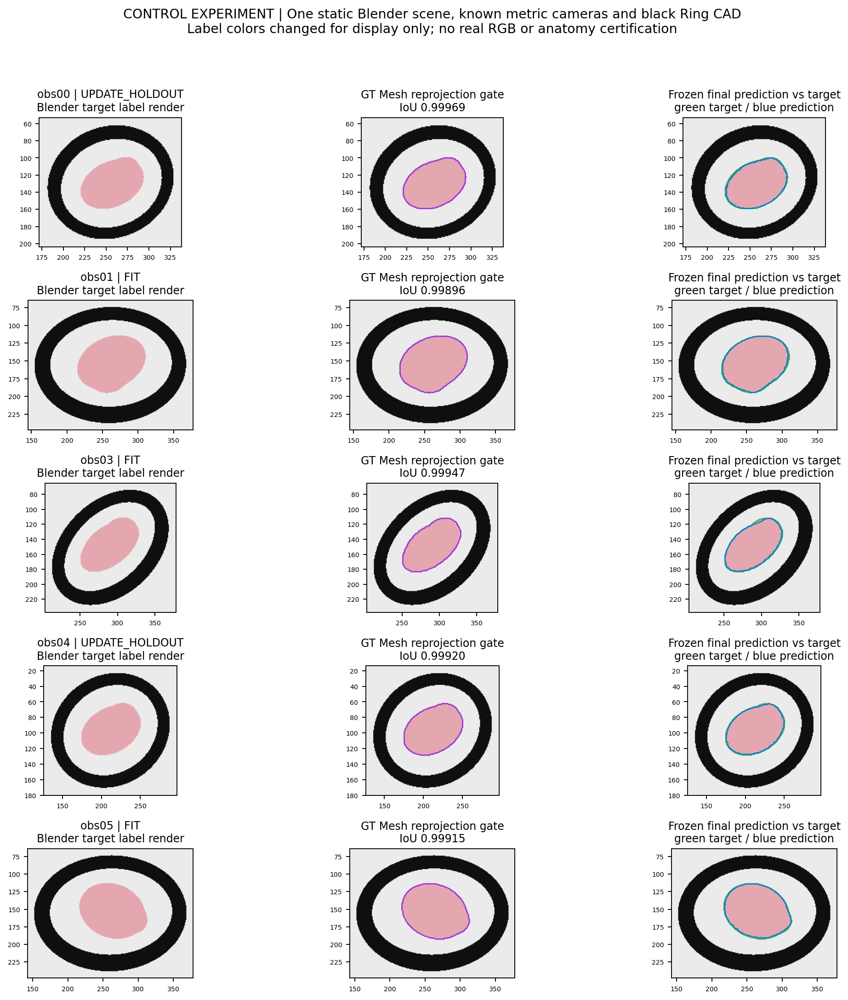
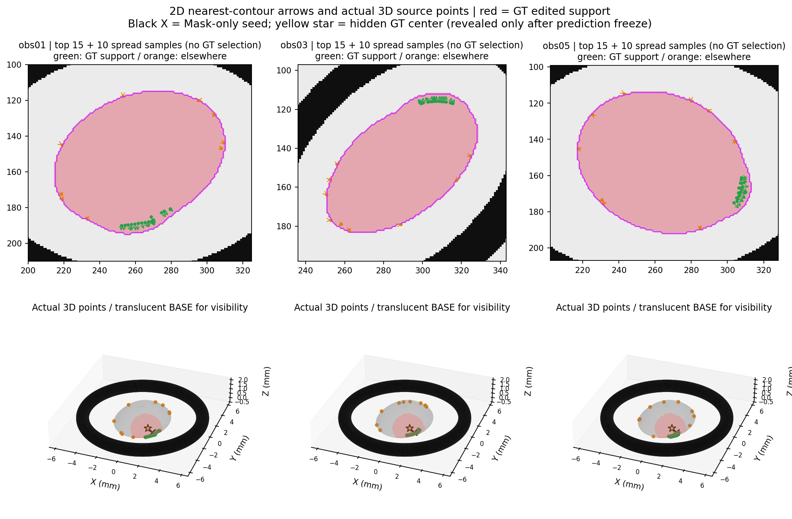
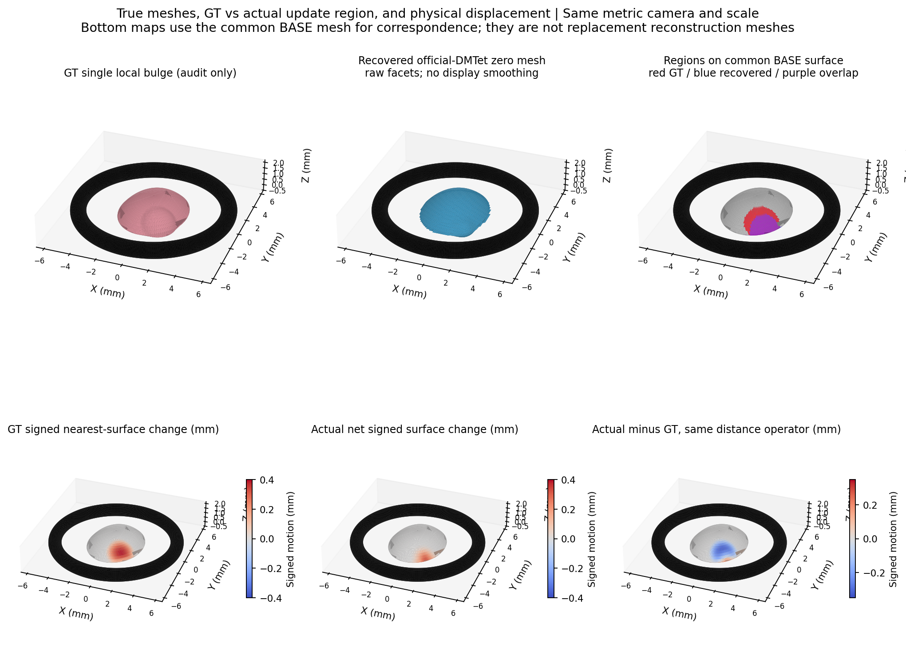
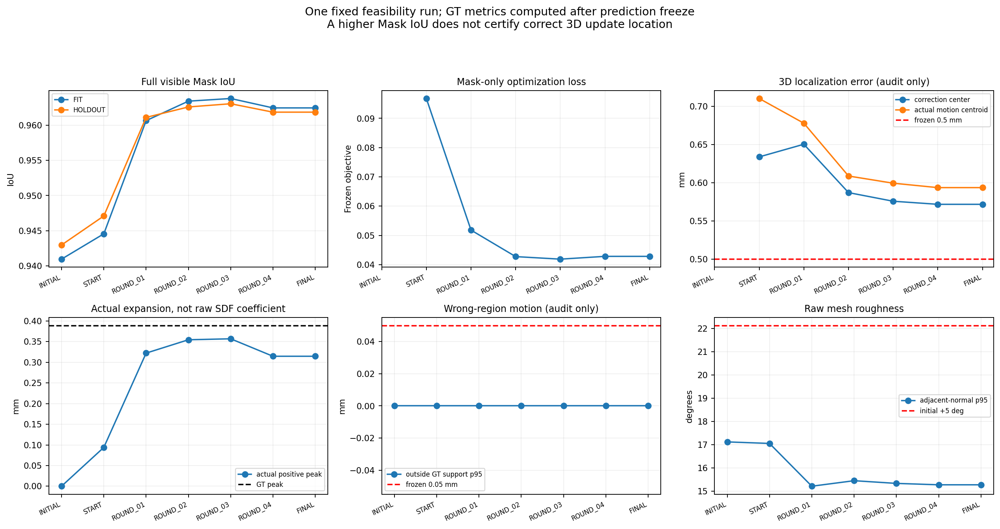

# E4-SDF局部更新定位审计与Blender可行性：首场景技术报告

本轮只读审计了现有data.py，并完成IIa6.5_R10一个静止Blender场景的单局部隆起恢复。历史obs02的Ring高度与其他观测不同，故固定主体与CAD重渲染五视角；逐视角投影门禁通过后，才用原样官方Kaolin DMTet提取、Open3D投影及SciPy四参数优化。三维GT不进入目标，预测冻结后才做三维审计。拟合Mask IoU由0.9410升至0.9625，但修正中心误差0.572mm超出冻结0.5mm门槛；实际更新质心偏差0.594mm，修改区域IoU仅0.621。因此只能证明大致区域和方向可恢复，不能认证可靠三维定位。当前局部雅可比满秩，不能把偏差直接归咎于视角不可辨识；固定核的表达偏差和轮廓目标均需保留。按首场景停止要求，Ip/Is只完成资产核对，未自动开展其他类型或对照。

## 核心判断

**PARTIAL_RECOVERY_LOCALIZATION_GATE_FAILED**。二维轮廓误差能在此控制场景中提供较有价值的候选区域，但现有最近邻箭头不是已认证的三维物理对应；较高Mask IoU不能证明中心、深度层或完整修改足迹正确。未达到全部预注册定位门槛，不降低阈值，不挑另一场景重试。

这不是“二维轮廓永远不能定位三维变化”的证据，也不是已完成三种息肉验证。只测试一个正向隆起；没有另做收缩/凹陷消融。已知初始几何是本控制实验的理想化输入，不是未知真实主体自主重建。

## 1. 当前data.py：实现、几何对应和不可辨识的分界

| 层级 | 实测或源码证据 | 能下的结论 |
|---|---|---|
| 当前面定位实现 | 原迭代1共591条记录，点到所记三角面边中点最大误差0.0e+00mm；存储法向速度与公式一致 | 没有发现“面ID指向另一处”的索引错误；ID只在当前提取轮次有效，不能跨重网格当持续身份 |
| 最近邻匹配 | 预测→观测与观测→预测均为二维欧氏NN；实测每个目标像素最多接收6–15个预测点 | 这首先是采样密度/非一对一性质，不自动等于错误；没有解剖语义、目标3D身份、循环一致性或目标首层深度认证 |
| 可见性 | 精确轮廓边射线可能数值漏射；旧abs(hit−Z)<0.2mm容许近层差，CAD截断另行执行 | 属实现容差风险，尚无真实G01 GT证明具体哪一条选错前层；本控制用前面内侧探针检查实际首层 |
| 像素坐标 | 旧320中心映射到原图2i+0.5，固定标签取2i+1 | 存在半原图像素离散惯例差；不能据此直接断言位姿错误。本控制明确边界/像素中心转换并做Blender验收 |
| 法向与更新 | δP=−δφ·n/|∇φ|，投影Jπn仅描述法向的一维图像运动；NN残差可能含切向误配 | 全二维残差不能被任意法向位移解释；目标视轮廓生成点会随形变改变，不能当作同一解剖点 |
| 场与提取 | 现版已修正真实三线性导数，但网格面处为单侧C0法向；MC面片与三线性零面并非处处相同 | 不能把梯度合同或表面光滑显示当位置正确。本轮少量光滑修正仍经真实提取Mesh检查 |
| 一般多视角不可辨识 | 未观测背面/不改变轮廓的内侧起伏、相关或接近视角可给相同Mask | 理论上存在零空间，但不能在每次失败时直接用作原因 |

当前真实G01没有获准的逐点GT，故其定位精度NOT_EVALUABLE。本轮不回写旧实验失败、不把原始面标签冒充跨轮几何身份。完整计数与源码SHA见 [LEGACY_IMPLEMENTATION_AUDIT](metrics/LEGACY_IMPLEMENTATION_AUDIT.json)。

## 2. Blender/CAD/相机身份

DXY theory的源资产已定位到旧realistic_simulation_mask_v2；四个公开IIa参考的RGB和原Oracle Mask字节SHA均逐一匹配公开表，三源CAD文件在本轮前后SHA一致（DXY_THEORY_IDENTITY_VERIFICATION）。三个源模型SHA与历史冻结一致：Ip4、Is14、IIa6.5。前二者只读核对文件/历史观测身份，没有执行恢复，也未据类别分支改变算法。IIa源主体1921顶点、3838三角面，无修改器、形状键或动画；全局矩阵应用后×1000转换mm，再沿用历史XY中心化/Z底部归零。

历史IIa6.5_R10_obs02的Ring中心Z=0.214500mm，obs01/03/05为0.332944mm，相差0.118444mm。它们原本是二维独立观测配置，旧任务并未要求多视角静止联合，不能将此差异称作历史错误。当前重新固定obs01主体与Ring，采用obs00/01/03/04/05已知相机渲染BASE/TARGET，每种状态全视角严格共用相同顶点与CAD阵列。

三拟合视角：obs01/03/05；两留出：obs00/04。原K的画幅边界坐标转换为像素中心时主点−0.5；Blender−Z前向/Y上与CV Z前向/Y下通过固定diag(1,−1,−1,1)转换。相机和CAD从未优化；1BU=1mm。与真实Ring-First相机资格无关，不将仿真已知相机冒充真实相机认证。

**先验收投影，再优化**：BASE/TARGET×五视角均通过主体及Ring IoU≥0.99、轮廓p95≤1px门槛；最差主体IoU=0.998961、Ring IoU=0.998264，点投影最大误差9.311e-05px。不是在投影错误上拟合几何。

## 3. 工具链与唯一恢复表达

优先核对了官方Kaolin、PyTorch3D SoftSilhouetteRenderer及相机转换、nvdiffrec DMTet。完整Kaolin/PyTorch3D均未安装；未为本可行性试验启动长期C++/CUDA部署。实际直接复用Kaolin官方torch-only marching_tetrahedra原文件，commit `ee8b7eca1e56b1b9fd1509fc406f8d8ccbc9240b`，Apache许可与原字节保留，并通过autograd/差分测试。**PyTorch3D门禁NOT_RUN，不宣称执行了SoftSilhouetteRenderer**；依据用户后备授权，以既有Open3D+SciPy完成同一物理投影验收和四参数试验。不是官方nvdiffrec输出。

预测为φ_base(x)+a·ψ(||x−c||/R)，只优化中心3维与幅值1维；ψ为有限支持C4 Wendland核，R=1.82mm，固定h=0.15mm四面体场。四面体顶点不变、不做自由逐顶点更新；无类别/头柄/球冠先验分支。少量光滑紧支撑是用户要求的通用表达假设，不能声称完全没有几何假设。

受控GT是源Mesh法向上的单个C∞隆起，峰值0.390mm、支撑1.56mm，中心根据预登记的BASE归一位置确定。GT与预测核不同，未将GT修正系数或位置传入模型。但该差异亦产生已知表达偏差，不能把恢复失败全归因于二维对应。GT存audit_only；优化进程禁止读取该目录、.blend和旧仿真目录。

初始中心仅来自三视角Mask轮廓差异在可见BASE表面的加权3D位置，幅值起点符号仅由二维面积差确定；未读GT中心、逐像素自由校正或模型GT损失。目标为稳健双向可见轮廓距离加固定分母Mask XOR；SciPy有界Powell，12轮/500评价上限。没有端到端渲染梯度或神经训练；GT仅在预测SHA冻结后独立读取。

## 4. 数值与三维位置审计

实际完成4轮Powell、265次函数评价，CPU耗时89.633s。求解器正常终止仅代表数值状态，不代表科学通过。第4轮Mask和目标较第3轮轻微回退，保留最后有界迭代；未按GT/留出指标挑第3轮或最佳图片。

| 指标 | 数值 | 判断 |
|---|---:|---|
| 拟合视角全可见Mask平均IoU | 0.940959→0.962467 | 改善，非三维定位证明 |
| 留出视角全可见Mask平均IoU | 0.942972→0.961862 | 未参与求解/选模 |
| 修正参数中心偏差 | 0.571852mm | FAIL：冻结门槛0.5mm |
| 实际位移加权更新质心偏差 | 0.593718mm | FAIL：超过0.5mm，与中心参数分开判断 |
| GT区域实际扩张方向一致率（面积加权） | 98.32% | 大体正确，非逐点全对 |
| GT峰值 / 实际几何峰值 | 0.388979 / 0.314651mm | 低估19.11%；不能用|a|=0.515037替代真实位移 |
| 修改区域面积IoU | 0.621496 | 覆盖不完整 |
| GT修改 / 实际修改面积 | 5.798583 / 3.648586mm² | 面积分母固定在共同BASE |
| GT支撑外错误位移p95 / 最大 | 0.000000 / 0.000745mm | 未见明显远处误扩张 |
| GT修改区位移误差MAE / p95 / 最大 | 0.145866 / 0.297596 / 0.314571mm | 仍显著欠恢复 |
| 邻面角p95 初始→最终 | 17.120°→15.276° | 未增粗，不能据此认证处处C1 |
| 最终全三角面Ring间隙 | 1.763486mm | FCL无交；Blender EXACT交集0 |

GT核中心为[1.2407548492774367, -2.091207425110042, 0.5580796860158443]mm，预测中心为[1.4955781998411137, -2.2679365373992098, 0.07761450647722251]mm，中心差向量为[0.254823350563677, -0.17672911228916766, -0.48046517953862183]mm，偏差主要在Z方向。实际更新质心与核中心不是同一概念，不能混用。Mask初始化中心距GT约0.634mm，最终约0.572mm，定位改善有限。

主表GT及预测均使用共同BASE点上的有符号最近面距离变化，不将预测距离变化与GT材料位移混算；构造GT的同ID法向位移另存。这不是任意形变下的材料点跟踪。初步混用口径及其0.473mm质心读数已封存，统一算子后的0.594mm才是最终主表值；预测/阈值不变，见METRIC_CONTRACT_NOTE。修改阈值固定0.01mm，GT真实区域由构造ID确定；错误区域按GT支撑外统计。1921顶点多数未改，整体中位0会掩盖失败，因此同时列218个GT有效修改顶点误差。

还执行独立同法线射线核验：GT与材料构造位移最大差约3.2e−7mm；最终共同有效1865/1921，未命中56条，GT修改区共同有效214/218。该口径GT峰0.390000mm、预测峰0.414265mm，修改区MAE0.152627mm。与主表最近面距离峰值读数不同，二者均保留，不择优。未命中为NaN，没有用GT或最近距离补齐；详见NORMAL_RAY_AUDIT.json。

BASE、GT、初始DMTet与最终DMTet无检出的严格三角形穿交；大量共面包围盒候选经窄相投影求交均未检出正面积重叠。保留数值精度边界，非数学精确自交证明。初/终/GT经全三角面FCL与独立Blender检查，Ring均无交。网格闭合、单连通；原始源Mesh和离散提取的最大邻面角仍较大，不用平滑法线或删面伪造连续性改善。

## 5. 科学原因：已证据化与尚不能断言的部分

1. **粗定位有信息，精定位未认证。** Mask-only候选权重中约87.40%来自GT支撑内，说明残差能富集到大致区域；其余并非自动“错误对应”，可能来自离散化和未改边界。对应箭头不能直接当三维GT位移。
2. **不能直接归咎于本例局部不可辨识。** 最终仅Mask轮廓残差Jacobian为691×4，数值秩4，奇异值[76.1148, 59.1516, 52.3747, 33.8772]px/mm，条件数2.247。该单点检查不是全局唯一性证明，但不支持“局部秩亏导致本次偏移”的简单解释。没有未经授权追加多初值/视角消融。
3. **定位语义与表达偏差。** 原主体的视轮廓生成点通常在侧缘，形变中心却可在面内或更高处；把轮廓点加权均值当成修正核中心本身有偏置。本例Mask seed的Z=0.0824mm、GT中心Z=0.5581mm，优化后Z=0.0776mm；这不是面索引错。另有固定Wendland核与法向C∞ GT核宽度/表面作用差异，中心/幅值可能补偿表达偏差。区域IoU约0.621、GT区几何MAE约0.146mm证实欠恢复，但未做GT最优拟合或新增对照，不能认定某一因素是唯一原因。
4. **目标与优化局限。** 二维NN距离、像素化XOR、视轮廓离散采样会产生局部偏差与非单调；4轮正常退出并不排除局部极小/平台。未为了外观继续搜参。
5. **一般多视角不唯一仍需承认。** 无轮廓变化的背面修改、不同深度层的投影补偿、模型族外几何都可能不可辨识。本例的已知相机与已知BASE属于有利条件，不能推出真实视频的同等性能。

## 6. 四张核心图

以下均为控制实验：真实读取的源CAD和实际Blender渲染标签，不是临床RGB；标签转显示颜色不改变几何。黑色Ring为原CAD实体。

## 7. 固定审计表

| 审计项目 | 汇报 |
|---|---|
| 目标组数 | 总要求3形态；按首场景停机阶段，本次实际执行1场景IIa6.5_R10 |
| 本算法独立成功 | 数值输出1/1首场景；三形态总体完成1/3，不能称3/3验证 |
| 本算法失败 | 数值硬失败0/1；科学定位门槛未通过1/1；Ip/Is为HUMAN_HOLD，非输入失败或已通过 |
| 历史测量值回退 | 0；只复用核验过的初始CAD与底层相机资产 |
| 失败组及具体原因 | IIa：中心偏差0.572mm、区域欠恢复；证据见失败记录及Fig3/4 |
| 最终统计样本 | 1场景、5相机（3拟合/2留出）、1921共同BASE顶点、218个GT有效修改顶点；全部分母保留 |
| 是否使用GT选择算法 | 否；GT用于构造目标和冻结后独立评价，不进入优化目标/初始化/选模；源码e9661ed及SHA回执 |

直径测量中位ARE/MAE/p95/最大NOT_EVALUABLE，本轮不是直径任务。局部位移误差的中位绝对、MAE、p95、最大及同一1921顶点上的配对变化均在ROUND_GEOMETRY.csv；GT未改区域中位0不可冒充整个修改区恢复准确。真实G01的GT定位精度仍NOT_EVALUABLE。

## 8. 交付与停止

最终Mesh：`/home/liu/ring_first_3d_e4_sdf_localization/experiments/E4-SDF-LOCALIZATION-BLENDER-001/local_results/FINAL/BODY_mm.ply`；4参数与实际顶点面：`local_results/FINAL/MODEL.npz`；逐轮与初始均保留；GT及逐点审计在audit_only。大型文件、原始.blend未上传，见assets_index/LOCAL_RESULTS.json。

代码、冻结协议、投影门禁、原始指标和四核心PNG提交独立分支；[复现](REPRODUCE.md)、[失败记录](FAILURE_LEDGER.md)、[验收JSON](metrics/ACCEPTANCE.json)。

**现在停止，等待人工确认首场景诊断。** 不自动进行Ip/Is、凹陷、核宽度搜索、同核GT对照、PyTorch3D部署或其他方法消融。后续若继续，需先区分表达能力与定位目标，而不能只追求更高Mask IoU。

## 官方参考与实际复用

- [Kaolin tetrahedra官方源文件](https://github.com/NVIDIAGameWorks/kaolin/blob/ee8b7eca1e56b1b9fd1509fc406f8d8ccbc9240b/kaolin/ops/conversions/tetmesh.py)：实际原样复用，非完整Kaolin安装。
- [PyTorch3D轮廓教程](https://pytorch3d.org/tutorials/fit_textured_mesh)、[相机转换](https://pytorch3d.readthedocs.io/en/latest/modules/utils.html)：接口调研，未运行，不使用其逐顶点SGD。
- [nvdiffrec DMTet](https://github.com/NVlabs/nvdiffrec/blob/main/geometry/dmtet.py)：只研究数学机制，不复制其专有声明代码，不称官方模型输出。
- [参数化水平集](https://arxiv.org/abs/1904.10379)：局部少参数场的理论参考，不采用其相机校准更新。
- [Open3D距离与射线](https://www.open3d.org/docs/release/tutorial/geometry/distance_queries.html)：实际复用；闭合有符号距离的条件在控制输入上核查。
