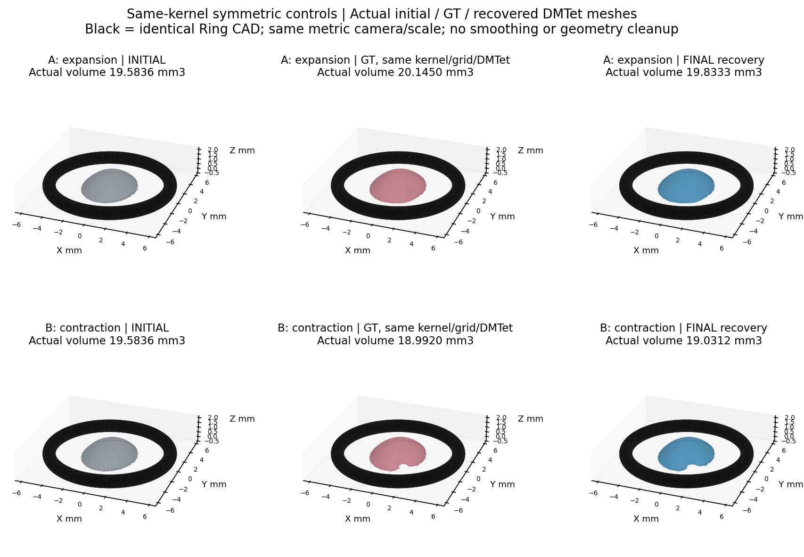
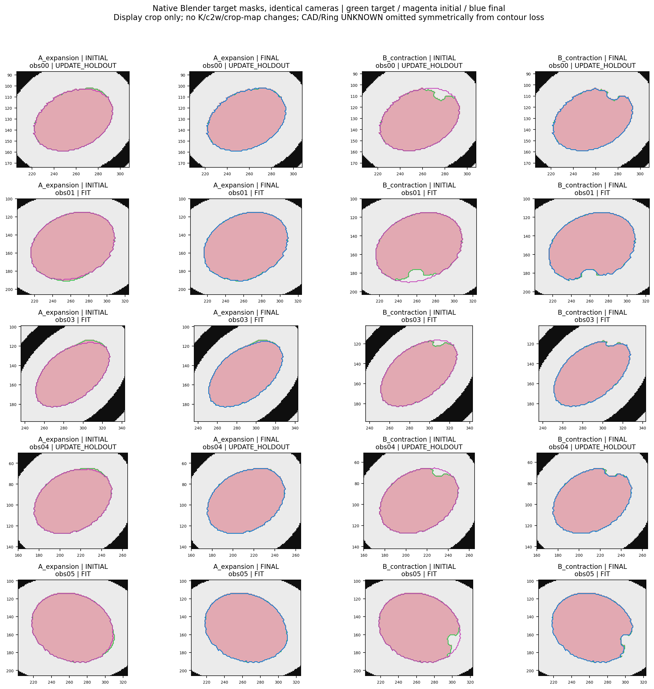
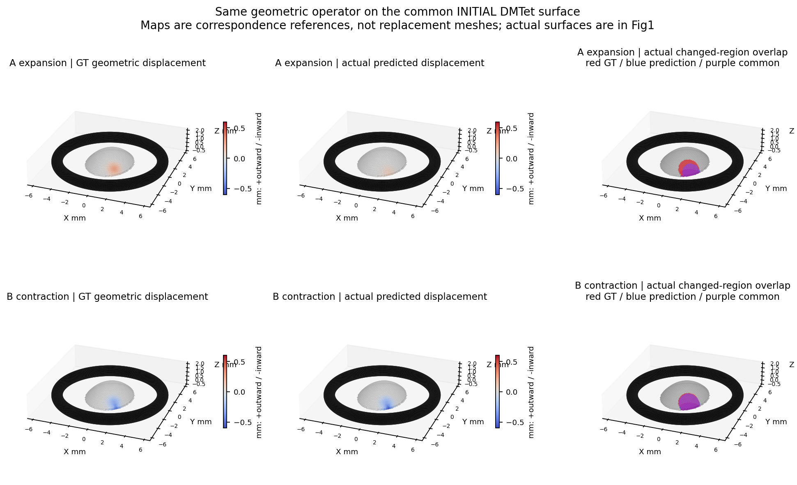
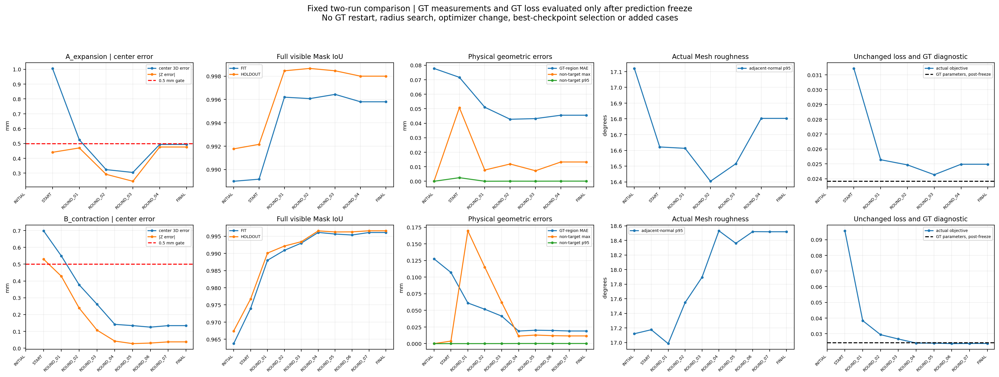

# 同核双向局部几何恢复：技术报告

**结论：收缩组通过本控制的冻结数值门槛，扩张组仍严重欠恢复，未实现两组同时准确恢复。** 两组采用相同初始SDF、Wendland C4、半径、DMTet及原优化器，只改变预登记幅值符号。三维GT不进入优化，预测冻结后才代入原目标做诊断。A的拟合Mask IoU已达0.9958，但真实峰值扩张仅为GT的41.9%，Z偏差仍为-0.476mm。B定位和删除区域较好，实际删除0.5524mm³，不能将两组的差异解释为单纯的核/离散表达不匹配。未更改损失、参数、预算或阈值，完成两次即停。

## 冻结与公平性

- 当前父目录内新增 `runs/SAME_KERNEL_BIDIRECTIONAL_001`，原149份源码、协议、审计、输入和结果的SHA全部保持。原FINAL未覆盖。
- 两组共享原BASE_FIELD字节、h=0.15mm的64,239节点/137,184四面体、R=1.8200001027435067mm。GT中心复用原先预登记位置，**不使用上一轮拟合中心**；幅值A=−0.39、B=+0.39mm，内负外正。位置/参数仅供生成和冻结后审计。
- 初始、GT及预测均经同一原样Kaolin DMTet提取；不再把原CAD顶点Mesh当本轮GT，也不作GT法向顶点形变。BASE_FIELD中原V/F仅为历史元信息；原seed中使用其均值时a=0，因此不改变实际初始零面。
- `model.py / renderer.py / fit.py / projection_gate.py`与父实验逐字节一致；common只改独立运行目录。相同四参数、初始化、目标、Powell与12轮/500评价预算，未按GT重启或选择更好检查点。3拟合obs01/03/05、2留出obs00/04及固定Ring CAD均保持。
- **A/B分别重跑** BASE/TARGET×5相机的主体、Ring与点投影门禁，全部通过；最差主体IoU=0.997413、Ring IoU=0.998264，未跳过或降低0.99门槛。原Blender/CV/像素中心转换保持。

## 两组结果

| 指标 | A：扩张 | B：收缩 |
|---|---:|---:|
| 正式迭代 / 函数评价 / CPU秒 | 4 / 237 / 78.1 | 7 / 434 / 140.8 |
| 拟合全可见Mask IoU 初→终 | 0.988993→0.995801 | 0.963726→0.996088 |
| 留出全可见Mask IoU 初→终 | 0.991769→0.997997 | 0.967422→0.996587 |
| 核中心三维误差 / Z有符号误差 mm | 0.493503 / -0.476294 | 0.133960 / 0.037237 |
| 实际更新质心误差 mm | 0.275752 | 0.060087 |
| 表面实际更新区域IoU | 0.715284 | 0.915914 |
| GT区域方向一致率（面积加权） | 99.886% | 100.000% |
| GT / 预测物理峰值绝对值 mm | 0.297222 / 0.124478 | 0.485235 / 0.566499 |
| 物理峰值相对误差 | 58.12%，FAIL | 16.75% |
| GT区域位移MAE / p95 / 最大 mm | 0.045538 / 0.179302 / 0.236461 | 0.018985 / 0.071327 / 0.099160 |
| 非目标区位移p95 / 最大 mm | 0.000103 / 0.013296 | 0.000191 / 0.011582 |
| 邻面角p95 初→终（度） | 17.120→16.803 | 17.120→18.518 |

函数评价数为SciPy返回的nfev。原函数缓存仅记录未缓存参数：A为235条、B为434条；OBJECTIVE_TRACE保留这些实际几何评价，不将重复缓存调用伪作新的几何采样。

主表对GT和预测使用**同一**初始DMTet面上全部11,374顶点的有符号最近曲面距离变化，正向外、负向内；GT实际区固定为|d_GT|>0.01mm，各为A 1137、B 1176点。没有混用材料顶点位移。SDF系数不等于真实表面位移：相同|a_GT|=0.39mm，GT向外峰值约0.297mm，向内约0.485mm，本就不具相同物理/图像信号幅度。

独立同法线射线核验亦使用GT/预测相同算子，未命中NaN；A最终共同有效11,374/11,374，B为11,023/11,374，未命中351（GT区域832/1176有效）。收缩后原法线可失去同层交点，不能将该子集读数当全部材料点位移，更不能补入GT。完整分母与所有轮次的粗糙度、Ring间隙、连通性见各组 `ROUND_GEOMETRY.csv`。

## 收缩是否真正删除体积？

**是，但“删除发生”与“删除位置准确”分开评价。** B预测节点φ相对初始处处不减，负区为初始负区子集；封闭真实Mesh体积由19.583559降至19.031185mm³，删除0.552374mm³；GT应删除0.591593mm³，预测未新增体积。固定同四面体积分的删除区IoU约0.904070，错误删除代理体积0.009000mm³。积分为固定548,736点的离散代理，Mesh体积差另报，不能冒称精确交集体积。

A实际新增0.249708mm³，GT新增0.561476mm³；新增区体积IoU代理仅0.408991。高Mask IoU和表面区域重叠掩盖了明显欠扩张。所有保存轮次均闭合、单连通且无FCL检出Ring交叠；初始、GT和最终的独立Blender EXACT交集均0。未平滑、删面或补洞。

## 冻结后的GT目标值诊断

| 原样目标 | A扩张 | B收缩 |
|---|---:|---:|
| GT参数损失 | 0.023825186 | 0.024345603 |
| 最终参数损失 | 0.024973113 | 0.023790979 |
| 最终−GT | +0.001147927 | -0.000554624 |
| GT是否“明显更优” | 否 | 否 |

按运行前门槛max(0.002, 0.1×|L_GT|)，A的GT损失虽略低，差额未达“明显”；B最终错误几何的目标值反而比GT低。GT的前向Mask重投影仍通过0.99门禁，所以这不是同核GT不能被渲染，而是**原轮廓采样/目标与准确几何不严格一致**。B的Mask XOR项比GT差，轮廓项改善却抵消了它；分项原数值保留，未改权重。

GT几何边缘相对“最内一圈前景像素中心轮廓”的向外偏移均值约0.21–0.37px，是目标存在内缩偏好的机制线索；不是重估相机的理由，也未通过新对照证明唯一因果。相同|a|的拟合目标相对初始净面积变化为A +134像素、B −542像素，收缩信号更强，不能把系数对称当信息量对称。

A初始化中心误差1.005mm，初始Z偏-0.441mm；实际搜索最接近GT中心为0.153mm，但无0.1mm内样本。B分别为0.699、-0.530mm，曾有3个中心样本在0.1mm内。中心邻近不等于四参数同时正确；初始化、耦合搜索和局部极小仍可能参与，当前诊断不能排除。没有用GT重启、延长预算或按更好中间轮选模。

## 图与复现

[汇总CSV](PAIRED_SUMMARY.csv) · [完整指标JSON](PAIRED_SUMMARY.json) · [协议](PROTOCOL.md) · [复现](REPRODUCE.md) · [失败记录](FAILURE_LEDGER.md)。输入、场、GT和真实Mesh留本地，路径/SHA见assets_index/LOCAL_DATA_INDEX.json。正式代码冻结提交fceeef8；官方Kaolin原样复用，未部署PyTorch3D或运行GPU训练。

## 固定审计表

| 审计项目 | 汇报 |
|---|---|
| 目标组数 | 2个控制、1个独立物理主体，不冒充2个息肉 |
| 本算法独立成功 | 数值输出2/2；冻结控制门槛B通过1/2；两组同时准确恢复未达成 |
| 本算法失败 | 数值硬失败0/2；A物理幅度失败1/2；临床直径指标NaN/NOT_EVALUABLE |
| 历史测量值回退 | 0；只用获准初始SDF和核验过的底层资产 |
| 失败及具体原因 | A欠扩张/Z偏置，原目标对GT几何不严格最优；见Fig3/4和GT_OBJECTIVE_DIAGNOSTIC |
| 最终统计样本 | 两控制均保留；各5视角、11,374共同表面点，GT区域及射线失效另列，不只报告B |
| 是否使用GT选算法 | 否；GT参数仅生成/授权投影门禁/预测冻结后诊断；原算法字节相同，无半径/优化器消融 |

位移误差中位绝对、MAE、p95、最大与共同样本均见逐轮CSV；直径ARE/MAE/p95/最大NOT_EVALUABLE，本轮不是测量任务。控制结果不认证真实病例、全局唯一性或所有形态。最终[交付完整性检查](assets_index/DELIVERY_VALIDATION.json)核对历史149文件、本轮冻结输入及全部预测SHA，不再次拟合；检查通过不改变扩张失败的科学结果。

**本轮停止。** 同核后收缩较好但扩张仍失败，不能支持“上轮位置偏差主要由表达不匹配造成”的充分结论。前轮GT物理改动不同，也不能用前后误差差直接量化原因；本轮没有继续改目标、重启搜索、开展Ip/Is或其他对照。
