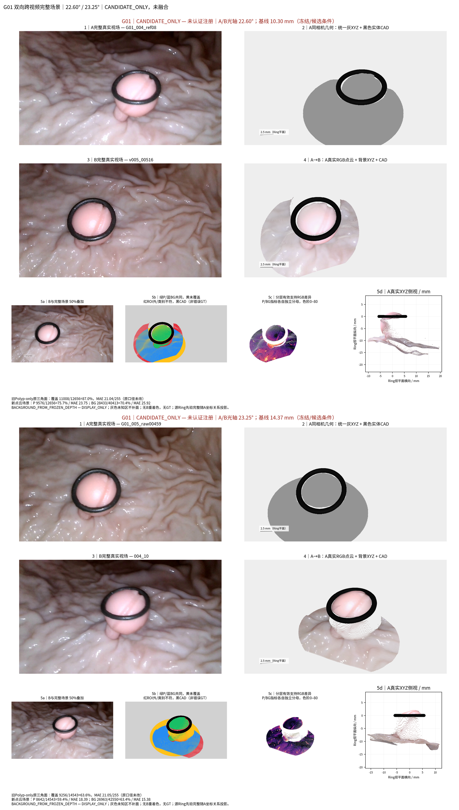
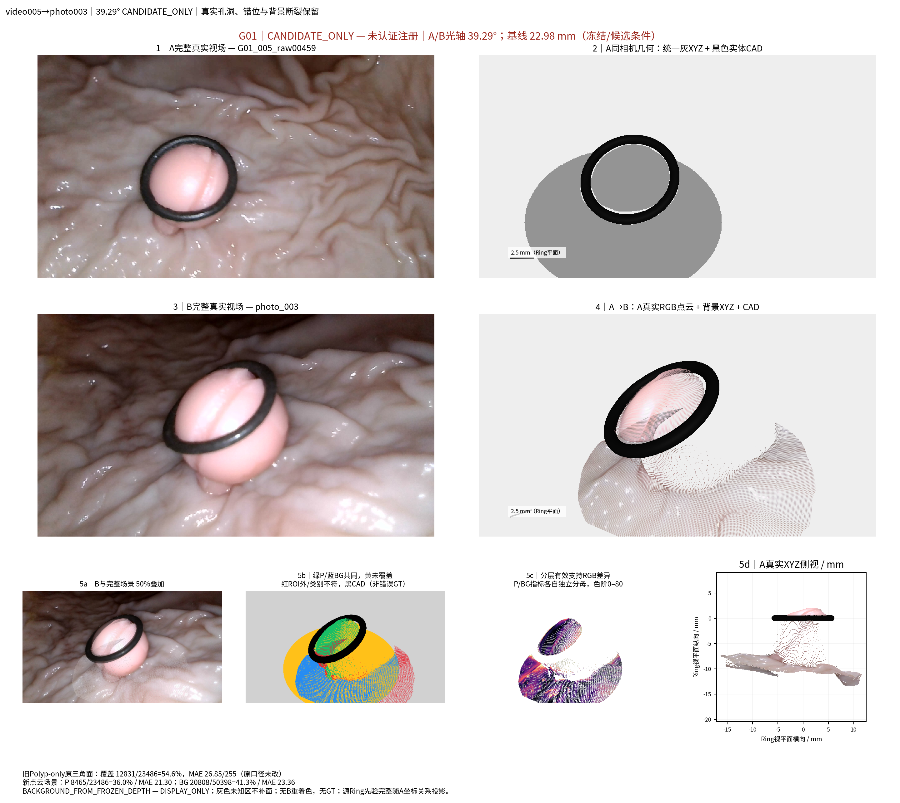
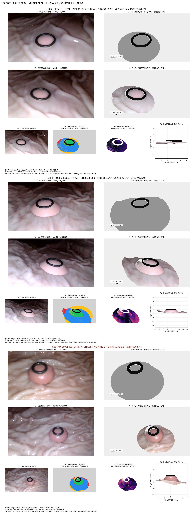
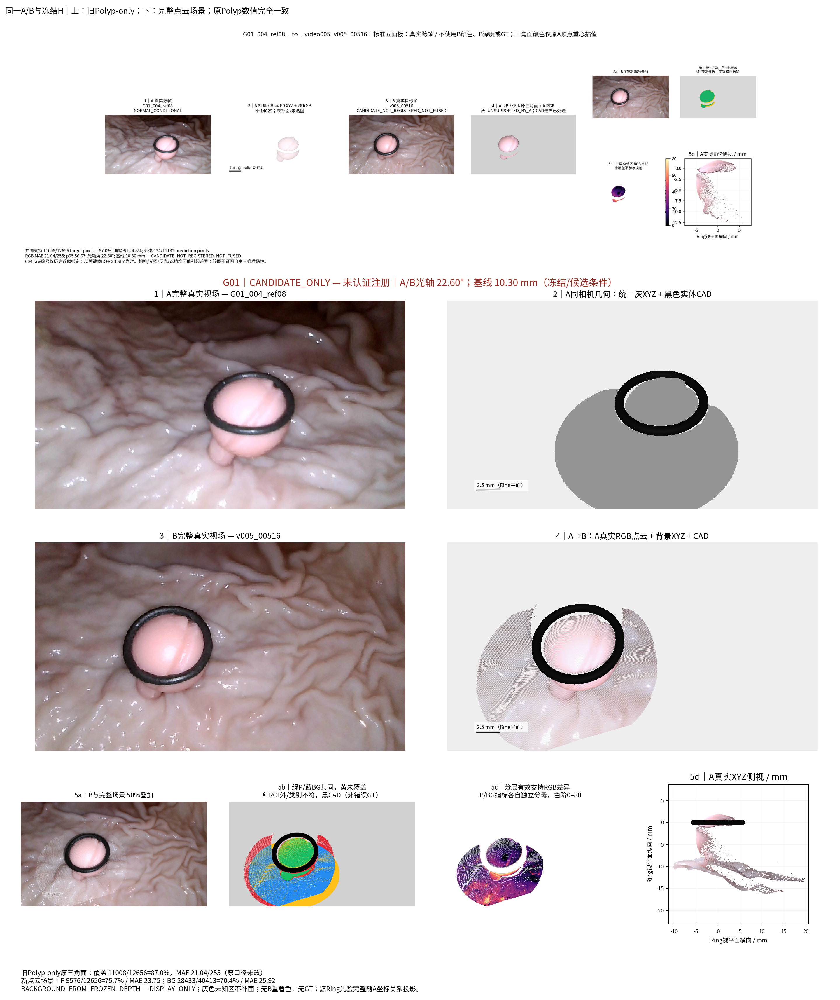

# TASK-AB-FULL-SCENE-VIS-002

用户任务标题：TASK-VIEW-OBSERVABILITY-AB-SCENE-VIS-002。状态 **REPORTED / VISUALIZATION RESTORED — 科学一致性未认证**。2026-10-28（Asia/Shanghai）。

## 中文摘要

本轮复用已有真实场景渲染器和冻结背景XYZ，恢复了四个物理组、11组A→B的息肉、实体参考环与局部背景展示。第2面板统一灰色离散点，第4面板仅采用源A的RGB，黑色CAD按实际几何和预测深度遮挡；原Polyp-only三角面指标完整保留，新增点云/背景指标使用独立分母。大角度样例包括同视频24.03°、14.52°以及跨视频22.60°/23.25°和照片候选39.29°。场景展示工程恢复成功，但大角度预测仍有孔洞、错位和背景断裂，G07继续是不合格相机压力测试。全部P0、背景点坐标、相机、HERO、融合与测量代码保持不变，未读取GT，未宣称重建精度改善。

## 入口与来源

本地根目录：`/home/liu/ring_first_3d_ab_scene/experiments/TASK-AB-FULL-SCENE-VIS-002`。 [HTML图库](/home/liu/ring_first_3d_ab_scene/experiments/TASK-AB-FULL-SCENE-VIS-002/visualizations/index.html) · [全部案例图](/home/liu/ring_first_3d_ab_scene/experiments/TASK-AB-FULL-SCENE-VIS-002/figures/cases/) · [完整索引](RESULT_INDEX.md)。分支`exp/TASK-AB-FULL-SCENE-VIS-002`，起始HEAD `432747735aad5df46df32a93f78b3c819c7797ed`，真实独立worktree `/home/liu/ring_first_3d_ab_scene`；旧任务及其未公开数据仍在原路径，只读。首阶段源码/选帧冻结提交`0d4285c`。

已读取AGENTS、COLLAB_STANDARD、README、BASELINE状态和FINAL_AUDIT历史副本。正式baseline仍未认证；用户本轮明确授权仅展示封装，不将治理状态改为科学验收。

历史完整场景位于 `/home/liu/ring_first_3d_scene_vis/experiments/TASK-PHASEC-VIDEO-SCENE-VIS-001/local_scenes/G01_004_same_camera_ref03/`，包含Local_3D_Scene.png、Real_vs_3D.png、Background_FULL_DISPLAY_ONLY.npz和Point_layers_and_source_ids.npz，均已实际找到。历史背景与当前ref03冻结缓存的XYZ及RGB **逐值相同**。上一轮退化源于仅传P0/开放面、遗漏背景输入、CAD只做遮挡；历史模块仍完整，不是重新设计渲染风格。

## 封装与物理坐标

`real_p0_renderer.py`提供原点绘制、冻结K/c2w和像素中心缩放；`SameCameraScene.draw()`对Polyp/Background使用同一个点artist、源RGB、远近排序及CAD逐射线遮挡；`ring_image()`使用原OBJ三角面命中、法向黑色着色与alpha1。`pointcloud_audit_renderer`提供侧视真实XYZ方法。版本和SHA见[RENDERER_VERSIONS](provenance/RENDERER_VERSIONS.json)。这些正式可视化模块原样未改。

所有点保存A原始毫米坐标与源UV。背景直接读旧NPZ display_mask：源基底代理附近较大椭圆（scale2，短长轴比.75）、12px接触带及旧源空间远端限制；无新世界Z截断、无B指导裁切、无坐标移动。完整原背景缓存保持不变，派生选择可反查缓存原索引。标签 **BACKGROUND_FROM_FROZEN_DEPTH — DISPLAY_ONLY** 不表示背景独立可靠。

跨视频/照片显示采用`c2w_B_in_A = inv(H_A_to_B) @ c2w_B`。源A Polyp、Background、Ring都保留原坐标；不把CAD独立吸附到B，也不改变半径、法向或尺度。相同投影等价于整场景应用既有H；候选H没有优化。其CAD遮挡与原Polyp-only内核的目标局部CAD口径有差异，因此新旧指标严格分列。

Panel2没有源RGB着色；统一灰`.58`，点大小`.08`和关闭抗锯齿沿用已有稀疏审计设置，每个原点独立绘制。源相机视角的密集采样仍可能呈连续灰色轮廓，应结合实际XYZ侧视、放大图和源UV核查点间距，不能据此认为存在平滑面。Panel4保持历史scene004 RGB点大小`.8`与不透明绘制。首张灰点`.8`样图因点过密不利检查，原样保留在本地first_display_sample，仅调整显示配置；XYZ/ROI/相机/评价规则完全没变。1280×720只进行像素中心保持的K缩放，不重估相机。所有无支持区域明确留空，无平滑、补面、额外点或纹理平面。

## 配对、大角度与限制

11配对在本轮场景误差前按冻结相机、可读RGB/Mask、Ring/Polyp可见和既有质量固定。[完整选帧清单](metrics/pair_selection.csv)及[冻结参数](provenance/PAIRS_FROZEN.json)保留所有矩阵与理由。没有按本轮误差或渲染美观择优。

| 组/视频 | 轨迹最大° | 本轮已有P0可用最大° | 相机条件 |
| --- | --- | --- | --- |
| G01/004 | 27.56 | 24.03 | NORMAL_CONDITIONAL |
| G01/005 | 14.81 | 14.52 | NORMAL_CONDITIONAL |
| G06/004 | 33.44 | 16.94 | NORMAL_CONDITIONAL |
| G08/005 | 23.52 | 12.79 | LIMITED_STRESS |
| G07/004 | 3.33 | 2.87 | UNQUALIFIED_STRESS |

轨迹最大角度两端不必有独立P0，故不重建新源面来凑角度。G06除14.29°已筛查目标外，保留16.94°未筛查目标。G08 12.79°目标仅MODEL_PREDICTED，标记FROZEN_LOCAL_TARGET_UNSCREENED，不能称可靠大角度。G07 2.87°是其当前源P0最大可用，整个相机不合格，仅UNQUALIFIED_CAMERA_STRESS；较好RGB分数不改变身份。保留0.65°小角度对照。

跨视频22.60°、23.25°和照片39.29°均明确CANDIDATE_ONLY；没有获得可靠跨视频注册或照片光学模式标定。这些基线/角度仅为候选条件量，照片目标曾参与历史候选位姿拟合，本轮图像不是新的独立相机认证。004原视频raw帧号历史存在近似绑定，引用固定缓存key+RGB SHA，不猜测新raw编号。

## 五面板与数值隔离

布局改为上两行2×2完整视场，第5面板四项横向展开：50%叠加、支持/未覆盖/外逸、分层有效差异、实际XYZ侧视。另11张3200×1070的Real_B_vs_Full_AtoB_Scene.png及11张三方向/相机关系侧视图供放大；主图2880×2484。灰点面板和RGB面板都包含全部保留P0、源背景及实体CAD；未知区域和错误深度不隐藏。

**原Polyp-only指标**：对四个已有配对复用旧NPZ，逐字段核验与上一轮相等；其他7配对从旧reprojection.py精确AST调用相同三角面投影/评价内核，源A顶点RGB、原面、全B Polyp Mask分母及.05mm目标局部CAD容差保持不变。BG没有进入这个预测或分母。[原口径表](metrics/legacy_polyp_metrics.csv)。

**新场景点云诊断**：640×360整数像素中心最近点z-buffer、源CAD .002mm遮挡，颜色为命中原点的A源RGB，Polyp与BG分别统计。BG目标ROI规则预先固定：B Polyp Mask图像下方20%像素中位UV，半长轴2×max(Polyp半宽,Ring半宽)，短轴.75倍，仅B label0且在椭圆为背景分母。B RGB/Mask只在A预测写盘后读取作评价，不生成颜色、不决定A点保留。BG ROI只是局部图像支持，不是独立三维组织对应GT。

新P/BG的分母、未覆盖、ROI外预测、BG投到B Polyp及P投到B BG均分开保存；不删除外逸点来压误差。图中红色表示评价ROI外或类别不符，不是真实错误标签。点中心数值支持与`.8`显示标记占像素范围不同，不能把显示面积当点覆盖。新旧MAE不得直接作“性能提升”比较：采样、可见性和支持集不同。

| 组/来源A→B | 角度° | 姿态状态 | 原Polyp三角面覆盖 / MAE | 新P点覆盖 / MAE | 新BG点覆盖 / MAE | 源BG点数 |
| --- | --- | --- | --- | --- | --- | --- |
| G01_004_ref08__to__video005_v005_00516 | 22.60 | CANDIDATE_NOT_REGISTERED_NOT_FUSED | 87.0% / 21.04 | 75.7% / 23.75 | 70.4% / 25.92 | 39785 |
| G01_004_ref13__to__004_00 | 24.03 | FROZEN_LOCAL_CAMERA_CONDITIONAL | 75.5% / 36.30 | 40.6% / 42.38 | 42.2% / 28.38 | 36812 |
| G01_004_ref03__to__004_15 | 21.17 | FROZEN_LOCAL_CAMERA_CONDITIONAL | 83.9% / 40.07 | 79.0% / 38.21 | 68.0% / 26.16 | 58623 |
| G01_005_raw00057__to__v005_00860 | 14.52 | FROZEN_LOCAL_CAMERA_CONDITIONAL | 80.9% / 43.03 | 73.1% / 41.07 | 63.1% / 37.48 | 49317 |
| G06_004_ref04__to__key01_raw00229 | 14.29 | FROZEN_LOCAL_CAMERA_CONDITIONAL | 92.7% / 8.91 | 92.2% / 9.00 | 78.1% / 10.04 | 41928 |
| G06_004_ref04__to__key00_raw00107 | 16.94 | FROZEN_LOCAL_TARGET_UNSCREENED | 90.4% / 9.63 | 90.5% / 9.57 | 80.6% / 16.10 | 41928 |
| G08_005_ref04__to__key00_raw00120 | 12.79 | FROZEN_LOCAL_TARGET_UNSCREENED | 95.7% / 23.47 | 90.5% / 22.64 | 67.7% / 19.82 | 74212 |
| G07_004_ref04__to__key00_raw00066 | 2.87 | UNQUALIFIED_CAMERA_STRESS | 87.0% / 22.16 | 88.5% / 22.09 | 87.1% / 18.79 | 65219 |
| G01_005_raw00459__to__v005_00516 | 0.65 | NORMAL_CONDITIONAL | 90.4% / 5.48 | 93.3% / 5.85 | 88.1% / 5.36 | 37751 |
| G01_005_raw00459__to__video004_004_10 | 23.25 | CANDIDATE_NOT_REGISTERED_NOT_FUSED | 63.6% / 21.05 | 59.4% / 18.39 | 63.4% / 15.38 | 37751 |
| G01_005_raw00459__to__photo_003_LG490_candidate | 39.29 | CANDIDATE_PHOTO_K490_NOT_REGISTERED | 54.6% / 26.85 | 36.0% / 21.30 | 41.3% / 23.36 | 37751 |

全部RGB MAE单位为0–255；新P/BG只有各自有效共同支持区计算。未覆盖不计误差但单独报告；完整分母见两份CSV。没有报告清理成功率、三维精度或物理测量改善。

## 真实诊断与验收结论

**展示封装工程验收：已恢复，11/11配对、4/4物理组都有Polyp+实际背景XYZ+黑色实体CAD完整五面板；最终人工视觉验收待PM与研究者完成。** 第2面板实际中性灰，背景/息肉同绘制方法；第4只用源A RGB，Ring具有真实厚度与深度遮挡。

科学/几何一致性没有因此通过：G01 24.03°的新点云P覆盖40.6%、BG42.2%；39.29°照片候选P36.0%、BG41.3%，明显孔洞、重复/错位和局部背景断裂保留。004→005新点P75.7%、BG70.4%，反向59.4%/63.4%；候选变换仍未认证。G06筛查14.29°场景相对一致（P92.2%、BG78.1%，对应MAE约9.00/10.04），但不能当绝对精度证明。G08背景缺口与目标相机限制、G07不合格相机均保留。

source背景与Polyp的真实预测间隙在侧视清楚可见；没有强行连接。Ring边缘在正侧视可呈细横向截面，这是该实体几何的真实侧向投影，主相机图与斜视同时提供完整圆环。

## 科研边界审计

| 审计项目 | 本轮结果 |
| --- | --- |
| 目标组数 | 4独立物理组，11配对；G01两视频不计两病例 |
| 本算法独立成功 | 仅展示工程11/11；本轮不生成测量预测，无正式几何成功认证 |
| 本算法失败 | 大角度和跨源孔洞/错位保留；G07压力测试；物理指标评价NOT_APPLICABLE |
| 历史测量值回退 | 0；只保留同一路线旧Polyp投影对照，不读取其他测量值 |
| 失败组及原因 | G01跨视角支持/注册候选，G08未筛查目标与背景缺口，G07相机不合格；每组完整图与侧视可查 |
| 最终统计样本 | 11展示配对、4物理组，非独立病例测量准确率；P/BG/旧口径各有分母 |
| 是否使用GT选择算法 | 否，GT_NONE；读取防火墙禁止GT/Oracle几何；无新算法/姿态优化 |

本轮正式renderer、P0、HERO、Ring-First、清理、融合、Dxy、高度和GT评价方法均未修改。完整NPZ/大图本地保存，GitHub仅公开源码、参数、表、4精选PNG与报告。完成后停止，等待人工审查。
