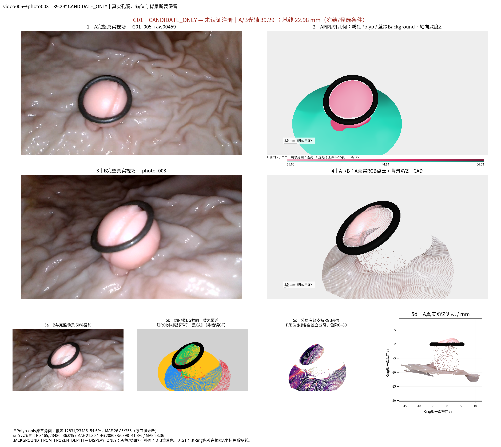
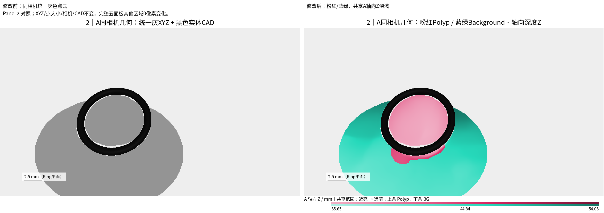
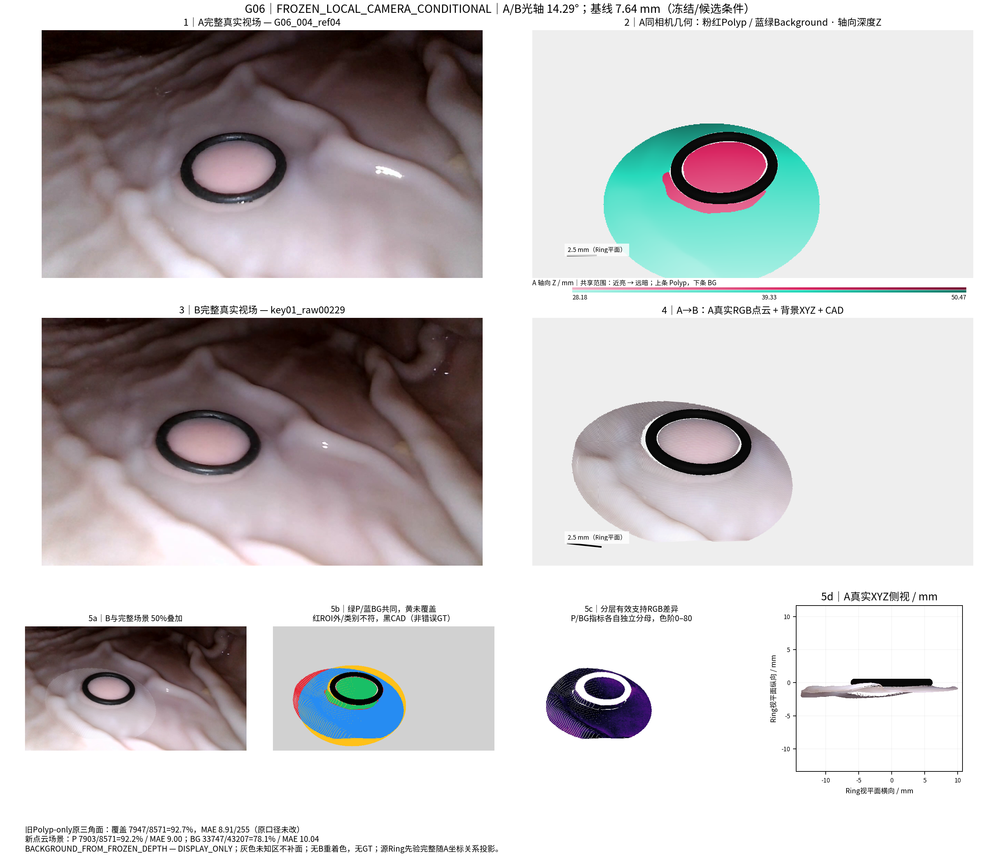

# TASK-AB-SCENE-PANEL2-DEPTH-COLOR-003

状态：REPORTED / PANEL2_ONLY；等待人工验收。2026-10-28（Asia/Shanghai）。

本轮仅将已认可五面板中的第2面板由灰色点云改为粉红Polyp与蓝绿Background，并用两色系内的明暗表达已有预测XYZ在冻结A相机下的轴向深度。先完成39.29° photo003，再对全部11配对复用。两类点共享同一A场景全部有效XYZ的Z最小/最大值，同一个A在不同B配对中使用相同颜色；未按图层独立归一化、未删极值、未重新估计深度。黑色实体CAD、点坐标、点数、点大小、遮挡与相机均不变。原图保留，新图逐像素复制其余区域，11/11张Panel2及必要图例之外变化均为0。全部历史评价文件只核对哈希，没有重新运行评价。候选姿态、背景DISPLAY_ONLY和相机压力测试身份原样保留，不产生新的科研精度结论。

本地目录：`/home/liu/ring_first_3d_panel2_depth/experiments/TASK-AB-SCENE-PANEL2-DEPTH-COLOR-003`。 [HTML图库](/home/liu/ring_first_3d_panel2_depth/experiments/TASK-AB-SCENE-PANEL2-DEPTH-COLOR-003/visualizations/index.html) · [全部新版](/home/liu/ring_first_3d_panel2_depth/experiments/TASK-AB-SCENE-PANEL2-DEPTH-COLOR-003/figures/cases/) · [结果索引](RESULT_INDEX.md)。独立分支`exp/TASK-AB-SCENE-PANEL2-DEPTH-COLOR-003`，起始提交`d969bd064e980ab0ca6af3b4d0e6f2e5a1bb1818`。旧任务脚本、官方renderer及旧图片均未改。

## 颜色与深度

读取已有source_layers NPZ，不重新生成点或背景。`Z=((XYZ-C_A) @ R_A)[:,2]`，单位mm。每个源A的Polyp和Background全部有限正Z共同构成范围；`t=(Z-Zmin)/(Zmax-Zmin)`，近端HLS明度0.82、远端0.27，饱和度0.70；Polyp色相340°，Background170°。两层共享t与明度公式。没有百分位裁剪，没有改变任何深度数值。此Z是冻结重建的相机轴向深度，不是独立GT或新深度预测。

photo003案例共享范围35.6454–54.0253mm，Polyp12775点、Background37751点。物理毫米比例尺仍是原Ring平面参考尺度。

| 配对 | A轴向Z范围 mm | P / BG点数 | Panel2外变化像素 |
| --- | --- | --- | --- |
| G01_005_raw00459__to__photo_003_LG490_candidate | 35.6454–54.0253 | 12775 / 37751 | 0 |
| G01_004_ref08__to__video005_v005_00516 | 34.7907–61.8958 | 14029 / 39785 | 0 |
| G01_004_ref13__to__004_00 | 35.7712–62.9772 | 13010 / 36812 | 0 |
| G01_004_ref03__to__004_15 | 25.9037–59.8923 | 24343 / 58623 | 0 |
| G01_005_raw00057__to__v005_00860 | 29.2214–46.1444 | 19813 / 49317 | 0 |
| G06_004_ref04__to__key01_raw00229 | 28.1801–50.4750 | 9282 / 41928 | 0 |
| G06_004_ref04__to__key00_raw00107 | 28.1801–50.4750 | 9282 / 41928 | 0 |
| G08_005_ref04__to__key00_raw00120 | 30.1228–60.6127 | 19631 / 74212 | 0 |
| G07_004_ref04__to__key00_raw00066 | 23.9788–38.2710 | 19784 / 65219 | 0 |
| G01_005_raw00459__to__v005_00516 | 35.6454–54.0253 | 12775 / 37751 | 0 |
| G01_005_raw00459__to__video004_004_10 | 35.6454–54.0253 | 12775 / 37751 | 0 |

## 严格不变范围

复用原SameCameraScene.draw、real_p0_renderer投影、点排序和CAD射线遮挡；Panel2点大小仍.08、alpha1、关闭抗锯齿，K缩放、c2w和Ring不变。先用原灰色图复绘Panel2位置，控制图与旧PNG逐像素一致；再仅替换该精确矩形，图例位于原Panel2下方白色间隙，不移动轴框、不覆盖Ring。

新版Fig2由旧公开Fig2直接复制，仅替换同一Panel2区域，原90px标题栏、Panel1/3/4/5及数值注释逐像素不变。黑色可见CAD像素另逐点检查保持相同。单独前后对照图仅并排显示Panel2，完整原图仍可在图库打开。

历史指标、预测缓存、背景ROI与源几何共128个输入文件在开始时冻结SHA；结束时再次核验。没有调用旧point_projection、scene_metrics、legacy.evaluate或任何重建/配准/测量流程。新audit目录仅存像素与显示审计，不是新的科研评价指标。







源相机密集采样处仍可能形成连续色块外观，实际绘制的是同一批离散XYZ，没有补面/平滑。旧跨源候选与背景几何缺陷保留；本轮不评判或修正它们。

## 修改文件与复现

所有代码均新增于本任务目录：`code/scene_renderer.py`仅做共享Z配色并复用原点/CAD接口；`code/render_cases.py`定位原Panel2与必要图例、复制其他像素；`code/redraw_geometry.py`只迭代已有11配对。`prepare.py`、`test_small.py`、`validate.py`、`deliver.py`为冻结/核查/交付辅助。旧scene_renderer.py/render_cases.py/redraw_geometry.py文件字节不变。

```bash
cd /home/liu/ring_first_3d_panel2_depth
PYTHONDONTWRITEBYTECODE=1 OPENBLAS_NUM_THREADS=1 OMP_NUM_THREADS=2 /home/liu/polyp_research/ring_anchor_3d/.venv/bin/python experiments/TASK-AB-SCENE-PANEL2-DEPTH-COLOR-003/code/validate.py
```

新空输出目录重放顺序：prepare.py → redraw_geometry.py --pair G01_005_raw00459__to__photo_003_LG490_candidate → test_small.py → redraw_geometry.py → deliver.py → validate.py。不得在已冻结旧任务目录覆盖生成。没有完整重建或评价入口。

验收依据为11/11外部像素差0、Ring保持、颜色深度单调与共享范围、128项冻结输入哈希不变；7项小测试及310项完整性检查通过，53个HTML链接有效。完整审计见`audit/VALIDATION.json`与`audit/panel2_changes.csv`。本轮不产生测量结果、不使用GT、不修改正式Dxy。完成后停止。

| 审计项目 | 本轮汇报 |
| --- | --- |
| 目标组数 | 11展示配对、4物理组；不是新测量实验 |
| 本算法独立成功 | 11/11展示更新；不生成物理测量预测 |
| 本算法失败 | 0展示生成失败；科学精度未重新评价，NOT_APPLICABLE |
| 历史测量值回退 | 0 |
| 失败组及具体原因 | 历史候选/压力测试身份与失败画面逐像素保留，未重新判定 |
| 最终统计样本 | 11配对仅用于像素不变检查，不作独立病例精度统计 |
| 是否使用GT选择算法 | 否，GT_NONE；仅显示颜色规则，无科学算法选择 |
