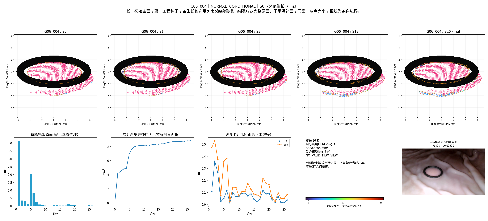
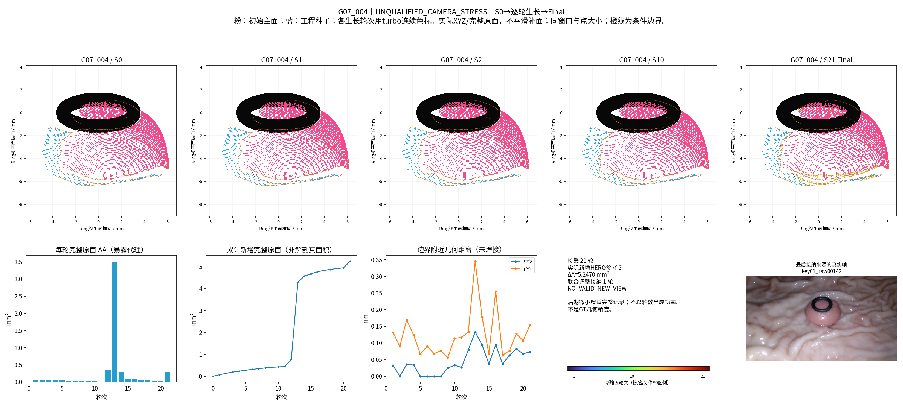
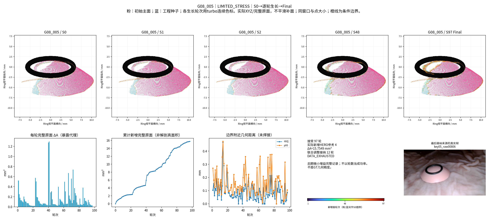
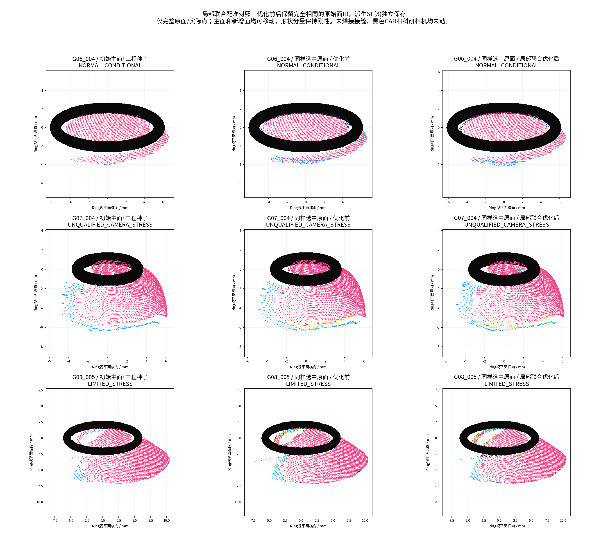

# 可信边界引导的增量可见表面生长

状态：RUNNING / EXPERIMENTAL；GT模式NONE。

中文摘要：本轮以连续原始三角面和真实观察边界为基本单位，从既有Cleaned F1恢复曲面，先按相机质量与连续支持面积选择主体，再检验重叠带、边界外延和逐轮更新。用户后续明确允许派生的局部联合配准与接缝优化；旧主体及已接纳补片不再被人为锁死，但原始资产和优化前版本保留。本报告将区分工程接纳、真实跨视角支持、几何变化与尚未认证的物理精度。

## P0/P1 — 来源、工程种子和实际边界

4物理组/5视频/14既有参考均核验来源。基于用户最新补充，本轮允许局部联合刚体调整已有及新增曲面；旧版本只读保留，不以保护旧结果不变代替几何接纳。

主体按相机质量×(0.55最大连续可靠法向/非留出Mask支持面积＋0.20连续面积比例＋0.15邻帧支持＋0.10法向可靠比例)选择，绝非只按总面积。选中：{'G01_004': 'G01_004_ref08', 'G01_005': 'G01_005_raw00459', 'G06_004': 'G06_004_ref04', 'G07_004': 'G07_004_ref04', 'G08_005': 'G08_005_ref04'}。分母和逐参考评分见main_surface_scores.csv。

G06/G07/G08工程种子恢复：

|组|Cleaned F1整源点|F2点|F2完整原面|完整原面mm²|原面分量|
|---|---|---|---|---|---|
|G06|8245|185|62|0.246976|22|
|G07|17169|1500|2247|10.248385|17|
|G08|13259|626|730|6.363068|16|

ENGINEERING_ACCEPTED_SEED表示人工认可局部展示，不是几何GT。没有把整片F1蓝面提升为可信。原始点索引/接受mask/完整面索引与SHA已冻结；新派生位置可在本轮授权下调整。主体全部Cleaned原面保留，最大主分量参与外边界生长，其他原小分量单列保护，不自动作为外部生长边界。源/几何原始版本不改。

边界由只使用一次的原面边提取，按真实Mask/Ring、原网格与Cleaned拓扑区分外部观测终止、Ring遮挡、原深度断裂、清理内孔和选面切口/未知。Ring边界只有另一真实观察能够支持时才可尝试；不是形态先验补面。

本轮重新先行冻结非参考图像评价帧，核查历史HERO源帧身份。G06/G07/G08旧HERO源列表未完整记录，故评价标记历史来源不完全可审计，不虚称全流程盲测。评价帧不参与本轮新的推理/选源/生长。没有GT/Oracle。

## P2/P3/P4 — 优先三组的连续生长和联合调整

本轮按最新授权实际实现完整原面补片生长＋有界局部联合配准，**没有把旧主体锁死，也没有仅重跑旧F2点级筛选**。主面/补片均按原始连通分量保持刚性，允许SE(3)派生位置变化；Raw、历史F1/F2、S0、每轮快照、同样选中面片的PreJoint与Joint独立版本均保留。

新参考先按当前可见边界与≥3°未利用方向排序，再运行冻结HERO；不再执行旧配置中的每视频最多1参考限制。新增原面从连接带沿真实共享原边的面邻接图扩展（每轮有限1.5mm），连接带不整片重复显示；EXPLAINED、NOVEL、OCCLUDED、CONFLICT、UNKNOWN完整保留。源像素、原点/面ID和派生H均可回溯，没有补面、重采样或自由形变。

|场景|条件|实际新HERO|接受轮数|新增完整原面mm²代理|最大新增完整源分量mm²|旧S0点位移p95 mm|联合调整轮数|停止|
|---|---|---|---|---|---|---|---|---|
|G06_004|NORMAL_CONDITIONAL|3|26|8.8305|4.1482|0.1161|3|NO_VALID_NEW_VIEW|
|G07_004|UNQUALIFIED_STRESS|3|21|5.2470|3.5099|0.0834|1|NO_VALID_NEW_VIEW|
|G08_005|LIMITED_STRESS|4|97|15.7549|2.4050|0.1147|12|DATA_EXHAUSTED|

面积是不同来源原始完整面暴露量的累计，非去重解剖真面积。97轮并不意味着97个有效新视角：G08仅4次新推理，后期很多轮是微小的补片边缘增量。每一轮及零接纳的参考试验都在growth_steps / patch_candidates / view_search表中。NO_VALID_NEW_VIEW表示在冻结的方向和可见边界规则下没有新候选，不能等同原始视频没有更多信息。

### 配准和接缝

原始面的局部重叠带使用Open3D GICP；法向近乎平行时退化为稳健点到平面的单法向偏移，以避免虚构切向自由度。只检查有限一次候选，不调参搜索。校正按刚度3:1（主体/新面）或2:1（已有补片/新面）在新旧分量间分配；原始分量形状、尺度和CAD不变。主体累计平移界0.75mm，其他派生分量1.5mm，旋转界5°；源和非留出邻帧Mask约束用于有限工程接纳，独立目标RGB误差不参与选解。G06实际有GICP将旧分量移动约0.171mm、新面约0.514mm的记录，证明并非仅让新面贴合冻结旧主体。

### 相同冻结真实帧比较

每视频2帧。所有数值以完整B Polyp Mask为分母，逐帧和共同支持像素数见[crossframe_comparison.csv](metrics/crossframe_comparison.csv)。原历史点中心协议未改；三角面射线命中仅作为新增独立口径，不能混作点覆盖率或精度。G07不合格压力测试、G08有限条件均单列。

|场景|方法|点中心平均覆盖%|实际原面命中覆盖%|点支持RGB MAE/255|
|---|---|---|---|---|
|G06_004|Initial_S0|76.745|93.761|21.953|
|G06_004|Historical_F2|76.930|93.761|21.970|
|G06_004|F3_PreJoint_SameFaces|79.546|95.798|21.375|
|G06_004|F3_Joint|79.466|96.451|21.416|
|G07_004|Initial_S0|86.905|92.402|25.803|
|G07_004|Historical_F2|86.998|92.402|25.814|
|G07_004|F3_PreJoint_SameFaces|88.060|93.706|25.873|
|G07_004|F3_Joint|88.014|93.717|25.796|
|G08_005|Initial_S0|68.214|85.099|30.173|
|G08_005|Historical_F2|68.391|85.099|30.176|
|G08_005|F3_PreJoint_SameFaces|69.524|86.221|30.585|
|G08_005|F3_Joint|69.357|86.014|30.407|

PreJoint与Joint使用完全相同的选中原面，前者恢复原坐标，并不是另行用目标误差调参得到的替代算法。G06实际原面命中覆盖S0约93.76%→Joint96.45%；G08约85.10%→86.01%，但其PreJoint86.22%略高于Joint，表明接缝拟合好并不必然改善另一视角。

### 重要反例：点采样与几何覆盖不能混淆

|场景|旧点中心支持消失/目标%|旧实际原面支持消失/目标%|接纳面中调整前已被解释面积mm²|
|---|---|---|---|
|G06_004|11.779|0.411|1.8351|
|G07_004|0.651|0.167|0.2209|
|G08_005|2.418|0.576|0.9355|

例如G06旧点中心支持消失约11.78个百分点，而完整原面支持损失约0.41个百分点：小的刚体位移会改变离散点落入哪些像素。两者均保留，不以三角面数值覆盖原指标。另有G06约1.835mm²接纳面在联合调整前已被解释，说明一部分“新增”来自位置改变后的投影空缺，不能算新观察方向的信息增量。新增来源、旧面移动及独有支持已分开统计。

工程实现得到更多有来源的连续原面，但物理精度、真实唯一新增面积与整体优于历史方法尚未认证。旧S0的面ID没有被删掉，然而几何位置和投影支持确实改变，不能把ID保留说成几何无损。逐帧三方法完全相同支持集的RGB比较另见[identical_common_support_RGB.csv](metrics/identical_common_support_RGB.csv)；光照和反光也会影响颜色差异。

所有逐轮单张图和优化前后GLB保留本地，见[HTML图库](visualizations/index.html)。四种人工审查状态为ACCEPTED（仅工程）、CANDIDATE（未连接/条件不足但保留）、CONFLICT（几何不一致）、REJECTED（本次不进入展示，非永久删除）。G01正在同一冻结框架下实际实验，不用上述正面结果代替复杂Ip验证。
