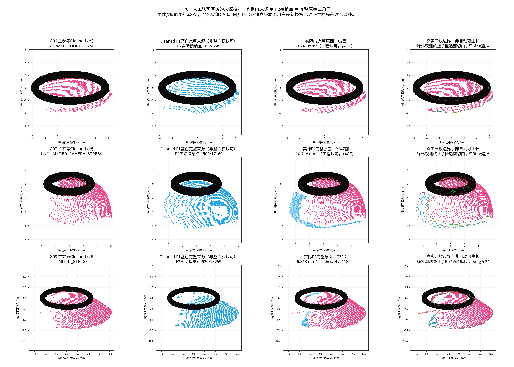
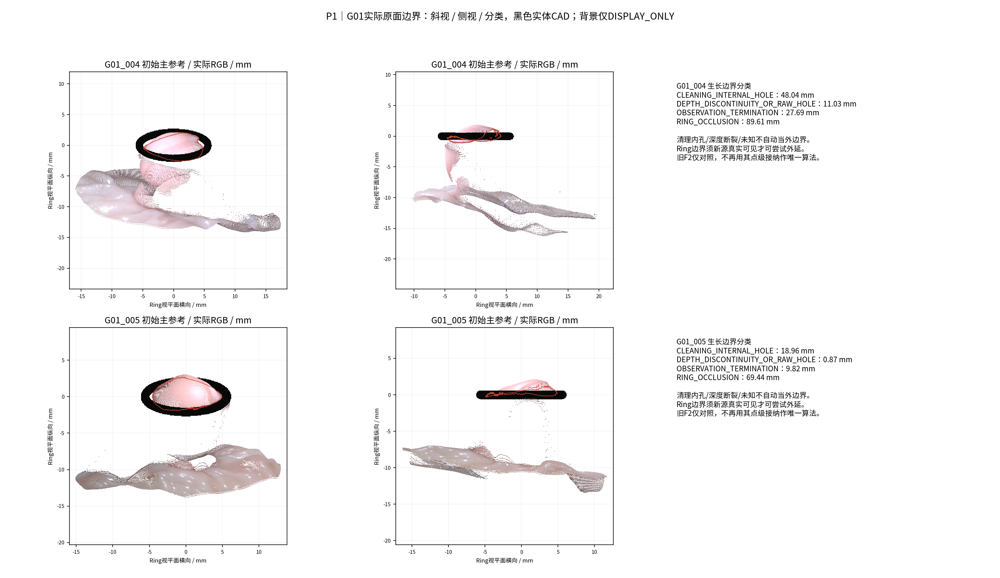
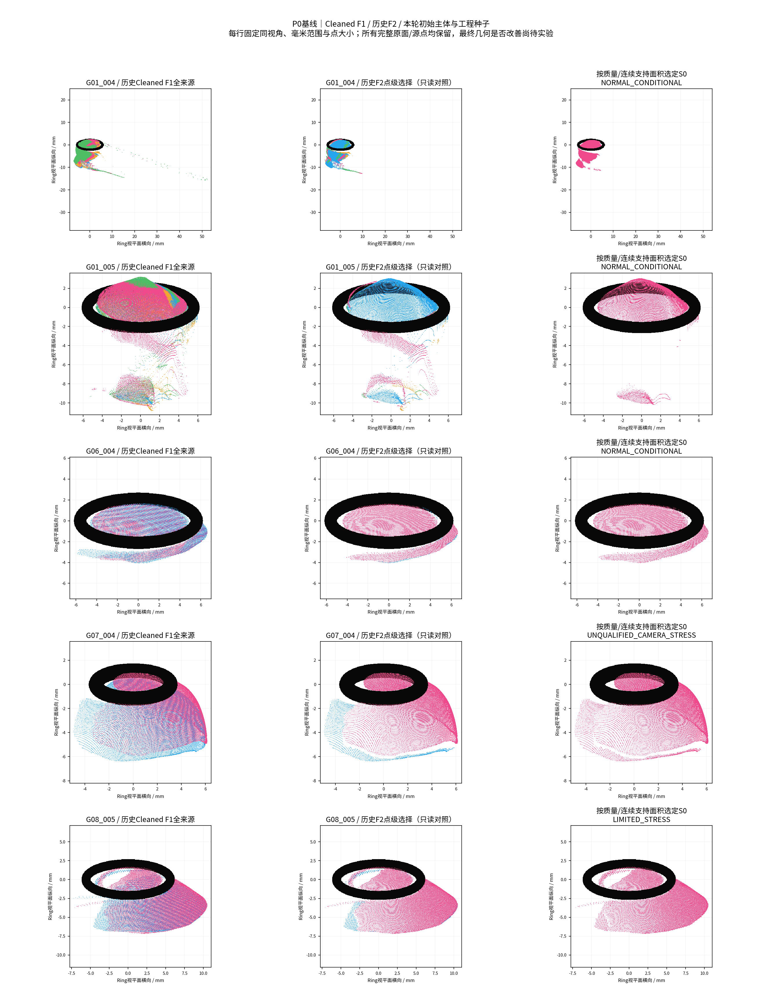

# 可信边界引导的增量可见表面生长

状态：RUNNING / EXPERIMENTAL；GT模式NONE。

中文摘要：本轮以连续原始三角面和真实观察边界为基本单位，从既有Cleaned F1恢复曲面，先按相机质量与连续支持面积选择主体，再检验重叠带、边界外延和逐轮更新。用户后续明确允许派生的局部联合配准与接缝优化；旧主体及已接纳补片不再被人为锁死，但原始资产和优化前版本保留。本报告将区分工程接纳、真实跨视角支持、几何变化与尚未认证的物理精度。

## P0/P1 — 来源、工程种子和实际边界

4物理组/5视频/14既有参考均核验来源。基于用户最新补充，本轮允许局部联合刚体调整已有及新增曲面；旧版本只读保留，不以保护旧结果不变代替几何接纳。

主体按相机质量×(0.55最大连续可靠法向/非留出Mask支持面积＋0.20连续面积比例＋0.15邻帧支持＋0.10法向可靠比例)选择，绝非只按总面积。选中：{'G01_004': 'G01_004_ref08', 'G01_005': 'G01_005_raw00459', 'G06_004': 'G06_004_ref04', 'G07_004': 'G07_004_ref04', 'G08_005': 'G08_005_ref04'}。分母和逐参考评分见main_surface_scores.csv。

G06/G07/G08工程种子恢复：

|组|Cleaned F1整源点|F2点|F2完整原面|完整原面mm²|原面分量|
|---|---|---|---|---|---|
|G06|8245|185|62|0.246976|22|
|G07|17169|1500|2247|10.248385|17|
|G08|13259|626|730|6.363068|16|

ENGINEERING_ACCEPTED_SEED表示人工认可局部展示，不是几何GT。没有把整片F1蓝面提升为可信。原始点索引/接受mask/完整面索引与SHA已冻结；新派生位置可在本轮授权下调整。主体全部Cleaned原面保留，最大主分量参与外边界生长，其他原小分量单列保护，不自动作为外部生长边界。源/几何原始版本不改。

边界由只使用一次的原面边提取，按真实Mask/Ring、原网格与Cleaned拓扑区分外部观测终止、Ring遮挡、原深度断裂、清理内孔和选面切口/未知。Ring边界只有另一真实观察能够支持时才可尝试；不是形态先验补面。

本轮重新先行冻结非参考图像评价帧，核查历史HERO源帧身份。G06/G07/G08旧HERO源列表未完整记录，故评价标记历史来源不完全可审计，不虚称全流程盲测。评价帧不参与本轮新的推理/选源/生长。没有GT/Oracle。

