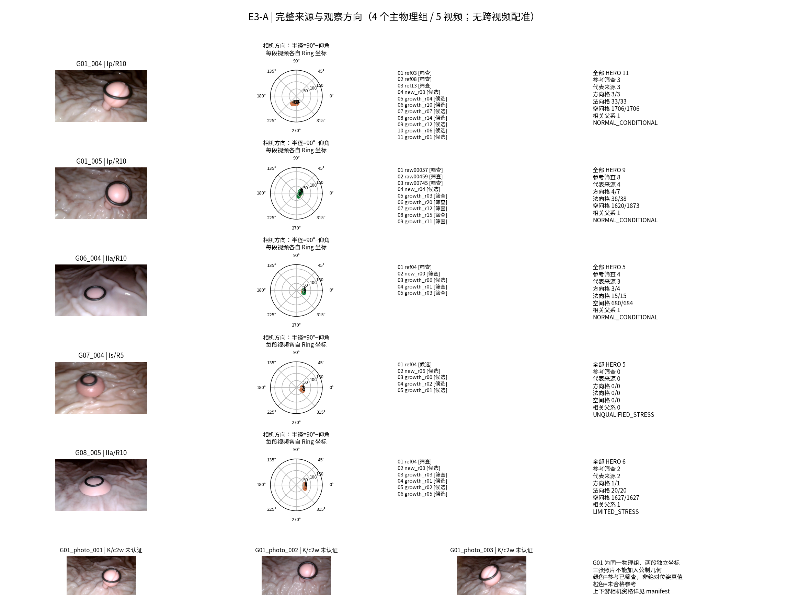
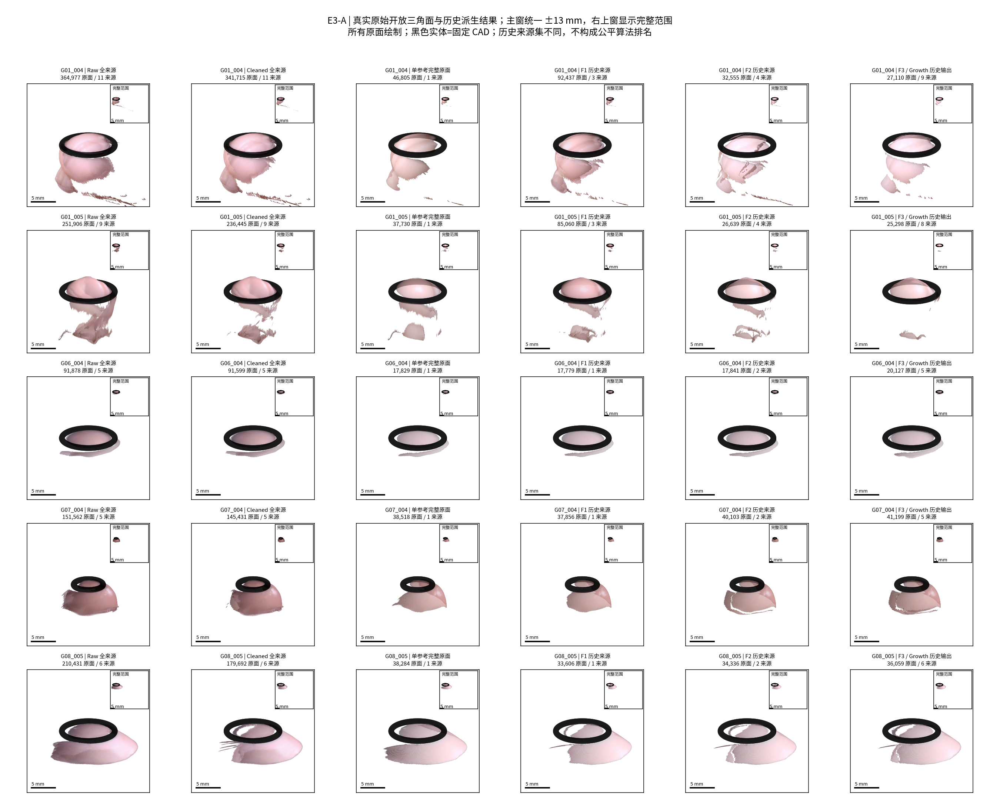
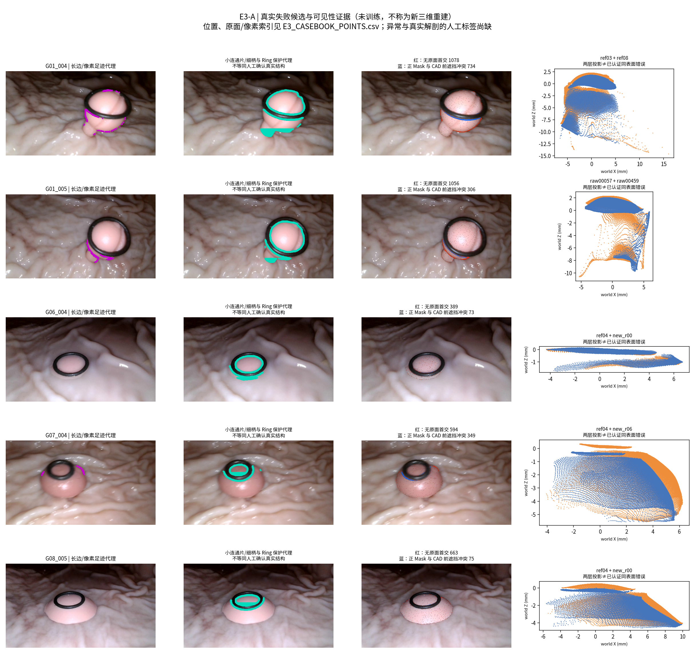
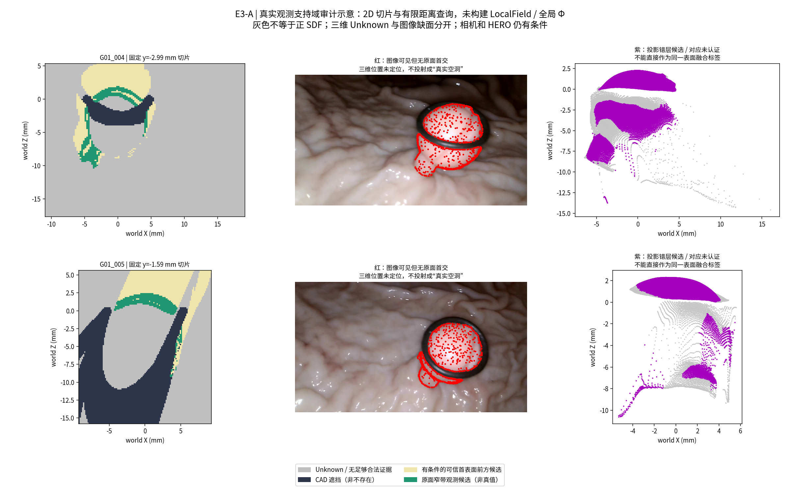

# E3-A TECHNICAL REPORT

本轮完成 Phase E3-A 的只读科研资产核验与问题定义，未恢复 MonoSDF 路线，也未运行新 HERO、融合优化或训练。主审计覆盖四个物理组、五段视频的三十六份来源，原始面身份均可追溯；另筛查四个物理组的四份旧来源。参考相机筛查与上游相机资格仍有层级差异，不能把资产存在等同于正式认证。实际计算已分开观察方向、原面法向与空间支持，并定位历史覆盖变化、投影错层和 CAD 次序矛盾。局部域、全局 ROI、来源身份与固定评价分母已冻结；同表面纠错真值、严格独立评价视角和真实细柄标签仍不足。本轮只交付可执行、可证伪的合同，不选择下一阶段算法。

任务 `TASK-E3-A-SOURCE-AUDIT-AND-PROBLEM-DEFINITION-001`；独立分支 `exp/TASK-E3-A-SOURCE-AUDIT-AND-PROBLEM-DEFINITION-001`；父提交 `fcdcefb13c00a3c940926dd2266137847eb768b6`。当前任务书是执行授权；RA原文是设计依据，其中旧版建议/未授权下一阶段不能取代本轮边界。两份原文均完整读取，SHA及阅读收据见 `provenance/RA_DOCUMENT_ACCESS.json`、`RA_READING_RECEIPTS.json`；v1.1数学约束、v1.2组织规则使用新版优先。

## 固定审计表

| 审计项目 | 必须汇报 |
| --- | --- |
| 目标组数 | 主审计4物理组/5视频；G01两视频不是两病例；补充4组仅目录筛查 |
| 本算法独立成功 | 测量0/4；本轮没有测量预测。资产审计完成4/4，不能冒充测量正确 |
| 本算法失败 | 4/4未执行测量，值NaN；不是4次算法测量失败 |
| 历史测量值回退 | 0；未读取旧直径/S0/V2测量或GT补齐 |
| 失败组及具体原因 | G01跨视频未认证及004上游候选；G06链条件；G08 LIMITED；G07相机未合格。见FAILURE_LEDGER.md及案例图 |
| 最终统计样本 | 测量0/4；MedARE/MAE/p95/max均NaN；共同成功配对N=0；原面统计为36源观测次数而非独立组数 |
| 是否使用 GT 选择算法 | 否；GT/Oracle未读，未选算法。配置/源码/输入SHA及预输出benchmark冻结均保留 |

## 资产与相机资格的实际结果

| 视频 | 来源/参考筛查/父相机非候选 | 完整原面 | 长边面积代理% | 小片组件代理 | 全源Mask像素 | 无原面首交 | 正Mask/CAD矛盾 |
| --- | --- | --- | --- | --- | --- | --- | --- |
| G01_004 | 11/3/0 | 364,977 | 5.32 | 84 | 192141 | 10483 | 4975 |
| G01_005 | 9/8/8 | 251,906 | 4.37 | 48 | 133186 | 7773 | 1249 |
| G06_004 | 5/4/0 | 91,878 | 0.00 | 0 | 47842 | 1971 | 308 |
| G07_004 | 5/0/0 | 151,562 | 1.24 | 8 | 78118 | 2677 | 1173 |
| G08_005 | 6/2/0 | 210,431 | 0.02 | 4 | 108359 | 3661 | 587 |

全部36源共1,070,754张原面，已核对原face数组、原顶点、UV与相机往返。40份native是36主目录+4补充目录，94条manifest还含3张照片、36份Cleaned及15份F1/F2/F3场景派生；派生几何不增加独立证据。主参考筛查17份，19份不合格；全部上游相机没有候选状态的8份均在G01_005，仍不等于绝对公制GT认证。旧组级31份NORMAL/LIMITED标签不能替代17份逐参考资格。原始材料依赖本地大文件，本分支只上传审计表、源码、报告和图，不声称远端包含全部输入。

## 来源方向、几何覆盖与历史变化

| 视频 | 参考对方向差° | 方向格代表/全 | 法向格代表/全 | 空间格代表/全 | F3保留原源面积% | F3原交点变miss/原有效源像素 |
| --- | --- | --- | --- | --- | --- | --- |
| G01_004 | 8.50–21.07 | 3/3 | 33/33 | 1706/1706 | 8.20 | 20744/176683 |
| G01_005 | 2.77–36.70 | 4/7 | 38/38 | 1620/1873 | 9.85 | 9805/124164 |
| G06_004 | 3.30–16.69 | 3/4 | 15/15 | 680/684 | 21.74 | 773/45563 |
| G07_004 | 未合格 | 0/0 | 0/0 | 0/0 | 21.27 | 2209/74268 |
| G08_005 | 5.89–5.89 | 1/1 | 20/20 | 1627/1627 | 14.08 | 9927/104111 |

全部252对同视频有向检查使用预定原索引采样、真实投影和原面/CAD首交。相机角度、共同Mask、原面共投影、方向法向/空间边际覆盖分别计算；数值代理不证明物理同一面。代表角色为来源组织诊断，不是正式优化输入获批。详细来源与边际增益见来源提案和CSV。

F3原面省略量远大于其实际首交缺失量，显示原面数量不能直接解释成可见解剖损失。旧算法的去重、选择和几何修改均可能参与；对同一个源原面可核对省略面积和保护代理，对现存输出可核对固定源像素首交，但没有资格把所有省略面判为真实面遭破坏。输入集不同、源本身有误且对应未认证，因此这些是风险证据，不是公平算法排名或物理错误率。F2未包含的22份growth源写NOT_IN_HISTORICAL_INPUT_SET，不记作零保留。

## 十个问题的明确回答

### Q1 — VERIFIED / CONDITIONAL

共发现40份现存native深度；36主目录具完整可追溯原面，17份参考相机筛查合格可作条件性只读几何实验，8份全上游非候选；其余19主源和4补充源不能直接升级为正式合格输入。严格完整相机链绝对认证数量UNKNOWN，不报40份全部合法。

### Q2 — VERIFIED / CONDITIONAL

G01_004为11源，其中3筛查参考方向差8.50–21.07°，保留三CORE；G01_005为9源/8筛查，2.77–36.70°，三CORE+growth_r20桥。005代表集保留38/38法向格但只有1620/1873空间格。所有主源共享上游相关家族；互补几何不等于独立重复票。详见252对CSV及边际表。

### Q3 — VERIFIED (bounded search)

额外G02–G05目录有4份旧HERO；G04/G05是Is/R10且链不足，G07是Is/R5但不合格。已审计目录额外合格Is/R5=0，未声称全磁盘不存在。

### Q4 — CONDITIONAL / UNKNOWN

已区分系统偏差候选、局部错层、长边延伸代理、小片、重复层候选、缺首交、CAD次序/Mask矛盾、未知和相机/对应不确定。认证同一物理表面深度冲突0；投影残差不能证明E1/E2真误差。A/B/C分别统计，不强行把C变A。

### Q5 — VERIFIED proxies / NOT_EVALUABLE anatomy

36源长边面积比例、小组件、主要连续面、边界及原面位置均已计算；上表为源面积加权代理。288条实际定位含头部/跨Ring/侧面/保护柄/长边/碎片位置。是否真实异常或真实细柄缺人工标签，不声称代理就是错误比例。

### Q6 — VERIFIED bookkeeping / CONDITIONAL physical loss

每源Raw/Cleaned/F2/F3原face保留、面积省略和保护代理损失已落表；108条历史输出固定源射线查询记录原hit变miss和替代层深度差。少面可能去重，多hit也可能错层，真实有效面破坏尚未全部认证；不能拿不同来源集排名。

### Q7 — VERIFIED image/triangle evidence / CONDITIONAL cause

逐源完整Mask内无原面首交与CAD前遮挡矛盾分开列UV/数量。前者包括边界栅格和断裂，不能全叫缺HERO点；只有图像证据而无深度定位的像素不映成假定三维孔洞。见E3_OBSERVED_WITHOUT_TRIANGLE.csv和Fig3/4。

### Q8 — UNKNOWN / CONDITIONAL domain support

固定ROI切片显示无合法原面窄带、域外或CAD后方的证据缺口；仅能支持目录不约束该位置。相机链/真实隐藏面身份不完整，无法认证整个真实背面为Truly-Unobserved；不足处保持UNKNOWN_OR_INSUFFICIENT_EVIDENCE。

### Q9 — VERIFIED specification / NOT_RUN implementation

局部四域和五种距离类型、有限有效符号/权重来源已定义。全局Phi完整ROI有限值须配U/sigma并分开观测/修正/先验/未知/冲突；尚非欧氏SDF。不实现LocalField或全局模型。

### Q10 — VERIFIED preregistration / CONDITIONAL future execution

同来源/同原面/相机/Mask/CAD/ROI/家族/预算/固定分母比较，历史原配置另作面板，保留全部强基线。覆盖与结构优先、miss-inclusive诊断、物理对应资格、保护预算及先验身份必须检查。9目标全有历史暴露，严格独立帧0；没有GT几何准确率宣称。具体算法/拟合预算待PM冻结，不预选赢家。

## 合同、验证与限制

局部合同、全局问题、评价协议、假设预注册均在docs目录。108次实际面重心/法向偏移查询全部有限数值校验通过；这只验证表面位置和UDF，不验证全局正负符号。两个121×121固定切片仅是有限查询可视化，没有输出可调用的场、全局Phi或融合优化器。四图均用真实源XYZ/原面/图像，未训练结果没有称新三维重建。

数值完整性与科学资格分开：原面/坐标往返PASS不等于相机绝对正确；无独立对应不报真实深度误差；没有独立视角不报泛化；缺人工结构标签不报细柄准确率；GT未读不报物理测量误差。机器验证与不可评价项见 `metrics/DELIVERY_VALIDATION.json`，失败记录见 `FAILURE_LEDGER.md`。全部历史受保护worktree的HEAD/已有修改与输入SHA在交付前后核对；没有删除旧产物，未修改Ring-First/HERO/CAD/P0/Dxy。

## 四张核心图

## PM 接口

E3-A 审计与合同可提交审阅；不等于后续科学算法已经具备真实性PASS。建议E3-B比较局部projective与mesh窄带等资格，E3-C比较support/occlusion/free-space及来源相关性消融，E3-D再比较受保护的非学习/残差/条件推断。相机链、真实对应、人工结构标签和严格独立评价仍是门槛。当前没有选择G0/G1，没有执行E3-B/C/D，没有启动GPU。任务交付后停止等待PM。
