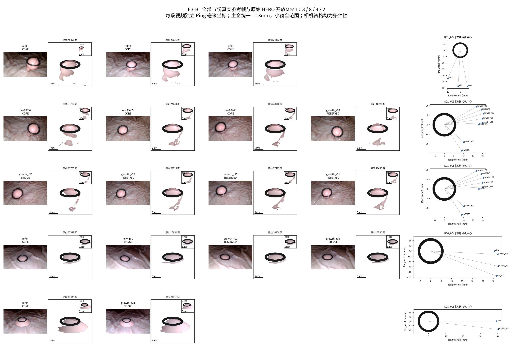
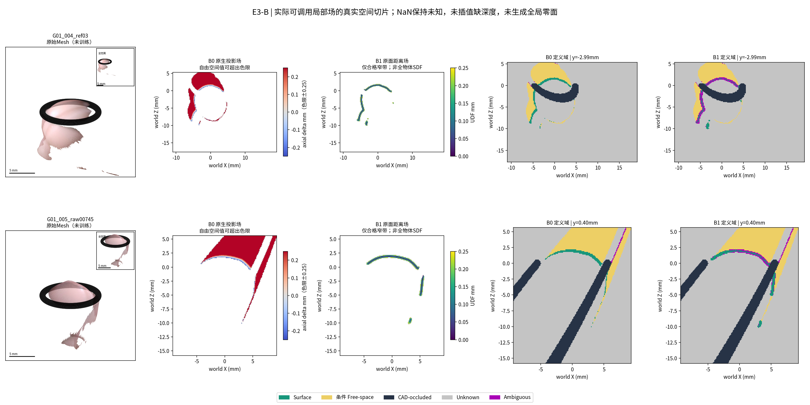
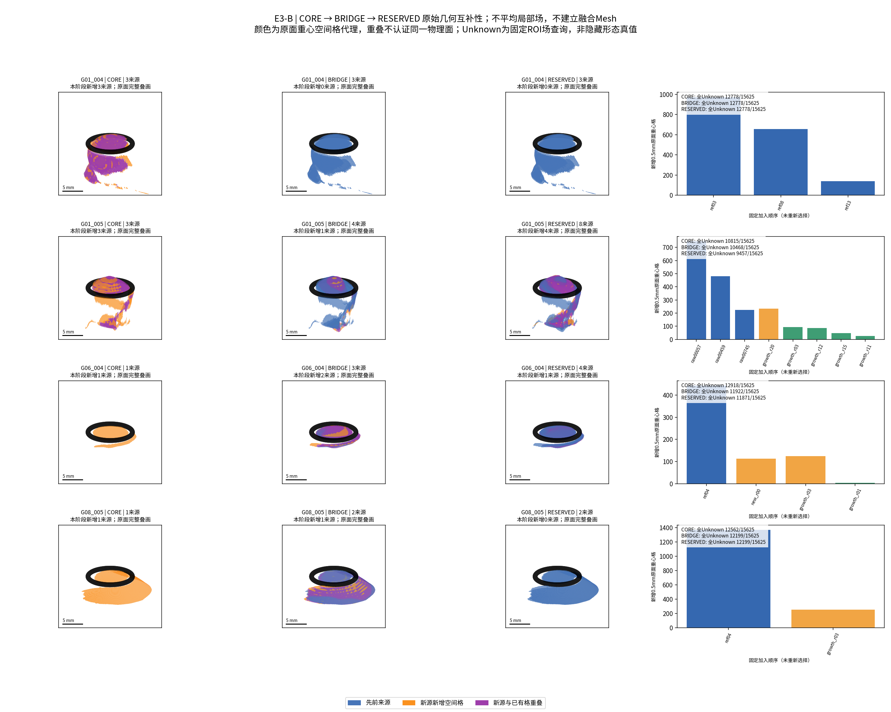
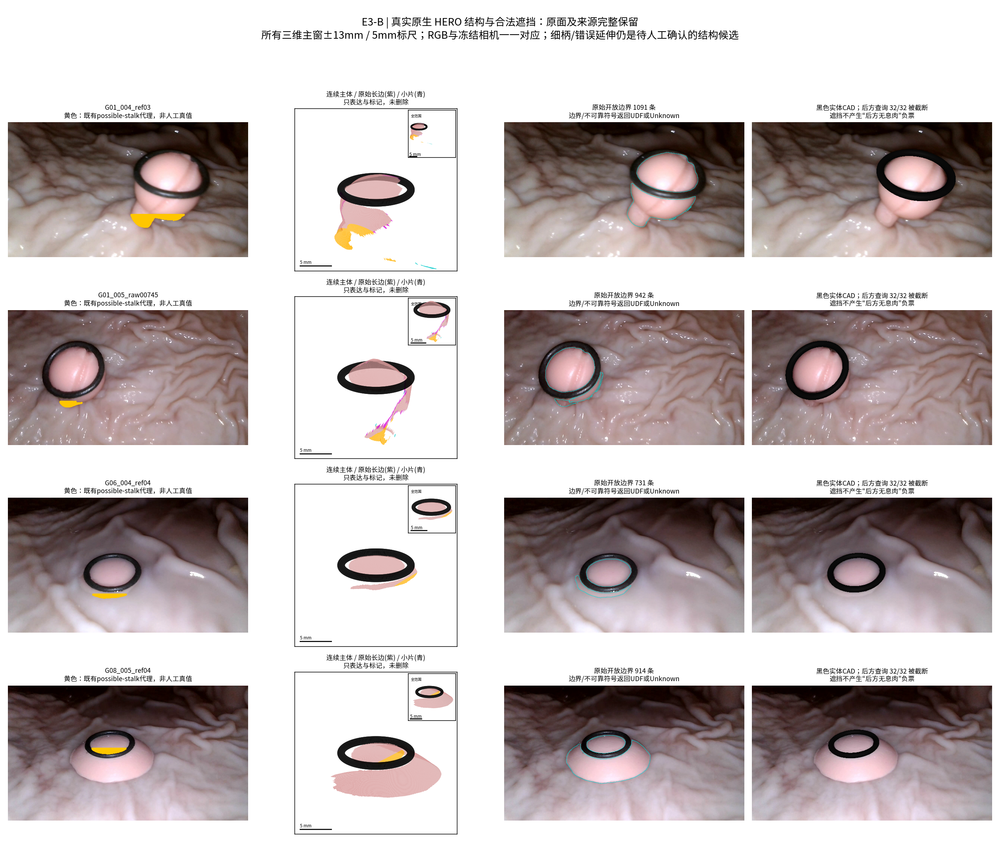

# E3-B TECHNICAL REPORT

本轮已在CPU上对E3-A筛查通过的全部17份原始HERO来源构建并实际查询B0投影局部场与B1开放Mesh距离场，共34个场对象。先验证12份CORE/BRIDGE，再纳入全部5份RESERVED，未重新选择参考，未使用历史融合结果生成几何。B1完整保留461,023张原始三角面及其身份；B0原生深度零值正确，但与历史双线性缩放后的Raw Mesh不完全重合，不能声称两者逐面等价。相机、同表面对应和真实结构资格仍有条件性，Unknown及不可靠符号均显式保留。

任务 `TASK-E3-B-LOCAL-HERO-FIELDS-001`；分支 `exp/TASK-E3-B-LOCAL-HERO-FIELDS-001`；直接父提交 `8f5f7ea59efb32a0f633409386431811444ee399`。沿用E3-A已阅读RA v1.2及既有局部合同，本轮明确任务授权覆盖其中“只定义未实现”的旧阶段限制。没有新HERO、历史融合重建、几何清理、全局SDF拟合、GPU或训练。

## 固定审计表

| 审计项目 | 必须汇报 |
| --- | --- |
| 目标组数 | 正式3物理组G01/G06/G08、4视频、17来源；G01两视频同一组。另保留G07不合格压力身份。测量分母沿用4主物理组，本轮无测量 |
| 本算法独立成功 | 局部场工程构建17/17源、34/34对象，3/3条件性正式组；不等于公制准确性。测量0/4 |
| 本算法失败 | 构建失败0/17；B0对历史Raw Mesh完全等价的假设不成立，逐源差异完整保留；G07未构建不计正式成功；测量值均NaN |
| 历史测量值回退 | 0；未用S0/V2旧测量、照片直径或其他预测补齐 |
| 失败组及具体原因 | G01_004/005的原生/Raw离散化差异与相机条件、G06上游候选、G08 LIMITED、G07不合格；逐源链接见FAILURE_LEDGER |
| 最终统计样本 | 17源完整分母；原面统计为源观测次数而非独立解剖面积。测量样本0/4，MedARE/MAE/p95/max均NaN，共同成功配对N=0 |
| 是否使用 GT 选择算法 | 否；输入白名单/协议/源码在字段运行前冻结，无GT/Oracle，无参数搜索，无依据结果扩大窄带 |

## 输入白名单和真实生成链

`HERO_NATIVE_INPUT_MANIFEST.json`逐源记录原生深度、Raw XYZ/PLY、原索引、RGB/Mask、全部HERO父图像SHA、K/c2w和CAD。所有正式来源保留E3-A条件性资格；17参考中8份全部父相机非候选，其他仍有上游条件。17个场独立表示各来源，不代表17份独立统计证据。共享RGB家族不删除独有几何，也不能重复投票。

两个G01_005旧native别名指向未融合的360×640缩放包：raw00057、raw00459。本轮通过现存package_surfaces.py追溯到raw/005_supported_refXXXXX.npz的352×640原始网络输出，未新推理。其余15份直接继承已审计native。17份Raw XYZ全部满足“原生深度→历史双线性缩放→原unproject”的一致性，最大允许2e-5mm；Mesh与原face数组及顶点一致。历史生成代码只读审阅，没有运行其模型main。

源目录名含fusion不构成判定依据：只有E3-A指定的单参考Raw资产、且通过原生深度/UV/原面一致性检查才准入。F1/F2/F3最终几何、SE3调整后融合面、跨视频融合和E2.7预测列为`FUSION_OUTPUT_NOT_ALLOWED_AS_INPUT`。运行时几何白名单与路径守卫拦截未准入NPZ/PLY/OBJ；两个实际历史F2/F3路径负例均在读取前被拒绝，记录于provenance。Cleaned仅加载历史标签作可靠性/可视化，原面和原顶点不据此筛除。

## B0 / B1的实际实现

B0.query采用原生最近邻深度采样，`D_native(pi_native(X))-Z_camera(X)`。通过既有scaled_intrinsics精确进行半像素中心换算，冻结物理相机不变；有归档native K时逐项核对。没有插值缺深度或填洞；无效/域外/遮挡/后方超窄带返回NaN和原因。表面带±0.25mm；前方可见段仅是有条件自由空间，不假定ROI入口在物体外，不把未见后方写成inside。CAD首交排序沿用0.002mm数值余量。来源深度在CAD后方时保留矛盾状态，不能据此生成空无负票。

B0在原生深度有效而既有Raw原面射线无交点时，仍可提供原生像素深度位置证据；此时original_face_id=-1并记录NO_ORIGINAL_FACE_AT_RAY，不虚构原面身份，也不能把这类深度位置证据叫完整连续原面。

B1以全部原Mesh做Open3D最近原三角面距离查询。`raw_udf_mm`为诊断通道，独立于监督可见性；活动`value`只在合格表面带/条件自由空间有效，Unknown不赋零。法向朝源相机，边界顶点关联面、非流形邻域、低法向一致性、掠视、最近面竞争或长边代理返回UDF/UNKNOWN_SIGN；不封闭原Mesh。局部有向值仅在冻结条件下给出，不能解释成物体内外。原始face、顶点ID、UV、最近点与重心坐标均可回溯。

最近面距离本身是全原Mesh BVH查询；**竞争筛查是32个最近三角面重心候选的实际三角面距离比较，不能保证发现任意大三角形/折叠的所有竞争面**。因此有向符号一律标LOCAL_CAMERA_ORIENTED_CONDITIONAL，未宣称认证欧氏SDF。UDF仍保留，不为获得符号而移面。边界规则与0.02mm竞争间隙、0.85法向一致性等均在数值输出前冻结，无阈值搜索。

统一接口返回value、field_kind、valid_surface、valid_free、cad_occluded、unknown、sign_status、source_id/family、original_face_id、reliability_factors、reason_codes。向量化结果逐点携带类型，局部有向值与UDF不能直接混为同一标量平均。w_i为未校准质量因子，不是假装正确概率。所有场沿用E3-A冻结单视频ROI；域外只有原面距离诊断，不作为有效场监督。

## 实验1：原始几何与数值资格

| 来源 | 角色 | 原面数 | B0原顶点在0.25mm带% | B1零距重心/全原面 | B1有向局部重心 | 边界错误符号 |
| --- | --- | --- | --- | --- | --- | --- |
| G01_004_ref03 | CORE | 46805 | 98.870 | 46805/46805 | 42974 | 0 |
| G01_004_ref08 | CORE | 26621 | 99.301 | 26621/26621 | 24192 | 0 |
| G01_004_ref13 | CORE | 24453 | 98.509 | 24453/24453 | 21934 | 0 |
| G01_005_raw00057 | CORE | 37730 | 99.425 | 37730/37730 | 34805 | 0 |
| G01_005_raw00459 | CORE | 24030 | 99.280 | 24030/24030 | 21928 | 0 |
| G01_005_raw00745 | CORE | 28016 | 97.774 | 28016/28016 | 25803 | 0 |
| G01_005_growth_r03 | RESERVED | 31498 | 99.243 | 31498/31498 | 29281 | 0 |
| G01_005_growth_r20 | BRIDGE | 27765 | 99.358 | 27765/27765 | 24899 | 0 |
| G01_005_growth_r12 | RESERVED | 23028 | 98.286 | 23028/23028 | 20584 | 0 |
| G01_005_growth_r15 | RESERVED | 27422 | 98.978 | 27422/27422 | 25106 | 0 |
| G01_005_growth_r11 | RESERVED | 23646 | 96.839 | 23646/23646 | 21446 | 0 |
| G06_004_ref04 | CORE | 17829 | 100.000 | 17829/17829 | 16379 | 0 |
| G06_004_new_r00 | BRIDGE | 15851 | 100.000 | 15851/15851 | 14366 | 0 |
| G06_004_growth_r01 | RESERVED | 16408 | 100.000 | 16408/16408 | 14958 | 0 |
| G06_004_growth_r03 | BRIDGE | 16550 | 100.000 | 16550/16550 | 15111 | 0 |
| G08_005_ref04 | CORE | 38284 | 99.878 | 38284/38284 | 36408 | 0 |
| G08_005_growth_r03 | BRIDGE | 35087 | 99.900 | 35087/35087 | 33244 | 0 |

全部原面重心UDF最大误差 1.47540527e-06mm，原生点的B0零值最大误差 2.84217094e-14mm。B1保留的是原始几何数值身份，不是声称这些面真实准确。CAD/自遮挡或Mask资格限制只影响合法监督，未从存储几何删除原面。边界符号违规0；1088次同primitive且仍有向的真实面±0.02mm检查未见反向符号。68项基础控制与51项局部符号/Ring控制均通过；其中缺深度反例只修改临时内存副本，原始HERO从未修改。

B0在原生像素点处精确零值，但历史Raw使用352→360双线性插值形成的开放三角面，本轮B0使用原生最近邻，二者离散化不同。原顶点入带率最低96.8394%（growth_r11），raw00745为97.7745%；不提高0.25mm门槛制造100%。因此“B0完全保留所有历史Raw连续面”不通过。B1提供原面完整距离通道；B0保留原生观测而不冒充原面等价物。

## 实验2–3：真实互补性与独有结构

| 视频 | CORE→代表→全部空间格 | RESERVED数/新增格 | 原面数 | 独有格内原面 | B1合法独有面/B0仍活动 |
| --- | --- | --- | --- | --- | --- |
| G01_004 | 1766→1766→1766 | 0/0 | 97879 | 25217 | 24199/24062 |
| G01_005 | 1453→1686→1941 | 4/255 | 223135 | 14256 | 13475/13348 |
| G06_004 | 443→680→684 | 1/4 | 66638 | 4047 | 4025/4025 |
| G08_005 | 1370→1627→1627 | 0/0 | 73371 | 9444 | 9399/9388 |

覆盖以全原面重心0.5mm空间格与12×6朝相机法向格统计，逐源CORE→BRIDGE→RESERVED顺序完全继承E3-A。这里没有为删除异常而过滤原面，也未使用E3-A选择诊断中的长边过滤/1%法向面积激活规则；故这些数不能与E3-A过滤后的格数直接比较成“算法增益”。正常方向格是覆盖代理，不是独立表面真实度。

G01_005的4份RESERVED额外贡献255个空间格，G06的1份RESERVED再增加4格；它们不能被永久排除。B1完整保留全部独有格中的原面，原始UDF零距身份不丢失；B0对其中一部分历史Raw独有面没有活动窄带支持，详见`UNIQUE_GEOMETRY_PRESERVATION.csv`。空间格重合不认证同一物理表面，独有也不等于错误；新增格含原生异常/碎片，不能全称真实新侧面。原有possible_stalk、长边、小片、开放边界只标记表达，没有清理或融合。细柄/基底真实身份缺人工标签，仍NOT_EVALUABLE。

## 实验4：固定ROI完整定义域

每视频使用同一25×25×25固定格点集（15625点），对17源×2表示共531250次格点查询，逐源主状态Surface/Free-space/CAD-occluded/Unknown/Ambiguous严格覆盖全部格点，未知活动值均为NaN。Ambiguous可能与UDF可用标志或Unknown标志并存：主状态是分类展示，布尔旗标说明具体信息可用性，不假称五个布尔互斥。表面窄带很薄，规则粗格点不能作为连续面积或体积精度测量。

| 视频 | B0 Surface/Free/CAD/Unknown/Ambiguous（源次数） | B1 同项 |
| --- | --- | --- |
| G01_004 | 68 / 790 / 3053 / 42942 / 22 | 95 / 755 / 3053 / 42900 / 72 |
| G01_005 | 532 / 5562 / 12285 / 106500 / 121 | 643 / 5371 / 12285 / 106239 / 462 |
| G06_004 | 469 / 4773 / 5453 / 51764 / 41 | 527 / 4683 / 5453 / 51591 / 246 |
| G08_005 | 297 / 3848 / 1797 / 25286 / 22 | 375 / 3775 / 1797 / 25173 / 130 |

多源只统计布尔证据覆盖并集/重叠，没有聚合标量值、生成统一Mesh或拟合全局函数。所有来源Unknown仅表示该目录证据不足，不认证那里没有息肉或一定存在未知背面。自由空间来源于尚有条件的HERO/相机，未来不能当不可违背的硬负票。

## Q1–Q6明确判断

### Q1

是：17/17独立来源均有B0/B1可调用对象，34/34已在真实数据查询；12份代表门禁通过后再扩展5份RESERVED。独立对象不等于独立统计证据，相机资格保持条件性。

### Q2

部分通过且有明确区别：B1全部原面完整、UDF零值/边界/合法域保持；B0原生深度零值和域语义通过，但不与历史插值Raw Mesh逐面等价，因此不能宣布B0完全保持历史Raw连续面。未放宽窄带。

### Q3

存在实际空间互补：005代表1686格→全部1941格，G06为680→684；004三源1766格，G08两源1627格。它们是有来源Raw几何支持代理；新增格是否真实独立侧面尚未认证。

### Q4

B1是：所有独有格原面及原始身份保留，无删除/移动；可见性裁剪与数据保留分开。B0有原生/Raw离散化造成的独有面活动窄带缺口，逐源给出，不掩盖；真实细柄准确性尚不可评价。

### Q5

是：运行白名单、E3-A哈希、原生→Raw一致性及原face数组共同约束，F2/F3路径被实际读取守卫拒绝。未使用历史融合Mesh、历史调整面或E2.7输出，照片与跨视频配准均未参与。

### Q6

具备有条件进入“无训练、多源可见性共识资格研究”的工程输入条件，可提交PM；不等于统一全局SDF、同表面融合或公制准确性已经通过。下一轮必须保持原面存活，区分B0/B1量纲语义和离散化差异，保留来源相关性/未知/遮挡，不把条件自由空间硬否定独有结构；处理有限竞争筛查、相机不确定和物理对应未决。不得直接启动全局拟合或神经训练。

## 图、复现和停机

[失败记录](FAILURE_LEDGER.md)、[复现](REPRODUCE.md)、[完整结果索引](RESULT_INDEX.md)。实际CPU控制、输入SHA、执行日志摘要及历史工作区保护快照随分支提交。源CSV中的seconds为ROI查询之前的诊断耗时，不冒充整流程性能或峰值RAM；本轮未测物理准确率。没有继续搜索参数，也没有执行共识融合、全局拟合或训练。交付后停止等待PM。
