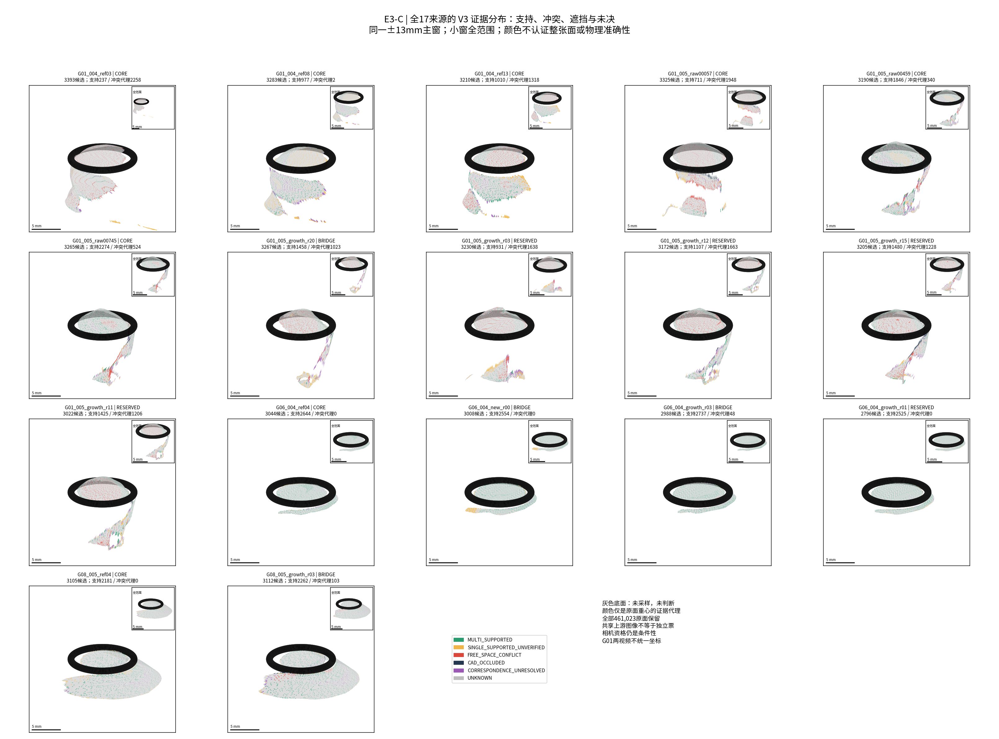
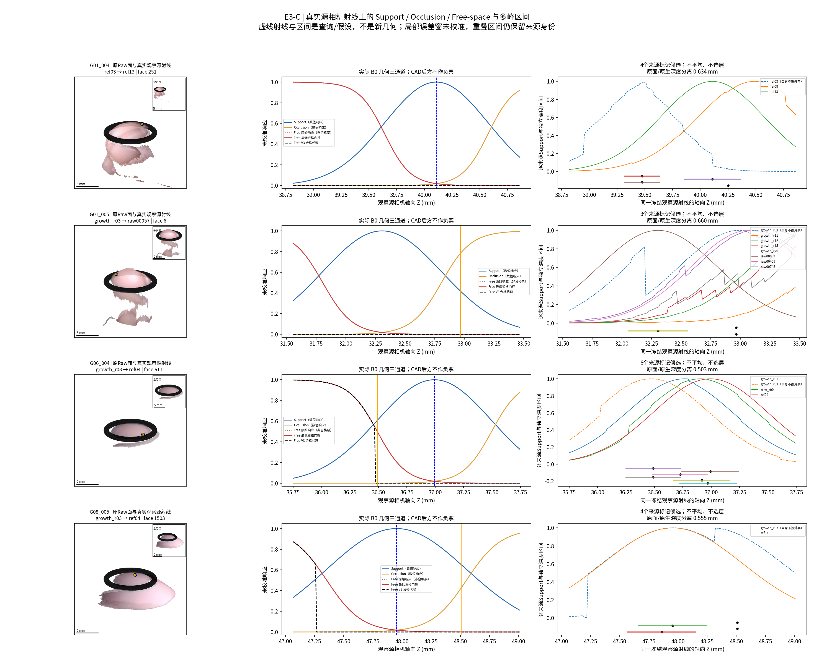
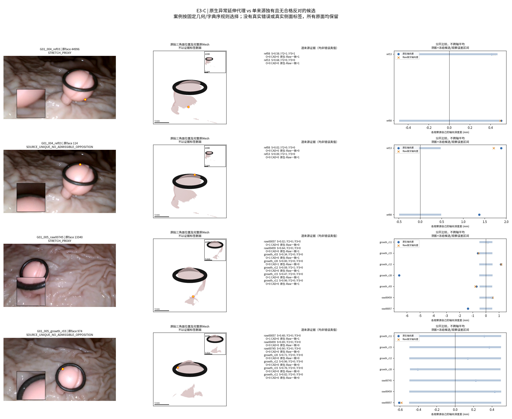
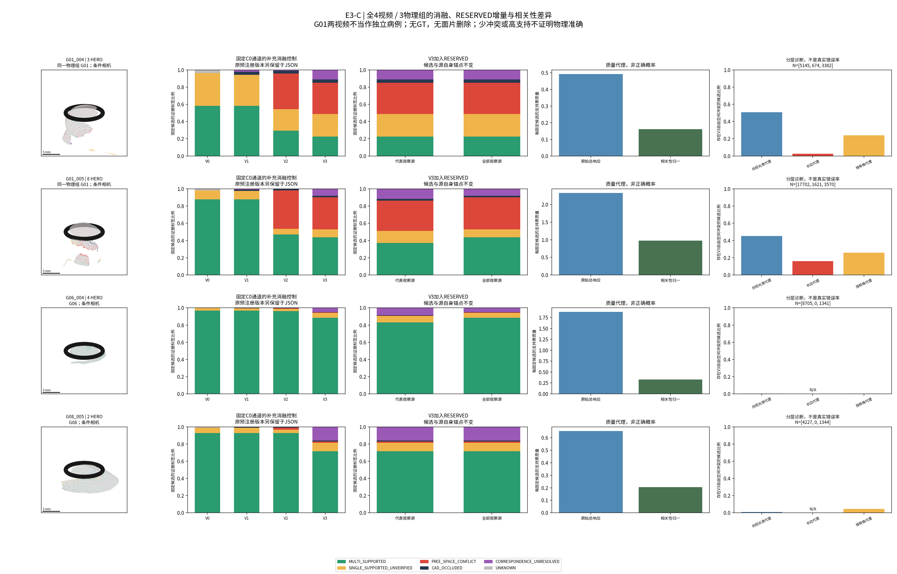

# E3-C TECHNICAL REPORT

本轮完成17份原始HERO局部场的多视角可见性证据计算、V0–V3消融及真实射线多峰窗口，但尚不能证明这些证据能可靠识别错误延伸。53,615个冻结原面重心、76个同视频有向来源对形成241,229次候选—观察源查询；所有原始面和候选保留。数值语义、遮挡次序和坐标检查通过，并不等于物理错误分类通过。G01长条代理的合格冲突比例低于光滑共视代理，故不把本轮标签升级为删面依据或全局场硬负监督。

任务 `TASK-E3-C-VISIBILITY-CONSENSUS-001`；分支 `exp/TASK-E3-C-VISIBILITY-CONSENSUS-001`；父提交 `a7c6233f33f9a2ec84b4ce19f668a187bd90b9c8`。本轮直接继承已获PM通过的E3-B；三份场源码和本地场协议字节一致，不调用旧初始化、来源审计、视角选择或融合main。原输入Hash、ROI、来源组织和真实观测分母不变。没有新HERO、CNN、GPU、训练、几何删改或全局拟合。

## 固定审计表

| 审计项目 | 必须汇报 |
| --- | --- |
| 目标组数 | 正式3物理组G01/G06/G08、4视频、17源；G01两视频同组。另保留G07压力身份，不纳正式成功率 |
| 本算法独立成功 | 证据工程17/17源、76/76有向对完成；不产生新重建或物理测量，可靠物理错误识别未确立 |
| 本算法失败 | 科学目标“可靠区分错误延伸与合理/独有表面”未通过证明；测量未执行，沿用4主组测量值均NaN |
| 历史测量值回退 | 0；无S0/V2旧直径/照片或其他预测补齐 |
| 失败组及具体原因 | G01两视频合理性代理也大量冲突；G06/G08无长条样本，不能报0%错误率；G07不合格。逐组链接见FAILURE_LEDGER |
| 最终统计样本 | 53,615固定候选及241,229观察源事件；分层采样频率不是独立病例准确率。测量0/4，MedARE/MAE/p95/max均NaN，共同成功配对N=0 |
| 是否使用GT选择算法 | 否；协议与候选在源间证据前冻结，未调阈值、未改评价标准制造科学PASS，未读GT/Oracle |

## 输入、采样与执行边界

正式源为004三份、005八份、G06四份、G08两份，CORE/BRIDGE/RESERVED及源DAG直接继承。读取E3-B独有格/可见性flag仅作固定采样分层，XYZ/法向/三角面身份始终来自原始Raw。F1/F2/F3最终几何、历史SE3调整面、跨视频融合及E2.7预测没有进入通路。只做运行时原输入完整性断言，不重新进行历史审计。

每源原面按均匀原face索引2048点，加开放边界、可见面、独有格、长边、碎片、Ring邻域和possible-stalk分层，最多3584个重心，联合后排序去重。总53,615张采样面；其余407,408面保持UNASSESSED，不能把重心证据推广为整面/整片真值。BASE是原面总体成员标志，BASE_N并非“只由2048基础抽样选中”的计数。分层重叠允许，频率不外推总体错误率。

两阶段固定全部17源候选与自身原始锚点，只改变**外部观察源**：先12个CORE/BRIDGE，再加入5个RESERVED。REP阶段不宣称只用代表源重建，来源自身从不计为外部票。前阶段142,114次查询，RESERVED增加99,115次；无需25³稠密ROI作为主要采样，没有创建全ROI体积。

## 几何通道与消融定义

候选A的毫米轴向误差沿其非单位射线转到观察源B相机，取区间半宽之和；见合同中的准确公式。Support为冻结宽度的Gaussian响应；Occlusion/Free-space为相反方向sigmoid。前方区间严格分离才计数自由空间冲突，后于首表面只是可能被遮挡。合法不同物理层的身份没有独立真值，不强制把它们当同表面误差。

V0保存数值Support；V1加入可能首表面/CAD遮挡及基本域资格；V2加入最低相机/Polyp Mask/有限深度/CAD合法性下的自由空间代理；V3再加源与观察源原生/Raw一致性、Mask/Ring边缘、首面质量、起源可见性、来源相关性和条件相机代理。Raw UDF仅作几何邻近资格，绝不与轴向差数值平均。

**消融解释限制**：原预注册V0数值Support与V1有效域门控并不完全相同，不能将V0→V1差异全部归于Occlusion。增加了明确标记的观察后`MATCHED_C0_CHANNEL_ADDITION_AUDIT`：只用已冻结同一C0与最低合法域，V0–V2 Support逐点保持一致，再依次加入O/F，V3与原结果完全相同。没有新阈值、场查询或替换原结果；它是控制审计，不冒充新预注册科学假设。图4展示此控制，原结果完整保留在同一JSON和CSV。

原B0内置CAD且任务要求所有自由空间都具合法遮挡次序，因此V2也保留最低CAD/Mask门槛，不故意构造危险的无CAD负票基线。V3增加的是更严格边缘/几何/来源条件；本轮无法单独归因Ring-only的因果收益。数值裸响应始终记录，不能将其当合格负票。

Jaccard归一按真实HERO父RGB集合计算，另报原始计数和归一响应。权重为未校准依赖/质量代理，不是正确概率或独立样本量；共享图像不抹掉独有几何。普通参考筛查链和全部上游非候选链分列，二者都不是绝对相机GT。

## 全部来源后的证据分布

| 视频 | 源数/候选 | MULTI | SINGLE未核验 | FREE代理 | CAD | 对应未决 | UNKNOWN | 同时有外部S和F |
| --- | --- | --- | --- | --- | --- | --- | --- | --- |
| G01_004 | 3/9886 | 2224 | 2598 | 3578 | 386 | 1099 | 1 | 1593 |
| G01_005 | 8/25676 | 11232 | 2368 | 9570 | 433 | 2054 | 19 | 8569 |
| G06_004 | 4/11836 | 10460 | 700 | 48 | 49 | 579 | 0 | 43 |
| G08_005 | 2/6217 | 4443 | 617 | 103 | 66 | 982 | 6 | 0 |

标签有优先级：存在合格F时记FREE_SPACE_CONFLICT，但表中仍保存同点的Support/Occlusion等证据，不能把类名当唯一事实。10,205个候选同时收到外部Support和F；高支持不能证明物理准确。CAD标签表示已知源遮挡证据，不认证所有视角都看不见。

## Q1：共同观察的合理表面是否较高Support？

| 视频 | 共视光滑代理N | 存在外部Support | 同组仍存在V3自由冲突 |
| --- | --- | --- | --- |
| G01_004 | 5145 | 60.10% | 50.83% |
| G01_005 | 17702 | 93.33% | 45.12% |
| G06_004 | 8705 | 97.12% | 0.34% |
| G08_005 | 4227 | 80.25% | 0.90% |

**CONDITIONAL / 物理合理性NOT_EVALUABLE**。该分层按源可见、光滑/非长边、非独有格和至少一个合法观察源定义，没有用深度残差或Support选“合理”组。很多候选获得支持，但G01同时有较多冲突；共视/光滑代理不认证同一物理表面，不能宣布真实合理面识别成功。

## Q2：错误延伸是否常违反可靠自由空间？

| 视频 | 长条代理N | 其中可被他源合法观察N | V3冲突候选N | V3冲突比例 | 对照光滑共视冲突比例 |
| --- | --- | --- | --- | --- | --- |
| G01_004 | 674 | 428 | 17 | 2.52% | 50.83% |
| G01_005 | 1621 | 1427 | 260 | 16.04% | 45.12% |
| G06_004 | 0 | 0 | 0 | N/A | 0.34% |
| G08_005 | 0 | 0 | 0 | N/A | 0.90% |

**未证明，当前数据不支持把该代理作可靠错误检测器。** G01_004长条代理仅17/674得到V3冲突（2.52%），005为260/1621（16.04%），低于对照。长条可能在其他源视场外/遮挡后、缺少可靠首面，或因边界/原生-Raw资格未能产生强反证；G01主体也可能受深度/相机偏差、不同层或对应身份未决影响。上述原因未被独立分解成物理错误真值，不能唯一归因。G06/G08长条样本N=0，比例N/A，未修改长边标准造样本。

## Q3：单来源独有侧面能否保留？

**数值守恒VERIFIED；真实侧面身份未认证。** 全部9,637个独有格候选保留，其中7,313个自身可见且无V3合格反对；其余即使出现冲突也保留原几何。没有第二来源不是反对票，遮挡/未知不导致删除。独有格是E3-B原面空间代理，不能保证是已确认真实侧面；图3案例为确定性几何/字典序规则的说明，不是只挑成功样本作统计。

## Q4：Ring后方是否错误记成自由空间？

**数值语义VERIFIED，物理投影资格仍条件性。** 全241,229源间事件中16,548个CAD遮挡事件没有进入V2/V3自由空间冲突；17源各16条真实Ring像素射线的272个控制同样为0。裸sigmoid响应可能非零，但被记录为不可采纳响应。此处保护从最低资格就存在，不能当作V3新产生的检测收益。

## Q5：0.5–1mm分歧是否保留多峰或连续区间？

**候选表示VERIFIED；物理层身份UNRESOLVED。** 16条实际源相机射线保留64个来源标记候选，各视频2条预定0.5–1mm差异窗口均保留起源原面和观察源native深度。原面相交点使用观察源非单位实际射线，t等于其轴向毫米Z；区间用局部平面误差传播，掠视不定不伪造精确边界。没有平均、soft-argmax选层或输出第三层。每Mesh只枚举首次交点加原候选，未声称穷尽所有背层。

## Q6：B0/Raw离散化差异是否制造敏感冲突？

**表示敏感性VERIFIED；真实“虚假冲突率”NOT_EVALUABLE。** 28,137条V2源间冲突中2,939条native判前方而Raw不判：737条有有限Raw首交，可见表示选择会改变判断；另2,202条无Raw首交，可能是开放Mesh缺面，不应全叫重采样假错误。V3对这些全部弃权，合计6,484条未通过强门槛，保留21,653条条件性代理（其中17,268条上下游均非候选链）。这些计数不证明谁更接近真实面，不能把Raw自动当GT。

## 科学判断、消融与下一阶段

四个视频均完成V0–V3，增加RESERVED使24,875个候选的V3类别或S/F计数变化；这是证据增量而非重建精度增量。相关性归一降低重复票质量但不会消除系统偏差：

| 视频 | 原始S总响应/固定候选 | 相关性归一S/固定候选 |
| --- | --- | --- |
| G01_004 | 0.49266 | 0.16054 |
| G01_005 | 2.32937 | 0.97658 |
| G06_004 | 1.87705 | 0.32889 |
| G08_005 | 0.65460 | 0.20456 |

**总体答案：可以按冻结几何假设区分数值Support、可能遮挡、合格自由空间代理和Unknown；尚不能可靠认证物理同一表面、真实错误延伸或真实独有结构。科学目标未确立，不据此推进标签驱动的全局删改/硬负监督。** 建议PM先审查证据误差/对应资格与未决机制；本轮不扩大参数搜索，不替换输入，不启动全局拟合。

## 验证、失败与可视化

17项数值/守恒检查通过：实际轴向误差传播、非单位射线、CAD不作F、同分母、原面/输入Hash、依赖归一、多峰存活等。补充34条同C0审计检查通过；这些不是“科学检测通过”。整个旧worktree状态和已有修改保留，所有原始面不移动/删除。CSV导出耗时故障和native模式可见性标注修正详见失败记录；均未改判据或模式位置。

[失败记录](FAILURE_LEDGER.md) · [后续全局场证据合同](CONSENSUS_TO_GLOBAL_FIELD_CONTRACT.md) · [复现](REPRODUCE.md) · [结果索引](RESULT_INDEX.md)。严格全链路独立评价身份沿用父阶段不足，本轮不作泛化/毫米测量准确率宣称。程序查询数在预算内；CSV首次重复解压耗时另录，未采样峰值RAM，不冒称完整性能认证。任务完成后停止，等待PM审计。
