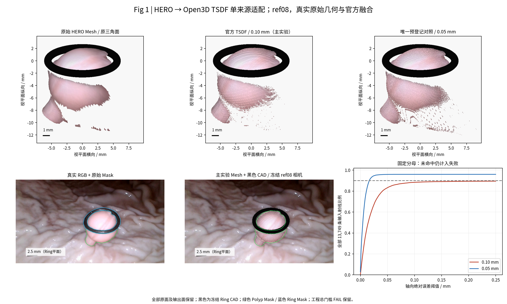
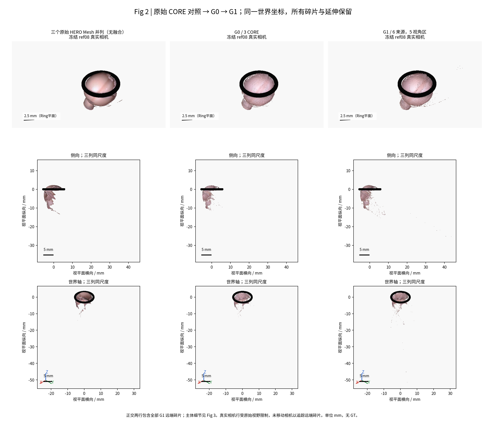
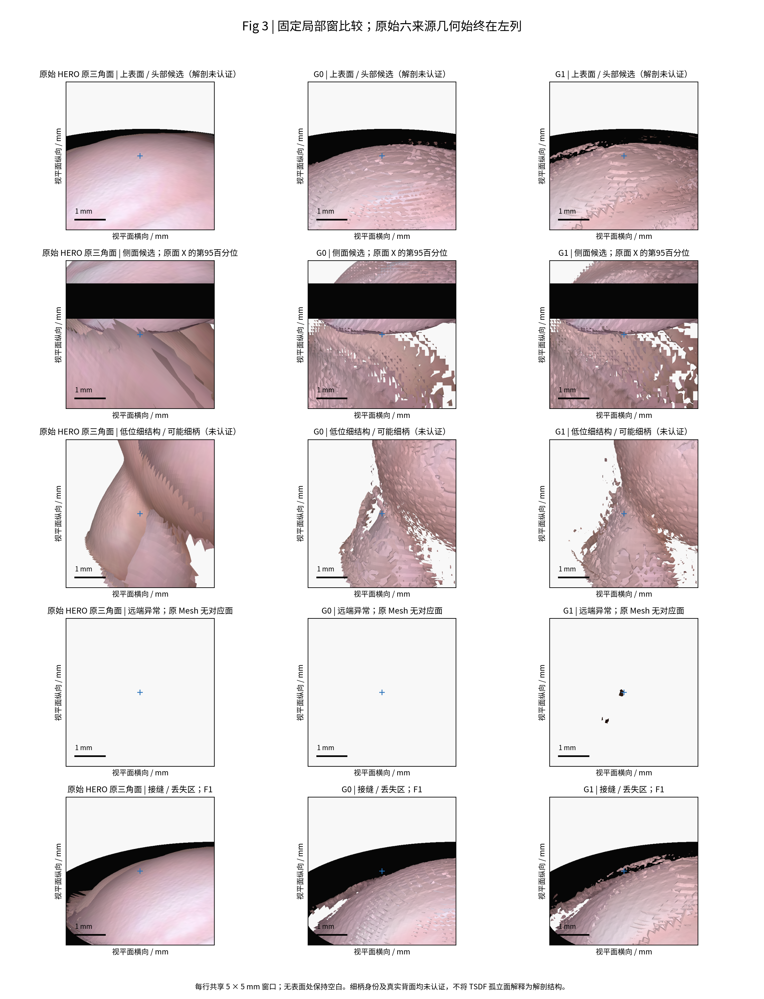
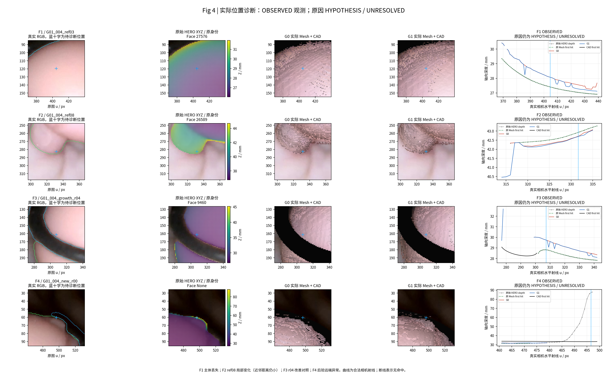

# TASK-E3-D0-OPEN3D-TSDF-BASELINE-001

日期：2026-11-02（Asia/Shanghai）。父提交 `6423b2709d1b528124ba6cc855883ba8a437e28c`；分支 `exp/TASK-E3-D0-OPEN3D-TSDF-BASELINE-001`。

## 实际结论与验收状态

已实际运行 Open3D 0.19.0 CPU 官方 ScalableTSDFVolume，并提取 SINGLE、G0、G1 Mesh。G1 对 CORE 原始面积的近邻保留率由 89.73% 提高至 95.89%，但 ref08 合格观测的首次可见深度一致率由 50.22% 降至 27.98%。更高的近邻保留和 Mask 覆盖并不等于正确的第一层可见曲面。

**本轮产出真实基础融合结果；几何质量未通过人工验收。预登记工程门槛仍为 FAIL；不正式冻结适配器、重建结果或科学参数。**

## 继承、输入与积分前冻结

原始 HERO 原生 352×640 轴向 Z 深度、历史 360×640 归档、原始 XYZ/Face ID、RGB、Mask、冻结 K/c2w、Ring CAD 均沿用。只核对本轮必要身份和 SHA，没有重新进行全资产审计。严格白名单拒绝历史融合、变形后 Mesh、E2.7 和跨视频几何。原始 Mesh 仅用于比较/诊断，实际 TSDF 输入为原生深度。

| 来源 | View Partition 区域 | 准入说明 |
| --- | --- | --- |
| ref03 / ref08 / ref13 | B2 / B3 / B5 | 历史条件性参考；同一冻结相机，非 GT |
| growth_r04 | B3 | 用户指定；Ring 与 ref03/ref08 图像关系通过；ref13 证据不足 |
| new_r00 | B1 | 唯一现有原始 HERO；Ring 轻微超容差、未达严重矛盾；ref03 图像支持 |
| growth_r14 | B4 | 唯一现有原始 HERO；未单独完成 Camera Gate，仅条件性纳入 |

G0 是 ref03/ref08/ref13。G1 按同序追加 growth_r04/new_r00/growth_r14，覆盖全部 5 个有现成来源的 View Partition 区域。其余 growth_r01/r06/r07/r10/r12 在已覆盖方向中未选用，未被删除或判为几何不合格。未用最终 Mesh 更换来源。Camera Gate 的历史 `INSUFFICIENT_EVIDENCE` 没有被改写为高可信资格；本轮按用户明确授权允许条件性方向参与。

冻结记录见 [TSDF_CONFIG.json](TSDF_CONFIG.json)、[VIEW_COVERAGE_SELECTION.csv](VIEW_COVERAGE_SELECTION.csv)、[HERO_TSDF_INPUT_MANIFEST.json](HERO_TSDF_INPUT_MANIFEST.json) 和 [积分前 SHA](config/BEFORE_ANY_INTEGRATION.json)。六来源合计 106,144 个有效原生 Polyp 像素；采样足迹中位 0.063525 mm、p95 0.084879 mm。固定主参数 voxel=0.1 mm、sdf_trunc=0.4 mm、depth_trunc=100 mm、volume_unit_resolution=16、depth_sampling_stride=1。0.25 mm 深度不确定度仅继承 E3-B 代理，未经传感器标定；上述参数未经科学质量验收。

## HEROToTSDFAdapter 与单来源验证

- K 使用已有半像素中心保持转换，native stored K 存在时做精确核对；不调整相机。原生深度双线性恢复归档与原 XYZ 祖先误差 ≤2e-5 mm，XYZ 精确反投影误差 ≤1e-6 mm。
- RGB 采用 INTER_AREA 到原生尺寸；类别 Mask 用 INTER_NEAREST。只让有限、正值、label=1 深度进入 RGB-D；Ring、背景、未知为零。没有填远深度、孔洞或背面。
- 深度 mm×0.001、c2w 平移 mm×0.001、体素和截断同样转 m；积分使用 metric `inverse(c2w)`。Mesh 提取后坐标×1000，仅一次；未修复、平滑、删面。Ring 的外包围径约 12.4 mm，沿用黑色原 CAD，从不进入 TSDF。
- CAD 只参与呈现和固定诊断，不预过滤 Polyp 深度，也不按 E3-C 标签或输出轮廓删除。

ref08 原生有效射线分母 13,749。主参数命中 12,313（89.56%），低于积分前冻结的 90%。98.69% 原生输入点距输出表面 ≤0.2 mm；有限命中深度误差中位 0.01205 mm、p95 0.05780 mm。**完整分母的深度 p95 为 +∞（未命中保留），不能把有限命中的 p95 当整体成功。** 1,436 条未命中中，881 条在 Mask 边界 2 像素内、555 条在更深的内部。原面样本距输出 ≤0.2 mm 比例 99.82%；相近的表面不保证同一射线有交点。

唯一预登记分辨率对照为 voxel=0.05 mm、同一 0.4 mm 截断，触发理由为主结果命中率 <90%。它命中 13,201（96.01%），完整分母深度 p95=0.02684 mm，输入点保留 99.96%。因此离散化/开放有效域对损失有实际影响；并不证明所有孔洞均由分辨率引起。**未用该对照替换 G0/G1 主参数，未运行第二组分辨率对照。**

毫米/米官方积分的双向顶点到实际三角面的距离中位 0.000003243 mm、p95 0.000011985 mm，最大 **0.0020026695 mm**，略高于原冻结 **0.002 mm**。不能四舍五入制造 PASS。首次实现用最近顶点作 Mesh Hausdorff 近似（0.002073 mm），诊断纠正为顶点到三角面代理；仍失败。严格连续曲面的数学 Hausdorff 未计算，该顶点取样是实现代理，应由 PM 审阅规范。主体坐标/尺度没有 1000 倍、外参方向或 K 错位；极小残差的具体浮点/拓扑原因未完全证明。

主 SINGLE 面积 137.15 mm²，对照原 ref08 面积 154.98 mm²；按实际被三角面引用的顶点计算包围盒中心偏移约 0.236 mm（精确值见 config/SINGLE_BOUNDS_DIAGNOSIS.json）。最初以包含未连面 XYZ 的全点包围盒比较得到 1.18 mm，另存原值，不能将其称作原 Mesh 主体位移。极端区域丢失与整体收缩不能等同。原主体局部距表面很小，但不宣称全域保形。主 SINGLE 有 648 个分量、无封闭分量；0.05 对照有 367 分量、2 个极小封闭分量（总面积约 0.000268 mm²），均保留。

初次断言失败后先停止多来源积分，保存原失败，再定位 Mask 边界、分辨率与数值等价残差。按用户要求“方法允许失败但必须实际输出”，随后以明确的失败机制诊断身份继续 G0/G1；[DIAGNOSTIC_CONTINUATION.json](config/DIAGNOSTIC_CONTINUATION.json) 记录此决定。没有把失败改为通过，也没有签发正式适配器冻结文件。

## G0/G1 固定分母结果

下表保留率在每份原始 Mesh 的**全部原始面中心**上查询输出距离，按原面面积加权；同一原面只有一个中心样本，细小边界误差仍可能低估。阈值 0.25 mm 预先固定。每来源完整原始面数和面积均在 CSV。六来源重叠面积是来源观测的重复计数，不是实体解剖面积。

合格 HERO 深度一致率分母由固定 stride=2 的真实 Polyp 像素、有效原深度和原深度/CAD 可见次序确定，与输出无关；要求输出首次交点可见且轴向深度差 ≤0.25 mm。所有未命中仍在分母。Mask 覆盖另对全部固定 Polyp Mask 像素报告，未以输出命中数替代分母。

| 来源 / 原面分母 | G0 面积保留 ≤0.25 mm | G1 面积保留 | G0→G1 合格 HERO 深度一致率 |
| --- | --- | --- | --- |
| G01_004_ref03 / 46805 | 71.65% | 88.96% | 27.36% → 50.49% |
| G01_004_ref08 / 26621 | 99.93% | 99.74% | 50.22% → 27.98% |
| G01_004_ref13 / 24453 | 97.91% | 99.08% | 66.64% → 79.41% |
| G01_004_growth_r04 / 40950 | 67.89% | 86.34% | 31.78% → 54.86% |
| G01_004_new_r00 / 44465 | 30.09% | 45.23% | 3.52% → 11.66% |
| G01_004_growth_r14 / 23283 | 12.29% | 25.99% | 0.72% → 2.90% |

共同 CORE 原面总数 97879、来源面积和 470.27 mm²；上述 89.73%→95.89% 为同三份原面配对比较。新方向的保留提升不代表深度正确：new_r00/r14 的合格观测深度一致率仍仅 11.66%/2.90%。

ref08 Mask 覆盖 92.25%→93.28%，深度一致率反而显著下降。ref08 可见预测中落在 Mask 外的比例 0.90%→1.61%；是图像对应代理，不能把背景/遮挡边界不确定性当物理 GT。

| 指标 | G0 | G1 |
| --- | --- | --- |
| 实际顶点 / 三角面 | 52087 / 90130 | 68948 / 118240 |
| 总面积 / mm² | 284.97 | 371.36 |
| 边相连分量 | 1700 | 2526 |
| 最大分量面积占比 | 44.16% | 50.76% |
| 面积 >1 mm² 的分量 | 6 | 5 |
| 开放边数 | 11140 | 15478 |
| 封闭分量 / 封闭面积 mm² | 722 / 25.79 | 853 / 16.59 |
| 无来源深度支持代理面积占比 | 9.33% | 14.29% |

原始 ref03/ref08/ref13 只有 6/8/10 个边相连分量，三者原面并列共 24 个分量（不合并原面身份），且各自没有封闭分量；见 [ORIGINAL_MESH_TOPOLOGY.csv](ORIGINAL_MESH_TOPOLOGY.csv)。因此本轮碎片化不是仅把原始多片身份重新计数。局部 5×5 mm 窗口的原面固定分母统计见 [DETAIL_REGION_METRICS.csv](DETAIL_REGION_METRICS.csv)，为后验描述，不是新增成功门槛。

“统一 Mesh”表示同一世界场提取的容器，**不表示单一连续有效解剖表面**。G0/G1 均不水密，且具有大量局部封闭小分量；不能用“整体不水密”掩盖这些闭合碎片。未知面积以同一六来源查询集定义：候选面中心投到有效 Polyp、通过 CAD 可见次序且与原生深度相差 ≤0.25 mm，至少一来源支持才算观测代理；否则 Unknown。相关来源的支持计数不当作独立统计票数，不声称物理真值。

原始开放侧面在新增方向中更多被保留，但 G1 更碎，且合法第一层对应没有同步改善。Fig3 的低位细结构有缺口；“真实细柄”身份没有独立证据，不能给出认证的细柄召回率或宣称其已恢复。近邻度量也不能认证未知背面。

## 失败机制与因果边界

**A 输入适配：** K/轴向 Z/原始 XYZ/mm→m/w2c/Mask 的代数和源 SHA 核对通过，未观察到严重单位或方向错误。严格单位数值门槛仍失败；原生 Mask 最近邻与归档双线性深度、历史原面有效域的差异是实际工程问题，不能忽略。

**B 相机：** 固定原相机没有优化。新增方向条件性证据不充分，深度与位姿误差仍混淆；当前结果不能证明某个候选存在严重位姿错误，也不能据此认证 growth_r14。

**C HERO/原始表达：** 原始深度已含边界跳变和多参考不一致。六来源中距各自原始三角面 >1 mm 的原生 Mask 点数分别为 243/110/134/124/283/200，其中大量位于 Mask 边界 2 像素内。历史 Raw Mesh 没有为这些深度点连面，不代表原生深度值被篡改。来源 raw XYZ/Face ID 均保留；未用“清洗后”几何代替。

**D 标准 TSDF：** 分辨率对照证明采样/有限观察有效域影响可见交点。多帧标准 projective 距离累计会在不一致深度间产生折中与多个零层；本轮观察到闭合碎片和近邻保留/第一层深度分离，因果中还含 B/C，不能仅凭这些现象独断归因。

G1 距所有六份原始 Mesh >1 mm 的输出面积为 1.5748 mm²（0.42%），最大中心距离 43.845 mm；极端点约 (34.16,43.64,-25.44) mm。此处 new_r00 原生邻近像素为 Polyp、轴向深度约 87.18 mm，其他来源投影为背景。它证明原始深度/Mask 有孤立远端候选可进入 TSDF，不证明其解剖身份；从真实相机看还可能被输出前层挡住。F4 为明确标记的**后验附加诊断**，没有改变三项预登记案例选择或性能分母。

E3-C 证据只在所有重建完成后读取，按原面身份查询保留率，见 [E3C_POSTHOC_DIAGNOSTICS.csv](E3C_POSTHOC_DIAGNOSTICS.csv)；未作输入过滤。其支持/冲突本身也受同源 RGB、相机资格与 Raw/native 离散化影响。F3 是 r04 近邻改善对照，位置邻近 CAD 且可被遮挡，不是已认证的新可见解剖。

## 可复现结果与图

四图由真实输入与实际提取面 CPU 射线投影生成；黑色 Ring 为冻结 CAD 实体。近真实相机行严格使用 ref08 K/c2w，其他视角共享毫米尺度。保留全部碎片，无纹理平面、重建后删面或平滑。轻量 [SINGLE](previews/SINGLE_mm.glb)、[G0](previews/G0_mm.glb)、[G1](previews/G1_mm.glb) 是完整实际面加独立黑色 CAD；数值坐标为 mm（GLB 查看器可能默认标 m，请遵从清单）。

本地保存实际 Mesh、官方观测 TSDF 带及完整 Masked RGB-D 重放数据，见 [LOCAL_RESULTS_INDEX.json](LOCAL_RESULTS_INDEX.json)。**Open3D legacy Python API 不暴露完整体素权重/完整 volume 序列化，本轮保存的带不是全量体积文件**；有精确输入、积分顺序、参数和重放脚本，可重新构造官方内存 volume。未自行重写积分器或用采样带冒称完整状态。官方实现和导出语义依据 [ScalableTSDFVolume v0.19.0](https://raw.githubusercontent.com/isl-org/Open3D/v0.19.0/cpp/open3d/pipelines/integration/ScalableTSDFVolume.cpp)、[UniformTSDFVolume v0.19.0](https://raw.githubusercontent.com/isl-org/Open3D/v0.19.0/cpp/open3d/pipelines/integration/UniformTSDFVolume.cpp)；导出仅含已观测且归一 TSDF 在 [-0.98,0.98) 的带。

合同检查 24 PASS / 1 FAIL。独立使用保存的三份 Masked RGB-D 重放 G0，顶点/面数与原结果一致，表面距离小于 1e-4 mm；六来源输入 SHA 和所有历史工作树保持一致。详见 [VALIDATION_RESULTS.csv](VALIDATION_RESULTS.csv)。没有 GPU、模型导入、推理、训练、优化、GT 或历史测量值回退。

## 五个最终问题

1. **Q1：可实际接入并保留毫米几何；严格工程验收仍 FAIL，暂不正式冻结。** 大尺度适配正确，有限有效域和极小单位等价残差仍需 PM 审阅。
2. **Q2：能形成同一隐式体积的实际 Mesh；尚不能称可用连续解剖曲面。** 1,700 个 G0 分量、最大面积占比 44.16%，碎片和原表面损失不能隐藏。
3. **Q3：G1 改善 ref03/r04 的原面保留和真实合格深度对应，也改善新增方向部分近邻保留；ref08 第一层深度一致率恶化，Unknown 和远端碎片增加。** 不接受“更多方向一定更好”。
4. **Q4：分辨率/有效域贡献有控制证据；多参考深度与相机资格问题尚无法完全分离。** 不能把全部错误归于 TSDF，也不能把全部重复层归于某份 HERO。
5. **Q5：优先审查原生深度与 Mask/开放边界有效域，并做真实跨视角轮廓批评和可靠第一层共识诊断。** 之后才考虑支持权重；没有证据要求立即换 Neural SDF、相机重估或密度权重。具体建议见 NEXT_STAGE_RECOMMENDATION.md，未执行下一阶段。

## 固定审计表

| 审计项目 | 必须汇报 |
| --- | --- |
| 目标组数 | 1 个物理组 / G01_004 单视频；G0 3 来源，G1 6 来源；可用原始来源共 11 份 |
| 本算法独立成功 | 1/1 视频产生实际 TSDF Mesh；SINGLE、G0、G1 均非空。仅数值输出成功，几何质量未通过验收 |
| 本算法失败 | 单来源冻结门槛 FAIL；可用连续解剖曲面成功 0/1；测量未执行，直径及中位绝对相对误差/MAE/p95/最大测量误差全部 NaN |
| 历史测量值回退 | 0；无 S0/V2/旧直径/融合预测回退 |
| 失败组及具体原因 | G01_004：单源命中损失、碎片、覆盖与深度一致性分离、远端孤立面；见 FAILURE_LEDGER.md、Fig1–4 |
| 最终统计样本 | 6 个固定原来源面的完整分母；共同 CORE 3 来源配对；几何距离为输入一致性代理。全体目标分母 1 视频 |
| 是否使用 GT 选择算法 | 否；GT/Oracle/Dxy 均未读取；积分前参数/来源/输入 SHA 见 config/BEFORE_ANY_INTEGRATION.json |

完成后停止，等待 PM/研究者审阅；没有运行 G2/G3。
