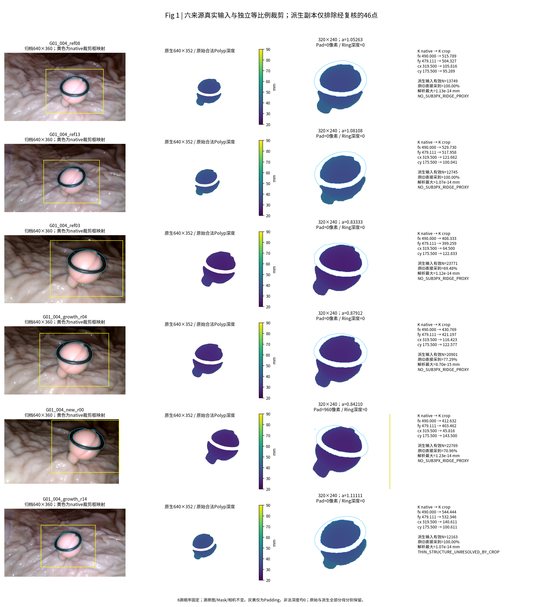
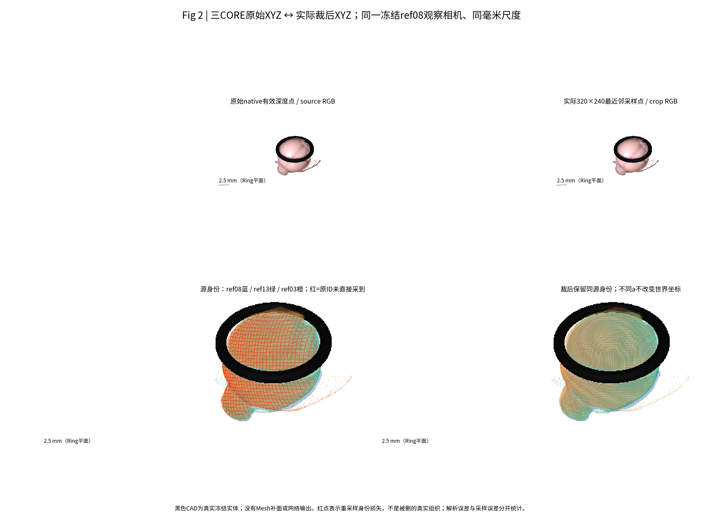
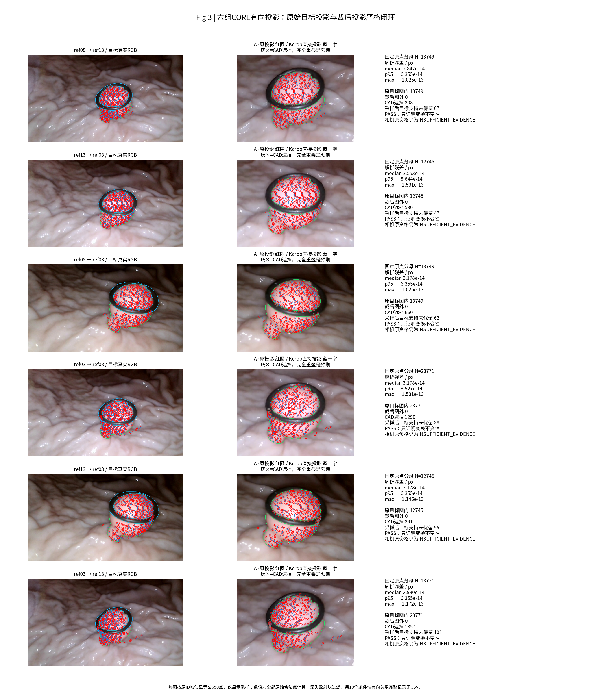
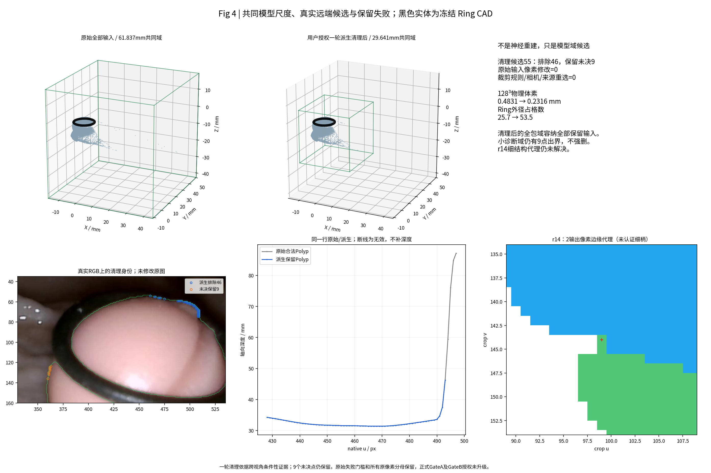

# TASK-E3-N0-GATE-A-COMPAT-CROP-METRIC-001

日期：2026-11-02（Asia/Shanghai）；父提交 `d69ade170352d1b5a1e46239f9516ab38c575648`；分支 `exp/TASK-E3-N0-GATE-A-COMPAT-CROP-METRIC-001`。

本轮仅执行Gate A。官方ShapeNet主模型在CPU构造并以strict=True加载，30个状态张量与1,403,920个神经参数逐项一致，未调用任何模型前向。六来源独立等比例裁剪的同原像素解析XYZ最大误差为1.59×10⁻¹⁴mm，三CORE六有向关系及18个条件性关系均保持，最大投影残差1.73×10⁻¹³px。原始全包域因边缘远端深度扩大至61.837mm；研究者现场判读后新增授权一轮投影清理，55候选中46点在派生副本排除、9点保留，候选全包域缩至29.641mm、体素0.23157mm。原始HERO/Mask/相机均未变。r14裁后出现2像素边缘宽度代理，低于冻结3像素门槛；尚不能认定为真实细柄损失，仍保留FAIL。整体结论为GATE_A_FAIL，未进入Gate B、GPU或任何融合实验。

## 授权、输入与复用

已读取AGENTS.md、COLLAB_STANDARD_v1.3.md及四份PM文件（docs/按原字节保留）。PM草案的DRAFT_NOT_APPROVED由用户本轮明确批准Gate A覆盖；B/C/D未获授权。首次缺文件时暂停正式验收，研究者下载补齐后才冻结并计算。附件和四文件SHA见 [AUTHORIZATION_AND_DOCUMENTS.json](config/AUTHORIZATION_AND_DOCUMENTS.json)。

顺序严格为ref08(B3)、ref13(B5)、ref03(B2)、growth_r04(B3)、new_r00(B1)、growth_r14(B4)。CORE是本轮角色，未提升历史相机资格：前五均保留Camera Gate的INSUFFICIENT_EVIDENCE，r14仍未单独完成Camera Gate。来源DAG、上游RGB相关性、原生352×640、归档360×640、原K/c2w和CAD沿用D0六源白名单。只验证必要六源文件及SHA，没有重做全资产审计。

实际复用 [CODE_REUSE_MATRIX.md](CODE_REUSE_MATRIX.md)：D0 source/native ancestry、HEROToTSDFAdapter、mesh_scene/cast/distance/ringmesh，旧unproject，冻结scaled_intrinsics/project_camera/camera_rays，SameCameraScene。采用精确AST抽取/直接导入，绑定本任务IO以避免D0模块main和旧输出写入。新增内容只是裁剪仿射、身份可追踪采样器与诊断组合；没有重写相机投影、反投影或射线算法。Raw Mesh仅作比较/诊断bbox，不生成伪深度。

## A6 官方模型、权重与环境

官方固定提交 [`4f0c14f`](https://github.com/weders/NeuralFusion/tree/4f0c14f67ad9d2368b68cbeb78c237a6328971e5)，24个代码/配置/权重文件逐Git blob及本地SHA256核对，清单 [OFFICIAL_ARTIFACTS.json](config/OFFICIAL_ARTIFACTS.json)。

| 权重 | SHA256 | 静态结构及结果 |
| --- | --- | --- |
| ShapeNet noise0.005 / best.ckpt | `3ac6dc9f219449e8aa5a26dec0a77691714e55d4e29da688c79630bf46068bff` | 16,882,708 bytes；128³、17特征（16 learned+count）、±3体素采样、SDF/occupancy heads、output_scale=0.04；strict=True PASS |
| Tanks&Temples / best.ckpt | `404867f7ab7e7cf978cd31bab3466334f50b4d12a3721e24e10e7d7d56ea570b` | 18,237,012 bytes；64³、9特征、外部count、±6采样、output_scale=0.06；仅静态反序列化/配置核验，无备用模型构造或前向 |

主模型保留官方FusionPipeline及全部层，仅以普通torch.nn.Module承载官方Lightning checkpoint的`_pipeline.`命名空间，避免import训练/GT数据库。未过滤任何state key；严格missing/unexpected/shape mismatch均为0。config.json、checkpoint hyper_parameters、hparams.yaml的网络配置一致，唯一运行设备放置为CPU。`weights_only=True`，只额外允许经审读的官方EasyDict1.9数据类；YAML用不构造Python对象的BaseLoader解析。备用状态与主结构的混载在真正载入前由键/形状合同拒绝，未用strict=False。

本机Python3.12.13、Torch2.7.1+cu128（以 [实际runtime记录](config/CHECKPOINT_COMPATIBILITY_DETAILS.json) 为准），官方锁定Python3.7.6/Torch1.10.1/Lightning1.5.7/CUDA10.2/Open3D0.10。CPU严格加载进程峰值RSS约785.3MiB；这不是融合峰值。未初始化CUDA，驱动仅只读/proc信息；GPU可用性/融合运行兼容NOT_TESTED。Open3D0.19复用历史vendor做CPU射线，无新TSDF。

主环境未修改。PyPI下载EasyDict因TLS EOF失败，改用其官方1.9标签对应提交`9d570ecc2799d8df16c640100c89a028dabc03a7`的原模块，独立置于任务runtime/python并核对blob/SHA；未升级全局包。官方training/database.py所需graphics沿RoutedFusion固定submodule追到[`weders/graphics@dfdd7d2`](https://github.com/weders/graphics/blob/dfdd7d21dcafe2542eb56f9c57f605117abbe4c5/src/graphics/voxelgrid.py)，还依赖tsdf/gridData等；没有安装或执行GT数据库。这个依赖问题不妨碍纯模块CPU构造，但完整官方test.py不在本轮可运行合同中。

[`pipeline.py`](https://github.com/weders/NeuralFusion/blob/4f0c14f67ad9d2368b68cbeb78c237a6328971e5/pipeline/pipeline.py)硬编码B1/H240/W320，FusionNet LayerNorm也固定空间尺寸。输入只消费深度/Mask/K/c2w、origin/resolution/latent/count，RGB仅供本轮判图。[`integrator.py`](https://github.com/weders/NeuralFusion/blob/4f0c14f67ad9d2368b68cbeb78c237a6328971e5/pipeline/integrator.py)在use_count=true时使用latent最后一维计数，外部count仍须初始化；reset不能替代重新置零体积/count。Translator可解码SDF/occupancy，但零count/Unknown的行为未前向验证，不得认证其零面。

## A2 独立裁剪与相同身份验证

[预登记协议](config/GATE_A_PREREGISTERED.json)在正式计算前冻结：FP64解析XYZ≤1e-5mm、连续目标投影≤1e-4px、薄结构输出宽度代理≥3px；所有原生合法点参与（每源12,163–23,771，均超过1000），不是只取有利像素。边界、近Ring、头部、深度跳变等都在完整点集中；原生未发现宽≤6px的medial ridge细柄代理，不能据此声称没有真实细柄。

每源bbox(Polyp∪visible Ring)两侧扩`max(ceil(0.2*max边),16px)`，扩为最小整数4k×3k虚拟矩形，再等比映到320×240。原图外是显式padding，不clip ROI。像素中心公式`u'=a(u-u0+0.5)-0.5`，`K'=AK`；nearest=floor(逆映射中心+0.5)。不同a完全允许，三维R/t与共同模型尺度不随之改变。深度只取对应原像素的合法Polyp值；不在无效0与前景间插值。

| 来源 | 原生合法N | a | 原ID采到比例（原始） | 派生排除N | 量化误差p95 / max mm（派生） | 最窄输出代理px |
| --- | --- | --- | --- | --- | --- | --- |
| G01_004_ref08 | 13749 | 1.052632 | 100.00% | 0 | 0.04463 / 0.06592 | 9.9938 |
| G01_004_ref13 | 12745 | 1.081081 | 100.00% | 0 | 0.04434 / 0.06486 | 12.7876 |
| G01_004_ref03 | 23771 | 0.833333 | 69.48% | 0 | 0.11260 / 13.42067 | 14.0000 |
| G01_004_growth_r04 | 20901 | 0.879121 | 77.29% | 0 | 0.10669 / 11.63899 | 9.9938 |
| G01_004_new_r00 | 22815 | 0.842105 | 70.94% | 46 | 0.12149 / 19.55735 | 14.0000 |
| G01_004_growth_r14 | 12163 | 1.111111 | 100.00% | 0 | 0.04397 / 0.06830 | 2.0000 |

六源ROI外丢失为0；ref03/r04/r00的原像素ID未直接采到是**离散重采样身份损失**，不能冒充连续几何错位，也不等于丢失同等百分比实体面积。逐原ID的represent/nearest-source-ID/actualXYZ误差均保存在local_results。解析最大原始1.5888e-14mm，派生1.2307e-14mm；实际nearest量化最大值仍达ref03 13.42mm、r04 11.64mm、派生r00 19.56mm，来自深度跳变处取到不同原像素，不能只报约0.03mm中位数遮蔽极值。原始r00最大49.77mm也保留。

Ring/BG/Unknown/Pad进入有效深度的数量全部0。r00 padding=960输出像素，其余0。解析CAD前后次序变化全部0；真实离散采样后的CAD次序变化依次64/45/86/47/107/51条（r00原始108），说明像素量化会影响遮挡资格，应供未来B阶段首层审计，不能混成解析变换失败或静默排除。

r14在crop(99,143)附近有一个宽度代理2px的局部距离变换极大值；原生没有对应<3px的medial ridge。现场图更接近Mask边缘凸起，**未认证为真实细柄，也未证明真实细柄已丢失**。冻结规则没有例外，本轮记THIN_STRUCTURE_UNRESOLVED_BY_CROP并保留FAIL，未手工改其ROI、删除像素或放宽阈值。

## A3 核心：跨视角关系不变性

直接使用原始世界点及冻结目标相机，比`π'_j(X)`与`A_jπ_j(X)`。没有最近邻点云替代身份闭环，没有剔除图外/遮挡点提高误差。以下是全部原点分母；CAD遮挡与目标支持采样变化是资格/采样记录，不能据此认证原位姿。

| 有向关系 | 完整原点N | median px | p95 px | max px | 裁后图外 / CAD遮挡 / 目标支持采样损失 |
| --- | --- | --- | --- | --- | --- |
| ref08→ref13 | 13749 | 2.842e-14 | 6.355e-14 | 1.025e-13 | 0 / 808 / 67 |
| ref13→ref08 | 12745 | 3.553e-14 | 8.644e-14 | 1.531e-13 | 0 / 530 / 47 |
| ref08→ref03 | 13749 | 3.178e-14 | 6.355e-14 | 1.025e-13 | 0 / 660 / 62 |
| ref03→ref08 | 23771 | 3.178e-14 | 8.527e-14 | 1.531e-13 | 0 / 1290 / 88 |
| ref13→ref03 | 12745 | 3.178e-14 | 6.355e-14 | 1.146e-13 | 0 / 891 / 55 |
| ref03→ref13 | 23771 | 2.930e-14 | 6.355e-14 | 1.172e-13 | 0 / 1857 / 101 |

全部24关系最大1.7288e-13px。条件性来源的完整表：

| 条件性有向关系 | 全部原点N | max px | OUT_OF_CROP_FIELD / CAD |
| --- | --- | --- | --- |
| growth_r04→ref08 | 20901 | 1.271e-13 | 0 / 1025 |
| ref08→growth_r04 | 13749 | 9.533e-14 | 0 / 494 |
| growth_r04→ref13 | 20901 | 1.705e-13 | 0 / 1425 |
| ref13→growth_r04 | 12745 | 9.533e-14 | 0 / 701 |
| growth_r04→ref03 | 20901 | 1.146e-13 | 0 / 877 |
| ref03→growth_r04 | 23771 | 9.099e-14 | 0 / 923 |
| new_r00→ref08 | 22815 | 1.729e-13 | 28 / 1278 |
| ref08→new_r00 | 13749 | 1.428e-13 | 0 / 843 |
| new_r00→ref13 | 22815 | 1.729e-13 | 72 / 1815 |
| ref13→new_r00 | 12745 | 1.449e-13 | 0 / 995 |
| new_r00→ref03 | 22815 | 1.271e-13 | 0 / 913 |
| ref03→new_r00 | 23771 | 1.421e-13 | 0 / 701 |
| growth_r14→ref08 | 12163 | 1.449e-13 | 0 / 557 |
| ref08→growth_r14 | 13749 | 1.214e-13 | 0 / 914 |
| growth_r14→ref13 | 12163 | 1.137e-13 | 0 / 350 |
| ref13→growth_r14 | 12745 | 1.271e-13 | 0 / 379 |
| growth_r14→ref03 | 12163 | 1.206e-13 | 0 / 793 |
| ref03→growth_r14 | 23771 | 1.271e-13 | 0 / 2006 |

清理后再次执行相同24关系，仍使用全部**原始**世界点/ID（含46个派生排除点），数值门槛全部保持；其新目标输入有效域另列。未将排除点从坐标验证分母消失。原始及派生CSV均上传；完整逐点target UV/Mask/CAD/图外标志留本地索引。r00→ref08/13的28/72个图外投影如实保留。

## 人工判读后的单轮投影清理：新增授权

原本Gate A不做清理。发现55点使模型域膨胀后，先停域选择，提供两张真实RGB/Mask/深度/3D判读图。研究者明确判断这些边缘点的极远三维位置不可信，并新增授权一轮多角度投影清理后再选域。授权和方法边界见 [HUMAN_JUDGMENT_AND_SCOPE_UPDATE.json](config/HUMAN_JUDGMENT_AND_SCOPE_UPDATE.json)。它不授权任何神经前向或一般G2/G3。

本轮仅以已判读的55个new_r00原生像素为候选；其余106,089个原合法像素不在清理池。先冻结 [单轮规则](config/PROJECTIVE_CLEANUP_PREREGISTERED.json)：用ref08/ref13/ref03及r04作条件性观察者，至少两个不同View Partition区域出现图内BG投影、距Polyp外轮廓>8归档像素、无CAD遮挡，且没有≤0.25mm深度支持，才在派生副本无效化。8px来自历史CORE Ring p95最大值向上取整再加2px，并非看清理结果调阈。相同B3的ref08/r04不作为两个独立方向票；共享RGB仍不能当独立统计证据。

结果：**46/55派生排除，9/55保留未决**。9点P47–P55在其他视角落于Polyp Mask但存在前后层差异，其中还有CAD遮挡；不能把合法遮挡简单当错误面。全部220条观察证据、逐点动作与原坐标在 [PROJECTIVE_CLEANUP_EVIDENCE.csv](PROJECTIVE_CLEANUP_EVIDENCE.csv)、[DECISIONS](PROJECTIVE_CLEANUP_DECISIONS.csv)。原始文件/Mask/三角面均未删除；派生depth置0、valid=0，表现为Unknown，未补面。

这套轮廓反证仍受条件性相机与未知真实背景遮挡影响，**是经人工先验支持的工程代理，不是物理错误GT**。没有使用E3-C Free-space硬标签，没有新相机/匹配模型或参数搜索，只执行一轮。六源/源DAG/方向顺序/裁剪规则不变。

## A4 公制模型尺度与选择

原始全包候选L=61.837mm，128³体素0.483102mm，约12.4mm Ring只占25.67格；诊断小框L=25.735mm会有55原合法点出界。因此先保留停机记录并请求研究者判断，未偷删深度。

按新增授权清理后，选择**容纳全部保留输入（含9未决点）**的候选域：

- O_mm = `[-10.240616086290146, -9.371236711407906, -21.76109316740262]`；L_mm =29.641；同一世界/模型坐标适用于全部六源。
- `X_model=(X_mm-O_mm)/L_mm`，resolution_model=1/128；物理体素 **0.2315703125mm**，Ring外径约53.55格。
- 深度Z_model=Z_mm/L；c2w旋转不变，中心`(C_mm-O_mm)/L`；绝不是D0的w2c。所有源共用同一个3D尺度。
- Ring逆变换最大误差 `3.389e-15mm`，恢复外径约 `12.39999962mm`。公制代数可靠，没有通过GT或相机拟合确定尺度。
- 清理后原生输入106,098点全部在当前候选域；诊断小域仍有9点出界，故不用它强裁点。原始106,144分母另保留。

原始域、派生域、当前候选选择均在 [METRIC_TRANSFORM.json](METRIC_TRANSFORM.json)及 [POST_REVIEW_DOMAIN_SELECTION.json](config/POST_REVIEW_DOMAIN_SELECTION.json)。候选已选供PM审阅，**未正式冻结为可推理的合格模型域**。按原冻结门禁，薄结构代理尚未通过；原始停机测试不被改成PASS。主Translator标称±0.04模型单位若在未来运行，约对应±1.18564mm；本轮没有验证其实际输出或Unknown行为。

静态CPU空latent[128,128,128,17]与count[128,128,128]的全零/reset合同已实测，总存储144MiB，未调用任何写入融合。官方纯unproject函数在真实裁后输入上单独核对坐标；这不是FusionPipeline.forward。接口及各字段dtype/device/unit在 [INFERENCE_ONLY_SCHEMA.json](INFERENCE_ONLY_SCHEMA.json)，派生准备函数prepare_candidate也只返回数组。

## Gate结果、保护与复现

| Gate | 状态 | 原因 |
| --- | --- | --- |
| A1 | PASS | fixed6 sources, original SHA/DAG/K/c2w/CAD unchanged |
| A2 | FAIL_THIN_PROXY_ANALYTIC_PASS | all analytic XYZ<1e-5mm and no bbox loss; r14 output ridge proxy2px<3px, anatomy unresolved |
| A3 | PASS_TRANSFORM_ONLY | 6CORE+18conditional pairs, all original point IDs retained in validation before/after cleanup; not camera certification |
| A4 | PASS_INVERSE_CANDIDATE_PENDING_PM | same29.641mm retained-input cube, reversible; all retained points enclosed; no formal domain freeze |
| A5 | PASS | Ring/BG/Unknown/Pad depth0, NaN handled explicitly |
| A6 | PASS_CPU_STRICT_FORWARD_NOT_TESTED | official ShapeNet30 state tensors/1,403,920 params exact strict load; backup only static |
| A7 | PASS | historical source/unproject/K/project/CAD functions executed unchanged via AST/import |
| A8 | PASS | no GT, neural forward, CUDA, newTSDF/HERO/camera fitting; only user-approved derived copies modified |

原始专项合同42 PASS / 2 FAIL（r14薄结构代理、原始域未就绪），失败原样保留；一轮清理后的6源输入合同、24关系及原分母对照另列。错w2c、1000倍深度、native误用archived K、1px主点偏移、NaN/0/负深度、Ring/BG、padding、错误权重混载、GT/训练导入及历史写入均产生显式拒绝/状态。运行中u/v测试索引及AST缺helper的两处实现错误已修正并留记录，没有改阈。

[GT_ISOLATION_AUDIT.md](GT_ISOLATION_AUDIT.md)给出静态路径与守卫结果。没有读取GT/Oracle/Dxy、执行training/database、修改HERO/Ring-First/CAD/P0或创建任何新融合Mesh。只上传源码、表、四核心图与两张研究者要求的判图；权重/原深度/逐点大表LOCAL_ONLY。安全重放入口见 [REPRODUCE.md](REPRODUCE.md)，全部本地证据SHA见LOCAL_RESULTS_INDEX.json。

## 五个最终回答

1. 官方模型：**主权重结构及CPU严格加载兼容**；完整融合前向/GPU/译码质量未测试，Tanks仅静态备用。
2. 六源裁剪：解析与ROI包围均有效；采样身份损失、深度跳变量化和r14的2px边缘代理使整体裁剪门槛尚未通过。
3. 三CORE关系：六个有向解析合同严格保持；其他18关系同样保持。它不认证原相机正确。
4. 公制尺度：共同可逆变换可靠；一轮清理后推荐29.641mm全包候选，容纳9个未决点，正式质量验收待PM。
5. Gate B：**暂不直接申请启动推理。** 先由PM审阅r14代理是否为需要保护的真实结构、统一门槛/候选域是否接受，以及46点派生处理的适用范围；没有自动清理第二轮或修改标准。后续推理仍须单独授权。

## 固定审计表

| 审计项目 | 必须汇报 |
| --- | --- |
| 目标组数 | 1物理组，G01_004单视频；固定6来源，原始106,144合法原生像素 |
| 本算法独立成功 | 1/1组产生坐标/输入合同；整体GateA通过0/1。神经融合与测量NOT_RUN，不宣称重建成功 |
| 本算法失败 | G01_004：r14裁后2px边缘代理触发3px门槛；初始物理域过粗；模型前向未评价。直径/形状GT误差NaN |
| 历史测量值回退 | 0；未读取S0、历史融合测量或Dxy |
| 失败组及具体原因 | 见FAILURE_LEDGER.md、Fig4及两张人工判读图；46派生排除、9未决点均逐原ID留存 |
| 最终统计样本 | 六源全部原像素分母106,144；派生保留106,098另列，投影校验仍保留全部原ID。独立物理GT/盲测样本=0 |
| 是否使用GT选择算法 | 否；先冻结FP64阈值和20%/16px统一裁剪，后计算；用户人工判读是记录的组织/可信性意见，不是物理GT |

结论：**GATE_A_FAIL（GATE_A_FAIL_GEOMETRY）**；停止等待PM/研究者验收。
