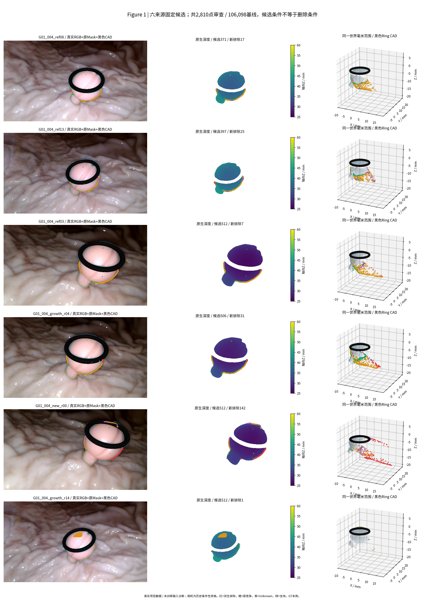
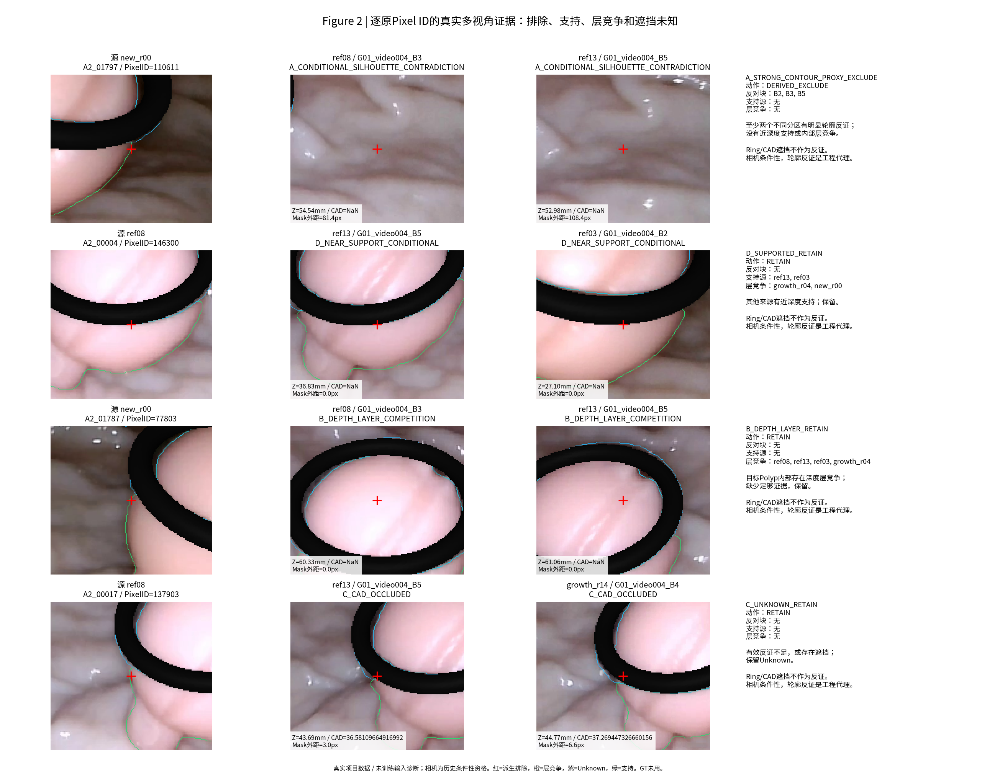
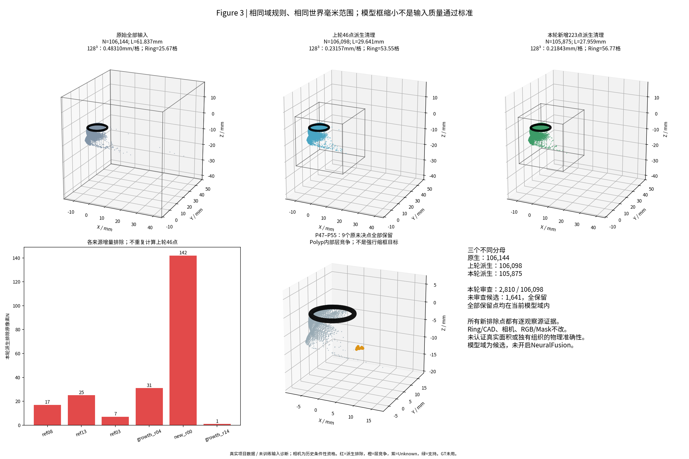
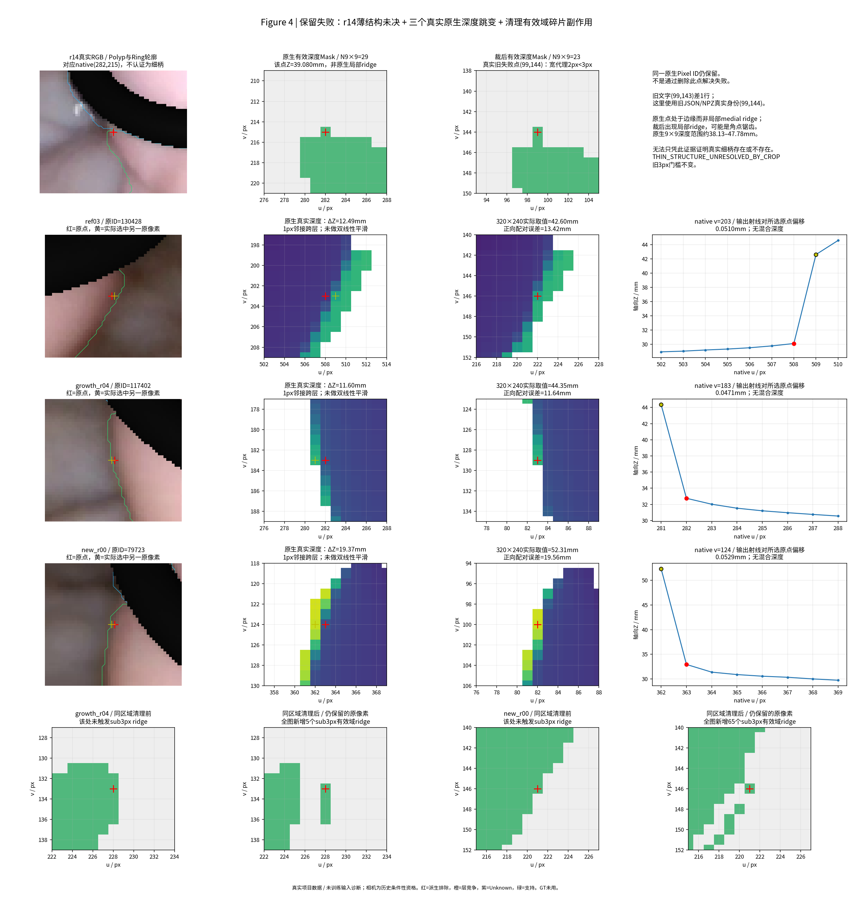

# TASK-E3-N0-GATE-A2-PROJECTIVE-CLEANUP-001

日期：2026-11-02（Asia/Shanghai）。父提交`4b60db5d9402c2bb87692ba3b2b7819f3c7c1423`；独立分支`exp/TASK-E3-N0-GATE-A2-PROJECTIVE-CLEANUP-001`。

本轮复用Gate A相机、投影/CAD、等比例裁剪与公制域规则，在106,098点派生基线上冻结六源候选协议。共发现4,451个异常标记，预算内审查2,810点，形成14,050条观察证据；新增223点只在新副本无效化，原9个未决点全部保留。全包候选域由29.641缩至27.959mm，128³对应0.21843mm/格，全部105,875保留点均在域内。CORE主连通域及已有支持得到保护，但r04/r00有效域出现碎片及新窄ridge代理。r14旧2px门槛仍失败，三个极端重采样已定位为相邻原像素跨深度层，采样本身未造值，输入竞争仍存在。最终GATE_A2_FAIL，不将较小框当作验收通过，不替换历史基线，不启动Gate B。

## 范围、来源与冻结

人工转交的[批准任务](docs/APPROVED_TASK.md)是本轮授权。开始前实测上一轮HEAD为`4b60db5`、完整Git工作树clean；从该提交创建新工作树`/home/liu/ring_first_3d_e3n0_a2`。旧Gate A、其他历史工作树、正式相机、原HERO/Raw面、RGB/Mask、Ring CAD不写入。GPU/神经前向/训练/新HERO/新TSDF/位姿优化/GT/Oracle均未执行。

只核对任务必要六源及旧交付SHA，不重审17源、不重跑旧Gate A。官方ShapeNet主权重严格CPU加载、三CORE六对及18条件性对的解析投影证明直接继承旧结果，不重新构造模型。旧投影CSV的全部原点分母与SHA保留；A/K/c2w逐数组未变，本轮输入只是原ID子集，所以旧24对代数合同仍适用。[CODE_REUSE_MATRIX.md](CODE_REUSE_MATRIX.md)逐项说明真实路径、精确函数和未执行入口。

全部五个Camera Gate pilot状态继续为`INSUFFICIENT_EVIDENCE`；CORE仍按历史**条件性**使用。r14未完成独立Camera Gate，禁止其否定其他来源。8px轮廓余量只能缓冲已知像素偏差，不能认证完整相机正确。真实背景首次表面未独立认证；所有轮廓反证仍是工程代理，**223点不能宣称为物理错误真值**，A2副本没有升级为正式输入。

原106,144点、上轮106,098点和本轮105,875点分母分别保存；原坐标/源索引/Native Pixel ID在LOCAL_ONLY的`local_results/ALL_ORIGINAL_IDENTITIES.npz`中完整保留，SHA见[DERIVED_INPUT_LINEAGE.json](DERIVED_INPUT_LINEAGE.json)。原点数据未被小框裁掉。

## 固定候选池

[A2_PREREGISTERED.json](config/A2_PREREGISTERED.json)在发现候选前冻结，SHA=`8edf9e9d0a255d0b47d120323cd52fa6d8c4d417b9834f08ad0399b3eb7b51b3`；决策代码亦有运行前SHA。候选包括：上一轮9点、每源六轴极值、距当前全体原点轴界≤0.25mm、合法4邻域跳深≥1mm、或距自身原始Raw面>1mm且Mask边缘≤2px。0.25/1mm沿用既有支持和Raw诊断尺度，跳深取4×0.25mm；这些只提出候选，不作删除依据。

每源最多512点，按上述优先级、同级Pixel ID排序，不按最终效果调整。9点和每源极值强制纳入。原生4邻域明确排除图像wraparound和无效邻居。审查2810/106098=2.6485%，另1641个已标记异常未进入预算，全部保留；未标记点也全部保留。完整发现表[CANDIDATE_DISCOVERY_ALL_FLAGS.csv](CANDIDATE_DISCOVERY_ALL_FLAGS.csv)保留未选标记；[CLEANUP_CANDIDATES.csv](CLEANUP_CANDIDATES.csv)为实际审查池。

| 来源 | 原始N | 上轮基线N | 发现 / 审查 / 未审查 | 新增排除N及基线比例 | 本轮保留N | 射线面积代理排除比例 |
| --- | ---: | ---: | ---: | ---: | ---: | ---: |
| ref08 | 13,749 | 13,749 | 371 / 371 / 0 | 17 (0.1236%) | 13,732 | 0.1939% |
| ref13 | 12,745 | 12,745 | 397 / 397 / 0 | 25 (0.1962%) | 12,720 | 0.2957% |
| ref03 | 23,771 | 23,771 | 542 / 512 / 30 | 7 (0.0294%) | 23,764 | 0.0610% |
| growth_r04 | 20,901 | 20,901 | 506 / 506 / 0 | 31 (0.1483%) | 20,870 | 0.3133% |
| new_r00 | 22,815 | 22,769 | 665 / 512 / 153 | 142 (0.6237%) | 22,627 | 1.2740% |
| growth_r14 | 12,163 | 12,163 | 1970 / 512 / 1458 | 1 (0.0082%) | 12,162 | 0.0128% |

面积代理为各原生像素`Z²/(fx fy)`的求和，只是局部相机射线脚印，不是真实曲面面积、组织体积或物理覆盖率。新增排除223/106098=0.21018%；CORE排除49/50265=0.09748%，新增方向排除174/55833=0.31164%。不把高像素保留率当作真实表面完整性的充分证据。

## 投影证据与保留机制

实际调用原`unproject`、`vis.project_camera`、D0 `cast(ringscene())`和冻结K/c2w。毫米轴向Z直接与CAD首次命中轴向参数比较，epsilon=0.002mm。原生352×640与归档360×640使用冻结半像素K映射，原Mask按既有语义查询。

每个候选投到其他5源：图内、正Z、BG且在Polyp轮廓外>8归档像素、无CAD首交遮挡，方可给条件性轮廓反证。合法深度支持容差0.25mm；沿用原归档深度，同时要求当前原生有效域仍合法，**原生或归档任一近深度均保护**，减少离散化导致的假反证。r14近深度可否决排除，但不认证其相机。

先保留近深度支持D；没有D但任何合格观察源有Polyp内部层竞争，归B保留；其后才允许两个不同View Partition块的轮廓反证形成A派生排除；其他C/Unknown保留。ref08/r04共享B3只计一方向；共享RGB不代表统计独立。CORE内部>2px且距自身Raw≤1mm的连续主体也强制保护。Ring/CAD、图外、边界不确定、无效深度和层竞争都不能作为否定票。

| 分类（候选分母2810） | 数量 | 动作 |
| --- | ---: | --- |
| A 条件性强轮廓代理 | 223 | 新派生副本depth=0、valid=False；Mask不变，输入为Unknown |
| B 深度层竞争 | 1929 | 全保留，不平均成一层 |
| C Unknown | 300 | 全保留 |
| D 有近深度支持 | 358 | 全保留 |

[逐观察证据](PROJECTIVE_CLEANUP_EVIDENCE.csv)有14,050行；[逐点决策](PROJECTIVE_CLEANUP_DECISIONS.csv)保留原ID、资格、CAD、反对块和支持/竞争来源。223个排除点均无近深度支持和内部层竞争；不使用E3-C FREE_SPACE标签删点，不运行历史融合。9个P47–P55全部为B保留；其中P48/native78442的Y=17.098526mm仍决定当前Y上界，P50/native79722还是r00极端重采样所选原像素。没有因它们妨碍缩框而删除。

## 三阶段统一模型域

精确复用`make_domain`：全部保留XYZ加原CAD，边距`max(2mm,10%最大跨度)`，立方边长向上取整至0.001mm；统一128³，不按视角缩放。25.735mm只是旧诊断框，不是目标。

| 输入阶段 | 合法保留N | L mm | 体素mm | Ring外径格数 | 保留点出界N |
| --- | ---: | ---: | ---: | ---: | ---: |
| ORIGINAL_ALL | 106,144 | 61.837 | 0.48310156 | 25.667 | 0 |
| PREVIOUS_46_CLEANUP | 106,098 | 29.641 | 0.23157031 | 53.547 | 0 |
| A2_INCREMENTAL | 105,875 | 27.959 | 0.21842969 | 56.769 | 0 |

本轮候选`O_mm=[-9.749887029020503, -8.530236711407907, -20.608446703928504]`，`L_mm=27.959`，`X_model=(X_mm-O_mm)/L_mm`；全部源旋转不变，中心和深度按同一L变换。Ring逆变换最大3.389e-15mm，恢复外径12.39999962mm。全部保留点及9点未决都在域内。旧模型域、上轮派生域均原样保存；新候选未正式冻结。[MODEL_DOMAIN_COMPARISON.json](MODEL_DOMAIN_COMPARISON.json)含全部矩阵；[FINAL_BOUNDARY_POINTS.csv](FINAL_BOUNDARY_POINTS.csv)明确记录新边界锚点，包括未经本轮审查但继续保留的新极值。没有第二轮搜索边界点。

## 有效表面保护与清理副作用

全部未排除深度/valid值逐数组bitwise未变；已识别支持、内部层竞争、1641个未审查异常及9点全保留。三个CORE原生/裁后主连通区域大小保持不变；原生分量数均2→2。该工程检查证明未破坏已保护主体连通区域，不能认证所有边缘组织物理正确或所有独有侧面完整。

**副作用不能隐藏：**r04原生分量2→4，增加两个<10px碎片，裁后2→3；r00原生2→3，增加一个小碎片，裁后仍2。有效域sub3px ridge代理从r04的0→5、r00的0→65。它们来自局部无效化后的有效域边缘/碎片，原Mask没改；这些不自动证明真实细柄被损害，但冻结门槛确实不满足。未二次删除碎片、闭运算补洞或改标签制造PASS。[VALIDITY_TOPOLOGY_COMPARISON.csv](VALIDITY_TOPOLOGY_COMPARISON.csv)保留全部前后值，Fig4最后一行展示新失败。

## r14薄结构

逐旧数据身份核对：真实失败像素为crop **(99,144)**，映射native **(282,215)**、archive(282,219.8977)。旧报告叙述写(99,143)有1行偏差；旧JSON/NPZ身份及2px数值正确，历史结果不覆盖。本轮最初诊断也沿用了文字坐标，发现它无效后仅修正诊断读取，不动清理/裁剪/阈值；初值和错误记录在[INITIAL_THIN_DIAGNOSTIC_ISSUE.json](config/INITIAL_THIN_DIAGNOSTIC_ISSUE.json)。

真实RGB显示该点邻近Ring与Polyp边缘；原生Mask存在单像素边界凸出，选中点自身宽度代理2px但不是原生局部ridge，裁后变成局部ridge。它仍在输入中，原深度=裁后深度 **39.080193mm**，本轮未排除。原生9×9有效29点、裁后9×9有效23点；两个窗对应不同尺度，不能直接用29−23推导真实表面丢失。原生9×9深度38.13247–47.78245mm，存在边缘深度变化。

证据更符合离散角点代理，但不能据此断言真实细柄不存在；保留`THIN_STRUCTURE_UNRESOLVED_BY_CROP`及旧3px FAIL。提出v0.2候选：区分“所有有效域距离变换角点”与“经原生身份、真实RGB/人工确认的解剖细结构”，后者才应用解剖宽度标准，同时单独报告采样拓扑/源身份保留。**仅提议，不替代现有标准，未用它制造PASS。**

## 最近邻深度：三个极值已解释、竞争未消失

| 来源 | 原(native u,v,Z) | 实际选中原像素(u,v,Z) | 轴向跳变mm | 原点到最近输出配对XYZ误差mm | 输出射线对所选原点偏移mm |
| --- | --- | --- | ---: | ---: | ---: |
| ref03 | (508,203,30.1083) | (509,203,42.6002) | 12.4919 | 13.4207 | 0.0510 |
| r04 | (282,183,32.7542) | (281,183,44.3544) | 11.6002 | 11.6390 | 0.0471 |
| r00 | (363,124,32.9416) | (362,124,52.3146) | 19.3731 | 19.5574 | 0.0529 |

三者都来自相邻1原像素的大深度跳变，原点ID没有被输出格点直接取到；正向将这个未采到点配给邻近输出格点时，该格点的逆最近邻却取了另一真实原像素。这解释了巨大正向配对误差。实际逆采样身份完全正确、深度与被选原生像素精确相同，没有双线性混合；相对于所选源点，输出射线离散位置只移动约0.05mm。**13–20mm不是坐标仿射错误，也不能据此当作采样无风险。**

竞争层仍可能被NeuralFusion当成合法输入表面，近邻层会在当前分辨率漏采。本轮没有足够证据认证所选远层一定错误；尤其r00所选点就是保留的P50。三处极值在A2后仍完全存在，不能以删除少量别的点宣称解决。

| 来源 | 解析XYZ最大mm | 实际逆NN射线偏移最大mm | 正向配对最大mm | 裁后sub3px ridge N |
| --- | ---: | ---: | ---: | ---: |
| ref08 | 1.127e-14 | 0.06592 | 0.06592 | 0 |
| ref13 | 1.066e-14 | 0.06494 | 0.06486 | 0 |
| ref03 | 1.123e-14 | 0.06453 | 13.42067 | 0 |
| growth_r04 | 8.702e-15 | 0.06140 | 11.63899 | 5 |
| new_r00 | 1.231e-14 | 0.06804 | 19.55735 | 65 |
| growth_r14 | 1.066e-14 | 0.06830 | 0.06830 | 1 |

六源解析最大1.231e-14mm，原A/K完全相同，非法语义深度非零数均0。有限修订建议只是**给原生1mm跳变采样脚印输出不确定性与两源ID记录**，交PM决定是否需要Unknown门控或分层策略。没有改变当前采样器、没有新增深度、没有自动屏蔽争议层；深度竞争未解决是诊断开放问题，**不是新增的正式硬门槛**。

## 验证、失败与复现

[A2_CONTRACT_TESTS.csv](A2_CONTRACT_TESTS.csv)：37项工程/保护检查PASS，旧3px硬门槛FAIL，竞争层消失这一诊断问题FAIL（非新增正式门槛）。决策代码/参数冻结SHA保持；source DAG、K/c2w、Ring CAD、原文件及历史Gate A交付SHA保持；25个历史工作树未变，164项源/旧交付/旧本地资产SHA核对通过。没有模型权重读取或神经模块import。

安全重放在新`runtime/replay_verification`目录完成，**7份关键CSV逐字节一致**，没有覆盖正式或历史输出。详见[REPRODUCE.md](REPRODUCE.md)。大NPZ只留本地并列SHA；四核心PNG、小表、源码/配置上传独立分支。构建过程的稀疏工作树目录缺失、错误系统Python、过严守卫对GT审计Markdown的误拒绝、r14文字坐标差1行均记录在[FAILURE_LEDGER.md](FAILURE_LEDGER.md)，不以修改科学标准处理。

## 四张核心图

所有RGB为真实源图并叠加冻结Mask/CAD；三维点均由原HERO恢复。二维图中黑色CAD是明确的遮挡覆盖层，三维为原实体三角面；没有纹理平面、补面或NeuralFusion输出。点云为显示预算确定性抽样，全部数字使用完整对应分母。

## 七个结论与停止

1. 新增**223点**符合预冻结的条件性跨视角轮廓反证代理；这是派生工程清理，不是223个物理真错点认证。
2. 全包候选域**27.959mm**，体素**0.2184296875mm**，Ring约56.769格；全部105875保留点包围，9点未决保留。不追25.735mm。
3. 已识别支持、层竞争、未审查和CORE连续主体得到工程保护；**无法认证所有真实独有侧面**。r04/r00有效域出现副作用，已报失败，未藏掉。
4. r14的2px问题**仍未决**，真实旧点已按身份复核；不把它直接称为细柄，也不豁免旧3px门槛。
5. 极端误差由跨1px原生深度跳变及正向身份配对造成；逆NN取值正确，但**原始竞争层仍影响未来输入**，未用平滑或删争议层解决。
6. **Gate A不具备整体PASS条件。** 旧硬门槛仍失败，A2候选不会自动替换106098点基线。
7. **当前不建议直接申请正式Gate B运行。** 先交PM审阅r14标准是否需版本化、有效域碎片副作用和深度竞争的可接受性，再决定是否接受带限制输入/另行批准有限修订。即便未来获准探索，也应保留三阶段输入对照和这些失败，不能宣称本轮已经PASS。

最终状态：**GATE_A2_FAIL**。[机器验收](GATE_A2_ACCEPTANCE.json)同时区分任务执行完成和工程门槛未达成。本轮停止，等待PM/研究者审计；Gate B没有自动启动。

## 固定审计表

| 审计项目 | 必须汇报 |
| --- | --- |
| 目标组数 | 1物理组，G01_004单视频，固定6来源 |
| 本算法独立成功 | 1/1组产生独立A2派生候选/诊断；整体GateA2通过0/1；测量/神经重建NOT_RUN |
| 本算法失败 | G01_004：旧薄结构硬门槛不满足、新有效域碎片/窄ridge；深度竞争未消失。测量误差NaN |
| 历史测量值回退 | 0；无S0、V2预测、旧直径或融合结果填补 |
| 失败组及具体原因 | FAILURE_LEDGER、Fig4、逐点决策、R14/重采样/拓扑CSV；科学失败均保留 |
| 最终统计样本 | 原106144、上轮106098、A2候选105875分列；候选审查2810/106098、未审查异常1641；真实物理GT评价样本0 |
| 是否使用GT选择算法 | 否；先冻结统一规则与源码SHA；不读取GT/Oracle/Dxy。条件性代理不冒称物理准确性 |
