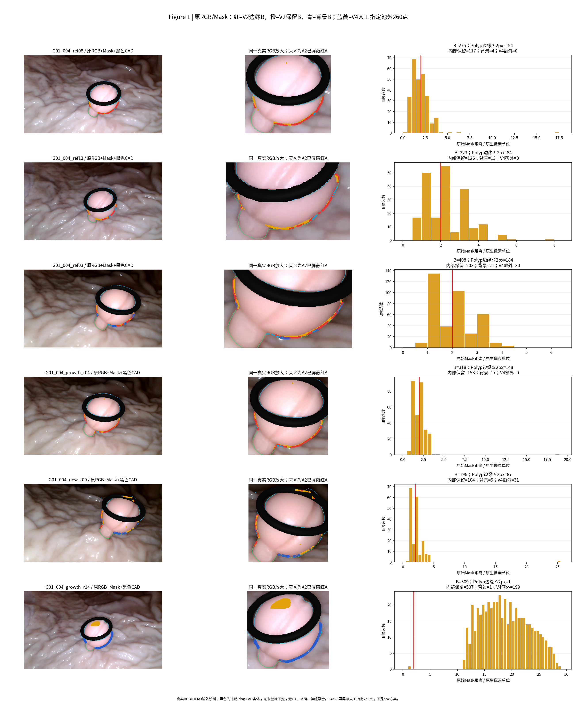
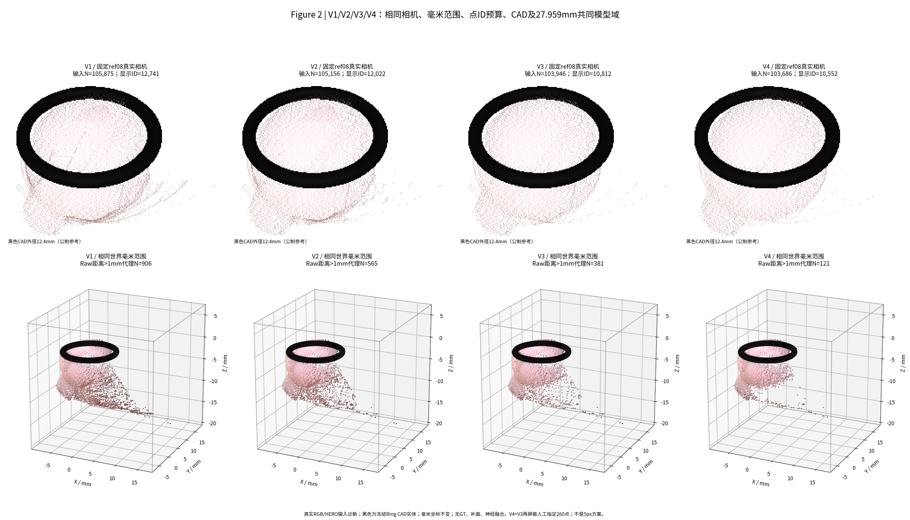
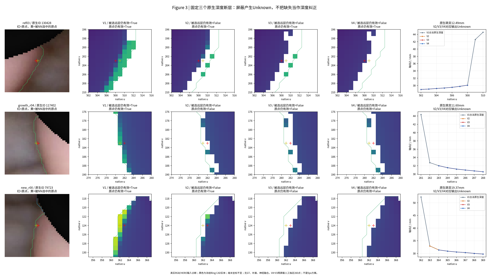
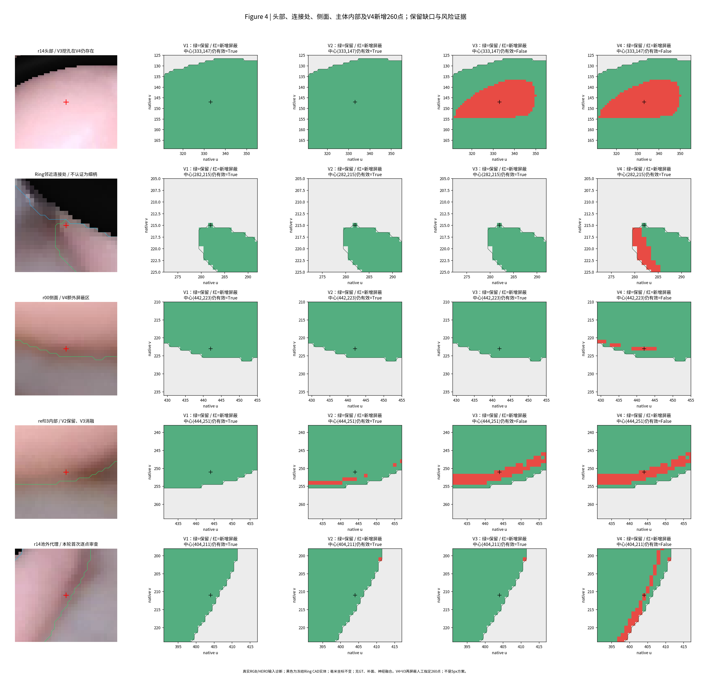

# TASK-E3-N0-GATE-A3-MASK-BOUNDARY-CLEANUP-001

日期：2026-11-03，Asia/Shanghai。父提交`75ba88303f5ca2e3eee362451d7a717d92506e10`；独立分支`exp/TASK-E3-N0-GATE-A3-MASK-BOUNDARY-CLEANUP-001`。

本轮复用A2的1929个橙黄色原生候选，在原始Mask坐标冻结2原生像素规则。658点位于Polyp内部边缘，1210点更深入；另61点映到背景，按研究者补充授权一并屏蔽。V2/V3分别保留105156/103946点。研究者随后指定正式V4为V3再清除260个此前池外Raw距离异常代理，最终保留103686点，C/D不变；5px试算已归档废止。异常代理数从906逐步降至565、381、121，但新增缺口不能被掩盖。V2保留全部内部候选；V3在r14头部形成507像素孔洞，V4继承该缺失并增加侧面屏蔽。新增260点的多视角核对仍发现16点有近深度支持，清理不等于物理真错认证。103项工程检查通过，22份CSV重放一致；旧3px指标不再阻塞A3。结果交研究者审核，不启动Gate B。

## 范围与有效授权

本轮是CPU输入清理与对照，原始HERO/Raw三角面、RGB、Polyp/Ring Mask、Pixel ID、K/c2w、Ring CAD均不变。没有模型权重读取、NeuralFusion前向、GPU、训练、TSDF、位姿优化、GT/Oracle。旧Gate A/A2失败记录不回写；研究者已明确废止旧3px薄结构硬门槛，A3没有再以它阻塞。

有效版本定义如下，人工补充指令逐条保留，不能混用早期试算：

| 版本 | 规则 | 定义依据 |
| --- | --- | --- |
| V1 | A2完成时的105875点派生输入 | 父提交及原输入SHA |
| V2（原主方案） | B类中原始Polyp内距离≤2原生像素的658点，加原始Mask背景61点屏蔽 | 初始2px协议＋[背景补充授权](config/USER_BACKGROUND_OVERRIDE.json) |
| V3（激进对照） | 全部1929个B类屏蔽，红A继续屏蔽，原C/D不改 | 用户批准全部橙黄消融 |
| **正式V4** | **V3再屏蔽恰好260个已确认身份的池外异常代理** | 最新指令“清除260个异常代理作为V4。清理后提交报告”，[冻结规则](config/V4_260_PREREGISTERED.json) |

原始106144→早期46点清理106098→A2/V1为105875的三个历史分母完整保留。V4相对V3新增260，相对V1累计2189，不能把二者混计。本轮所有屏蔽只写新depth/valid副本，depth=0且valid=False表示Unknown，不填假深度。每个屏蔽点保存原ID及原值，可以精确恢复。

最初“Mask外保留”的结果在`pre_background_override/`按原字节保留，补充背景授权后才生成正式V2/V3。研究者曾要求5px，试算写出输入/统计后被明确暂停替换；其结果和合并JSON异常记录保存在`superseded_5px_diagnostic/`，**不作为正式V4**。正式V4是在观察残留后人工指定的探索性版本，不冒称初始盲验协议。

## 来源、复用与Mask距离定义

固定六来源顺序为ref08/ref13/ref03/growth_r04/new_r00/growth_r14，视频G01_004独立。复用A2原1929个`B_DEPTH_LAYER_RETAIN`，未重新选视角、重做来源审计或重建历史融合。相机资格原样保留：五pilot仍是INSUFFICIENT_EVIDENCE，r14未独立完整Camera Gate；“CORE”不是相机GT。

[CODE_REUSE_MATRIX.md](CODE_REUSE_MATRIX.md)列出实际函数路径。使用原Gate A make_crop/unproject、D0 source/cast/ringscene、real_p0_renderer的K缩放/投影及SameCameraScene黑色CAD。没有重新实现相机/射线方法。自己的Raw距离只来自同一原始HERO的原生/归档面离散化诊断，不是历史融合预测或物理GT。

原Mask为640×360，原生深度为640×352。使用冻结`K_archive @ inv(K_native)`的像素中心仿射，将原生整数(u,v)投到原Mask连续坐标；纵向等价`v_a=(v+0.5)*360/352-0.5`。Mask成员查询`floor(uv_a+0.5)`，不使用320×240裁后坐标。

**本轮边界定义：候选中心到最近非Polyp原Mask像素中心的欧氏距离，不是到像素格边线。** 在原Mask网格上，x距离权重1，y距离权重352/360，换算为原生像素单位；不额外减0.5。整数原Mask中心以exact EDT核验，连续映射位置以等价KDTree查询，外图一圈虚拟非Polyp中心。没有对深度插值或平滑。

原生/原Mask往返最大8.527e-14px，独立暴力背景中心距离核对最大4.174e-14px。合成控制确认相邻三排内部中心距离为1/2/3、2px包含边界，且纵向单位按352/360转换。A2 legacy native DT数值另存为诊断，因网格和查询中心不同不等价；**没有根据删除数量选取更有利的定义**。

1929点原Pixel ID与XYZ均正确；1868点映入原始Polyp，其中658≤2px、1210>2px。61点在原Mask是背景0，而legacy原生最近邻语义为Polyp1；它们原先保留，研究者明确批准“非polyp和ring”区域也删除后，才加入V2/V3。Ring2候选和身份错误数为0；若存在仍受保护。背景不是Polyp内部，内部距离列记NaN，单独列授权，不把它们混成“719个Polyp边缘点”。

| 来源 | B总数 | Polyp≤2px | 背景授权 | V2新增 | V3新增 | V4相对V3新增 | V4有效N |
| --- | ---: | ---: | ---: | ---: | ---: | ---: | ---: |
| ref08 | 275 | 154 | 4 | 158 | 275 | 0 | 13,457 |
| ref13 | 223 | 84 | 13 | 97 | 223 | 0 | 12,497 |
| ref03 | 408 | 184 | 21 | 205 | 408 | 30 | 23,326 |
| growth_r04 | 318 | 148 | 17 | 165 | 318 | 0 | 20,552 |
| new_r00 | 196 | 87 | 5 | 92 | 196 | 31 | 22,400 |
| growth_r14 | 509 | 1 | 1 | 2 | 509 | 199 | 11,454 |

原始逐点距离见[CANDIDATE_DISTANCE_AUDIT.csv](CANDIDATE_DISTANCE_AUDIT.csv)，V1–V3动作见[CLEANUP_DECISIONS.csv](CLEANUP_DECISIONS.csv)，正式V4逐ID见[V4_260_CANDIDATES.csv](V4_260_CANDIDATES.csv)。

## 四版本几何与异常/覆盖对照

全部版本使用同一裁剪A、K_crop、原K/c2w、原始Mask和Pixel ID采样图。共同模型域固定为V1的L=27.959mm、128³、0.2184296875mm/格，未因清理而给某版本额外提高网格分辨率。24个源×版本的解析XYZ最大1.231e-14mm，公制/相机变换可逆，出界0；所有有效裁后深度精确来自对应原生像素，Ring/BG/Unknown/padding语义有效深度没有混入。

表中Raw>1mm仅是异常代理；各版本都用V1完整105875点作为覆盖基准。孔洞是有效域补洞差集的像素统计，原生连通域采用8邻接。孔洞/分量计数不是解剖真值，且孔洞合并可能导致计数下降。

| 版本 | 有效原生N | 相对V1屏蔽N | Raw>1mm代理N | 被屏蔽且Raw≤1mm的N | 六源连通分量总N | 原生孔洞像素N | 各自全包框诊断L mm |
| --- | ---: | ---: | ---: | ---: | ---: | ---: | ---: |
| V1 | 105,875 | 0 | 906 | 0 | 15 | 47 | 27.959 |
| V2 | 105,156 | 719 | 565 | 378 | 31 | 208 | 27.252 |
| V3 | 103,946 | 1,929 | 381 | 1404 | 44 | 815 | 27.252 |
| V4 | 103,686 | 2,189 | 121 | 1404 | 31 | 852 | 25.636 |

V2异常代理906→565，减少341（37.64%）；但719个原有效输入样本消失，其中378个与自身Raw面距离≤1mm。故不能说它只删错误，也不能把更低误差或更小框当作无损。仍有565个Raw异常代理，说明橙黄边缘清理没有穷尽问题。

V3进一步清除全部B后还剩381个代理，组成是原C89、D32和池外260；B在V3剩余有效数经ID复核为0。“全部橙黄清除”始终只表示固定B池，不等于所有异常几何清除。原C/D各300/358个有效输入始终保留；在它们之外还有大量未审查点。

**正式V4精确屏蔽这260个池外代理：ref03=30、new_r00=31、growth_r14=199，其余来源增量0。** 这不是扩大Mask阈值，也不是重新搜索候选。最终异常代理121个，全是原C89/D32，逐ID留在[V4_REMAINING_ANOMALY_PROXIES.csv](V4_REMAINING_ANOMALY_PROXIES.csv)。原C/D没有因结果不好被改标签或删除。

V4各自全包框诊断L=25.636mm，但比较仍使用共同27.959mm域；较小框只供研究者参考，不自动变更未来正式模型域。所有保留点均包围，未直接裁掉框外点制造结果。

## 新增260点的多视角审计及局限

清理前冻结260个Native ID与XYZ；再精确抽取执行A2已有observer投影循环，查询其他5源的真实Mask、冻结K/c2w、CAD首交和V3有效深度，共1300条证据。使用原8归档像素轮廓余量、0.25mm支持容差、0.002mm CAD排序。ref08/r04共享B3不独立计票，r14不能承担负票。没有运行新匹配/深度/相机算法。

其中**16点存在近深度支持，219点存在深度层竞争**（两者可重叠）。因此，V4不能称为“260个已由多视角证明错误的面”。本次删除的依据是研究者明确指定这260个诊断代理；多视角结果只记录风险，没有根据结果悄悄改变指定列表。它们在A2未审查，不能将新见支持偷偷写回成历史D类；原C/D保护范围没有被改变。全部动作可逆。

完整证据见[V4_260_MULTIVIEW_EVIDENCE.csv](V4_260_MULTIVIEW_EVIDENCE.csv)与[逐点汇总](V4_260_MULTIVIEW_SUMMARY.csv)。候选位于Mask边缘及Raw远端，不等于物理错误GT；原生HERO与归档Raw的离散化差异也可能贡献距离。这里如实保留可能误删真实可见样本的风险。

## 头部、细柄、侧面、主体与新增缺口

区域在V1上固定：头部投影区为原生Polyp连通分量中与Ring内孔相机射线重合最多者；其余Polyp分量称侧面区；主体内部为原始Mask距离>2px。它们是几何/分割代理，不能替代独立解剖标注。

| 版本 | 头部投影区损失（分母59631） | 侧面区损失（46244） | 主体内部损失（98654） |
| --- | ---: | ---: | ---: |
| V1 | 0 | 0 | 0 |
| V2 | 4 | 715 | 0 |
| V3 | 550 | 1379 | 1210 |
| V4 | 550 | 1639 | 1282 |

V2全部1210个内部B点和98654个主体内部样本保留；仍屏蔽头部边缘4点与侧面区715点。因此**不能认证V2没有丢失真实有效表面**。即使深度不准确，这些原像素也承载真实RGB/Mask可见观察，不能只看总保留率宣布无损。

V3比V2额外损失1210个内部候选；r14头部新增507个原生孔洞像素（裁后对应628），真实RGB对应区域明确在Polyp头部内部。该缺面仍被V4继承。V4相对V3再丢失260个侧面区样本，其中72个属于固定>2px主体内部代理；原生孔洞815→852。连通分量44→31部分来自碎片被屏蔽，不能解释为真实曲面连接恢复。

原生medial-ridge宽≤6px的既有“可能细柄”代理在六源均无样本，记NOT_EVALUABLE，不据此宣称没有真实细柄。另检查此前r14原生(282,215)连接处：四版本中心点都保留，但V4使其邻近边缘产生新缺口，图中公开展示。没有用旧3px指标重新阻塞，也没有假定所有细柄/独有侧面已经得到物理认证。

详见[FOUR_VERSION_REGION_RETENTION.csv](FOUR_VERSION_REGION_RETENTION.csv)、[连通分量](FOUR_VERSION_COMPONENT_RETENTION.csv)及[新增缺口](FOUR_VERSION_NEW_GAP_STATISTICS.csv)。未做闭运算、补洞、补面或碎片二次删除。

## 原极端深度断层

继续跟踪同一ref03/native130428→130429、r04/117402→117401、r00/79723→79722，原跨1像素轴向跳变12.49/11.60/19.37mm，对应正向XYZ配对13.42/11.64/19.56mm。V2/V3/V4均将被采样的远层设为Unknown，相应误差记NaN，不计成0或“深度修复”。r04连原较近像素也被屏蔽，说明覆盖确有代价。

裁剪逆NN本身取值正确，无双线性混合；本轮只是改变有效性，没有恢复缺失表面。所有深度跳变统计维持V1固定邻接对分母，同时列不可用对数，见[固定分母跳变](FOUR_VERSION_FIXED_DENOMINATOR_DEPTH_JUMPS.csv)与[固定原案例](FOUR_VERSION_FIXED_DEPTH_CASES.csv)。

## 验证、保护和复现

V1–V3的60项合同、正式V4的43项合同全部PASS；其含义是身份/参数/几何/可逆性和边界保护正确，**不是103项物理准确性认证**。[GATE_A3_ACCEPTANCE.json](GATE_A3_ACCEPTANCE.json)明确为`A3_ENGINEERING_PASS_WITH_LIMITATIONS`，物理真值和真实有效表面是否误删仍NOT_CERTIFIED。旧3px不再阻塞，历史Gate A/A2文件SHA不变。

26个历史工作树与202项源/旧交付SHA检查保持；V4清理前冻结的31项V1/V2/V3表/输入数组也全部保持。原始106144点ID/坐标继续由旧不可变身份账本完整保留；大深度NPZ、裁后数组及旧试算大文件只在本地列SHA，不上传。

最终隔离重放在`runtime/replay_final_verified`完成，**22份关键CSV逐字节一致**。复现入口[REPRODUCE.md](REPRODUCE.md)拒绝覆盖已有输出。旧5px合并JSON的实现错误、一次重放缺源路径和绘图退出143均留[FAILURE_LEDGER.md](FAILURE_LEDGER.md)，修复只涉及清单/隔离IO/绘图，没有搜索参数或覆盖旧数据。

## 四张核心图

所有点均由真实原生HERO和冻结相机产生，RGB为真实源；黑色Ring为原CAD实体。图2是固定ID显示预算的输入点云拼接展示，不是新融合结果或三维重建；统计使用全部点。原始Raw三角面没有删除，查看旧Raw Mesh不会随本轮派生输入屏蔽而改变。

## 对研究问题的回答及停止

1. 1929个B中**658个在原始Polyp内部≤2原生像素**，1210个更深入，61个为人工批准的背景点；不能把719都称作Polyp边缘点。
2. V2确实减少外伸异常代理（906→565），V4进一步降至121；仍不能把代理减少称为所有错误面已清干净。
3. V2完整保留内部B及固定主体内部样本。V3/V4有更明显的内部/侧面损失，已公开。
4. V2丢失719个原有效样本，并增加孔洞和碎片；没有GT证明其真实有效表面无损，结论是存在误删风险。
5. V3比V2造成更严重缺面，尤其r14头部507像素孔洞。正式V4只增加260点清理，不修复该缺面。
6. **V2值得作为V1/V2受控NeuralFusion输入消融候选**，V3/V4宜作为激进对照，保留固定真实观察分母并评价缺面。它们不自动替换正式基线。V4含人工诊断代理删除及16个新见近支持点，研究者应结合图和逐点证据审阅其可接受性。
7. 最新要求已完成：V4从V3清除恰好260点，保留103686点；剩余C89/D32代理清单保留，不自行继续删除。5px方案已经废止。

本轮仅交付输入、CPU证据、代码及报告；**Gate B未获授权、未启动**。提交后停止，等待研究者审核。

## 固定审计表

| 审计项目 | 必须汇报 |
| --- | --- |
| 目标组数 | 1物理组，G01_004单视频，固定6来源 |
| 本算法独立成功 | 1/1组生成四版本派生输入及CPU合同；工程验收带局限通过；物理测量/神经重建NOT_RUN |
| 本算法失败 | 真实有效表面无损未能认证；V3/V4头部/侧面缺口；仍有121个C/D异常代理；测量误差NaN |
| 历史测量值回退 | 0；无S0/V2旧预测/旧直径/历史融合回填 |
| 失败组及具体原因 | G01_004，见FAILURE_LEDGER、Fig4、区域/孔洞统计、V4新见支持及残留逐ID清单 |
| 最终统计样本 | 原106144、早期106098、V1 105875、V2 105156、V3 103946、V4 103686；始终保留V1固定观察分母；真实GT样本0 |
| 是否使用GT选择算法 | 否。2px先冻结；背景61及正式V4的260为显式人工补充。5px探索已废止，未按评价目标搜索参数 |
