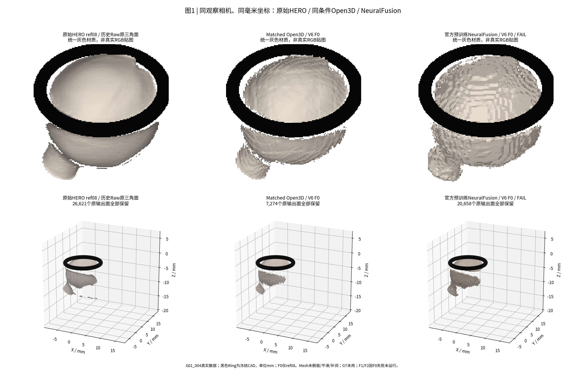
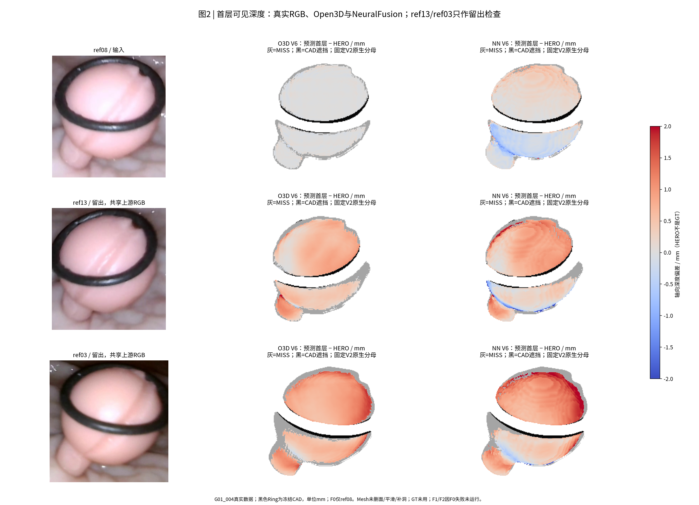
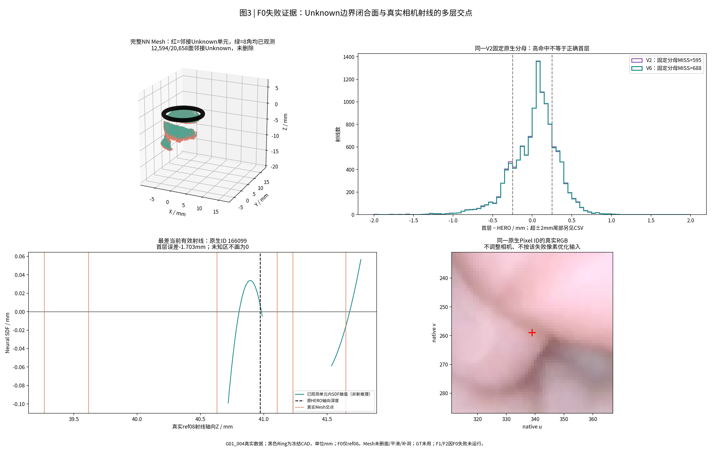
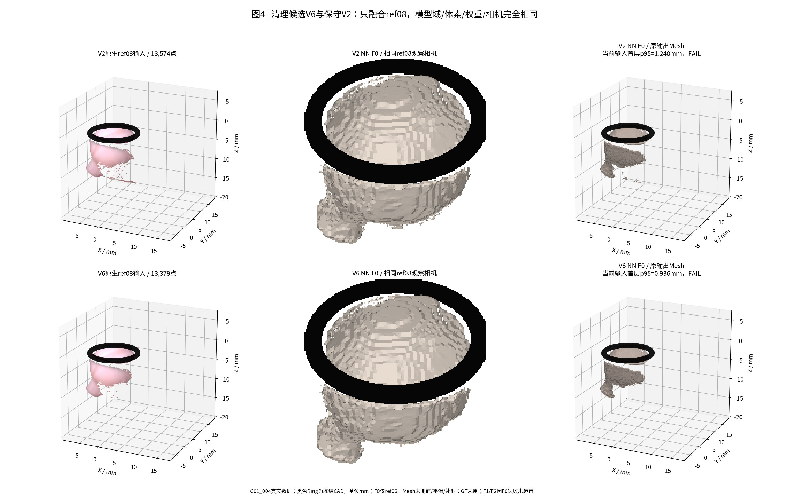

# TASK-E3-N0-GATE-B-NEURALFUSION-F0-F2-001

**结论：官方预训练F0推理工程运行成功，但V6和V2均未通过单视角几何门槛；F1/F2依预注册停机条件未执行。未训练、未更新权重、未读取GT。**

本轮继承研究者对V6的明确认可，以及对上一条两阶段任务第二阶段的授权。“开始训练”在该上下文中按已经明确限定的**预训练NeuralFusion有限推理**执行：官方固定网络和权重，optimizer.step()=0。没有扩展到重训或新增来源。

## 冻结输入与真实执行

从A3完成提交b114ee0b5470f98303f20f4e2bcd1ccd1f3e5ed7建立独立分支`exp/TASK-E3-N0-GATE-B-NEURALFUSION-F0-F2-001`。V6和V2各六来源的原生depth/valid与320×240裁剪全部冻结，24文件逐SHA相同。V6原生共103,100点，V2共105,156点；本轮实际各只融合ref08，未把其他五源偷偷用于预测。ref13/ref03只用于投影/原Raw评价，且共享HERO上游RGB，不能称严格盲测。

统一模型域沿用V4/V5/V6：O=[-9.749887029020503, -8.530236711407907, -20.608446703928504] mm，L=27.959mm，128³，体素0.2184296875mm。所有版本保持相同模型域、裁剪A/K、原生ID、冻结c2w及12.4mm Ring CAD。公式：X_model=(X_mm−O)/L，Z_model=Z_mm/L，C_model=(C_mm−O)/L，旋转不变；没有逐视频/逐来源调尺度。12组输入坐标合同通过，真正官方GPU反投影最大偏差5.639e−6mm。

模型为[官方NeuralFusion](https://github.com/weders/NeuralFusion/tree/4f0c14f67ad9d2368b68cbeb78c237a6328971e5)，唯一主checkpoint为Gate A已经验证的ShapeNet noise005，SHA256=`3ac6dc9f219449e8aa5a26dec0a77691714e55d4e29da688c79630bf46068bff`，1,403,920参数，严格完整加载。没有使用Tanks权重。网络结构/推理配置不变，仅指定CUDA设备。直接调用官方FusionPipeline.forward及Translator；官方get_translation以AST原样提取，避免导入会读取GT的训练/数据库包装。该官方128³分支只译码非零latent的已观测索引，并按本次所有观测点一次查询归一count；未自行换成依赖分块的计数归一。

空latent[128,128,128,17]和count[128,128,128]全零，每版本独立reset。n_samples=±3，nearest提取/整合，SDF输出范围±0.04模型单位=±1.11836mm；eval()+inference_mode()，所有参数requires_grad=False，前后逐值一致。两次GPU融合前向分别0.491s/0.363s，融合+译码及保存约1.599s/1.278s（不含导入和CPU评价），峰值分配约644/658MiB。每版本仅一次真实参考前向，没有通过重复输入代替多视角。

## 预先冻结的F0门槛与结果

先冻结config/PREREGISTERED.json，再运行任何模型前向。非CAD遮挡的当前输入原生射线：命中≥90%，首层轴向误差p95≤0.20mm（MISS记+∞），点到输出面0.25mm内保留≥90%，坐标/有限性通过；任何失败停止F1/F2。其中90%命中/0.20mm轴向门槛沿用D0；0.25mm近面距离沿用既有局部场评价尺度，并非D0原0.20mm点距。全部在本轮前向前固定。误差相对原HERO观测，属于接口/几何保真门槛，不是物理GT。旧3px薄结构门槛未使用。参数冻结后没有改阈、缩域、重选像素或搜索。

| 方法 | 输入 | 当前可见原生分母 | 首层命中率 | 首层p95/mm，含MISS | 判断 |
| --- | --- | ---: | ---: | ---: | --- |
| NN | V6 | 12880 | 95.73% | 0.936 | FAIL |
| NN | V2 | 13075 | 95.45% | 1.240 | FAIL |
| O3D | V6 | 12880 | 88.22% | ∞（MISS超过5%） | FAIL |
| O3D | V2 | 13075 | 87.89% | ∞（MISS超过5%） | FAIL |

V6 NN点到面保留96.39%，V2 NN95.86%，均通过；仍不能补偿首层错误。V6 NN当前输入p95=0.936mm明显超限，因此没有启动ref13→F1或ref03→F2。V2 F0是事先允许的同条件控制，不能用它绕过主方案停机。

Matched Open3D只做本轮两份F0控制：同Crop/Mask/K/c2w/顺序，0.2184296875mm体素、4体素截断、官方ScalableTSDFVolume、米制内部/毫米导出。它也没有通过原生首层覆盖门槛；不调成更细体素救PASS。历史D0未重建、未输入本路线，也不作为本次匹配控制。

## 共同分母与清理代价

公平比较固定在**V2 ref08全部13,574个合法原生观测**，其中CAD遮挡499、可见13,075；V6屏蔽的195个本来源点仍留在该分母。未命中单列，不把误差均值的样本自动缩小；下面MAE/p95明确只针对实际命中，不能单独当整体改善证据。

| 方法 | 版本 | 固定分母首层命中 | ≤0.25mm首层一致 | 命中MAE/mm | 命中p95/mm | 全原Raw ref08面积保留@0.25mm |
| --- | --- | ---: | ---: | ---: | ---: | ---: |
| NN | V6 | 94.74% | 60.36% | 0.230 | 0.589 | 94.21% |
| NN | V2 | 95.45% | 60.45% | 0.234 | 0.596 | 94.64% |
| O3D | V6 | 86.91% | 86.85% | 0.025 | 0.075 | 91.72% |
| O3D | V2 | 87.89% | 87.79% | 0.025 | 0.078 | 93.64% |

固定分母下NN V6命中12,387、MISS688；V2命中12,480、MISS595，V6覆盖下降0.711个百分点，一致率也没有改善。V6含MISS的固定分母p95=∞，V2=1.240mm。**不能用V6当前较小分母下0.936mm对V2的1.240mm直接宣布清理改进了融合。** 两版共同仍可用的观测未被挑出用于替代主评价；源ID、availability、误差及类别全部保存。

原Raw面积保留分母为所有26,621个原ref08三角面及其原始面积154.977mm²，而非只取好看的主体。评价用Raw不回流预测。较高近面保留不意味着首层正确：一个额外薄层仍可能靠近原面，同时挡在它前方。

## 失败机制与真实射线

V6 NN实际Mesh20,658面、面积323.884mm²、64连通分量、全体闭合；matched Open3D7,274面、面积119.798mm²、60分量、1,196开放边。面积变多和闭合不能证明新增真实可见组织。图1显示NN出现台阶/条纹，主面附近保留但可见深度发生偏移。

官方译码未观测体素初值0不能当成零面。原始SDF/occupancy与known mask分开保存；MC前仅为复现官方导出将Unknown置+0.04哨兵，**没有向原深度填假值或声称Unknown为观测自由空间**。全部原输出面保留。按MC单元8角是否都已观测，12,594/20,658面（60.96%）邻接Unknown；FACE_VALIDITY.csv逐Face ID标注。这是边界可靠性代理，不是真错误标签。

固定ref08分母有4,495条已命中但首层偏差＞0.25mm，其中991条命中Unknown邻接面、3,504条落在8角已观测单元。因此，**首层失败不能只归因于Unknown闭合**；学习到的局部场/离散化同样未满足观测保真合同。分布域差异和稀疏Mask输入可能有关，但没有本轮因果消融证据，不将其写成已证实原因。

图3的最差当前有效ref08原生ID166099，HERO轴向深度40.970680mm，输出首次交点39.267303mm，偏差−1.703377mm。同一真实射线还在39.616440、40.630611、41.105537、41.228394、41.647175mm相交；没有靠删输出面制造单层PASS。曲线只插值已生成场，不再调用模型。原生图像和ID用于定位，未据此改相机或调输入。

## ref08→ref13与额外参考投影

| 参考 | 身份 | 固定可见分母 | 命中 | MISS | 首层≤0.25mm一致 | 命中误差p95/mm |
| --- | --- | ---: | ---: | ---: | ---: | ---: |
| ref08 | 输入 | 13075 | 12387 | 688 | 60.36% | 0.589 |
| ref13 | 留出/共享上游RGB | 12278 | 10984 | 1294 | 20.47% | 1.182 |
| ref03 | 留出/共享上游RGB | 22779 | 19437 | 3342 | 7.77% | 1.824 |

ref13存在约0.5–1mm及更大的HERO相对深度差异，图2完整展示；ref03也未与仅ref08的结果对齐。HERO本身不是真值，不能据此单独判相机错误或宣布模型物理失真；本轮不做参考级深度校正或姿态修正，也未删除困难参考。只有一视角被融合，因此无多视角接缝改善/新增表面/顺序效应的实验结论，均NOT_RUN。

## 交付与停止

- `meshes/*_mm.ply`：四份实际未删Mesh，毫米；`*_m.glb`：同Face ID的米制glTF，序列化误差＜1e−5mm。原infer产生的`*_mm.glb`仅为本地诊断，未作为标准glTF交付。
- `F0_SUMMARY.csv`、各RAYS/RAW_FACES表、FACE_VALIDITY、F0_FAILURE_DIAGNOSIS、STAGE_STATUS、FINAL_VALIDATION及固定源/坐标/权重SHA均提供。
- `local_results/`完整latent/count、SDF/occupancy/known、逐原ID射线及Raw面距离保留本地；不上传权重、视频或大型原始HERO。
- 图1：同相机同尺度Raw/Open3D/NN；图2：真实RGB与首层；图3：Unknown/真实射线失败；图4：V2/V6同尺度。
- 全部旧数据、V4/V5/V6源输入、Ring-First/HERO/CAD/P0/Dxy不变；不重训、不新增视角，不做后处理掩盖失败。

**当前不具备按原门槛推进F1/F2的条件。GPU代码可运行与科学几何就绪是两个判断；缺口是稳定的首层观测保真，以及Unknown边界/闭合层的可解释输出合同。已停止，等待研究者/PM审阅。**

## 固定审计表

| 审计项目 | 必须汇报 |
| --- | --- |
| 目标组数 | 1视频G01_004；主方案计划F0–F2三个前缀，实际只执行F0；V2做F0控制 |
| 本算法独立成功 | 1/1视频有数值Mesh（两版F0）；几何门槛通过0/1；多视角融合未执行 |
| 本算法失败 | G01_004 F0：首层p95超限；F1/F2=NOT_RUN；物理测量值/GT误差NaN |
| 历史测量值回退 | 0；原Raw只评价/展示；无历史融合参与预测 |
| 失败组及具体原因 | 本视频完整失败见FAILURE_LEDGER.md、Fig1–Fig4和逐原ID表 |
| 最终统计样本 | 固定V2原生观测ref08/ref13/ref03全部保留；ref08 13,574、CAD可见13,075；未仅报告命中像素 |
| 是否使用GT选择算法 | 否；前向前协议SHA冻结。物理直径中位绝对相对误差/MAE/p95/max均NOT_EVALUABLE，未读GT |

