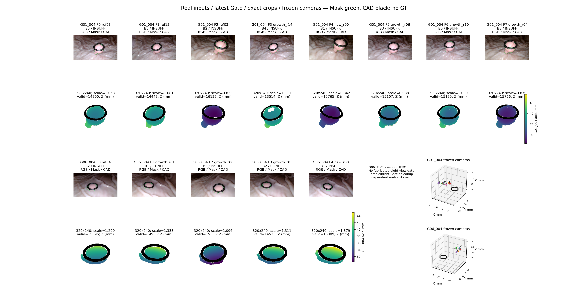
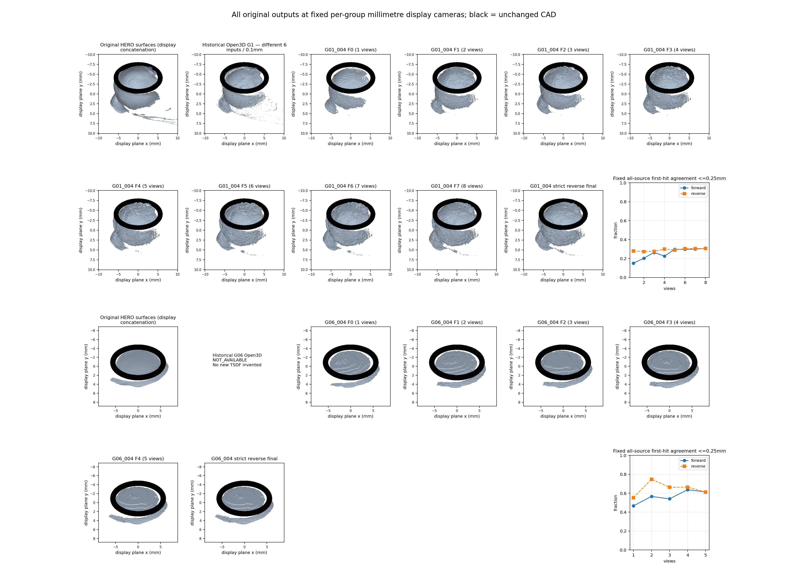
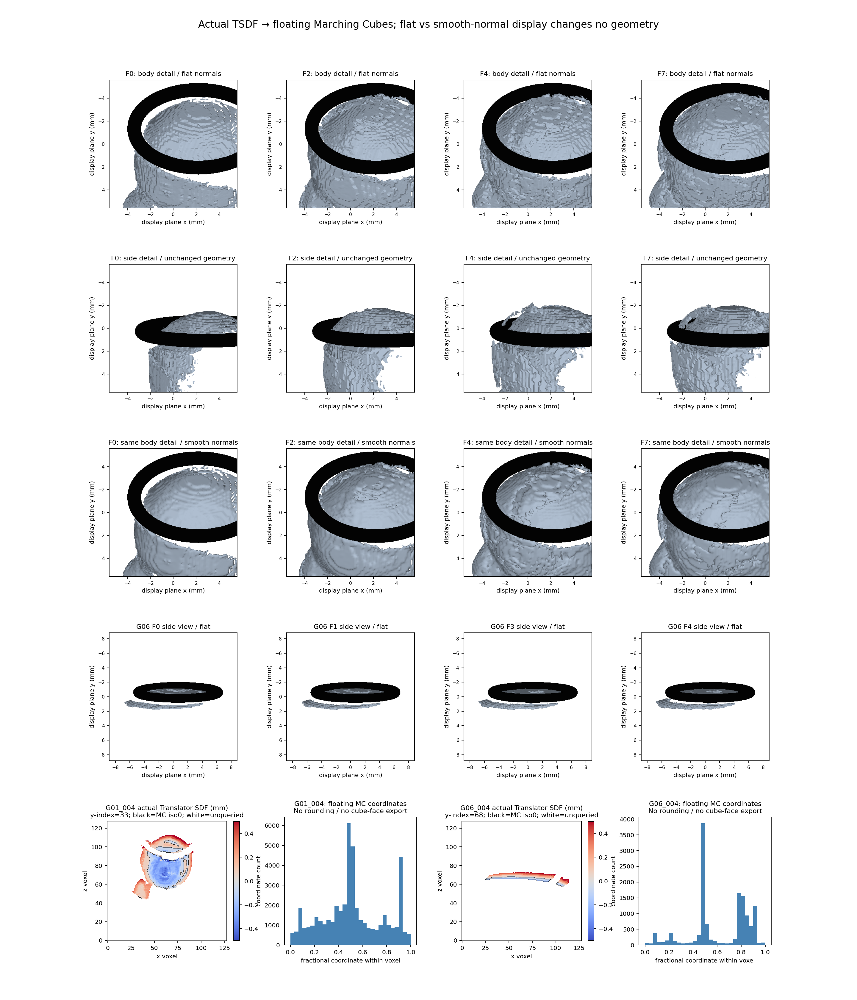
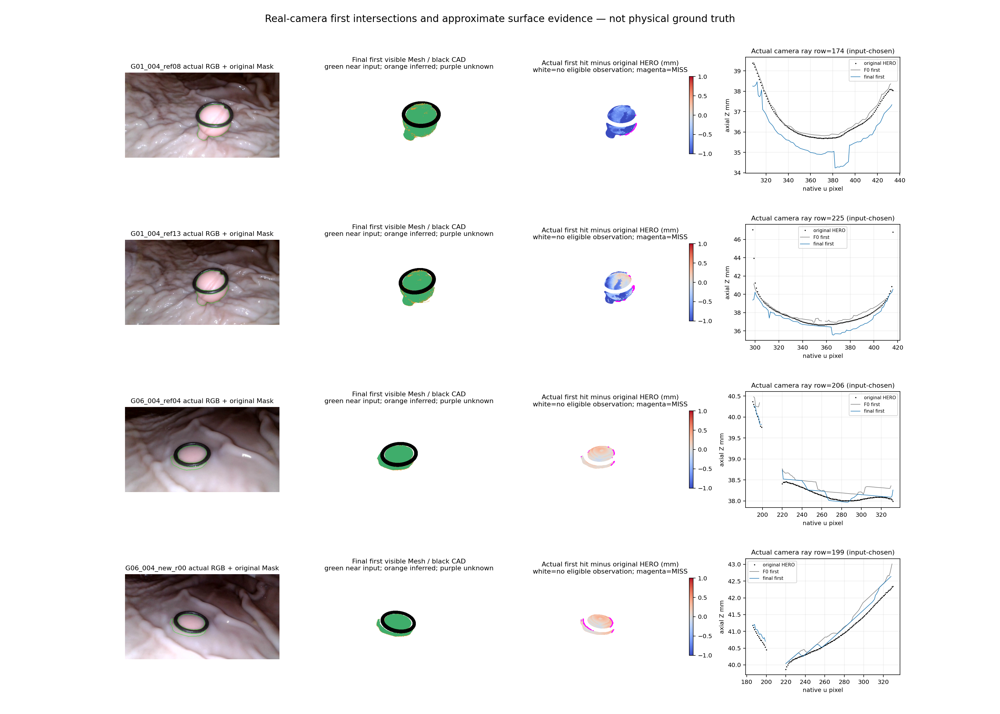

# TASK-E3-N0-NEURALFUSION-EIGHT-VIEW-001 — TECHNICAL REPORT

2026-11-03，REPORTED，等待研究者审阅，非科学基线认证。

已根据G01_004实际脚本首次建立关键技术版本v1.0，统一核查27份现有来源的相机规则，冻结G01八源及G06五源，完整执行26个正序/逆序预训练前缀。每次均实际运行官方Extractor、FusionNet、Integrator、Translator和浮点Marching Cubes，权重未变，未训练。多视角提高总体覆盖，但没有稳定解决表面真实性：G01固定首次深度一致率15.13%→30.69%，首源ref08却73.52%→0.47%，四次以上交点显著增加；G06提高至61.39%，仍有台阶、封闭与弱参考退化。清理还新增局部孔洞，不能声称没有表面损失。第二组只有五份现存HERO，不冒称八视角。原始Mesh、状态、失败及四张真实证据图全部保留；20–30视角仅准备方案，当前不扩大运行。

## 1. 版本、来源和授权边界

首次总技术文档：[关键技术版本v1.0](../../docs/KEY_TECHNICAL_VERSION_v1.0.md)。研究者明确说明不存在旧总文档，并授权调研当前004脚本后建立。72份历史脚本完整路径及SHA见[脚本审计](provenance/SCRIPT_VERSION_AUDIT.json)，各E3-A/B/C/D、Camera Gate、A2/A3/V5/V6和上轮F0报告的阅读回执见[来源版本](provenance/READING_AND_VERSION_RECEIPTS.json)。相机/清理/裁剪/域规则全部在首次新推理前冻结，首个代码提交为`b9711c8`；后续只修改评价、可视化和可复现交付，见[变更记录](TECHNICAL_CHANGELOG.md)。

官方版本`4f0c14f67ad9d2368b68cbeb78c237a6328971e5`，ShapeNet noise005，checkpoint SHA256 `3ac6dc9f219449e8aa5a26dec0a77691714e55d4e29da688c79630bf46068bff`；严格加载1,403,920参数，eval/inference_mode，逐次参数bitwise未变。官方来源：[weders/NeuralFusion](https://github.com/weders/NeuralFusion)。本轮禁止/实际次数：训练=0、optimizer.step=0、HERO新推理=0、相机优化=0、GT/Oracle读取=0、新TSDF=0、Dxy修改=0、20–30视角推理=0。所有旧工作树、原生Mask/HERO/K/c2w/CAD未覆盖。

## 2. 当前Camera Gate及源选择

同一v0.1候选规范的真实CAD双向轮廓、RGB-only独立F、固定空间留出、Sampson、视差/正深度及无先验Jacobian用于全部27份现有来源。优先已有真实RGB匹配，缺少时仅CPU SIFT，无新神经匹配器。数值阈值继承，没有为了入组调整。完整原始结果见[当前Camera Gate](config/CAMERA_GATE_RESULTS.json)。未进行任何位姿修正。

严格资格与研究入组分开：INSUFFICIENT_EVIDENCE仍不合格认证；身份/公制变换可靠、Ring无明确矛盾且无充分RGB反证者按本轮允许制度条件性入组。G01 growth_r01的Ring p95=12.4px超过12px明确矛盾线，未入组。G01新r00的Ring p95=6.708px不满足6px通过线，但未达明确矛盾线；作为高风险条件输入保留，且不投负向清理票。没有把历史资格改成真实GT。

G01从全部11份原生来源按固定CORE种子及“未覆盖block优先、最远姿态”选8份；不是旧六源追加两个。覆盖B1–B5。G06–G08按输入资格比例、Ring通过比例/误差、分区及深度存在性预先确定评分；G06胜出，无网络结果参与选择。G06只有5份HERO，覆盖3分区，最多执行F0–F4；不存在八视角迁移成功的结论。

|场景/阶段|来源|分区|当前资格|Ring p95 px|
|---|---|---|---|---:|
|G01_004 F0|G01_004_ref08|G01_video004_B3|INSUFFICIENT_EVIDENCE|5.385|
|G01_004 F1|G01_004_ref13|G01_video004_B5|INSUFFICIENT_EVIDENCE|4.243|
|G01_004 F2|G01_004_ref03|G01_video004_B2|INSUFFICIENT_EVIDENCE|4.000|
|G01_004 F3|G01_004_growth_r14|G01_video004_B4|INSUFFICIENT_EVIDENCE|4.472|
|G01_004 F4|G01_004_new_r00|G01_video004_B1|INSUFFICIENT_EVIDENCE|6.708|
|G01_004 F5|G01_004_growth_r06|G01_video004_B3|INSUFFICIENT_EVIDENCE|4.000|
|G01_004 F6|G01_004_growth_r10|G01_video004_B5|INSUFFICIENT_EVIDENCE|4.243|
|G01_004 F7|G01_004_growth_r04|G01_video004_B3|INSUFFICIENT_EVIDENCE|4.123|
|G06_004 F0|G06_004_ref04|G06_video004_B2|INSUFFICIENT_EVIDENCE|2.236|
|G06_004 F1|G06_004_growth_r01|G06_video004_B1|CONDITIONAL_USABLE|2.236|
|G06_004 F2|G06_004_growth_r06|G06_video004_B3|INSUFFICIENT_EVIDENCE|2.000|
|G06_004 F3|G06_004_growth_r03|G06_video004_B2|CONDITIONAL_USABLE|2.236|
|G06_004 F4|G06_004_new_r00|G06_video004_B1|INSUFFICIENT_EVIDENCE|2.000|

名单、顺序及理由：[VIEW_SELECTION_8.md](VIEW_SELECTION_8.md)、[输出前冻结](config/VIEW_SELECTION_FROZEN.json)。所有逆序均为空latent/count独立初始化，使用严格反转名单；无择优冒充主实验。

## 3. 原生输入、固定清理及表面损失

复用已认可六源V6的删除ID及原始HERO，另两G01来源与G06从真实原生深度开始；选定来源按相同A2候选/实际射线/Mask/CAD逻辑再执行一轮固定审查。每源最多512候选，未审查保留。支持/合法遮挡/未知保留，两个不同分区无支持或层竞争的轮廓反证屏蔽A；B竞争候选按最新已授权全B Mask语义派生屏蔽，Ring或映射身份不确定不删。原V6定向XYZ删除只保留其历史ID，不向新组外推，也没有在新源搜索类似空间阈值。A2 C/D的本轮判定保持保留，逐点证据全部保存。

|场景|原生合法Polyp|既有V6历史屏蔽|本轮A2/全B新增屏蔽|保留|新增闭合孔洞像素（净）|
|---|---:|---:|---:|---:|---:|
|G01_004|136203|3044|1072|132087|463|
|G06_004|46856|0|29|46827|4|

|来源|新增屏蔽|新增闭合孔洞像素（净）|主体最大组件：前→后|
|---|---:|---:|---:|
|G01_004_ref08|9|1|8320→8319|
|G01_004_ref13|30|-3|7804→7804|
|G01_004_ref03|9|0|13100→13100|
|G01_004_growth_r14|436|362|6883→6521|
|G01_004_new_r00|42|-4|11258→11257|
|G01_004_growth_r06|290|92|9197→9196|
|G01_004_growth_r10|236|15|8157→8156|
|G01_004_growth_r04|20|0|11705→11703|
|G06_004_ref04|2|0|6856→6855|
|G06_004_growth_r01|0|0|6005→6005|
|G06_004_growth_r06|7|4|10130→10122|
|G06_004_growth_r03|19|0|6394→6376|
|G06_004_new_r00|1|0|5692→5692|

**清理存在真实覆盖风险，不能写为无损。** G01 r14新增436屏蔽，其中362位于最大原Mask组件，并形成362闭合孔洞像素；原V3/V6继承的r14头部507像素缺口也未修复。G01 r06/r10新增孔洞92/15像素，G06 r06新增4。这里“最大Mask组件”只是头部代理，其他组件只是侧面/细柄候选，不能自动认证解剖身份。全局展示未通过补洞隐藏损失；详见[头部/细柄/侧面代理](metrics/HEAD_STALK_SIDE_INPUT_PROXIES.csv)。旧3px薄结构硬门槛完全未执行。

所有屏蔽可逆：frozen_inputs/native含original_native_id、historical_excluded、incremental_excluded；原始XYZ由原生深度/原ID/冻结K/c2w精确恢复。决策CSV含来源、原ID、原XYZ、分类、原因及逐观察者证据。没有未知深度填充。

## 4. 裁剪、公制域及尺度核查

逐视角原生Polyp+可见Ring bbox，max(16px,20%最大跨度)余量，最小4:3虚拟矩形，等比例320×240，直接复用Gate A make_crop。A的半像素偏移为`a*(0.5-x0)-0.5`，`K_crop=A K_native`。nearest原生ID采样深度，invalid=0，RGB/Mask同步。相机旋转未改，c2w为相机到Ring世界坐标，深度为轴向Z毫米。

归一：`X_model=(X_mm-O)/L`、`Z_model=Z_mm/L`、`C_model=(C_mm-O)/L`，128³/17维latent。域使用本组全部保留原生XYZ+实际CAD顶点，加max(2mm,10%跨度)余量，边长上取0.001mm；不存在出域点剔除。两个组各自冻结，不要求同一边长；组内前缀/逆序保持完全相同域。

|场景|O mm|L mm|voxel mm|实际CAD外径逆映射 mm|外径/体素|
|---|---|---:|---:|---:|---:|
|G01_004|[-10.21591, -9.692644, -15.41292]|20.106|0.157078125|12.400000|78.942|
|G06_004|[-8.481196, -9.463708, -9.399142]|17.664|0.138|12.400000|89.855|

R10文件名没有被解释为半径10mm；这两组实际外径均12.4mm。CPU代数逆映射<1e−5mm，实际GPU官方unproject误差<1e−4mm。nearest离散采样的原生像素中心与crop连续射线有有限量化位移，最大0.06378mm（不是相机校准残差），另列[采样误差](metrics/CROP_NEAREST_PIXEL_QUANTIZATION.csv)，没有用插值假深度消除它。

本轮G01域20.106mm不同于上轮F0的27.959mm，因此**不能把新旧F0差别单独归因于新增视角或清理收益**。本轮阶段间域/权重/采样保持固定，才能研究新增视角效应。

## 5. 官方完整链与Mesh真实性

26次实际链：输入深度/Mask/K/c2w → official unproject → FusionExtractor → FusionNet → FusionIntegrator更新共享latent → official get_translation调用Translator（每前缀全部known点同批）→真实SDF/occupancy → iso0浮点MC → `vertex_index/128*L+O`毫米Mesh。无占据体素立方体替代，无latent阈值伪Mesh，无直接点云充当预测。

128³官方路径只查询非零latent位置。未查询位置在原始field容器为0，不冒充网络预测或观测自由空间；供官方式MC的副本才使用+0.04哨兵。该处理可产生闭合壳/未知边界，面片全部保留并单列标记。SDF头参与官方训练损失；没有误把occupancy当SDF。Translator count归一保持官方完整批，未随意分块改变数学结果。

所有26个field已在CPU重放MC，浮点索引顶点和三角面与保存值完全一致。raw/flat/smooth-normal三份PLY的顶点/面逐项一致；GLB使用米，PLY使用毫米，回转误差<1e−5mm。法线插值只改变显示，没有平滑几何、缩面、补洞或删除网络推断区域。[完整审计](NEURALFUSION_OFFICIAL_PIPELINE_AUDIT.md)、[逐Mesh核查](metrics/MESH_EXTRACTION_AND_SHADING_AUDIT.csv)。

## 6. 固定分母的完整结果

分母为所有所选来源**清理前原生合法Polyp**：G01 136203，CAD遮挡4405，固定可见131798；G06 46856，CAD遮挡692，固定可见46164。所有阶段、顺序均一致。清理移除仍计入原分母，availability另列。hit不是正确，一致阈值0.25mm只是HERO/相机条件下代理；Raw面保留按原始全部面及原面积计，不删除困难面。该面积指标是逐来源加权，含共视重叠，不等于真实表面积或去重后的并集。八参考HERO共享部分上游RGB，E3-A来源DAG身份保留；八源和不同分区不等于八份独立统计证据，本轮未将共视留出称为盲测。

|场景|方向|阶段|视角数|命中率|首次深度一致≤0.25mm|Raw面积保留≤0.25mm|Mesh面积 mm²|连通组件|
|---|---|---|---:|---:|---:|---:|---:|---:|
|G01_004|forward|F0|1|86.03%|15.13%|41.05%|307.23|113|
|G01_004|forward|F1|2|91.37%|20.32%|56.28%|420.07|143|
|G01_004|forward|F2|3|96.13%|26.49%|68.10%|497.61|163|
|G01_004|forward|F3|4|97.66%|22.55%|82.02%|625.91|243|
|G01_004|forward|F4|5|98.42%|29.73%|84.93%|689.90|254|
|G01_004|forward|F5|6|98.61%|29.69%|84.85%|771.65|292|
|G01_004|forward|F6|7|98.90%|29.93%|85.21%|779.80|263|
|G01_004|forward|F7|8|99.06%|30.69%|82.72%|742.30|273|
|G01_004|reverse|F0|1|89.58%|27.94%|62.30%|315.09|86|
|G01_004|reverse|F1|2|95.79%|27.38%|77.28%|454.84|146|
|G01_004|reverse|F2|3|97.03%|27.62%|80.40%|667.75|210|
|G01_004|reverse|F3|4|98.65%|30.00%|86.82%|755.36|219|
|G01_004|reverse|F4|5|99.07%|28.97%|89.42%|771.03|274|
|G01_004|reverse|F5|6|99.11%|30.53%|86.56%|757.83|272|
|G01_004|reverse|F6|7|99.06%|30.48%|82.28%|724.32|238|
|G01_004|reverse|F7|8|99.08%|30.58%|83.62%|751.84|286|
|G06_004|forward|F0|1|94.85%|46.65%|69.58%|181.64|3|
|G06_004|forward|F1|2|96.71%|56.62%|81.14%|191.28|4|
|G06_004|forward|F2|3|97.87%|54.05%|80.40%|199.40|11|
|G06_004|forward|F3|4|98.02%|63.68%|89.94%|202.71|10|
|G06_004|forward|F4|5|98.56%|61.39%|87.77%|210.40|11|
|G06_004|reverse|F0|1|94.42%|55.32%|81.84%|186.62|14|
|G06_004|reverse|F1|2|96.70%|74.81%|94.96%|198.99|7|
|G06_004|reverse|F2|3|98.44%|66.24%|91.87%|210.23|13|
|G06_004|reverse|F3|4|98.55%|66.43%|92.50%|210.94|10|
|G06_004|reverse|F4|5|98.57%|61.24%|87.71%|210.10|11|

每源MAE/中位/p95/最大值在各*_RAYS.csv及*_METRICS.json中。hit-only误差与包含MISS的p95分开，MISS>5%时完整p95=∞（JSON值null加INFINITE_DUE_TO_MISSES状态，不当作0），不会只报命中均值。未做物理直径测量，物理GT的中位绝对相对误差/MAE/p95/max均NOT_EVALUABLE（NaN）。

|来源|F0首次一致率|正序最终一致率|最终hit-only MAE/p95/max mm|含MISS p95状态|
|---|---:|---:|---|---|
|G01_004_ref08|73.52%|0.47%|1.132/2.504/12.938|FINITE|
|G01_004_ref13|17.89%|37.36%|0.624/1.738/10.556|FINITE|
|G01_004_ref03|6.93%|53.40%|0.532/1.556/17.951|FINITE|
|G01_004_growth_r14|0.19%|24.51%|0.659/1.299/10.888|FINITE|
|G01_004_new_r00|0.00%|33.24%|0.413/1.015/19.723|FINITE|
|G01_004_growth_r06|25.59%|0.25%|1.494/2.412/12.440|FINITE|
|G01_004_growth_r10|7.56%|31.67%|0.619/1.983/11.636|FINITE|
|G01_004_growth_r04|6.92%|43.92%|0.657/1.893/15.185|FINITE|
|G06_004_ref04|81.46%|86.23%|0.128/0.321/0.604|FINITE|
|G06_004_growth_r01|32.16%|53.17%|0.241/0.441/0.725|FINITE|
|G06_004_growth_r06|52.95%|77.89%|0.168/0.338/0.686|FINITE|
|G06_004_growth_r03|9.79%|6.90%|0.381/0.505/0.774|FINITE|
|G06_004_new_r00|51.02%|72.77%|0.166/0.376/0.717|FINITE|

总体覆盖增加有意义，但G01 ref08及r06的真实射线首层几乎全部偏移，不能被汇总改善掩盖。G01 F3、F5、F7的部分Raw保留/一致性也非单调；G06最后加入r00后总体一致率从F3 63.68%降至61.39%，仍完整执行，未用质量门槛停机。

### 光滑、完整、真实分开判断

光滑：G01邻接面法线角中位7.13°→11.80°，p95 72.11°→79.64°；近坐标轴法线比例14.92%→10.96%。指标方向不一致，真实图仍有块状/粗糙。G06法线角约1°而坐标轴法线比例约53%，浅表面仅跨少数Z体素，出现台阶环带；不能将平面/平滑显示当精度改善。

完整：两组固定射线命中和Raw面积保留均高于F0，但G01组件113→273、最大组件面积比例49.83%→48.20%，G06组件3→11、79.85%→74.49%。没有形成一个已验证的统一解剖表面，细柄/侧面连通仍未认证；清理孔洞没有因Mesh封闭而被解释为恢复真实组织。

真实：没有GT，首次表面与HERO是有条件几何解释。G01 ref08最终bad首交点13065中，12895落在MC单元8角均known区域，只有170为unknown边界代理；因此不能把全部深度退化归咎于unknown哨兵或渲染。G06对应1173个bad中1114也在all-known单元。都是代理归因，不是物理真值。

|场景/阶段|≥4次交点射线/固定可见分母|unknown边界面比例|可见但缺直接支持面比例|无观测/遮挡未知面|
|---|---:|---:|---:|---:|
|G01_004 F0|6.44%|59.73%|37.37%|598|
|G01_004 F7|66.43%|40.34%|44.32%|4035|
|G06_004 F0|1.70%|56.43%|48.01%|133|
|G06_004 F4|1.73%|57.02%|54.39%|603|

正常闭合壳本身有前后两次交点，所以“两次”不能自动视为重复层。G01四次以上交点6.44%→66.43%才是明显多壳/多层代理；G06约1.70%→1.73%，仍不能证明真实表面正确。

支持类别要求：面心距真实清理点<=0.25mm，且至少一真实相机投影有合法Polyp深度、轴向差<=0.25mm、CAD未遮挡。可见但无直接支持记INFERRED_UNSUPPORTED_PROXY，未见/遮挡/不足记UNKNOWN。所有标签未校准，不删面。任一来源的背景Mask反证/前方自由空间代理同时保留，跨来源可能冲突。邻近支持不等于该面是某视角的第一可见层，这正是ref08表面看似“被其他源支持”却首交点严重提前的原因。

新侧面不能只看面积：[新增观测代理](metrics/NEW_VIEW_GEOMETRY_PROXY.csv)中，G01 r06有6772个相对前源新颖且CAD可见点，当前Mesh近邻保留5975，却只有20个满足该源首次深度一致，说明邻近几何存在与真实可见首层解释是不同问题。G06后续点多为重复观测，新增侧面证据有限。

跨源输入本身也有差异：投影到ref08的r13/r03/r14/r00/r10/r04清理点轴向中位差约−0.544/−0.766/−1.573/−1.150/−1.119/−0.708mm；G06对应大多在0.03–0.29mm量级。这些受相机、HERO和离散化共同影响，不据此认证哪一源错误。官方局部±3体素更新、不显式施加本项目自由空间一致性，与远层残留机制相容；没有通过新增算法强迫它们成为单层。

### 严格逆序

- G01_004：正序→逆序全部面心距离MAE=0.00889mm，p95=0.04030mm，max=0.33639mm；反向p95=0.04828mm。
- G06_004：正序→逆序全部面心距离MAE=0.00169mm，p95=0.00912mm，max=0.10623mm；反向p95=0.00847mm。

最终总体一致率G01正序30.69%/逆序30.58%，G06 61.39%/61.24%；不是完全顺序不敏感，局部差异仍在。两条均原样保存，无择优输出。

### 历史Open3D对照

G01历史D0 G1（旧六源、原生未清理、0.1mm）在本轮同一8源固定分母上命中率94.79%、首次一致率32.58%、Raw面积保留71.89%。NeuralFusion最终首次一致率30.69%，未超过该历史数值。但两者输入/清理/分辨率不同，不能据此做纯融合算法因果排名。G06无已核验同组历史Open3D；返回NOT_AVAILABLE，没有补跑新TSDF或借其他组结果。历史融合只用于图与评价，未参与NeuralFusion预测。

## 7. 四张核心证据图

Figure 2各组所有列使用固定毫米观察坐标；原始Raw有域外长条，显示窗口按本轮清理域统一，原Raw文件并未裁剪/删除；它们全范围与原ID仍可读取。不要把图中窗口截取误认为清理算法输出。

Figure 3局部放大中心来自冻结输入XYZ中位数；black CAD为真实几何。Figure 4所有RGB和射线均来自原相机，profile行由原Mask最宽行预定，未临时挑有利像素；蓝线最终首层与黑点原始HERO的偏离是实际几何，非光照变化。

## 8. 固定审计表

|审计项目|本轮必须汇报|
|---|---|
|目标组数|2，G01_004/G06_004；27来源仅做统一输入Gate，不作27个独立物理组|
|本算法独立成功|2/2产生独立非空预测；26/26前缀完成；不等于测量正确或科学验收|
|本算法失败|工程预测失败0/2；两组物理准确性均NOT_EVALUABLE/NaN，G01存在严重首层退化，G06迁移仅5视角|
|历史测量值回退|0；历史Open3D只读评价，没有参与预测|
|失败组及具体原因|两组均保留未认证风险，详见FAILURE_LEDGER.md及四图；未删除失败来源制造成功|
|最终统计样本|两组所有所选原始观测固定分母；总目标2；G06缺8视角单列，不隐瞒缺口|
|是否使用GT选择算法|否；b9711c8及provenance/BEFORE_GPU.json在输出前冻结，GT读取0；物理误差不计算|

独立数值覆盖2/2，已证实物理正确覆盖未知，不能写100%正确率。未来评价GT须独立授权并保持这次预测、参数及选择冻结。

## 9. 结论、交付与停止

**官方程序确实输出了Translator SDF驱动的真实三角Mesh，完整八视角实验已经执行，不能再把旧F0停机当作路线结论。** 新增视角改善固定总体覆盖和部分源解释，但没有稳定保持原可信主面，G01多层首交点冲突显著；G06更连贯但不足八源、存在台阶和弱参考。平滑法线不能解决这些真实几何问题。

本轮不宣布NeuralFusion全面失败，也不宣布已获得可靠测量模型；应由研究者结合全部结果决定是否投入增强输入。目前不能假设单纯增加重复视角就能纠正相互冲突的几何。24份现有RGB/相机候选资源和缺失计算见[增强方案](VIEW_EXPANSION_20_30_PLAN.md)：G01仅16缓存帧，G06仅8，两组不可合并，单组20–30仍需新增真实帧和身份/相机/HERO资格。

真实26组Mesh：meshes/*_raw_mm.ply（mm），对应flat、smooth_normals PLY和SI_m.glb；每阶段配置/调用/状态SHA在metrics/*_RUN.json。全部latent/count、原field/known/MC哨兵、浮点MC身份和逐观测数组保留local_results（LOCAL_ONLY，不复制原视频/大模型）；索引见LOCAL_RESULTS_INDEX.json。完整代码、配置、小表、Mesh和四图提交独立GitHub分支，复现见[REPRODUCE.md](REPRODUCE.md)。

完成本轮后停止，等待研究者/PM审阅。不自动运行20–30视角、新HERO、相机修正或训练。
