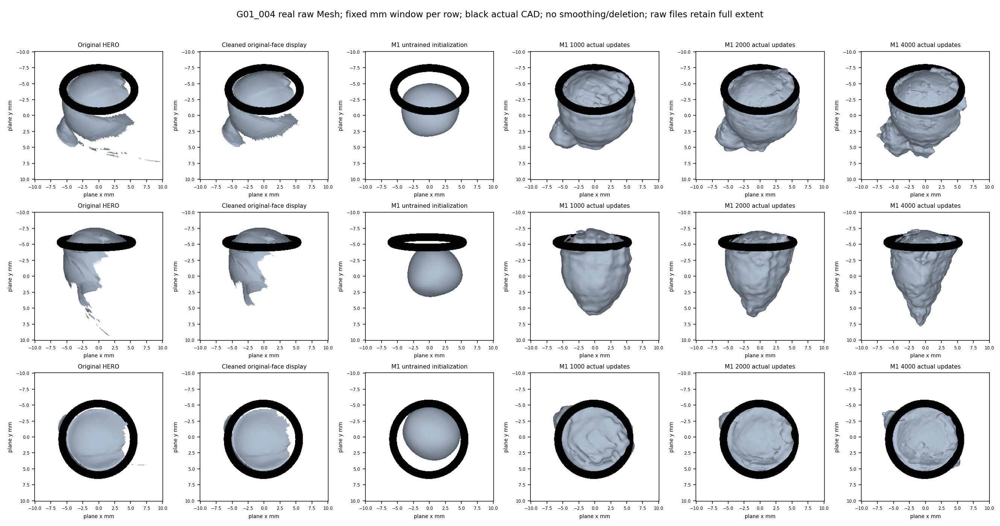
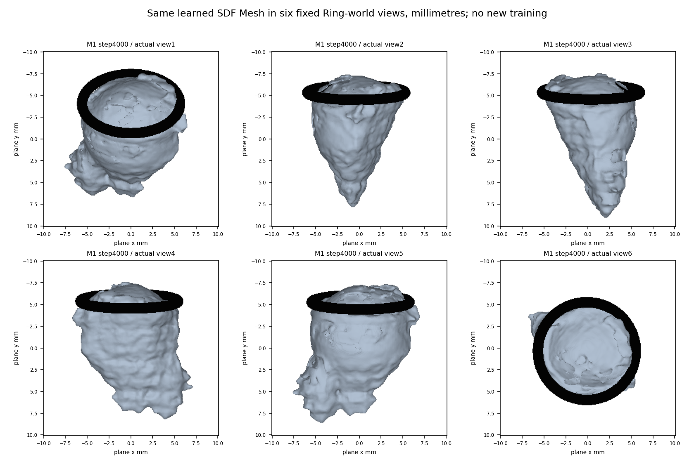
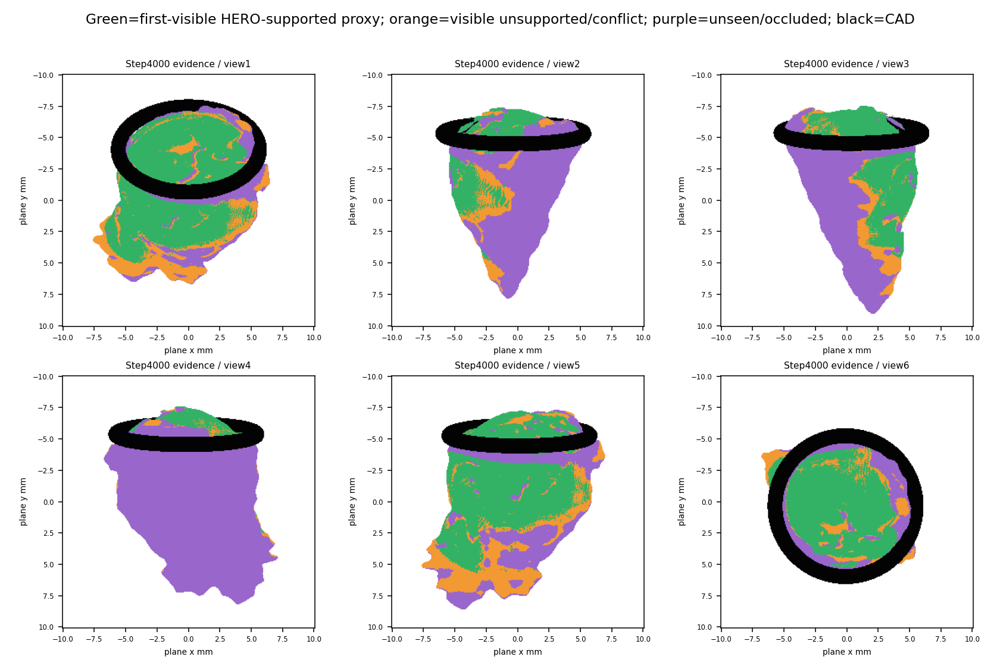
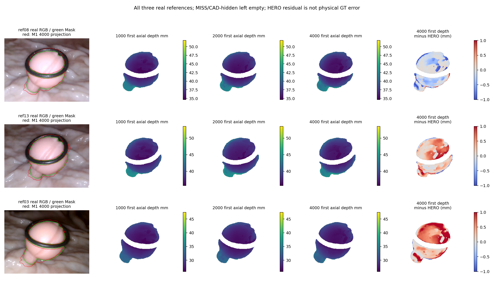

# 额度中断后的实际进度与可视化

**本地 G01_004 M1 已完成4000次真实Adam更新；4090新增训练更新0。G06/G08训练NOT_RUN。** 上次中断位于环境迁移阶段，远端长程训练任务尚未发布，不能声称已完成10倍或多息肉实验。

本轮仅检查状态、读取已有参数、官方零面提取和CPU绘图，optimizer.step=0。服务器仍可连接，独立Python/PyTorch环境安装已完成；未因额度问题自动追加云端训练。

## 已保全状态

G01检查点包含37个模型张量、Adam、scheduler、loss step、完整配置、CPU/CUDA/Python/NumPy RNG和采样位置，4000步状态SHA256：`63a1b05b681fd47929afe2b05437f18bc5ccb9ad28c63056179315cb00859985`。本地累计训练约1675秒（27.9分钟，含阶段提取/监测）。旧M0不计入M1次数。

远端RTX4090 24564MiB、driver560.35.03、Python3.12.16、PyTorch2.7.1+cu126、Open3D0.19。原本地PyTorch同版cu128，迁移只调整CUDA构建包以匹配现有驱动，未更换网络、损失或数据。官方源码commit12513009。所有选定资产和官方源码SHA通过，真实模型参数在提取前后逐项不变。

4000步固定raw SDF的CPU/GPU最大差3.43323e−5mm，低于预先设置的2e−4mm；这证明迁移读取与数值相容，不是训练效果认证。0/1000步复用此前真实导出，2000/4000步在4090用同一官方256³iso0流程重新提取；各阶段相同公制域与显示方式。

## 固定原生分母

|阶段|首层命中|首层≤.25mm|清理HERO点保留|≥4层交点|连通组件|
|---:|---:|---:|---:|---:|---:|
|0|46.09%|0.00%|0.00%|0.00%|1|
|1000|98.03%|38.86%|64.96%|7.20%|1|
|2000|98.35%|43.78%|65.48%|7.89%|4|
|4000|98.37%|43.49%|67.96%|22.80%|12|

分母始终为三参考原始合法native Polyp 50265，CAD遮挡1624单列，可见48641；清理屏蔽与未命中均不从评价分母删除。条件HERO/相机不是GT，绝对精度NOT_EVALUABLE。

2000→4000：主面最近点保留65.48%→67.96%，首层一致43.78%→43.49%基本持平略降，≥4层交点7.89%→22.80%，组件4→12，负区代理体积782.96→733.46mm³（约−6.3%）。最大连通分量仍占99.44%面积，因此小组件增加不等于主体完全碎裂。原生ref08/ref13首层一致有所提高，ref03下降。不能仅凭较完整的外观或近点保留认定整体重建改善。当前同时存在HERO贴合与重复层/小碎片风险，未完成目标训练，不能据此否定MonoSDF路线。

## 四张核心图

图1：0为未训练官方网络初始化，不称重建结果。Raw/Cleaned对照显示原归档面，cleaned按已冻结native有效性映射筛选原面，未移动XYZ；原始完整文件未裁剪，所有列仅使用同一固定毫米显示窗口。

图2：268462个原始零面三角形的六视角，无平滑、删组件、补洞或几何后处理，黑色实体为实际Ring CAD。

图3：绿色74826面为真实相机首次可见、原Mask/合格HERO深度±.25mm支持的代理；橙色31578面为可见但无支持/冲突；紫色162058面为未见/遮挡，不认证为真实息肉。另有19313面存在至少一个视角BG Mask反证。这些类别并非物理真值。新增自身首层容差.01mm和CAD .002mm仅用于展示诊断，不回写或修改历史评价。所有面保留。

图4：三个真实源的原RGB/Mask、真实SDF Mesh首次深度及相对原生HERO轴向误差；MISS/CAD后方留空，不补假深度。绿色是真实Mask，红色是4000步模型可见投影。

## 仍未完成

4090训练性能短测、4000→目标继续优化、G06/G08独立训练及1x/2x/5x/10x长程比较仍未运行。已固定比较N=2000、最低目标20000，但不能将本次提取/绘图算作优化步。控制器代码是未执行候选，不代表已发布远程任务。

|审计项目|必须汇报|
|---|---|
|目标组数|3：G01/G06/G08|
|本算法独立成功|现有G01已产生真实4k SDF/Mesh，工程产物1/3；本轮10倍训练完成0/3|
|本算法失败|G06/G08为NOT_RUN，不伪造；物理准确度三组NaN/NOT_EVALUABLE|
|历史测量值回退|0，未读其他路线预测填补|
|失败组及具体原因|额度中断发生在迁移/发布前；没有NaN/OOM训练故障证据|
|最终统计样本|当前仅G01三参考固定原生48641可见观测，不将其算三物理组|
|是否用GT选算法|否；源、配置、源码冻结，GT/Oracle不读|

物理MedARE/MAE/p95/max及共同成功组物理配对全部NOT_EVALUABLE。相机仍是原资格，三份G01均INSUFFICIENT_EVIDENCE，仅条件研究入组。
