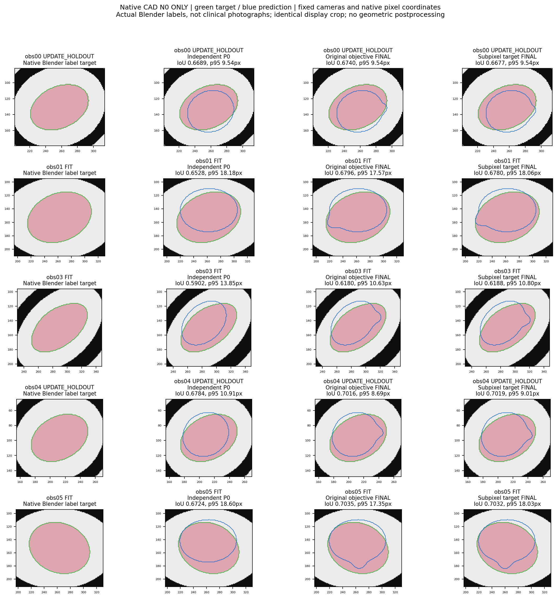
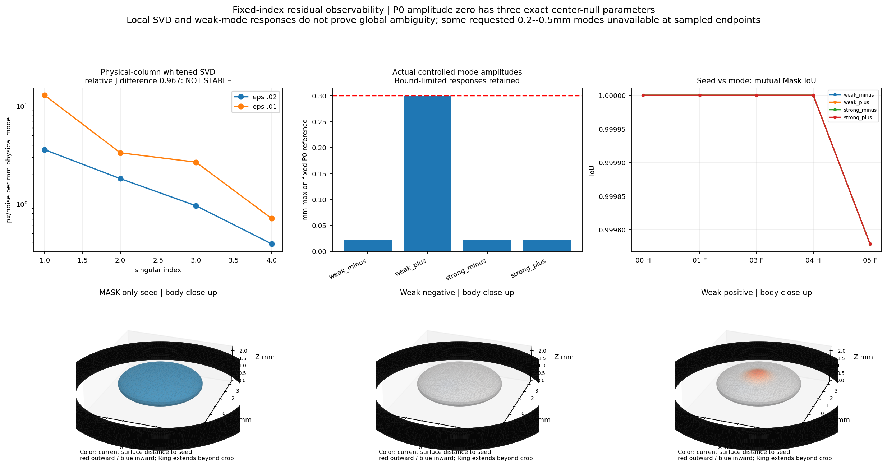
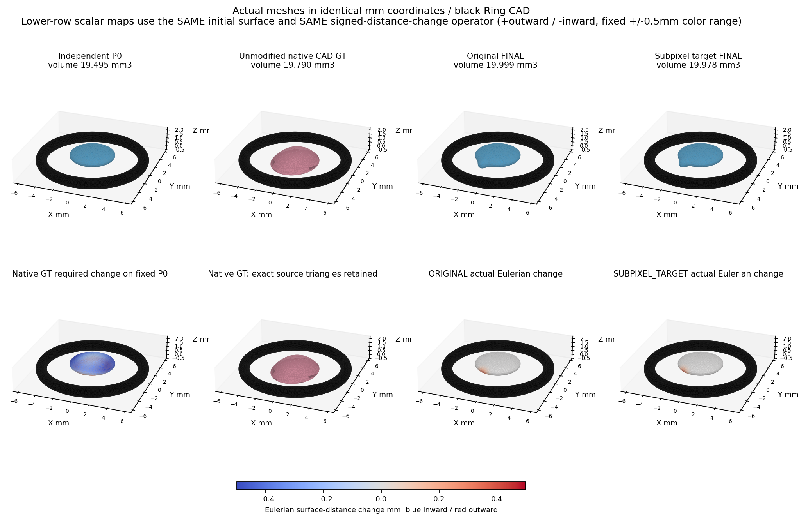
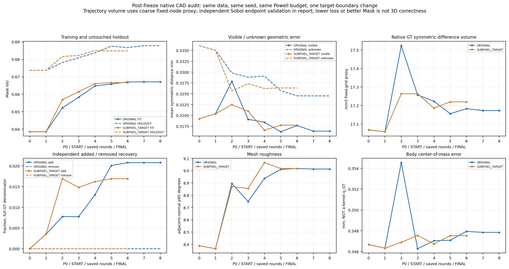

# Gate A：二维约束到三维几何可观测性审计

**Gate A 已完成；Gate B/C/D 未运行，待人工确认。** 原生CAD目标与独立Ring规则椭球P0、旧同核控制严格分开。预测已冻结，没有原生CAD的q_GT，没有用GT初始化、挑选或停止优化。

## 本轮身份及门禁

本轮1个固定IIa6.5_R10原生Blender场景，3拟合obs01/03/05、2留出obs00/04。主体原生顶点×1000、只作历史场景居中/落地，不进行局部人为形变。Ring/CAD与相机保留原字节；用户允许统一选择后，采用K实际水平视场66.787223°，没有把名义70°冒充实际值。K_edge主点−0.5对应整数像素中心，Blender与CV轴变换diag(1,-1,-1,1)。

新P0中心为Ring中心+(0,0,0.5mm)、半轴(2.5,2.5,0.75mm)，零旋转；仅由固定Ring规则构造，不是原生CAD生成的旧BASE_FIELD，也不是跨视频搬来的真实病例。新h=.15mm、核半径1.8mm按Ring固定，未搜索。九参数只定义冻结椭球，真正更新仍为中心XYZ+幅值四参数，非九参数优化器。P0全三角面Ring正间隙2.544663mm，无静默平移修复。**本P0未做Mask驱动九参数椭球校准，原始轮廓解释较粗；结论仅针对该冻结起点/局部四参数族，不代表所有可能的低维P0或SDF路线。**

BASE/TARGET各五视角重新渲染通过：最差主体IoU=0.998612、Ring IoU=0.998264，点投影最大误差=0.00009311px，原门槛未改。模拟已知相机不能冒充真实视频相机认证。真实标签来自Blender发射材质渲染，不是临床RGB。

[来源/防火墙审计](SOURCE_AND_FIREWALL_AUDIT.md)、[输入manifest](assets_index/INPUT_MANIFEST.json)、[运行前协议](01_PROTOCOL.md)。源CAD/旧GT/旧CAD底场/.blend在优化进程均被拒读；只读GT哈希及投影门禁不参与生成预测。

## 固定残差与可观测性

固定查询2154行，每源的线性0.5目标边界中点和4px近边界网格不随参数改变；Ring/UNKNOWN、前背景分母均固定。残差为真实可见投影线段的有符号距离差(px)，噪声0.5px、各源1/sqrt(N)白化；未把可变整数findContours列表当雅可比行。列按同一P0表面Eulerian距离最大灵敏度归一化，SDF系数不是表面位移。完整查询、原始/归一化J保留本地索引。

P0幅值为0时，核中心移动不改变几何，三中心列严格为零；这是表示的参数冗余，不是相机失败。非零Mask seed的联合归一化奇异值为[12.86139326490932, 3.32678935409228, 2.67108357853784, 0.7105059235448042]，表面看满秩，但ε=.02→.01mm的相对J变化为0.967，超过预登记0.2敏感线，**弱方向数值认证未通过**。整体残差平方梯度差约2.14%，说明可有稳定的大致下降方向而不具稳定的全部参数定位。三角剖分/可见轮廓段选择随参数改变，仍需审计；不能凭该SVD宣布全球唯一或全球不可辨识。

预登记弱方向的一个正扰动产生最大0.299917mm变化、平均0.008411mm、体积改变0.374222mm³；五视角相互IoU=[1.0, 1.0, 1.0, 1.0, 0.999779]，各源亚像素p95变化均小于0.03px。**两份实际三维Mesh在当前轮廓下几乎相同**，是本例P0邻域有限幅度弱约束的直接证据，非所有三维形状不唯一的定理。**这里接近1的是两份预测互比IoU，不是对原生目标的IoU；它们总体目标拟合仍差，不能据此宣称存在两个都高质量拟合GT的全局解。**

其他三个方向按冻结边界走到端点只产生约0.022mm，未达到0.2–0.5mm要求，保留原始数据；端点标定不证明整条非单调方向均不可达到。因此不将四方向当物理等幅比较，也不据此排名强/弱方向优劣。未扩大范围、修改幅值或补做模式搜索。

## 目标偏置：旧控制诊断，非N0结果

旧同核A/B原样目标在GT及历史FINAL处均精确回放至1e−12。B的GT幅值+0.02mm会增加真实三维错误，原损失却从0.024345603降至0.0234967，达到预登记方向偏置触发条件；A本次±0.02幅值邻域未触发。旧0.21–0.37px外向几何边缘/内缩前景中心偏置仅以[旧控制回执](metrics/LEGACY_OFFSET_RECEIPT.json)引用，不当成本轮原生CAD测量。

仅做一项修正：目标轮廓由前景像素中心换成二值Mask线性0.5亚像素边界；预测轮廓、XOR、所有权重、相机、初始化、表示、求解器和预算不变。矩形控制验证原像素中心距修正边界正好0.5px。**训练修正仍是亚像素边界采样点的NN目标，不是完整连续线段损失；固定行雅可比审计才使用线段距离，二者不混称。**修正后旧同核GT损失降低，但局部采样/NN目标仍不保证GT严格最优，不宣称一次修正消除了全部偏差。历史“扩张新增体积恢复约44.5%”与“峰值位移约42%”为不同指标，均不是原生N0结果。

## 配对短程及原生GT后验评价

两臂从同一冻结Mask-only seed运行，最多12轮/500函数评价、同Powell/direc/停止条件，取最后有界迭代，不按更好中间轮、GT或留出选模。ORIGINAL: 6轮/388次SciPy评价/226.9秒；最终q=[-1.033433408255702, -2.5794054614391313, 0.5166368268646951, -0.589530332310934]，Ring碰撞候选0。 SUBPIXEL_TARGET: 4轮/273次SciPy评价/163.1秒；最终q=[-1.346326163056479, -2.4648637544677454, 0.5023676465586651, -0.5925242818319139]，Ring碰撞候选0。 本轮没有额外物理拒绝优化器；候选新最佳/未改善是线搜索记录，不能误称具备独立接受/拒绝碰撞机制。

|指标|独立P0|原目标FINAL|亚像素目标FINAL|
|---|---:|---:|---:|
|拟合Mask IoU|0.638480|0.667063|0.666648|
|留出Mask IoU|0.673665|0.687805|0.684812|
|对称曲面距离 MAE mm|0.325187|0.319264|0.320797|
|对称曲面距离 p95 mm|0.697122|0.658148|0.661233|
|可见GT区域 MAE mm|0.319219|0.316360|0.317738|
|未知GT区域 MAE mm|0.336098|0.324505|0.326336|
|主体质心误差 mm|0.346664|0.347839|0.347522|
|Mesh体积 mm³|19.495241|19.999263|19.978344|
|体积有符号相对误差|-0.014909|0.010559|0.009502|
|面积有符号相对误差|-0.223689|-0.200471|-0.200819|
|粗节点差异体积代理 mm³|17.067375|17.172000|17.219250|
|新增体积恢复率|0.000000|0.020797|0.016919|
|删除体积恢复率|0.000000|0.000000|0.000000|
|邻面角p95 度|8.388967|9.013559|9.017610|
|独立Sobol差异体积代理 mm³|15.068025|15.213391|15.245347|
|独立Sobol新增恢复率|0.000000|0.023338|0.019817|

修正−原版：拟合IoU -0.000416，留出IoU -0.002993，Chamfer MAE +0.001533mm，差异体积代理 +0.047250mm³。不能比较不同定义的原始loss大小来宣布哪个几何更好。

全部预测SHA冻结后才读取原生GT开展三维评价。每个方向6000面积样本，GT采样点固定；可见性由三训练相机/目标Mask/Ring下GT首次表面定义，预测按最近GT表面可见性分组，不按低误差筛掉坏点。全部分母保留，GT可见/未知样本分别3366/2634。曲面距离的中位绝对/MAE/p95/最大、PCA轴/世界尺寸、面积和体积误差、FP/FN及未知像素均有逐轮/逐源表。主体质心误差不是不存在的核q_GT误差。PCA轴是不同离散Mesh顶点分布的描述，近等轴方向不作为可靠旋转认证；世界XYZ尺寸另报。

固定P0表面同一有符号最近面距离变化用于GT/预测Eulerian比较，不混用材料位移。独立同法线射线最终以STRICT_NORMAL_RAY_VALIDATION为准：发现113个射线原点位于原生GT内部，不能将其退出面命中误作前表面；已按GT/预测同一外部原点规则排除并存NaN。NATIVE_POSTERIOR.normal_rays及原NPZ为未加此条件的初步记录，保留但不作最终射线结论；主表最近曲面指标及所有预测均未改变。差异体积在同一独立P0网格用实际闭合Mesh占据求积，是离散代理，不是精确布尔体积；GT域外顶点0。**原生CAD平底导致粗节点体积出现明显混叠**，因此另做一次固定2^18 Sobol点、同独立P0边界、同实际Mesh占据算子的精度核验；不重拟合、不覆盖粗表、不按结果选择参数。Sobol差异体积为P0 15.068025→原版15.213391／修正版15.245347mm³，确认两臂三维差异并未随Mask改善而改善。它仍是积分代理；精确闭合Mesh体积独立另报，不能将粗节点值当精确物理体积。未平滑、补洞或删面。

## 表示上限及四类原因

原生GT相对P0同时需要新增约7.651810mm³和删除约7.416215mm³（独立固定Sobol积分代理；原粗节点读数另存）。**一个非负Wendland核乘单一幅值只能在全域加体积或删体积，不能同时完成两者**。无论中心怎样、换何求解器，单符号限制使该固定P0/单核族无法同时修复两种差异；不可消除的体积量下限代理约7.416215mm³，不能冒称连续精确下限数值。单符号性质是解析结论。不能把全局形状差异解释为仅仅缺视角或Powell搜索失败。

|解释|标签|证据与边界|
|---|---|---|
|观测不足|supported|实际0.300mm/0.374mm³形变几乎不改五视角Mask；仅本例/该方向，局部J弱模态未稳定认证|
|目标函数偏差|supported|旧同核B的已知错误方向降低原loss；N0修正对照另报，不混合GT身份|
|搜索失败|inconclusive|无原生q_GT、弱J不稳定且表示不完备；正常Powell退出不证明全局最优，也不足以单独定罪求解器|
|表示不足|supported|GT需要同时加/删，而固定P0单符号单核表达不了；不靠再调阈值或选初始化掩盖|

所有保存轮次闭合/单连通及Ring结果见原始表；独立Blender EXACT端点交集见NATIVE_POSTERIOR。P0、原生GT及两最终Mesh的独立Blender BVH均未检出非邻接三角面自交，见SELF_INTERSECTION_AUDIT；邻接/退化情形仍NOT_CERTIFIED，未将“单连通”偷换成完整无自交证明。

## 七问与下一步边界

1. 相似Mask下本例已展示约0.300mm最大局部变化和0.374mm³体积变化；非全场平均位移，不泛化所有形态。
2. a=0中心三维严格零空间；非零seed可观测的大致合成方向存在，但四参数独立/稳定支持尚未认证，分源SVD/贡献见OBSERVABILITY及VIEW_SUPPORT。
3. 原目标偏差真实存在，旧同核B明确改变下降偏好；旧像素偏置与N0分别报告，不认定它是唯一原因。
4. 观测、目标、表示均有支持证据；搜索仍inconclusive，不能将失败只归于其中之一。
5. 一项亚像素目标修正已按固定Powell完成，二维/后验三维是否一致改善按上表差值判断，不将Mask改善等同三维正确；单核整体表示上限仍存在。
6. 优先确认连续可见边界的数值稳定性、解决已有证据的通用表示上限，再审查新增视角是否提供新轮廓约束；当前没有触发改TRF的充分前提。增加训练次数或直接换求解器不能消除单符号表达限制。
7. 相机等价/防火墙门槛满足；N0方法与弱J尚未验收，B/C/D仍为HOLD。**建议下一项唯一数值预审变更为可见投影边界提取/取样一致性**，保持P0、数据、目标、Powell及预算不变，以ε/2相对J稳定为门槛；若不稳定仍不进入求解器比较。任何双核/新表示需另行人工授权，不能伪装成Gate B原协议。

## 核心图和原始证据

[逐轮三维表](metrics/NATIVE_STAGE_METRICS.csv) · [逐源二维表](metrics/NATIVE_PER_VIEW.csv) · [候选决策表](metrics/CANDIDATE_DECISIONS.csv) · [完整后验](metrics/NATIVE_POSTERIOR.json) · [复现](REPRODUCE.md) · [失败记录](FAILURE_LEDGER.md) · [本地Mesh/场/雅可比索引](assets_index/LOCAL_RESULTS.json)。代码/输入冻结提交cb959b3，各原始资产SHA与预测冻结见manifest，旧378文件未改。

## 固定审计表

|审计项目|汇报|
|---|---|
|目标组数|1原生CAD场景，2短程目标臂；旧2同核控制仅诊断，不增加病例分母|
|本算法独立成功|2/2臂数值输出；相机/防火墙通过；不宣称完整正确三维恢复|
|本算法失败|稳定弱模态认证失败；3/4扰动未达要求幅度；四参数族完整原生恢复未认证，直径指标NaN/NOT_EVALUABLE|
|历史测量值回退|0；新P0只读Ring，旧CAD底场被拒读|
|失败组及原因|IIa6.5：弱J敏感、单符号表达限制及轮廓隐藏形变；见Fig2/3/4及失败表|
|最终统计样本|全部1场景/2臂/5视角，各方向6000曲面样本及固定P0空间/表面分母，未删失败行|
|是否使用GT选择算法|原生GT否；旧同核GT按用户明确授权用于A2目标诊断/预登记纠偏触发，未用于N0初始化、选模或停止；无原生q_GT|

本轮非直径测量，中位ARE等直径指标NOT_EVALUABLE；几何中位绝对/MAE/p95/最大均原样提供，不用历史融合结果回退。官方[Powell](https://docs.scipy.org/doc/scipy/reference/optimize.minimize-powell.html)与[Open3D距离查询](https://www.open3d.org/docs/release/tutorial/geometry/distance_queries.html)实际复用，Kaolin原样DMTet/许可保留；[SDFDiff](https://github.com/YueJiang-nj/CVPR2020-SDFDiff/tree/master/multi_view_code/code)、[PyTorch3D教程](https://pytorch3d.org/tutorials/fit_textured_mesh)只读参考，不安装或冒称其模型输出。

**Gate A 已完成；Gate B/C/D 未运行，待人工确认。**
