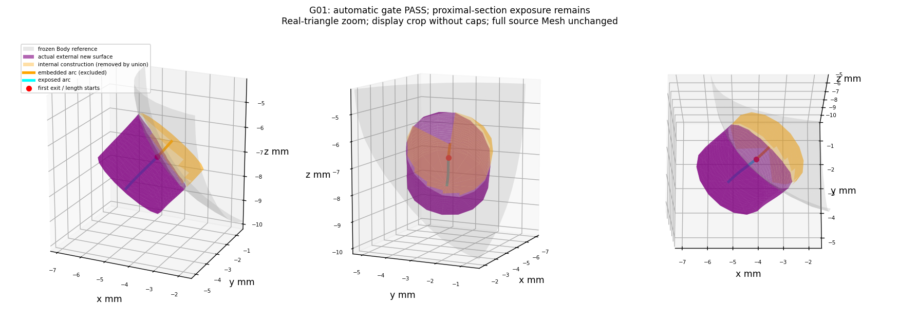
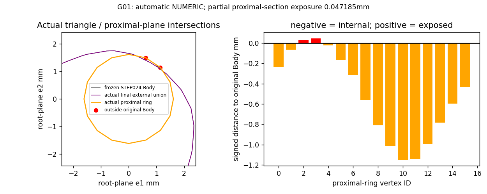
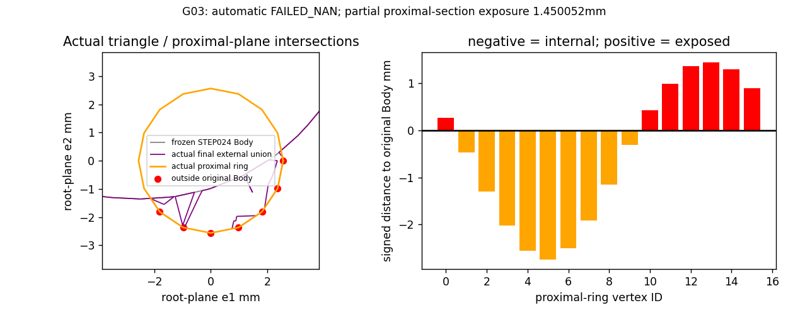

# TASK-E4-G01-G03-GROWTH-RECOVERY-001

## 冻结后的补充几何审阅（必须与自动门禁结论同时阅读）

本轮自动门禁数值输出为 **1/2（G01）**，G03正式预测与柄长为NaN；这不是“两组科学成功”。额外检查发现：中心线近端在Body内部，并不保证整个椭圆近端截面都在内部。G01近端截面顶点最大外露 **0.047185 mm**；G03失败尝试为 **1.450052 mm**。这些是真实缺陷，见新增根截面三角面求交和SDF图，不能称整个近端截面已完全隐入。原实现中“近端cap完全内部”的注释是过强陈述，实际证据以此审阅为准。

外部Boolean并集仍真实连接、闭合且无检测到的自交；上述缺陷是根部形态/近端截面约束不足，不能靠“闭合”掩盖。因此 **G01完成了自动门禁接受的连续柄生成，但不宣称已完全证明理想的内藏根部形态；G03未完成可接受恢复**。原冻结预测、原自动门禁记录及自动报告均未修改，本报告额外区分自动通过与更完整的几何审阅。没有根据这一发现调整嵌入深度、重新选择checkpoint或再次优化。

G01独立尺度固定SE(3)对齐MAE由0.334906降到0.303623 mm；固定INITIAL→GT框架下由0.335972升到0.356988 mm。故只能说轮廓及独立对齐后的形状距离改善，不能宣称原公制框架中的三维定位改善。G03失败尝试同样有独立对齐后距离下降、固定框架误差上升现象；不能将无效候选计入成功结果。

## 执行版本与恢复来源

|用途|完整提交或身份|
|---|---|
|原始已审计基线|238c2da1cd842c0eba710a4ec44db5f437bff8e4|
|原运行源码／G03实际优化源码|62c56097916e32da6dde3a3d9018912f76c69378|
|空Boolean工程修复／G01实际重放源码|abd4917f2074cb38e22db9b1b5f55b5ff56e6041|
|本轮算法单元及完整回归|247/247 PASS，包含原始35项与原212项集合|
|正式执行协议|protocols/ENGINEERING_REPAIR_001/TASK.yaml|
|有效完整运行|runs/LOCAL_002；LOCAL_001原样保留|

源码、初始化、相机、Mask、Ring、FIT/HOLDOUT及数据文件SHA256见inputs与TASK_FREEZE；正式Runner身份见RUN_MANIFEST。G03原123次试验经1240个文件SHA绑定恢复，没有第二次执行优化；G01工程重放的83次候选在同一冻结预算内，科学参数与旧协议逐项相同。没有重跑Body形变、没有新候选搜索、没有GT调参。未进行G05、HERO或DXY实验。

## 原冻结Runner报告：结论与逐组失败

**G01：通过全部冻结门禁，形成嵌入式外部统一Mesh。
最后接受/尝试中心线：总弧长 2.53096 mm，嵌入弧长 0.80412 mm，外露弧长 1.72684 mm；实际SDF嵌入深度 0.74944 mm；首次穿出点 [-4.103250889940962, -2.712918023616005, -6.810211897237267]。只有外露弧长是柄长。
门禁原因：[]
**G03：未完成可接受生长；最终尝试只作为失败诊断，正式预测/柄长为NaN。
最后接受/尝试中心线：总弧长 6.70653 mm，嵌入弧长 1.27767 mm，外露弧长 5.42887 mm；实际SDF嵌入深度 0.76994 mm；首次穿出点 [6.516346253344061, -3.1720996291566665, -14.294171810356074]。只有外露弧长是柄长。
门禁原因：["PER_VIEW_PROTECTION"]

## 方法与冻结边界

基线为238c2da1cd842c0eba710a4ec44db5f437bff8e4，核验远端一致；其相对已审计执行源码cadde3e9没有科学代码新增。本轮仅两组、单臂DEFORM_SWEEP_RECOVERY。G01 seed54、G03 seed544均来自iteration24保存的UPDATES，不重新搜索候选，不读取GT调整方向或Patch。
通过16点三次B-spline和半轴softplus逆变换最小二乘恢复5控制点/两轴参数；保存的RMF初始法向复现Double Reflection。历史BODY含被拒绝的临时Graph更新，先用其临时旧顶点完整复现，再记录平移重基准至STEP024。正式Body固定STEP024，未恢复或重训Graph。Adam重新初始化，明确标记REJECTED_CANDIDATE_WARM_START；未声称恢复旧Adam。
嵌入深度预先按min(.5*根部几何平均半径,.25*双向射线局部厚度)确定。近端C0固定，另外4控制点和5×2轴参数参与同一PyTorch优化；沿用三次5控制/16站×16角度与Double Reflection RMF，终端为解析收尖。三阶段外露目标比例.35/.7/1，每阶段8次局部更新，固定回缩与信赖域；不重跑36轮Body。
柄长用冻结STEP024实体SDF的唯一首次内→外穿出点分割，SciPy对B-spline导数范数数值积分；总长=嵌入弧长+外露弧长，不用端点弦长。交界附近的已声明局部嵌入区允许构造性重叠，其他区域/远端回入与Sweep自身相交仍拒绝。
外部Mesh使用既有Blender5.0.1 EXACT Boolean UNION，不使用GT场景、体素重建或事后补洞。布尔接缝仅以预冻结1e-8mm阈值合并数值重合顶点并作BEAUTY三角化，保留RAW_EXACT_BOOLEAN；没有按自交检测结果删除面片。最终完整执行非流形、重复面、闭合、绕序、退化、自交、基底和有效旧表面保留检查。
[Blender官方布尔文档](https://docs.blender.org/manual/en/5.0/modeling/modifiers/generate/booleans.html)。成熟后端仍可能出现无效结果，不能以Boolean返回成功代替完整几何验收。
二维对应复用002 ProjectionGate的双向、mutual NN、法向、可见性、40px和Ring unknown。区别旧/替代根部/新外露面，保留区域覆盖不因合法替代根部而误判坍缩。新柄部须产生至少3个原支持FIT视角且同时覆盖004/005的有效新外露对应，两视频数据项均真实改善；所有FIT继续参与且相对STEP024保护ΔIoU≥-.01、Boundary增量≤1px，同时维持历史初始好视角保护。
PyTorch轮廓梯度使用实际Boolean新面的冻结Face/bary局部代理，并非可微精确Boolean算子。每个接受候选重新执行Boolean、全部FIT渲染和全部对应/门禁，绝不以旧对应或总代价下降替代真实投影验证。记录梯度和所有回缩拒绝；HOLDOUT只在两组预测冻结后评价。
Ring门禁只比较candidate-current，两方向最大穿透、面积、面积加权能量及局部CAD面严重程度；初始仅诊断，不再施加initial/current逐点更严上界。重复SDF查询和float32 ULP预先确定深度容差，面积/能量容差由同一长度容差与面积界推导。它是采样的detached门禁，不给Body或柄部提供排斥梯度；不宣称连续碰撞完备证明。

## 定量结果（固定两组分母）

|病例|状态/臂|FIT IoU|HOLDOUT IoU|GT MAE mm|GT P95 mm|GT覆盖@.5|F-score@.5|固定初始GT框架MAE mm|
|---|---|---:|---:|---:|---:|---:|---:|---:|
|G01|INITIAL (FROZEN_REFERENCE)|0.87699|0.86526|0.35100|1.15103|0.86025|0.90098|0.35100|
|G01|ITERATION_024 (FROZEN_REFERENCE)|0.89203|0.87679|0.33491|1.20487|0.86583|0.90616|0.33597|
|G01|OLD_REJECTED (DIAGNOSTIC_INVALID)|0.93264|0.93241|0.30175|0.92611|0.86233|0.89365|0.36856|
|G01|RECOVERY (ACCEPTED_GROWTH)|0.93278|0.93325|0.30362|0.81778|0.85408|0.88755|0.35699|
|G03|INITIAL (FROZEN_REFERENCE)|0.72548|0.73730|1.24818|8.51414|0.48142|0.54332|1.24818|
|G03|ITERATION_024 (FROZEN_REFERENCE)|0.72751|0.73947|1.24873|8.50571|0.47583|0.53796|1.24667|
|G03|OLD_REJECTED (DIAGNOSTIC_INVALID)|0.73599|0.75377|0.85876|4.42615|0.49292|0.53600|1.31317|
|G03|FAILED_ATTEMPT_DIAGNOSTIC (DIAGNOSTIC_INVALID)|0.73317|0.75023|0.89274|4.70259|0.45342|0.49869|1.30368|
|G03|RECOVERY FAILED|NaN|NaN|NaN|NaN|NaN|NaN|NaN|

## 11项核心问题逐项回答

### G01
1/2. 真正生长：是，以下完整冻结门禁通过；三维准确性另外评价。
3. 修改：恢复原iteration24首选候选，固定STEP024 Body，固定预先确定的近端，三阶段仅优化原样条的其余控制点和双轴；用真实Boolean并集替代相交的内部双层表面。
4–6. 中心线近端确在Body内部，唯一首次穿出；总弧长 2.530961、嵌入 0.804116、外露 1.726844 mm；SDF嵌入深度 0.749438 mm。
7. 最终外部并集检查：{"watertight": true, "winding_consistent": true, "nonmanifold_edges": 0, "duplicate_faces": 0, "self_intersections": 0, "sweep_self_intersections": 0}
8. STEP024→本轮有效结果：FIT IoU 0.892030→0.932784；HOLDOUT 0.876787→0.933253。逐视角保护和双视频支持见PER_VIEW与UPDATES，均值改善不能覆盖局部退化。
10. 独立尺度固定SE(3) GT MAE 0.334906→0.303623 mm；固定INITIAL→GT框架MAE 0.335972→0.356988 mm。两项并列，未据GT选择参数。
9. Ring候选−当前双向变化：{"body_max_mm": 0.0, "ring_max_mm": 0.0, "body_area_mm2": 0.0, "ring_area_mm2": 0.0, "body_energy_mm4": 0.0, "ring_energy_mm4": 0.0}
11. 接受/拒绝：[]；所有失败尝试、空Boolean原始操作数及回缩记录保留。
### G03
1/2. 真正生长：否；正式预测及正式柄长NaN，以下形状是失败尝试诊断。
3. 修改：恢复原iteration24首选候选，固定STEP024 Body，固定预先确定的近端，三阶段仅优化原样条的其余控制点和双轴；用真实Boolean并集替代相交的内部双层表面。
4–6. 中心线近端确在Body内部，唯一首次穿出；总弧长 6.706532、嵌入 1.277666、外露 5.428867 mm；SDF嵌入深度 0.769941 mm。这些长度仅属失败尝试，不能作为正式测量。
7. 最终外部并集检查：{"watertight": true, "winding_consistent": true, "nonmanifold_edges": 0, "duplicate_faces": 0, "self_intersections": 0, "sweep_self_intersections": 0}
8. STEP024→本轮无效诊断：FIT IoU 0.727510→0.733174；HOLDOUT 0.739466→0.750226。逐视角保护和双视频支持见PER_VIEW与UPDATES，均值改善不能覆盖局部退化。
10. 独立尺度固定SE(3) GT MAE 1.248728→0.892742 mm；固定INITIAL→GT框架MAE 1.246669→1.303682 mm。两项并列，未据GT选择参数。
9. Ring候选−当前双向变化：{"body_max_mm": 0.0, "ring_max_mm": 0.0, "body_area_mm2": 0.0, "ring_area_mm2": 0.0, "body_energy_mm4": 0.0, "ring_energy_mm4": 0.0}
11. 接受/拒绝：["PER_VIEW_PROTECTION"]；所有失败尝试、空Boolean原始操作数及回缩记录保留。

## 工程修复与有效阶段恢复

LOCAL_001完整保留。G01一次局部更新的Blender EXACT返回空Mesh，原适配器触发AxisError并提前结束，导致该运行的最终Artifact门禁拒绝。修复只将空/无效Boolean作为候选拒绝并执行原回缩，增加已接受状态检查点；没有修改科学参数、视角、容差、方向、GT选择或候选。修复版协议另存protocols/ENGINEERING_REPAIR_001。G01从同一实际候选重放工程失效阶段；G03不再次优化，其已完成的原123次门禁记录、失败Mesh和冻结预测由SHA绑定后在Runner内恢复。两者来源源码与运行身份分别记录，绝不声称同一个提交重新计算了原G03。

每方向固定12000面积样本并查询真实三角面；报告MAE/median/P95/max和覆盖，Chamfer为双向非平方距离。先冻结两组全部输出，后读GT；沿用best_rigid015尺度固定独立SE(3)评价副本，并额外使用历史INITIAL→GT固定矩阵诊断。两种评价均保留，不根据GT挑结果，不回写训练模型/相机。新的拓扑没有伪称共享材料Face身份；固定诊断指固定坐标框架和样本分母。

嵌入、穿出点、根部双轴及16站截面、新顶点/面数、净新增面积/体积、实际完整几何检查见GROWTH_METRICS.csv与每次GATES.json；双向Ring更新前后及差值见RING_COLLISION_METRICS.csv。失败候选的数值仅作为诊断，不能计入独立成功覆盖率。

## 固定审计表

|审计项目|必须汇报|
|---|---|
|目标组数|2：G01、G03；单臂各一次局部恢复|
|本算法独立成功|1/2门禁通过输出；不等同于GT三维正确|
|本算法失败|1/2；正式预测/柄长NaN，最后尝试Mesh和定量诊断保留|
|历史测量值回退|0；指定历史实际候选是本轮授权起点，未读取其他路线补全|
|失败组及具体原因|Failure Registry及各组UPDATES/GATES；不自动晋升永久规则|
|最终统计样本|完整2组分母，成功组配对，失败不隐藏；表面MAE/median/P95/max见CSV，直径相对误差N/A|
|是否使用GT选择算法|否；源码、配置、输入、嵌入深度与容差预冻结；两组预测冻结后独立GT评价|

## 测试、资产与审阅入口

回归包含既有35基线、上一轮212项集合及本轮嵌入、布尔融合、唯一穿出弧长、双向Ring和隔离测试。完整实测计数见recovery_regression/result.json；原始开发测试故障也保留，不通过删测试或关闭自交获得通过。旧工作树及全部历史失败只读，本轮不执行G05/HERO/DXY/相机更新。

所有原FIT逐视角原图/Mask/投影、正背左右完整Mesh、根部内部/外露和第一次穿出标记、真实三角面切面、截面尺寸、Ring差值和GT对齐副本均在离线visualization/index.html。失败状态写在每张相关图中。

工程存储就绪曾遇磁盘满，仅清理可再生成的HTTP/缩略图/浏览器缓存，没有删除科研文件或模型权重。新工作树稀疏检出初始化错误已在开跑前纠正；缓存、错误与修复日志均留存evidence。
