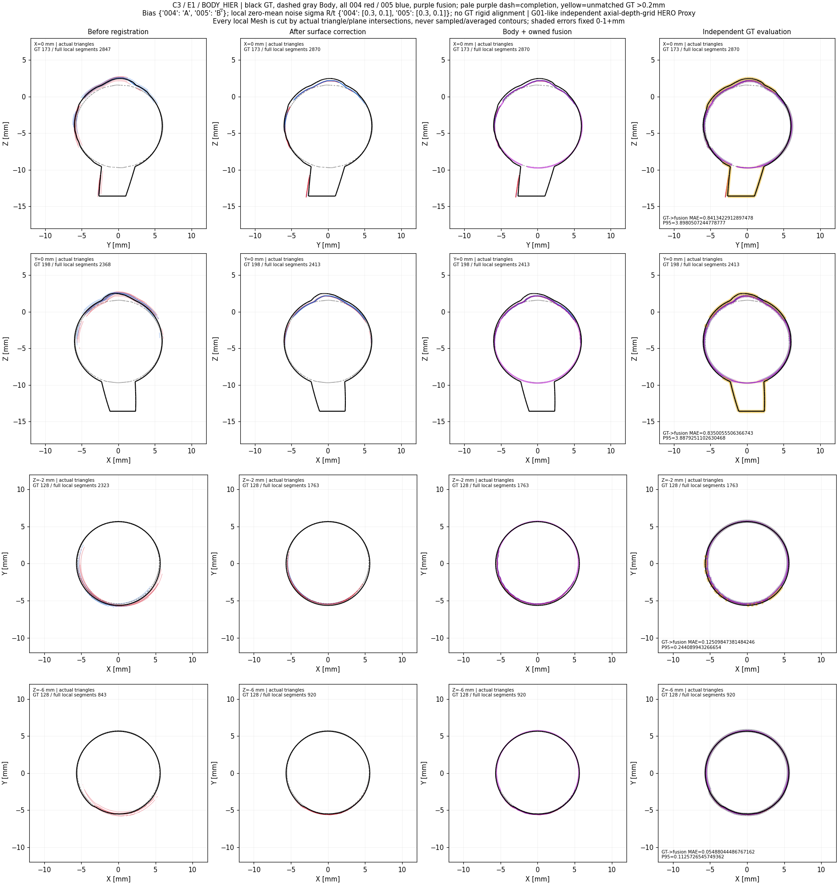

# TASK-E4-G01-MULTISURFACE-BODY-FUSION-001

**实测结论：执行完成，尚不能证明二维主体中介可靠恢复空间定位。**104项回归与13阶段执行/产物检查通过，48主组合+4容差消融全部产生真实模型。E1主组合融合6/6改善Body-only平均误差，但不修正也6/6改善，不能将这项改善全部归功于配准。

预注册C3/E1：匹配细分Body-only双向MAE 0.323293mm →分层定位后融合0.303003mm；不修正直接融合更低，为0.201619mm。完整材料顶点加权MAE为0.514579mm；逐视角等权MAE由不修正0.460332升至分层0.514474mm。C0本来无误差，E1 Body方法却引入约0.376231mm逐视角MAE，提示模型/中介偏差，原因尚未隔离。

高方差C4/E1中，分层方法逐视角MAE约0.582827mm，低于仅视频级0.806058mm和不修正0.658540mm，说明小残余修正有部分作用，仍不等于正确定位。主纵向切面保留细柄缺失、黄色GT未匹配和Body补全区域；未用GT修补或改选容差。

实现提交：`1648935501781d6acb47a288253255134bdedb89`；Runner冻结指纹：`5d0ccfd70109df4f3fb241ea788b272f39a31a685801b4994d3d1c8425020e10`。本轮运行耗时228.711s，未执行新DXY/HERO训练或相机优化。全部16视角具有不同RGB内容哈希，68,230材料顶点、127,691独立深度网格三角面；GT观察/未观察固定目标分别6132/5868，总分母12000。

[全部52组合真实切面（含失败与容差）](visualization/sections_all.html) · [全部材料顶点加权误差](visualization/AGGREGATE_MATERIAL_METRICS.csv) · [逐帧失败台账](visualization/FRAME_FAILURE_LEDGER.json) · [同数值条件配对](visualization/PAIRED_COMPARISONS.json)

以下补充只读导出已冻结几何与评价，不新增优化或修改原始Runner快照。所有材料目标保留；无GT最佳刚体对齐；Body-only匹配细分基线避免伪改进。单一固定种子、有限轨迹与radial-chart非星形限制意味着不能声称一般化成功。

主图为预先固定C3/E1/BODY_HIER：两张纵向(X=0、Y=0)、两张横向(Z=-2、Z=-6mm)；四列配准前→配准后→整体融合→GT评价。黑GT、灰虚线Body、全部004红/005蓝、紫融合。所有曲线来自实际三角面求交，未以采样点或平均轮廓替代。

[离线逐视频/逐视角三维交互](visualization/multisurface_3d.html) · [全部条件指标](visualization/ALL_CONDITION_METRICS.csv) · [材料点/重叠](visualization/REGISTRATION_METRICS.json) · [整体/区域/截面](visualization/MODEL_METRICS.json) · [Surface Ownership Map](visualization/SURFACE_OWNERSHIP_MAIN.csv) · [失败台账](visualization/FAILURE_LEDGER.json)

## 科学范围、来源与独立曲面

复用已验收SIM_PROTOCOL_REV1的G01-like固定场景及GT-free正式E1/E2初始Body。004/005各选8个FIT视角：保留全部父Body拟合FIT引用，再按真实Camera-to-Ring方向最远点补齐；另保留8 HOLDOUT。真实机位定义本轮虚拟真值，不宣称真实部署认证。每视角重新生成RGB/Mask/轴向深度，并严格核对冻结DXY缓存的RGB/Mask内容SHA。没有新的DXY调用、P/Q或直径研究，没有HERO训练。

每片局部Mesh独立由本帧Mask内原生2px深度栅格反投影并三角化；跨深度不连续大边显式拒绝，原始无效/缺失区域保留。禁止且未使用GT原始面按视频合并。GT像素/Face/重心身份只存在generator私有输出，评价器在预测冻结后才读取。所有未融合的16片独立曲面均保留。

## 误差协议与曲面优化

EstimatedPose=VideoBias×TruePose×FrameNoise。A=+Y2°/+X0.5mm，B=+Y3°/+X0.3mm；世界偏差左乘、零均值六维噪声右乘局部机位。种子20261117，按视频中心化，跨σ使用共同随机数；每轴分布σ为0、0.3°/0.10mm或0.7°/0.20mm。物理Ring和GT固定。每帧实际注入、经验均值/标准差/完整协方差见[NOISE_AUDIT](visualization/NOISE_AUDIT.json)。预测器未获得真实误差逆矩阵。

C0全无误差；C1仅005=A+低方差；C2仅005=B、无随机噪声；C3两视频A/B+低方差；C4两视频A/B+高方差；C5两视频无系统偏差、仅低方差。

比较M0、不含Body的多曲面Open3D Robust ICP、仅共享视频Body定位、视频共享+帧残余Body定位。ICP固定第一片004曲面作为其显式规范，评价不替其做GT对齐。Body两臂与所有相机文件始终冻结；只估计曲面刚体变换。中介在每次外层重新建立：将固定Body拉回不可变测量图表，计算椭圆规范坐标→Body候选区域，而非优化相机。错误/接触未知/低置信或超2.5mm对应可拒绝。Body允许0.5mm区域残差，并预先运行C3的0和1mm容差消融。

帧残余为绕本帧固定估计机位图表的小曲面SE(3)，受σ归一化先验、3σ界及视频内均值先验约束；不输出新相机，不变更输入相机文件。完整源Mesh顶点统一刚体变换，Face拓扑及边长断言排除直接贴椭球/形态替换。

## 有明确Ownership的整体几何

这是明确标记的radial-chart融合基线：相同冻结椭球参数仅作96×96等极角图表重新细分，不优化Body；从Body中心射线查询每片实际测量三角面。共识支持≥2视角时只选择一个实际三角面交点，记录来源Face/重心和全部未采用候选，绝不输出平均坐标。其余位置由Body补全，观测但不可信与从未观测分开标记。冲突跨度>0.25mm逐点保留；跨owner接缝大边>0.8mm的三角形显式记为缺口，不静默删除。

每图表单元最多一片最终三角形，GT覆盖只在固定独立GT样本上计一次，重复曲面不能提高分母或虚增覆盖。所有原片仍可独立开关。非星形、隐藏凹部和接缝仍是该基线的真实限制；有缺口、偏差或不改善均保留负结果。Body-only同时给原冻结网格和相同细分图表，主要改善比较使用相同图表，避免把细分误差归功于HERO。

## 全部主条件和容差消融

| Condition/arm/method/tol | Material MAE mm | Whole GT bidir MAE / P95 mm | Unique GT coverage | Improves Body |
| --- | ---: | --- | ---: | --- |
| C0__E1__M0__tol0.5 | 0.000000 | 0.191363 / 1.140959 | 0.818917 | True |
| C0__E1__ICP__tol0.5 | 0.007546 | 0.191215 / 1.142399 | 0.819000 | True |
| C0__E1__BODY_VIDEO__tol0.5 | 0.376231 | 0.268755 / 1.216447 | 0.642917 | True |
| C0__E1__BODY_HIER__tol0.5 | 0.376231 | 0.268755 / 1.216447 | 0.642917 | True |
| C0__E2__M0__tol0.5 | 0.000000 | 0.368825 / 1.889219 | 0.597250 | True |
| C0__E2__ICP__tol0.5 | 0.007546 | 0.368798 / 1.889219 | 0.597250 | True |
| C0__E2__BODY_VIDEO__tol0.5 | 0.361400 | 0.383313 / 1.873628 | 0.598167 | True |
| C0__E2__BODY_HIER__tol0.5 | 0.361400 | 0.383313 / 1.873628 | 0.598167 | True |
| C1__E1__M0__tol0.5 | 0.275999 | 0.222861 / 1.130927 | 0.780167 | True |
| C1__E1__ICP__tol0.5 | 0.295755 | 0.209516 / 1.099182 | 0.786083 | True |
| C1__E1__BODY_VIDEO__tol0.5 | 0.430123 | 0.299160 / 1.467003 | 0.649667 | True |
| C1__E1__BODY_HIER__tol0.5 | 0.389454 | 0.300357 / 1.479916 | 0.640833 | True |
| C1__E2__M0__tol0.5 | 0.275999 | 0.400401 / 1.887063 | 0.559833 | True |
| C1__E2__ICP__tol0.5 | 0.295755 | 0.391266 / 1.873628 | 0.562500 | True |
| C1__E2__BODY_VIDEO__tol0.5 | 0.436982 | 0.389631 / 1.887063 | 0.592583 | True |
| C1__E2__BODY_HIER__tol0.5 | 0.392443 | 0.382392 / 1.873628 | 0.598083 | True |
| C2__E1__M0__tol0.5 | 0.175644 | 0.197133 / 1.141060 | 0.817750 | True |
| C2__E1__ICP__tol0.5 | 0.173589 | 0.194283 / 1.118538 | 0.819417 | True |
| C2__E1__BODY_VIDEO__tol0.5 | 0.409514 | 0.298706 / 1.479729 | 0.641250 | True |
| C2__E1__BODY_HIER__tol0.5 | 0.409514 | 0.298706 / 1.479729 | 0.641250 | True |
| C2__E2__M0__tol0.5 | 0.175644 | 0.375229 / 1.864829 | 0.597583 | True |
| C2__E2__ICP__tol0.5 | 0.173589 | 0.374328 / 1.887775 | 0.597583 | True |
| C2__E2__BODY_VIDEO__tol0.5 | 0.411534 | 0.382300 / 1.865847 | 0.597833 | True |
| C2__E2__BODY_HIER__tol0.5 | 0.411534 | 0.382300 / 1.865847 | 0.597833 | True |
| C3__E1__M0__tol0.5 | 0.460332 | 0.201619 / 0.872401 | 0.748000 | True |
| C3__E1__ICP__tol0.5 | 0.445184 | 0.246304 / 1.182575 | 0.738333 | True |
| C3__E1__BODY_VIDEO__tol0.5 | 0.557104 | 0.269309 / 1.144797 | 0.623417 | True |
| C3__E1__BODY_HIER__tol0.5 | 0.514474 | 0.303003 / 1.468234 | 0.638583 | True |
| C3__E1__BODY_HIER__tol0 | 0.555805 | 0.277911 / 1.276640 | 0.649000 | True |
| C3__E1__BODY_HIER__tol1 | 0.451161 | 0.310457 / 1.468047 | 0.605583 | True |
| C3__E2__M0__tol0.5 | 0.460332 | 0.420343 / 1.882470 | 0.518250 | False |
| C3__E2__ICP__tol0.5 | 0.445184 | 0.424022 / 1.869669 | 0.505750 | False |
| C3__E2__BODY_VIDEO__tol0.5 | 0.567918 | 0.389376 / 1.860704 | 0.587833 | True |
| C3__E2__BODY_HIER__tol0.5 | 0.526644 | 0.384899 / 1.864003 | 0.595583 | True |
| C3__E2__BODY_HIER__tol0 | 0.541421 | 0.386348 / 1.864003 | 0.594333 | True |
| C3__E2__BODY_HIER__tol1 | 0.400207 | 0.386131 / 1.887775 | 0.596083 | True |
| C4__E1__M0__tol0.5 | 0.658540 | 0.294137 / 1.466263 | 0.745917 | True |
| C4__E1__ICP__tol0.5 | 0.788098 | 0.240706 / 0.882328 | 0.721583 | True |
| C4__E1__BODY_VIDEO__tol0.5 | 0.806058 | 0.321006 / 1.467003 | 0.654417 | True |
| C4__E1__BODY_HIER__tol0.5 | 0.582827 | 0.308335 / 1.467003 | 0.621167 | True |
| C4__E2__M0__tol0.5 | 0.658540 | 0.433544 / 1.881846 | 0.511750 | False |
| C4__E2__ICP__tol0.5 | 0.788098 | 0.378519 / 1.273828 | 0.493083 | True |
| C4__E2__BODY_VIDEO__tol0.5 | 0.812745 | 0.426480 / 1.890057 | 0.506583 | False |
| C4__E2__BODY_HIER__tol0.5 | 0.584890 | 0.390293 / 1.875055 | 0.592417 | True |
| C5__E1__M0__tol0.5 | 0.244931 | 0.163936 / 0.745643 | 0.816250 | True |
| C5__E1__ICP__tol0.5 | 0.314713 | 0.201560 / 0.931516 | 0.799833 | True |
| C5__E1__BODY_VIDEO__tol0.5 | 0.442877 | 0.261023 / 1.081971 | 0.617083 | True |
| C5__E1__BODY_HIER__tol0.5 | 0.389915 | 0.302664 / 1.467052 | 0.632500 | True |
| C5__E2__M0__tol0.5 | 0.244931 | 0.386950 / 1.864003 | 0.588917 | True |
| C5__E2__ICP__tol0.5 | 0.314713 | 0.397214 / 1.890046 | 0.576583 | True |
| C5__E2__BODY_VIDEO__tol0.5 | 0.455805 | 0.387941 / 1.860476 | 0.591833 | True |
| C5__E2__BODY_HIER__tol0.5 | 0.405635 | 0.382245 / 1.873628 | 0.597917 | True |

每片全部材料点误差、同视频及跨视频固定重叠材料目标、双向表面MAE/中位数/P95/最大值、真实观测/未观测区域覆盖、无向法向形态误差及真实Mesh截面误差均保留。材料点相对误差另给相对于真实轴向深度的定义；本任务不输出直径精度。GT目标12000和模型面积样本12000固定；局部截面使用固定400点弧长求积仅作指标，显示始终是全部真实线段。未命中和失败保留NaN/全分母，任何阶段未作GT最优刚体对齐。

## 固定审计表

| 审计项目 | 必须汇报 |
| --- | --- |
| 目标组数 | G01-like场景1；6主条件×2 Body×4方法；每条件16独立FIT片，另8 HOLDOUT源保留；4个C3容差消融 |
| 本算法独立成功 | 主组合48/48、容差4/4均数值输出；每组合16/16片与68,230/68,230材料点数值有效。数值输出不等于位置正确 |
| 本算法失败 | 数值失败0/52，数值NaN 0；原预注册联合指标未通过44/52，逐帧位置超差另见FRAME_FAILURE_LEDGER；全部实际切面保留 |
| 历史测量值回退 | 0；用户明确授权复用GT-free二维Body/像素初始数据，不作为最终测量值回退 |
| 失败组及具体原因 | 每条件/Body/方法关联材料点、重叠、Ownership冲突、接缝缺口和切面 |
| 最终统计样本 | 固定每片全部材料顶点、固定重叠目标、固定GT样本；不只统计成功条件 |
| 是否使用GT选择算法 | 否；TASK/源码/数据/先验及容差预先冻结，所有预测冻结后独立评价 |

## 实际切面图

- [C3/E1/BODY_HIER: four fixed actual Mesh sections, all independent local surfaces](visualization/figures/01_MAIN_MULTISURFACE_SECTIONS.png)
- [C0/E1/BODY_HIER: four fixed actual Mesh sections, all independent local surfaces](visualization/figures/C0_MULTISURFACE_SECTIONS.png)
- [C1/E1/BODY_HIER: four fixed actual Mesh sections, all independent local surfaces](visualization/figures/C1_MULTISURFACE_SECTIONS.png)
- [C2/E1/BODY_HIER: four fixed actual Mesh sections, all independent local surfaces](visualization/figures/C2_MULTISURFACE_SECTIONS.png)
- [C4/E1/BODY_HIER: four fixed actual Mesh sections, all independent local surfaces](visualization/figures/C4_MULTISURFACE_SECTIONS.png)
- [C5/E1/BODY_HIER: four fixed actual Mesh sections, all independent local surfaces](visualization/figures/C5_MULTISURFACE_SECTIONS.png)
- [C3/E2/BODY_HIER: four fixed actual Mesh sections, all independent local surfaces](visualization/figures/C3_E2_MULTISURFACE_SECTIONS.png)
- [All main conditions, both Body initializers and four methods](visualization/figures/ALL_METHOD_METRICS.png)

Smoke先通过C0和单视频低方差实际Mesh错层/真实优化验证，随后才扩展矩阵和融合。执行/产物验收不代表科学准确性通过；不收敛、不改善和未匹配均为保留结果，不自动晋升永久规则。

## 全部结果的逐项真实切面

每个条件/Body/方法/容差都有完整四列、四截面图，点击可检查全部原始线段，未用采样点/平均轮廓替代：

- [C0__E1__M0__tol0.5](visualization/sections_all.html#C0__E1__M0__tol0.5)
- [C0__E1__ICP__tol0.5](visualization/sections_all.html#C0__E1__ICP__tol0.5)
- [C0__E1__BODY_VIDEO__tol0.5](visualization/sections_all.html#C0__E1__BODY_VIDEO__tol0.5)
- [C0__E1__BODY_HIER__tol0.5](visualization/sections_all.html#C0__E1__BODY_HIER__tol0.5)
- [C0__E2__M0__tol0.5](visualization/sections_all.html#C0__E2__M0__tol0.5)
- [C0__E2__ICP__tol0.5](visualization/sections_all.html#C0__E2__ICP__tol0.5)
- [C0__E2__BODY_VIDEO__tol0.5](visualization/sections_all.html#C0__E2__BODY_VIDEO__tol0.5)
- [C0__E2__BODY_HIER__tol0.5](visualization/sections_all.html#C0__E2__BODY_HIER__tol0.5)
- [C1__E1__M0__tol0.5](visualization/sections_all.html#C1__E1__M0__tol0.5)
- [C1__E1__ICP__tol0.5](visualization/sections_all.html#C1__E1__ICP__tol0.5)
- [C1__E1__BODY_VIDEO__tol0.5](visualization/sections_all.html#C1__E1__BODY_VIDEO__tol0.5)
- [C1__E1__BODY_HIER__tol0.5](visualization/sections_all.html#C1__E1__BODY_HIER__tol0.5)
- [C1__E2__M0__tol0.5](visualization/sections_all.html#C1__E2__M0__tol0.5)
- [C1__E2__ICP__tol0.5](visualization/sections_all.html#C1__E2__ICP__tol0.5)
- [C1__E2__BODY_VIDEO__tol0.5](visualization/sections_all.html#C1__E2__BODY_VIDEO__tol0.5)
- [C1__E2__BODY_HIER__tol0.5](visualization/sections_all.html#C1__E2__BODY_HIER__tol0.5)
- [C2__E1__M0__tol0.5](visualization/sections_all.html#C2__E1__M0__tol0.5)
- [C2__E1__ICP__tol0.5](visualization/sections_all.html#C2__E1__ICP__tol0.5)
- [C2__E1__BODY_VIDEO__tol0.5](visualization/sections_all.html#C2__E1__BODY_VIDEO__tol0.5)
- [C2__E1__BODY_HIER__tol0.5](visualization/sections_all.html#C2__E1__BODY_HIER__tol0.5)
- [C2__E2__M0__tol0.5](visualization/sections_all.html#C2__E2__M0__tol0.5)
- [C2__E2__ICP__tol0.5](visualization/sections_all.html#C2__E2__ICP__tol0.5)
- [C2__E2__BODY_VIDEO__tol0.5](visualization/sections_all.html#C2__E2__BODY_VIDEO__tol0.5)
- [C2__E2__BODY_HIER__tol0.5](visualization/sections_all.html#C2__E2__BODY_HIER__tol0.5)
- [C3__E1__M0__tol0.5](visualization/sections_all.html#C3__E1__M0__tol0.5)
- [C3__E1__ICP__tol0.5](visualization/sections_all.html#C3__E1__ICP__tol0.5)
- [C3__E1__BODY_VIDEO__tol0.5](visualization/sections_all.html#C3__E1__BODY_VIDEO__tol0.5)
- [C3__E1__BODY_HIER__tol0.5](visualization/sections_all.html#C3__E1__BODY_HIER__tol0.5)
- [C3__E1__BODY_HIER__tol0](visualization/sections_all.html#C3__E1__BODY_HIER__tol0)
- [C3__E1__BODY_HIER__tol1](visualization/sections_all.html#C3__E1__BODY_HIER__tol1)
- [C3__E2__M0__tol0.5](visualization/sections_all.html#C3__E2__M0__tol0.5)
- [C3__E2__ICP__tol0.5](visualization/sections_all.html#C3__E2__ICP__tol0.5)
- [C3__E2__BODY_VIDEO__tol0.5](visualization/sections_all.html#C3__E2__BODY_VIDEO__tol0.5)
- [C3__E2__BODY_HIER__tol0.5](visualization/sections_all.html#C3__E2__BODY_HIER__tol0.5)
- [C3__E2__BODY_HIER__tol0](visualization/sections_all.html#C3__E2__BODY_HIER__tol0)
- [C3__E2__BODY_HIER__tol1](visualization/sections_all.html#C3__E2__BODY_HIER__tol1)
- [C4__E1__M0__tol0.5](visualization/sections_all.html#C4__E1__M0__tol0.5)
- [C4__E1__ICP__tol0.5](visualization/sections_all.html#C4__E1__ICP__tol0.5)
- [C4__E1__BODY_VIDEO__tol0.5](visualization/sections_all.html#C4__E1__BODY_VIDEO__tol0.5)
- [C4__E1__BODY_HIER__tol0.5](visualization/sections_all.html#C4__E1__BODY_HIER__tol0.5)
- [C4__E2__M0__tol0.5](visualization/sections_all.html#C4__E2__M0__tol0.5)
- [C4__E2__ICP__tol0.5](visualization/sections_all.html#C4__E2__ICP__tol0.5)
- [C4__E2__BODY_VIDEO__tol0.5](visualization/sections_all.html#C4__E2__BODY_VIDEO__tol0.5)
- [C4__E2__BODY_HIER__tol0.5](visualization/sections_all.html#C4__E2__BODY_HIER__tol0.5)
- [C5__E1__M0__tol0.5](visualization/sections_all.html#C5__E1__M0__tol0.5)
- [C5__E1__ICP__tol0.5](visualization/sections_all.html#C5__E1__ICP__tol0.5)
- [C5__E1__BODY_VIDEO__tol0.5](visualization/sections_all.html#C5__E1__BODY_VIDEO__tol0.5)
- [C5__E1__BODY_HIER__tol0.5](visualization/sections_all.html#C5__E1__BODY_HIER__tol0.5)
- [C5__E2__M0__tol0.5](visualization/sections_all.html#C5__E2__M0__tol0.5)
- [C5__E2__ICP__tol0.5](visualization/sections_all.html#C5__E2__ICP__tol0.5)
- [C5__E2__BODY_VIDEO__tol0.5](visualization/sections_all.html#C5__E2__BODY_VIDEO__tol0.5)
- [C5__E2__BODY_HIER__tol0.5](visualization/sections_all.html#C5__E2__BODY_HIER__tol0.5)

## 固定重叠材料目标的总体一致性

[全部同/跨视频重叠MAE/中位数/P95/最大值](visualization/OVERLAP_FAMILY_METRICS.csv)。所有方法使用预生成相同共可见材料目标，没有按配准后的距离筛除失败。额外核验了共享视频刚体不改变同视频内部距离这一物理不变量；帧级残余才可能改变内部错层。

| C4/E1 method | Within-video MAE mm | Cross-video MAE mm |
| --- | ---: | ---: |
| M0 | 0.796598 | 0.776265 |
| ICP | 0.652101 | 0.828311 |
| BODY_VIDEO | 0.796598 | 0.947368 |
| BODY_HIER | 0.160583 | 0.204778 |

## 离线交付实测

浏览器实际加载了52/52切面组合，每组16片原三角面交线、4固定切面；逐视频开关改变实际渲染，无JavaScript异常。完整Mesh WebGL页面验证9个展示状态及逐视频/逐帧开关；16片共127,691三角面。见[切面浏览器收据](evidence/SECTIONS_BROWSER_VERIFICATION.json)、[切面截图](evidence/SECTIONS_BROWSER.png)、[3D浏览器收据](evidence/BROWSER_VERIFICATION.json)。

[最终Runner来源/源码检查](evidence/FINAL_POLICY_CHECK.json) · [阶段/产物状态](evidence/FINAL_POLICY_STATUS.json)。执行验收与科学验收分开，后者等待人工审阅；本轮结束不扩大实验。8个HOLDOUT源已保留，未纳入本轮16片FIT曲面优化或声称已完成新HOLDOUT定位评价。
