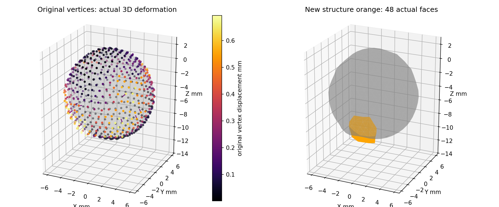
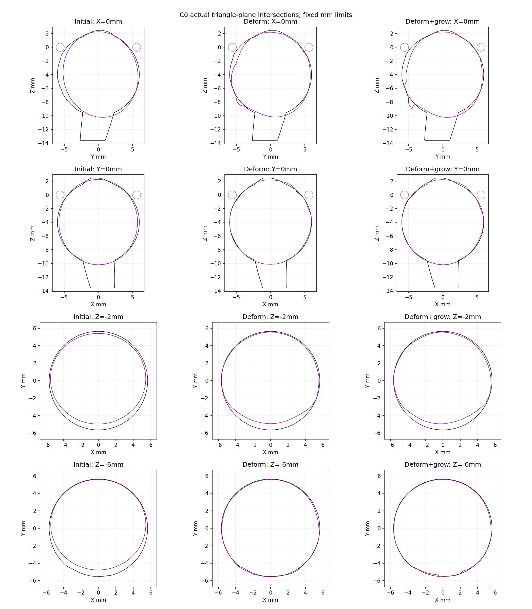
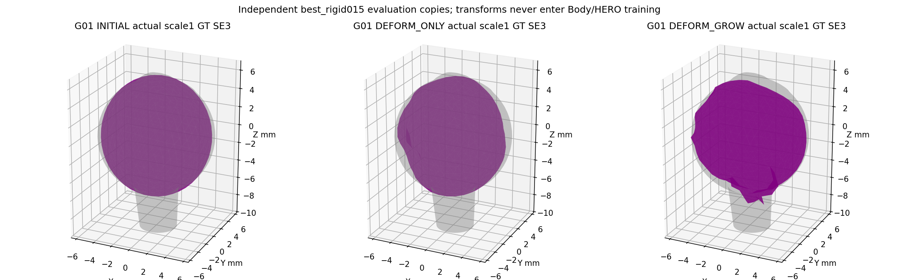
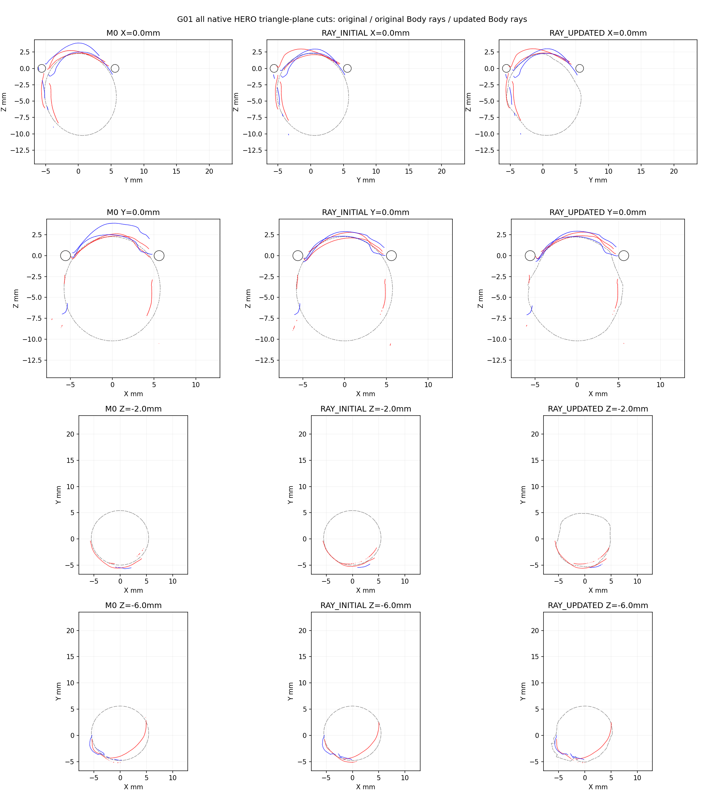

# TASK-E4-MULTIVIEW-STRUCTURAL-UPDATE-001

## 科学结论

本轮完成了一个共享 Body 的多视角二维驱动形变、证据约束的局部拓扑生长，以及冻结 Body 后的真实 HERO 像素身份重定位。**理想 C0 证明流程有效，但真实实验没有证明它能可靠恢复缺失结构或进一步改善 HERO 定位。**

C0 双向表面 MAE 从 **0.380925 降至 0.278727 mm**，HOLDOUT IoU 从 **0.876567 升至 0.955210**。一次生长有 13 个 FIT 视角、004/005 两视频支持，确实生成 19 个新顶点和连续侧壁。与仅形变相比，生长的 MAE 增益只有约 **0.00319 mm**；完整长柄仍缺失，P95 仍比初始略差。本轮没有做噪声矩阵或宣称完整结构恢复。

真实 G01 有两次生长，HOLDOUT IoU 小幅提高，但 GT MAE **0.351000→0.398401 mm，变差**。G03/G05 的最大累计原顶点位移分别只有约 **1.14e-5 / 1.16e-5 mm**，应判为实质停滞，不能把接受步数当作成功。三组 HERO 的跨视角距离相比 M0 均下降；然而更新 Body 相比初始 Body **没有一致额外增益**。G01 跨视频 MAE 由初始锚点的 0.599996 变为新锚点的 0.601995 mm，HERO HOLDOUT IoU 也由 0.870756 降至 0.865305。真实 HERO 没有独立完整三维 GT，绝对位置精度为 NOT_EVALUABLE。

## 1. 初始化一致性和版本

| 来源 | 完整 commit / SHA256 | 用途 |
| --- | --- | --- |
| 本轮指定基线 | 418c96f87ba06458be5bb082813cad6e20127a19 | 只读继承输入、相机、划分与 Policy |
| 历史 Init-A 015 | 905e2a9b3615a5f429553837a05e5d53826cef03 | 013 起始 Mesh、FreeVertices/GeometryGuard、best_rigid015 |
| C0 与未封盖真实组预测 | d78cacd86b095ade5c4753537e216f900a018bcd | STRUCTURAL_003，预测冻结后独立评价 |
| 通用封盖参数化修复与最终运行 | 6415993f4c6aa2370e80841d1803ed701b257bee | STRUCTURAL_004；G05 重跑，两组非封盖结果有证明地恢复 |
| G01 013 初始化资产 | 3045a7546d1eaf2bfd8fcd05cfd0c83cadfcd92bd684ecc6efbd8c286fad8c9f | 虚拟和真实使用同一资产及 initialize 函数 |
| G03 013 初始化资产 | 37e49e0043427bac000a5f25a623ff363e7ee261223c163dc9dfc51338e4bc34 | 原生病例参数，无组别算法分支 |
| G05 013 初始化资产 | dab90a228f097a81dc40a581fbe3b9a02be8eec97aefdfc3ae9c085c40d03819 | 保留原封盖/边界定义 |
| 最终 TASK.yaml | 5523fcf6656b5c39041339b8d1e3c55fc38bb46cfd6fef40d549ec7a5a7007e5 | 所有参数、数据角色及门禁先冻结 |
| 最终 CODE_LOCK.json | 826ba47e48e7f12ba76bbbc10aae4fa94154f93249fecc25cd9773f362076c7c | 逐代码文件 SHA256 |
| Runner freeze | 71840a4cbe10031820fac4b248a4eebb557cf03dce8b3c959e6ad28049ce4adf | 模块、环境、源码与输入共同锁定 |

旧虚拟 E1/E2 是九参数椭球，均为 4514 顶点、9024 面；与 EXACT_013_INPUT_MESH_V_F_SOLID_CAP 不同。本轮只审计其身份，**没有用于生成预测**。虚拟与真实调用同一个 `body_update.initialize`，读取既有013的 V/F/F_solid、推断封盖与边界标签，无重新拟合/尺度调整/GT辅助。虚拟直接使用真实 G01 的 642 顶点、1280 面初始资产；两者 Ring CAD 字节哈希一致，唯一坐标变换为确定性的单位矩阵。G03 为642/1280，G05 原始可见面为578/1104，原封盖实体面单独保留。各病例原生资产并不要求顶点数相同；网格定义、装载实现、参数规则与 mm/opencv_c2w 约定相同。

完整初始化记录在 [INITIALIZATION_AUDIT.json](visualization/INITIALIZATION_AUDIT.json)，代码及配置哈希在 [CODE_LOCK.json](inputs/CODE_LOCK.json)、[INPUT_MANIFEST.json](inputs/INPUT_MANIFEST.json)、[TASK_FREEZE.json](TASK_FREEZE.json)。虚拟 FIT/HOLDOUT=16/8；真实 G01=16/7，G03=16/5，G05=16/4。原视频、方向分区和权重不变，每个视频总权重0.5，独立对照历史实现逐项相等：[权重核验](evidence/EXACT_HISTORICAL_WEIGHTS_COMPARISON.json)。没有重筛选视角。

## 2. 新增算法及可追踪更新

固定 K、C、Ring；对一个共享 V 进行优化。使用既有公制三角面光线渲染器保存每像素真实可见 Face/bary/z，坐标与 PyTorch3D 投影契约一致。分别保留 `R+=M\P` 和 `R-=P\M`。Ring 三像素不确定带与 CAD 遮挡不进入训练，但保留其图像与拒绝标记；接触环边界不自动解释为息肉轮廓。

R- 映射自身可见面，R+ 映射最近可见投影边界的真实面和重心坐标。它们提出局部几何约束，缺失像素没有直接被赋予任意深度。一次外循环为：全部 FIT 重建对应 → 累加均衡梯度 → Adam 提议同一个 V 的更新 → 封盖可行投影 → 八级回缩和原几何保护 → 重建全部 FIT 对应。

记 `X_ik=sum_j bary_ikj V_face_ikj`，实际损失为：

`L(V)=sum_i w_i mean_k Huber((pi_i(X_ik)-q_ik)/20px) + .03 ||L_ref(V-V_ref)||² + .02 ||edge(V)-edge(V_ref)||² + .002 ||V-V_ref||²`。

主要优化使用 PyTorch float64 自动微分；L_ref 复用 PyTorch3D 稀疏 Laplacian。这里实现的是边长/Laplacian/位移正则，**没有声称实现 ARAP**。Ring/Base 是继承 GeometryGuard 的硬接受约束。36次迭代，Adam lr=0.02mm，双向各384轮廓对应、最多256个R-密集样本，捕获120px；同一函数与参数用于虚拟和全部真实组。HOLDOUT、HERO 深度及 GT 均不能进入训练输入。

生长与形变明确分开：迭代12/24，从R+间隙≥6px的区域提出连通局部面片；至少3视角且包含两视频；堆叠标定投影 Jacobian 的最小/最大奇异值比≥0.02，三维共同行进方向解释残差的不一致性≤0.5。解共同最小二乘位移，并要求朝外；位移0.1–0.8mm。最多3个候选，用连通面片挤出替换旧面、增加顶盖与侧壁。面片至多80面，邻接扩展两环；必须通过几何检查和均衡FIT IoU增益>0.0001。不能只凭一个视角生长。接受后的新拓扑进入同一优化器，正则参考在该拓扑阶段冻结。此为明确标注的**局部面片挤出基线**，没有专门为Ip设计柄部模型。

每次迭代保存完整前/后Mesh、R+/R-空间图、候选/拒绝、Face/bary、每视角梯度及其与实际共同位移的内积。该内积是方向功，不冒充唯一的因果位移分解。稠密数组见 `visualization/evidence/`；可读链路见 [2D_TO_3D_TRACE.json](evidence/2D_TO_3D_TRACE.json)。完整36步保存在原子 Runner attempts；公开本地交付另保存0/12/24/35及Final。梯度真实验证覆盖实际 STEP000 的48个坐标，有限差分最大误差 **5.65e-11**：[梯度证据](evidence/ACTUAL_GRADIENT_FINITE_DIFFERENCE.json)。二维投影改善来自实际三维顶点变化，没有图像仿射。

## 3. 唯一理想 C0

复用 G01-like SIM_PROTOCOL_REV1 的冻结场景、RGB/Mask/轴向深度生成结果与相机轨迹，只运行 C0。GT 只在两个最终预测冻结后进入评价；采用原 Ring 公制坐标，未用GT刚体对齐隐藏空间误差。每方向固定12000表面样本、固定种子20261117，无成功区域筛选。

| 实验臂 | FIT IoU | HOLDOUT IoU | FIT/HOLDOUT BF@2px | 双向 GT MAE / P95 mm | F-score@0.5mm |
| --- | --- | --- | --- | --- | --- |
| INITIAL | 0.872853 | 0.876567 | 0.693947 / 0.685889 | 0.380925 / 1.252439 | 0.782469 |
| DEFORM_ONLY | 0.966722 | 0.949822 | 0.939907 / 0.893682 | 0.281918 / 1.311215 | 0.887202 |
| DEFORM_GROW | 0.964608 | 0.955210 | 0.930170 / 0.903997 | 0.278727 / 1.270091 | 0.880813 |

预先冻结的五项科学门禁均通过：MAE改善、HOLDOUT不恶化、实际接受生长、生长臂MAE优于形变臂、无几何恶化。门禁没有被降低。一次生长在迭代12发生，位移 `(0.135725,-0.355508,-0.703699)mm`，19新顶点，24顶盖面+24侧壁面；13视角支持。迭代24没有合格生长候选。最终642→661顶点，新结构与原Body连续、无新增自交/Ring碰撞。可见局部外形改善；**远端长柄仍缺失，不能宣称恢复完整柄部**。

全24视角见 `C0_VIEW_*.png`；HOLDOUT 没有训练对应箭头。中位数/最大值、单向距离、F-score和覆盖率完整保留于 [C0_METRICS.json](visualization/C0_METRICS.json)。形变臂与生长臂是同一初始资产、预算与数据的消融。本轮未与历史A2做预算相同的新增配对实验，因此不能将这里的结果解释为对历史整套算法的普遍优势。

## 4. 真实 G01/G03/G05

冻结预测后，复用历史 best_rigid015 的96起始旋转和双向表面刚体细化，尺度固定1。保存真实对齐副本、T矩阵和完整候选日志；此多初值方法不保证数学全局最优。原世界Mesh没有被覆盖，GT对齐副本不进入 HERO。

| 组 | 实验臂 | GT MAE / P95 mm | FIT / HOLDOUT IoU | F-score@0.5mm |
| --- | --- | --- | --- | --- |
| G01 | INITIAL | 0.351000 / 1.151030 | 0.842758 / 0.832392 | 0.900976 |
| G01 | DEFORM_ONLY | 0.404253 / 1.174126 | 0.830097 / 0.814434 | 0.776505 |
| G01 | DEFORM_GROW | 0.398401 / 1.072508 | 0.844321 / 0.835052 | 0.745316 |
| G03 | INITIAL | 1.248184 / 8.514138 | 0.721612 / 0.734675 | 0.543323 |
| G03 | DEFORM_ONLY | 1.248183 / 8.514134 | 0.721612 / 0.734675 | 0.543323 |
| G03 | DEFORM_GROW | 1.248183 / 8.514134 | 0.721612 / 0.734675 | 0.543323 |
| G05 | INITIAL | 0.666172 / 4.042938 | 0.948769 / 0.945764 | 0.753944 |
| G05 | DEFORM_ONLY | 0.664348 / 4.032621 | 0.948769 / 0.945764 | 0.771184 |
| G05 | DEFORM_GROW | 0.664348 / 4.032621 | 0.948769 / 0.945764 | 0.771184 |

| 组 | 臂 | 接受形变/生长 | 顶点数 | 原顶点位移 MAE / P95 / max mm |
| --- | --- | --- | --- | --- |
| G01 | DEFORM_ONLY | 26 / 0 | 642 → 642 | 0.318757 / 0.643598 / 0.665145 |
| G01 | DEFORM_GROW | 29 / 2 | 642 → 678 | 0.350244 / 0.749898 / 0.762698 |
| G03 | DEFORM_ONLY | 8 / 0 | 642 → 642 | 0.000007 / 0.000011 / 0.000011 |
| G03 | DEFORM_GROW | 8 / 0 | 642 → 642 | 0.000007 / 0.000011 / 0.000011 |
| G05 | DEFORM_ONLY | 11 / 0 | 578 → 578 | 0.000004 / 0.000012 / 0.000012 |
| G05 | DEFORM_GROW | 11 / 0 | 578 → 578 | 0.000004 / 0.000012 / 0.000012 |

G01的生长分别由16、12视角共同支持，包含两个视频，新增16+20个顶点。轮廓小幅改善不意味着形态正确：MAE和F-score变差，局部挤出也形成较薄面片。G03有多视角候选，但三次候选均没有均衡FIT增益，被拒绝；原有Ring碰撞限制形变，未恢复长柄。G05修复封盖可行更新后仍被Ring/反向包含保护限制；没有合格的多视角生长候选。**这两组为科研失败，保留最终原样附近Mesh，而非NaN伪装成功或特殊形态补丁。**

G05单独最佳刚体评价的约0.00182mm“改善”不能归功于Body：其Mesh仅变化约1e-5mm。额外诊断固定使用 INITIAL 的同一评价T时，MAE为0.66617160→0.66617012mm，只有1.48e-6mm变化。不同最优刚体数值路径产生的差异明确保留：[同T诊断](evidence/POST_FREEZE_GEOMETRY_AND_FIXED_ALIGNMENT.json)。G03同样无实质恢复。

| 组 | 最终自交/闭合/一致绕向 | Ring 最小有符号距离：初始→最终 mm | 最终最小三角形双面积 mm² |
| --- | --- | --- | --- |
| G01 | 0 / True / True | 0.037555 → 0.030932 | 0.012464 |
| G03 | 0 / True / True | -0.006154 → -0.006164 | 1.565541 |
| G05 | 0 / True / True | -0.008364 → -0.008372 | 0.068379 |

G03/G05初始资产已有Ring相交；“不恶化”的保护在1e-5mm数值容差内保留它们，并不等同无碰撞。G01最小双面积从0.577253降至0.012464mm²，提示局部薄面风险，即便自交/闭合检查通过也不能宣称形态良好。原有几何限制未放松。

G03/G05对应图、每视角RGB+轮廓/R+/R-+Face箭头、实际位移热图和GT对齐图均在本地PNG目录。几何/对齐评价是独立诊断，不用于重新选择checkpoint。

## 5. Body冻结后的 HERO 重定位

只使用历史已有且来源绑定完整的原始像素深度Mesh：G01=4片、G03=4片、G05=3片，按原FIT来源执行，不伪造16片HERO；HOLDOUT使用原留出视图。两视频来源与原拓扑、UV逐项核验，所有11片、3方法均保留完整Mesh。Body、相机、K、原始深度与原输入文件均不修改。

每个HERO原始UV查询冻结Body的实际可见Face/bary；要求在真实Polyp Mask、Ring前可见、初始轴向距离≤3mm。未匹配像素与全部原顶点保留。预测允许的低自由度改正为：

`z_new=(1+s_frame) z + b_video + b_frame + gx_frame (u-cx)/fx + gy_frame (v-cy)/fy`。

共享视频偏移界2mm；每帧scale/offset/slope界为(.03,.3,.3,.3)，先验(.01,.1,.1,.1)；Body残差0.5mm死区，soft_l1，3外循环、每次40评价。每视角最多384优化样本，全部UV记录完整映射。像素射线和Body固定，因此每轮重新查询的Face身份应一致；这不是在固定射线上虚构动态横向对应。局部校正是同一低维模型作用于整片Mesh，未将顶点替换为Body表面，没有全局融合。

| 组 | 方法 | 同视频 MAE / P95 mm | 跨视频 MAE / P95 mm | HOLDOUT IoU | 有效 Body 对应 / 原始顶点 |
| --- | --- | --- | --- | --- | --- |
| G01 | M0 | 0.826822 / 1.717904 | 0.733900 / 1.722431 | 0.824679 | 不使用 Body 对应 |
| G01 | RAY_INITIAL | 0.592968 / 1.462584 | 0.599996 / 1.520841 | 0.870756 | 52849 / 64180 |
| G01 | RAY_UPDATED | 0.590424 / 1.425711 | 0.601995 / 1.570644 | 0.865305 | 50867 / 64180 |
| G03 | M0 | 1.914257 / 5.630212 | 2.092017 / 5.248991 | 0.887589 | 不使用 Body 对应 |
| G03 | RAY_INITIAL | 1.212341 / 3.341577 | 1.332363 / 3.658389 | 0.900842 | 66416 / 102020 |
| G03 | RAY_UPDATED | 1.212342 / 3.341580 | 1.332364 / 3.658387 | 0.900842 | 66416 / 102020 |
| G05 | M0 | 0.560135 / 1.224072 | 1.171931 / 1.986105 | 0.922488 | 不使用 Body 对应 |
| G05 | RAY_INITIAL | 0.413605 / 0.808885 | 0.334211 / 0.848392 | 0.945687 | 84180 / 87718 |
| G05 | RAY_UPDATED | 0.413605 / 0.808885 | 0.334212 / 0.848394 | 0.945687 | 84180 / 87718 |

同/跨视频距离使用继承的固定原始投影支持分母（分别G01=675/1226、G03=716/1316、G05=369/680）。这是原Mask支持下的最近表面一致性，**没有认证材料点共同可见身份**，不是绝对三维精度。原始几何、离群区域与失败匹配没有因评价而删除。HOLDOUT报告Mask IoU和未匹配分母；其HERO深度差也不是真值，明确标记 `axial_difference_is_not_GT`。

新锚点相对旧锚点：G01同视频略好、跨视频及HOLDOUT更差；G03/G05只在数值噪声量级变化。新Body没有提供稳定额外收益，M0→RAY_INITIAL的改善也不能归功于本轮Body更新。跨视频MAE从M0到RAY_UPDATED下降约18.0%/36.3%/71.5%，仅说明固定支持下更集中。真实三维绝对精度为NaN/NOT_EVALUABLE（3/3组），没有用Blender评价副本充当真实HERO GT。

最终方法各组最大单视角边长相对变化P95约2.91%/4.59%/4.71%；最大轴向改正约1.053/3.002/1.512mm。不能宣称完全刚体保真；未进行逐顶点平滑或替换，细节受低维轴向变换影响。全部UV重投影误差<4.3e-13px，原面索引与UV完全相同。[拓扑身份审计](evidence/HERO_NATIVE_TOPOLOGY_AUDIT.json)。没有相机优化。

G01/G03/G05均提供X=0、Y=0两纵向及Z=-2、Z=-6mm两横向切面，使用真实三角面求交，固定共同坐标范围；红004、蓝005、灰Body、黑Ring。空切面明确保留。`*_HERO_PIXEL_*.png`显示每一原始UV的Face、接受/拒绝与实际轴向变化；`*_FULL_HERO.glb`包含所有原生完整局部Mesh，可在本地GLB查看器逐节点检查。GLB按标准米导出，原mm乘0.001，PNG/NPZ仍为毫米。

## 6. 失败、恢复及执行验收

保留所有历史冻结文件、失败目录和首次完整运行 STRUCTURAL_003。001在任何主体更新前因源RGB缓存不含T而失败，已复用官方pose_origin适配；002在任何接受更新前因成熟稀疏Laplacian dtype不一致而失败，已修复明确dtype并新增完整目标反向测试。

003完成了C0/真实/HERO，但G05缺少历史FreeVertices的封盖边界切向投影与封盖中心随动。**在真实GT评价启动之前**已记录代码遗漏及修复计划：[预GT诊断](evidence/PRE_REAL_GT_CAP_DIAGNOSIS.json)。004仅恢复该通用机制，不改变loss、数据、预算或阈值，不根据组名选择算法。原003结果保留。C0/G01/G03均无推断封盖；AST证明修复前后非封盖路径一致，991项缓存来源哈希锁定，故有条件恢复其同任务有效结果，C0不重新运行。G05不能采用缓存，按原预算重跑；全部后续HERO/GT评价与门禁再执行。见 [缓存合同](inputs/CAP_REPAIR_CACHE.json) 和 [旧冻结协议](inputs/BEFORE_CAP_PARAMETERIZATION_REPAIR/TASK.yaml)。

最终 **186项测试通过，0失败/错误**，包括最初35项Policy/Harness、既有157项及29项本轮测试。实际运行13阶段全PASS，Runner工程验收PASS；科学验收仍为 `AWAITING_HUMAN_REVIEW`，并不代表三个真实病例成功。004计入Runner约520.9秒，003/004分别保留独立预算账；原子阶段/快照不覆盖。门禁不存在force/skip。具体失败和未审查候选记录在 [FAILURE_REGISTRY.json](FAILURE_REGISTRY.json)，不自动晋升永久规则。

| 审计项目 | 必须汇报 |
| --- | --- |
| 目标组数 | 独立虚拟C0 1组；真实3组G01/G03/G05；HERO为11片固定来源 |
| 本算法独立成功 | C0两个臂2/2数值完成且预定门禁通过；真实两个臂6/6数值完成；HERO三方法9/9组方法数值完成。真实有实质形变/生长仅G01 1/3，整体科学增益未证实 |
| 本算法失败 | 真实G03/G05实质停滞2/3；G01 GT均值恶化1/3；HERO绝对3D准确性3/3 NOT_EVALUABLE/NaN；原始工程失败001/002及003封盖遗漏全部保留 |
| 历史测量值回退 | 0；只复用用户规定的013初始资产及冻结底层数据；无历史直径/其他算法预测补值 |
| 失败组及具体原因 | 逐组失败台账、实际候选/回缩记录、GT图和完整切面链接；无失败组删除 |
| 最终统计样本 | C0 24视角；真实64视角=48FIT+16HOLDOUT，详见初始化表；真实表面每臂固定双向各12000样本；HERO各方法固定同一重叠分母；全部3组均报告 |
| 是否使用GT选择算法 | 否；任务/源码/输入及最终预测先冻结，GT只独立评价，预定C0门禁只决定是否继续；封盖修复有预真实GT证据；无GT选checkpoint/病例参数 |

本任务不输出直径，直径中位绝对相对误差不适用；表面MAE/中位数/P95/最大值、覆盖率均在JSON完整报告，配对比较保留全分母，不将数值完成等同准确。真实共64视角（G01 23、G03 21、G05 20）；上表以此固定分母为准。

## 7. 交付入口

本地保留完整逐视角中间数组与全部原子运行。GitHub同步完整最终Mesh、全部关键PNG、指标和精选对应/梯度证据；具体清单见 `GIT_PUBLICATION_LIST.json`，不上传全量原始运行、视频、权重或历史资产。离线索引中其余中间数组链接用于本机审阅。

- [RESULT_CARD.md](RESULT_CARD.md)、[RUN_MANIFEST.json](RUN_MANIFEST.json)、[真实Body指标CSV](REAL_BODY_METRICS.csv)、[真实HERO指标CSV](REAL_HERO_METRICS.csv)。
- [本地图片/数据/完整Mesh索引](visualization/index.html)：仅离线文件列表，不制作网页应用。主要验收为PNG。
- 本地可视化目录：`/home/liu/ring_first_3d_structural_update/experiments/TASK-E4-MULTIVIEW-STRUCTURAL-UPDATE-001/visualization`。
- 本地首页：`/home/liu/ring_first_3d_structural_update/experiments/TASK-E4-MULTIVIEW-STRUCTURAL-UPDATE-001/visualization/index.html`。
- 全部原始阶段：`/home/liu/ring_first_3d_structural_update/experiments/TASK-E4-MULTIVIEW-STRUCTURAL-UPDATE-001/runs`；历史资产、DXY、相机和输入源未改写。

最终回答：二维轮廓确能推动共享三维Body真实形变和局部拓扑生长，理想C0支持这一点；真实病例目前没有可靠的缺失结构恢复。更新Body对真实二维观测只在G01有很小的额外解释增益，G03/G05未改善。HERO像素身份射线校正能减少固定支持下的错层，但新Body未优于初始Body形成一致收益，不能据此宣称更准确的真实三维定位。
