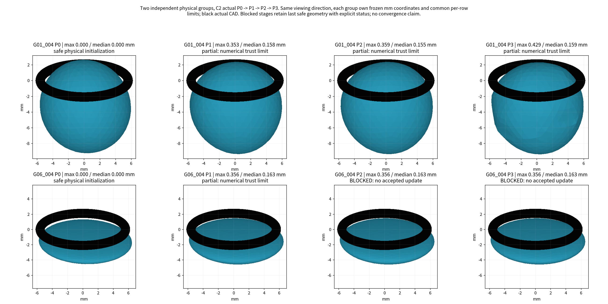
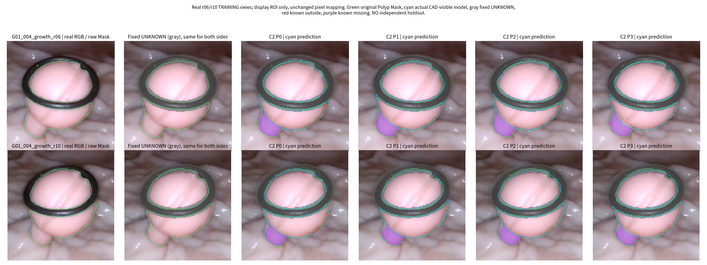
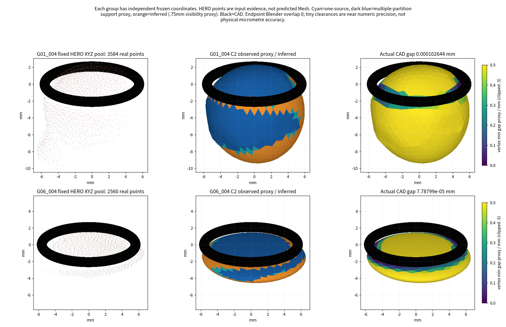
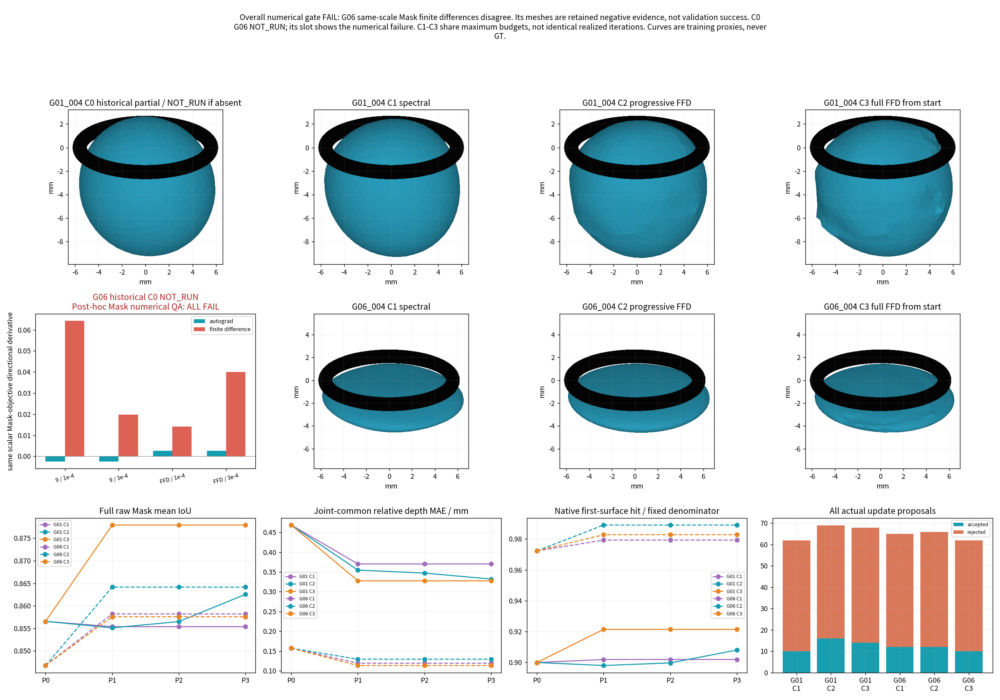

# TASK-E4-PMGR-FFD-002：两例试跑已交付，整体数值门禁未通过

本轮在独立分支实际执行G01_004与G06_004，共六个优化臂的P0→P3有预算尝试，另只读复评R1/C0。主方法C2的最大/中位位移分别为0.4285/0.1590mm与0.3564/0.1632mm，已产生真实非椭球形变；固定射线覆盖和部分HERO相对深度指标改善，保存端点均未检测到Ring实体穿透。多数后期阶段仍受数值信赖域、Ring与路径认证限制而阻塞。重要负结果是：训练前局部Mask梯度检查只覆盖G01；同尺度事后检查发现G06全部四项失败。这是验证覆盖缺口，不能把G06的数字输出当作通过门槛。总体判定为`NUMERICAL_GATE_NOT_PASSED`，不升级正式主线，不宣称P3可靠，不进入B1/B2。全部几何、失败、初始化警告及执行纠错均保留。

## 一页结论

1. **清理**：仅删R1的python-fcl0.7.0.11 HTTP下载缓存2文件，逻辑4,660,487bytes，实得4,661,248bytes。所有科研唯一成果、共享环境、原始/冻结输入及A1/R1安全P0保留；恢复是重新下载同版本wheel。没有为了凑空间删除历史模型。
2. **FFD闭环**：原生Torch几何核、九参数、实际nvdiffrast反传均可运行；G01初始状态在两个局部尺度通过有限差分。G06虽有梯度并完成了更新，但同规则事后有限差分失败，故不能声称跨案例可靠闭环已通过。下面的几何数字是保留证据，不是科学验收。
3. **R1问题**：已取消动态轮廓点数作为损失分母、对称应用固定Ring UNKNOWN、移除逐源0.5px否决。多视角可软折中，但光栅显隐事件的数值不稳定仍在，未实现全局连续可靠梯度。
4. **对照**：G01 C3投影/覆盖较好但弯曲更强，C2的深度尾部/曲率更温和；G06 C2覆盖较好、C3相对深度较低。没有一致的渐进解锁优势。六臂都有真实提案和保存端点，多个P2/P3没有接受新更新，明确BLOCKED；不是把P1副本冒充成功P3。
5. **P3资格**：相机不确定、无独立留出、G06梯度FAIL、近Ring停滞与大部分推断表面共同阻止P3正式认证。应先补齐数值门禁/接触可行更新的可靠性；中等复杂主体可留作对照。B1仅是以后需另行申请的方向，本轮没有执行。

## 版本、范围和真实执行

父提交432c8a9；首次源码/配置/测试冻结并提交24232c8后才优化。G01于2026-11-05 03:36:20–03:43:09（UTC+8）完成；G06后续执行入口c775bfe于03:58:11–04:03:07完成。两段实际运行合计约704.63秒，包含CPU几何检查、初始化和阶段导出；中间只读评价与代码审查不计GPU训练时间。没有训练神经网络或调用MonoSDF/NeuralFusion。

G01直接读取SHA冻结的R1安全P0，初始整面间隙0.082401mm；G06只做一次26迭代九参数可行性求解，间隙0.180657mm、Blender实体交集0，体积为历史1.23989，存在明显Mask退化。详见[协议](01_PROTOCOL.md)、[配置](config/LOCKED_PROTOCOL.json)、[输入冻结](metrics/INPUT_FREEZE.json)、[源码冻结](metrics/IMPLEMENTATION_FREEZE.json)、[版本/许可复用](SOURCE_REUSE_AUDIT.md)。

### 必须公开的实施纠错

首次执行错误沿用了R1的初始化观测退化硬门槛，给G06写入NOT_EXECUTABLE。v1.1允许观测软折中，额外用Mask退化阻塞并不符合上位任务。随后先提交[纠正登记](02_G06_ADMISSION_CORRECTION.md)，直接从同一个已保存安全候选继续原预算；没有重求P0、换输入、改损失或挑参数。原初Mask下降9.210个百分点及[首次执行结果](metrics/INITIAL_EXECUTION_RESULTS.json)保留，入组另标`CONDITIONAL_PHYSICAL_START_WITH_MASK_REGRESSION`，不把原观测警告改成PASS。

第二个流程缺口是逐案例训练前数值验证不完整。G06的同尺度梯度检查是在更新后才做，且失败。因此它只能作为附带数值缺陷的探索输出，不能倒称满足训练前门槛。当前代码已在每个案例的正式更新之前强制调用相同`case_gate.py`；未来复现会提前阻塞该G06，而不会静默重训。原执行源码提交和全部结果仍保留，没有因纠错重跑G01或清除G06负结果。

## 固定输入、资格、分母

| 案例 | 代表视角 | 全部训练源 | 相机身份 |
|---|---|---|---|
| G01_004/E2 | ref08/ref13/ref03 | 再加growth_r04/r06/r10/r14，共7 | 全部INSUFFICIENT_EVIDENCE，仅条件研究 |
| G06_004/E1 | growth_r01/r03/r06 | 再加new_r00/ref04，共5 | r01/r03为CONDITIONAL_USABLE，其余证据不足 |

沿用最新冻结Camera Gate/View Partition/清理；E1/E2这里只指定历史初始化来源，不在损失中按息肉类型分支。原B转训练，`NO_HOLDOUT_AVAILABLE`，没有独立B验证。不改Ring-First、K/c2w、原生HERO/Raw/Cleaned、Mask、Type-2、CAD、DXY。只读符号链接，没有可写硬链接；141项来源/输入SHA最终均不变。

归档360×640→320×180的采样与半像素K转换冻结；原生352×640的512条轴向Z射线保留原Kn/Pixel ID。固定UNKNOWN为原Ring Mask与真实CAD投影并集再3×3膨胀，同一权重同时作用预测与观测。G01固定已知386550像素、其中息肉24872；UNKNOWN16650/403200。G06已知278012、其中息肉10357；UNKNOWN9988/288000。原始全Mask和全512射线另行评价，不使用变小的头部Mask，不以有效命中数改分母。

G01原始评价射线3584、深度对1792；G06为2560/1280。跨本组全部臂/阶段的共同有效对分别1428/1792和1212/1280。误差配对只在这些共同对上比较，同时保留全部未命中计数。所有HERO误差是来源代理，不是物理GT。

## 实际成熟工程与适配

使用现有Torch2.7.1+cu128、nvdiffrast0.4.0（本地源码253ac4fcea7de5f396371124af597e6cc957bfae）、FCL/Open3D/Blender；没有安装PhysicsNeMo/PyTorch3D/libigl/IPC。GPU为RTX3060 Laptop 6144MiB、驱动570.133.07。预检完整七源前后向约0.093秒、Torch分配峰值67.48MiB；该数值不是整机驱动占用或全流程峰值。

PyTorch3D官方教程仅用于共享Mesh/view-loss组织与网格正则思路；实际渲染调用已安装nvdiffrast的rasterize→interpolate→antialias。PhysicsNeMo公式用于小型Torch Bernstein/B-spline核，PyGeM角点例子用于独立手算测试。训练时缓存固定模板的FFD方向，不每步重建控制格；不是调用完整PhysicsNeMo，也不是官方PyTorch3D模型输出。来源函数/URL/许可逐项见SOURCE_REUSE_AUDIT。

固定642点1280面，九参数始终开放。C1谱法向，C2渐进FFD，C3相同FFD从开始开放最终方向；均共享一个主体。P1/P2/P3为12/48/96方向，原参数无损继承，新系数零，所有转移误差为0。P3新增方向仅作用初始有≥2分区及≤0.75mm HERO邻近代理支持的顶点；没有给各视角私有Mesh。

目标为固定像素BCE/Dice/距离场、固定256对相对深度、低权重可信XYZ，加Laplacian/边应变/系数弱先验与Ring近接势垒；没有ARAP库调用或体积守恒硬约束。相关性/资格权重和软退让保持每源非零。C1/C2/C3的最大预算相同：36/48/48轮、每轮最多4提案。实际轮数不同，不能说计算量完全匹配；下表完整公开。BEST只从同臂保存阶段的共同训练目标选，不使用GT或B，也不替代预声明主方法C2。

## 主结果

| 案例/Arm | 原始全Mask均值IoU：P0→末状态 | 首层命中/固定射线 | 共同深度对MAE / mm | 最大/中位P0位移 / mm | 接受/拒绝 | 优化耗时 / s |
|---|---|---|---|---|---|---|
| G01_004/C1 | 0.85656→0.85538 | 3232/3584（P0=3225） | 0.37031（P0=0.46876） | 0.2713/0.0512 | 10/52 | 96.2 |
| G01_004/C2 | 0.85656→0.86254 | 3254/3584（P0=3225） | 0.33204（P0=0.46876） | 0.4285/0.1590 | 16/53 | 96.4 |
| G01_004/C3 | 0.85656→0.87791 | 3302/3584（P0=3225） | 0.32755（P0=0.46876） | 0.6614/0.0943 | 14/54 | 201.1 |
| G06_004/C1 | 0.84677→0.85820 | 2507/2560（P0=2489） | 0.11899（P0=0.15696） | 0.2317/0.0942 | 12/53 | 104.0 |
| G06_004/C2 | 0.84677→0.86416 | 2532/2560（P0=2489） | 0.12913（P0=0.15696） | 0.3564/0.1632 | 12/54 | 106.4 |
| G06_004/C3 | 0.84677→0.85758 | 2516/2560（P0=2489） | 0.11316（P0=0.15696） | 0.2951/0.0430 | 10/52 | 84.2 |

数值最优不等于物理正确：G01 C3的Mask/覆盖更好，但局部曲率比C2更高；G06 C2的覆盖更好，而C3深度更低。不能宣称渐进解锁普遍胜出。G01 C2虽净增29条首层命中，r10仍少2条、ref03原始IoU仍下降约0.0037；各源代价未隐藏。G06 C2净增43条，初始安全P0相对历史的退化也未因此抹除。

### 同一共同深度对的配对误差

| 案例/Arm | 共同有效对/全分母 | 中位绝对残差 / mm | MAE / mm | p95 / mm | 最大 / mm |
|---|---|---:|---:|---:|---:|
| G01_004/C1 | 1428/1792 | 0.25710 | 0.37031 | 1.16145 | 2.82317 |
| G01_004/C2 | 1428/1792 | 0.23014 | 0.33204 | 0.96328 | 2.12311 |
| G01_004/C3 | 1428/1792 | 0.22920 | 0.32755 | 0.98041 | 2.15921 |
| G06_004/C1 | 1212/1280 | 0.09536 | 0.11899 | 0.30853 | 0.59458 |
| G06_004/C2 | 1212/1280 | 0.09961 | 0.12913 | 0.34786 | 0.61947 |
| G06_004/C3 | 1212/1280 | 0.08780 | 0.11316 | 0.31590 | 0.52131 |

MRE/直径准确度/真实表面误差均NOT_EVALUABLE，未读取GT。不将相对深度下降当成绝对深度正确，例如G01 r06的绝对首层HERO残差仍约1.15mm。没有校正HERO、相机或深度来源去消除该矛盾。

### 实际阶段与阻塞

| 案例/Arm | 阶段 | 有效形变参数 | 尝试轮/最大预算 | 接受/拒绝提案 | 最终状态 |
|---|---|---:|---|---|---|
| G01_004/C1 | P1 | 12（另加九参数） | 13/36 | 10/20 | TRUST_REGION_NUMERICAL_LIMIT_PARTIAL_ACCEPTANCE |
| G01_004/C1 | P2 | 48（另加九参数） | 4/48 | 0/16 | STAGE_BLOCKED_NO_ACCEPTABLE_UPDATE |
| G01_004/C1 | P3 | 96（另加九参数） | 4/48 | 0/16 | STAGE_BLOCKED_NO_ACCEPTABLE_UPDATE |
| G01_004/C2 | P1 | 12（另加九参数） | 9/36 | 6/20 | TRUST_REGION_NUMERICAL_LIMIT_PARTIAL_ACCEPTANCE |
| G01_004/C2 | P2 | 48（另加九参数） | 8/48 | 5/16 | TRUST_REGION_NUMERICAL_LIMIT_PARTIAL_ACCEPTANCE |
| G01_004/C2 | P3 | 96（另加九参数） | 8/48 | 5/17 | TRUST_REGION_NUMERICAL_LIMIT_PARTIAL_ACCEPTANCE |
| G01_004/C3 | P1 | 96（另加九参数） | 16/36 | 13/21 | TRUST_REGION_NUMERICAL_LIMIT_PARTIAL_ACCEPTANCE |
| G01_004/C3 | P2 | 96（另加九参数） | 5/48 | 1/17 | TRUST_REGION_NUMERICAL_LIMIT_PARTIAL_ACCEPTANCE |
| G01_004/C3 | P3 | 96（另加九参数） | 4/48 | 0/16 | STAGE_BLOCKED_NO_ACCEPTABLE_UPDATE |
| G06_004/C1 | P1 | 12（另加九参数） | 14/36 | 11/20 | TRUST_REGION_NUMERICAL_LIMIT_PARTIAL_ACCEPTANCE |
| G06_004/C1 | P2 | 48（另加九参数） | 5/48 | 1/17 | TRUST_REGION_NUMERICAL_LIMIT_PARTIAL_ACCEPTANCE |
| G06_004/C1 | P3 | 96（另加九参数） | 4/48 | 0/16 | STAGE_BLOCKED_NO_ACCEPTABLE_UPDATE |
| G06_004/C2 | P1 | 12（另加九参数） | 16/36 | 12/22 | TRUST_REGION_NUMERICAL_LIMIT_PARTIAL_ACCEPTANCE |
| G06_004/C2 | P2 | 48（另加九参数） | 4/48 | 0/16 | STAGE_BLOCKED_NO_ACCEPTABLE_UPDATE |
| G06_004/C2 | P3 | 96（另加九参数） | 4/48 | 0/16 | STAGE_BLOCKED_NO_ACCEPTABLE_UPDATE |
| G06_004/C3 | P1 | 96（另加九参数） | 13/36 | 10/20 | TRUST_REGION_NUMERICAL_LIMIT_PARTIAL_ACCEPTANCE |
| G06_004/C3 | P2 | 96（另加九参数） | 4/48 | 0/16 | STAGE_BLOCKED_NO_ACCEPTABLE_UPDATE |
| G06_004/C3 | P3 | 96（另加九参数） | 4/48 | 0/16 | STAGE_BLOCKED_NO_ACCEPTABLE_UPDATE |

`TRUST_REGION_NUMERICAL_LIMIT_PARTIAL_ACCEPTANCE`指接受过真实更新，但在阻尼达到预定数值上限时提前停止，绝不等于跑满预算或收敛。`STAGE_BLOCKED_NO_ACCEPTABLE_UPDATE`虽释放新候选并实际求解提案，却没有接受更新；其端点保留上一安全状态并明确标记。C0/G01只有R1局部P1，P2/P3 NOT_RUN；C0/G06全部NOT_RUN，不伪造配平优势百分比。

### 物理质量和形变

| 案例/Arm | FCL末状态间隙 / mm | Blender实体交集 / mm³ | 体积/安全P0 | 最大非椭球位移 / mm | 最大曲率代理 / mm⁻¹ |
|---|---:|---:|---:|---:|
| G01_004/C1 | 0.000051754 | 0.0 | 0.99663 | 0.25136 | 0.22667 |
| G01_004/C2 | 0.000102644 | 0.0 | 0.99467 | 0.40970 | 0.53122 |
| G01_004/C3 | 0.000094993 | 0.0 | 1.00002 | 0.64522 | 0.98671 |
| G06_004/C1 | 0.000068826 | 0.0 | 1.07532 | 0.21316 | 2.36920 |
| G06_004/C2 | 0.000077880 | 0.0 | 1.09047 | 0.19691 | 2.33988 |
| G06_004/C3 | 0.068001313 | 0.0 | 1.02985 | 0.30723 | 4.46932 |

36份保存端点（阶段/BEST/LAST_SAFE）均封闭、绕序一致、正体积、内负外正；接受时未检测到自交/不可解析共面穿插，Blender EXACT实体交集均为0。大提案确曾发生Ring穿透和自交，被拒绝并保留典型失败，而非事后删除预测表面。

几个终点的间隙已接近约4.7e-5mm数值误差带，不能解释为物理亚微米精度或稳健安全余量。接受路径由既有FCL/Lipschitz认证世界顶点直线插值，不认证九参数非线性插值的所有路径。无法认证的路径拒绝；未用有限中点抽样冒称连续安全。

G01 C2体积仅小降约0.53%，G06 C2相对安全P0增长约9.05%，未靠大幅缩水获得改善；后者相对原历史椭球累计膨胀约35%，仍是重要形态风险。G01 C3及G06 C3的局部曲率代理更高，图中不规则凹凸没有平滑掉。曲率为离散代理，不能跨不同形态仅凭最大值判物理错误。

## 数值门禁：局部通过与明确失败

训练前16项检查覆盖G01：FFD恒等/角点手算、控制梯度、真实安全P0恢复、跨阶段零跳变、真实Mask到两参数块反传、两个局部有限差分尺度、AA关闭零轮廓梯度对照、Ring首次遮挡、对称UNKNOWN不变、同K/c2w A→B及CPU/CUDA同面光栅、正负间隙FCL/Blender。

原h=1e-3检查FAIL；4×/8×内部渲染也没有消除跨像素显隐差异。G01在h=1e-4、3e-4有约1–2%的局部一致平台，保留15%容差，没有把大扰动FAIL改成PASS或声称全局C1。它只证明该初始邻域的梯度链，不覆盖所有后续显隐事件。

G06用完全相同方向/尺度/阈值的事后QA：九参数相对差约1.038/1.122，FFD约0.819/0.936，四项均FAIL。没有搜索更有利尺度。其训练前未独立覆盖的流程缺口已记录；数值输出不能视为该组训练门禁通过。当前`case_gate.py`在每组更新前强制执行，未来该输入会在更新前返回NUMERICAL_GATE_FAILED。原负结果保留，可用于定位扁平主体/光栅三角显隐的数值限制，不能以库成熟为由忽略。

数据见[训练前检查](metrics/PRE_RUN_VALIDATION.json)、[原失败](metrics/PRE_RUN_VALIDATION_INITIAL_FAILURE.json)、[逐案例事后QA](metrics/POST_HOC_CASE_MASK_GRADIENTS.json)。总体工程验收是**NUMERICAL_GATE_NOT_PASSED**。

## 拒绝原因与剩余机制问题

总计392个实际提案，接受74、拒绝318；没有R1逐视角veto、没有多数拒绝全局停止。碰撞后会扩大近活动CAD约束并重求QP方向，不只是缩放旧向量；但这不等于已实现可靠的接触流形优化。

主要限制为：采样的线性接触约束仍可能漏掉真正最近特征；近接势垒按大量采样均值归一，对局部最小间隙可能过弱；保守的连续路径认证在接近数值精度时难放行有限步；真实Mask光栅显隐及首层身份变化导致实际下降与预测不一致。后两项在G06 C3仍有约0.068mm间隙时也出现，所以不能把所有停滞归咎于Ring。

投影顶点Jacobian秩和每源Mask梯度符号只是可观测性上界/冲突代理，不是真实像素Fisher矩阵或独立统计证据。多个模式标为CONFLICT_PROXY，未据此删除来源。P3的96候选可运行不等于96个可靠可辨识自由度。IPC没有安装，本轮没有验证它是否能解除这些阻塞。

## 覆盖、真实性与审计表

G01 C2的同源可见支持面积代理从173.25增至176.52mm²，多分区支持从148.51增至160.35mm²；仍约261mm²被标为未获支持/推断。阈值邻近不能证明真实新增侧面；隐藏背面、细柄和组织闭合均未获物理认证。所有网格直接来自本路线参数，原始顶点/面输出保留，没有补洞、删面、几何平滑或法线显示冒充改善。

| 审计项目 | 必须汇报 |
|---|---|
| 目标组数 | 2：G01_004、G06_004，独立坐标；每组C1/C2/C3 |
| 本算法独立成功 | 数字Mesh输出2/2；逐例局部梯度门槛仅G01通过，G06失败；正式科学成功未认证 |
| 本算法失败 | G06数值门禁FAIL；多个P2/P3阻塞，完整收敛0/2；不可评价项NaN/NOT_EVALUABLE；C0/G06 NOT_RUN |
| 历史测量值回退 | 0；只复用明确授权的九参数初始化，没有借其他路线补齐预测 |
| 失败组及具体原因 | G06初始化退化与数值QA失败、G01/G06后期阻塞，逐项见FAILURE_LEDGER及四图 |
| 最终统计样本 | 两个数值输出组/目标2；不能把G06算工程门槛成功。共同深度对1428/1792、1212/1280；全射线分母3584、2560 |
| 是否用GT选择算法 | 否；先冻结输入/源码/参数，GT准确度、测量MRE、直径MAE均NOT_EVALUABLE |

## 磁盘、依赖、文件与输出修正

清理后6.046GiB，最终审计时5.971GiB，保留4GiB余量；真正清理仅4.66MB两缓存文件，未把人工/系统释放空间归功于本任务。预估峰值0.8GiB，未安装任何新框架。[before](DISK_AUDIT_BEFORE.md)、[after](DISK_AUDIT_AFTER.md)、[逐路径清单](CLEANUP_MANIFEST.csv)。

停止后修正两个纯报告计算：非椭球位移应相对当前九参数椭球；信赖域提前耗尽不能标为BUDGET_COMPLETED。原阶段PROGRESS、更新日志和原报告字段归档保留，未改变任何网格或重放优化。[输出修正记录](metrics/DERIVED_OUTPUT_CORRECTION.json)。G06用更新后的输出计算记录，没有同类误标。

## 四张核心图

两组每臂另有六视角和原A→B展示；原B已经训练，不能称留出。[全部图/GLB](assets_index/VISUALIZATIONS.json)。NPZ/PLY和图用毫米，GLB用米，黑色Ring为原CAD实体。[大型本地结果路径/SHA](assets_index/LOCAL_RESULTS.json)、[固定分母逐源表](metrics/FIXED_DENOMINATOR_METRICS.csv)、[阶段对照](metrics/STAGE_COMPARISON.csv)、[共同对误差](metrics/COMMON_PAIR_COMPARISON.csv)、[最终物理/来源审计](metrics/FINAL_AUDIT.json)。

主方法末状态：`local_results/G01_004/C2/P3.ply`与`local_results/G06_004/C2/P3.ply`；G06 P3文件是明确BLOCKED后的最后安全状态，不是P3新学习成功。每组/arm均保留P0/P1/P2/P3、BEST/LAST_SAFE、系数与少量失败提案。旧实验及原始数据未覆盖。

## 最终停止状态

本轮有限试跑与交付完成；工程验收未通过。不得以两组下降的损失、连续闭合外形或零数值穿环宣告真实重建成功。优先修复逐案例数值门禁和接触可行更新；不自动延长训练、扩展其他组、执行B1/B2或升级主线。等待人工/PM审阅。
