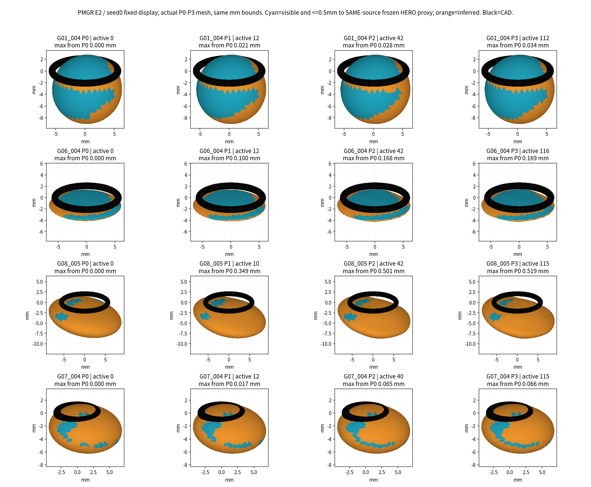
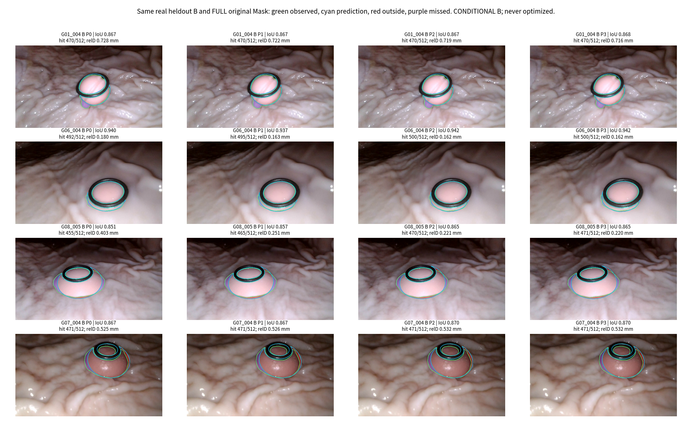
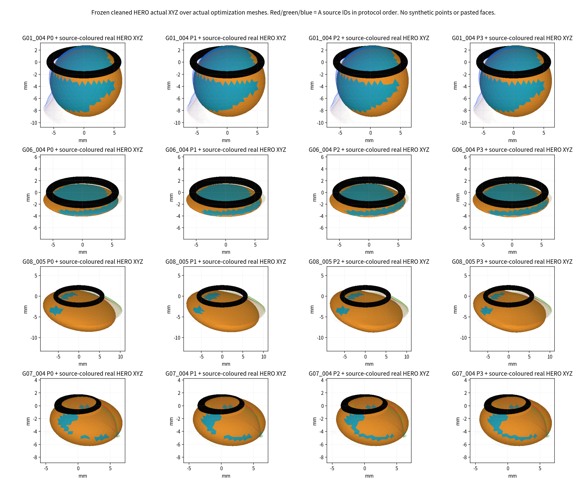
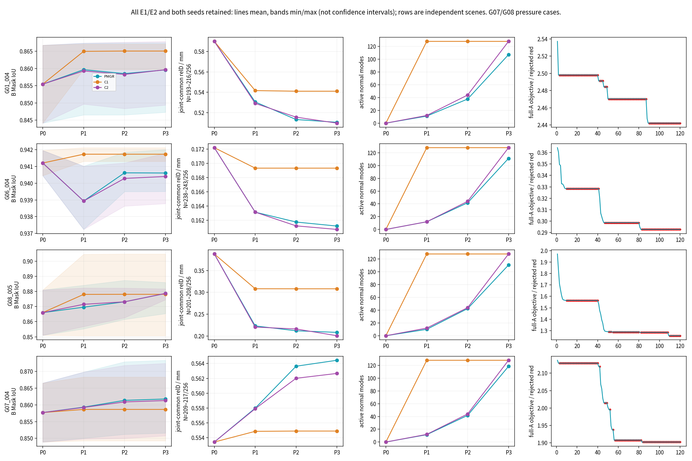

# PMGR 完整实验技术报告

完成日期：2026-11-05（Asia/Shanghai）；预注册日期2026-11-04。

**任务执行：80/80运行完成固定预算；科学结论仍为条件性、混合。** 本轮真正实施P0→P1→P2→P3、直接高自由度C1、频率渐进C2及两项数量配平诊断，输出实际生成的显式形变网格，不是神经训练或贴片融合。不能仅以训练目标下降宣称重建更真实，也不将未知闭合初始化称为已观测表面。

四物理组、E1/E2冻结P0与两个固定采样seed全部保留；G01/G06条件性、G07/G08压力，B全部带历史上游选择依赖。相机、HERO、Mask、清理、Ring CAD和DXY未改。两轮CAD下界实现问题均已保留诊断并修正，正式结果只用原预算完整重跑，不在两轮中选优。

| 审计项目 | 必须汇报 / 本轮结果 |
| --- | --- |
| 目标组数 | 4个独立物理组G01/G06/G07/G08，4单视频；G01_005不入组；16个初值/seed案例不是16个息肉 |
| 本算法独立成功 | 4/4组均独立输出数值网格；本路线数值执行80/80臂运行；条件性2物理组、压力2组；科学真实几何/测量正确率不可评价 |
| 本算法失败 | 数值网格输出失败0/4组（NaN 0组）；运行硬失败0、未运行0；真实合格Is不可评价；几何/覆盖/FD风险见[失败账本](05_FAILURE_LEDGER.md)，测量及GT误差NaN |
| 历史测量值回退 | 0；父E1/E2九参数只作本轮明确批准P0，不以历史直径或融合模型补输出 |
| 失败组及具体原因 | [逐臂与来源](metrics/FAILURES.csv)、[完整分母](metrics/CASE_ARM_SEED_RESULTS.csv)、[Fig4](figures/Fig4_Ablation_Conflict.png) |
| 最终统计样本 | 4/4物理组的条件/压力配对；80臂只是同4组的重复条件；严格独立验证覆盖0/4（正确性未知），MedARE/MAE/p95/max均NOT_EVALUABLE |
| 是否使用GT选择算法 | 否；GT/Oracle读取0；51116d0预注册、2f7e042最终CAD工程修正后冻结，未以B选参数/模式/初值/展示 |

## 执行与版本

父HEAD4a09aedc669092d264f070ccac4fd12851097dd1；新分支exp/TASK-E4-PMGR-PROGRESSIVE-GEOMETRY-001。协议提交51116d0、最终CAD修正2f7e042。RTX3060 Laptop 6GiB，PyTorch2.7.1+cu128；官方nvdiffrast精确253ac4fcea7de5f396371124af597e6cc957bfae。完整配置/输入SHA与代码冻结先于优化。26个P0相机组合及28个合同测试通过；额外精确球体ARPACK重根完整性控制失败被保留，实际八份冻结谱经独立稠密参考全部一致。

| 场景/初值/seed | PMGR | C1 | C2 | C1数量配平 | C2数量配平 |
| --- | --- | --- | --- | --- | --- |
| G01_004/E1/s0 | P0/P1/P2/P3 DONE | P0/P1/P2/P3 DONE | P0/P1/P2/P3 DONE | P0/P1/P2/P3 DONE | P0/P1/P2/P3 DONE |
| G01_004/E1/s1 | P0/P1/P2/P3 DONE | P0/P1/P2/P3 DONE | P0/P1/P2/P3 DONE | P0/P1/P2/P3 DONE | P0/P1/P2/P3 DONE |
| G01_004/E2/s0 | P0/P1/P2/P3 DONE | P0/P1/P2/P3 DONE | P0/P1/P2/P3 DONE | P0/P1/P2/P3 DONE | P0/P1/P2/P3 DONE |
| G01_004/E2/s1 | P0/P1/P2/P3 DONE | P0/P1/P2/P3 DONE | P0/P1/P2/P3 DONE | P0/P1/P2/P3 DONE | P0/P1/P2/P3 DONE |
| G06_004/E1/s0 | P0/P1/P2/P3 DONE | P0/P1/P2/P3 DONE | P0/P1/P2/P3 DONE | P0/P1/P2/P3 DONE | P0/P1/P2/P3 DONE |
| G06_004/E1/s1 | P0/P1/P2/P3 DONE | P0/P1/P2/P3 DONE | P0/P1/P2/P3 DONE | P0/P1/P2/P3 DONE | P0/P1/P2/P3 DONE |
| G06_004/E2/s0 | P0/P1/P2/P3 DONE | P0/P1/P2/P3 DONE | P0/P1/P2/P3 DONE | P0/P1/P2/P3 DONE | P0/P1/P2/P3 DONE |
| G06_004/E2/s1 | P0/P1/P2/P3 DONE | P0/P1/P2/P3 DONE | P0/P1/P2/P3 DONE | P0/P1/P2/P3 DONE | P0/P1/P2/P3 DONE |
| G08_005/E1/s0 | P0/P1/P2/P3 DONE | P0/P1/P2/P3 DONE | P0/P1/P2/P3 DONE | P0/P1/P2/P3 DONE | P0/P1/P2/P3 DONE |
| G08_005/E1/s1 | P0/P1/P2/P3 DONE | P0/P1/P2/P3 DONE | P0/P1/P2/P3 DONE | P0/P1/P2/P3 DONE | P0/P1/P2/P3 DONE |
| G08_005/E2/s0 | P0/P1/P2/P3 DONE | P0/P1/P2/P3 DONE | P0/P1/P2/P3 DONE | P0/P1/P2/P3 DONE | P0/P1/P2/P3 DONE |
| G08_005/E2/s1 | P0/P1/P2/P3 DONE | P0/P1/P2/P3 DONE | P0/P1/P2/P3 DONE | P0/P1/P2/P3 DONE | P0/P1/P2/P3 DONE |
| G07_004/E1/s0 | P0/P1/P2/P3 DONE | P0/P1/P2/P3 DONE | P0/P1/P2/P3 DONE | P0/P1/P2/P3 DONE | P0/P1/P2/P3 DONE |
| G07_004/E1/s1 | P0/P1/P2/P3 DONE | P0/P1/P2/P3 DONE | P0/P1/P2/P3 DONE | P0/P1/P2/P3 DONE | P0/P1/P2/P3 DONE |
| G07_004/E2/s0 | P0/P1/P2/P3 DONE | P0/P1/P2/P3 DONE | P0/P1/P2/P3 DONE | P0/P1/P2/P3 DONE | P0/P1/P2/P3 DONE |
| G07_004/E2/s1 | P0/P1/P2/P3 DONE | P0/P1/P2/P3 DONE | P0/P1/P2/P3 DONE | P0/P1/P2/P3 DONE | P0/P1/P2/P3 DONE |

每个完成臂均保存P0/P1/P2/P3，120次联合梯度求值（提案预算）；总9600次，正式运行串行累计37.7分钟（不含两轮拒收诊断、开发预检、独立秩复查和制图；完整计算分账见HARDWARE_AND_RESOURCE_ACCOUNTING）。非零接受提案1514，拒绝提案8086。固定预算执行不等于优化充分收敛。

## 固定真实B，完整Mask与深度

| 场景/初值（两seed平均） | P0→P3 B IoU | 同P0共同pair相对D MAE mm | P3 B命中/512 | P3激活 | 最大P0位移 mm |
| --- | --- | --- | --- | --- | --- |
| G01_004/E1 | 0.844→0.852 | 0.471→0.312 | 461.5 | 102.5 | 0.620 |
| G01_004/E2 | 0.867→0.867 | 0.728→0.713 | 470.0 | 112.0 | 0.041 |
| G06_004/E1 | 0.942→0.940 | 0.164→0.158 | 497.0 | 109.5 | 0.025 |
| G06_004/E2 | 0.940→0.941 | 0.180→0.164 | 499.0 | 113.0 | 0.179 |
| G08_005/E1 | 0.881→0.883 | 0.380→0.212 | 476.0 | 109.0 | 1.322 |
| G08_005/E2 | 0.851→0.874 | 0.400→0.206 | 474.5 | 112.5 | 0.717 |
| G07_004/E1 | 0.849→0.852 | 0.582→0.589 | 463.0 | 120.5 | 0.042 |
| G07_004/E2 | 0.867→0.872 | 0.525→0.540 | 471.0 | 116.5 | 0.097 |

每行两seed均值仅便于阅读，逐seed全部见CASE_ARM_SEED_RESULTS和PER_VIEW_LOSS。P0也是本轮相同三角化/512射线重新评价，不与父任务32射线或解析球面指标混算。深度是HERO一致性，非独立传感器真值。绝对首深、HERO距离、轮廓median/MAE/p95/max、Mask越界、缺失及CAD数量见逐源表。

4个臂运行的B固定512命中数低于P0，均记覆盖潜在失败，不因平均误差降低改写。A允许至多2个百分点容差，实际下降也单列COVERAGE_DEGENERACY，不承诺零表面损失。

## 强制消融与公平性

| PMGR 对照 | 配对case数/物理组 | B IoU差 PMGR−对照 | B共同pair D差 mm，负为较小 |
| --- | --- | --- | --- |
| C1_DIRECT_HIGH_DOF | 16/4 | -0.0007 | -0.0334 |
| C2_FREQ_ONLY_PROGRESSIVE | 16/4 | 0.0001 | 0.0025 |
| C1_count_matched | 16/4 | -0.0017 | -0.0257 |
| C2_count_matched | 16/4 | 0.0010 | -0.0018 |

深度差采用PMGR∩该对照∩P0同一原生pair交集；交集数单列。Mask固定完整原始像素；所有16案例均纳入，不能把重复seed当独立物理组。平均差不能替代逐组相反方向。

| 臂 | 运行数 | 总联合梯度 | 平均墙钟s | 平均实际render calls | 平均J秒 |
| --- | --- | --- | --- | --- | --- |
| PMGR | 16 | 1920 | 27.7 | 3307.3 | 6.5 |
| C1_DIRECT_HIGH_DOF | 16 | 1920 | 29.4 | 3414.8 | 6.1 |
| C2_FREQ_ONLY_PROGRESSIVE | 16 | 1920 | 27.2 | 3214.6 | 6.0 |
| C1_count_matched | 16 | 1920 | 29.3 | 3416.1 | 6.0 |
| C2_count_matched | 16 | 1920 | 27.6 | 3253.2 | 6.0 |

同案例各臂的P0、候选池、A/B、Mask、HERO池、loss、正则、基础优化器与120梯度上限一致。各臂均做三次候选J诊断；P0 J共享缓存，因此实际渲染/时间不同，不声称完全墙钟公平。另有逐源梯度诊断和独立J审计开销，见索引；count-matched只控制数量，不控制模式身份。

## 几何、可辨识性及边界

PMGR最终激活98–121个模式，各臂P3实际激活J秩范围92–128。仅局部数值代理；FD半步复查最大相对范数差1.410，238/960个检查超过20%（仅事后描述警示，不改变冻结门槛）。遮挡/换面/光栅边缘使高秩不能被当作物理独立形态证据。

60/80运行对应的冻结P0已有CAD采样穿透代理；保留而不偷偷改初始主体，后续不得相对P0加重超过.01mm数值容差。有限CAD采样、分段三角自交测试都不是完整组织接触认证。RESULT_INTEGRITY中82/82项几何/SHA重放通过，失败如有完整列出。

表面颜色中的“可见且距HERO≤.5mm”只是支持代理，不能证明准确；其余为未知/推断。HERO点、原面、Mask和相机均只读，模型自由度没有补造观测。

## 七个科研判断

**Q1 连续突破椭球：支持（工程/有限条件范围）。** 每阶段共享同一网格、基准法向和系数，非零谱位移改变实际三角面；没有重置P0、换模型或后处理。不过闭合未知背面仍只是先验。

**Q2 何阶段首次改善B：混合、普遍结论证据不足。** PMGR最终Mask IoU在12/16个条件案例上高于P0，其余保留下降；P1已可出现Mask改善；各案例首个变化阶段及全四阶段共同pair深度见PMGR_STAGE_DIAGNOSTICS（事后描述，不是新PASS标准）。深度只按同P0共同pair对比，同时读固定512命中。不能把局部IoU或D改善外推为真实重建成功。

**Q3 何阶段开始不稳：条件性支持存在风险，单一阶段界线证据不足。** P1已有提案被拒绝和停滞；每级均有回缩/拒绝、源梯度竞争及FD尺度敏感。已接受网格未发生新增自交或翻折，不能把提案失败等同于已接受表面失稳；也不能只把风险归于P3。未出现已通过保护的新增自交，不等于所有形变物理真实。

**Q4 PMGR是否优于C1：见配对表，普遍优越性证据不足。** 需要同时满足B Mask、相同pair深度及覆盖方向；候选数量匹配与实际放行数量匹配分列，不能仅归因于渐进顺序。

**Q5 观测驱动解锁优于C2：普遍结论证据不足。** 已真实执行固定频率主对照及count-matched诊断，筛查减少部分模式；数值秩、冲突代理和相机资格仍不足以把差异解释为被正确识别的物理自由度。

**Q6 当前数据支持什么复杂度：仅支持有条件的局部数值响应。** PMGR最终放行98–121/128个候选；实际激活J秩和FD尺度敏感性都已列出。独立真实Is/背景不足、相机链与同源HERO相关性使高秩不能直接认证高复杂度。

**Q7 增自由度还是B1：证据不足以批准继续扩张全局自由度。** 先人工检查当前可信主面与冲突/未知区域；B1可作为随后单独审批的保真方向候选，当前只到可回放的候选脚手架，不视为已验收A2/正式B1起点；本轮不启动B1/B2或任何融合/神经路线。

## 核心实图

四张核心几何图固定E2/seed0展示，未按B择优；Fig4纳入所有初值/seed，六视角和GLB全部保留。大模型及完整日志本地路径/SHA见assets_index；没有后处理美化、平滑、补面或删除输出。

本轮执行到此停止，交由人工/PM审核，不自动推进B1/B2。
