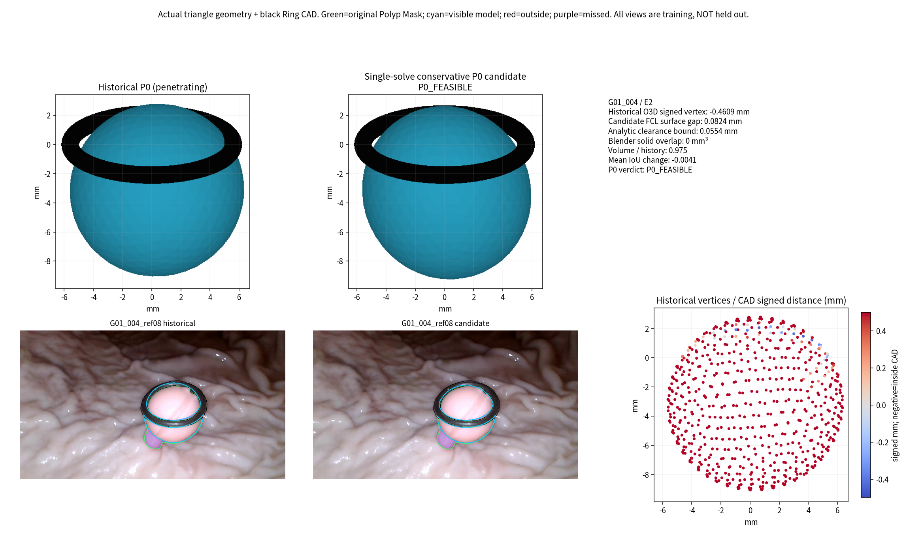
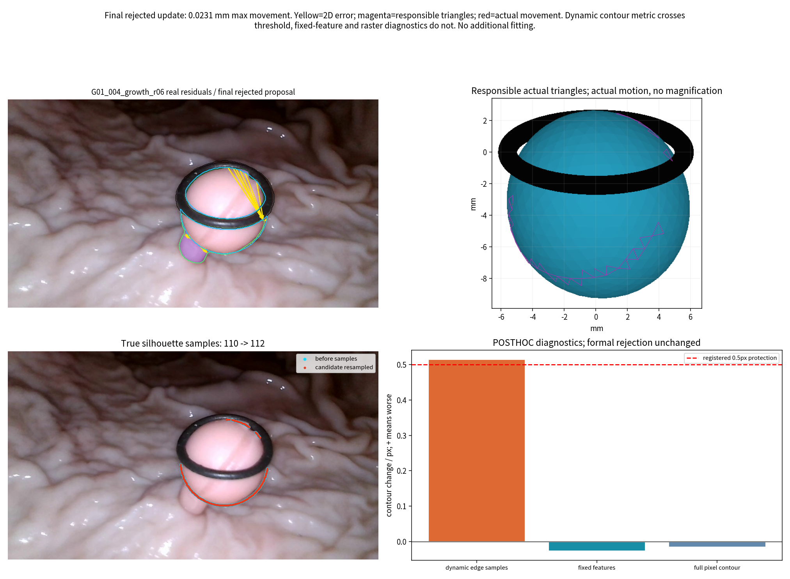
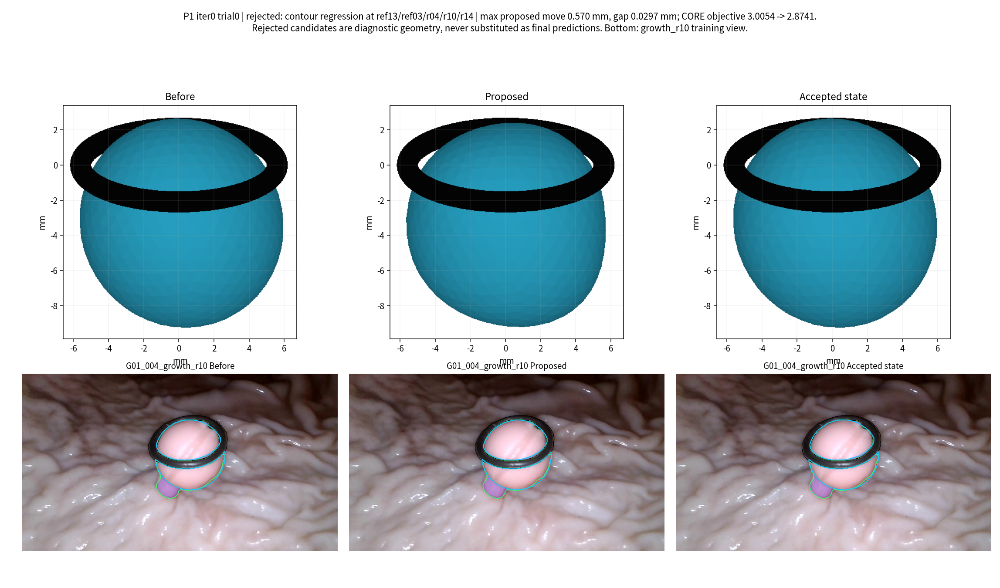
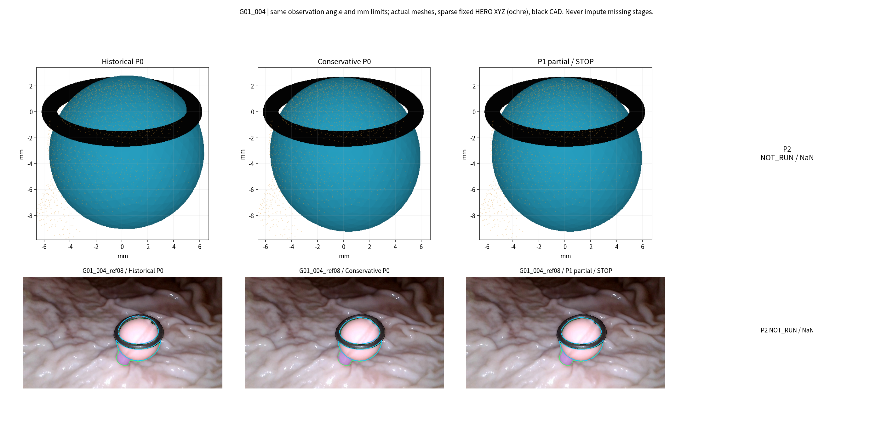

# TASK-E4-PMGR-R1：已按多数拒绝条件停止

本轮只执行了G01_004/E2的一次保守初始化和受控P1试跑。历史椭球确有实体穿环，Blender交集体积3.8960 mm³；新P0在保留97.52%体积时获得0.08240 mm整三角面间隙，七视角平均IoU仅下降0.00411。随后九参数与12个谱参数共同更新，但10个实际提案中9个被拒绝，触发预注册全局停止，P2及G06/E1均未执行。拒绝均来自逐视角轮廓保护，而非Ring碰撞或QP失败。只读复核发现，大提案存在真实投影退化，小提案则受到边缘重采样、Ring接触边界语义不对称影响。因此安全初始化部分成立，明显渐进形变机制尚未通过；不能据此认定真实多视角几何无解。没有继续调参、改阈值或扩展案例。

## 1. 范围、冻结和执行身份

- 分支：`exp/TASK-E4-PMGR-R1`；父提交：`b8c41565d467c922fdf2f45d3a4adf92f332813d`。
- 正式执行源码/预注册提交：`eea53d74e645f58fc67e6b4d01ce4db96e716524`。先提交代码、配置、8项数值验证，再启动唯一一次正式运行。
- [01_PROTOCOL.md](01_PROTOCOL.md)、[LOCKED_PROTOCOL.json](config/LOCKED_PROTOCOL.json)、[IMPLEMENTATION_FREEZE](metrics/IMPLEMENTATION_FREEZE.json)、[INPUT_FREEZE](metrics/INPUT_FREEZE.json)均先于拟合。
- CPU正式运行：2026-11-05 01:55:30–01:56:12（UTC+8），约42.19秒。Python3.12.13、SciPy1.15.3、Torch2.7.1 CPU float64、Open3D0.19.0、python-fcl0.7.0.11、Blender5.0.1（a3db93c5b259）。GPU未使用。[环境记录](metrics/ENVIRONMENT.json)。
- 停止条件：从第10个实际提案起，累计或最近10个拒绝率>50%即全局停止；重求可行方向及回溯提案全部计数，不允许零移动凑接受。本次9/10立即停止。

## 2. 输入与相机角色

直接复用当前Ring-First公制K/c2w、HERO原生深度、已有Camera Gate/View Partition、最新冻结清理、原始Polyp/Ring Mask及真实CAD。只复制本轮小型样本池，不更改任何上游资产。原生352×640与归档360×640采用既有半像素中心映射，轴向Z与射线参数方向完全继承。没有读取GT、Oracle或DXY测量值，亦未重跑清理。

| 案例 | P1代表视角 | 全部条件研究入组池 | 严格资格与角色 |
|---|---|---|---|
| G01_004/E2 | ref08/ref13/ref03 | 上述3源及growth_r04/r06/r10/r14，共7源 | 全部保留`INSUFFICIENT_EVIDENCE`，仅条件性研究入组；严格认证源数为0 |
| G06_004/E1 | growth_r01/r03/r06 | 再加new_r00/ref04，共5源 | r01/r03为`CONDITIONAL_USABLE`，其余证据不足；本次均NOT_RUN |

逐候选排除理由见[VIEW_QUALIFICATION.csv](metrics/VIEW_QUALIFICATION.csv)。Ring不通过、明确几何不合格或缺少当前清理输入的视角未入组；没有伪造第三个严格认证视角。G01、G06的原B转为训练池，P0已使用全部入组源，本轮没有独立留出验证。相机资格未升级，条件研究结果不能当作严格相机验证或独立泛化成绩。

每源固定512个原生Pixel ID、256个相对深度对。已有池按字节复用，新增池按相同可靠性规则固定；额外采样不构成清理。G01全评价分母为3584条原生射线、1792对深度及115901个原始Polyp像素。未命中始终单列，不以有效命中数重定义成功率。

## 3. P0：非接触初始化部分成立

使用同一个九参数旋转椭球、642点/1280面；单次SLSQP、同一历史初值、最多60次迭代，不做多初值搜索。体积不低于历史85%，各半轴比例在0.8–1.25，中心/旋转域及Mask/HERO退化门槛预先冻结。CAD上262144个固定重心采样点与0.023546 mm覆盖半径给出1-Lipschitz椭球level的保守下界，再用整面FCL、Open3D双向符号和Blender BVH/EXACT实体交集复核。

| 指标 | 历史P0 | 新保守P0 | P1最后安全状态 |
|---|---:|---:|---:|
| Blender实体交集 / mm³ | 3.896047 | 0 | 0 |
| FCL全表面间隙 / mm | 穿插 | 0.082401 | 0.080870 |
| Open3D主体顶点最小签距 / mm | −0.460934 | +0.082401 | +0.080870 |
| 相对历史体积 | 1 | 0.975208 | 约0.97515 |
| 七源平均完整Mask IoU | 0.860668 | 0.856559 | 0.856615 |
| 原生首层命中 / 3584 | 3254 | 3225 | 3225 |
| 原始Mask命中 / 115901 | 101040 | 99992 | 100002 |

新P0解析间隙下界0.055424 mm，大于冻结的0.05 mm门槛及数值误差带。中心移动0.418406 mm，三个半轴比例0.96457/0.95013/1.06410，体积只减2.48%，没有靠大幅缩小获得无碰撞。平均IoU下降0.411个百分点，最差单源下降1.831个百分点，均在预注册范围内。新P0及最后安全网格均封闭、绕序一致、正体积、内负外正，无检测到的面翻折/非邻接自交；数值证明及限制见[FINAL_INTEGRITY](metrics/FINAL_INTEGRITY.json)。这仅证明相对已知CAD的安全起点，不认证息肉隐藏表面的真实性。

历史冲突的机制：历史A-only二维/相对深度椭球并未把实体Ring非穿透作为初始化可行条件；圆滑二维投影可同时对应穿环的三维椭球。后续固定原始九参数时，仅靠小幅谱形变难以逃离已有相交构型。新P0提供了可行反例，不能再将此案例解释为“所有九参数椭球都无法避环”。但本轮没有证明所有Mask/HERO绝对约束可同时精确满足。

### P0日志缺失必须保留

执行时可行性求解报告与阶段P0报告使用同名`G01_004_P0.json`，后者覆盖了前者。中间可行性轨迹、实际SLSQP迭代数及其success字段不可恢复，明确保留null，未重跑拟合补造轨迹。历史/候选端点NPZ、各独立Blender检查以及全部P1提案均完好。停止后只从端点重算最终门槛，另存[P0_FEASIBILITY_RECONSTRUCTED](metrics/G01_004_P0_FEASIBILITY_RECONSTRUCTED.json)。`run.py`仅作输出文件名修正供未来复现，原执行版本仍由上述提交和SHA保留。[输出修正审计](metrics/POST_STOP_OUTPUT_FIX.json)。

## 4. P1：10个提案，9个拒绝，按要求停止

始终开放中心/旋转/半轴9参数，加12个低频谱系数；P2原计划增加至32且无损继承，但没有执行。所有视角优化同一个共享网格。可见真实三角边及其责任Face/Edge ID、图像Jacobian驱动GN/LM，像素信赖域来自当前轮廓残差；无统一毫米步长上限。CAD线性化、体积及参数域进入可行方向QP，候选仍需整面碰撞与几何质量复查。

| 提案 | 最大实际候选位移 / mm | 判定 | CORE目标：3.005427起 | 主要拒绝来源 |
|---|---:|---|---:|---|
| 1 | 0.569807 | REJECT | 2.874087 | ref13/ref03/r04/r10/r14 |
| 2 | 0.484598 | REJECT | 2.810021 | ref13/r04/r10/r14 |
| 3 | 0.392833 | REJECT | 2.779042 | ref13/r04/r10/r14 |
| 4 | 0.293900 | REJECT | 2.738370 | ref13/r04/r10/r14 |
| 5 | 0.203925 | REJECT | 2.793308 | ref13/r04/r10 |
| 6 | 0.118620 | REJECT | 2.836322 | r04/r06/r10 |
| 7 | 0.055671 | REJECT | 2.935563 | r06/r10 |
| 8 | 0.021798 | REJECT | 2.979281 | r06 |
| 9 | 0.007735 | ACCEPT | 2.990411 | 无 |
| 10 | 0.023141 | REJECT/STOP | 2.975035 | r06 |

拒绝9/10，接受1/10。所有拒绝标签均为`VIEW_CONTOUR_REGRESSION`；Ring实体穿透、QP失败、HERO覆盖回退、网格质量拒绝均为0。各来源标签次数可重叠：r10=7、r04=6、ref13=5、r14=4、r06=4、ref03=1。所有候选端点Ring间隙保持正值（最小约0.00614 mm）；后续接触被允许，但本次不需要触发接触判别修正。可行方向在碰撞后主动改变方向的分支未获得真实碰撞提案验证，不能宣称已完成该分支的科学验收。

原始九参数确实参与：最大提案的“仅九参数变化”顶点最大位移0.49653 mm，谱项单独变化0.24582 mm；接受提案相应为0.00678与0.00479 mm。两项非线性合成，不能简单相加。参数没有被冻结，但最终只产生0.007735 mm改变，未实现研究目标所需的明显三维形变。完整记录见[UPDATE_SUMMARY.csv](metrics/UPDATE_SUMMARY.csv)、[ALL_UPDATE_PROPOSALS.json](metrics/ALL_UPDATE_PROPOSALS.json)。

## 5. 为什么仍被拒绝：优化设计、可见性统计均有问题

### 5.1 P1目标与全源保护条件不一致

P1只用3 CORE提出方向，却用7源相对新P0的轮廓均值逐源保护（每源最多恶化0.5归档px）。CORE目标下降不足以保证其余源改善。提案1 CORE目标3.00543→2.87409，但七源目标3.25257→3.30034；growth_r10完整像素轮廓距离也恶化3.6406 px，ref13恶化0.8871 px。大更新存在投影层面的冲突，不能只说优化器太保守，或只因IoU略好就接受。

这些是当前模型、条件相机、Mask、HERO与损失共同产生的代理冲突；无GT且相机证据不足，不能进一步断言哪个真实来源错误，也不能证明物理约束无解。

### 5.2 小更新的轮廓统计存在跳变

最后提案仅移动0.023141 mm。r06预测轮廓从110样本变112样本：登记动态轮廓均值12.67994→13.19354 px，较当前状态恶化0.51360 px，较新P0恶化0.50470 px，触发0.5px保护。

停止后固定原责任边及采样位置、仅投影同一实际几何，轮廓变化为−0.02586 px；从完整360×640真实投影二值区域提取像素轮廓，变化−0.01437 px，IoU增加0.000419。提案8也呈类似现象。这证明小提案的拒绝受边缘重新采样/显隐切换显著影响，不能全当成真实轮廓损坏。

这些只读复核没有替换登记指标，没有把REJECT改成ACCEPT，也没有再求一个更新。固定对应忽略新显隐，像素轮廓亦有量化，二者都是诊断而非新的真值。详见[PER_VIEW_REJECTION_ANALYSIS.csv](metrics/PER_VIEW_REJECTION_ANALYSIS.csv)。

### 5.3 Ring接触边界剔除不对称

代码对观测轮廓剔除了Ring Mask的3×3邻接带，但对预测轮廓仅排除了Ring像素自身及CAD遮挡，未对称剔除同一邻接带。这会让靠Ring的模型轮廓寻找远处仍被保留的解剖轮廓，对应箭头跨过可见区域，产生非解剖残差。

实际最后安全状态：r06有8/110个预测样本处于观测被剔除的带内，占前向绝对轮廓距离和31.8%；r10为19/115，占57.4%。这是明确的可见性/对应实现问题，不能把接触Ring当成息肉真实轮廓。本轮遵守停止要求，没有对称修补后再跑，也没有用该结果回写历史。见[边界诊断](metrics/RING_CONTOUR_ASYMMETRY_DIAGNOSTIC.json)、[Figure 2](figures/Fig2_Contour_To_Geometry.png)。

### 5.4 目前不能归咎于几何表达不足

QP10次均数值成功，梯度在预检的固定显隐邻域内与有限差分相符；该局部PASS并不保证轮廓拓扑切换时可微或统计连续。当前证据首先指向“3源方向/7源保护不一致”和“可见性对应、样本归一化不稳定”。椭球+低频谱模型是否也有限制仍需独立验证；本轮无法将其列为唯一失败原因，更不能据此否定全部渐进几何路线。

## 6. 固定分母与共同成功样本

表中HERO误差属于来源几何代理，非物理GT。未命中保留在3584射线/1792对全体分母。历史、新P0、最后安全状态共同有效深度对为1451/1792（80.97%），在同一1451对上配对比较：

| 相对深度绝对残差 / mm | 历史P0 | 新P0 | LAST_SAFE |
|---|---:|---:|---:|
| 中位绝对值 | 0.40652 | 0.34377 | 0.34523 |
| MAE | 0.57811 | 0.48878 | 0.48581 |
| p95 | 1.75289 | 1.51729 | 1.51510 |
| 最大值 | 4.32786 | 3.49643 | 3.47730 |

没有只凭命中条件误差下降宣布改善。P0相对历史少29条首层命中，固定像素命中少1048；尽管在预注册合理退化范围内，仍是真实代价，不能省略。接受的微小P1没有再损失射线覆盖，但七源目标略增，不代表整体改善。逐源全部结果：[STAGE_SOURCE_METRICS.csv](metrics/STAGE_SOURCE_METRICS.csv)、[COMMON_PAIR_DEPTH.csv](metrics/COMMON_PAIR_DEPTH.csv)。

| 审计项目 | 必须汇报 |
|---|---|
| 目标组数 | 最多2个：G01_004/E2、G06_004/E1；先后顺序冻结 |
| 本算法独立成功 | 1/2获得本路线保守P0和最后安全数字输出；完整P2完成0/2；不等于正确重建 |
| 本算法失败 | G01：P1多数拒绝停止，P2=NaN/NOT_RUN；G06：全局停止未执行，预测NaN/NOT_RUN |
| 历史测量值回退 | 0；仅使用任务明确授权的历史椭球初始化，未借用其他路线补齐最终预测 |
| 失败组及具体原因 | [G01提案/停止](metrics/ALL_UPDATE_PROPOSALS.json)、[G06 NOT_RUN](metrics/CASE_RESULTS.json)、[失败台账](FAILURE_LEDGER.md) |
| 最终统计样本 | 只有G01数值输出；全体目标分母2组。不是跨物理组成功率认证；来源深度对1451/1792共同有效 |
| 是否使用GT选择算法 | 否；GT准确度、直径MAE、相对GT误差均NOT_EVALUABLE；先冻结源码/参数/输入SHA，未读取GT |

## 7. 对七个验收问题的回答

1. **历史椭球为何穿环？** 初始化未解实体可行性；其二维/相对深度拟合可允许3.896 mm³穿插，固定九参数后难以逃离。
2. **新P0可否安全且维持观测？** 本例可以：0.08240 mm间隙、体积97.52%、平均IoU仅降0.00411；条件相机与覆盖代价如实保留。
3. **开放九参数有无作用？** 参数确实进入Jacobian、候选及接受状态，提出约0.5 mm级贡献；最终接受贡献仅0.0068 mm，未证明足够的有效更新。
4. **P1能否明显改变几何？** 提案能，接受结果不能。9/10拒绝后已停止，机制目标未通过。
5. **P2能否进一步稳定？** NOT_RUN，不可评价；没有用P0/P1副本冒充P2。
6. **拒绝多少及原因？** 9/10，均逐源轮廓保护；非Ring碰撞/求解失败。小更新还包含指标离散性与边界语义缺陷。
7. **仍有Ring/Mask/HERO冲突吗？** 安全P0已经存在；观测残差仍非零，大方向存在投影权衡。尚不能证明物理三者无共同解，亦不能认定所有拒绝都为真实冲突。

## 8. 四张核心图与本地成果

最终可恢复网格：`local_results/G01_004/LAST_SAFE.ply`、同名NPZ/GLB；安全初始化：`local_results/G01_004/P0.*`；历史端点、每个提案的修改前/候选/接受状态、参数更新、实际Face/Edge对应全部保留。GLB单位米，NPZ/PLY/图单位毫米。背面和无观测区域仍为参数模型推断，不是已重建的真实组织；HERO点仅作叠加证据。

[本地完整路径和SHA](assets_index/LOCAL_RESULTS.json)、[图/GLB索引](assets_index/VISUALIZATIONS.json)、[复现说明](REPRODUCE.md)。未上传大型原始资产或运行依赖。最终127项来源及冻结输入SHA均未变。

## 9. 停止后的建议范围

本轮状态`REPORTED_STOPPED_MAJORITY_REJECTED`，未升级正式主线。后续若获重新授权，应先解决预测/观测Ring带语义对称、轮廓采样与归一化在小几何变化下的稳定性，并审查少视角方向与全视角保护如何一致；不应先放宽0.5px门槛或增加实验臂。这里只提出诊断，不执行新优化。P2、G06、全部测量组及B1/B2保持未启动，等待人工/PM审阅。
