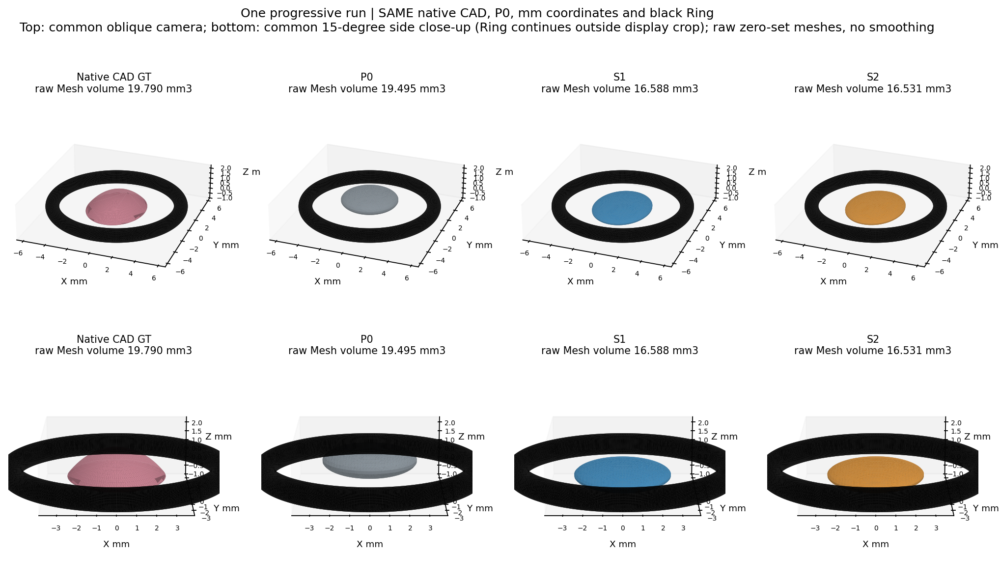
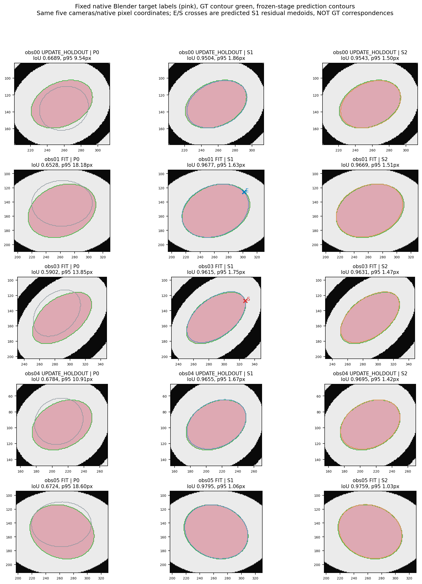
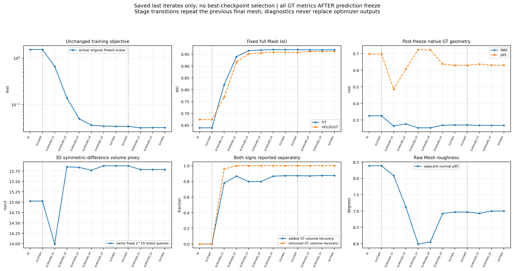
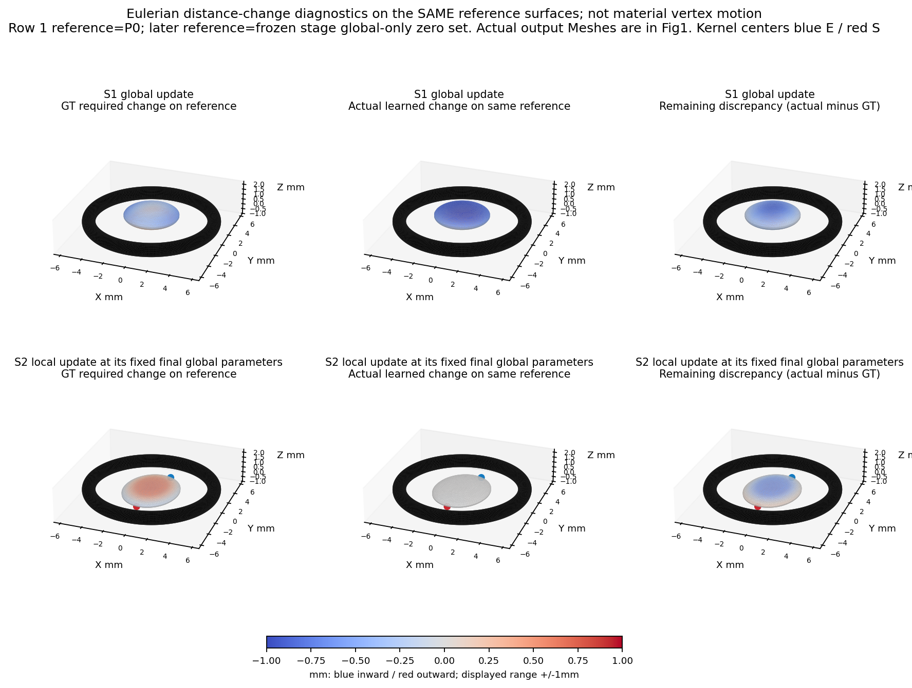

# 渐进几何自由度验证：一次IIa运行

**结论：六参数显著改善轮廓和平均曲面距离，但体积/位置并未一致接近GT；双核未产生有效独立拟合信号，中心没有释放。** 本轮只完成P0→S1→S2，一场景一次渐进轨迹，不将三个检查点当三个病例，不自动运行Gate B/C/D。

## 三问回答

1. **六参数能否明显纠正P0？部分能。** 训练/留出IoU从0.638/0.674提升至0.970/0.958，Chamfer MAE下降17.0%；但差异体积由15.025增至15.873mm³，质心误差亦增大，不能宣称整体三维稳定纠偏。
2. **两相反核能否进一步改善真实形状？本次未见实质独立收益。** 双核数学/数值方向合同通过，但优化后幅值只有[-0.005108501128786256, 0.002401927138183635]。S2仍开放六全局参数，故总阶段变化不能全归于局部；在同一最终全局参数处关掉两核，实际拟合loss反而略低。GT固定采样方向的局部净收益只有约0.00005558mm，不能当有效恢复。S3按规则NOT_TRIGGERED。
3. **二维提升与三维误差下降是否一致？不完全一致。** Chamfer改善而差异体积、质心位置恶化。低轮廓loss、高IoU、闭合光滑都不足以证明真实三维正确。

## 数据/代码/GT隔离

独立目录与分支 `TASK-E4-PROGRESSIVE-DOF-001`，从Gate A c5fb079建立，原结果、代码和冻结证据不修改。P0、BASE_FIELD、Ring、K/c2w、五个原TARGET标签字节相同，没有重渲染Mask/RGB或重新导出GT。3拟合obs01/03/05、2留出obs00/04不变；模拟已知相机不冒称临床Camera Gate认证。GT直接复用原生CAD NPZ，全部优化文件先冻结后才打开，不用GT参数/深度选择初始化、核位置、停止或结果。

`renderer.py`和`continuous.py`与Gate A原字节一致。固定原版目标（corrected=False）：预测几何轮廓与前景像素中心轮廓的双向NN Huber/9 +0.2固定分母XOR。没有同时改用亚像素候选、固定残差平方loss、新优化器或几何先验。GT最低Z只作本报告后验审计，没有加入训练地板约束。

## 零面、尺度与灵敏度先行合同

中心ΔXYZ及半轴log倍率共六参数，零旋转。参考节点仿射变换，字段乘几何平均尺度，保证零局部幅值时零面为原P0的仿射变换。P0的V/F完全一致；各参数.02mm量级扰动与预期仿射顶点最大误差小于1e−6mm。只使用少量共享参数，不是自由顶点更新。

参考h=.15mm；世界网格间距随半轴倍率改变，非更换分辨率。各向异性字段**不是严格单位梯度距离场**，添加核后亦不保证Eikonal；near-zero梯度范数原值保留。物理评价从实际Mesh距离/占据取得，不能把SDF系数当真实表面位移。局部±.02系数测试确认节点占据和Mesh体积扩张/收缩方向正确，故没有“核接反/完全不响应”的实现失败。

固定索引残差J只作旁路诊断，Powell实际调用原标量loss，没有用Jᵀr驱动更新。初始六参的两种梯度方向余弦约0.943/0.944，S1后八参约0.530/0.511，S2最终约0.647/0.644；两套定义不等价，不能把诊断残差的满秩/下降方向当实际目标的证明。全部ε=.02/.01数据、分源loss和J在metrics及本地索引。

## 一次运行与阶段连续性

- S1：中心Δ各±.75mm，半轴倍率[.5,1.4]，初值0即原P0。500次评价/5轮/286.6秒，达到500次预算，**未宣称充分收敛**。
- 核位置仅由S1三拟合视角可见轮廓残差确定；目标内欠覆盖提出扩张、目标外过覆盖提出收缩，Ring/UNKNOWN过滤保持。残差按源等权，取加权均值最近的实际表面候选。面ID属于预测S1零面，不是GT面身份。全部候选与两核选择CSV可追溯；半径固定1.8mm，无搜索。
- S2：保留六全局参数开放、增两幅值共8维，中心固定。216次评价/2轮/126.1秒，正常数值退出；保存最后迭代，不挑更好中间轮。
- S3：逐核幅值/实际loss贡献门槛未通过，不释放中心。S1 loss=0.034342134，S2=0.032184982，S2停用两核=0.032161105；局部净拟合收益-0.000023877，不是有利贡献。结论并非只依赖.02幅值门槛，停用核的实际目标更低这一事实也否定了释放信号。

每阶段START继承上阶段FINAL，校验V/F完全相同，不重拟合P0。每阶段均12轮/500函数预算、同Powell及原xtol/ftol；direc按实际维度必要扩展，log半轴方向按.2/a0归一。Powell xtol=.01是相对数值容差，不能冒充统一毫米位移限制。未增加碰撞损失/正则化/搜索半径。

## 统一独立GT评价

|指标|P0|S1：六参数|S2：六参数+双幅值|
|---|---:|---:|---:|
|拟合Mask IoU|0.638480|0.969566|0.968642|
|留出Mask IoU|0.673665|0.957964|0.961934|
|Chamfer MAE mm|0.325187|0.270066|0.267582|
|Chamfer中位 mm|0.301619|0.254091|0.252854|
|Chamfer p95 mm|0.697122|0.629164|0.629811|
|Chamfer采样最大 mm|1.054582|0.858037|0.859312|
|差异体积代理 mm³|15.025004|15.873093|15.782871|
|实际封闭Mesh体积 mm³|19.495241|16.588228|16.531485|
|Mesh质心误差 mm|0.346664|0.410224|0.405603|
|可见区Chamfer MAE mm|0.319219|0.261571|0.259496|
|未知区Chamfer MAE mm|0.336098|0.277658|0.274811|
|原始Mesh邻面角p95 度|8.388967|6.967190|6.999496|

GT真实封闭Mesh体积为19.790290mm³。P0、S1、S2采用同一2^19 Sobol集合，固定域只由P0网格与最大仿射边界决定，GT域外顶点0。单点体积权重0.001503703mm³；占据差异是积分代理，真实Mesh净体积另列。与Gate A的采样域不同，不将两个实验的微小体积读数直接比较。

三维距离每方向6000面积样本，GT点集固定，可见/未知按原相机Mask/CAD下GT首次表面后验分组；全部分母保留。预测面积采样点随三角化改变，局部微米级对称Chamfer差异可能有采样噪声，因此另报同一GT点集的配对方向。GT/预测Eulerian误差用同一固定P0参考点、同一有符号最近面距离变化，不与材料顶点位移混用。

|相对P0的占据变化代理 mm³|S1|S2|
|---|---:|---:|
|实际新增|13.038612|12.964931|
|实际删除|15.910686|15.921212|
|正确新增|6.679451|6.692984|
|错误新增|6.359162|6.271947|
|正确删除|7.371154|7.371154|
|错误删除|8.539532|8.550058|

“GT应删区域恢复率100%”不等于正确：S1/S2同时错误删除约8.54/8.55mm³，还错误新增约6.36/6.27mm³，不能用召回率或净体积抵消错误。S2相对S1新增0.063156、删除0.147363mm³，阶段变化仍含全局继续拟合。

## 整体与局部分量

S1全局中心控制Z降到0.084132mm，ΔZ=-0.748813接近−.75下界；半轴=[2.5667358012627632, 3.188834778445701, 0.48730344992600333]mm。S2相近。这里不将椭球控制中心冒充GT的同名参数；真正比较的是两个Mesh质心，误差由0.3467变为0.4102/0.4056mm。

最终阶段在同一冻结全局参数下，关掉两核得到Chamfer 0.268578mm、差异体积15.784375mm³；全模型分别0.267582mm/15.782871mm³。这些是固定参数分量诊断，不是重新优化/新实验臂，不用它们替代正式输出。

同一全局零面上，局部实际最大外扩0.007162mm、内缩0.003367mm。固定GT点方向平均误差仅改善约0.00005558mm；差异体积改善约一个空间积分点权重。不能据此认定局部真实表面有实质改善，也没有重复实验为其建立统计置信度。S2相对S1的主要变化来自继续调整全局参数；此单轨迹没有额外预算匹配全局续训对照，不作过强因果外推。

## 不一致的原因及证据强度

**接口实现错误：不支持。** P0同一、仿射零面、符号/体积方向、相机/Mask/CAD字节合同均通过。字段非单位梯度已明示，评价没有混用系数/材料位移。

**轮廓目标不足以保证三维正确：直接支持。** 大幅提高IoU、降低实际loss时，差异体积和质心误差反而变大；最终约6.115562mm³预测占据低于GT的最低Z。三维体积错误并没有被二维轮廓充分惩罚。不能只凭此区分纯观测不充分与离散NN目标偏差的唯一份额；也不是误把FixedResidual接入了优化器。

**中间轨迹的同族反例。** S1第1→2轮，实际loss 0.666171→0.139669，拟合IoU 0.821192→0.939609；但Chamfer MAE 0.264342→0.276600mm、p95 0.485591→0.606231mm、差异体积 13.990456→15.850538mm³均恶化。两者都在同一六参数可表达族内，后者确实更符合原训练目标；因此这次退化不能只解释为“表达不了更好的几何”或“尚未找到更低loss”。所有连续保存转移均见CONSECUTIVE_TRANSITIONS，不只挑这一行。该中间点只用于后验机制诊断，**未据GT回退/选作正式输出**。

**当前局部表达/定位受限：有局部证据。** 约76.2%的大于.2mm GT误差样本位于两核支撑之外。固定中心幅值无法修改那些区域，边缘残差位置不等于应恢复内部形状的位置。双符号核已解除上轮单符号限制，不能继续套用“只能扩或只能缩”的旧结论；本轮未做GT最优拟合，不能证明所有可移动双核或所有SDF表示都不足。

**搜索未充分收敛：有证据但非唯一原因。** S1用满预算，已登记的Y正向.02/.01mm探针均进一步降低实际loss，没有选为新预测。S2有到Z下界的小步下降，部分ε探针被边界裁剪成同一实际位置，不能把它们当两个独立步长证据。正常退出不代表全局最优。保留全部有限差分和轨迹，不加预算、不改边界、不重启；当前证据不足以将GT体积恶化全归于搜索。

所有保存Mesh保持闭合、绕序一致、单连通，Ring候选碰撞记录为0；端点Blender EXACT Ring交集为0，非邻接三角面自交未检出。邻接/退化情形仍非完整形式认证，详见连续性表和Blender原值。光滑、连通并不认证真实几何。

剩余实际loss下降空间也不证明它就是GT改善方向；本轮没有把这些探针选为新输出或重新启动优化。

## 图与交付

[结果汇总CSV](metrics/RESULT_SUMMARY.csv) · [逐轮GT表](metrics/ROUND_METRICS.csv) · [连续转移审计](metrics/CONSECUTIVE_TRANSITIONS.csv) · [逐源表](metrics/PER_VIEW_METRICS.csv) · [分量表](metrics/COMPONENT_METRICS.csv) · [归因审计](metrics/DIAGNOSIS.json) · [复现](REPRODUCE.md) · [失败记录](FAILURE_LEDGER.md) · [本地Mesh/SDF/采样索引](assets_index/LOCAL_RESULTS.json)。冻结代码668dbe1，全部优化文件SHA先于GT读取保留，未回写Gate A。

## 固定审计表

|审计项目|汇报|
|---|---|
|目标组数|1个IIa原生场景、1条渐进轨迹，非3病例或多方法搜索|
|本算法独立成功|1/1场景数值输出，P0/S1/S2保留；总体真实几何正确性未认证|
|本算法失败|S1预算终止未收敛；双核信号不足、S3未触发；几何多指标不一致保留|
|历史测量值回退|0；只复用获准P0和原始底层Mask/相机/Ring|
|失败及具体原因|见上节与FAILURE_LEDGER，Z下界/体积错误/局部覆盖/有限搜索均有证据|
|最终统计样本|完整1场景、3拟合2留出、每方向6000面积点、固定524288空间点，未删困难行|
|是否使用GT选算法|否；全部优化SHA冻结后才读原生GT，核位置与中心门槛仅用拟合观测|

本轮不是直径测量，ARE/直径MAE等NOT_EVALUABLE；曲面中位绝对/MAE/p95/最大完整提供。没有GPU、DXY修改、Gate B/C/D、其他息肉、超参搜索或更复杂模型。**完成后停止，等待人工审核。**
