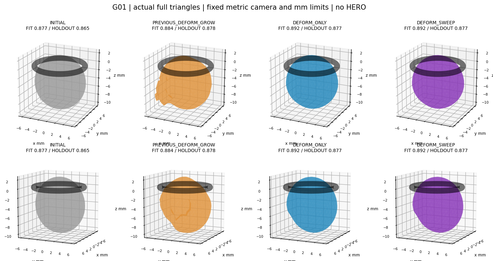

# TASK-E4-STRUCTURED-BODY-UPDATE-002

## 实测结论

完成3组×2实验臂、212项回归及独立GT评价。G01仅取得平均形状与HOLDOUT改善，GT P95从1.1510增至1.2049mm；G03未取得可靠三维改善，G05为数值停滞。没有任何Sweep通过完整接受门禁，不能宣称已恢复缺失结构。DEFORM_SWEEP没有显示超越DEFORM_ONLY的有效增益。

G01 / **DEFORM_ONLY**：接受 20/36 次更新；FIT IoU 0.87699→0.89203，HOLDOUT 0.86526→0.87679。独立 GT 双向表面 MAE 0.35100→0.33491 mm（上一轮 0.39840 mm）。实际原顶点最大位移 0.351385 mm。未接受 Sweep；不宣称恢复缺失结构。
G01 / **DEFORM_SWEEP**：接受 18/36 次更新；FIT IoU 0.87699→0.89203，HOLDOUT 0.86526→0.87679。独立 GT 双向表面 MAE 0.35100→0.33491 mm（上一轮 0.39840 mm）。实际原顶点最大位移 0.351378 mm。未接受 Sweep；不宣称恢复缺失结构。
G03 / **DEFORM_ONLY**：接受 11/36 次更新；FIT IoU 0.72548→0.72751，HOLDOUT 0.73730→0.73947。独立 GT 双向表面 MAE 1.24818→1.24873 mm（上一轮 1.24818 mm）。实际原顶点最大位移 0.081075 mm。未接受 Sweep；不宣称恢复缺失结构。
G03 / **DEFORM_SWEEP**：接受 11/36 次更新；FIT IoU 0.72548→0.72751，HOLDOUT 0.73730→0.73947。独立 GT 双向表面 MAE 1.24818→1.24873 mm（上一轮 1.24818 mm）。实际原顶点最大位移 0.081075 mm。未接受 Sweep；不宣称恢复缺失结构。
G05 / **DEFORM_ONLY**：接受 10/36 次更新；FIT IoU 0.96270→0.96271，HOLDOUT 0.96042→0.96042。独立 GT 双向表面 MAE 0.66617→0.66725 mm（上一轮 0.66435 mm）。实际原顶点最大位移 0.000049 mm。未接受 Sweep；不宣称恢复缺失结构。
G05 / **DEFORM_SWEEP**：接受 10/36 次更新；FIT IoU 0.96270→0.96271，HOLDOUT 0.96042→0.96042。独立 GT 双向表面 MAE 0.66617→0.66725 mm（上一轮 0.66435 mm）。实际原顶点最大位移 0.000049 mm。未接受 Sweep；不宣称恢复缺失结构。

二维改善、三维改善与新增结构是三个独立结论。没有因候选更接近 Mask 或曲面更漂亮而自动判定三维重建成功。所有病例使用同一参数；本轮未运行 HERO，也未重新运行 C0/误差矩阵。

## 版本与初始化一致性

|来源|完整身份|
|---|---|
|指定基线|`7c471701f38f1577ba506bc8ed1e38774f99dabe`|
|实际执行源码|`cadde3e9efc64e0925933d0a663150db9031caee`|
|历史 Init-A 015|`905e2a9b3615a5f429553837a05e5d53826cef03`|
|TASK SHA256|`20257116b2b65d8b9b4c4f4cb2ae238cfdc6484f613d4deee80f021bb0005351`|
|CODE_LOCK SHA256|`d379cbb03c82aa1309c61bd151ef67e32974f24418cb509602ff10ecab56301e`|
|Runner freeze|`79f91dc8b1dce1b2fbb39dd6ce1caa3c44616cd2d177f10013837fc7427a5e42`|

直接复用上一轮 initialize() 函数，输入为各病例真实 EXACT_013_INPUT_MESH_V_F_SOLID_CAP，不使用 E1/E2、Init-B/C 或虚拟 GT。F/F_solid/推断封盖、网格尺度和相机 OpenCV c2w mm 约定继承。各病例原生资产拓扑允许不同，但实现和规则相同。输入资产、相机缓存、Mask、划分、Ring 和旧对照均逐文件 SHA256 锁定，见 inputs/INPUT_MANIFEST.json。初始化资产和逐视角原权重见 evidence/INITIALIZATION_AUDIT.json。

## 核心几何与统一优化

**Deformation Graph**：在初始实体网格边测地距离上确定性 FPS 取32节点；每节点4近邻连接，每顶点4节点的测地权重。`v′=Σ_j w_ij [R_j(v−g_j)+g_j+t_j]`，`R_j=exp(skew(ω_j))`。优化变量为节点旋转/平移，原顶点不独立参数化。封盖资产的基底保护通过节点变换限制实现，不是重新启用自由顶点。

**Smooth ARAP**：实现 Oehri et al.2025 Eq(1)–(5) 的 cotangent Laplacian、mixed Voronoi 顶点面积、triangle spokes-and-rims 邻域及 proper-SVD 局部旋转。`E_ARAP=Σ_vΣ_e∈N_v cot(e)/3 ||e′−R_v e||²`；`ell=M^-1 LV`，`E_smooth=Σ_v A_v ||ell′_v−R_v ell_v||²`；两项以 λ=.7 混合。局部旋转仅由边向量拟合，固定后通过 PyTorch 更新图参数。这是 **Graph 参数化的 Smooth ARAP**，不是论文原始无约束顶点局部—全局线性求解器。参考作者代码采用平均归一面积，而本实现按论文使用原始公制面积；组合目标中 SARAP 再除以初始总面积，差异已明确记录。
[论文](https://arxiv.org/html/2501.10335v1)；[作者实现](https://github.com/oehria/smooth-arap)。参考源码审阅 SHA 在 evidence/REFERENCE_AUDIT.json。

**B-spline Sweep**：三次5控制点中心线、16截面×16角向采样，独立 softplus 半轴，Wang2008 Double Reflection RMF。原主体移除连通附着片，提取唯一边界环；第一截面共享原顶点身份，真实多边形向椭圆平滑过渡，根部法向连续损失与中心线/半轴平滑共同优化。不存在浮动球壳，也没有调用上一轮 extrude_patch() 生成正式预测。长度上限6mm、半轴 .05–3mm 全病例统一。
[RMF 原文](https://www.ag.jku.at/pubs/2007wjzl.pdf)。至少3有效 FIT、两个视频、Jacobian 奇异值比≥.02、一致性误差≤.5 才能提出生长；局部 Jacobian 最小二乘仅初始化中心线方向。不可辨识或不通过实际网格门禁的生长保留拒绝证据，不能由先验凭空确定柄长。

**Projection Gate**：复用 target_boundary()/explicit_pairs() 的双向逻辑，在适配层补上两个方向的严格 mutual NN 和可定向的外法向检查。40px 捕获、8px 切向阈值、法向 cos≥.5、三像素 Ring unknown、可见 Face/bary 均执行断言式门控。远距离 R+ 只作为结构候选，不进入形变对应。PyTorch 优化双向对应法向 Huber 与双线性 SDF 残差，真实 Mask 区域一致性作为独立硬接受条件；没有自由二维图像形变。

**接受次序**：每次候选生成真实 Mesh 后，重新渲染全部 FIT、重建 R+/R− 与 Face/bary，再检查逐视角保护、区域目标、对应覆盖、独立 Ring 门控、翻折/自交/基底/拓扑和新 FIT 目标。不能使用旧 pairs 决定接受。初始有效 IoU≥.80 的视角相对初始最多下降.01、Boundary MAE最多增加1px；回缩八级，仍失败则拒绝。所有16个 FIT 视角保留，均衡权重不变；低质量视角不独自决定生长。

**RingCollisionGate**：固定 Body 材料面重心探针和 CAD 探针，两方向有符号距离；每面7个确定性探针。重复查询与 float32 坐标 ULP 确定数值容差，已存档。原面穿透须同时不超过 current 与 initial，既有碰撞不变/减轻均可接受；新增根部按父片来源继承，其他新增面禁止新穿透。它仅为 NumPy/Open3D detached 谓词，不提供排斥 Ring 的优化梯度。该离散采样门控不等于连续碰撞的数学完备证明；自交检查独立执行。

统一目标为轮廓 + Graph + SARAP + 中心线 + 半轴 + 附着连续 + 先验。两个实验臂相同 Adam、学习率、三次内部步/外循环、八级回缩、36外循环预算。DEFORM_SWEEP 在12/24轮尝试有证据的生长；不强制执行。配置完全预先冻结，没有按病例或 GT 调参。

## 定量结果：完整固定分母

|病例|实验臂|FIT IoU|HOLDOUT IoU|GT MAE mm|GT median mm|GT p95 mm|GT max mm|覆盖@.5mm|
|---|---|---:|---:|---:|---:|---:|---:|---:|
|G01|INITIAL|0.87699|0.86526|0.35100|0.22511|1.15103|3.77184|0.86025|
|G01|PREVIOUS_DEFORM_GROW|0.88446|0.87785|0.39840|0.28451|1.07251|3.13849|0.71317|
|G01|DEFORM_ONLY|0.89203|0.87679|0.33491|0.20605|1.20487|3.77128|0.86583|
|G01|DEFORM_SWEEP|0.89203|0.87679|0.33491|0.20605|1.20487|3.77127|0.86583|
|G03|INITIAL|0.72548|0.73730|1.24818|0.45726|8.51414|13.69273|0.48142|
|G03|PREVIOUS_DEFORM_GROW|0.72548|0.73730|1.24818|0.45726|8.51413|13.69272|0.48142|
|G03|DEFORM_ONLY|0.72751|0.73947|1.24873|0.47295|8.50571|13.78251|0.47583|
|G03|DEFORM_SWEEP|0.72751|0.73947|1.24873|0.47295|8.50571|13.78251|0.47583|
|G05|INITIAL|0.96270|0.96042|0.66617|0.19259|4.04294|6.79911|0.61133|
|G05|PREVIOUS_DEFORM_GROW|0.96270|0.96042|0.66435|0.19488|4.03262|6.79994|0.62758|
|G05|DEFORM_ONLY|0.96271|0.96042|0.66725|0.19445|4.04223|6.79600|0.60942|
|G05|DEFORM_SWEEP|0.96271|0.96042|0.66725|0.19445|4.04223|6.79600|0.60942|

GT 未知真实部署经历史 best_rigid015 的尺度固定 SE(3) 多初值配准处理，矩阵和对齐后的实际 Mesh 均保存。GT 只在所有 G01/G03/G05 预测冻结后读取；对齐不回写预测、相机或 Ring。表面指标每方向固定12000面积采样并查询真实三角面，Chamfer 是双向非平方距离。没有 GT 最优缩放；同时保存未 GT 配准的世界坐标表面指标。不声称全局刚体最优已被数学认证。

全体16 FIT、原 HOLDOUT 分母分别 G01=7、G03=5、G05=4；逐视角差异与 Boundary F-score 在 PER_VIEW_METRICS.csv。不选择“好视角”降低分母。局部新增体积使用最终 Sweep Body 与相同图形变后的原拓扑 Body 的体积差，区别于整体形变体积变化；原 Runner 原始输出只读保留。

## 逐视角保护与 Ring / 几何检查

G01/DEFORM_ONLY：保护视角 16，违规 0；改善：G01_004_ref08, G01_004_ref13, G01_004_ref03, G01_v004_raw01112, G01_v004_raw00878, G01_v004_raw01086, G01_video004_004_05, G01_v004_raw01138, G01_005_raw00057, G01_video005_v005_00860, G01_video005_v005_00401, G01_video005_v005_00611, G01_v005_raw00192, G01_v005_raw00262, G01_v005_raw00721, G01_v005_raw00139；退化：无。
G01/DEFORM_SWEEP：保护视角 16，违规 0；改善：G01_004_ref08, G01_004_ref13, G01_004_ref03, G01_v004_raw01112, G01_v004_raw00878, G01_v004_raw01086, G01_video004_004_05, G01_v004_raw01138, G01_005_raw00057, G01_video005_v005_00860, G01_video005_v005_00401, G01_video005_v005_00611, G01_v005_raw00192, G01_v005_raw00262, G01_v005_raw00721, G01_v005_raw00139；退化：无。
G03/DEFORM_ONLY：保护视角 9，违规 0；改善：G03_key04_raw00554, G03_key00_raw00100, G03_key07_raw00896, G03_key02_raw00327, G03_v004_raw00426, G03_v004_raw00569, G03_v004_raw00487, G03_v004_raw00467, G03_v005_raw00070, G03_v005_raw00589, G03_v005_raw00402, G03_v005_raw00373, G03_v005_raw00561, G03_v005_raw00099, G03_v005_raw00546；退化：G03_v005_raw00474。
G03/DEFORM_SWEEP：保护视角 9，违规 0；改善：G03_key04_raw00554, G03_key00_raw00100, G03_key07_raw00896, G03_key02_raw00327, G03_v004_raw00426, G03_v004_raw00569, G03_v004_raw00487, G03_v004_raw00467, G03_v005_raw00070, G03_v005_raw00589, G03_v005_raw00402, G03_v005_raw00373, G03_v005_raw00561, G03_v005_raw00099, G03_v005_raw00546；退化：G03_v005_raw00474。
G05/DEFORM_ONLY：保护视角 16，违规 0；改善：G05_key02_raw00320, G05_v005_raw00082；退化：无。
G05/DEFORM_SWEEP：保护视角 16，违规 0；改善：G05_key02_raw00320, G05_v005_raw00082；退化：无。

## 独立刚体评价的敏感性诊断

原始尺度固定多初值 SE(3) 评价保持不变，未修改历史评价器，也未从两种指标中选择更好结果。检查发现 G05 实际最大顶点位移仅0.00004851mm，但独立对齐副本最大差异0.05777mm，主要评价数值变化不能直接当作形状变化。G03 的独立对齐解相差约122度，提示缺失结构下评价配准解/朝向不稳定。
另对全部三组、全部新臂统一增加固定 INITIAL→GT 矩阵、固定初始材料 Face/bary 和固定GT采样的只读诊断。它不替代主指标，不参与预测或模型选择。G01 在两种评价下均降低平均误差，但P95均变差；G03 微小变化的符号依赖评价配准，不能据此宣称结构改善；G05为数值停滞。见 metrics/ALIGNMENT_SENSITIVITY_DIAGNOSTIC.csv 与三组 COMMON_GT_REFERENCE 图。

|病例|臂|固定初始GT框架MAE mm|独立对齐相对旋转deg|实际顶点最大位移mm|
|---|---|---:|---:|---:|
|G01|INITIAL|0.3509995|0.0000|0.00000000|
|G01|DEFORM_ONLY|0.3357526|12.8723|0.35138543|
|G01|DEFORM_SWEEP|0.3357522|12.8723|0.35137766|
|G03|INITIAL|1.2481837|0.0000|0.00000000|
|G03|DEFORM_ONLY|1.2464152|122.1528|0.08107499|
|G03|DEFORM_SWEEP|1.2464152|122.1528|0.08107499|
|G05|INITIAL|0.6661716|0.0000|0.00000000|
|G05|DEFORM_ONLY|0.6661654|0.3322|0.00004851|
|G05|DEFORM_SWEEP|0.6661654|0.3322|0.00004851|

G01 的主评价 P95 1.1510→1.2049mm，因此只支持局部平均形状改善，不支持尾部/缺失结构恢复。G03/005 的 Ring 投影冲突及已通过多视角支持的 Sweep 自交是两类独立问题；本轮没有把后者归咎于证据不足。G05 在固定材料诊断中 MAE仅变化约0.0000062mm，不构成实质几何增益。

G01/004 原相机 Ring-CAD 对真实 Ring Mask IoU范围 0.7050–0.7980，全部保留。
G01/005 原相机 Ring-CAD 对真实 Ring Mask IoU范围 0.7268–0.8822，全部保留。
G03/004 原相机 Ring-CAD 对真实 Ring Mask IoU范围 0.7930–0.8533，全部保留。
G03/005 原相机 Ring-CAD 对真实 Ring Mask IoU范围 0.0383–0.7940，全部保留。
G05/004 原相机 Ring-CAD 对真实 Ring Mask IoU范围 0.8156–0.8700，全部保留。
G05/005 原相机 Ring-CAD 对真实 Ring Mask IoU范围 0.4915–0.8586，全部保留。

G03 的 Ring 投影冲突属于已有输入证据的不一致，未通过修改相机或删除难视角解决；其错误对应被局部可见性、unknown、法向、双向/切向阈值限制。主体对轮廓拟合能力受这类冲突制约，不能把这种残差全解释为缺失柄部。Ring 穿透最大深度、面积、面积加权能量和几何自交/三角面质量详见四张主要 CSV 与 STRUCTURED_QUALITY_METRICS.csv。

## 生长与失败证据

**G01/DEFORM_ONLY**：{"case": "G01", "arm": "DEFORM_ONLY", "accepted": false, "length_mm": 0.0, "net_sweep_added_volume_mm3": 0.0, "status": "No accepted sweep; no stalk length inferred", "attempts": [], "candidate_trials": []}
**G01/DEFORM_SWEEP**：{"case": "G01", "arm": "DEFORM_SWEEP", "accepted": false, "length_mm": 0.0, "net_sweep_added_volume_mm3": 0.0, "status": "No accepted sweep; no stalk length inferred", "attempts": [{"iteration": 12, "status": "SWEEP_GATES_REJECTED", "support_rows": 459, "eligible_patches": 25, "candidate_support": [{"seed": 54, "support_views": ["G01_004_ref03", "G01_004_ref08", "G01_004_ref13", "G01_005_raw00057", "G01_v004_raw00878", "G01_v004_raw01086", "G01_v004_raw01112", "G01_v004_raw01138", "G01_v005_raw00139", "G01_v005_raw00192", "G01_v005_raw00262", "G01_video004_004_05", "G01_video005_v005_00401", "G01_video005_v005_00611"], "support_videos": ["004", "005"], "singular_ratio": 0.26573663341118, "inconsistency": 0.08701277693364298}, {"seed": 210, "support_views": ["G01_004_ref03", "G01_004_ref08", "G01_004_ref13", "G01_005_raw00057", "G01_v004_raw00878", "G01_v004_raw01086", "G01_v004_raw01112", "G01_v004_raw01138", "G01_v005_raw00139", "G01_v005_raw00192", "G01_v005_raw00262", "G01_v005_raw00721", "G01_video004_004_05", "G01_video005_v005_00401", "G01_video005_v005_00611"], "support_videos": ["004", "005"], "singular_ratio": 0.26493924965715643, "inconsistency": 0.12180224984592111}], "seed_rejections": {"INSUFFICIENT_MULTIVIEW_SUPPORT": 1}}, {"iteration": 24, "status": "SWEEP_GATES_REJECTED", "support_rows": 459, "eligible_patches": 25, "candidate_support": [{"seed": 54, "support_views": ["G01_004_ref03", "G01_004_ref08", "G01_004_ref13", "G01_005_raw00057", "G01_v004_raw00878", "G01_v004_raw01086", "G01_v004_raw01112", "G01_v004_raw01138", "G01_v005_raw00139", "G01_v005_raw00192", "G01_v005_raw00262", "G01_video004_004_05", "G01_video005_v005_00401", "G01_video005_v005_00611"], "support_videos": ["004", "005"], "singular_ratio": 0.2657366473720312, "inconsistency": 0.08701275336378031}, {"seed": 210, "support_views": ["G01_004_ref03", "G01_004_ref08", "G01_004_ref13", "G01_005_raw00057", "G01_v004_raw00878", "G01_v004_raw01086", "G01_v004_raw01112", "G01_v004_raw01138", "G01_v005_raw00139", "G01_v005_raw00192", "G01_v005_raw00262", "G01_v005_raw00721", "G01_video004_004_05", "G01_video005_v005_00401", "G01_video005_v005_00611"], "support_videos": ["004", "005"], "singular_ratio": 0.26493926143115715, "inconsistency": 0.12180224405470949}], "seed_rejections": {"INSUFFICIENT_MULTIVIEW_SUPPORT": 1}}], "candidate_trials": [{"iteration": 12, "status": "SWEEP_GATES_REJECTED", "reasons": ["FRESH_FIT_OBJECTIVE", "SELF_INTERSECTION"], "first_candidate_geometry": {"self_intersections": 30, "watertight": true, "winding": true, "min_double_area_mm2": 0.012213330787442779, "min_original_area_ratio": 0.8978388143195913, "volume_mm3": 846.5104607401637, "referenced_vertices": 876, "all_vertices": 883, "original_displacement_MAE_mm": 0.1189182809754385, "original_displacement_max_mm": 0.40844798351347195}, "evidence": "/home/liu/ring_first_3d_structured_body_002/experiments/TASK-E4-STRUCTURED-BODY-UPDATE-002/runs/G01/DEFORM_SWEEP/STEP_012.json"}, {"iteration": 24, "status": "SWEEP_GATES_REJECTED", "reasons": ["FRESH_FIT_OBJECTIVE", "SELF_INTERSECTION"], "first_candidate_geometry": {"self_intersections": 30, "watertight": true, "winding": true, "min_double_area_mm2": 0.011879165174457931, "min_original_area_ratio": 0.9007178138447209, "volume_mm3": 846.2989422485797, "referenced_vertices": 876, "all_vertices": 883, "original_displacement_MAE_mm": 0.11999995358307217, "original_displacement_max_mm": 0.40807617827788295}, "evidence": "/home/liu/ring_first_3d_structured_body_002/experiments/TASK-E4-STRUCTURED-BODY-UPDATE-002/runs/G01/DEFORM_SWEEP/STEP_024.json"}]}
**G03/DEFORM_ONLY**：{"case": "G03", "arm": "DEFORM_ONLY", "accepted": false, "length_mm": 0.0, "net_sweep_added_volume_mm3": 0.0, "status": "No accepted sweep; no stalk length inferred", "attempts": [], "candidate_trials": []}
**G03/DEFORM_SWEEP**：{"case": "G03", "arm": "DEFORM_SWEEP", "accepted": false, "length_mm": 0.0, "net_sweep_added_volume_mm3": 0.0, "status": "No accepted sweep; no stalk length inferred", "attempts": [{"iteration": 12, "status": "SWEEP_GATES_REJECTED", "support_rows": 561, "eligible_patches": 6, "candidate_support": [{"seed": 544, "support_views": ["G03_key00_raw00100", "G03_key02_raw00327", "G03_key04_raw00554", "G03_key07_raw00896", "G03_v004_raw00426", "G03_v004_raw00467", "G03_v004_raw00487", "G03_v004_raw00569", "G03_v005_raw00070", "G03_v005_raw00099"], "support_videos": ["004", "005"], "singular_ratio": 0.1984285349262473, "inconsistency": 0.10467431454431649}, {"seed": 535, "support_views": ["G03_key00_raw00100", "G03_key02_raw00327", "G03_key04_raw00554", "G03_key07_raw00896", "G03_v004_raw00426", "G03_v004_raw00467", "G03_v004_raw00487", "G03_v004_raw00569", "G03_v005_raw00070", "G03_v005_raw00099"], "support_videos": ["004", "005"], "singular_ratio": 0.2005825779927456, "inconsistency": 0.1059708241178548}], "seed_rejections": {"INSUFFICIENT_MULTIVIEW_SUPPORT": 67}}, {"iteration": 24, "status": "SWEEP_GATES_REJECTED", "support_rows": 561, "eligible_patches": 6, "candidate_support": [{"seed": 544, "support_views": ["G03_key00_raw00100", "G03_key02_raw00327", "G03_key04_raw00554", "G03_key07_raw00896", "G03_v004_raw00426", "G03_v004_raw00467", "G03_v004_raw00487", "G03_v004_raw00569", "G03_v005_raw00070", "G03_v005_raw00099"], "support_videos": ["004", "005"], "singular_ratio": 0.19842853492674034, "inconsistency": 0.104674314571592}, {"seed": 535, "support_views": ["G03_key00_raw00100", "G03_key02_raw00327", "G03_key04_raw00554", "G03_key07_raw00896", "G03_v004_raw00426", "G03_v004_raw00467", "G03_v004_raw00487", "G03_v004_raw00569", "G03_v005_raw00070", "G03_v005_raw00099"], "support_videos": ["004", "005"], "singular_ratio": 0.2005825779926217, "inconsistency": 0.10597082414556093}], "seed_rejections": {"INSUFFICIENT_MULTIVIEW_SUPPORT": 67}}], "candidate_trials": [{"iteration": 12, "status": "SWEEP_GATES_REJECTED", "reasons": ["CORRESPONDENCE_COVERAGE_COLLAPSE", "FRESH_FIT_OBJECTIVE", "SELF_INTERSECTION"], "first_candidate_geometry": {"self_intersections": 37, "watertight": true, "winding": true, "min_double_area_mm2": 0.06677599664802526, "min_original_area_ratio": 0.9212954251297951, "volume_mm3": 3515.269609919191, "referenced_vertices": 876, "all_vertices": 883, "original_displacement_MAE_mm": 0.06045787818201666, "original_displacement_max_mm": 0.1561594446809942}, "evidence": "/home/liu/ring_first_3d_structured_body_002/experiments/TASK-E4-STRUCTURED-BODY-UPDATE-002/runs/G03/DEFORM_SWEEP/STEP_012.json"}, {"iteration": 24, "status": "SWEEP_GATES_REJECTED", "reasons": ["CORRESPONDENCE_COVERAGE_COLLAPSE", "FRESH_FIT_OBJECTIVE", "SELF_INTERSECTION"], "first_candidate_geometry": {"self_intersections": 37, "watertight": true, "winding": true, "min_double_area_mm2": 0.06675225930696346, "min_original_area_ratio": 0.918666474935967, "volume_mm3": 3515.818211992273, "referenced_vertices": 876, "all_vertices": 883, "original_displacement_MAE_mm": 0.06045449864074891, "original_displacement_max_mm": 0.15631089211736657}, "evidence": "/home/liu/ring_first_3d_structured_body_002/experiments/TASK-E4-STRUCTURED-BODY-UPDATE-002/runs/G03/DEFORM_SWEEP/STEP_024.json"}]}
**G05/DEFORM_ONLY**：{"case": "G05", "arm": "DEFORM_ONLY", "accepted": false, "length_mm": 0.0, "net_sweep_added_volume_mm3": 0.0, "status": "No accepted sweep; no stalk length inferred", "attempts": [], "candidate_trials": []}
**G05/DEFORM_SWEEP**：{"case": "G05", "arm": "DEFORM_SWEEP", "accepted": false, "length_mm": 0.0, "net_sweep_added_volume_mm3": 0.0, "status": "No accepted sweep; no stalk length inferred", "attempts": [{"iteration": 12, "status": "UNDERCONSTRAINED_GROWTH", "support_rows": 114, "eligible_patches": 0, "candidate_support": [], "seed_rejections": {"INSUFFICIENT_MULTIVIEW_SUPPORT": 11, "FROZEN_BASE_ATTACHMENT": 8}}, {"iteration": 24, "status": "UNDERCONSTRAINED_GROWTH", "support_rows": 114, "eligible_patches": 0, "candidate_support": [], "seed_rejections": {"INSUFFICIENT_MULTIVIEW_SUPPORT": 11, "FROZEN_BASE_ATTACHMENT": 8}}], "candidate_trials": [{"iteration": 12, "status": "UNDERCONSTRAINED_GROWTH", "reasons": ["FRESH_FIT_OBJECTIVE", "RING_COLLISION_WORSENING"], "first_candidate_geometry": {"self_intersections": 0, "watertight": true, "winding": true, "min_double_area_mm2": 0.0683787674401246, "min_original_area_ratio": 0.9999564753932125, "volume_mm3": 952.0138107326987, "referenced_vertices": 578, "all_vertices": 578, "original_displacement_MAE_mm": 7.00031059726864e-05, "original_displacement_max_mm": 0.00017149424630555268}, "evidence": "/home/liu/ring_first_3d_structured_body_002/experiments/TASK-E4-STRUCTURED-BODY-UPDATE-002/runs/G05/DEFORM_SWEEP/STEP_012.json"}, {"iteration": 24, "status": "UNDERCONSTRAINED_GROWTH", "reasons": ["FRESH_FIT_OBJECTIVE"], "first_candidate_geometry": {"self_intersections": 0, "watertight": true, "winding": true, "min_double_area_mm2": 0.06837867637227361, "min_original_area_ratio": 0.9999874902426923, "volume_mm3": 951.9951953427467, "referenced_vertices": 578, "all_vertices": 578, "original_displacement_MAE_mm": 2.014893058659966e-05, "original_displacement_max_mm": 4.948008119031119e-05}, "evidence": "/home/liu/ring_first_3d_structured_body_002/experiments/TASK-E4-STRUCTURED-BODY-UPDATE-002/runs/G05/DEFORM_SWEEP/STEP_024.json"}]}

所有科学负结果保留为候选记录，不自动晋升永久规则。一次工程错误为延迟可视化导入的别名语法问题：PILOT_001 在 GT 读取前主动终止，完整中间结果、配置/源码冻结保留；修复后增加全部模块语法回归和明确标注的球体出图夹具检查，PILOT_002 从相同 Initial 完整重跑，未采用旧预测。fixture 图不进入科研交付。参数与输入 manifest 相等证明见 evidence/PILOT001_STOP.json。另一次正式执行前 SOURCE_LOCK 绑定拒绝已保留，修正为实际执行工作树的同字节锁。

## 测试与人工审阅入口

正式 Runner：212 项测试，原始 baseline 35 项，failures=0，errors=0。包含 Graph identity/刚体、SARAP 刚体不变性/高阶项、RMF 正交连续与非平凡梯度、Sweep 共享根拓扑和独立半轴/中心线有限差分、Ring四种必测情形、错误/远距离对应拒绝、候选重渲染与逐视角保护。实际三组投影损失的非零三维节点梯度亦已验证。没有安装新依赖或创建环境。

- [本地离线首页](visualization/index.html)：全部 FIT 对应、真实 Mesh、切面、Graph、Ring 和生长拒绝证据。
- [G03 主体](visualization/figures/G03_BODY.png)、[G03 原相机 Ring 投影冲突](visualization/figures/G03_RING_PROJECTION_AUDIT.png)。
- [指标](metrics/BODY_METRICS.csv)、[逐视角](metrics/PER_VIEW_METRICS.csv)、[几何](metrics/GEOMETRY_METRICS.csv)、[Ring](metrics/RING_COLLISION_METRICS.csv)。
- [Failure Registry](FAILURE_REGISTRY.json)、[预测后 GT 首次访问](evidence/GT_FIRST_ACCESS.json)。
- runs/G01、runs/G03、runs/G05 指向只读有效阶段，含 INITIAL/早中期/FINAL、Graph 参数、全部 Face/bary、实际拒绝 Sweep Mesh。

## 固定审计表

|审计项目|必须汇报|
|---|---|
|目标组数|3物理组；每实验臂3组；总计6独立预测|
|本算法独立成功|6/6数值输出；不等于三维改善成功|
|本算法失败|失败臂保留NaN；不接受生长/无GT增益均保留科学负结果|
|历史测量值回退|0；上一轮仅评价对照，不参与本轮预测|
|失败组及具体原因|逐组见 Failure Registry、UPDATES、Sweep和全部对应图|
|最终统计样本|每臂完整3组分母；表中MAE/median/p95/max；同组配对；不做直径测量，直径相对误差N/A|
|是否使用GT选择算法|否；TASK/源码/输入预冻结，所有预测完成才开启GT评价；固定final36，无GT模型选择|

本轮结束于主体研究。是否进入 HERO，应由三维改善、HOLDOUT 和几何证据共同人工判断；本轮没有擅自继续。

## 最终交付复核

Policy Runner状态为 ACCEPTED_ENGINEERING，科学结论仍待人工审阅。6个最终预测SHA256与GT读取前冻结记录完全一致；82个受保护视角×实验臂无违规；6个最终网格均闭合、定向一致且自交数为0。Ring两方向固定探针的穿透增量均不超过各组预先冻结的数值容差；G05存在容差内的微小增量，不能表述为精确零增加。

新增Sweep根部的Ring继承阈值使用父附着面片的最大穿透，属于区域上界近似，而非逐点材料传输；根部之外阈值为零。本轮没有接受任何新增面，因此最终预测的非恶化结论不依赖该近似。根部碰撞的更细材料对应仍需后续验证。

正式Run累计4761.50秒，逻辑产物438479840字节，均在冻结预算内。离线首页包含144张真实数据图。全部最终Face/bary对应、Graph终态、早中期Mesh及被拒绝的实际Sweep网格另存review_assets便于审阅；完整原始逐步轨迹保留在runs/PILOT_002。

中文报告、固定初始GT框架敏感性诊断和补充三角面切图均为Runner验收后的只读派生审阅文件，源码位于review_code；它们没有回写预测、冻结文件或历史结果。工程出图/打包故障与修复一并记录在Failure Registry，打包曾因目标目录缺失失败，创建目录并验证相同文件后恢复。最终核验记录见evidence/FINAL_PATH_VERIFICATION.json，Runner原验收见evidence/CLI_ACCEPT.json。
