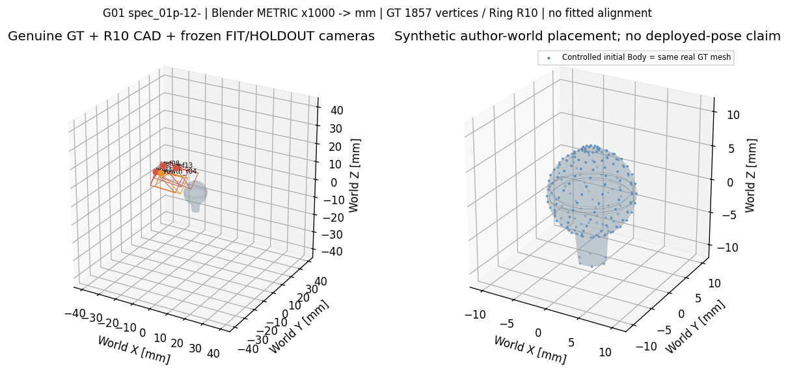
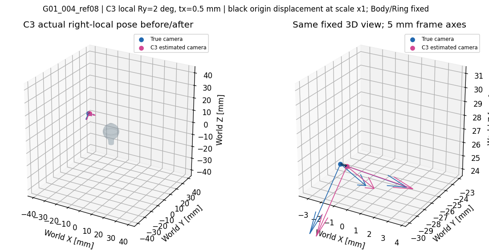
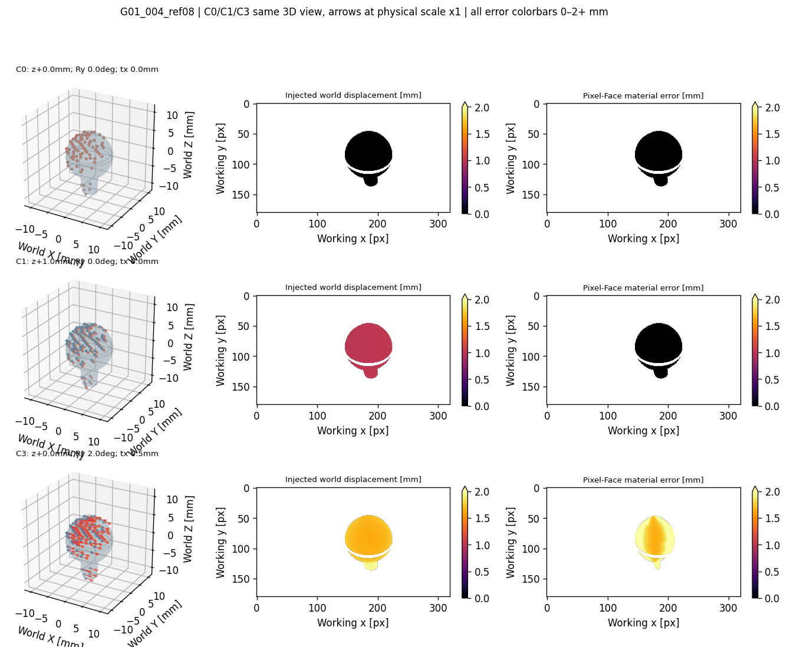
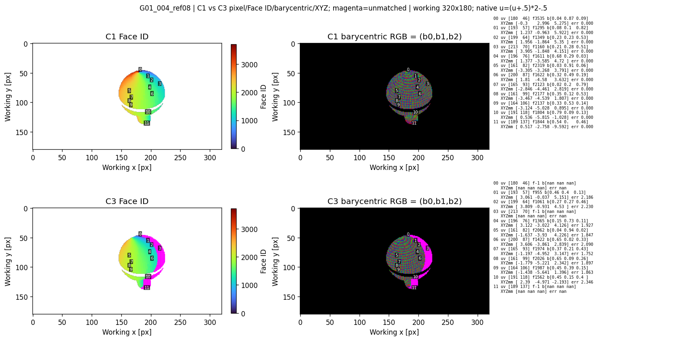
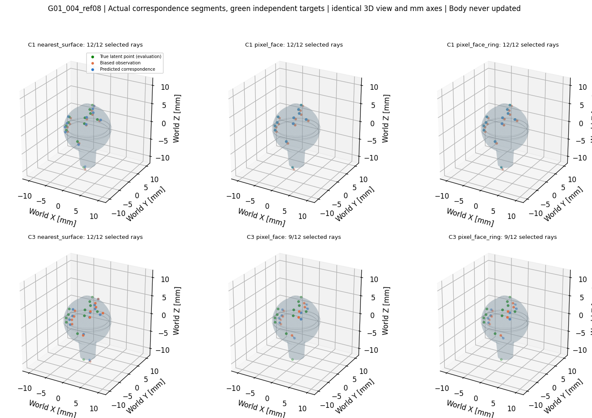
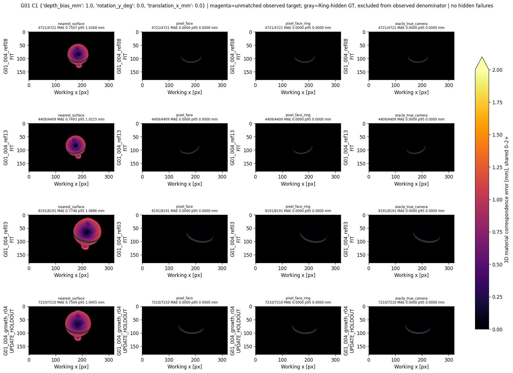
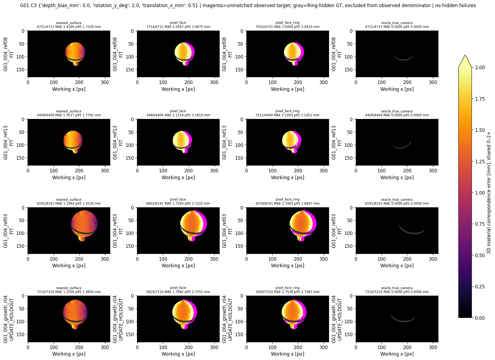
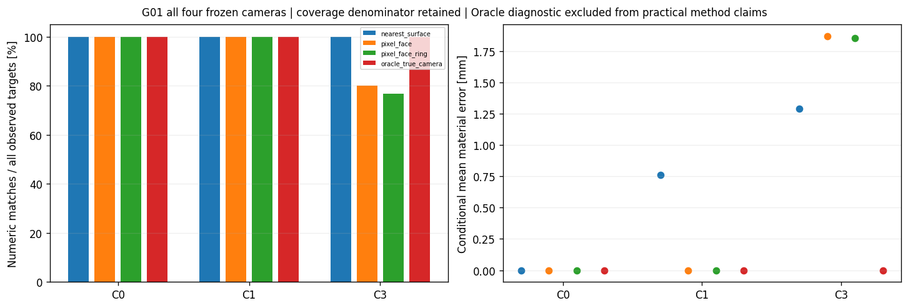

# TASK-E4-SYNTHETIC-BODY-PIXEL-CORRESPONDENCE-001 · G0–G1

本轮增量注册 G0–G1，使用真实 G01 Blender、R10 CAD 和三 FIT/一 HOLDOUT 相机。原35项及新增15项测试、最小C0和14阶段验收通过。每条件24,531观察点。C1轴向深度+1mm时，最近面MAE为0.760325mm，像素对应约2.45e-6mm；C3位姿扰动下，像素对应MAE为1.869378mm、覆盖80.0008%，Ring后覆盖76.6459%，最大误差8.460369mm。初始Body为真实GT的已知受控副本，不是独立重建。Body更新、HERO训练和BA均为0。九张实际数据图、失败NaN和离线首页已交付。G1完成后停止，等待人工审阅。

## G0：来源、坐标与权限冻结

基线分支 `exp/TASK-RESEARCH-POLICY-BOOTSTRAP-001`；基线 commit `fc63df356a577c61de75912b136f92d7f7b15e9d`。执行源码提交 `7c31af7a185f63fd58182eaffc36316cf49d2e73`，最终对应字节在 [TEST_RESULTS.json](TEST_RESULTS.json) 逐文件核验。参数/来源/版本指纹：`ce521c1f3670ece2db87c9bcf15b3100181af78943d587bf55f93faa11a961b2`。唯一正式统计来源为本任务 `runs/delivery-001`，其余开发/试运行不混入统计。

| 项目 | 核验事实 |
| --- | --- |
| 原始 G01 | `/home/liu/polyp_research/01p型/01p-12-/息肉.blend`，物理身份 spec_01p-12-，对象“球体” |
| Blender SHA256 | fb448629ee17dce682632f886f714472e4df1d43825092fbf604415c6511de5a |
| 登记 GT mesh SHA256 | 315d9acefab13acb340d6d3469d794cda06af229cf4705f1a528fbee9c01e183 |
| 现场导出 | Blender 5.0.1 禁用 autoexec；复用原 export_blender_gt.py 数学 AST；1,857 顶点、3,710 三角面，现场 V/F 与登记导出在 1e-10 mm/精确面索引下相同 |
| 公制尺度 | 原 Blender METRIC、scale_length=1 m、evaluated world transform 后 ×1000 到 mm；没有按“12 mm”文件名、历史直径或预测缩放 |
| Ring CAD | 冻结 R10，内径约 10 mm、外径约 12.4 mm、线径约 1.2 mm；32,768 原始三角面用于遮挡计算 |
| 相机 | 原冻结 004 视频相机；本合成实验将其作为已知真相机，不认证真实部署准确性 |
| 图像契约 | 640×360 → 320×180，K 使用半像素传输；P3D raster center 另补 +0.5；OpenCV c2w、mm、axial Z |
| GT placement | canonical_from_blender=I，明确的作者原生合成坐标；没有 GT→旧预测配准，不能宣称真实息肉部署位姿已标定 |
| 受控初始 Body | G01 GT 网格的精确公开副本，专门隔离对应关系机制；不是 GT-free 初始化，也不是新重建成果 |

完整相机矩阵、输入 SHA、FIT/HOLDOUT、CAD/Blender/代码和条件见 [G0_SOURCE_CAMERA_PROTOCOL_FREEZE.json](G0_SOURCE_CAMERA_PROTOCOL_FREEZE.json) 与 [TASK.yaml](TASK.yaml)。核验的登记来源为 233 个原 Harness 资产加 7 个真实科学来源，共 240 项，未用临时椭球或演示模型替代 G01。

相机固定为：FIT `G01_004_ref08`、`G01_004_ref13`、`G01_004_ref03`；HOLDOUT `G01_004_growth_r04`。可见观测分母分别为 4,721、4,409、8,191、7,210。四个视角相关，不能当四个独立物理组。每条件总目标 24,531 点；三条件共 73,593 点次，不是 73,593 个独立病例。

角色边界如下：generator 独占真实 GT/真相机并完成误差注入；公开包仅含固定 Body/CAD、受扰深度、受扰相机与观测像素，不含干净 T、真深度或材料 GT。predictor 的方法只收公开包，Python I/O 门禁拒绝 private、原 GT、原始相机缓存及已存在的评价目录。evaluator 在每个条件的 `PREDICTIONS_FROZEN.json` SHA 冻结后，才读私有真点/真相机进行独立评价和 Oracle 诊断。所有条件的 Body SHA 相同，Body 更新数 **0**。

原 schema 1 的无 GT 契约和 35 项回归不变；本任务使用 schema 2、S01–S05 注册角色。阶段有序，前置失败即停止，不存在强制通过选项。授权到 G1，未注册 G2/主体优化入口。

## 执行与注入验证

原 35 项加新增 15 项，合计 **50/50** 测试通过；在执行 worker 门禁下再次通过同一 50 项后，才现场导出真实 G01 和运行最小 C0 Smoke。正式运行 14/14 阶段 PASS，累计阶段耗时约 **58.34 s**，预算 1200 s、单阶段 180 s、最多两次尝试/阶段、250 MB 输出上限。完整日志见 [REGRESSION_TEST_LOG.txt](REGRESSION_TEST_LOG.txt) 和 [TEST_RESULTS.json](TEST_RESULTS.json)。

| 条件 | 冻结设置 | 独立核验 |
| --- | --- | --- |
| C0 | 无偏移、无旋转、无平移 | 三个实用方法 100% 输出；对应点误差 max≤0.000131 mm；非精确零是数值误差 |
| C1 | 每个相机的 axial Z +1 mm，保持同一像素射线 | 真相机系 Z 增量约 1 mm；斜射线世界位移长度可大于 1 mm，不能当成 range+1 或同一个世界 Z 向量 |
| C3 | c2w 右乘局部 Ry=2°，局部 tx=0.5 mm | 独立 SE(3) 相对变换与世界点构造复算；不是左乘世界旋转或错误 w2c |

注入器的声明字段不直接作为验收依据：evaluator 独立使用真点、真相机和 Rotation 复算，所有视角/条件最大差 **9.43e-5 mm**。G0 的独立 Open3D 真射线与 T24 契约适配的硬栅格，在共同像素上的深度差最大 **0.000126224 mm**，小于预冻 0.001 mm。最小 C0 Smoke 是 ref08 的 4,721 个真实网格观测点，不是演示平面。

观测分母来自全图独立射线，先判 Body/Ring 首次交点；不是按实用方法命中与否删目标。共享三角边界的硬栅格未命中在新增单位测试中显式保留，不能悄悄回填。当前真实 C0 四视角没有此类未匹配点；C3 的所有未匹配仍保留 NaN、Face ID=-1。

## G1：对应指标

真值为合成观测对应的原始 G01 材料点 `P_true`；误差为 `||Q_method - P_true||`，**不是 Q 到已知 Body 表面的最近距离**。后者会因 Q 本来就在模板上而给出虚假的零误差。相对误差使用真 axial depth 归一化，非息肉直径相对误差。

| 条件 | 方法 | 数值输出/24,531 | 覆盖率 | 误差中位数 mm | MAE mm | p95 mm | 最大 mm | 中位相对误差 d/z |
| --- | --- | ---: | ---: | ---: | ---: | ---: | ---: | ---: |
| C0 | 最近三角面 | 24,531 | 100% | 1.00e-6 | 1.56e-6 | 4.14e-6 | 0.000112 | 3.52e-8 |
| C0 | Pixel-to-Face | 24,531 | 100% | 1.66e-6 | 2.45e-6 | 6.80e-6 | 0.000130 | 5.80e-8 |
| C0 | Pixel + Ring | 24,531 | 100% | 1.66e-6 | 2.45e-6 | 6.80e-6 | 0.000130 | 5.80e-8 |
| C1 | 最近三角面 | 24,531 | 100% | 0.811568 | 0.760325 | 1.053346 | 1.612121 | 0.026736 |
| C1 | Pixel-to-Face | 24,531 | 100% | 1.66e-6 | 2.45e-6 | 6.80e-6 | 0.000130 | 5.80e-8 |
| C1 | Pixel + Ring | 24,531 | 100% | 1.66e-6 | 2.45e-6 | 6.80e-6 | 0.000130 | 5.80e-8 |
| C3 | 最近三角面 | 24,531 | 100% | 1.330896 | 1.290998 | 1.698576 | 2.467838 | 0.047453 |
| C3 | Pixel-to-Face | 19,625 | 80.0008% | 1.720892 | 1.869378 | 2.903907 | 8.460369 | 0.058885 |
| C3 | Pixel + Ring | 18,802 | 76.6459% | 1.711407 | 1.854651 | 2.868216 | 8.460369 | 0.058607 |

独立 Oracle 是 evaluator 专用的**真相机/潜在 GT 材料 Face ID + barycentric 点位**诊断，并另做真相机射线深度核验；三条件均 24,531/24,531，材料点误差按构造为零。它不参与实用方法预测或方法选择，也不是可部署算法/重建的零误差证明。

数值输出成功与对应正确不同：以预实现的 0.1 mm 校准诊断阈值（非临床门槛）计，C1 最近面只有 **127/24,531** 点在阈值内，两个像素方法为 24,531/24,531；C3 三个实用方法均 **0/24,531** 点在阈值内。不能用 NN 的 100% 数值覆盖率宣称它正确，也不能用 Pixel/Ring 只在成功子集上的均值掩盖失败。

完整逐帧表见 [PER_VIEW_METRICS.csv](PER_VIEW_METRICS.csv)，全点数值重算见 [AGGREGATE_METRICS.json](AGGREGATE_METRICS.json)。没有历史融合对照参与预测，也没有历史测量回退。

### 共同成功点配对

C3 在 Pixel 的 19,625 个共同成功点上，Pixel 相对最近面每视角 MAE 增量分别为 **+0.544991、+0.570591、+0.457696、+0.478186 mm**，不是由覆盖分母不同造成的假象。Ring 在其 18,802 个共同成功点上与原 Pixel 的预测点完全相同，配对误差增量每视角均 **0**；它只过滤了额外 823 个对应，没有修正任何位置。

因此，Ring 后条件 MAE 从 1.869378 降至 1.854651 mm 是选出不同子集的效果，不能说“Ring 已修好相机/对应”。配对分母、差值见 [PAIRED_COMPARISON.csv](PAIRED_COMPARISON.csv)。

### 失败逐视角追溯

| G01 / 004 来源 | C3 Pixel 无数值对应 | C3 Pixel+Ring 无数值对应 | 新增 CAD 拒绝 | 证据与步骤 |
| --- | ---: | ---: | ---: | --- |
| ref08 / FIT | 1,007 / 4,721 | 1,169 / 4,721 | 162 | 受扰相机下硬栅格 Face=-1；或有效 Body 命中被 CAD 首次遮挡条件拒绝 |
| ref13 / FIT | 929 / 4,409 | 1,098 / 4,409 | 169 | 同一固定条件、同一阶段；没有据误差挑帧 |
| ref03 / FIT | 1,589 / 8,191 | 1,852 / 8,191 | 263 | 保留 NaN；与原真可见目标分母比较 |
| growth_r04 / HOLDOUT | 1,381 / 7,210 | 1,610 / 7,210 | 229 | 不用于调参；独立保留 HOLDOUT 原角色 |

这些是对应阶段的无命中/遮挡拒绝，不是用 GT 判“好坏”后删除。C3 有数值但错误的区域也完整保留，最大材料错配 **8.460369 mm**；不能只统计 NaN。详见 [FAILURE_LEDGER.md](FAILURE_LEDGER.md) 和下方洋红失败区域。

## 实际数据可视化

所有图为本轮真实 G01 网格、实际注入数据、实际对应/评价结果生成，没有用纯示意图代替；三维视角固定 `(25,-60)`，轴为 mm。CAD 绘图仅按固定 triangle stride=16 显示，计算仍用全部 32,768 面；Body 计算/绘图未平滑或优化。误差色标统一 0–2+ mm，色标上限不是统计截断，p95/max 原值在上表。

洋红为观测目标未匹配，灰色为真 Ring 遮挡下不可观察的 Body；二者不混同。图上的分割/遮挡边界不是完整息肉可见轮廓认证，更不能自动把环接触边界当成真实息肉轮廓。采样点编号对应 [PIXEL_FACE_AUDIT.csv](PIXEL_FACE_AUDIT.csv)，保留工作/原生 uv、真实 Face ID、barycentric、XYZ mm、valid、误差及 NaN。全点原始 NPZ 留在 LOCAL_ONLY 的各独立 attempt。

离线首页绝对路径：

`/home/liu/ring_first_3d_synthetic_correspondence/experiments/TASK-E4-SYNTHETIC-BODY-PIXEL-CORRESPONDENCE-001/runs/delivery-001/visualization/index.html`

该运行根目录同时有 RESULT_CARD.md、RUN_MANIFEST.json、TECHNICAL_REPORT.md、metrics.json 和 failures.json，所有必需路径、图像、CSV、阶段数据 SHA 已核验；最终运行有 14 条不可变 attempt，历史快照不覆盖。

## 科研固定审计表

| 审计项目 | 必须汇报 |
| --- | --- |
| 目标组数 | 1 个真实 G01；3 条件×4相关视角；每条件 24,531 观察像素，完整分母明确 |
| 本算法独立成功 | 三个实用对应方法均在 G01 独立产生对应，数值成功组 1/1；逐点覆盖如表，不能当独立 Body 重建成功 |
| 本算法失败 | C3 Pixel 4,906 点 NaN，Pixel+Ring 5,729 点 NaN；有数值但错误的区域亦完整保留；无新 Body 重建，不能给 Body 成功率 |
| 历史测量值回退 | 0，无 S0/V2/历史直径或其他路线测量回退 |
| 失败组及具体原因 | G01 的 C1 最近面材料错配、C3 全部实用方法失准及逐帧无命中/CAD拒绝，见本报告/FAILURE_LEDGER/实际热图 |
| 最终统计样本 | 每方法仅其独立匹配点算误差，同时给出全分母/NaN；共同成功点配对单列。4视角和像素不是独立病例 |
| 是否使用 GT 选择算法 | 否；GT用于授权的合成生成/已知受控 Body和预测冻结后的独立评价；参数/方法统一固定，没有按组/误差选择结果 |

中位绝对相对误差、MAE、p95、最大误差、独立数值覆盖和配对比较均已汇报；相对量 d/z 不冒充直径误差。GT 派生初始 Body 是本实验已知条件，不能把此对应结果推广为无 GT 真实重建准确度。

## 失败保留与结论边界

前期门禁/接口调试暴露临时测试目录清理、字体只读查询、以及提交新 visualizer attempt 后仍读取旧 current 指针的问题；均修复接口和增加/保留回归，没有改科学参数来“修好”结果。源码改变后旧冻结拒绝恢复，均另开 run，原始失败、已提交但未发布的 attempt 和图像保留。详见 [DEVELOPMENT_FAILURES.json](DEVELOPMENT_FAILURES.json)，不把这些开发运行混入正式统计。

本轮只证明：在**真实 G01 已知模板、固定 canonical pose**的受控场景，像素对应消除了保持像素不变的轴向深度偏差造成的最近面滑移；相机误姿态仍破坏 Pixel-to-Face，Ring 只提供拒绝约束，独立 Oracle 显示仍有较大可达差距。没有执行错误修正/优化，不能据图声称 Body 或真实相机已改善。

G1 已完成并停止。工程门禁通过，科学状态 **AWAITING_HUMAN_REVIEW**；不扩大扰动矩阵，不更新 Body，不运行 HERO 训练或跨视频 BA。后续是否继续由人工审阅决定。
