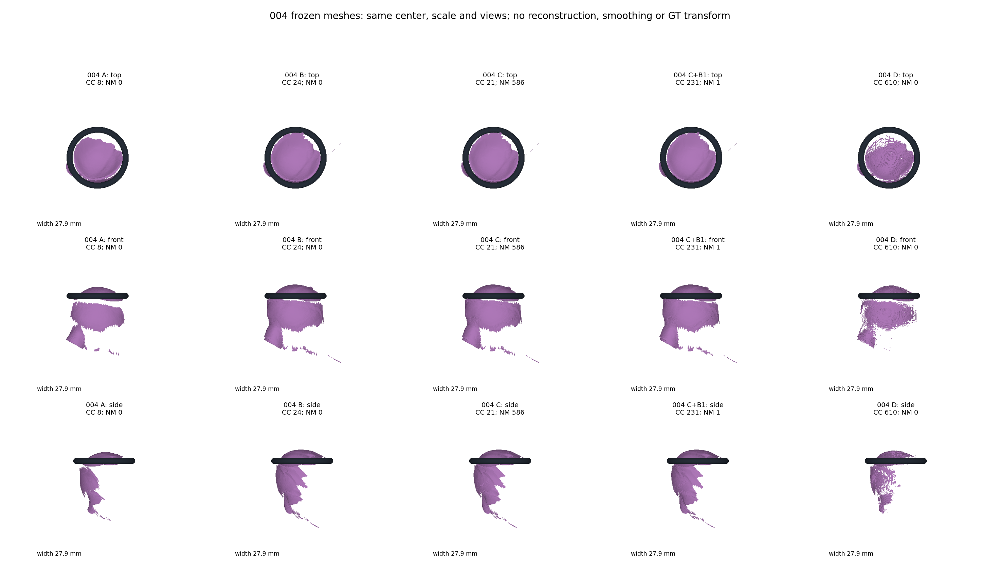
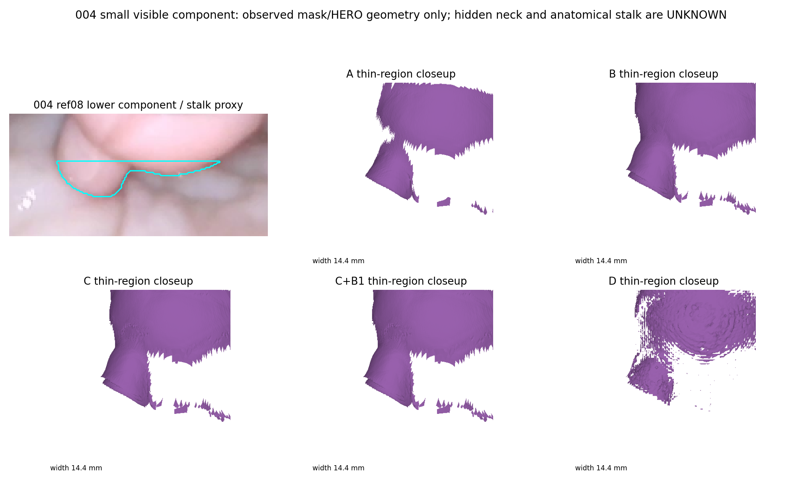
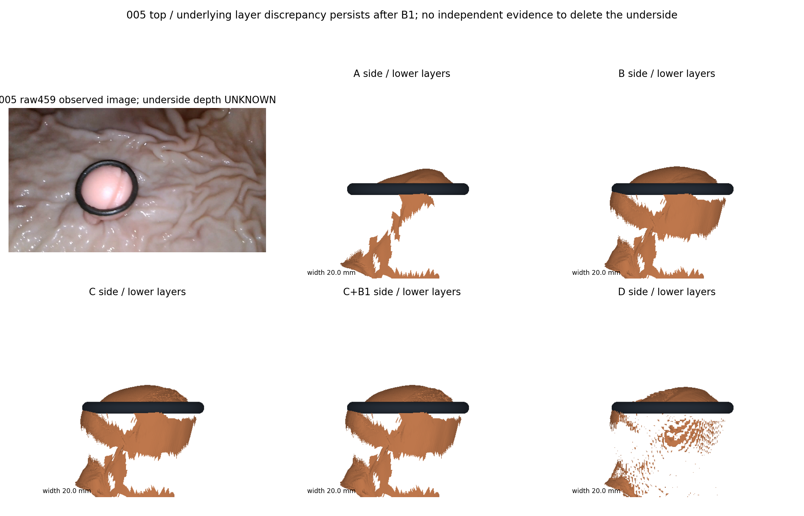
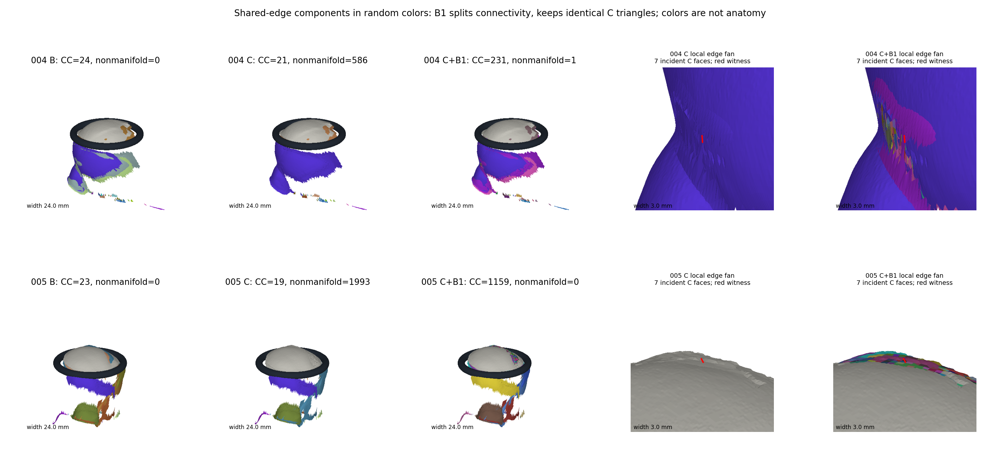

# TASK-FUSION-AUDIT-001

Status: AUDIT_COMPLETE / AWAITING_PM_REVIEW
Approved date: 2026-10-25 (Asia/Shanghai).

Scope: audit existing same-video multi-reference surface baselines and locate continuity bottlenecks. Compare historical single-reference, direct overlay, confidence fusion, conservative topology repair and TSDF separately for videos 004 and 005.

No training, new fusion implementation, camera or scale changes, cross-video registration, Hull rerun, large GT experiment or scientific baseline tag is authorized.

Publication update approved by the researcher on 2026-10-25 (Asia/Shanghai): this task record and the four selected PNG figures below are approved for public upload. Research source, videos, model weights, GLB files, full numerical tables, the full technical report and local asset manifests remain unpublished.

The approved audit is complete. One technical report, geometry and provenance checks, visual comparisons, and read-only references to existing models were produced locally under this task directory. The next-step proposal is recorded in the local report and has not been implemented. No claim of scientific acceptance is made.

Work stopped after this audit. This supplement only publishes existing visualization files; no algorithm was run, no parameter or camera was changed, and no new reconstruction was generated. Further scientific work requires an approved PM task.

## 精选四图：整体对照、细小结构与失败诊断

方法定义：A为中央单参考原始开放Mesh，B为同视频三参考直接叠加，C为历史置信融合，C+B1为既有保守拓扑修复，D为历史TSDF。004/005分别处于各自的冻结局部坐标，未跨视频配准或合并。

**GT身份：以下四图均为真实输入及冻结预测的审计图，没有GT对齐或GT修正。它们不能证明自主三维重建精度。** 原PNG按字节复制上传，未重绘、裁切、美化或隐藏失败区域；局部放大沿用已完成审计时的窗口，完整几何仍保留在本地原资产中。

**图1｜004整体对照。** 五方法按相同中心、毫米尺度及顶/正/侧视角展示。C的较大连通块不等于真实几何改善，TSDF仍有表面缺失；005的五方法同侧视对照见图3。

**图2｜004细小结构。** ref08真实RGB/Mask与五方法局部保持同视角、同尺度。青色轮廓是可观察下方Mask的细小结构代理，不是经GT认证的完整解剖蒂部；Ring后隐藏连接仍未知，不能由轮廓自动补面。TSDF的稀疏外观也不能作为过滤正确的证据。

**图3｜005顶部及下方深度层。** raw459真实RGB与五方法采用相同侧视方向和20mm显示宽度。B、C、C+B1仍保留下方片、层间空隙及深度不一致，B1没有修正这些位置。下方哪些面是真实侧面、哪些为错误深度尚缺独立证据，不能整体视为可删除噪声。

**图4｜004/005拓扑失败。** 随机颜色表示共享边的面连通分量，不代表解剖或正确性。两视频C分别有586/1993条非流形边；B1后降至1/0，但分量增至231/1159，三角面几何不变。右侧相同3mm窗口的红线标出C的7面共边位置，显示拓扑切分不能消除深度错层。

## 后续科研Task的默认可视化交付

研究者已授权：此后每个科研Task默认精选3–4张核心真实科研可视化，增量上传公开GitHub供PM和研究者独立评审。对照须保持相同视角和尺度，注明算法与视频编号，GT辅助图必须显著标记。此授权不包含完整视频、模型权重、未经授权的源码、GLB或其他完整科研资产，也不表示科研结论已被验收。
