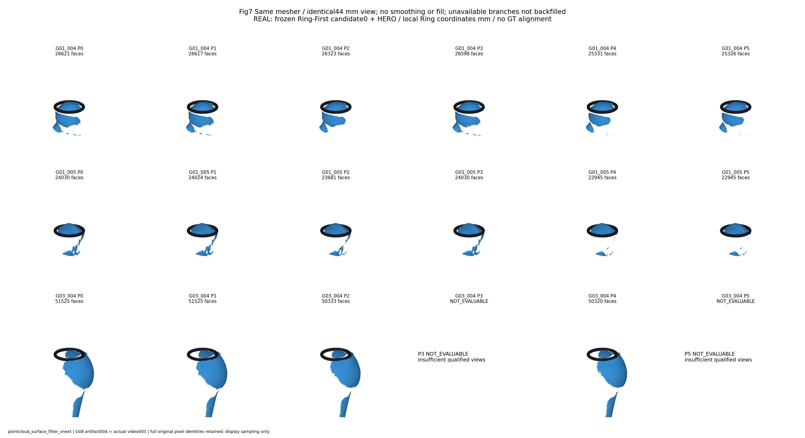
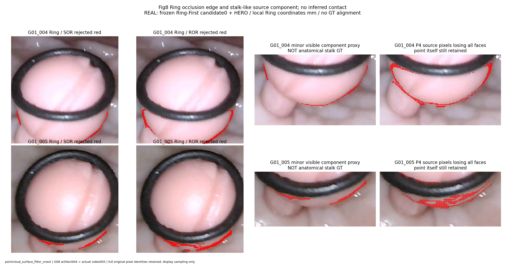
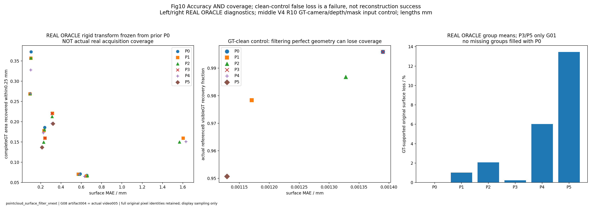
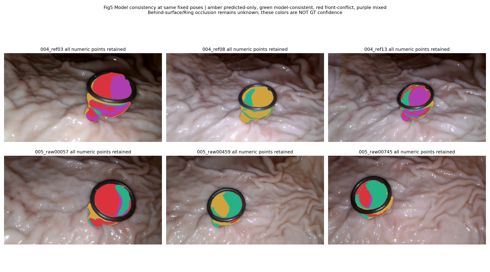

# 四张历史核心图索引

本次仅复制已有PNG；无重绘、裁剪、重新渲染或算法运行。004与005各自使用原Ring局部坐标，未完成跨视频认证。几何坐标/深度为mm；RGB像素坐标为px。

## 图1：Fig1_P0_P5_same_view.png

真实004/005/G03冻结局部预测，同44mm视域；无GT配准；失败分支保留NOT_EVALUABLE。

- 原文件：`/home/liu/polyp_research/ring_anchor_3d/experiments/pointcloud_surface_filter_vnext/visualizations/Fig7_P0_P5_surface_comparison.png`
- 来源版本：`pointcloud_surface_filter_vnext`；分辨率：3630×1980。
- SHA256（原件与上传件相同）：`c35d697b99bdb546da7a9c8ebc4702c30bf3e550e116c704536f988e818ceb38`

## 图2：Fig2_004_005_structure_loss.png

真实004/005；红点为过滤拒绝/失去全部三角面支持的源像素，不代表人工解剖蒂部GT。

- 原文件：`/home/liu/polyp_research/ring_anchor_3d/experiments/pointcloud_surface_filter_vnext/visualizations/Fig8_Ring_boundary_and_lower_regions.png`
- 来源版本：`pointcloud_surface_filter_vnext`；分辨率：3135×1650。
- SHA256（原件与上传件相同）：`952babf88f8b0efaec677d48317f93d84e6fe720e15d488bed9d0457b05d181a`

## 图3：Fig3_accuracy_coverage.png

左/右：真实形状的Oracle诊断；中：Blender GT相机/深度/Mask控制；不可冒充真实端到端精度。

- 原文件：`/home/liu/polyp_research/ring_anchor_3d/experiments/pointcloud_surface_filter_vnext/visualizations/Fig10_accuracy_coverage_false_removal.png`
- 来源版本：`pointcloud_surface_filter_vnext`；分辨率：3300×1155。
- SHA256（原件与上传件相同）：`f2f2fb5f187a678c7f55728a98d65cd53eb175a8a5d581ca59667588c15960de`

## 图4：Fig4_multireference_conflict.png

真实004/005各3参考；绿为模型自一致，红/紫为冲突；未知点保留；非GT置信度。

- 原文件：`/home/liu/polyp_research/ring_anchor_3d/experiments/independent_confidence_fusion_v1/visualizations/Fig5_consistency_and_conflict.png`
- 来源版本：`independent_confidence_fusion_v1`；分辨率：3150×1750。
- SHA256（原件与上传件相同）：`faa13d06a914312ce51cb8df92f95189a342614e80735bf7bb83b9172f52ceb5`

图1：P0原始，P1 SOR，P2 ROR，P3多视角，P4像素邻接禁面，P5=P3+P4；同视角同44mm窗口。图2红色是被排除或失去面支持的像素，不能单凭图确认哪一个是真实解剖蒂点；Oracle指标提供条件性误删证据。图3原图含明确标记的Blender控制，不能称全图均为真实拍摄。图4黄/绿/红/紫依次为仅预测/模型一致/前方冲突/混合，绿色不是独立GT认证。
