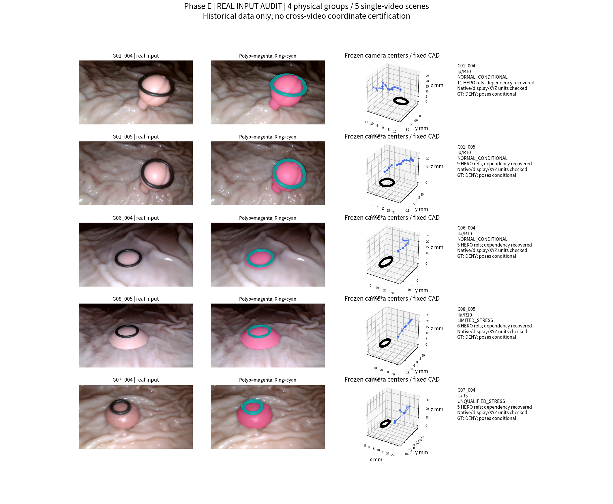
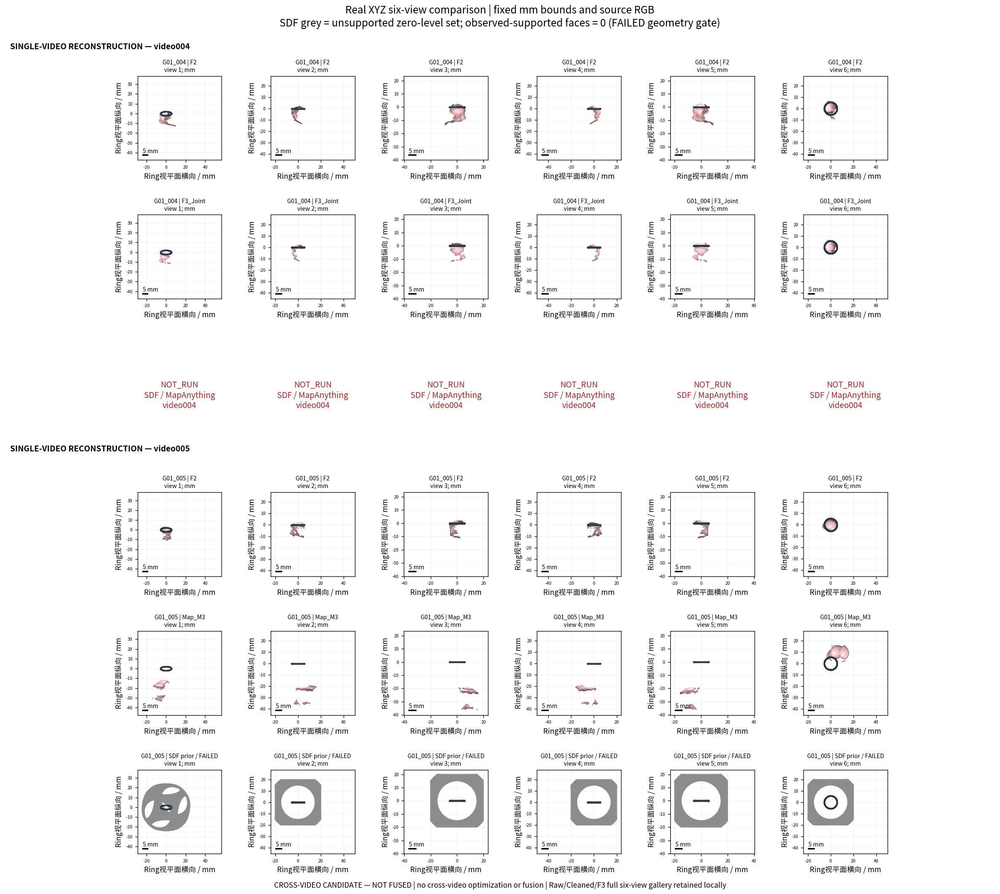
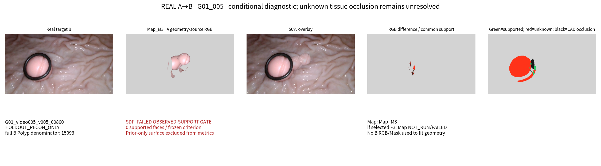
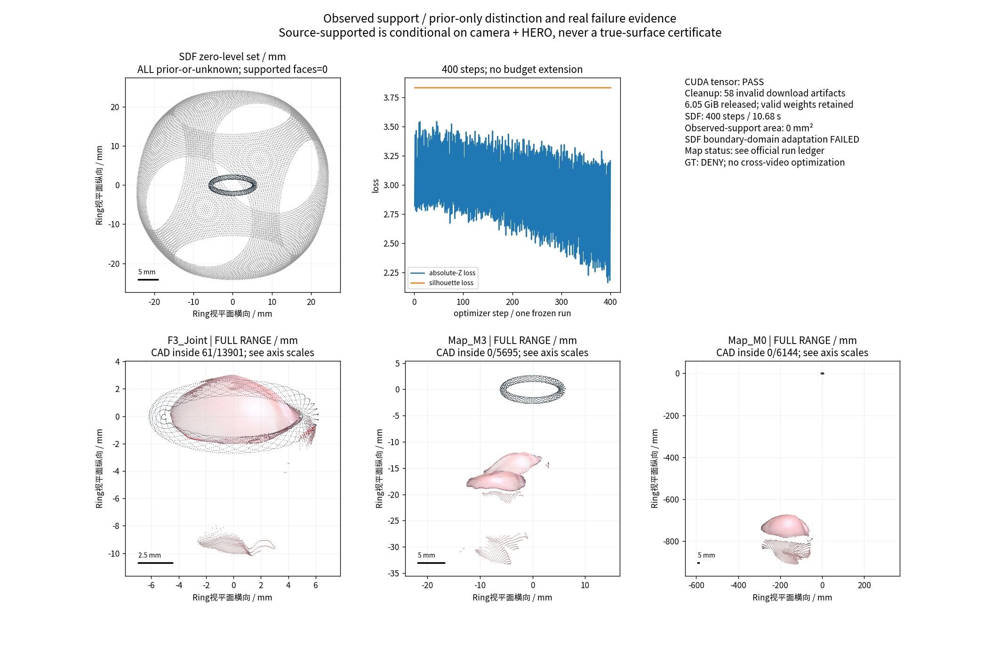

# TASK-NEURAL-E0-COMPARE-001｜Phase E 首轮有限科研执行报告

状态：**REPORTED / MINIMAL RUNS COMPLETED / NO EFFECTIVE DUAL-ARM SCIENTIFIC COMPARISON**。2026-10-30，Asia/Shanghai。等待PM独立验收与RA技术审查；没有科学赢家、没有正式baseline变更。

本轮实际完成四物理组、五视频的本地资格审计，并在G01 video005实跑官方MapAnything四种输入配置和一次MonoSDF单场景优化。36份参考的坐标契约、HERO源依赖均核清；新发现G06/G07各一张旧目标实际进入过HERO。磁盘曾满，按用户追加授权清理58份明确失效的旧下载产物，释放6.05GiB后推进真实实验。Map四配置均有数值输出，但M3在两目标的覆盖仅3.67%/16.81%，Ring公制定位仍明显偏移。SDF完成400步，却因本次适配的吸收边界域错误产生0观测支持面。结果证明有限工程调用可以完成，尚未证明重建改善；不能据此否定两种方法的一般能力，也不能宣布四组科学成功。

## 实际范围与版本

独立工作树 `/home/liu/ring_first_3d_neural_e0`；分支 `exp/TASK-NEURAL-E0-COMPARE-001`。精确来源：

|来源|commit SHA|用途|
|---|---|---|
|边界生长|`fa50f68f27fd1679276e3ac549322cda05fc4191`|任务基点、36参考、F3、CAD及历史失败|
|MASt3R分区|`4adfe3aac780bf319aebf9cdd137f42e1e0eb055`|14参考/F2、匹配、来源及相机索引|
|视角/GT资格|`432747735aad5df46df32a93f78b3c819c7797ed`|条件相机、真实重投影成熟实现|
|main|`02dee8092dce9f89d050bccca35aa51768988645`|治理与renderer；不是最新科研闭包|

已读治理、三项实验的报告/结果索引/复现及复用审计、附件初始化/E0/RA请求/任务/验收资料；SHA在[阅读与版本清单](provenance/READING_AND_SOURCE_COMMITS.json)。附件按正式路径导入；根README未覆盖。较早P0-only限制已由直接用户授权覆盖；[授权说明](AUTHORIZATION_OVERRIDE.md)、[追加清理指令](USER_STEERING.md)保留全过程。第一阶段真实提交[c4a3c39](https://github.com/zheng1524/ring-first-3d/commit/c4a3c393c885f17281d04699301b93a587f5f202)曾因资源门禁停止；追加指令后第二阶段[ba4d99a](https://github.com/zheng1524/ring-first-3d/commit/ba4d99afca06cebd3d7d1f1fd0d6625941bb4454)保存真实运行和四核心图。两阶段均核验远端；最终报告提交见本分支最新commit。

新模型只运行**G01 video005、两个输入视角**：`raw00057`、`raw00459`。P0曾为SHA/尺寸核验读取固定目标`00860`、`00611`的文件并解码RGB；全部模型输出冻结后才计算两帧RGB/Mask评价，二者未进入几何拟合。video004只复算历史基线，未运行新模型；G06/G08/G07仅做本地资格审计。没有新增HERO、MASt3R匹配、相机优化、跨视频配准/联合训练、参数网格或第二次SDF优化。

## 固定科研审计表

|审计项目|必须汇报|
|---|---|
|目标组数|P0：4独立物理组/5视频；P1实际模型预算：G01一物理组/1视频/2输入/2目标。G01两视频始终只算1病例|
|本算法独立成功|数值产物：Map 1/4审计组（1/1实跑组，4/4配置）；SDF 1/4有零水平集（1/1实跑组），但**有效观测支持面0/4、0/1实跑组**。数值输出不等于测量正确|
|本算法失败|G01：SDF适配域失败1组；Map未证明真实几何改善1组。其余3组NOT_RUN，不冒充算法失败。四组绝对物理测量均NaN/NOT_EVALUABLE|
|历史测量值回退|**0**。历史F1/F2/F3仅作评价对照；没有用其XYZ/直径补任何新模型输出。冻结HERO是明确授权的输入|
|失败组及具体原因|G01：SDF域错误、Map尺度/覆盖失败；G06：raw00351泄漏；G08：有限条件/未预冻独立留出；G07：不合格相机且raw00293泄漏。逐项见[失败台账](FAILURE_LEDGER.md)及四核心图|
|最终统计样本|新输出仅G01_005，2目标不是2病例；正常物理组审计2/4，但新模型仅1组。没有四组平均成功率或测量精度统计|
|是否使用GT选择算法|否。源/权重/配置/预测先冻结，模型loader拒绝GT/Dxy；未加载GT网格、未GT-ICP。按任务阅读过含GT结果的历史报告，故不宣称从未接触历史GT信息的严格盲测|

绝对三维测量的独立覆盖率、中位绝对相对误差、MAE、p95、最大误差及共同成功组物理误差比较：**0可认证/4审计组，全部NaN/NOT_EVALUABLE**，不是误差为0；没有真实部署GT变换。下文RGB/Mask/CAD指标不替代息肉真值精度。

## P0：真实资产、四组和留出资格

本地实存9旧P0＋5分区新增＋22边界生长新增＝**36参考**，36个不同参考RGB、47个不同HERO输入图像身份、154条输入依赖边；不能当36个独立病例。旧生长末2次CUDA失败输入单列，不补深度。依赖和SHA见[输入清单](provenance/INPUT_ELIGIBILITY.json)、[344项文件账](provenance/SOURCE_SHA_LEDGER.csv)、[HERO依赖边](provenance/HERO_DEPENDENCY_EDGES.csv)。

|组/视频|形态/条件|参考|本轮模型|留出与限制|
|---|---|---:|---|---|
|G01_004|Ip/R10，NORMAL_CONDITIONAL|11|NOT_RUN|004_15诊断；旧ref08/ref13曾被错称留出；原视频精确顺序帧身份仍未认证|
|G01_005|Ip/R10，NORMAL_CONDITIONAL|9|Map四配置＋SDF一次|00860/00611仅HOLDOUT_RECON_ONLY；未进入本轮两个模型及其输入HERO依赖|
|G06_004|IIa/R10，NORMAL_CONDITIONAL|5|NOT_RUN|raw00351确属旧HERO输入，降为诊断；raw00962可作重建级受限诊断|
|G08_005|IIa/R10，LIMITED_STRESS|6|NOT_RUN|raw00943/raw01080保留有限诊断，不事后升级为严格盲测|
|G07_004|Is/R5，UNQUALIFIED_STRESS|5|NOT_RUN|raw00293确属旧HERO输入；全部压力单列，不能计正常成功率|

从原点缓存的`source_depth_path`恢复了三份旧多组native记录：G06 sources=[0,1,2]、G07=[0,1,3]、G08=[1,0,2]。这纠正了只看display pack会“源列表缺失”的判断，也揭示上述两张目标污染。[逐帧资格](provenance/SOURCE_LEAKAGE_LEDGER.csv)保留全部9个旧目标，不换好帧。**严格留出0张**：全部已知HERO依赖排除仍不能证明上游相机/历史方案从未见过这些帧。

36/36：XYZ→UV最大残差3.41e-13px，复用原unproject回算误差0；XYZ与原Mesh最大差1.91e-6mm；pack的K/pose与对应冻结相机完全一致；264/264可比较历史manifest SHA匹配。所有原始图、Mask、深度、UV和几何关系实查，没有补造相机。

3份004 pack的`native_source`实际指向360×640打包预测，不能称原生HERO；已沿**原有infer/package代码**追到352×640 raw文件，SHA、源列表及双线性display适配误差0另存[原生深度链补证](provenance/NATIVE_DEPTH_CHAIN_SUPPLEMENT.json)。该补证没有改变模型输入，P1选中的005不受此别名问题影响。

K遵循像素中心，resize同步焦距/主点；相机为OpenCV c2w（右X/下Y/前Z），内部mm。Map深度与相机平移一同乘0.001，返回一同转mm；HERO为光轴Z，不是ray distance。畸变没有独立参数认证，保留冻结pinhole假设，不声称完成新去畸变。完整[契约测试](provenance/FRAME_CONVENTION_TESTS.json)、[pack到相机核验](metrics/PACK_TO_FROZEN_CAMERA_CHECK.json)可复算。

## 复用与新增代码界限

[函数/文件SHA及依赖](provenance/CODE_REUSE_EXECUTED.json)列明具体签名：`camera_frame_inventory`、`source/target_source`、冻结`load_official`、`unproject/depth_mesh`、cleaning、MASt3R matching/registration、`cad_audit`、`projection/common_metric`、`real_p0_renderer.py:view`、`SameCameraScene`、GLB来源导出。HERO/MASt3R只审计，没有在本轮调用。

本轮真实调用原`unproject`和renderer作契约验证、原renderer作XYZ六视角；A→B逐字AST复用视角评价的`reprojection.py:render/evaluate`，无B图像参数进入预测。新增仅清单/格式/单位适配、官方模型调用、SDF损失包装、后验统计和组合图；没有第二套相机、深度、反投影或神经渲染实现。清理规则只用作SDF固定权重代理，未改旧清理。

## 两臂官方来源与实际运行

详细[依赖与官方接口审计](provenance/MODEL_DEPENDENCIES.md)、[具体官方revision](provenance/OFFICIAL_SOURCE_REVISIONS.json)、[隔离依赖版本](provenance/ISOLATED_DEPENDENCIES.json)。

**MapAnything**：官方代码`3d10cf7a3016fc0f9bb13a071ee66c47b10be0d9`，v1.1.4；官方apache checkpoint revision`00f9c245bbcb60522d1ed7f9e9d88462c6e3f38a`，4,914,062,480bytes，本地SHA256=`fa06c0fdccefc5048e072c85935d5789b1e36b307f3859033c17f9dcb9fd5201`。这是实际下载核验，不只是发布摘要。代码/该权重Apache2.0；没有混用CC-BY-NC版本。[官方仓库](https://github.com/facebookresearch/map-anything/tree/3d10cf7a3016fc0f9bb13a071ee66c47b10be0d9)、[官方权重](https://huggingface.co/facebook/map-anything-apache/tree/00f9c245bbcb60522d1ed7f9e9d88462c6e3f38a)。

相同2输入，官方预处理280×154，AMP bf16、minibatch_size=1。1228491222参数。只将encoder/info_sharing以BF16存储，官方关闭AMP的geometry/heads保留FP32，并在其边界转换dtype；官方网络文件、学习权重文件与架构不改。DINO代码复用已有冻结官方本地源，不再下载基础权重。所有学习参数按共享对象别名查全，并核验实际加载值。

|配置|合法实际输入|Polyp点数|模型前向秒|完整infer调用秒|GPU峰allocated GB|
|---|---|---:|---:|---:|---:|
|M0|RGB|6144|0.562|0.916|2.764|
|M1|RGB+条件有效K|6141|0.187|0.517|2.765|
|M2|RGB+K+冻结条件pose|6224|0.206|0.555|2.765|
|M3|RGB+K+pose+HERO Z|5695|0.459|0.781|2.765|

峰reserved约2.812GB；时间不含约40秒/次的冷加载、权重下载与工程修复。总计7次实际前向尝试：最终4成功，M0两次dtype错误、M3一次metric布尔接口错误，全部保留；另1次加载别名守卫误拒绝发生在前向之前。没有CUDA硬件启动错误或CPU模型推理回退。[主运行](provenance/MAP_RUN_RESULT.json)、[M3补充](provenance/MAP_M3_SUPPLEMENT_RESULT.json)、[最终成本](metrics/ARM_FINAL_STATUS.csv)。

官方输出pts3d、depth_z、pose、K、confidence/mask和原RGB均保留；8个视角输出的有效Polyp坐标自洽测试通过，最大光轴Z/pose差0.000239mm。未掩码的极端预测值另存，不用其误差混入有效Polyp统计。模型confidence未经真实误差校准。M0/M1仅作第一相机刚体规范定位，**没有尺度拟合、ICP或GT校正**；绝不以历史面修补远离Ring的输出。

**Arm S**：审计了[MonoSDF](https://github.com/autonomousvision/monosdf/tree/12513009cd20a08b35ddc2c55a7e42da2c7baf43)、[NeuS2](https://github.com/19reborn/NeuS2/tree/081b8191d049158a8296bfcb15c7d9cf065540df)、[SparseRecon](https://github.com/hanl2010/SparseRecon/tree/50e11d660bf51d1ea61c271c10c70c698ca30988)。选择MIT MonoSDF原生MLP，次选NeuS2（NVIDIA Source Code License），SparseRecon旧依赖/附加模型闭包本轮不选。没有安装nvcc、改Torch/CUDA或拼接自制神经渲染器。

实际复用`MonoSDFNetwork/ImplicitNetwork/RenderingNetwork/LaplaceDensity/ErrorBoundSampler`；只延迟未使用grid分支的CUDA import，[补丁](provenance/MONOSDF_LAZY_IMPORT.patch)。原生MLP四层128、88275参数，场景归一化10mm/unit；RGB L1、Mask BCE、[0.25,1]固定清理代理加权绝对HERO Z Huber、原Eikonal。不同于默认MonoSDF的scale/shift不变深度损失；不是官方完整benchmark配置。

**只做一次**400步，优化10.684秒、总13.772秒，峰allocated0.148GB；预定上限400步/900秒，绝对1800秒。没有根据效果延时。生成29448顶点、57176面，但按冻结“输入Mask内且轴向Z距HERO≤0.75mm”支持判据：**0支持面、0mm²支持面积；3142.04mm²全部仅先验/未知**。

本次适配存在明确错误：相机半径3.271/3.870网络单位，超过官方吸收边界球2.5；相机处clamp SDF为负，近端吸收与恒定轮廓损失3.8372一致。P0对原相机的几何测试不能替代神经基座域检查。[域诊断](provenance/SDF_POST_RUN_DOMAIN_AUDIT.json)和灰色实测零水平集完整保留。结论是**本次适配失败，不能认证SDF可见表面；并非证明MonoSDF方法无效**。没有以临时模型、历史面或隐藏背面补成成功。

## G01有界真实对照：相同目标与像素分母

所有模型输出在15:47:11（Asia/Shanghai）冻结，[不可变模型清单](provenance/ALL_MODEL_OUTPUTS_FROZEN_BEFORE_EVALUATION.json)早于首次读取B用于本轮新方法评价；P0源身份核验的文件读取已披露。最终重绘缓存清单晚于首轮评价，已如实标注；重绘未更改模型。图默认展示M3，因为预设最高合法输入条件，不是按评价择优。

统一采用640×360原三角面射线，源RGB重心插值、固定CAD遮挡0.05mm。历史F1/F2为14参考注册表中同视频子集；F3/AllAvailable为36参考子集，**对照包含历史聚合/融合**；另存相同2输入Raw/Cleaned，不能把多数据强基线当同输入方法收益。Mask接触Ring的边界仅是观察标签，不认证隐藏真实息肉轮廓。

|方法|00860 支持/15093|覆盖%|00611 支持/12494|覆盖%|
|---|---:|---:|---:|---:|
|Raw F1（历史子集）|14025|92.92|11979|95.88|
|Cleaned F1（历史子集）|13264|87.88|11326|90.65|
|历史F2|12982|86.01|11157|89.30|
|全部可用Cleaned F1|13655|90.47|11588|92.75|
|历史F3 Joint|13218|87.58|11099|88.83|
|Raw F1（匹配2输入）|13152|87.14|11521|92.21|
|Cleaned F1（匹配2输入）|12942|85.75|11202|89.66|
|Map M0|0|0|0|0|
|Map M1|0|0|0|0|
|Map M2|0|0|1621|12.97|
|Map M3|554|3.67|2100|16.81|
|SDF观测支持面|0|0（域失败）|0|0（域失败）|

完整[逐方法/目标：覆盖、IoU、2px边界F1、RGB分位和未知](metrics/G01_REAL_TARGET_COMPARISON.csv)。M3轮廓IoU为0.02360/0.12024，RGB自身支持MAE为53.316/31.886；这些自身支持误差不能直接与历史方法比较。

|固定共同像素对照|共同像素/完整目标|历史F3 RGB MAE|Map RGB MAE|
|---|---:|---:|---:|
|00860：F3 vs M3|145/15093|26.591|24.241|
|00611：F3 vs M3|1883/12494|7.815|32.006|
|00611：F3 vs M2|1589/12494|7.975|41.807|

00860上M3共同MAE较小只涉及0.96%目标像素，同时覆盖严重损伤，不能宣布获胜。其余空共同支持保留NaN。SDF有效支持为空，双臂共同样本0；**未形成有效双臂科学比较**。[所有共同像素对照](metrics/G01_IDENTICAL_COMMON_PIXELS.csv)没有删除失败配置。

004仅1个诊断目标004_15（12966像素）：Raw/Cleaned/F2/F3覆盖94.71%/90.31%/85.82%/85.31%，全部可用Cleaned为92.67%；新方法NOT_RUN。该目标无原视频精确帧认证；与005不合并优化或计为第二病例。

## Ring尺度、穿插、重叠层与支持解释

Map四配置Polyp CAD内点均0，历史F3为61/13901，最大穿插0.2561mm。**不能用零穿插证明正确**：模型几何远离CAD时同样为零。实际Ring源像素预测到固定CAD的中位绝对距离，M0约1138/1161mm，M1约1184/1222mm，M2约59.6/67.6mm，M3约22.35/21.94mm；M3 p95为26.88/27.58mm。M0/M1的公制近距先验在此条件明显未对齐，M2/M3仍未恢复已知Ring的条件定位/尺度。未用CAD拟合补救。部分可见Ring的三轴范围只作局部暴露，不冒充完整Ring直径。

M3两个来源在首冻结相机下有1775共同射线像素，按成熟max(0.5mm,3像素足迹)判据有1206冲突（67.94%），轴向差中位0.841mm、p95 3.839mm。M0/M1冲突约94.6%；M2只有57重叠像素，57均冲突，不能忽略小分母。Map输入pose不是输出pose的硬锁，M3相对pose比冻结输入差约0.487°、9.94mm；这只是相机条件下自洽诊断，不是部署真值误差。

[全部CAD](metrics/ALL_METHOD_CAD_AUDIT.csv)、[Ring公制定位](metrics/MAP_RING_SCALE_ALIGNMENT.csv)、[层冲突/pose](metrics/MAP_OVERLAP_AND_POSE_DIAGNOSTIC.csv)、[输出契约](metrics/MAP_OUTPUT_GEOMETRY_CONTRACT.csv)。Map的源Mask/内部valid支持不等于独立真实几何认证；SDF先验区全部排除可见面统计。只知道CAD遮挡，未知目标组织遮挡仍为UNKNOWN，不编造真实遮挡标签。

## GPU、空间和失败分类

RTX3060 Laptop 6144MiB；Torch2.7.1+cu128、CUDA12.8；当前小张量正常，旧video005“unspecified launch failure”未复现，旧错误[另保留](provenance/HISTORICAL_GPU_FAILURES.json)。未改驱动、CUDA或原环境，没有静默CPU模型回退。

初始3.3GiB随后降到不足2MiB并真实ENOSPC。先缩减本任务重复checkout，用户追加授权后再删除明确无效的旧V8下载/装配文件58项，实际回收6.05GiB；没有清理预测、原视频、GT、有效权重或其他工作树。HERO与有效MASt3R SHA核验不变。官方Map权重实际传输600秒后缺102.4MiB，同一revision唯一终段恢复16.95秒；完整SHA通过。隔离依赖仅写任务runtime，不升级旧Torch/CUDA。末次可用约1.6GiB，最终值见验证记录。

[逐文件清理依据](provenance/USER_AUTHORIZED_CLEANUP.json)、[运行原日志](provenance/run_logs/)、[失败台账](FAILURE_LEDGER.md)。环境、下载、接口、SDF适配域和科学效果分别记账；没有把工程错误解释成某算法科学失败。全部保护工作树Git状态仍一致，58项经授权失效文件是明确例外。

## 交付、科研判断与PM/RA裁决

[结果索引](RESULT_INDEX.md)、[复现](REPRODUCE.md)。4核心PNG、23张完整本地PNG、5个新LOCAL_ONLY GLB；原输入、模型权重和完整NPZ只本地。GLB以m存储，源NPZ为mm，所有跨视频展示保留`CROSS-VIDEO CANDIDATE — NOT FUSED`，不把水密/外观或有文件当科学成功。

当前**不建议直接扩大到正式E0竞争或四组批量优化**。建议先由PM核验运行/分母/保护证据，由RA裁决最多三项：

1. 是否允许在新的明确预算中修正SDF归一化/吸收边界域，先做不优化的射线契约检查，再批准另一次优化？本次一次优化已用完，不自动追加。
2. Map在厘米近距场景的尺度响应、pose条件是否足够，是否需要一个独立、无GT的已知Ring/相机输入控制实验来区分模型域限制与输入契约？保留本轮差结果，不做尺度拟合或择优隐藏。
3. 哪些目标可用于正式竞争：严格留出仍0，004顺序帧/上游相机暴露与G06/G07已确认HERO输入污染应如何裁定？预先确定覆盖、共同误差、Ring定位及冲突的否决门槛后再运行。

本轮结束，等待PM独立验收与RA技术审查；没有路线获胜、跨视频统一或四组泛化成功的声明。
