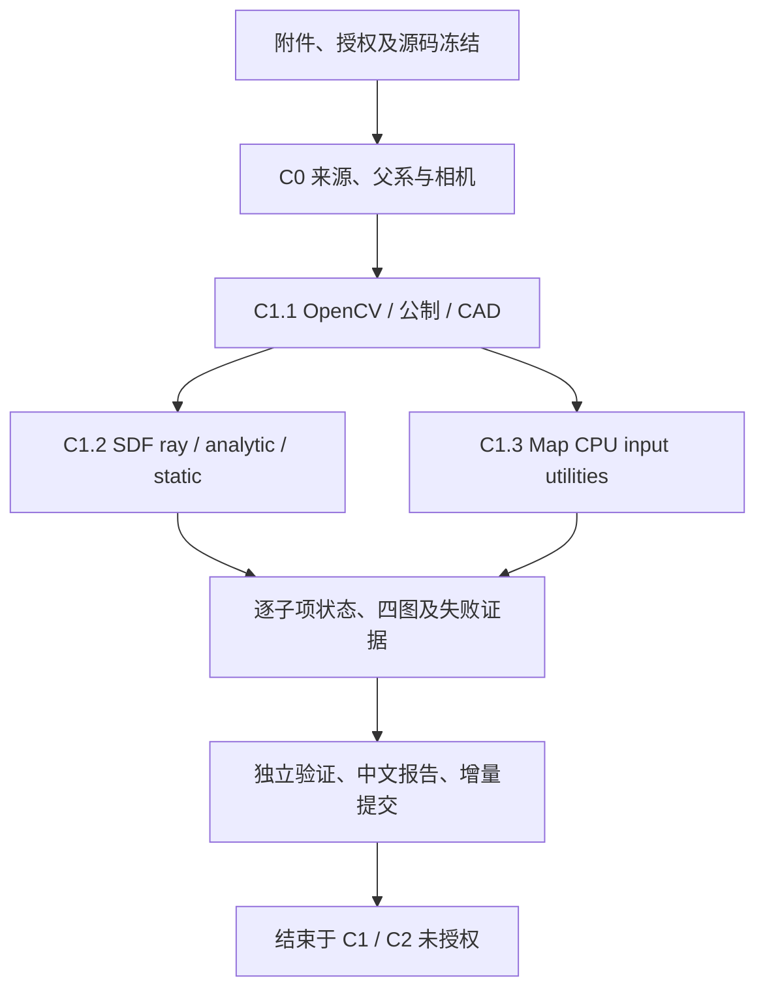

# E1 C0+C1 执行任务构建

用户于 2026-10-31 明确选择“构建后直接执行获授权的 C0+C1 CPU 审计与合同测试”。原始任务逐字保存在 [TASK.md](TASK.md)，压缩包六份文件保存在 `inputs/`，五份正文的 SHA256 均与包内清单一致。仅执行本文件所列 CPU 工作；C2–C4 不在范围内。

工作树 `/home/liu/ring_first_3d_neural_e1`；分支 `exp/TASK-NEURAL-E1-PIPELINE-RECOVERY-001`；基点 E0 `26a3f82b2b6644b78c8560650fdc319fbb30322f`。用户原有 `polyp_research` 脏 main 与 E0/F3/MASt3R 工作树保持只读。

| 工作项 | 前置 | 实际入口 | 可审核输出 |
| --- | --- | --- | --- |
| 冻结授权、包及源码 | 原始附件与真实工作树 | `common.py` / 初始冻结 | AUTHORIZATION、PACKAGE_VERIFICATION、SOURCE_COMMITS、PROTECTED_START、CPU_CONTRACT |
| C0 来源恢复与 C1.1 基础几何 | 冻结容差 | `source_audit.py` | 36 来源 / 252 有向对 / 原生链 / 父系 DAG / 资格与复用表 |
| C1.2 SDF 真实射线与负例 | 来源与候选集 | `sdf_contract.py` | 实际射线、官方静态源码、解析控制例、两个域设计、分支停止状态 |
| C1.3 Map 合法几何条件 | 来源、冻结 K/T 与官方 revision | `map_contract.py` | Raw/Cleaned/F1/F2/F3 深度、来源 UV/面 ID、遮挡/未知、原生/派生合法矩阵 |
| 四幅图与逐组证据 | 已冻结测试结果 | `figures.py`、`failure_evidence.py` | 4 核心 PNG、本地逐组图、HTML |
| 独立 CPU 验证 | 实际缓存与前后源哈希 | `validate.py` | 相机不变量、CAD 前后遮挡负例、32 深度合同、旧 BCE 定量复现、旧源保护 |
| 报告与交付审查 | 各子项真实状态 | `report.py` | 一份 TECHNICAL_REPORT、FAILURE_LEDGER、验收矩阵、分母、manifest、Git 状态 |

SDF 与 Map 保持两独立路线。任何 CPU 合同通过都不等于模型科学成功；失败保留 NaN。相机/GT/历史测量值不作为适配调参或补值来源。E0 `audit.py` 主入口包含 CUDA 探针，故仅按精确 AST 提取并执行其 CPU 来源审计函数；不调用旧主入口、模型或清理脚本。
