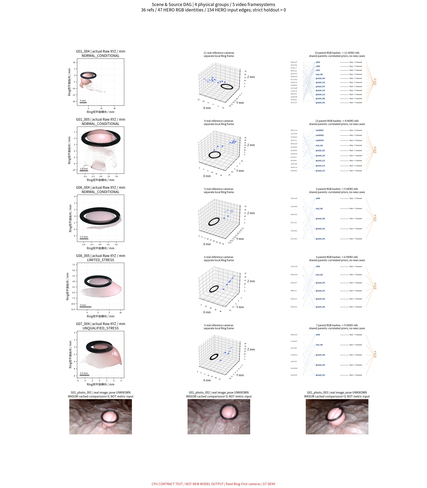
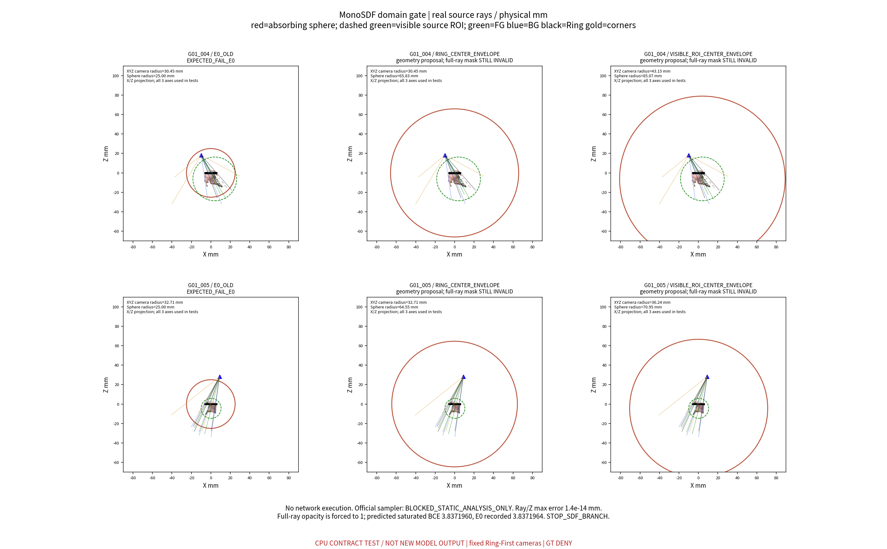
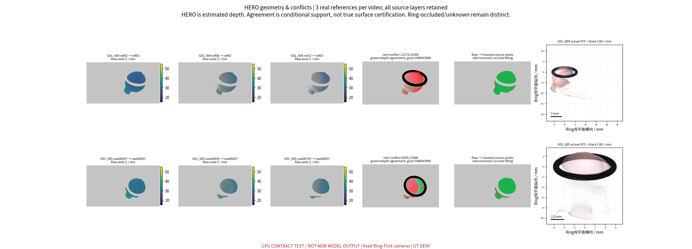
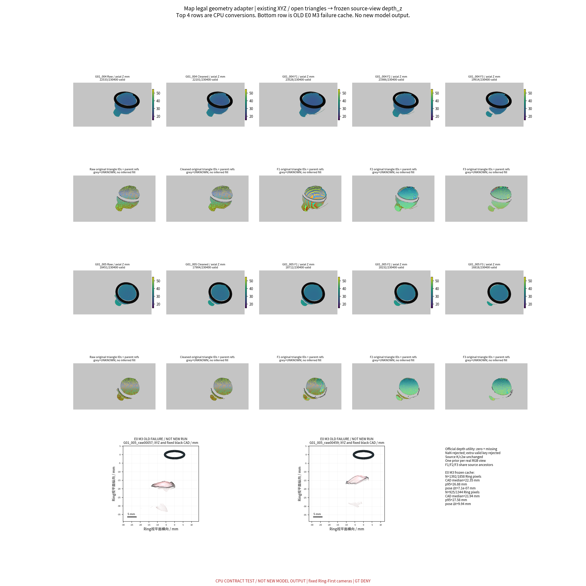

# TASK-NEURAL-E1-PIPELINE-RECOVERY-001 技术报告

**2026-10-31，Asia/Shanghai。状态：C0_LIMITED；OpenCV/CAD合同通过；SDF ADAPTER_INVALID / STOP_SDF_BRANCH；Map CPU输入合同通过。C2–C4未执行。**

本轮在独立E1工作树完成用户授权的C0+C1 CPU审计。真实复核36份参考、47个HERO输入RGB身份和154条依赖边，并检查252个同视频有向参考对。两段G01各保留三份不同参考，但共享HERO父系且深度冲突显著，严格全流程留出仍为0。零训练射线检查不仅复现旧SDF近端吸收，还发现整射线权重和会被官方终端吸收强制饱和，精确解释旧恒定轮廓损失，故停止该分支。Map完成32项真实几何转换及8项三视图原生配置CPU合同；旧M3约22mm公制偏差原样保留。全部冻结相机及旧资产未变；无GPU、模型前向、训练、下载、GT或历史测量回退。本轮没有新重建模型、测量精度或科学赢家。

## 固定科研审计表

| 审计项目 | 必须汇报 |
| --- | --- |
| 目标组数 | 4个物理组：G01/G06/G08/G07，5段视频。G01两视频只算1个病例；36参考不是36病例。 |
| 本算法独立成功 | **新测量0/4、模型运行0/4**。CPU数值光栅化32/32及原生接口8/8通过，只表示合同成立，不表示测量正确。 |
| 本算法失败 | G01 SDF适配合同失败1物理组/两视频；新模型均NOT_RUN。其余输入资格限制逐组列示，四组测量全部NaN。 |
| 历史测量值回退 | **0**。历史XYZ/F1/F2/F3是本任务明确允许的被审计先验；旧M3只作失败对照，没有回填新预测。 |
| 失败组及具体原因 | G01：吸收/轮廓合同、深度冲突与坐标限制；G06：raw00351泄漏；G08：有限留出；G07：相机不合格及raw00293泄漏。逐组链接见[失败台账](FAILURE_LEDGER.md)。 |
| 最终统计样本 | 真实独立新测量0/4，配对共同成功组0。CPU转换按32任务分别计数，禁止代作病例成功率。 |
| 是否使用 GT 选择算法 | **否**，未打开GT/Blender、未拟合尺度或pose；[容差](config/CPU_CONTRACT.json)、逐阶段BEFORE_TEST冻结及源码SHA均先于对应测试。历史报告已有曝光，因此不声称历史信息盲测。 |

独立覆盖率为**0/4新测量**；中位绝对相对误差、MAE、p95、最大误差均为**NaN/NOT_EVALUABLE**；共同成功组配对比较N=0。参见[物理统计表](metrics/PHYSICAL_MEASUREMENT_STATISTICS.csv)。CAD距离及HERO一致性误差不是息肉真值误差。

## 实际版本、复用与边界

工作树 `/home/liu/ring_first_3d_neural_e1`；分支 `exp/TASK-NEURAL-E1-PIPELINE-RECOVERY-001`。本地HTML：`/home/liu/ring_first_3d_neural_e1/experiments/TASK-NEURAL-E1-PIPELINE-RECOVERY-001/visualizations/index.html`。用户原有脏main未提交或清理。

| 来源 | 精确 SHA |
| --- | --- |
| base_E0 | `26a3f82b2b6644b78c8560650fdc319fbb30322f` |
| F3 | `fa50f68f27fd1679276e3ac549322cda05fc4191` |
| View_Partition | `4adfe3aac780bf319aebf9cdd137f42e1e0eb055` |
| observability | `432747735aad5df46df32a93f78b3c819c7797ed` |
| MonoSDF_official | `12513009cd20a08b35ddc2c55a7e42da2c7baf43` |
| MapAnything_official | `3d10cf7a3016fc0f9bb13a071ee66c47b10be0d9` |

附件五正文SHA全部匹配，原任务未改写。授权证据见[AUTHORIZATION](provenance/AUTHORIZATION.json)，任务依赖与入口见[执行计划](TASK_EXECUTION_PLAN.md)。[复用表](CODE_REUSE_E1.csv)记录真实路径、SHA、函数签名与最小适配。E0来源函数、原`unproject`、原点/三角面Z-buffer、SameCameraScene及renderer均复用；旧`audit.py` main会探测CUDA，故没有执行，只精确提取CPU函数。MonoSDF官方含GPU组件未实例化；Map只导入官方数据utils，未导入模型或加载权重。

## C0：来源、独立性与分母

| 组 | AUDITED_N参考 | ELIGIBLE_N参考 | ADAPTER_TESTED_N转换 | MODEL_RUN_N | SCIENTIFIC_SUCCESS_N |
| --- | --- | --- | --- | --- | --- |
| G01 / NORMAL_CONDITIONAL | 20 | 20 | 20 | 0 | NOT_EVALUATED |
| G06 / NORMAL_CONDITIONAL | 5 | 5 | 4 | 0 | NOT_EVALUATED |
| G08 / LIMITED_CONDITIONAL | 6 | 6 | 4 | 0 | NOT_EVALUATED |
| G07 / UNQUALIFIED_STRESS_ONLY | 5 | 0 | 4 | 0 | NOT_EVALUATED |

ELIGIBLE_N仅表示相机/来源条件下可提出后续候选：G01/G06为正常条件25参考，G08另列有限6参考，G07的5参考仅压力。它不构成训练授权或全独立HERO监督。36/36 native逐文件可读；三个004 display别名已沿真实infer/package链更正，未将display当native。详见[来源清单](metrics/E1_SOURCE_MANIFEST.csv)、[native核验](metrics/NATIVE_DEPTH_AUDIT.csv)、[父系DAG](provenance/E1_SOURCE_DAG.json)。

| G01视频 | 固定提出的三参考 | 光轴夹角范围 | 有向对共视深度点数范围 | 深度冲突比例范围 |
| --- | --- | --- | --- | --- |
| G01_004 | ref03 / ref08 / ref13 | 8.74–17.56° | 11664–21494 | 21.5%–90.9% |
| G01_005 | raw00057 / raw00459 / raw00745 | 4.57–9.63° | 11772–17210 | 13.2%–64.8% |

采用预注册最初三参考，不按目标误差换源。共视分母是源点投影到另一个来源Mask且通过CAD遮挡/有效深度后的点数，含投影到同像素的多点；不是独立像素/病例。阈值固定`max(0.5mm,3像素足迹)`。三参考的身份、冻结相机和射线链成立；**可信多深度一致性闭环尚未成立**。HERO输入父系共享数逐对保留；同一RGB上的F1/F2/F3只能作互斥先验，不增加相机观察数。

G06 raw00351及G07 raw00293分别确认为旧ref04的HERO输入；G08 raw00943/raw01080没有预冻严格独立留出。三照片各有真实RGB/Mask和3条缓存匹配比较，但pose未注册、K仅候选，不制造公制相机。004/005保持两个局部系，没有跨视频融合。严格全流程holdout仍为0，见[逐帧泄漏表](provenance/SOURCE_LEAKAGE_LEDGER.csv)。

## C1.1：相机、单位与CAD

36/36真实基础几何合同通过；XYZ→UV最大残差`3.41e-13px`，原unproject回算误差0。36/36 pack的K/pose与归档相机按来源reference_index逐值相同，差值0；32个Map条件产物另逐文件比对源K/c2w。mm→m只改变接口表达并闭环回mm；resize/crop的K是官方图像坐标变换，不是重拟合物理相机。所有源文件哈希不变。

合成负例证实轴向Z不能直接当单位射线长度，漏掉半像素主点项也会被捕获。R10 CAD中心线半径5.6mm/截面0.6mm、R5为3.1/0.6mm，真实网格均闭合。5个场景各64条射线在真实CAD前/后各1mm构造控制例：前方64/64可见，后方0/64可见，重叠时64/64选择近层。CAD始终单独作刚体遮挡，未与息肉标签合并；Ring接触边界不当真实息肉轮廓。见[相机不变量](metrics/FROZEN_CAMERA_INVARIANTS.csv)、[CAD测试](metrics/SYNTHETIC_CAD_ZBUFFER_TESTS.csv)。

## C1.2：SDF负例、两方案及停止结论

两视频各3来源，每源按前景64、邻近背景64、Ring64、角落4采样，共1176条真实像素射线；旧域+两候选形成3528条域测试记录。Ray/Z点相交最大误差`1.42e-14mm`。官方固定revision的ErrorBoundSampler实际先取cube far，再补全局`far=3.5R`；ImplicitNetwork用`min(sdf, R−||x||)`吸收；LaplaceDensity按CDF转密度。源码/行号及完整类见[官方行为证据](provenance/SDF_OFFICIAL_SOURCE_BEHAVIOR.json)。

旧10mm/unit、R=2.5域中，真实射线可穿入表面支持区间——因此“目标在域内”的子检查确实能通过，未为得到FAIL更改断言。但ray近端在吸收球外时，负sphere SDF会在表面之前产生高密度，24个源×类别汇总被正确拦截。旧两输入camera norm 3.2714/3.8705只作背景事实，判据使用具体entry/exit、target t、采样比例和透过率，而非仅看camera norm。

更直接的包装错误是`acc=weights.sum(-1)`：官方有限边界外的吸收与远端终止会让每条射线最终不透明。128前景/64背景、float32 clamp(1e−5,1−1e−5)数学计算得到BCE **3.837196032**，旧400步全程实测 **3.837196350**，差小于1e−6。该数值无需网络/训练即能重现。

仅静态设计两种具有物理理由的规范域：以固定Ring原点或真实可见ROI中心为原点，根据冻结相机+实际来源点包络及10β边界余量确定统一规范尺度。源公制K/c2w不变，仅ray的表达规范变化且回算闭环；不是重估pose或按误差搜索半径。两候选均让目标t进入有效区间并避免近端处在吸收球外，但**不能修复旧全射线轮廓损失**。预冻0.95球内均匀样本比例在48汇总行中44行未达标；球外终端/角落样本仍计分母，未放宽阈值。这不是方法普适失败的证明。

解析球/平面控制验证正负号、零交叉、有限段吸收/透明变化；另对真实射线给出empty-space有限段与终端opacity对照。官方GPU/网络组件均标`BLOCKED_STATIC_ANALYSIS_ONLY`；没有伪造官方Sampler运行或神经梯度。有限可信ROI内的轮廓累积仅是后续设计，未接入计算图。**最终SDF门禁为ADAPTER_INVALID / STOP_SDF_BRANCH**；没有可认证当前包装进入训练的方案。RGB/多HERO/权重/Eikonal/anchor/CAD损失的状态逐项写为FUTURE_REQUIRED或NOT_WIRED，见[loss合同](metrics/SDF_FUTURE_LOSS_CONTRACT.csv)。

## C1.3：Map原生与局部几何合法条件

锁定官方revision`3d10cf7a3016fc0f9bb13a071ee66c47b10be0d9`。对两个G01视频各3个真实参考执行M0–M3共8个CPU预处理/校验组合；没有调用infer或网络。官方真实白名单支持img、intrinsics或ray_directions、depth_z、camera_poses、is_metric_scale；拒绝额外valid/PLY/GLB/任意confidence/多层depth字段。depth要求校准，K与ray_directions互斥，带pose时第一view必须带pose。API文档写B×H×W×1，但实际image预处理产物为B×H×W，inference再加末维；本轮按真实代码而非仅按docstring测试。

两个G01视频各5几何族×点/原三角面两种光栅化=20合同；G06/G08/G07各Raw/Cleaned×两种=12压力合同；合计**32/32合法转换**。最大轴向Z回算残差`9.61602e-05mm`，预冻容差0.002mm；resize后的逐深度值与官方最近邻来源像素索引重放误差0。Raw为本来源；Cleaned使用原删除索引；F1为历史来源Cleaned并集；F2为原accepted索引并集；F3为真实Joint来源索引及原face_ids，保留其历史变换身份。

稀疏点仅落到其实际投影像素，未按邻近填洞；只有原有三角面才光栅化。每个本地产物包含axial_Z_mm、depth_z_m、validity、来源点/三角面ID、来源参考与UV/重心、surface_origin、Ring_occluded、UNKNOWN、冻结相机及预处理来源索引。官方validity不是原生字段，作为审计元数据保留，绝不塞入infer。

无效深度在适配器中严格写0，正深度用m。官方`normalize_depth_using_non_zero_pixels`以`depth>0`计数，0归一化/编码后仍为0，证明它表示缺失条件；NaN乘mask仍会传播，CPU负例确认污染，故拒绝NaN进入官方utils。不能据此声称模型对稀疏输入科学有效。保存全部F1/F2/F3互斥层及20对同RGB先验冲突表，不融合为一个“更好”结果。M4/M5正式名称未启用。

| 旧M3来源 | Ring有效/预处理Mask像素（280×154） | CAD距离 median / MAE / p95 / max（mm） | 冻结条件pose相对输出pose的平移 / 转角 |
| --- | --- | --- | --- |
| G01_005_raw00057 | 1392/1858 | 22.348 / 23.128 / 26.876 / 56.113 | 7.09748e-07mm / 0.0118936° |
| G01_005_raw00459 | 925/1344 | 21.941 / 22.597 / 27.577 / 58.422 | 9.93978mm / 0.487614° |

这是旧E0 M3缓存，表达转换仅复用其原先保存的首相机刚体gauge，没有新ICP/尺度拟合/pose优化。首相机本来就是该gauge锚点，约0.012° trace残差主要是旧float32矩阵数值精度，不代表独立定位精度。第二视角约9.94mm残差及约22mm的CAD偏差均保留，输出pose从未成为本轮输入。

## 支持域、不能进入后续的输入与验收

冻结标签：MULTI_VIEW_OBSERVED_SUPPORTED、SINGLE_VIEW_OBSERVED_SUPPORTED、CONFLICT、RING_OCCLUDED、PRIOR_ONLY、UNKNOWN。原始可追溯来源点只获条件性的单来源证据；F3 Joint变化点和三角面内部插值保守标先验；冲突层独立保存。没有生成新的supported mesh，未知背面、Ring后遮挡及先验补全不计观测面积。概览正交图中CAD填色仅是既有面片布局；物理遮挡结论以source-view CPU Z-buffer为准。

确定不能直接进入下一轮的输入/包装包括：当前SDF全射线轮廓损失；未认证照片公制相机；G07作为正常成功组；G06 raw00351/G07 raw00293作为独立留出；任何未认证004/005融合；任意PLY/GLB/confidence/valid原生字段；同RGB多先验伪装多相机；NaN/负深度未经清洗的条件。

| 门禁 | 最终状态 | 真实证据 |
| --- | --- | --- |
| C0-01 | `GATE_PASS` | [独立分支、基点/来源SHA、旧工作树状态及哈希](provenance/SOURCE_COMMITS.json) |
| C0-02 | `GATE_PASS` | [36/36真实来源与native链；display别名另纠正](metrics/NATIVE_DEPTH_AUDIT.csv) |
| C0-03 | `GATE_PASS` | [Raw/Cleaned/F1/F2/F3父系，不增加独立观察数](provenance/E1_SOURCE_DAG.json) |
| C0-04 | `PASS_WITH_LIMITATIONS` | [两视频各3真实候选，有角度/共视；深度冲突显著](metrics/REFERENCE_COVISIBILITY.csv) |
| C0-05 | `PASS_WITH_LIMITATIONS` | [G06/G08/G07分层；三照片未认证；两视频未融合](provenance/PHOTO_QUALIFICATION.json) |
| C0-06 | `HOLDOUT_STRICT_UNAVAILABLE` | [strict holdout=0；raw00351/raw00293污染确认](provenance/SOURCE_LEAKAGE_LEDGER.csv) |
| C0-07 | `GATE_PASS` | [精确源码SHA、签名、可执行范围及最小桥接](CODE_REUSE_E1.csv) |
| C1-01 | `GATE_PASS` | [36真实几何、合成Ray/Z负例、相机逐值相同](metrics/OPENCV_METRIC_TESTS.csv) |
| C1-02 | `GATE_PASS` | [R10/R5真实CAD；5场景前后遮挡及最近层合成控制](metrics/SYNTHETIC_CAD_ZBUFFER_TESTS.csv) |
| C1-03 | `EXPECTED_FAIL_E0` | [官方真实规则静态拦截，BCE定量匹配旧400步](metrics/SDF_GATE_STATUS.json) |
| C1-04 | `ADAPTER_INVALID / STOP_SDF_BRANCH` | [两种物理域射线几何可行，但旧全射线轮廓合同仍无效](metrics/SDF_RAY_DOMAIN_SUMMARY.csv) |
| C1-05 | `FUTURE_REQUIRED / NOT_WIRED` | [本轮不装配可微loss，ROI轮廓/多源loss未入图](metrics/SDF_FUTURE_LOSS_CONTRACT.csv) |
| C1-06 | `GATE_PASS_CPU_ONLY` | [官方固定rev原生M0–M3：两视频各3源，8组合CPU预处理](metrics/MAP_NATIVE_CPU_CONTRACT.csv) |
| C1-07 | `GATE_PASS_CPU_ONLY` | [32/32源几何光栅化/来源索引/单位/无效值合同](metrics/MAP_GEOMETRY_ADAPTER_CONTRACT.csv) |
| C1-08 | `GATE_PASS_CPU_ONLY` | [互斥先验、层冲突、原生/派生/不支持矩阵](metrics/MAP_LEGAL_INPUT_MATRIX.csv) |
| C1-09 | `E0_FAILURE_REPRODUCED_CPU` | [旧M3约22mm CAD偏差与输入/输出pose残差](metrics/E0_M3_FAILURE_RECHECK.csv) |
| C1-10 | `GATE_PASS_SCHEMA_ONLY` | [支持域6标签冻结，F3/三角面插值不冒充新观察](config/CPU_CONTRACT.json) |
| C1-11 | `DELIVERED` | [4核心PNG、5逐场景证据、本地HTML、单份中文报告](visualizations/index.html) |
| C1-12 | `GATE_PASS` | [0 GPU/模型forward/训练/下载/GT；412旧文件SHA不变](metrics/FINAL_VALIDATION.json) |

独立验证实际通过 **118项断言**，旧输入/源码 **412项SHA不变**。失败及工程错误未删除：一次NumPy1.x无trapezoid的兼容错误已改同义trapz，原日志、原冻结SHA留本地；这是CPU工程修复，没有训练重试或容差调整。详见[验证](metrics/FINAL_VALIDATION.json)、[失败台账](FAILURE_LEDGER.md)、[复现](REPRODUCE.md)。

本轮在C1结束。Map合同通过不自动授权新Map前向；SDF当前包装必须保持停止。后续只提交研究者/RA审阅，C2数据/loss冻案需另立任务；不自动进入C2/C3/C4。Git同步的实际commit与远端结果以[同步记录](provenance/GIT_SYNC_STATUS.json)为准。
