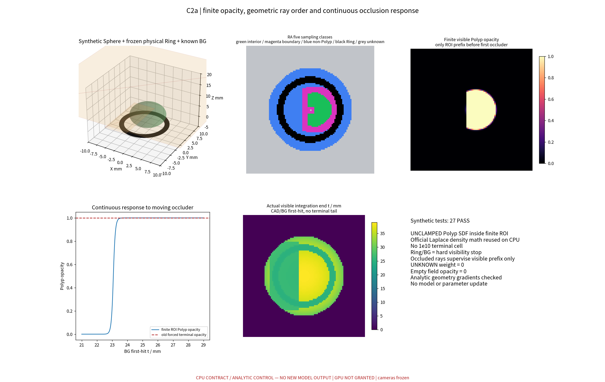
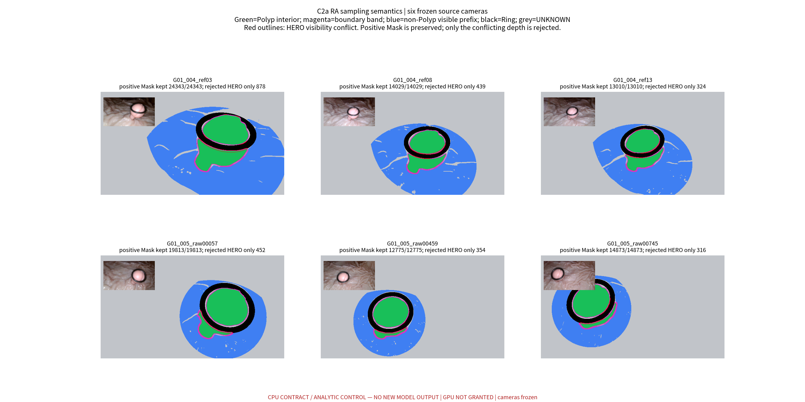
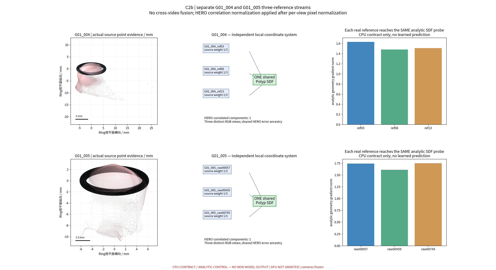
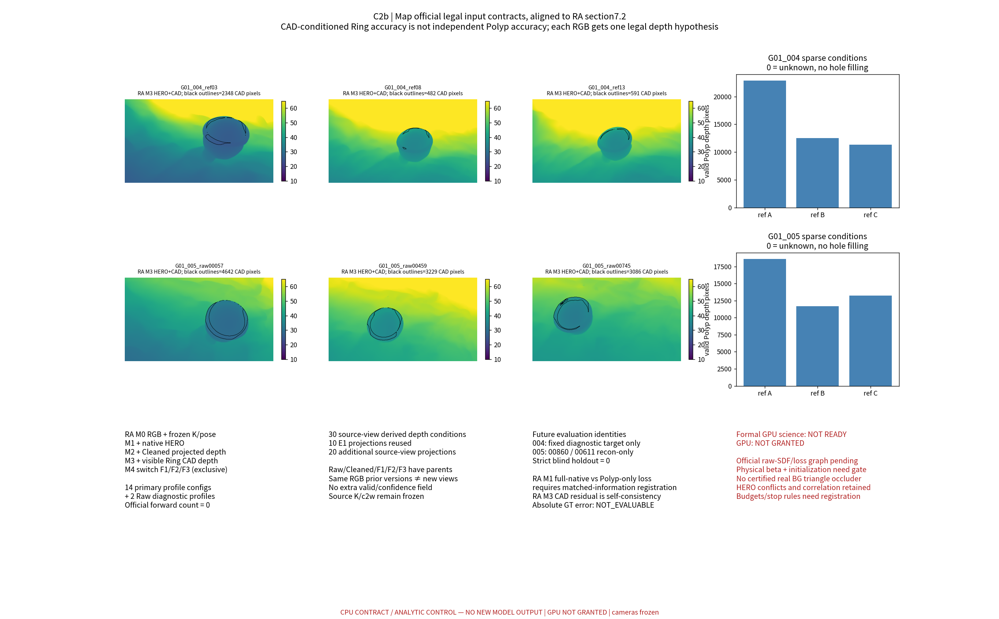

# TASK-NEURAL-E2-C2A-C2B-CONTRACT-001 技术报告

本轮延续既有研究，未重复已完成的审计；在独立分支先完成有限区域透明度、固定环遮挡和五类射线采样，再建立两个视频各三参考的共享几何监督及官方合法输入合同。阶段检查275项、完整性核验257项均通过。真实背景仍只有来源观测点，未认证为不透明网格；保留2,763个正掩膜对应的深度冲突，解析探针的164条未命中深度记为缺失。旧初始化在其中一个视频没有区域内前交点，网络梯度接线、物理平滑尺度和严格独立评价仍缺门槛。工程通过不代表模型重建或测量正确；两阶段均不能直接进入正式科学实验。本轮没有正式模型推理、训练或权重更新，图形处理器授权仍未授予。

## 1. 状态、授权与版本

- 交付状态：`REPORTED / CPU_PASS_WITH_LIMITATIONS`；不宣告科学验收或正式 baseline 更新。
- 唯一执行授权来自用户明确批准的 E2 请求；[RA 原文](inputs/RA_PHASE_E_ADAPTIVE_DESIGN_REVIEW.md)是采纳的设计依据，文档内未来实验建议不构成新的运行授权。SHA256：`512ad8b3369e9a8888643a2e477463b000d0f8187b64b3ee40a9a0cd4e85140d`。
- E1 父提交：`af71a6f85328f487b4a319d47e429c3606f5ca33`；独立分支：`exp/TASK-NEURAL-E2-C2A-C2B-CONTRACT-001`。C2a 首次提交 `282b2881316f18d825180e7c4f5cba99d10382a2`；RA 对齐及 C2b 实现提交 `c2d54d8c46ac85268f987dc904a3f7152c69430c`。
- 本轮正式模型推理 **0**、GPU 运行 **0**、模型权重读取/更新 **0**、训练/优化器步数 **0**。CPU autograd 仅作用于解析 Sphere 参数，没有更新参数。
- Ring-First、HERO、CAD、P0、Dxy 与历史工作树未修改；历史 HEAD/status/原有脏文件哈希核对通过。未使用未认证照片或跨视频位姿。
- MonoSDF 官方源码：`12513009cd20a08b35ddc2c55a7e42da2c7baf43`；MapAnything：`3d10cf7a3016fc0f9bb13a071ee66c47b10be0d9`。仅调用必要数学/输入工具，不载入权重。
- [复用表](CODE_REUSE_E2.csv)、[122输入哈希](provenance/E2_READONLY_INPUTS_AND_SHAS.json)、[环境](provenance/CPU_ENVIRONMENT.json)、[冻结记录](provenance/C2A_BEFORE_TEST.json)。最终报告提交由 Git 包含关系标识，避免在文件内自引用最终提交 SHA。

## 2. 固定分母与输入身份

| 审计项目 | 必须汇报 |
| --- | --- |
| 目标组数 | **1 个物理组 G01**；2 个独立视频场景，6 个输入参考；G06/G08/G07 不在本轮 E2 范围 |
| 本算法独立成功 | **0/1** 新测量输出；CPU 合同通过不能计入测量成功；两视频均无新神经预测 |
| 本算法失败 | 1/1 未产生可评价测量，Dxy/形状误差保留 **NaN / NOT_RUN**；未运行不冒称模型实测失败 |
| 历史测量值回退 | **0**；历史 Raw/Cleaned/F1/F2/F3 仅为明确标注的 Map 输入消融，非测量回填 |
| 失败组及具体原因 | G01/004 与 G01/005 官方模型未运行，梯度接线/初始化/来源冲突/留出门槛未齐；见[失败记录](FAILURE_LEDGER.md)、图2/3及逐源表 |
| 最终统计样本 | 新测量成功样本 N=0，总分母1；独立覆盖率0/1；MedARE、MAE、p95、最大误差均 NaN；共同成功配对 N=0 |
| 是否使用 GT 选择算法 | **否**；未打开 GT、Dxy/历史测量，不做 Oracle/ICP/目标拟合；参数/源码/权重资格在解析探针前冻结 |

固定三参考：004=`ref03/ref08/ref13`；005=`raw00057/raw00459/raw00745`。各视频只有一个共享 Polyp SDF 身份，两个视频各自的 LOCAL_RING_MM 坐标系严格隔离，不拼接点云、不共享位姿或监督。源 K/c2w、原生 HERO Z 保持逐值一致。

源身份/祖先沿用 E1 既有审计结果，只对实际复用资产查哈希，未重跑 E1 溯源。每个视频三个 HERO 参考均连接为 **1 个同源相关分量**，不等于3个独立深度证据。不能将同帧不同先验、同一 HERO 祖先或两个视频当作额外独立息肉组。

## 3. C2a：有限 Polyp 几何适配

[实现](code/opacity.py)注入未夹断的 Polyp `raw_sdf_mm`。先计算单位世界射线与源固定 ROI 的有限交段，再取 `start=max(ROI_enter,0.05mm)`，`end=min(ROI_exit,t_Ring−0.05mm,t_BG−0.05mm)`；空段不查询 SDF。自适应采样接口删除段外采样/巨大尾段并插入准确端点，未来官方接线必须在段内重新求 raw SDF，不能复用旧 clamped SDF 或旧权重。

每个有限单元内计算官方 LaplaceDensity，`alpha=1−exp(−sigma*delta)`，从有限段起点重新累计透射率，`Polyp_opacity=sum(T*alpha)`。固定 Ring 和背景不进入可学习 Polyp 密度；不存在 `1e10` 终止单元。整射线 `weights.sum()` 在空 Polyp 控制中为 **1.0**，新有限积分为 **0.0**。这是旧错误的局部解析复现，不是重跑 E1 审计。

采样五类按 RA §4.4：`P_INTERIOR / P_BOUNDARY_BAND / VISIBLE_NONPOLYP / RING_OCCLUDED / UNKNOWN_LOW_CONF`；边界半宽2像素。另保留正 Polyp、可见非 Polyp、Ring 截断、BG 截断、未知的可见性状态，两套语义正交。被遮挡的隐藏段不接受负 Mask；接触 Ring 的边界不自动认作真实隐藏息肉轮廓，体积/背面均未推断。

观测正 Mask 在有限可见前缀上保持正监督，HERO 落在截断后只拒绝该深度，不能把正 Mask 改成 Ring/负类。深度只用于 P_INTERIOR，要求前向 SDF 正到负过零且 opacity≥1e−4；未命中为 NaN、无零深度回归，仍保留正 Mask 惩罚并报告观测/命中/缺失分母。深度输出为有限段权重的条件均值，再按源相机夹角转为 axial Z。

单位转换：`x_net=(x_mm−origin)/s`，`sdf_mm=s*sdf_net`，`beta_mm=s*beta_net`。射线 t 为欧氏毫米，HERO 与相机深度为 axial Z；二者使用冻结相机的方向范数精确转换。相机不参与梯度。

真实背景只使用已归档 `quality=true`、源 label0、正且有限 Z、原始 UV 重投影误差≤1e−6像素的来源点；无补洞、三角化、跨源融合或假网格。其作用是同源观测的非 Polyp 自由空间上界，不能当作认证的不透明背景表面，也不会覆盖源正 Polyp。真正不透明 BG 网格缺失，真实物理遮挡认证仍未完成。

| 核验层 | 通过数 | 边界 |
| --- | --- | --- |
| C2a 合成几何 | 27 | 解析 Sphere + 固定真实 CAD 网格 + 合成 BG |
| C2a 六源几何接线 | 54 | 冻结相机/原生深度/来源 BG 点 |
| C2b 三参考数据流 | 44 | 解析 SDF 梯度；官方神经网络未运行 |
| Map 官方输入工具链 | 150 | 16配置/30派生深度；官方模型 forward=0 |
| 独立完整性核验 | 257 | 122冻结输入，保护历史，未重跑E1审计 |

合成连续性最大相邻变化 **0.01611944**（截断每步0.004mm，冻结容差0.03）；解析梯度 **3.6098133068**，独立有限差分 **3.6098132964**。另覆盖 Beer–Lambert 独立闭式解、Ring 前后顺序、贴近背景的细柄、ROI漏射线、空段零查询、正负 Mask 梯度方向及两实际尺度的光学厚度不变性。

六幅640×360源图总分母 **1,382,400像素**；正 Mask **98,843**，均未因 HERO 冲突抹去；深度资格 **86,789**；保留 Mask 且拒绝 HERO **2,763**。逐类完整分母见[可见性表](metrics/C2A_REAL_RAY_CLASSES.csv)与[RA采样表](metrics/RA_FIVE_SAMPLING_CLASSES.csv)。

| 视频/参考 | 正 Mask | HERO 冲突（Mask保留） | 合格深度 P_INTERIOR |
| --- | --- | --- | --- |
| G01_004_ref03 | 24343 | 878 | 21608 |
| G01_004_ref08 | 14029 | 439 | 12199 |
| G01_004_ref13 | 13010 | 324 | 11262 |
| G01_005_raw00057 | 19813 | 452 | 17691 |
| G01_005_raw00459 | 12775 | 354 | 11076 |
| G01_005_raw00745 | 14873 | 316 | 12953 |

图中为来源 RGB 与源固定几何资格，不是新模型预测或 GT 轮廓。红线对应 HERO 深度冲突；可观察 Mask 与隐藏/未知区分别显示。

## 4. C2b：三参考共享监督合同

[数据流](code/multiview.py)每次按视频取得3个不同真实 RGB，各参考采样配额 **96/96/64/32/32**，每参考320条、每视频960条。无放回均匀采样，seed=20261031+参考序号+3×iteration；相同迭代可复现，下一迭代刷新。Mask/深度像素乘 `region_population/sample_N`，避免高配额边界悄悄改写总体像素权重。

统一共享 SDF 的深度合同为：对每参考有效 P_INTERIOR 的 axial Z 误差，使用 Huber δ=0.5mm；先按像素重要性及来源冲突权重求该参考均值，再按 `1/同源分量大小` 对参考均值加权。源间冲突门槛固定为 `max(0.5mm,3像素足印)`，冲突像素权重0.25，其余1；无共视证据不伪造一致性。六个方向对逐一记录，权重先于解析预测冻结。相关分量总权重1；增加同源重复参考不会放大证据，已用独立闭式均值验证。当前两视频所有参考均在单分量内，因此每参考1/3，总体不会凭空获得3个独立证据。

| 视频 | 有向源对数 | 有向比较总数（非独立样本） | 冲突总数（可重复） | 源对冲突比例范围 |
| --- | --- | --- | --- | --- |
| G01_004 | 6 | 81958 | 47706 | 19.1%–92.4% |
| G01_005 | 6 | 74044 | 28178 | 11.5%–66.1% |

这里是估计深度先验间的条件一致性，**不是对真实深度误差的估计**，不能用源间低差异宣称重建准确。冲突保留在[有向源对明细](metrics/C2B_DEPTH_CONFLICTS.csv)，没有为制造 PASS 修改冲突阈值。

用真实冻结射线、每视频一个半径=0.5×固定ROI半径的解析 Sphere，共享半径及 Z 偏移变量验证每个参考对同一几何参数有非零响应。两视频变量对象独立，无优化步骤。解析控制 beta=0.08mm 仅为可复现控制，不是官方模型训练配置。

| 参考 | 观测深度数 | 解析命中 | 未命中/NaN | 解析梯度 [半径,Z偏移] |
| --- | --- | --- | --- | --- |
| G01_004_ref03 | 93 | 79 | 14 | [-1.6307376881291238, 0.047486080308299726] |
| G01_004_ref08 | 96 | 70 | 26 | [-1.4766292033328876, -0.13941528314891677] |
| G01_004_ref13 | 96 | 64 | 32 | [-1.4928919360910307, -0.23047813333466646] |
| G01_005_raw00057 | 96 | 59 | 37 | [-1.425148708693471, -1.002560767692989] |
| G01_005_raw00459 | 95 | 72 | 23 | [-1.2784607909350103, -0.9796293192543477] |
| G01_005_raw00745 | 96 | 64 | 32 | [-1.4365707898120177, -1.0008946177966103] |

合计观测 **572**，命中 **408**，未命中 **164**，未命中率 **28.67%**；这些是解析探针，不能当作 MonoSDF 成败或准确率。某源若全未命中会明确标记 `NO_RENDER_HIT`，调用方拒绝把缺源结果作为完整三参考合同通过。原生 HERO 数据未替换，未命中深度从不写成0。

RGB像素已进入联合包；本轮没有官方渲染颜色、RGB损失、Eikonal 或神经参数梯度验证。统一 Polyp SDF 是接口与数据归属合同，尚不是已完成训练的神经模型。

## 5. MapAnything M0–M4 官方输入

RA §7.2 为当前命名权威；与 E1 名称的差异保存在[交叉表](provenance/MAP_NUMBERING_CROSSWALK.json)，不覆盖历史 E1。每个模式只有3幅真实 RGB，每视图只有一层深度；Mask/valid/confidence 不作为私有扩展键传入官方接口。

| 模式 | 冻结输入 | 解释 |
| --- | --- | --- |
| M0 | RGB + K + frozen pose | 三参考共同基线 |
| M1 | M0 + 原生 HERO 全深度 | 与 SDF 仅内部 Polyp 深度有信息范围差异 |
| M2 | M0 + Cleaned 单层投影深度 | 不混合 Raw/Cleaned 多层假设 |
| M3 | M1 + 合格可见 Ring CAD pixel Z | 选择 M1 为父模式；CAD自洽不等于独立精度 |
| M4 | 用 F1 / F2 / F3 分别替代M2深度 | 三个互斥配置，不拼接为9视图；额外历史祖先已披露 |
| Raw diagnostic | M0 + Raw投影深度 | 单独诊断，非主 M4 |

两个视频合计 **16 配置**（14主profile+2 Raw诊断），对应10个概念M0–M4场景模式。生成30个来源视角×先验族深度，其中10个直接复用 E1 投影，其余20个精确复用既有投影器。稀疏未知深度编码0，条件深度均满足有限可见前缀，未填洞。M3仅使用源Ring label2、真实CAD首次交点、与原生HERO Z差≤max(0.5mm,3足印)的像素，不替换Polyp label1。

执行官方 CPU 图像/几何预处理与字段合法性检查，**没有调用模型 forward/infer**。输入 K/c2w 保持冻结；未来官方输出姿态须单列残差，不回写 Ring-First。模型可能不严格服从条件输入，必须未来实测，不能由合法输入合同推断。

完整[配置表](metrics/MAP_M0_M4_CONFIGURATIONS.csv)、[数据Manifest](provenance/MAP_M0_M4_DATA_MANIFEST.json)、[逐层转换](metrics/MAP_DERIVED_DEPTH_CONVERSIONS.csv)。F1/F2/F3 有额外历史先验信息，仅作显式信息层级对照，不将历史融合当作新路线自主预测。

## 6. 初始化、未来变量和评价身份

旧官方 `bias=0.6` 的理想球半径在004约20.416mm（ROI22.466mm），在005约17.027mm（ROI10.279mm）。解析旧初始化在004三个参考有前交点93/93、96/96、96/96，005为0/96、0/95、0/96。**不能声称旧初始化普遍失败，也不能声称新候选改善004**。同一来源ROI规则的半径候选为004=11.233mm、005=5.140mm，仅供未来接线检查；没有据组误差选择半径。

旧 beta=.1001网络单位分别是004 **3.4061mm**、005 **2.8406mm**，与解析控制0.08mm不同。官方网络初始化的真实过零面与物理beta仍未验证，下一轮beta配置为UNSET。[初始化域检查](metrics/INITIALIZATION_DOMAIN_GUARD.csv)及[单位表](metrics/SDF_BETA_UNIT_CONTRACT.csv)不可解释成实际神经模型测试。

未来SDF消融已登记：S0_VALID（RGB/HERO/Eikonal，无显式Mask BCE）、S1_MASK（加有限Mask）、S2_CAD（加固定Ring截断）、S3_UNCERTAIN（加来源/冲突权重），S4_ANCHOR_OPTIONAL尚未实现。BG0/BG1需单独报告资格分母。S0仍使用来源分割界定ROI/资格，不能声称完全未用分割。MASt3R锚点/CAD穿透惩罚没有伪造实现。

变量见[未来实验变量](metrics/FUTURE_EXPERIMENT_VARIABLES.csv)，指标见[评价指标合同](metrics/FUTURE_EVALUATION_METRICS.csv)。固定相机、输入RGB/资格、源ROI、可见性裕量、单模型资源预算、种子、停止规则、样本分母须在正式运行前一并冻结。不得用目标B或GT选择模式。M1全HERO与SDF内部Polyp深度的matched-information profile尚须冻结；best-legal-information对照与额外历史祖先模式另行报告。

目标身份沿用E1：004 `G01_video004_004_15`=`DIAGNOSTIC_ONLY`；005 `G01_video005_v005_00860`、`G01_video005_v005_00611`=`HOLDOUT_RECON_ONLY`。本轮只读身份元数据，未打开目标像素，训练/选参禁用。**全流程严格盲留出=0**，不能重新命名成独立测试集。[身份及哈希](provenance/EVALUATION_IDENTITIES_FROZEN.json)。

未来应报告可见Mask IoU/边界F1、固定目标A→B RGB误差与覆盖/溢出、Ring CAD一致性与穿透、模型输出相机相对冻结相机残差、HERO源间一致性、观测/推断/未知面积比例。输入CAD后的Ring残差属于自洽指标。绝对形状/直径误差需要独立有效GT，当前GT世界位姿未认证且本轮未访问，均NOT_EVALUABLE；不得依赖Oracle对齐宣称端到端精度。共同成功组配对比较必须显示共同分母和历史融合标志；当前N=0。

## 7. 失败保留及工程限制

完整[失败记录](FAILURE_LEDGER.md)包括磁盘ENOSPC、首次合成背景断言失败、晚到RA导致的合同修正、诊断复现脚本自身的错误假设、真实HERO冲突、解析未命中、初始化与留出限制。原始失败日志/冻结信息保留，没有改动验收阈值使失败变PASS。背景分组改按实际primitive身份；初版分组表达式未逐字归档，后补启发式反例明确标记“非历史逐字复现”。

磁盘恢复后，本轮local_results/runtime从临时内存目录恢复到持久目录，49+8个文件逐一SHA一致；历史产物删除0。Git仅收代码、小表、报告和4张精选PNG，不上传原始视频、深度NPZ、权重或GT。RA原文的Markdown双空格换行保留原始字节与SHA，不做空白归一化。

## 8. 是否进入正式GPU科学实验

**C2a：CPU工程合同通过，真实背景认证与官方网络接线仍有限制。C2b：三参考数据和Map输入合同通过。两者均尚不具备直接启动正式GPU科学实验的条件。** CPU检查275项（81+44+150）与完整性核验257项是不同层级，不应合并成科学成功样本。

还缺以下门槛：

1. 在另行授权的有限运行中验证官方raw implicit/实际sampler/有限积分/RGB/Eikonal/所有损失的神经梯度贯通；本轮仅完成callable接口及解析梯度。
2. 冻结物理单位beta和初始化，并实测各源ROI内前过零面、深度命中与正Mask梯度，不能直接套用旧配置。
3. 审阅2,763个保留Mask/拒绝HERO的可见性冲突，以及高比例源间冲突；冻结逐源分母和不确定性政策。
4. 认证真实不透明背景网格，或明确接受当前稀疏自由空间界，并预注册BG消融；不能以合成网格通过替代真实认证。
5. 明确接受“每视频一个相关HERO分量、严格留出0、条件相机”的诊断研究边界，或另行取得认证独立评价数据。
6. 冻结matched-information与best-legal-information两个比较层级、预算/种子/停止规则，以及非循环CAD/pose评价门槛。
7. 研究者/RA审阅工程证据，并取得**新的明确GPU授权**。本轮 `GPU NOT GRANTED` 持续有效。

交付已具备复核这些门槛的CPU证据；没有正式神经预测、测量精度结论或上线/基线采纳声明。
