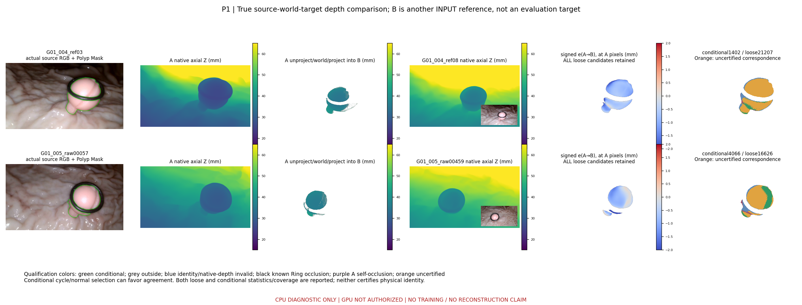
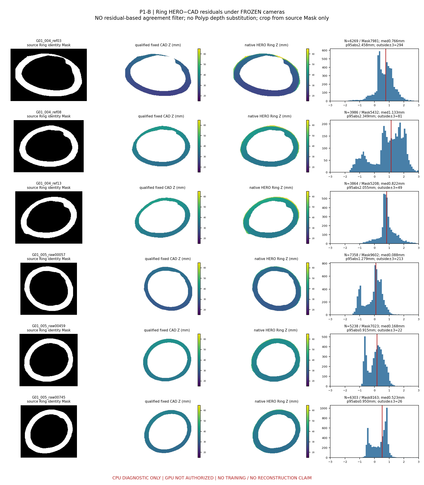
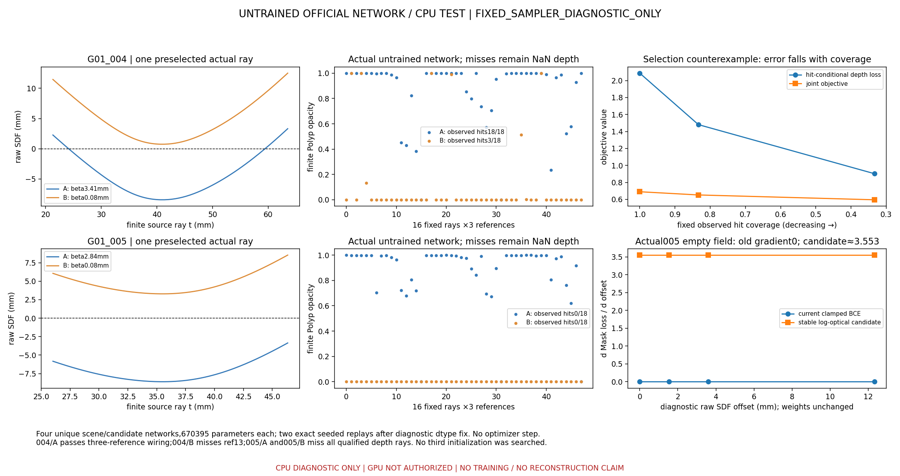
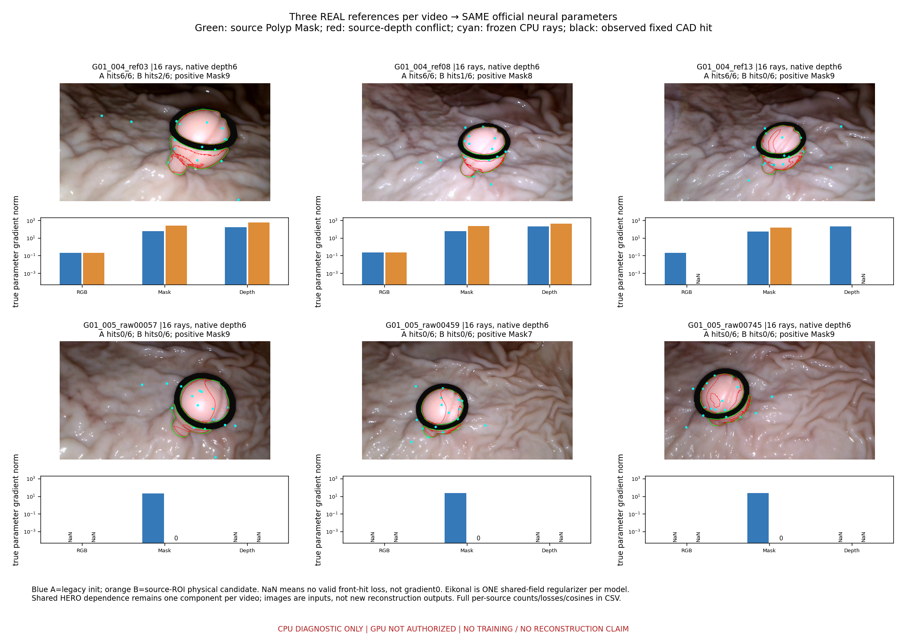

# TASK-NEURAL-E2P5-DEPTH-AND-NEURAL-WIRING-001 技术报告

本轮先完成真实多参考深度与环诊断，再实例化冻结官方网络，未重跑旧审计或扩大解析球实验。六参考中四个呈方向稳定的偏移迹象，但相机、对应及材质误差仍不可分离，不建议直接校正原生深度。真实网络检查采用两项预注册初始化：004旧配置三参考均产生联合梯度，物理尺度候选缺一参考；005两配置均无合格前表面命中，三参考门槛失败。退化反例显示覆盖由全体降至三分之一时，深度和联合损失反而下降；空场中的密度尾部抵消及掩膜截断还会切断恢复梯度。已保留失败、给出稳定计算候选和四张证据图，但未更新任何参数、未训练、未运行图形处理器。下一阶段配置已具体化，仍因初始化、损失和设备接线门槛未齐而禁止启动。

## 1. 当前结论与七项门槛

| Gate | 状态 | 解释 |
| --- | --- | --- |
| DEPTH_CONSISTENCY | PASS_CONDITIONAL_DIAGNOSTICS | 12方向、双资格层；不证明物理对应或真实深度精度 |
| RING_DEPTH_DIAGNOSTIC | EVALUABLE_ALL_6_SOURCES | 原生Ring独立资格、无残差筛选 |
| BIAS_IDENTIFIABILITY | NOT_IDENTIFIED_PHYSICALLY | 4个条件性稳定方向，设计秩3仍不能分离相机/材质/对应误差 |
| OFFICIAL_SDF_CPU | PASS_ACTUAL_CPU_FORWARD_BACKWARD | 真实官方670395参数；固定有限采样，官方adaptive未通过 |
| THREE_REFERENCE_GRADIENT | PARTIAL / FAIL_FOR_TWO_VIDEO_SCOPE | 004/A通过；004/B缺ref13；005/A、B均失败 |
| MISS_DEGENERACY | RISK_IDENTIFIED_NOT_ELIMINATED | partial命中仍可降低目标；all-miss gate不足以消除风险 |
| GPU_MVP_READINESS | NOT_READY / NOT_AUTHORIZED | 新初始化/稳定loss真实参数/设备采样门槛及授权仍缺 |

本轮目标是诊断和真实CPU接线，不是恢复高精度模型。关键结论：HERO有系统性排序迹象，也有局部/对应/遮挡冲突，不能简单将其全归为可校正常数；真实MonoSDF已能接收共享多源梯度，但**尚未在两视频都达到完整三参考联合监督条件**。正式训练禁止启动。

## 2. 授权、版本与完整分母

用户请求逐字保存在[任务附件](inputs/USER_TASK.md)。新授权仅放宽真实官方网络的CPU构造、极小前向和autograd；GPU、优化器更新、正式训练、Map推理仍禁止。上一轮E2 continuation父提交`c530fcb375d3412d49a6f2ce0346af6aa4def74a`保持原样，本轮独立分支`exp/TASK-NEURAL-E2P5-DEPTH-AND-NEURAL-WIRING-001`。P1提交`42f99cd`；P2提交`0199bee`；报告提交由包含本文件的最终Git commit标识。

MonoSDF官方revision `12513009cd20a08b35ddc2c55a7e42da2c7baf43`，真实类`model.network.MonoSDFNetwork`。旧E1/E2代码、来源DAG、native HERO、Mask、K/c2w、ROI与CAD直接只读复用，不重跑其审计。004=`ref03/ref08/ref13`、005=`raw00057/raw00459/raw00745`，两个局部坐标系严格隔离。

| 审计项目 | 必须汇报 |
| --- | --- |
| 目标组数 | 物理G01共1组；2视频、6输入参考；12有向比较不是12独立样本 |
| 本算法独立成功 | 新测量0/1；实际CPU神经诊断覆盖2/2视频、4个唯一场景×候选配置；非正式重建成功 |
| 本算法失败 | 新测量NOT_RUN/NaN；真实接线：004/B缺ref13深度命中、005/A与B全缺深度命中 |
| 历史测量值回退 | 0；不使用S0/V2旧测量、旧照片直径或其他路线补齐 |
| 失败组及具体原因 | G01两视频详细原因见[失败记录](FAILURE_LEDGER.md)、初始化命中表及图3/4；005为实测初始化失败，不删除或改采样 |
| 最终统计样本 | 测量N=0、总分母1；独立覆盖率0/1；MedARE/MAE/p95/max均NaN，共同成功配对N=0 |
| 是否使用GT选择算法 | 否；未读GT、Dxy或目标评价帧；阈值、像素和两个初始化候选先冻结，无第三候选搜索 |

原始4个网络各670,395参数；修复候选诊断数值bug时额外构造了2个**完全同种子、同参数SHA**的B复核实例：总实例6，唯一配置仍4、初始化候选仍2。模型所有学习参数前后SHA一致，OPTIMIZER_STEP0。没有保存或下载模型checkpoint，未复制视频/权重，未删除旧产物。[冻结配置](config/PREREGISTERED.json)、[实际网络配置](config/ACTUAL_OFFICIAL_NEURAL_CANDIDATES.json)、[复核SHA](provenance/IDENTICAL_NETWORK_DIAGNOSTIC_REPLAY.json)。

## 3. P1：正确的跨视角残差及未认证对应

将A原生axial Z反投影到固定世界坐标，再投影B，计算`e=Z_A→B−Z_B(round(u_B))`，从不减相同像素索引的两图Z。使用原生最近像素，不插值深度；原相机回投影闭环误差见[闭环表](metrics/DEPTH_PROJECTION_CLOSURE.csv)。

源资格为正Polyp Mask、有限正HERO、原有限ROI/CAD前缀，保留边界用于诊断；B需合法投影、同物体身份、有效原生深度及自身可见资格。排除已知CAD遮挡和投影A点自身Z-buffer后的明显后层。原生深度前后顺序冲突不按残差大小直接删除，而标记对应歧义。

保留两个层级：LOOSE_PROJECTIVE_CANDIDATE记录所有条件投影候选，不能称物理正确对应；CONDITIONAL_CYCLE_NORMAL另外要求回投影循环误差≤2px、两侧源法向有效且点积≥0.2。循环/法向也来自相同HERO，可能偏向一致像素，不是独立认证，**不以更小误差的子集宣称深度变好**。无法认证的候选保留，资格流与未认证数量逐方向公开。

| A→B | 源合格N | loose N | loose signed/abs median mm | MAD / p95abs mm | conditional N |
| --- | --- | --- | --- | --- | --- |
| G01_004_ref03→G01_004_ref08 | 23465 | 21207 | -0.767 / 0.767 | 0.146 / 1.443 | 1402 |
| G01_004_ref03→G01_004_ref13 | 23465 | 20372 | -0.244 / 0.259 | 0.188 / 1.132 | 9353 |
| G01_004_ref08→G01_004_ref03 | 13590 | 12715 | 0.824 / 0.825 | 0.231 / 1.653 | 1549 |
| G01_004_ref08→G01_004_ref13 | 13590 | 12758 | 0.537 / 0.547 | 0.206 / 1.084 | 9169 |
| G01_004_ref13→G01_004_ref03 | 12686 | 11190 | 0.197 / 0.203 | 0.128 / 0.852 | 7390 |
| G01_004_ref13→G01_004_ref08 | 12686 | 11673 | -0.545 / 0.552 | 0.226 / 1.016 | 8204 |
| G01_005_raw00057→G01_005_raw00459 | 19361 | 16626 | -0.779 / 0.779 | 0.319 / 1.391 | 4066 |
| G01_005_raw00057→G01_005_raw00745 | 19361 | 15391 | -0.422 / 0.423 | 0.258 / 1.277 | 3180 |
| G01_005_raw00459→G01_005_raw00057 | 12421 | 11598 | 0.617 / 0.617 | 0.265 / 1.030 | 3536 |
| G01_005_raw00459→G01_005_raw00745 | 12421 | 11816 | 0.203 / 0.255 | 0.259 / 0.584 | 10263 |
| G01_005_raw00745→G01_005_raw00057 | 14557 | 12816 | 0.355 / 0.356 | 0.179 / 0.850 | 3034 |
| G01_005_raw00745→G01_005_raw00459 | 14557 | 13398 | -0.118 / 0.204 | 0.226 / 0.645 | 11228 |

有向反向结果单列，不当独立样本。完整[分区残差CSV](metrics/HERO_PAIRWISE_DEPTH_CONFLICTS.csv)共120行，包含ALL/主体代理/内边界2px/环邻近8px/掠视法向代理；优先级先冻结，不按误差重划区域。输出N、覆盖、signed median、MAD、median abs、p90/p95、正负比例及连续冲突区域数/最大像素面积。mm²为源HERO像素投影足印，**不是实际表面积**。[资格流分母](metrics/PAIRWISE_QUALIFICATION_FLOW.csv)。



B是另一个输入参考而非目标评价帧。本轮没有打开任何已冻结评价目标像素。图的深度为mm，残差色标±2mm作显示截幅，统计保留全值。

## 4. P1-B/C：Ring证据和偏移可辨识性

Ring使用**独立原生Ring深度集合**。源Ring Mask内缩1px、CAD命中内缩1px、入射绝对余弦≥0.2；排除Polyp身份和无CAD对应。没有沿用E2 M3的“与CAD小残差才合格”过滤，避免循环筛选偏差；没有从Polyp或插值构造Ring观测。另公开未内缩的交集诊断层，避免边界尾部被隐藏。

| 参考 | 可靠N/源Ring Mask | signed median mm | MAD mm | p95abs mm |
| --- | --- | --- | --- | --- |
| G01_004_ref03 | 6269/7981 | 0.7656 | 0.4133 | 2.4578 |
| G01_004_ref08 | 3986/5432 | 1.1326 | 0.6298 | 2.3490 |
| G01_004_ref13 | 3864/5208 | 0.8220 | 0.2090 | 2.0554 |
| G01_005_raw00057 | 7358/9602 | 0.0884 | 0.3706 | 1.2787 |
| G01_005_raw00459 | 5238/7023 | 0.1677 | 0.3859 | 0.9145 |
| G01_005_raw00745 | 6303/8163 | 0.5227 | 0.3226 | 0.9502 |



四个参考对其他两参考有稳定残差方向，标为POSSIBLE_REFERENCE_BIAS；其余NO_STABLE_REFERENCE_BIAS只是该保守方向规则未满足，并非证明无系统误差。[逐源偏移诊断](metrics/DEPTH_BIAS_DIAGNOSTICS.csv)。Ring残差004约0.766/1.133/0.822mm、005约0.088/0.168/0.523mm，材料/反光/边界/相机仍可能贡献；其中004 ref08超出预注册±1mm偏移范围，**未clip成合法值**。

线性化模型`e_AB≈k_AB*b_A−b_B`的设计矩阵两视频数值秩均3，条件数约36.78/46.68；这仅在固定相机、固定像素对应下的代数可辨识性，不解决相机误差和深度偏移的物理混淆。未拟合深度校正参数。[可辨识性表](metrics/BIAS_DESIGN_IDENTIFIABILITY.csv)。

Ring棋盘半区的中位数仅用于固定对应的有界线性反事实检查，不实际修改或重投影校正深度。12方向中8个在±1mm范围内，其中5个中位绝对残差降低，其他并不统一；不能作为新精度。Ring到Polyp材料误差迁移未认证。[反事实表](metrics/RING_BIAS_EXPLANATION_COUNTERFACTUAL.csv)。

明确决定：首轮保持D0原生HERO和D1既有1/0.25冲突权重及相关分量归一。D2物理证据不足，不纳入首轮MVP；未来如有独立相机/材料证据，才考虑单独有界常数偏移，不拟合自由scale+shift、不逐像素修正。[五问完整决定](docs/DEPTH_CORRECTION_DECISION.md)。

## 5. P2：真实官方网络、有限采样和真实参数梯度

实际导入冻结`model.network`并构造完整`MonoSDFNetwork`，使用官方plain MLP分支（8×256、PE6、feature256、skip4；颜色2×256、方向PE4）。没有自造网络。CPU构造时只将官方bg_color和beta_min两处`.cuda()`张量分配局部转到CPU；其余CUDA调用会抛错，官方源码没有写入修改。实际子模块和参数数目在[运行记录](metrics/OFFICIAL_SDF_CPU_RUNS.json)。

直接复用E2 `finite_joint_adapter.py`的raw head、有限单元、颜色、深度、Eikonal及联合损失。新薄构造器仅承接本轮真实网络CPU授权，使用`implicit_network.forward`，不调用吸收球`get_outputs/get_sdf_vals`或旧full-ray renderer。官方自适应sampler含CUDA/夹持访问，因此采用用户允许的 **FIXED_SAMPLER_DIAGNOSTIC_ONLY**：128有限单元，段内重新求raw SDF，段外/终端不吸收。不能说官方sampler已通过。

每参考从E2冻结320条batch内按seed固定选16条（6/3/3/3/1配额），补乘原batch区域数/子采样数做重要性修正。每视频48条、每参考6条合格原生HERO；没有依命中结果换像素。[六份像素冻结文件](provenance/G01_004_ref03_CPU_PIXEL_SELECTION.json)。候选A：旧bias0.6、beta0.1001网络单位；候选B：bias=0.5×源ROI半径/s、beta0.08mm。两者是复合初始化控制，不冒充单因素科学消融。相同seed、两候选在预测前冻结，之后不增第三候选。

| 视频/候选 | 参考 | 输入/正Mask/合格HERO | 观测hit/miss | raw SDF范围mm | beta mm |
| --- | --- | --- | --- | --- | --- |
| G01_004/A | G01_004_ref03 | 16/9/6 | 6/0 | -10.179..5.521 | 3.4061 |
| G01_004/A | G01_004_ref08 | 16/8/6 | 6/0 | -10.040..5.748 | 3.4061 |
| G01_004/A | G01_004_ref13 | 16/9/6 | 6/0 | -9.940..6.106 | 3.4061 |
| G01_004/B | G01_004_ref03 | 16/9/6 | 2/4 | -0.996..14.704 | 0.0800 |
| G01_004/B | G01_004_ref08 | 16/8/6 | 1/5 | -0.857..14.931 | 0.0800 |
| G01_004/B | G01_004_ref13 | 16/9/6 | 0/6 | -0.757..15.289 | 0.0800 |
| G01_005/A | G01_005_raw00057 | 16/9/6 | 0/6 | -8.597..-3.354 | 2.8406 |
| G01_005/A | G01_005_raw00459 | 16/7/6 | 0/6 | -8.505..-3.220 | 2.8406 |
| G01_005/A | G01_005_raw00745 | 16/9/6 | 0/6 | -8.582..-3.385 | 2.8406 |
| G01_005/B | G01_005_raw00057 | 16/9/6 | 0/6 | 3.290..8.533 | 0.0800 |
| G01_005/B | G01_005_raw00459 | 16/7/6 | 0/6 | 3.382..8.667 | 0.0800 |
| G01_005/B | G01_005_raw00745 | 16/9/6 | 0/6 | 3.306..8.503 | 0.0800 |

004/A的三个参考RGB、Mask、Depth均对同一组真实参数有非零梯度，联合梯度范数约24.332；共享Eikonal梯度约10.259。Eikonal只作为一个场正则，不伪造三个来源。实际每源值及梯度全部见[逐源Loss和梯度](metrics/NEURAL_PER_REFERENCE_GRADIENTS.csv)。

| 004/A真实参数梯度 | ref03 | ref08 | ref13 |
| --- | --- | --- | --- |
| rgb | 0.21311287954435185 | 0.2287806877894714 | 0.2091856520150959 |
| mask | 65.10065793417864 | 65.71068984393538 | 55.45657287322025 |
| depth | 176.3769527500968 | 205.74771755150917 | 205.73865441741887 |

每个参考、两个候选的实际损失及梯度如下；NaN表示该项没有合法前表面回归，0表示计算图实测零梯度：

| 参考/候选 | RGB Loss | Mask Loss | Depth Loss | 真实梯度范数 RGB/Mask/Depth |
| --- | --- | --- | --- | --- |
| G01_004_ref03/A | 0.188217 | 2.01739 | 1.30099 | 0.213113 / 65.1007 / 176.377 |
| G01_004_ref08/A | 0.295666 | 2.929 | 2.18717 | 0.228781 / 65.7107 / 205.748 |
| G01_004_ref13/A | 0.201718 | 2.00493 | 2.77382 | 0.209186 / 55.4566 / 205.739 |
| G01_004_ref03/B | 0.249746 | 1.902 | 8.89433 | 0.214406 / 255.761 / 609.997 |
| G01_004_ref08/B | 0.314183 | 2.50557 | 7.19162 | 0.22752 / 241.378 / 457.461 |
| G01_004_ref13/B | NaN | 2.79103 | NaN | NaN / 159.551 / NaN |
| G01_005_raw00057/A | NaN | 1.76181 | NaN | NaN / 21.4726 / NaN |
| G01_005_raw00459/A | NaN | 1.98998 | NaN | NaN / 23.26 / NaN |
| G01_005_raw00745/A | NaN | 2.06814 | NaN | NaN / 24.3195 / NaN |
| G01_005_raw00057/B | NaN | 5.77883 | NaN | NaN / 0 / NaN |
| G01_005_raw00459/B | NaN | 4.77023 | NaN | NaN / 0 / NaN |
| G01_005_raw00745/B | NaN | 5.15982 | NaN | NaN / 0 / NaN |

004/A三个参考隐式参数的RGB梯度两两余弦0.706–0.767，Mask0.862–0.918，Depth0.815–0.948，联合数据项0.887–0.959。这只是初始同向约束，不证明真实几何准确或HERO冲突已消失。[全部方向关系](metrics/NEURAL_GRADIENT_DIRECTIONS.csv)。

004/B的HERO命中分别2/6、1/6、0/6，ref13虽然其他类别有一个前交点，**不能冒充有效HERO命中**。005/A采样raw SDF全负，前表面位于所监督段之外或无该段前交点；005/B采样raw全正、opacity0，RGB/Depth无有效回归。不能把解析球初始化近似当实际神经几何，也不能根据004成功给005切换其他候选。





这四张图均未展示训练重建。P2原始四模型耗时约0.7–3.7秒/模型（不含所有后续诊断复核），阶段RSS约1.2–2.4GiB；环境未阻碍真实CPU执行，GPU未初始化。没有optimizer、学习率步骤、checkpoint读写或任何网络参数更新。

## 6. 漏命中退化：明确存在潜在风险

保持原18条真实HERO观测，004/A选择敏感性反例仅将高误差命中从回归选择里移除，不改变源观测和Mask opacity。它是**离散的loss选择反例，不是声称某个真实连续场已经产生了该轨迹**；离散计数没有伪造梯度。

| 条件 | 命中/固定观测 | Depth hit均值 | 联合目标 | 判读 |
| --- | --- | --- | --- | --- |
| 正常 | 18/18 | 2.087327 | 0.689999 | 三源均有效 |
| 部分缺失 | 15/18 | 1.480642 | 0.652145 | 现joint仍可接受部分覆盖 |
| 大量缺失 | 6/18 | 0.902485 | 0.595167 | 覆盖降至1/3，目标更小 |
| 全缺失 | 0/18 | NaN | NaN/REJECTED | 严格缺源门槛阻止通过 |

RGB也按保留命中子集重新算，未固定成有利值；完整[选择反例](metrics/DEGENERACY_SELECTION_COUNTEREXAMPLE.csv)。把已命中误差之和除以固定观测权重，同样会因为缺失项未贡献误差而降低，不能单独当解决方案；必须连同`C_hit=N_hit/N_observed`、各源miss及正可见性约束报告。

另在真实网络上对raw SDF施加预注册的连续输出偏移（0、0.15R、0.35R、1.2R、−1.2R），**不修改模型参数**，记录实际命中和dLoss/dOffset。005/B的0偏移本已0/18命中，当前Mask导数0；log-optical候选导数约3.55327，下降方向可降低正SDF偏移、扩张可见场。这是恢复梯度的诊断，不是已经训练恢复表面。[连续场诊断](metrics/DEGENERACY_TESTS.csv)。

还定位了两个数值原因：官方Laplace `0.5+0.5*expm1(−f/beta)`在正尾部抵消为0；005/B预选首射线的129个raw样本均出现“官方密度0但稳定表达式严格正”的情况。BCE再clamp到1e−8可继续截断梯度。[真实网络尾部检查](metrics/LAPLACE_TAIL_CANCELLATION.csv)。

稳定候选不添加命中计数loss，其数学仍为有限opacity BCE：`logτ=logsumexp(logσ+logΔ)`，正例`−log(1−exp(−τ))`，负例`τ`；正SDF的`logσ=−log(2β)−f/β`，负SDF为`−logβ+log(1−0.5exp(f/β))`。logτ<−20时log opacity近似logτ，误差界1.1e−9。真实未饱和射线上三次BCE等价检查最大误差2.14e-13。仍需真实参数梯度、ROI起点已在内部时的反例及GPU数值一致性，**本轮未采纳为正式训练损失**。

该候选首版误用uint8 Mask取负，产生负BCE，已明确作废归档并改为浮点。仅重建两份同种子B网络复核，参数SHA与首次完全一致；旧网络Loss和初始化失败没有被替换成PASS。[失败原因](provenance/STABLE_MASK_ATTEMPT001_FAILURE.json)。

结论：**当前联合损失存在“降低覆盖换更低误差”的潜在退化，尚未排除。** all-miss门槛必要但不足；覆盖计数只作监控/停机，不能冒充可微训练约束。

## 7. 下一阶段配置与仍缺门槛

[完整GPU MVP预注册建议](docs/GPU_MVP_PREREGISTRATION.md)和[机器可读配置](config/GPU_MVP_PROPOSED.json)已经列明：官方结构、两个视频及三参考、固定源几何初始化壳校准规则、beta0.08mm、Adam1e−4/密度1e−5、RGB/Mask/Depth/Eikonal权重1/0.1/0.1/0.1、128单元、每源96射线、seed20261031、每run1000步/30分钟/5GiB、首轮四个预注册run及固定最终步评价。

E2.5_S0保留用户D0指定的原生HERO和当前1/0.25稳健权重；S1一起增加Mask+Ring（不能单独归因二者）。D0/D1当前定义已经共享相同不确定性政策，S2不能将相同权重重复包装成新消融，标NOT_RUN_DUPLICATE_POLICY；S3/D2取消。公共资格已使用Mask/ROI/CAD，S0不能称没有任何这类信息。此命名只属E2.5，不覆盖原E2/RA命名。MapAnything保持独立M0–M4，未推理、不用于初始化。

**配置是具体建议，但当前不能直接启动。** 005真实三参考门槛失败；已达本轮最多两个候选上限。下一项受控CPU门槛应在预测前冻结单一几何校准规则，验证每参考front-hit、Mask/RGB/Depth真实参数梯度，验证稳定loss的恢复方向。之后仍需新授权下无更新的GPU设备/采样一致性、研究者接受HERO相关性/相机/严格留出0的边界以及明确GPU训练授权。不能给失败初始化增加训练步数掩盖合同问题。

评价身份沿用E2，严格全流程holdout0。报告可见轮廓、源RGB真实A→B解释/覆盖/溢出、supported/conflict/prior/unknown面、CAD自洽/穿插；背面和体积不自动计真。历史Raw/Cleaned/F1/F2/F3只作明确对照，配对共同分母及历史融合标志必须公开。GT封存，部署位姿未认证，绝对3D精度当前NOT_EVALUABLE。

## 8. 交付、失败与复现

[完整失败记录](FAILURE_LEDGER.md)、[复现](REPRODUCE.md)、[复用来源](CODE_REUSE_E2P5.csv)、[环境](provenance/ENVIRONMENT.json)、[全部图浏览](visualizations/index.html)。大型原始资产仍在旧工作树；本任务只保存少量压缩二维诊断/射线trace，不生成大规模点云或模型权重。Git仅代码、指标、文档和四张精选PNG。

最终完整性核验见[DELIVERY_VALIDATION](metrics/DELIVERY_VALIDATION.json)，失败的研究门槛保持失败；完整性PASS不能转换为科学PASS。原生HERO、相机、CAD、P0、Dxy及所有旧工作树保护核对在交付清单中记录。

```text
MODEL_FORWARD: CPU_DIAGNOSTIC_ONLY
MODEL_TRAINING: NOT_RUN
OPTIMIZER_STEP: 0
GPU: NOT_AUTHORIZED
MAPANYTHING_FORWARD: NOT_RUN
NEW_RECONSTRUCTION_RESULT: NOT_CLAIMED
```
