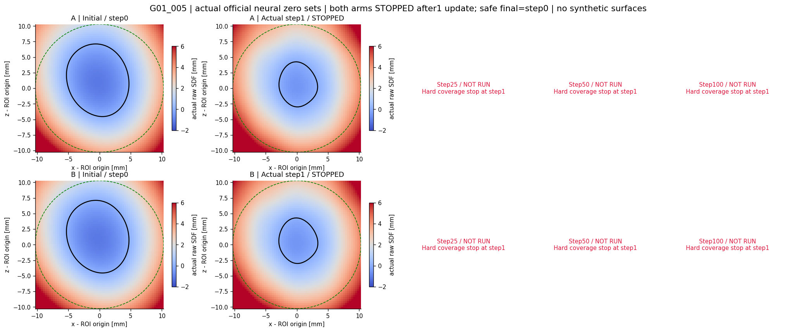
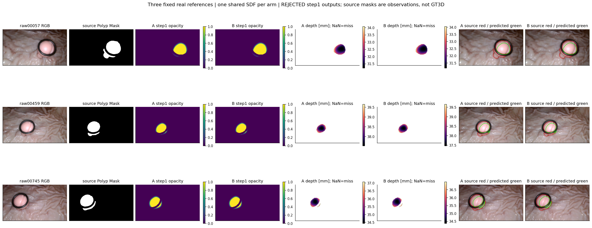
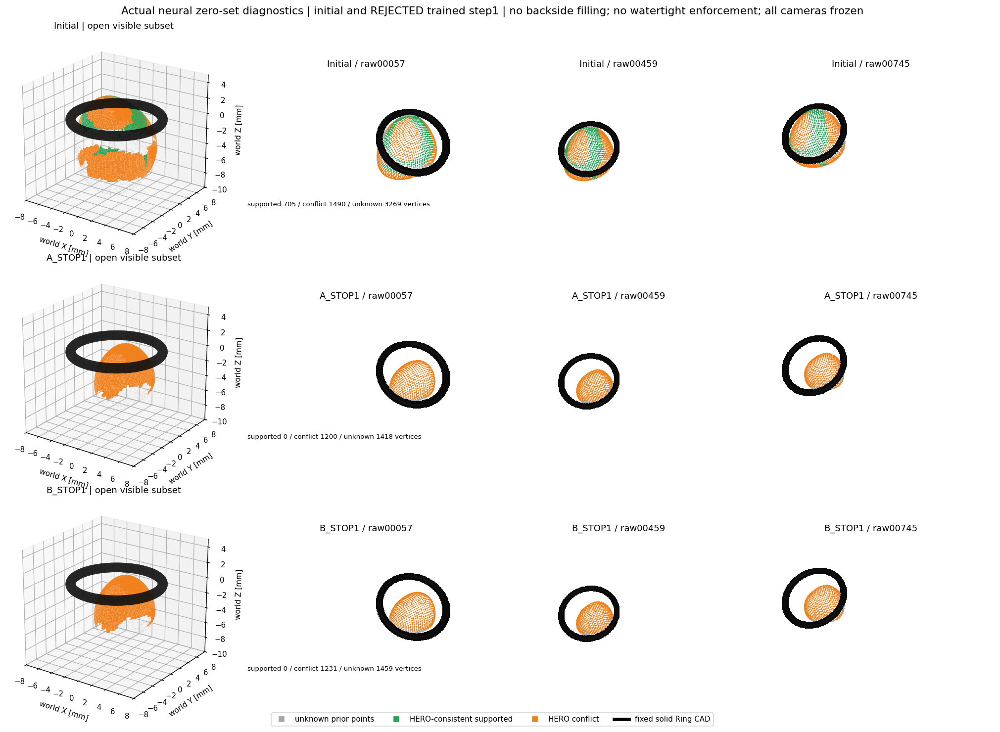
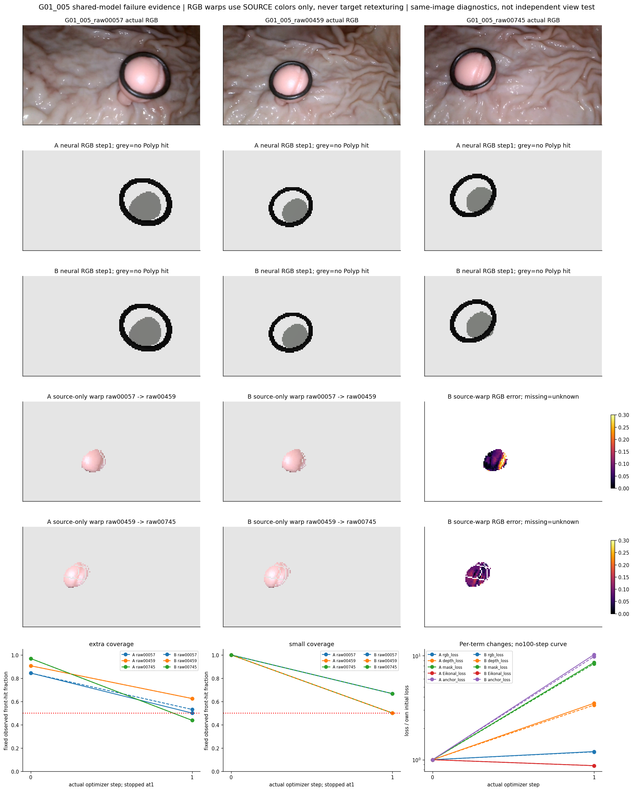

# TASK-NEURAL-E2P7-BOUNDED-LEARNING-PILOT-001 技术报告

本轮在预注册的G01_005三参考固定射线上完成真实GPU前反向与Adam参数更新，未训练其他视频。采样密度与设备一致性门槛通过后，两组均仅执行一次更新即触发前表面覆盖停止条件，未继续到二十五、五十或一百步。A、B在raw00745训练射线上的命中均从31/32降为14/32；弱锚点只保留了少量额外命中，未阻止整体表面收缩。实际零水平集、图像拟合与跨参考重投影均保留失败证据：源颜色转移误差虽降低，解释覆盖却明显减少，不能称为几何改善。已交付被拒绝的首步模型和最后安全的初始模型、完整曲线及四图；原生深度、相机和CAD未改，GT继续封存。本轮判定训练停止、无可信学习改善，不将局部短程结果外推为路线或系统成功。

## 1. 最终判定与实验边界

**TRAINING_STOPPED / NO_LEARNING / ANCHOR_NOT_BENEFICIAL（仅指本轮配方、一步观测）。** PREFLIGHT通过，真实官方模型发生了参数更新；“能前后向并更新”没有转化为可信三参考表面学习。A/B均按硬门槛停止，未进行第二次更新、学习率调整或额外实验组。不能据此断言所有锚点或Neural SDF均无效，也不能把完成一次Adam更新当作重建成功。

本轮授权来自[用户完整任务](TASK.md)，明确允许G01_005 GPU训练、Adam和精简state_dict保存，覆盖旧E2.6 CPU限制；不再请求授权。独立分支`exp/TASK-NEURAL-E2P7-BOUNDED-LEARNING-PILOT-001`，父提交`a69a17099e4ed5ff34ed8e1be49157fbda329615`，训练与检查点增量提交`55dc099`。未修改main、E2.5、E2.6或其他历史实验；最终报告由包含它的提交标识。

| 审计项目 | 必须汇报 |
| --- | --- |
| 目标组数 | 物理G01息肉1组；本轮仅G01_005一个视频、3参考、2实验组；不是6个独立场景 |
| 本算法独立成功 | 新测量0/1（NOT_RUN）；可信学习改善0/2；GPU工程执行2/2组各1次真实更新，不是科学成功 |
| 本算法失败 | G01_005的A/B均在首步触发覆盖门槛；未训练步骤保留NOT_RUN，测量与绝对误差NaN |
| 历史测量值回退 | 0；未读S0、历史V2测量、旧照片直径或其他路线预测补齐 |
| 失败组及具体原因 | raw00745 extra均14/32；两组表面收缩、各参考监测覆盖下降；见[失败记录](FAILURE_LEDGER.md)、[覆盖历史](metrics/COVERAGE_HISTORY.csv)、图1–4 |
| 最终统计样本 | 测量N=0/总分母1，独立测量覆盖0/1；MedARE/MAE/p95/max均NaN，共同成功配对N=0；未做历史融合测量比较 |
| 是否使用GT选择算法 | 否；GT/Oracle封存，规则/像素/阈值先冻结；没有目标选步、重新采样或按误差调参 |

训练分母每步192条extra射线、96条合格HERO；像素级留出监测48条small、18条HERO，small与extra完全不相交。三参考来自同一组三张图像，**没有独立视角、独立场景或严格全流程留出认证**。全图stride4诊断也来自同三源，不能作为独立精度测试。

## 2. 冻结继承、官方网络和真实初始化

E2有限ROI、五类语义、首Ring CAD截断、条件背景遮挡与原相机原样复用；E2.5官方MonoSDF、E2.6壳初始化、log-optical Mask与候选弱HERO锚点直接继承。原生HERO及1/0.25像素冲突权重、source component1/3不变。训练仅Polyp SDF和官方颜色/密度网络，Ring与背景不是待学习几何。

真实`MonoSDFNetwork` plain MLP：8×256隐式层、PE6、skip4、feature256、官方rendering network，共670,395参数、37个参数张量；A/B的37张量均实际更新。每组一个共享模型承担3源，不按视角单独拟合，不使用简化网络。官方revision `12513009cd20a08b35ddc2c55a7e42da2c7baf43`。冻结本地network.py含先前已审计的hashencoder惰性import移入Grid构造器的改动，本轮没有改源码或网络结构。[复用表](CODE_REUSE_E2P7.csv)。

CPU FP64以seed20261031、bias0.33739213617088626重建，参数SHA必须等于`7b5b64e57523d72ededf4c27f2314dd84776066f66197056c44bf014b2b3c81c`；再转FP32和GPU，初始FP32 SHA为`c02a788808d3944b35f9901a32cc05600bd1e15ff5c57afb25f2a12f2a2fbac8`，A/B完全相同。没有在GPU重新随机初始化，也未重搜壳。官方bg_color和beta_min两处构造常量沿用CPU转接，随后将未注册buffer的这两个属性显式移动设备/精度；未调用官方吸收球get_outputs/get_sdf_vals或adaptive sampler。

ROI原点(0.2917828830804057,−0.793891385404947,−4.4124351955893335)mm，s=28.3780268204276 mm/unit，R=10.27908157050465mm；壳0.5R、128 Fibonacci规则冻结，beta初始0.08mm。`x=(X−O)/s, f_mm=s*f_net, t_net=t_mm/s, beta_mm=s*beta_net`；相机不参与优化。[初始化与文件SHA](provenance/INITIAL_MODEL.json)、[源像素](provenance/SOURCE_PIXELS.json)。

## 3. 训练前采样与GPU一致性门槛

所有阈值见[预注册](config/PREREGISTERED.json)，在新模型输出前冻结，未因本轮失败修改。固定模型在六数据包比较128/256：所有前表面命中集合相同；最大Mask相对差5.40462e-05，深度最大差0.00378799mm，前交点最大差0.00312042mm；opacity差≤9.37283e-05，RGB差≤2.95043e-06。联合隐式梯度余弦最低0.999928960、范数相对差最大0.00496855。因此按预先规则选128，没有第三种密度搜索。

128单元Δt/beta约0.325–1.999，单靠该比值不能证明所有后续几何都充分采样；本次只证明初始固定模型在这两个密度上的有界一致性。beta在采样比较中相同，没有改初值。[采样CSV](metrics/SAMPLING_COMPARISON.csv)。

CPU/GPU FP32的30项逐源数据损失梯度、6项预测、1项共享Eikonal共37检查通过；完整implicit向量余弦最低0.9999999560，范数相对误差最大5.28065e-05，符合≥0.995和≤2%。关闭AMP/TF32。128初始命中准确复现E2.6给定87/96训练与18/18监测。[GPU门槛](metrics/GPU_PARITY.json)、[逐项对照](metrics/GPU_PARITY_DETAILS.csv)。门槛通过后直接运行，不将诊断许可混同更新许可。

硬件RTX3060 Laptop 6GiB、driver570.133.07；其他进程显存未清理/终止。诊断峰值912.74MiB；A/B训练各峰值504.48/504.48MiB，低于5GiB；训练计时分别7.107/6.618秒，低于30分钟。两组串行；后处理只读前向/诊断另计，不发生追加更新。

## 4. 联合Loss、梯度累积与停止

Adam：implicit与rendering lr=1e−4、density beta lr=1e−5，betas(0.9,0.999)、weight_decay0，默认eps1e−8；无增强、AMP、额外正则或步长搜索。

每步三个参考各完整64条extra，逐源`(RGB+.1Depth+.1Mask+.01Anchor_B)/3`反向后累积，再对18个固定extra P_INTERIOR射线中点计算一份`.1Eikonal`反向，最后唯一一次optimizer.step。small仅前向监测，无任何训练反向或Eikonal取点。A不使用Anchor梯度，B仅增加0.01弱锚点；其余数据/网络/优化器/步骤一致。

RGB是P_INTERIOR和真实前面命中上的官方颜色稳健Huber δ0.05；Depth为原生HERO轴向Z的Huber δ0.5mm，仍hit-gated，未命中NaN；Mask沿用同一有限可见段BCE数学目标，直接log密度/log光学厚度稳定计算，无旧clamp；Anchor对合格extra HERO世界点的SDF_mm作δ0.5mm Huber，不依赖预测是否命中，不改深度、不当精确GT。逐源带原重要性和冲突权重归一，再1/3等权，不能让像素多的源支配。

每次更新后都检查六固定包的前交点和CAD关系（不等到每5步）；每5步作完整梯度/几何探针，提前停止时额外作即时探针。A/B实际均在第1次更新后raw00745 extra=14/32=43.75%，触发即时<50%硬门槛，故没有第二步。10个百分点连续3次规则不需要等候，不能覆盖更严格的50%即时规则。

| 参考 | extra初始/32 | A step1/32 | B step1/32 | small初始/6 | A step1/6 | B step1/6 |
| --- | --- | --- | --- | --- | --- | --- |
| G01_005_raw00057 | 27 | 16 | 17 | 6 | 4 | 4 |
| G01_005_raw00459 | 29 | 20 | 20 | 6 | 3 | 3 |
| G01_005_raw00745 | 31 | 14 | 14 | 6 | 3 | 4 |

所有下降标`POTENTIAL_FAILURE_COVERAGE_LOWER`。末安全模型为step0，实际step1因失败以`STOP_UNSAFE_step001.pt`保留；没有选“好看”中间模型替代最终。Step25/50/75/100均NOT_RUN，不能绘制/声称100步结果。

| 组/步 | RGB | Depth | 稳定Mask | Eikonal | Anchor（A仅记录） | total | beta mm | 完整梯度范数 | 实际Δθ L2 |
| --- | --- | --- | --- | --- | --- | --- | --- | --- | --- |
| A/0 | 0.249463 | 0.43031 | 0.0784634 | 0.604308 | 0.0542991 | 0.360771 | 0.08 | 11.4299 | 0 |
| A/1 | 0.298763 | 1.50051 | 0.674789 | 0.529878 | 0.555254 | 0.569281 | 0.0802838 | 71.0968 | 0.0793447 |
| B/0 | 0.249463 | 0.43031 | 0.0784634 | 0.604308 | 0.0542991 | 0.361314 | 0.08 | 11.4517 | 0 |
| B/1 | 0.296772 | 1.43903 | 0.656293 | 0.529657 | 0.531677 | 0.564586 | 0.0802838 | 71.1084 | 0.079345 |

训练RGB/Depth/Mask均恶化，Eikonal下降不代表表面变好。beta仅从0.0800000到0.0802838mm；实际参数L2变化约0.079345、相对0.0836%，但raw SDF发生近毫米变化。这不是只对输出加一个标量：所有37张量均更新。[逐参数真实变化](metrics/ACTUAL_PARAMETER_UPDATES.csv)、[逐参考Loss和梯度](metrics/PER_REFERENCE_METRICS.csv)、[完整曲线](metrics/TRAINING_CURVES.csv)。

## 5. 首步失败机制的只读核验

对实际训练的原逐源loss.backward累积路径独立重算梯度，但**没有创建新optimizer或执行更新**。用首步Adam闭式公式与被拒绝模型比对，全部670,395参数最大绝对差均为1.4901161e−8，小于原2e−7检查容差。[精确累积核验](metrics/EXACT_ACCUMULATION_VERIFICATION.json)。说明本次收缩对应注册Loss和实际Adam步，并非偷偷删参考/用small训练或错接更新。

另一个较早的只读检查将各Loss的autograd向量先线性组合，在FP32下不能与逐源loss.backward的舍入逐坐标完全一致；其Adam闭式重放误差A/B约1.31e−6，**未通过2e−7，该失败保留**在[原检查](provenance/COMPONENT_SUM_ADAM_CHECK.json)和[首步诊断](metrics/FIRST_STEP_DIAGNOSIS.json)。Adam在梯度抵消接近eps坐标会放大这种舍入差异；随后核对原始实际累积路径是新的针对性证据，未放宽阈值，也未把原检查改PASS。

96个训练HERO点的实际SDF变化全部为正，中位A约+0.8978mm、B约+0.8763mm；87个初始化真实前零交叉点处变化也全部为正，中位A约+0.9843mm、B约+0.9571mm。原零点变成正SDF，和负区收缩/命中丢失一致。它是全网络实际更新响应，不是仅检查beta或输出偏置。[真实点响应与初始Jacobian方向](metrics/SDF_POINT_RESPONSES.csv)。

初始锚点加权梯度范数0.2591，相对基础联合梯度11.4299仅约2.27%；B初始联合方向与A余弦0.999745。这个配方中弱锚点没有控制住首步几何幅度。上述是本轮机制证据，不能仅凭梯度范数推导各Loss因果贡献，Adam是逐坐标归一化。

## 6. 真实零水平集、头部/下部/基底与CAD

图1同坐标raw网络切片，黑线是真实f=0，绿线固定ROI。Step1为实际已更新但被拒绝的模型，未运行时点明确留空。没有解析球替代或未训练模型冒充训练后重建。

| 模型 | 负区体素体积mm³ | raw bounds z mm | supported/conflict/unknown顶点 | raw主要分量 | 可见Mesh封闭 |
| --- | --- | --- | --- | --- | --- |
| Initial | 672.968 | -8.973..2.722 | 705/1490/3269 | 1 | False |
| A_STOP1 | 223.958 | -7.446..0.394 | 0/1200/1418 | 1 | False |
| B_STOP1 | 230.852 | -7.471..0.456 | 0/1231/1459 | 1 | False |

65³固定ROI网格上的**模型负区体素体积**由672.968mm³降为A223.958/B230.852mm³，约缩小66.7%/65.7%；不是实际息肉测量体积。主要零面分量仍各1，没有明显新增多重大伪面，也没有整个ROI变负或球壳膨胀；相反，主要失败是收缩、头部退缩和下部/基底支持丢失。

原始零面世界z上缘2.722mm缩到A0.394/B0.456mm，下缘−8.973mm移至−7.446/−7.471mm。以训练源原生HERO世界Z三分位0.739916/1.490143mm预先定义低/中/高Z代理区域；高Z近头部、低Z近下部/基底仅为几何诊断，**没有独立解剖分区认证**。不把不可见基底包装成完整重建。

| 源几何Z分区代理 | 初始命中/固定HERO | A首步命中/同分母 | B首步命中/同分母 |
| --- | --- | --- | --- |
| HIGH_Z_HEAD_PROXY | 839/869 | 432/869 | 442/869 |
| MID_Z_LOWER_PROXY | 683/724 | 418/724 | 421/724 |
| LOW_Z_BASE_PROXY | 860/1016 | 396/1016 | 400/1016 |

图2为stride4（160×90）固定网格诊断，源RGB/Mask原样；预测opacity、轴向深度及边界来自同一共享模型；没有HERO修正。原图红边界表示观察到的Mask，绿色为预测，接触Ring边缘不自动推断隐藏轮廓。白色深度区是未命中NaN。

| 模型/参考 | 前面hit/合格HERO | Mask IoU | 条件RGB MAE | 条件Depth MAE mm |
| --- | --- | --- | --- | --- |
| Initial/raw00057 | 954/1112 | 0.871142 | 0.257069 | 0.551117 |
| Initial/raw00459 | 650/689 | 0.891608 | 0.296478 | 1.22303 |
| Initial/raw00745 | 778/808 | 0.869059 | 0.21073 | 0.881854 |
| A_STOP1/raw00057 | 545/1112 | 0.557351 | 0.319071 | 2.28685 |
| A_STOP1/raw00459 | 343/689 | 0.562264 | 0.367558 | 1.57659 |
| A_STOP1/raw00745 | 358/808 | 0.564795 | 0.283858 | 1.61831 |
| B_STOP1/raw00057 | 551/1112 | 0.567044 | 0.318171 | 2.23033 |
| B_STOP1/raw00459 | 347/689 | 0.568553 | 0.366644 | 1.51605 |
| B_STOP1/raw00745 | 365/808 | 0.570194 | 0.282662 | 1.5517 |

以上分母是同图不同像素的诊断，不能替代冻结small/extra或作为临床独立样本。其更密集覆盖也确认收缩，未以临时容易像素给训练改判。

零面从真实网络65³场marching cubes提取。逐顶点在三个固定相机下作自身零面首交点与原CAD可见性检查；合格原生HERO Z残差≤1mm作support、>1mm作conflict（任一冲突优先），其余unknown。1mm为可视化支持资格，不是精度认证、训练目标或GT阈值。仅supported/conflict可见面导出open PLY，unknown仅诊断灰点，不补背面，不force watertight，不造背景平面。

初始化705个supported顶点、1490 conflict；两个首步模型supported均0（conflict分别1200/1231）。这不表示“无顶点所以CAD完美”：严资格支持面CAD比例为**NOT_EVALUABLE/NaN**。每步固定观测前交点的CAD检查另外有初始105、A60/B62点，均无>0.1mm穿插，最小有符号距离A1.356/B1.293mm；其分母是观察像素命中点，不是已证准确表面。后处理最初把零分母比例写0，已改为null/NOT_EVALUABLE，原JSON与修正证据留存；未改模型或训练判定。

Ring为原R10 CAD实体、世界bounds±6.2mm、z±0.6mm，黑色显示，未重建Ring点云。所有训练查询均在原ROI/CAD前缀，终点≤首CAD−0.05mm，HERO锚点不在Ring后。原条件背景代理只读复用，无背景预测或合成平面。CAD检查通过仅表示本轮范围自洽，不能证明完整Ring关系或绝对三维精度。

## 7. 多参考解释与降低覆盖的假改善

图4前列是实际图像与官方颜色网络预测，灰区是无Polyp命中。source-only warp单独标注：把A源RGB经**该模型真实前零交叉点**投到B相机，只从A取色，B只作残差评价，绝不取B像素给错误几何重新贴纹理。还展示B→C，同样规则；所有18个模型×有向源对均公开[重投影表](metrics/MULTIVIEW_WARPS.csv)。这些参考都参与训练，不是新视角留出。

12个已更新有向重投影（两组各6）均出现RGB MAE降低而解释覆盖下降。例如raw00057→raw00459初始覆盖547/689=79.39%、RGB MAE0.10230；A首步313/689=45.43%、0.08275；B315/689=45.72%、0.08134。看似更低颜色误差来自更小解释区域，深度解释同时恶化，全部标潜在失败：[低覆盖低误差实际记录](metrics/LOW_COVERAGE_LOW_RGB_ERROR.csv)。

因此，**本轮确实观察到条件重投影RGB评价的覆盖选择风险**；总训练Loss实际升高，不能把它误述成“优化器已通过降低总Loss成功作弊”。固定分母与硬停止阻止把这种较漂亮的小色块称为改善。单独降低HERO残差也不构成B优越证据。

## 8. 八个科研问题的明确回答

1. **同一个MonoSDF能否联合解释三视角？** 工程上3源共享37张量并实际更新，精确更新核验通过；科学上本轮没有得到稳定的三视角共同表面解释，两个首步均失败。
2. **稳定Mask是否在实际更新中帮助形成表面？** 梯度/损失有限并进入真实更新，但联合结果是收缩且Mask Loss升高；两组都有稳定Mask，没有无Mask对照，不能独立归因其促进或导致失败。
3. **弱Anchor是否改善几何而非贴近HERO？** B相对A多1个extra和1个small命中，点响应/体积略少收缩；仍同样触发14/32硬停止，源几何一致支持降为0，未证明可信几何收益。ANCHOR_NOT_BENEFICIAL仅限本轮配方，不外推所有锚点。
4. **A/B谁保留可见表面更好？** 匹配首步B略多命中（51/96 vs50/96、11/18 vs10/18），但两者相对初始化87/96和18/18均显著下降；两者都不能接收。安全最终模型均回到step0，不能称B学习成功。
5. **是否牺牲覆盖降低Loss？** 总训练Loss没有下降；条件source-warp RGB误差在12/12方向降低但覆盖都下降，是实际评价退化证据，已拒绝。
6. **头部/下部/基底发生什么？** 固定Z代理区三者都损失覆盖，头部上缘退回Ring平面附近、下缘上移，负区明显收缩；未观察到合理新连续下部或完整隐藏基底。
7. **膨胀、伪面、Ring穿插？** 没有ROI饱和或主要多零面、也没有膨胀，主要是收缩。固定观测点未见CAD穿插；严资格mesh支持点为0，不能据此认定全表面CAD无误。
8. **下一步优化路线还是换表示？** 一步结果不足以淘汰官方MLP。优先在新的有限任务中验证参数更新到物理SDF变化的控制，以及期望深度/前零面/覆盖的合同；本轮没有执行该修改或调学习率。若步幅稳定后仍无法解释多源冲突，再比较表示；不以扩到1000步、修HERO或读GT绕过失败。

## 9. 检查点、复现与历史保护

[A被拒绝step1](checkpoints/A/STOP_UNSAFE_step001.pt)、[B被拒绝step1](checkpoints/B/STOP_UNSAFE_step001.pt)是真实已更新参数；[A末安全step0](checkpoints/A/FINAL_LAST_SAFE_step000.pt)、[B末安全step0](checkpoints/B/FINAL_LAST_SAFE_step000.pt)按停止规则保存，均等于原FP32初始化。canonical FP64另存`checkpoints/INITIAL_CANONICAL.pt`。所有权重为精简state_dict，无原视频/完整数据包/大型缓存/优化器状态；[文件与参数SHA](provenance/CHECKPOINT_HASHES.json)。不会自动恢复继续训练。

本轮没有触发NaN/Inf、5GiB、30分钟或未知区训练门槛；触发的是科学覆盖失败。原模型/失败权重/CSV完整保留，未通过修改评价标准、换样本或回退其他路线制造PASS。首次Git上传HTTP408，随后用相同分支/提交正常重试成功，不force push；上传状态以最终远端核验为准。

[复现说明](REPRODUCE.md)、[产物索引](RESULT_INDEX.md)、[失败记录](FAILURE_LEDGER.md)、[环境](provenance/ENVIRONMENT.json)、[完整性结果](metrics/FINAL_INTEGRITY.json)。最终只核对来源SHA、两次真实更新的预算、历史工作树、文件链接/权重，不重跑E1/E2/E2.5/E2.6审计，也不再做GPU更新。

本轮只研究**G01_005短程学习能力**。GT持续封存，G01_004更新0、MapAnything执行0，相机/CAD/HERO/P0/Dxy未修改。未认证绝对三维误差，也未生成新直径测量。不能把同图像素级监测、单个场景或一次更新的结果外推为整个G01、所有息肉形态或完整系统成功。
