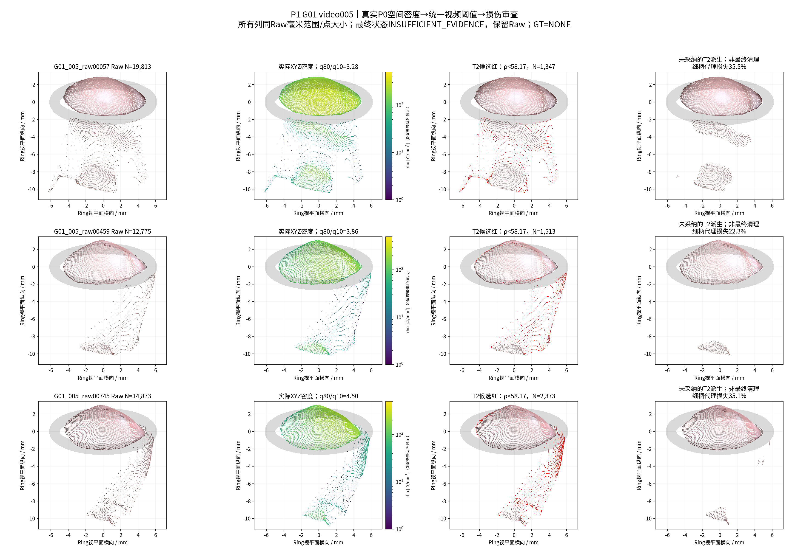
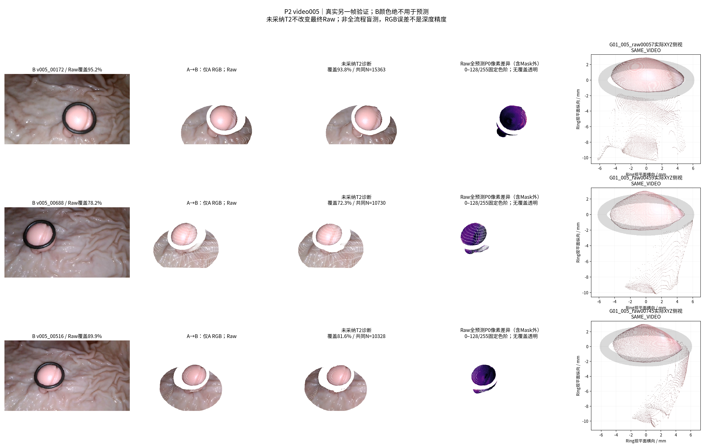
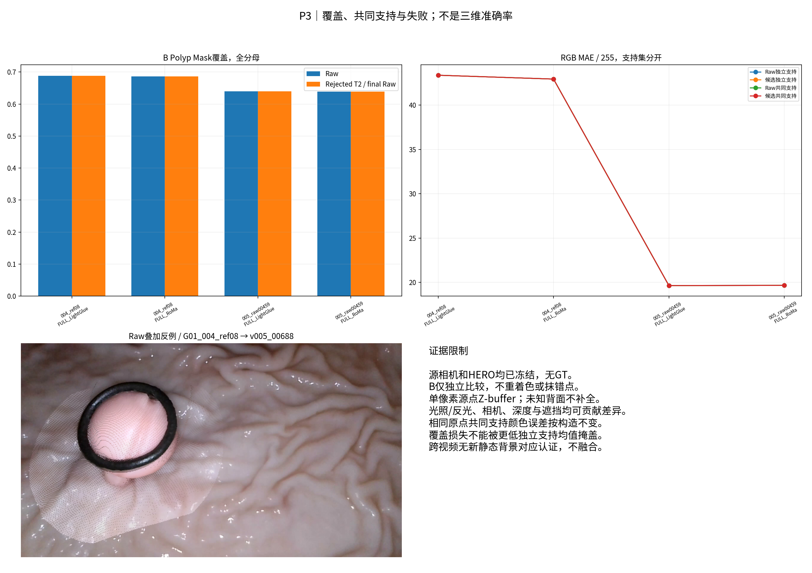

# TASK-PHASEC-ABS-DENSITY-REPROJ-001 技术报告

## 中文摘要

**工程执行完成；可靠自动Type-2清理目标未达成；跨视频配准未获认证。** 完成8物理组、9视频、13冻结参考面（213,654来源点）的空间密度诊断，3视频共21个视频阈值候选试验及13个固定50对照；原P0、相机、HERO、Mesh和Dxy均保持不变。全部最终结果保留Raw，派生删除只存在于明示的候选与对照中。

004/005三个参考均有空间连贯的密度跌落，但没有一档视频统一阈值同时通过三个参考的结构保留检查。005积极档允许并实际删除8,521、12,644、10,531点，没有以历史C/M/A比例封顶；raw459高密度代理原面只剩2.6%，说明同视频原始密度仍有显著参考差异。细柄代理损失不等于真实解剖误删，但足以使当前自动采用证据不足。

完成7个真实A→B配对，预测颜色仅来自A；B不重着色，不遮掉Mask外预测。G01 Raw目标Mask覆盖78.2–95.2%；未采纳T2候选均降低覆盖，共同支持RGB误差基本不变，不能由删后独立支持均值下降宣称几何改善。G06 Raw覆盖92.2%，同样不是绝对精度。

有限检查两套历史005→004刚体H及其逆，4次跨视频真实帧投影全部标记NO_VERIFIED_REGISTRATION。没有新拟合、焊接或融合；没有GT、Oracle、上游推理或Dxy修改。完成后停止等待人工验收。

## 固定审计表与分母

| 审计项目 | 必须汇报 |
|---|---|
| 目标组数 | 8独立组、9视频、13参考；G01两视频只计1组 |
| 本算法独立成功 | P1诊断/候选输出13/13参考；P2真实跨帧7/7配对（G01六、G06一）；P3诊断4/4投影。仅数值/工程成功 |
| 本算法失败 | 5/9视频证据不足；进入候选试验的3/3视频均无可采纳阈值。另4/9按规则无需清理，不算清理失败。跨视频认证0/1物理组；真实误删率与绝对三维精度全体NaN/NOT_EVALUABLE |
| 历史测量值回退 | 0。仅复用用户指定冻结P0/字段；两套旧H作为明确标记的历史诊断输入，不冒充新配准预测 |
| 失败组及具体原因 | [逐视频清单](metrics/failure_ledger.csv)；G01阈值/结构冲突，G03/G07相机不合格，G08证据不足；其余按规则不需要清理不代表证明正确 |
| 最终统计样本 | 全13参考213654来源点；NORMAL 2组7参考108125点，LIMITED 2组2参考23516点，UNQUALIFIED 4组4参考82013点，分开统计 |
| 是否使用GT选择算法 | 否，GT模式NONE；规则/阈值/A-B配对先冻结，RGB误差不用于选阈值或选B |

[条件分层](metrics/condition_summary.csv)、[输入/源身份](metrics/source_identity.csv)、[输入哈希](provenance/INPUTS.json)。这些点是重复观察暴露分母，不是独立解剖点，也不是13个物理病例。没有独立真实几何标签，不报告清理准确率、真实Type-2召回率、物理测量误差或重建成功率。

## 历史复用与密度身份

读取并核对历史Density、Sparse-Stretch、Video-Scene报告及代码；直接复用13份冻结字段。字段实际名`rho_surface_radius`，本任务称rho_radius：以原P0 XYZ为样本，r=0.4mm球内邻居数**排除自身**，rho=N/(πr²)，单位点/mm²。它是球邻域计数的二维表面采样代理，非真实表面积密度；离边界、倾角、深度、遮挡与叠层均会影响计数。13份字段均与历史SHA及原XYZ/像素身份匹配，未重算密度、k12、相机或深度。

历史C/M/A删除1,840/4,867/10,450点并有细柄/Ring/主片风险，只读对照；本轮没有复用其局部相对锚或联合删点规则。仅AST复用源Mask连通、原面连通、边界边和内部删除片统计函数，原脚本未执行。新预测只来自原P0按本轮rho阈值的原索引子集。

## P1：空间跌落、阈值冻结与结构失败

门控先找rho≤q20的低带及rho≥q70的密带，以低带源8邻接最大连通区检查空间支持。预先冻结：q80/q10≥3、连贯区占低带≥50%、其最大PCA标准差×4≥0.4CAD外径、区内k12中位/密带中位≥1.8；视频≥2/3参考满足才进入阈值试验。没有使用固定世界方向/平面，没有只看全局直方图。

阈值按同规则生成：L=跨参考最大低带区rho q25的中位，D=跨参考密带rho q10的中位；仅试L、√(LD)、D三个绝对值。点级规则严格为rho<T，未加C/M/A联合条件或逐点局部中位归一。三个候选及源代码在删除前冻结，见[VIDEO_THRESHOLDS](provenance/VIDEO_THRESHOLDS_FROZEN.json)、[P1源码/规则冻结](provenance/P1_CODE_AND_RULES_FROZEN.json)。保留单个全局50对照，不搜索。

| 视频 / 条件 | 空间门控参考 | 跌落q80/q10中位 | 三个绝对阈值 点/mm² | 最终状态 |
| --- | --- | --- | --- | --- |
| G01_004 / NORMAL_CONDITIONAL | 3/3 | 4.28 | 17.905, 49.216, 135.282 | INSUFFICIENT_EVIDENCE / Raw |
| G01_005 / NORMAL_CONDITIONAL | 3/3 | 3.86 | 17.905, 58.172, 188.996 | INSUFFICIENT_EVIDENCE / Raw |
| G02_004 / LIMITED_STRESS | 0/1 | 2.29 | 无 | NO_CLEANING_REQUIRED / Raw |
| G03_004 / UNQUALIFIED_STRESS | 1/1 | 3.73 | 17.905, 42.202, 99.472 | INSUFFICIENT_EVIDENCE / Raw |
| G04_004 / UNQUALIFIED_STRESS | 0/1 | 2.50 | 无 | NO_CLEANING_REQUIRED / Raw |
| G05_004 / UNQUALIFIED_STRESS | 0/1 | 2.51 | 无 | NO_CLEANING_REQUIRED / Raw |
| G06_004 / NORMAL_CONDITIONAL | 0/1 | 1.78 | 无 | NO_CLEANING_REQUIRED / Raw |
| G07_004 / UNQUALIFIED_STRESS | 0/1 | 3.28 | 无 | INSUFFICIENT_EVIDENCE / Raw |
| G08_005 / LIMITED_STRESS | 0/1 | 3.40 | 无 | INSUFFICIENT_EVIDENCE / Raw |

G01 q80/q10逐参考约3.28–4.73，密度图呈宽过渡与分散边界，未找到或声称唯一真实/错误突变点。L≈17.905来自极低采样尾部（约9邻居），中档004≈49.216、005≈58.172；这些是冻结试验档，不是认证错误边界。[156个空间剖面箱](metrics/dense_to_low_spatial_profiles.csv)使用各参考密带中心→低带中心的自适应三维方向描述完整投影范围，不反馈阈值。原/归一密度、k12、拉伸分布分别保留；归一后可能解释掉原密度差异，提示正常采样因素与错误深度不可单凭此分离。

结构采用检查：可能细柄代理保留≥90%、原主面剩余部分中最大连续片占比≥95%、高密度代理原面保留≥98%、内部删除片候选=0。没有限制全局删除比例。高密度代理不是认证头部；细柄代理是源Mask非最大分量最下20%像素行，不是真值；检查失败只能说保留证据不足，不能直接报真实误删率。

| 005参考 | 原始N | 低带连贯区N（非错误标签） | 档位T | 删除N | 低带残留N | 细柄代理删除/N | 原面面积损失 mm² | 高密度代理面积保留 |
| --- | --- | --- | --- | --- | --- | --- | --- | --- |
| raw00057 | 19813 | 3017 | T1 ρ<17.905 | 407 | 2610 | 133/845 | 5.051 | 100.0% |
| raw00057 | 19813 | 3017 | T2 ρ<58.172 | 1347 | 1729 | 300/845 | 21.497 | 100.0% |
| raw00057 | 19813 | 3017 | T3 ρ<188.996 | 8521 | 0 | 845/845 | 72.623 | 100.0% |
| raw00459 | 12775 | 1432 | T1 ρ<17.905 | 581 | 855 | 20/435 | 12.873 | 100.0% |
| raw00459 | 12775 | 1432 | T2 ρ<58.172 | 1513 | 218 | 97/435 | 31.401 | 100.0% |
| raw00459 | 12775 | 1432 | T3 ρ<188.996 | 12644 | 0 | 435/435 | 112.077 | 2.6% |
| raw00745 | 14873 | 2311 | T1 ρ<17.905 | 572 | 1754 | 115/539 | 8.487 | 100.0% |
| raw00745 | 14873 | 2311 | T2 ρ<58.172 | 2373 | 212 | 189/539 | 43.484 | 100.0% |
| raw00745 | 14873 | 2311 | T3 ρ<188.996 | 10531 | 0 | 539/539 | 103.205 | 93.2% |

005原低带区域、全部删除/残留、原面面积、主片连续性、新边界边、内部删除片和各代理分母见[逐项验收表](metrics/P1_005_acceptance.csv)。区域只是密度候选而非Type-2真值。T2三参考删除1,347/1,513/2,373点，细柄代理分别损失35.5%/22.3%/35.1%；即便残留更少、视觉更整齐，也未通过采用检查。T1在005 raw57/745仍损失15.7%/21.3%细柄代理；raw459单独通过不能冒充视频整体通过。T3 raw459删除98.97%，高密度代理面积只保留2.6%，属于明确工程损伤反例。

没有追加区域删除：残留孤岛登记在[残留连通/面积表](metrics/P1_residual_regions.csv)，保留未能排除的真实细小结构风险，不用全局小分量筛掉它。派生Mesh仅删除引用候选点的原三角面，原面索引保留，不补面/重采样。34份全部[候选损伤表](metrics/P1_candidate_damage.csv)含原始面积、连续片、孔洞代理、Mask/Ring及头部源分量统计。

固定50对照会删23,160/213,654点；G03删7,797/26,966（28.9%），但并没有证据把它们全部判错。G03初始空间门控也激活，说明门控仍有压力场景误报风险；最终因不合格相机/证据不足保留Raw。最终全体删除0不是“清理成功率”，也不能证明所有参考都不需清理。规则设计参考G01既有观察，扩组只做冻结规则复用，不是独立盲测；正常条件没有Is/R5独立验证组，不能声称形态通用。



## P2：真实A→B、独立支持与覆盖损失

[A/B清单](provenance/P2_PAIRS_FROZEN.json)在任何图像误差前冻结：合格冻结相机、绕Ring观察角3–25°、基线≥0.5mm，取最接近12°的可用B；实际7对观察变化9.23–14.55°、基线5.71–11.87mm。B排除A及其HERO输入帧，Ring/Polyp同见；[候选选择账本](provenance/P2_PAIR_SELECTION_AUDIT.json)保留没有选中的帧。所有相机参与过历史估计，且005有既有验证使用，不能称全流程盲测；004早期时间线对旧位姿的潜在影响仍在。

预测仅将A实际XYZ与A源RGB变换至B冻结K/c2w。使用正深度、画幅边界、每像素最近源点z-buffer及原CAD首交遮挡；没有B颜色采样、B Mask删预测、贴图、三角面补洞或稠密插值。预测PNG未覆盖处alpha=0。背景同样来自A冻结深度局部反投影；每个胜出点的源原索引和颜色可追溯。B Mask只定义独立评价区域，Mask外预测仍显示并单列数量。点级可见性不等于完整真实场景可见性，未知背面/遮挡未恢复。

P1最终没有采纳候选，正式最终Cleaned=Raw。为检查已经生成的清理候选是否只是改变评价支持，另在**计算RGB误差之前**冻结中档T2作为“REJECTED_T2_DIAGNOSTIC_ONLY”，没有重新选参数；见[P2执行冻结](provenance/P2_EXECUTION_FROZEN.json)。下表候选均未进入最终预测；G06未清理，候选列即Raw。

| A → B（实际帧） | B Mask N | Raw覆盖N / % | 未采纳T2覆盖N / % | 独立支持RGB MAE Raw / 候选 | 共同支持N | 共同RGB MAE Raw / 候选 |
| --- | --- | --- | --- | --- | --- | --- |
| G01_004_ref03 → 004_07 (raw602) | 13769 | 12731 / 92.5% | 12450 / 90.4% | 22.597 / 22.455 | 12450 | 22.456 / 22.455 |
| G01_004_ref08 → 004_14 (raw1118) | 12424 | 10312 / 83.0% | 9408 / 75.7% | 12.577 / 12.357 | 9408 | 12.351 / 12.357 |
| G01_004_ref13 → 004_07 (raw602) | 13769 | 10848 / 78.8% | 9396 / 68.2% | 17.555 / 17.163 | 9396 | 17.164 / 17.163 |
| G01_005_raw00057 → v005_00172 (raw172) | 16385 | 15594 / 95.2% | 15363 / 93.8% | 19.763 / 19.754 | 15363 | 19.769 / 19.754 |
| G01_005_raw00459 → v005_00688 (raw688) | 14844 | 11612 / 78.2% | 10730 / 72.3% | 25.616 / 26.098 | 10730 | 26.096 / 26.098 |
| G01_005_raw00745 → v005_00516 (raw516) | 12656 | 11376 / 89.9% | 10328 / 81.6% | 22.058 / 22.179 | 10328 | 22.179 / 22.179 |
| G06_004_ref04 → key01_raw00229 (raw229) | 8571 | 7906 / 92.2% | 7906 / 92.2% | 8.991 / 8.991 | 7906 | 8.991 / 8.991 |

RGB误差定义为胜出源点RGB与B相应真实像素的逐通道绝对差均值（0–255），在各自B Polyp有效支持统计；不是深度误差。完整median/MAE/p95/max、独立支持n、共同支持n、相同原点支持、Mask外预测、失去/新增像素和胜出点变更见[完整指标](metrics/P2_results.csv)。共同支持为同一B像素上Raw/Candidate均有Polyp预测；“相同原点”子集再要求A原点ID相同，其颜色和RGB误差按构造完全不变。

所有6个G01 T2候选均降低目标覆盖，最大下降约10.6个百分点。共同支持MAE变化仅约±0.016灰度，而005 raw459/745独立支持MAE上升。部分独立均值下降主要伴随支持缩小，不能算验证清理有效。G06 Raw数值对应较好，但共享相机、反光/光照变化、错误深度与未知遮挡仍无法由RGB差异唯一分解。A→A源像素往返只做工程自检，不计独立证据。

真实B帧使用冻结的640×360源RGB，未宣称原生1280×720无损像素；004源JPEG缓存风险沿历史身份链保留。所有同帧展示和A→B目标视角严格使用各自冻结相机，无独立旋转。差异图固定0–128/255色阶；没有覆盖的位置透明，不涂成低误差。



## P3：有限历史配准诊断与停止原因

复用ICF的FULL_LightGlue/FULL_RoMa；来源链为ICF H_frozen→MASt3R group-consensus baselines→ring_anchored_sparse_registration_v2历史候选，非本轮优化。历史导出代码明确H为005→004，004→005用其逆。尺度为固定毫米刚体，原点只在诊断副本中变换，未覆盖局部XYZ。005/004的目标B沿用另一视频已冻结P2列表，未按跨视频误差换帧或选更好H。

| A → B | 历史候选 | Raw覆盖N / B Mask N | P0 RGB MAE | 背景RGB MAE / N | Ring中心偏差mm / 法向角° |
| --- | --- | --- | --- | --- | --- |
| G01_004_ref08 → v005_00688 | FULL_LightGlue | 10219/14844 | 43.378 | 43.081 / 35076 | 0.154 / 2.602 |
| G01_004_ref08 → v005_00688 | FULL_RoMa | 10189/14844 | 42.944 | 43.331 / 34972 | 0.115 / 2.536 |
| G01_005_raw00459 → 004_14 | FULL_LightGlue | 7948/12424 | 19.648 | 19.829 / 27002 | 0.154 / 2.602 |
| G01_005_raw00459 → 004_14 | FULL_RoMa | 7932/12424 | 19.670 | 19.744 / 27013 | 0.115 / 2.536 |

Ring中心偏差0.115–0.154mm、法向差2.54–2.60°只是历史H与两局部CAD规范的差别，不能认证yaw。静态背景仅提供A颜色投影到B背景的条件一致性，上表分母是目标背景标签上的胜出源背景点；没有获得可认证的新材料对应，新增背景拟合锚点=0。跨视频曝光、反光、源/目标相机误差及Ring旋转对称未解耦，尤其004→005颜色差较大。没有以小Ring偏差或点云近邻误差宣称高精度。两候选都保留，认证状态全部NO_VERIFIED_REGISTRATION；未新增ICP、非刚性、H更新或跨视频融合。



## 可视化、保存与复现

沿用`visualization/real_p0_renderer.py`，未改该模块。13参考均保存完整L1–L5、Raw/Marked/Final、三个近相机视角（原相机及横向平移±1mm副本）和Ring XYZ正交双着色。L1–L4点大小0.08、alpha=1，无描边/抗锯齿膨胀，原XYZ和源RGB直接scatter，范围保持Raw；CAD为原位透明实体辅助，不用图像平面、Polyp/背景Mesh或插值替代点云。密集区域视觉连片不代表正确，真实间隙保留。L5才使用0.8点及黑色不透明CAD同相机展示。

L2背景沿用前轮较大椭圆：源Polyp最下20%图像行为基底代理、椭圆scale=2及纵横比0.75，外围限2个CAD外径；基底代理邻近12px接触见证全部保留，不做固定世界Z裁切，不移动背景XYZ。该代理可能被错误延伸牵引，不能证明真实基底连接。各层点数、坐标、K/c2w、原帧及参数见[13场景清单](metrics/LAYER_SCENES.json)。完整点/面、源像素、删除原因与原索引保存在本地，未将全量缓存公开。

每阶段公开4/3/3张PNG，共10张。每重点A/B配对本地另存B原图、透明预测、Raw/Candidate叠加、有效差异和实际XYZ侧视；[全部可访问核心图与本地索引](RESULT_INDEX.md)、[完整资产哈希表](metrics/LOCAL_ASSET_INDEX.csv)。L5/A→A只展示工程对应，不能替代P2或准确性证据。

318项[核验](metrics/VALIDATION.json)通过：历史输入、源身份、rho单位、严格阈值、原点/原面索引、最终Raw保持、所有胜出像素颜色来自A、相同原点颜色不变、相机未改、10PNG及四个受保护工作树状态。8项解析小检查通过。[独立目录重放](metrics/REPLAY_CHECK.json)复算后4份核心科学指标JSON逐项一致；没有运行上游模型。另从单个实际XYZ/RGB包独立重放L1–L4，禁止读取源RGB/Mask/深度图和视频，Camera/XYZ诊断图逐字节一致，见[点层重放](metrics/INDEPENDENT_LAYER_REPLAY.json)。这些工程测试不是真实误删率或绝对三维精度验证。

在本机冻结资产环境从仓库根目录复现到**不存在的新目录**（默认也生成全部图；可用`--no-render`只核对指标）：

```bash
PYTHONDONTWRITEBYTECODE=1 OPENBLAS_NUM_THREADS=1 OMP_NUM_THREADS=2 \
  /home/liu/polyp_research/ring_anchor_3d/.venv/bin/python \
  experiments/TASK-PHASEC-ABS-DENSITY-REPROJ-001/code/reproduce.py \
  --output-root /tmp/ring-abs-density-new-review
```

重放器复制本任务源码到新目录并在新输出中重新冻结相同规则/配对，再按P1→P2→P3执行，不覆盖本轮证据。原P1运行前源码留在初始commit，P2增加未采纳T2诊断时另留执行冻结；阶段源版本差异不等于阈值更改。[最终执行源码哈希](provenance/EXECUTED_SOURCES.json)。依赖沿用既有Python3.12、numpy/scipy/matplotlib/Pillow/trimesh/OpenCV与已审计Open3D vendor；不下载模型。

初始规则/配对commit `8166656`，指标/图片阶段截至 `87d5d61a92a459bb1a0b09327fd474f62fd58853`；最终报告提交以Git记录和人工回执为准。下一步仅等待人工验收：尤其需要判断源Mask细柄代理与真实结构的对应，以及是否接受局部候选可视效果；本轮没有将这种判断冒充自动成功，也不会自行放宽门槛或进入融合。
