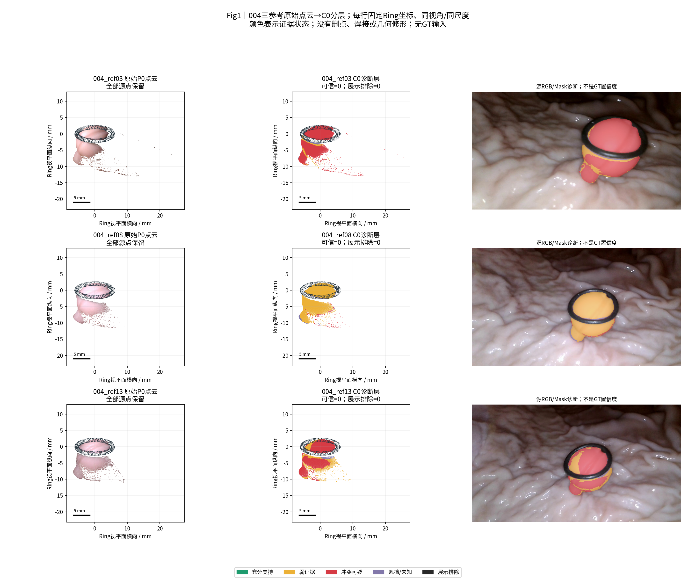
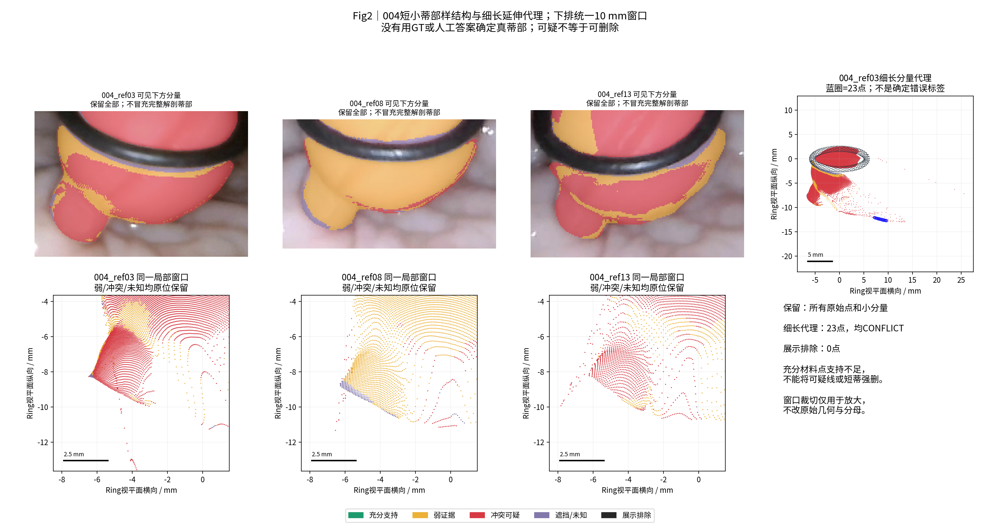
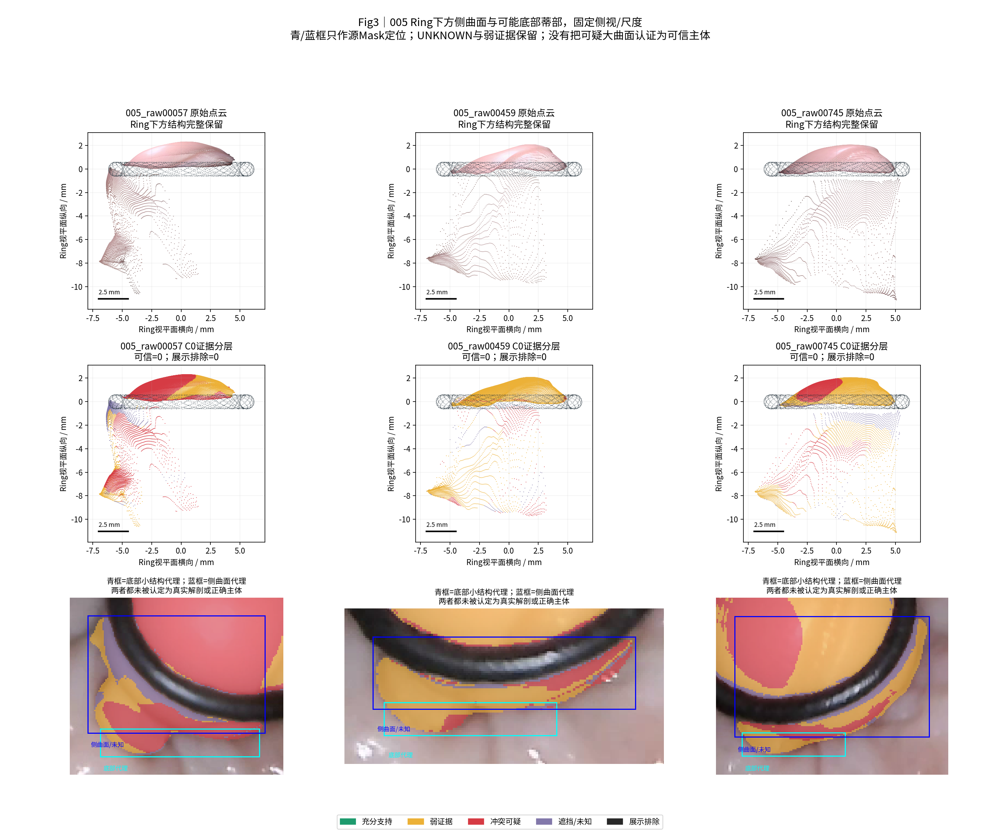
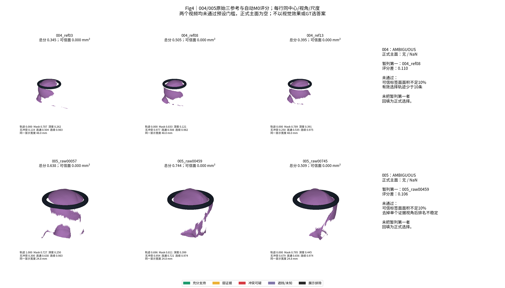

# TASK-PHASEC-C0-M0-E0-001 结果索引

状态：工程完成；M0两视频AMBIGUOUS；等待共同验收。

- [唯一技术报告](TECHNICAL_REPORT.md)
- [冻结协议](PROTOCOL.md)、[参数](config.json)、[输入/源码SHA](provenance/INPUT_FREEZE.json)
- [C0逐参考/状态点数和面积](metrics/C0_layers.csv)
- [M0候选评分](metrics/M0_candidate_scores.csv)、[正式决策](metrics/M0_decisions.json)、[稳定性](metrics/M0_stability.csv)
- [评价视角分层分母](metrics/evaluation_by_layer.csv)、[评价轨迹分家族](metrics/track_summary.csv)
- [004/005结构代理](metrics/inspection_regions.csv)、[模型差异](metrics/view_disagreement.csv)
- [E0七组资产](metrics/E0_assets.csv)、[推荐两组](metrics/E0_recommendations.csv)
- [9个小测试](metrics/safety_tests.json)、[最终验证](metrics/VALIDATION.json)
- [本地模型索引，仅指针不含GLB](metrics/local_model_index.json)

同视角、同Ring坐标和毫米尺度，全部原始点保留，颜色不是GT置信度。

23点细长代理标为冲突而非确定错误；短小结构与未知区域保留，展示排除0。

底部小部件和环下侧面仅为源Mask定位代理，未把侧面认证为可信主体，未永久删除。

004_ref08与005_raw00459只暂列第一，两视频正式选择均为NaN，不作为成功主面回填。

本地完整PLY/GLB/NPZ及源码不上传；未运行GT、HERO、相机重估、ICP或融合。

已完成的增量上传：

- 协议与输入冻结：`b2e31cdd8ec34ae9bcb5c6c81bd7215e4cb4af8e`。
- 指标/E0/四图：`7b2ed56e6534fdc50642bdc9bd62eeafc84979d3`。
- 最终报告及本索引位于后续报告提交；完整SHA以分支历史与交付消息为准。
