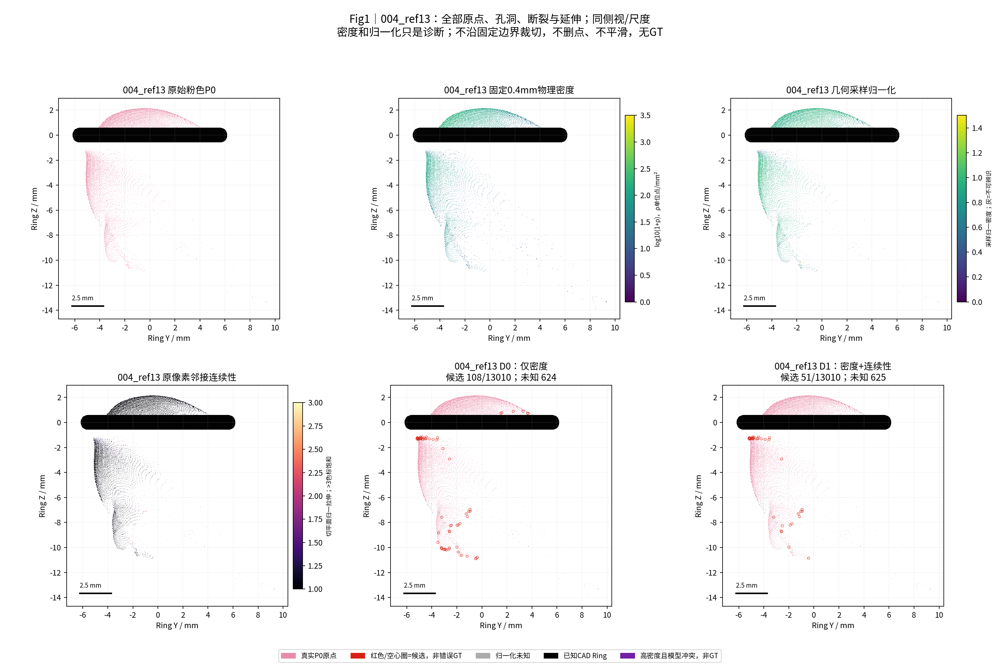
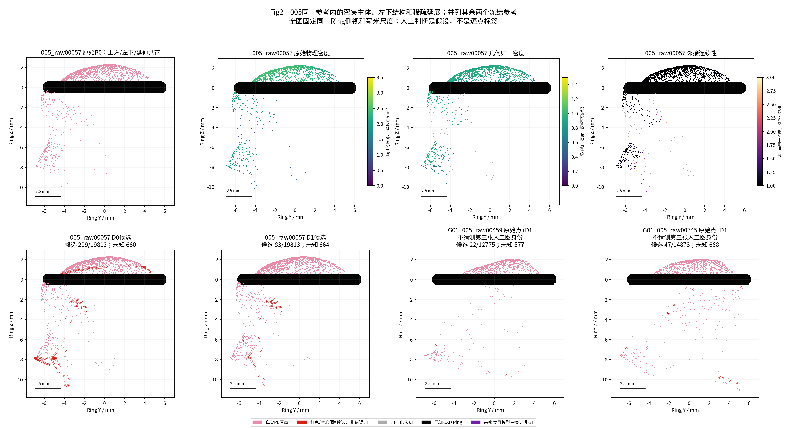
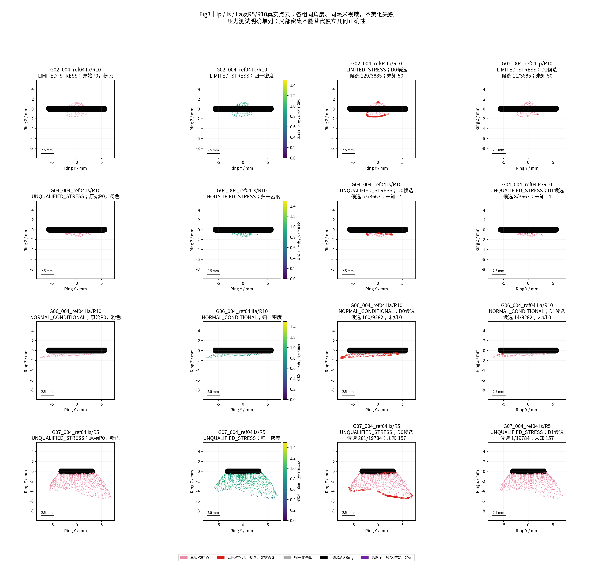
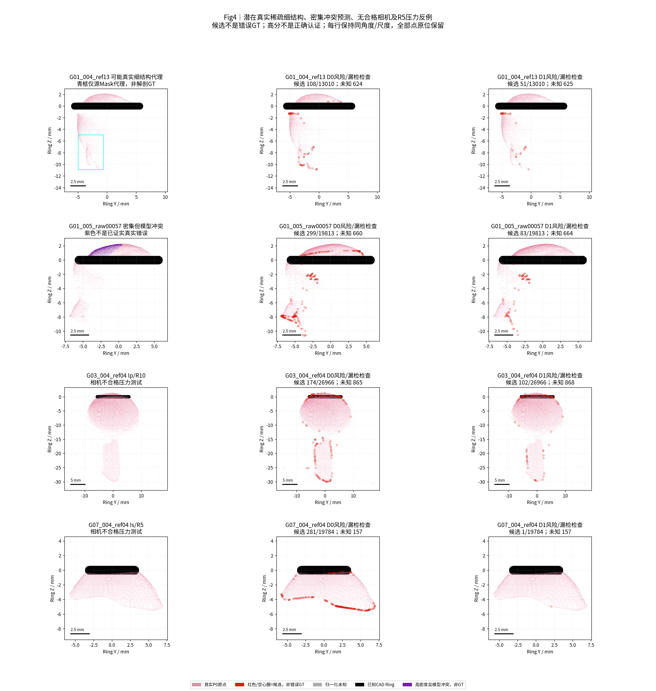

# TASK-PHASEC-DENSITY-MULTIGROUP-001｜局部密度、连续性与跨组诊断

日期：2026-10-25（Asia/Shanghai）。状态：**ENGINEERING_COMPLETE / DIAGNOSTIC_ONLY / 未证明可靠几何判别 / 已停止优化，等待人工验收**。分支：`exp/TASK-PHASEC-DENSITY-MULTIGROUP-001`。

## 中文摘要

实际完成8个独立物理组、9段视频、13份冻结P0的局部密度与源像素邻接诊断，共213,654个来源点；G01的004/005仍是一组，坐标独立。所有原始点、开放Mesh、HERO深度和相机未变。G01先算六参考，冻结源码/配置/字段后，以完全相同参数处理G02–G08；没有参数搜索、模型训练、重推深度、融合、ICP、GT或删点。

**有用的线索：** 004_ref13环下从相对左至右，原密度中位数97.482→39.789点/mm²，归一拉伸1.028→1.081；005_raw00057对应97.482→57.694点/mm²、1.044→1.175。实际点列的稀疏与发散可以由局部特征描述，过渡并非一条硬切线。

**主要负结果：** 深度/倾角采样归一化后，上述归一密度分别只从0.953→0.902和0.926→0.876变化；平滑错误深度可以被预测自身的法向和切平面“解释”。D0/D1候选分别2,224/535点，但这只是诊断数量；D1是保守合取，其候选按定义减少，不能称精度提升。细小结构代理仍有候选和UNKNOWN；密集且多参考冲突的预测仍获高分。

**跨组限制：** 只有G01与G06符合冻结的正常条件规则；G02/G08为有限压力测试，G03/G04/G05/G07源相机不合格，单独统计。正常条件中没有Is或R5独立组，不能证明形态或环尺寸通用性。没有独立真实几何标签，清理准确率、三维绝对误差和真实误删率均为NOT_EVALUABLE。仅改善了可审查性，几何改善、视觉清理改善均未发生。

## 1. 审计、来源与工程验证

沿用仓库规则、FINAL_AUDIT、历史资产审计及上一轮C0/M0/E0冻结链。ICF原点/像素身份供G01六参考；其余使用已有`P0_RAW_OPEN`与`RAW_PIXEL_IDENTITIES`，没有新增参考深度。每点可回溯`(group, actual_video, reference_frame, source_u, source_v)`；字段NPZ逐点保存这些身份。G08历史文件名含004，但实际视频005，来源表按actual_video修正名称，坐标与数据不变。

[输入身份表](metrics/input_identity.csv)、[逐文件SHA256](provenance/INPUT_FREEZE.json)记录85份启动输入/源码。与上一轮重合输入逐项匹配。算法源码SHA256：`311c17bfe3e4a4812c8c81088622d9dcd11cefc730019cf0a905e3766e9fa436`；配置SHA256：`7752b41cab89af594d8869d1cdc1ac807ed2743aef0ee04e64e9202f6b0e01ed`。源码全文与完整字段留本地，公开哈希、规则与统计；公开仓库不是完整数据/代码运行闭包。[G01后冻结](provenance/FEATURES_FROZEN_AFTER_G01.json)与[全部字段冻结](provenance/DIAGNOSTIC_OUTPUTS_FROZEN.json)证明没有按扩组结果改参。

复用历史`raw_points`、`project/unproject`；CAD检查只提取`o3scene/cast`，不执行旧实验入口。算法运行禁止打开GT/Oracle/.blend及评价资产，禁止写旧科研/DXY目录；名义组尺寸仅为来源身份。11项解析数值小测试通过，包括平面/倾角采样归一化、刚体不变性、边界可误报、线状法向UNKNOWN、身份保持与GT防护。最终[109项核验](metrics/validation.json)通过：13份来源、全部冻结哈希、指标、未知支持集、D1子集、四PNG及两个旧仓库HEAD/index/status和既有未提交文件哈希均未变。数值测试不是真实几何精度验证。

| 审计项目 | 必须汇报 |
| --- | --- |
| 目标组数 | 8独立物理组 / 9视频 / 13参考；G01两视频不拆成两个病例 |
| 本算法独立成功 | 字段计算8/8组、13/13参考；仅数值输出成功，不是几何判别正确 |
| 本算法失败 | 输入/计算失败0/13；科学正确性8/8组NOT_EVALUABLE；D0有5,292个NaN，D1有5,304个NaN |
| 历史测量值回退 | 0；不读历史测量值补齐，不用B/C或C0/M0生成新字段 |
| 失败组及具体原因 | 全13参考见[失败清单](metrics/failure_ledger.csv)与Fig4；G03/04/05/07相机压力，G02/08证据有限；各组均缺真实逐点标签 |
| 最终统计样本 | 所有13参考、213,654来源点均登记；D0有限208,362，D1有限208,350；正常2组与压力6组分开宏统计 |
| 是否使用GT选择算法 | 否；GT未读取、未拟合、未评价；先冻结G01定义，再直接跨组，调整次数0 |

## 2. 冻结特征与对照

P0是原始保留对照；D0/D1只增加字段，不生成新的预测表面。历史B/C及既有SOR/ROR、固定边长、多视图删点仅作历史背景，没有重跑或搜索。C0/M0未修改。此轮没有“清理后Mesh”或“最可信主面”产物。

固定物理半径r=0.4mm，记录球内其他点数、`rho_radius=N/(πr²)`与`N/(4πr³/3)`；前者是表面采样密度代理，后者是三维计数密度，不是组织物理密度。记录k=12的最近/中位/第k邻距离及`rho_knn=k/(πr_k²)`，不用全局点数代替局部密度。

局部16邻PCA给出**预测自身**法向。对相机射线`r=K^-1[u,v,1]`、轴向Z毫米、单位法向n，`rho_expected=fx*fy*|n·r|/Z²`，即每源像素的预测局部面积倒数。实际K/640×360源采样、深度和倾角均进入；未重新缩放原图。归一密度为`min(rho_radius,rho_knn)/rho_expected`，同时完整保留原始两套密度。入射余弦<0.15、PCA非平面性>0.1或切向特征值比<0.02时保持NaN/UNKNOWN，细线法向不能被强行解释。

源像素8邻接给出真实三维边长、仅透视归一拉伸、两端切平面射线交点归一拉伸。记录最大邻接拉伸与最大相邻归一密度对数梯度（每像素及每mm）。Mask边界≤3px、Ring邻近≤3px单独标识；预测冻结后才加CAD Ring首交及同视频其他参考深度冲突诊断，不反写分数。

`D0=clip(rho_normalized,0,1)`；`C=1/[1+max(0,stretch_max-1)+gradient/log(2)]`；`D1=max(D0,C)`。低于0.5才标候选；缺可靠法向/邻接则未知。D1要求密度与连续性同时可疑，故候选是D0的子集；高分不是正确概率。这种合取还使高D0永远不能被连续性单独降分，是当前方案的结构性局限，不能据此否定所有可能的密度/连续性组合。

## 3. 全分母结果与候选面积

正常条件要求源相机通过既有筛选且bundle至少3帧合格；源合格但不足3帧记LIMITED_STRESS，源不合格记UNQUALIFIED_STRESS。这只是既有相机筛选条件，不保证姿态真实正确。

| 组/参考 | 形态/环 | 条件：源合格/筛过帧数 | 原点N | D0/D1候选 | D0/D1未知 |
| --- | --- | --- | --- | --- | --- |
| G01_004_ref03 | Ip/R10 | NORMAL_CONDITIONAL：True/16 | 24343 | 170/55 | 887/890 |
| G01_004_ref08 | Ip/R10 | NORMAL_CONDITIONAL：True/16 | 14029 | 120/42 | 501/501 |
| G01_004_ref13 | Ip/R10 | NORMAL_CONDITIONAL：True/16 | 13010 | 108/51 | 624/625 |
| G01_005_raw00057 | Ip/R10 | NORMAL_CONDITIONAL：True/15 | 19813 | 299/83 | 660/664 |
| G01_005_raw00459 | Ip/R10 | NORMAL_CONDITIONAL：True/15 | 12775 | 148/22 | 577/577 |
| G01_005_raw00745 | Ip/R10 | NORMAL_CONDITIONAL：True/15 | 14873 | 172/47 | 667/668 |
| G02_004_ref04 | Ip/R10 | LIMITED_STRESS：True/2 | 3885 | 129/11 | 50/50 |
| G03_004_ref04 | Ip/R10 | UNQUALIFIED_STRESS：False/0 | 26966 | 174/102 | 865/868 |
| G04_004_ref04 | Is/R10 | UNQUALIFIED_STRESS：False/1 | 3663 | 57/8 | 14/14 |
| G05_004_ref04 | Is/R10 | UNQUALIFIED_STRESS：False/0 | 31600 | 205/50 | 236/236 |
| G06_004_ref04 | IIa/R10 | NORMAL_CONDITIONAL：True/4 | 9282 | 160/14 | 0/0 |
| G07_004_ref04 | Is/R5 | UNQUALIFIED_STRESS：False/0 | 19784 | 281/1 | 157/157 |
| G08_005_ref04 | IIa/R10 | LIMITED_STRESS：True/2 | 19631 | 201/49 | 54/54 |

总点数是参考观测暴露量，存在重复观察，不是213,654个独立解剖样本。全部原点保留；D0的2,224/213,654（1.041%）及D1的535/213,654（0.250%）均为DIAGNOSTIC_ONLY。共同有限支持为208,350点，D1独有候选0；1,689个D0候选未被D1标候选，包含支持缺失的情况，不能全称“获救真点”。未知分别5,292/213,654及5,304/213,654，不并入可信点。

| 组 | 条件 | 点暴露分母 | D0/D1候选 | 原三角面面积和 mm² | D0面积 全顶点/任一顶点 mm² | D1面积 全顶点/任一顶点 mm² |
| --- | --- | --- | --- | --- | --- | --- |
| G01 | NORMAL_CONDITIONAL | 98843 | 1017/300 | 824.211 | 0.302 / 15.592 | 0.128 / 7.519 |
| G02 | LIMITED_STRESS | 3885 | 129/11 | 17.810 | 0.084 / 0.755 | 0.000 / 0.253 |
| G03 | UNQUALIFIED_STRESS | 26966 | 174/102 | 414.699 | 0.040 / 5.827 | 0.040 / 4.111 |
| G04 | UNQUALIFIED_STRESS | 3663 | 57/8 | 25.960 | 0.025 / 0.669 | 0.000 / 0.240 |
| G05 | UNQUALIFIED_STRESS | 31600 | 205/50 | 212.377 | 0.000 / 2.329 | 0.000 / 1.336 |
| G06 | NORMAL_CONDITIONAL | 9282 | 160/14 | 80.466 | 0.072 / 1.432 | 0.000 / 0.215 |
| G07 | UNQUALIFIED_STRESS | 19784 | 281/1 | 113.474 | 0.185 / 1.486 | 0.000 / 0.016 |
| G08 | LIMITED_STRESS | 19631 | 201/49 | 229.385 | 0.047 / 3.646 | 0.047 / 1.583 |

面积依据**原有开放Mesh**：三个顶点全为候选的三角面面积和、任一顶点候选的面面积和，两者是不同离散归属约定，不是真实错误面积的置信区间。单点候选可无完整面，故全顶点面积可为0。跨参考面积和包含重复层、重叠及错误连接，不是去重可见面积，也未输出新的物理测量。全13参考D0面积代理0.755/31.736mm²，D1为0.215/15.273mm²；这些总量仅用于资产账本，科学比较用分组表。

正常2组（G01/G06，7参考）D0/D1候选1,177/314，点暴露108,125；LIMITED两组330/60，23,516点；UNQUALIFIED四组717/161，82,013点。组先对参考取均值，再对独立组宏平均：正常候选比例1.379%/0.227%，LIMITED为2.172%/0.266%，UNQUALIFIED为1.068%/0.190%，见[分层表](metrics/stratified_macro.csv)。这些是候选分布，不是压力测试或方法的成功率。

## 4. 逐参考分布与采样混杂

下表各格为中位数[p05,p95]，始终在该字段自身有限支持上计算；NaN数见上一表，完整均值、max、有效n、密度梯度与原始透视拉伸见[逐参考指标JSON](metrics/reference_metrics.json)。不同字段不能假定支持相同，D0/D1的直接数量差异另有[共同支持配对表](metrics/D0_D1_paired.csv)。

| 参考 | 固定r密度 点/mm² | k12距离 mm | 归一密度 | 最大邻接3D距离 mm | 切平面归一拉伸 |
| --- | --- | --- | --- | --- | --- |
| G01_004_ref03 | 177.060 [43.768, 336.215] | 0.143 [0.111, 0.302] | 0.938 [0.755, 1.007] | 0.131 [0.079, 0.521] | 1.030 [1.006, 1.161] |
| G01_004_ref08 | 101.461 [23.873, 183.028] | 0.189 [0.152, 0.394] | 0.929 [0.718, 1.009] | 0.170 [0.106, 0.721] | 1.029 [1.005, 1.184] |
| G01_004_ref13 | 97.482 [17.905, 181.039] | 0.192 [0.152, 0.458] | 0.933 [0.721, 1.003] | 0.174 [0.107, 0.888] | 1.028 [1.004, 1.195] |
| G01_005_raw00057 | 208.891 [45.757, 278.521] | 0.139 [0.121, 0.293] | 0.909 [0.643, 1.000] | 0.106 [0.085, 0.512] | 1.020 [1.002, 1.196] |
| G01_005_raw00459 | 133.292 [17.905, 179.049] | 0.172 [0.153, 0.442] | 0.907 [0.634, 0.993] | 0.131 [0.108, 0.825] | 1.021 [1.003, 1.216] |
| G01_005_raw00745 | 155.176 [23.873, 212.870] | 0.156 [0.139, 0.395] | 0.912 [0.641, 0.999] | 0.126 [0.098, 0.848] | 1.022 [1.003, 1.204] |
| G02_004_ref04 | 248.680 [91.514, 286.479] | 0.129 [0.116, 0.201] | 0.920 [0.541, 0.983] | 0.091 [0.082, 0.302] | 1.010 [1.001, 1.236] |
| G03_004_ref04 | 73.609 [17.905, 135.282] | 0.220 [0.177, 0.454] | 0.925 [0.791, 1.009] | 0.191 [0.125, 0.845] | 1.030 [1.004, 1.226] |
| G04_004_ref04 | 159.155 [57.694, 194.965] | 0.160 [0.144, 0.252] | 0.910 [0.633, 0.990] | 0.119 [0.103, 0.293] | 1.014 [1.002, 1.239] |
| G05_004_ref04 | 167.113 [61.673, 260.616] | 0.148 [0.126, 0.247] | 0.945 [0.714, 1.005] | 0.123 [0.089, 0.290] | 1.017 [1.004, 1.113] |
| G06_004_ref04 | 105.440 [63.662, 165.123] | 0.186 [0.155, 0.239] | 0.924 [0.575, 1.006] | 0.146 [0.110, 0.196] | 1.019 [1.004, 1.092] |
| G07_004_ref04 | 202.923 [65.651, 322.289] | 0.136 [0.112, 0.232] | 0.934 [0.611, 1.008] | 0.105 [0.079, 0.302] | 1.012 [1.002, 1.064] |
| G08_005_ref04 | 97.482 [31.831, 137.271] | 0.193 [0.164, 0.340] | 0.922 [0.677, 1.010] | 0.155 [0.116, 0.405] | 1.015 [1.003, 1.100] |

所有13参考中，原密度与预测采样密度的Spearman相关0.847–0.990；归一密度中位数仅0.907–0.945。相关性来自同一P0推导的变量，不能当独立验证。它说明原始稀疏差异很大程度可被观察深度/倾角/采样解释，也可能包括**错误深度自身导致的采样变化**。过度几何归一化会同时解释并掩盖这种异常；不应把原密度直接阈值化，也不应把归一后接近1直接认证为真实。详见[采样相关表](metrics/sampling_correlations.csv)。

## 5. G01人工观察的定性核对

人工标注图片未进入工作区，文字观察只作为假设，无逐点真值。侧视沿-X，横轴Ring Y、纵轴Z；环下定义Z<−0.6mm。其Y分位数左/中/右三等分及1mm横向剖面只为描述过渡，绝不作为预测边界。不能把世界Y=0当用户“可信/不可信”的分界；部分向右延伸仍位于Y<0。环上Z>0.6是可见主体位置代理，未认证连续真表面。

| 参考 | 描述区域，非标签 | N | 原密度中位 | 归一密度中位 | 拉伸中位 | D0/D1候选 |
| --- | --- | --- | --- | --- | --- | --- |
| G01_004_ref13 | 环上主体代理 | 5195 | 121.356 | 0.941 | 1.021 | 7/0 |
| G01_004_ref13 | 环下相对左1/3 | 1678 | 97.482 | 0.953 | 1.028 | 16/14 |
| G01_004_ref13 | 环下相对中1/3 | 1677 | 67.641 | 0.936 | 1.048 | 9/7 |
| G01_004_ref13 | 环下相对右1/3 | 1677 | 39.789 | 0.902 | 1.081 | 32/14 |
| G01_005_raw00057 | 环上主体代理 | 13222 | 230.775 | 0.919 | 1.016 | 66/0 |
| G01_005_raw00057 | 环下相对左1/3 | 1200 | 97.482 | 0.926 | 1.044 | 43/0 |
| G01_005_raw00057 | 环下相对中1/3 | 1200 | 107.430 | 0.883 | 1.081 | 53/11 |
| G01_005_raw00057 | 环下相对右1/3 | 1200 | 57.694 | 0.876 | 1.175 | 65/52 |
| G01_005_raw00459 | 环上主体代理 | 6609 | 149.208 | 0.915 | 1.016 | 9/0 |
| G01_005_raw00459 | 环下相对左1/3 | 623 | 107.430 | 0.857 | 1.073 | 22/2 |
| G01_005_raw00459 | 环下相对中1/3 | 622 | 21.884 | 0.849 | 1.119 | 10/2 |
| G01_005_raw00459 | 环下相对右1/3 | 623 | 17.905 | 0.839 | 1.070 | 16/1 |
| G01_005_raw00745 | 环上主体代理 | 8364 | 181.039 | 0.918 | 1.018 | 4/1 |
| G01_005_raw00745 | 环下相对左1/3 | 865 | 59.683 | 0.852 | 1.103 | 38/7 |
| G01_005_raw00745 | 环下相对中1/3 | 865 | 47.746 | 0.927 | 1.048 | 10/4 |
| G01_005_raw00745 | 环下相对右1/3 | 865 | 31.831 | 0.899 | 1.046 | 37/9 |

004_ref13确有原密度递减、邻接拉伸增加的过渡，D0/D1却只在右第三分区标32/14个点（分母1,677），不能可靠把整片破碎延伸与真实小结构分离。005_raw00057右第三分区D1标52/1,200，左第三分区0/1,200，提供了同参考内部的局部对比；但右区大多数点仍非候选，不能将其称为已识别整片错误侧面。

005_raw00459和raw00745均保留顶部较密集与环下稀疏延展并列证据；方向和分布并非单调统一。raw00459环下三分区原密度107.430→21.884→17.905，但D1只标2/2/1点；raw00745为59.683→47.746→31.831，归一密度反而0.852→0.927→0.899。检查了全部三个005原参考，没有猜测第三张人工图的精确身份。完整[85个1mm剖面](metrics/transition_profiles.csv)保留零散过渡与UNKNOWN。

Fig1：004_ref13全部原始点、0.4mm原密度、几何归一密度、邻接拉伸及D0/D1，同侧视/毫米尺度；右下发散、孔洞和断裂均保留，未沿固定边界裁切。红色与空心圈是候选注释，不是错误GT；灰色为不能可靠归一的点。

Fig2：005_raw00057同一原点云中的顶部、左下结构和右下延展直接对照，下排同时保留raw00459/raw00745。所有子图共享Ring视角和物理显示范围；D1高分没有被解释为真实认证。

## 6. 细小结构、密集冲突与Ring风险

“可能蒂部”仅用源Mask最大分量以外的可见分量底20%图像行作代理，既不等于真实解剖蒂部，也不等于用户的精确标注；没有该分量的组其代理为空，不推断其没有蒂部。

| G01参考 | 底20%源Mask代理点数 | D0/D1候选 | D0/D1未知 |
| --- | --- | --- | --- |
| G01_004_ref03 | 2302 | 63/13 | 207/208 |
| G01_004_ref08 | 1136 | 23/3 | 158/158 |
| G01_004_ref13 | 1074 | 20/5 | 159/160 |
| G01_005_raw00057 | 845 | 33/3 | 167/170 |
| G01_005_raw00459 | 435 | 21/2 | 0/0 |
| G01_005_raw00745 | 539 | 23/0 | 103/104 |

004_ref13代理1,074点中D0/D1候选20/5，未知159/160；005_raw00057代理845点中33/3，未知167/170。因此真实但稀疏的小结构、Mask边缘、细线退化法向均有潜在误伤风险，无法宣称“蒂部安全”。这不是测得的误删率，因为没有真实标签且实际删点0。全数据D0候选2,171/2,224在源Mask边界3px内，D1为486/535；大量响应来自边界截断，不能直接视为坏深度。

预测冻结后，逐点投影到**同视频另两参考**，仅当目标Polyp Mask、正深度、夹角≥2°时比较轴向深度；前方差超过0.3mm作模型冲突代理。以本参考原密度上四分位且D0≥0.8挑出密集冲突例，只用于分析，不反馈D0/D1。

| 参考 | 全点分母 | 高密度+前冲突+D0≥0.8 | 其中D1≥0.8 | 其中又获另一参考同意 |
| --- | --- | --- | --- | --- |
| G01_004_ref03 | 24343 | 5936 | 5936 | 3164 |
| G01_004_ref08 | 14029 | 0 | 0 | 0 |
| G01_004_ref13 | 13010 | 3263 | 3263 | 3240 |
| G01_005_raw00057 | 19813 | 4874 | 4874 | 133 |
| G01_005_raw00459 | 12775 | 0 | 0 | 0 |
| G01_005_raw00745 | 14873 | 789 | 789 | 216 |

005_raw00057有4,874个这样的密集冲突代理点，全部D1≥0.8；其中133点又与另一参考深度同意。所有这些代理的连续性分数均未低于0.5。这里证明的是**密度/连续性高分不能消除多参考冲突**；并未证明4,874点全部错误。004_ref13多数冲突点同时被另一参考同意，强调冲突来源和可见性可能互相矛盾。没有独立真几何，已确认“密集错误面”的数量为NOT_EVALUABLE，不能用冲突冒充错误标签。

Ring首交是冻结后、固定CAD/相机条件下的可见性风险；不是GT遮挡证明。004_ref13的13,010点中298点落在CAD首交后>0.3mm，D0/D1标33/23；raw00057的19,813点中338点，标39/28。Ring遮挡附近仍有高分或未知，不自动变成删除依据。逐组[CAD可见性风险](metrics/Ring_visibility_risk.csv)与[细结构/边界风险](metrics/thin_boundary_risks.csv)提供完整分母；相机压力组尤其不能把该首交当确定物理遮挡。

## 7. 跨组、反例与停止条件

G02–G08均直接复用G01冻结规则，不依据组名、尺寸、人工印象或GT调参。环上主体位置代理的分布如下；它不证明完整表面连续性，环下大面也可能与同一个源分量连通。G06环上仅有少量点或为空时，表格如实报告，不以环上规则裁掉其余点。

| 组/参考 | 环上代理N | 原密度中位 | 归一密度中位 | 拉伸中位 | D0/D1候选 |
| --- | --- | --- | --- | --- | --- |
| G02_004_ref04 | 973 | 274.542 | 0.924 | 1.007 | 9/3 |
| G03_004_ref04 | 1218 | 71.620 | 0.954 | 1.056 | 15/2 |
| G04_004_ref04 | 0 | NaN | NaN | NaN | 0/0 |
| G05_004_ref04 | 518 | 141.250 | 0.972 | 1.019 | 2/2 |
| G06_004_ref04 | 0 | NaN | NaN | NaN | 0/0 |
| G07_004_ref04 | 0 | NaN | NaN | NaN | 0/0 |
| G08_005_ref04 | 0 | NaN | NaN | NaN | 0/0 |

为避免用环上位置代替主体，另在预测冻结后统计**最大源Mask连通分量**的既有特征，所有组采用相同定义；这反映二维源邻接连续候选，不认证真实三维主体，也不阻止错误面与主体相连。下表同样是各字段有限支持的中位[p05,p95]；逐项n/未知、邻接、梯度和面积见[主体代理完整表](metrics/body_proxy_profiles.json)。该描述性统计没有改变D0/D1或增添选择规则。

| 参考 | 最大源Mask分量N/全点N | 原密度中位[p05,p95] | 归一密度中位[p05,p95] | 拉伸中位[p05,p95] | D0/D1候选 |
| --- | --- | --- | --- | --- | --- |
| G01_004_ref03 | 13441/24343 | 222.817 [67.641, 348.151] | 0.930 [0.750, 1.006] | 1.026 [1.005, 1.136] | 85/31 |
| G01_004_ref08 | 8471/14029 | 129.313 [37.799, 187.007] | 0.915 [0.735, 1.005] | 1.024 [1.004, 1.171] | 74/24 |
| G01_004_ref13 | 7978/13010 | 121.356 [29.842, 185.018] | 0.930 [0.745, 1.000] | 1.023 [1.003, 1.110] | 51/16 |
| G01_005_raw00057 | 15834/19813 | 230.775 [111.408, 278.521] | 0.911 [0.730, 0.997] | 1.017 [1.002, 1.079] | 116/15 |
| G01_005_raw00459 | 10829/12775 | 145.229 [73.609, 181.039] | 0.910 [0.711, 0.994] | 1.019 [1.003, 1.126] | 91/16 |
| G01_005_raw00745 | 12278/14873 | 171.092 [79.577, 214.859] | 0.914 [0.712, 0.998] | 1.020 [1.004, 1.119] | 87/27 |
| G02_004_ref04 | 3885/3885 | 248.680 [91.514, 286.479] | 0.920 [0.541, 0.983] | 1.010 [1.001, 1.236] | 129/11 |
| G03_004_ref04 | 24082/26966 | 75.599 [15.915, 135.282] | 0.924 [0.812, 1.005] | 1.027 [1.004, 1.191] | 134/83 |
| G04_004_ref04 | 3663/3663 | 159.155 [57.694, 194.965] | 0.910 [0.633, 0.990] | 1.014 [1.002, 1.239] | 57/8 |
| G05_004_ref04 | 21487/31600 | 181.039 [55.704, 266.585] | 0.929 [0.712, 1.004] | 1.017 [1.004, 1.110] | 148/33 |
| G06_004_ref04 | 7048/9282 | 103.451 [65.651, 133.292] | 0.939 [0.665, 1.013] | 1.018 [1.004, 1.079] | 49/5 |
| G07_004_ref04 | 16719/19784 | 206.901 [61.673, 324.278] | 0.937 [0.634, 1.011] | 1.012 [1.002, 1.072] | 227/1 |
| G08_005_ref04 | 15646/19631 | 117.377 [29.842, 139.261] | 0.918 [0.683, 0.990] | 1.014 [1.002, 1.086] | 141/35 |

Ip有正常G01、有限G02及不合格G03；Is的G04/G05/G07全部为相机不合格压力测试；IIa有正常G06和有限G08。R5仅G07一组且相机不合格。各类描述统计均已输出，但没有正常Is/R5独立验证，更没有G02–G08人工标签。跨组稳定的只是“源采样/边界强烈影响密度”的现象；可信/错误的判别规律没有获证。

Fig3：G02 Ip、G04 Is、G06 IIa与G07 Is/R5的真实P0、归一密度、D0/D1。全图共享侧视与毫米视域，压力条件显式标出。G07的大面积连续延展仍有较高归一密度；D1仅1/19,784候选，不构成优良相机或优良深度的证据。

Fig4：004_ref13青框为源Mask细结构代理的范围，不能当逐点解剖标签；005_raw00057紫色为密集模型冲突代理，不能当错误GT。G03与G07展示不合格相机下仍可能密集、连续的预测。每行三列同视角/尺度，异常不隐藏；行间尺度不同且均标毫米比例尺。

已触发本轮停止优化条件：正常采样混杂强、可能真实细结构仍被标候选/未知、平滑冲突曲面可密集且连续。没有据此添加复杂模型或重新搜索阈值。G01结果之后只完成事先规定的**同参数跨组验证与只读评价**。不把压力组的顺滑外观当成功。

## 8. GT身份、失败与NOT_EVALUABLE

GT使用模式：**NONE**。C0/M0、Oracle ICP、历史GT拟合分数和人工逐点答案均不参与特征、参数或候选。人工文字不是GT；其他HERO参考与CAD首交只是预测/姿态条件下的证据。历史GT部署位姿和成功率风险仍待审计，本轮未重做GT实验。

清理准确率、真实误删率、真实可见覆盖、真实三维精度、共同真实成功组的ARE/MAE/p95/max及物理尺寸误差全部NaN/NOT_EVALUABLE；未进行物理测量。特征分布p95/max是观测统计，与几何误差无关。只报告同原点支持上的候选数量/面积及风险，完整失败记录覆盖13/13参考，没有筛掉失败或只报漂亮组。

工程成功：全部字段、身份、指标与真实可视化完成并可本地逐点审查。科学改善：尚未证明。视觉改善：仅信息着色、对照与反例可读性，原几何没有变好。人工待判：004真实短蒂与异常延伸的边界、005侧曲面中真实/错误部分、密集冲突来源；本轮不替人工或GT给确定标签。

## 9. Q1–Q4与结论

**Q1 局部密度有价值吗？** 有限有用：可以定位原采样稀疏、断裂及过渡，特别是004_ref13和005_raw00057同参考对比；不能单独认证表面可信度，原密度对观察几何非常敏感。

**Q2 D1明显优于D0吗？** 未证明。D1候选更少是max合取的定义；它减少部分细结构代理响应，也留下大部分稀疏延展和密集冲突。没有真实标签可判断这些变化的净收益，且此结论只针对本轮冻结的简单D1。

**Q3 跨形态/环尺寸仍成立吗？** 采样混杂与边界风险在多组存在，但可信度判别的通用性NOT_EVALUABLE。正常条件只2个独立组，Is/R5没有正常样本，不把8组字段成功当8组方法有效。

**Q4 哪些真实结构可能误伤？** 细小或近线状蒂部、真实稀疏侧面、Mask截断边、Ring遮挡附近和高倾角表面；法向不可靠处应保持UNKNOWN。所有这些原点均保留，没有实际误删。

本轮结论是保留这些字段作为**诊断证据**，不升级正式清理。下一步内容由PM与用户验收后另行授权；本任务已停止，不自动进入M1/M2、GT、补算或扩组实验。

## 10. 可视化真实性、产物与增量上传

VIS-REAL-3D-v1未找到额外独立规范文件，本轮严格执行用户给定条款：粉色真实P0、黑色实际CAD Ring、毫米坐标/比例尺。每个原始点投影到620×620正交深度缓冲，按最近点解决像素重叠，并按真实Ring首交遮挡；没有点云体素降采样、插值、平滑或新曲面。图像因光栅与遮挡不会显示每个点的独立像素，但所有点均参与投影且保持原位。候选空心圈为注释，不改变原密度；热力图统一色标、饱和不裁剪数据，原始分布全部保留。[四PNG尺寸/哈希](provenance/FIGURE_MANIFEST.json)。

本地`local_fields/*_fields.npz`保留13份完整密度、法向可靠性、梯度、邻接、D0/D1和源身份；`*_evaluation_only.npz`、`*_Ring_diagnostic.npz`明确为事后评价，未参与预测。原PLY/Mesh继续使用原路径，没有新GLB或删除后的模型。源码、完整字段、原始RGB/Mask/视频、模型、全缓存均未公开上传。

- 阶段1协议/输入冻结：[`e4ab4ae17ee856c84b7522ffce53c358bb3a0294`](https://github.com/zheng1524/ring-first-3d/commit/e4ab4ae17ee856c84b7522ffce53c358bb3a0294)；代码与小测试本地保留，公开哈希及11项测试结果。
- 阶段2指标与四PNG：[`d541afe8d32dd228ea3720c512e922135112e35b`](https://github.com/zheng1524/ring-first-3d/commit/d541afe8d32dd228ea3720c512e922135112e35b)。
- 阶段3本报告、[结果索引](RESULT_INDEX.md)与发布清单：最终SHA由交付回执及本文件GitHub版本记录提供，避免报告自引用SHA。

唯一完整报告为本文件。公开范围限本任务文档、小型指标/来源/哈希与四PNG；不创建正式科学baseline tag。完整本地产物及公开目录见[RESULT_INDEX.md](RESULT_INDEX.md)。
