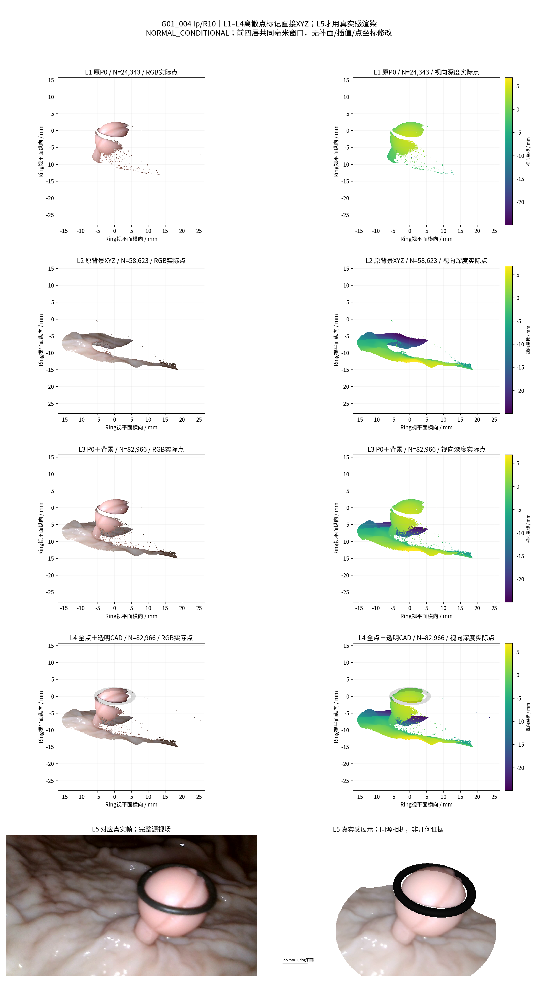
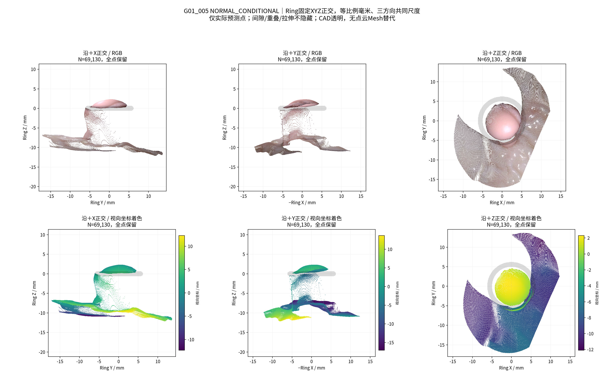

# TASK-PHASEC-SCENE-POINTCLOUD-AUDIT-001 技术报告

## 中文摘要与任务状态

已完成5个视频场景、4个独立物理组的L1–L5逐层展示和六方向真实点云诊断，共20张核心PNG。L1–L4直接使用冻结P0及冻结深度反投影的背景XYZ，未补点、补面、平滑、移动坐标或修改科研相机；沿用`real_p0_renderer.draw_rgb_points`。原有同视角真实感004资产保留不变。结果支持的是**工程可审计性改善**：能够分别观察点层、空隙、折叠和异常延伸。没有三维准确性改善结论，没有清理、融合或新模型推理。完成后停止，等待人工验收。

## 分母、来源与GT身份

| 审计项目 | 本轮汇报 |
|---|---|
| 目标组数 | 4独立物理组：G01、G04、G06、G07；5视频、5参考 |
| 本算法独立成功 | 数值/渲染输出5/5视频，4/4组；仅工程输出完成，非测量或重建正确 |
| 本算法失败 | 输出缺失0/5；三维精度全体NaN/NOT_EVALUABLE |
| 历史测量值回退 | 0；复用冻结P0属于本轮授权输入，不是测量值回退 |
| 失败组及具体原因 | G04/G07相机几何不合格；全部场景缺独立几何评价，见下文证据 |
| 最终统计样本 | 描述统计5/5视频；其中3视频来自2个正常条件组，另2视频/2组为压力测试；无准确率分母 |
| 是否使用GT选择算法 | 否；GT=NONE，输入哈希、统一配置及执行源码哈希留存 |

原始息肉总点数76,885，全部保留。每点仍绑定(group, actual_video, reference, source_u, source_v)。[来源清单](metrics/source_identity.csv)、[48项输入SHA256](provenance/INPUT_MANIFEST.json)、[源码哈希](provenance/EXECUTION_SOURCES.json)。带`gt`名称的历史目录中只读取已核验的预测深度和源RGB/Mask等输入，不读取GT形状、部署姿态、Oracle结果或GT评分。

G01两视频保持独立坐标，无跨视频拼接。G04历史参考相机不合格（仅1个合格帧），G07无合格帧，均标记UNQUALIFIED_STRESS；其余是NORMAL_CONDITIONAL，亦未经本轮精度认证。未报告MAE、p95误差、准确率、测量值或“正确重建成功率”。下表p95仅是**预测层间距离分布**，不是对GT的误差。

## 五层数据及统一显示

| 层 | 数据与绘制方式 | 点数身份 |
|---|---|---|
| L1 | 冻结P0原XYZ、源像素RGB，实际scatter | 原始P0全点 |
| L2 | 同参考冻结深度、K/c2w反投影；Mask=0的局部背景 | 原始背景子集，XYZ未移动 |
| L3 | L1、L2精确拼接后scatter | L1+L2 |
| L4 | L3全点+原位CAD实体几何，alpha=0.15 | 与L3相同；不按CAD遮掉点 |
| L5 | 同一源相机完整点渲染+黑色不透明CAD，与原生真实帧并排 | 输入同L4；正常可见性遮挡另记，不能替代L1–L4 |

L1–L4点大小0.08 pt²、alpha=1、无描边、关闭点标记抗锯齿，保留实际密度、孔洞和拉伸；没有下采样、图像背景、纹理平面、Polyp/背景Mesh或插值。CAD投影来自实际网格射线求交，不是RGB贴图。逐层图前四行使用共同Ring毫米窗口及(-65°,22°)正交诊断视图，RGB和视向坐标双列；L5行才使用真实帧/真实感图。高密度处仍可能视觉连片，应结合深度、侧视和源XYZ检查，不能据此认定连续实体。

三个近相机视角：原冻结相机、沿原相机横轴平移−1/+1mm的平行轴副本，具备真实基线位移；左右明确标DIAGNOSTIC_ONLY，非视频帧。科研K/c2w未改。诊断窗口保留画幅外投影点，不裁掉异常结构。XYZ沿Ring +X/+Y/+Z正交，三方向共同毫米尺度、等比例轴，每类均RGB/深度双行。

## 背景范围与实际层间距离

背景不再限于Polyp Mask外45px。以源Polyp最下20%图像行作为**基底代理**，其UV中位数定位椭圆；这并非真实解剖基底标签。椭圆横半轴=scale×max(Polyp半宽,Ring半宽)，纵横比0.75，比较1.5/2/2.5，统一采用2.0，未按组或间隙评分调参。外围距基底代理XYZ中位数超过2个CAD外径的点仅从展示选区排除；基底代理像素距离≤12px的接触见证点全部豁免，避免通过裁剪隐藏实际间隙。没有固定世界Z截断，完整原背景仍另存。

| 场景 | scale 1.5 点数 | scale 2.0 点数（采用） | scale 2.5 点数 | 采用范围远端展示排除点 | 仍保留的远接触见证点 |
|---|---:|---:|---:|---:|---:|
| G01_004 | 35,127 | 58,623 | 78,485 | 3,963 | 0 |
| G01_005 | 28,172 | 49,317 | 75,234 | 0 | 0 |
| G04_004 | 24,825 | 53,853 | 88,649 | 0 | 0 |
| G06_004 | 19,898 | 41,928 | 68,046 | 0 | 0 |
| G07_004 | 31,205 | 65,219 | 86,771 | 736 | 0 |

完整分母、椭圆中心/半轴、全背景点数、世界包围盒和三范围排除数见[范围表](metrics/background_ranges.csv)。展示排除不是清理，不改变任何源坐标。代理可能受异常延伸影响，不保证覆盖真实基底；这属于本轮限制。

| 场景 / 条件 | 原始帧（0起） | L1 P0 | L2 背景 | L3=L4 总点 | 基底代理→背景 NN 中位 / p95 mm |
|---|---:|---:|---:|---:|---:|
| G01_004 Ip/R10 / NORMAL_CONDITIONAL | 303 | 24,343 | 58,623 | 82,966 | 2.470 / 4.532 (n=4949) |
| G01_005 Ip/R10 / NORMAL_CONDITIONAL | 57 | 19,813 | 49,317 | 69,130 | 1.824 / 3.885 (n=4037) |
| G04_004 Is/R10 / UNQUALIFIED_STRESS | 437 | 3,663 | 53,853 | 57,516 | 0.741 / 1.353 (n=780) |
| G06_004 IIa/R10 / NORMAL_CONDITIONAL | 596 | 9,282 | 41,928 | 51,210 | 0.486 / 1.044 (n=1915) |
| G07_004 Is/R5 / UNQUALIFIED_STRESS | 369 | 19,784 | 65,219 | 85,003 | 0.996 / 2.073 (n=4108) |

NN以表列n个基底代理P0点分别查找选中背景最近点；并非真实表面距离，不能推断哪层错误。反向接触见证→代理距离、两层原生点间距及各自n另列[场景指标](metrics/scene_summary.csv)，不混合不同支持集。L1/L2/L3/L4共20层记录，另5条L5输入/可见点记录见[逐层点数与XYZ来源](metrics/stage_counts.csv)。

## 观察结果、失败与人工待判定

- G01_004：源P0下方细长、稀疏延伸完整保留；背景在侧向呈折叠片层。L3/L4显露两点层的空隙和局部重叠，L5看起来更连贯，不能证明真实连接。[逐层](figures/G01_004/Layers_L1-L5.png)、[XYZ](figures/G01_004/XYZ_3Views.png)。
- G01_005：顶部、下方未知大曲面和稀疏延伸都未处理；不同方向需共同检查，不能把可疑曲面认作真实背景或已修复。[逐层](figures/G01_005/Layers_L1-L5.png)、[近相机](figures/G01_005/Camera_3Views.png)。
- G04 Is/R10、G07 Is/R5：保留不合格相机导致的潜在尺度/方向问题，仅供压力观察；RGB同帧对应不能抵消几何不合格。[G04 XYZ](figures/G04_004/XYZ_3Views.png)、[G07 XYZ](figures/G07_004/XYZ_3Views.png)。
- G06 IIa/R10：展示较平坦目标及其原背景预测层，表面是否真实连接仍需人工及后续独立证据确认。[逐层](figures/G06_004/Layers_L1-L5.png)。

本轮没有消除这些异常，只有分层与多视角使其可观察。工程实现成功≠科学证据支持的几何改善；仅L5视觉完整感不能算改善。未知区域、遮挡背面、真实小结构及背景预测真实性均未认证。





## 身份核验、独立复现与保存

原生视频帧按历史零起始逐帧解码。发现OpenCV随机seek使G06/G07与冻结RGB不一致，改为历史顺序读取后精确匹配，未降低门限或改帧号；[取帧审计](metrics/FRAME_BINDING_AUDIT.json)。005、G04、G06、G07缩小后与冻结RGB逐像素相等。004冻结RGB来自历史JPEG，已核验其哈希及缩放后逐像素相等；原生MP4的raw303解码与该RGB平均绝对像素差为0.605/255，不能宣称像素精确相等。沿用历史纠正后的raw303身份，未修正其旧相机；早期时间线对相机的潜在影响仍属限制。以上均是输入展示身份核验，不是几何优化。

完成105项检查：P0 XYZ/源像素/RGB逐项相等；背景为原深度反投影精确子集；Mask来源、接触见证保护、三范围嵌套、相机副本位移、真实scatter artist、CAD唯一图像层、全点绘制、等比例轴、20张PNG及受保护工作树/旧图哈希均通过。[检查结果](metrics/VALIDATION.json)。

XYZ-only复现入口运行时拒绝读取原RGB/Mask/深度图及视频，仅读取保存的XYZ/RGB/K/c2w、CAD、配置。已实测5个场景；全部场景的Camera/XYZ诊断图与完整入口逐字节一致，详见[独立复现证据](metrics/XYZ_ONLY_REPLAY.json)。每场景均保存完整`Layers_L1-L4_XYZ_RGB.npz`、`Raw_Background_FULL.npz`及参数，路径与SHA256见[本地资产清单](provenance/LOCAL_LAYER_ASSETS.json)。这些完整资产未上传public仓库。

从仓库根目录复现单场景（需本机冻结输入，输出新目录）：

```bash
PYTHONDONTWRITEBYTECODE=1 OPENBLAS_NUM_THREADS=1 OMP_NUM_THREADS=2 \
  /home/liu/polyp_research/ring_anchor_3d/.venv/bin/python \
  experiments/TASK-PHASEC-SCENE-POINTCLOUD-AUDIT-001/code/audit.py build \
  --scene G01_004 --output-root /tmp/ring-scene-audit-new
```

仅从实际三维点层独立重放L1–L4及六方向（不需要RGB图像或深度图）：

```bash
PYTHONDONTWRITEBYTECODE=1 OPENBLAS_NUM_THREADS=1 OMP_NUM_THREADS=2 \
  /home/liu/polyp_research/ring_anchor_3d/.venv/bin/python \
  experiments/TASK-PHASEC-SCENE-POINTCLOUD-AUDIT-001/code/replay_layers.py \
  --layers experiments/TASK-PHASEC-SCENE-POINTCLOUD-AUDIT-001/local_layers/G01_004/Layers_L1-L4_XYZ_RGB.npz \
  --ring /home/liu/polyp_research/ring_anchor_3d/experiments/surface_fusion_v2/inputs/R10_ring.obj \
  --config experiments/TASK-PHASEC-SCENE-POINTCLOUD-AUDIT-001/config.json \
  --output-root /tmp/ring-xyz-only-new
```

使用Python3.12及[固定依赖](requirements.txt)；Open3D沿用配置中已有vendor。固定点绘制入口`visualization/real_p0_renderer.py`保持不变，诊断扩展为`visualization/pointcloud_audit_renderer.py`。源码阶段commit `1e8c1a83c796c52ebcd3156d56be4f56ad1120bc`，结果/修正阶段commit `1d8c177409f5db200f70e66e464977abd4e14d62`；报告最终commit由Git历史和交付回执提供。全部场景可点击索引：[RESULT_INDEX.md](RESULT_INDEX.md)。

本轮公开内容仅新增可视化源码、配置、小型指标/来源清单、20张任务批准的核心PNG及本报告；无原视频、模型权重、完整缓存或旧科研源码搬运。未修改P0、HERO、Ring-First、Dxy或任何清理/融合参数，未进入下一任务。
