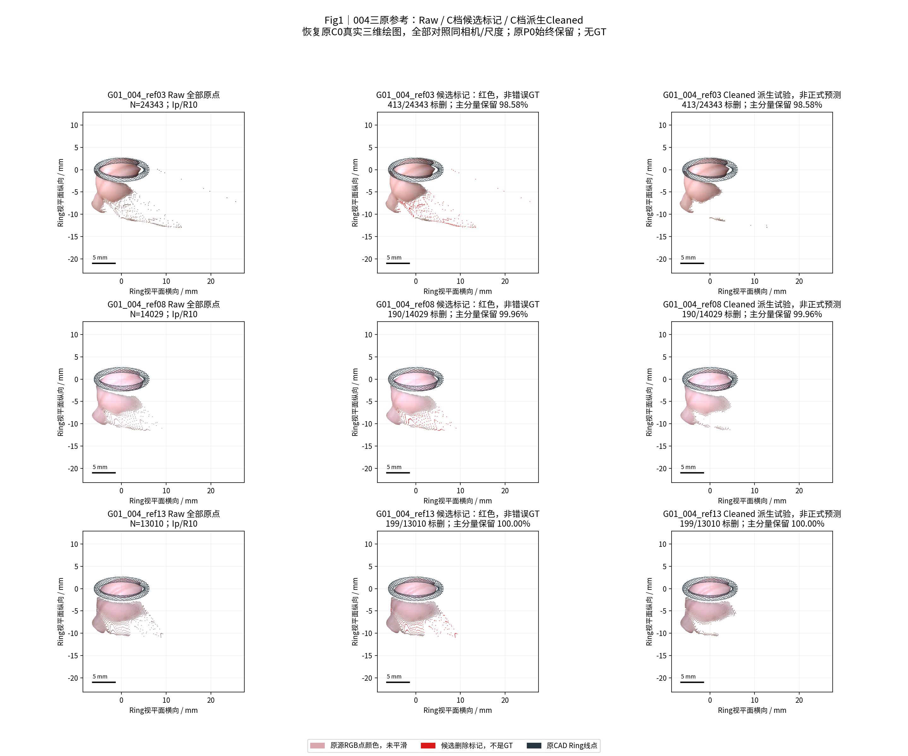
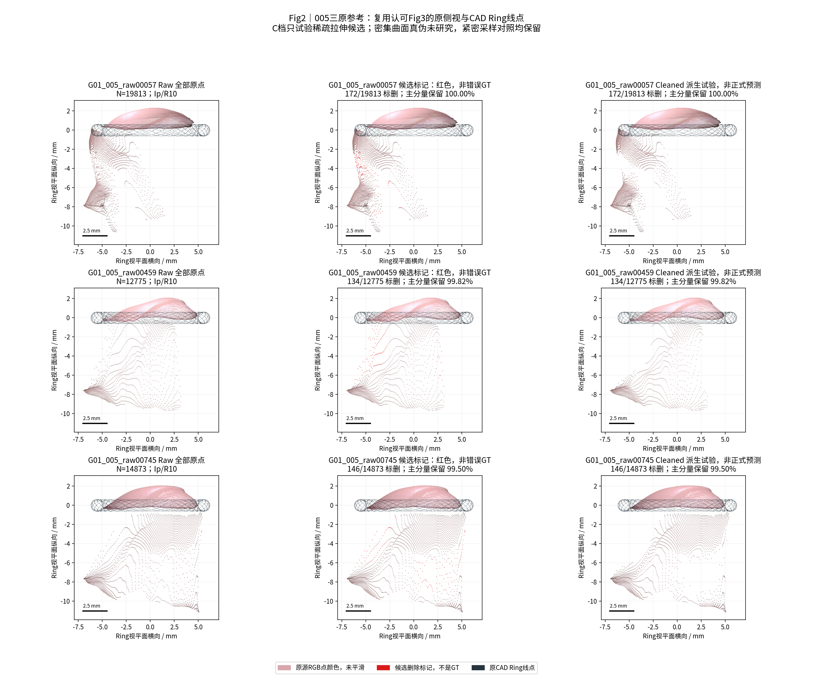
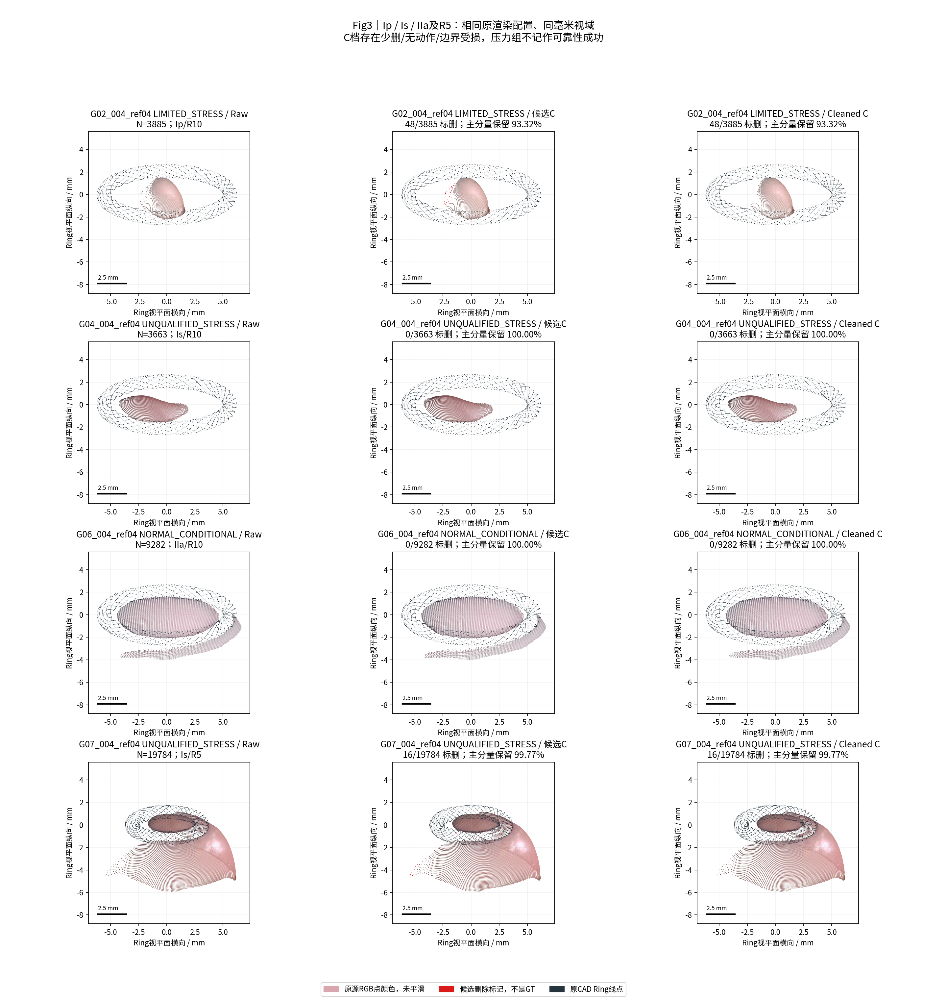
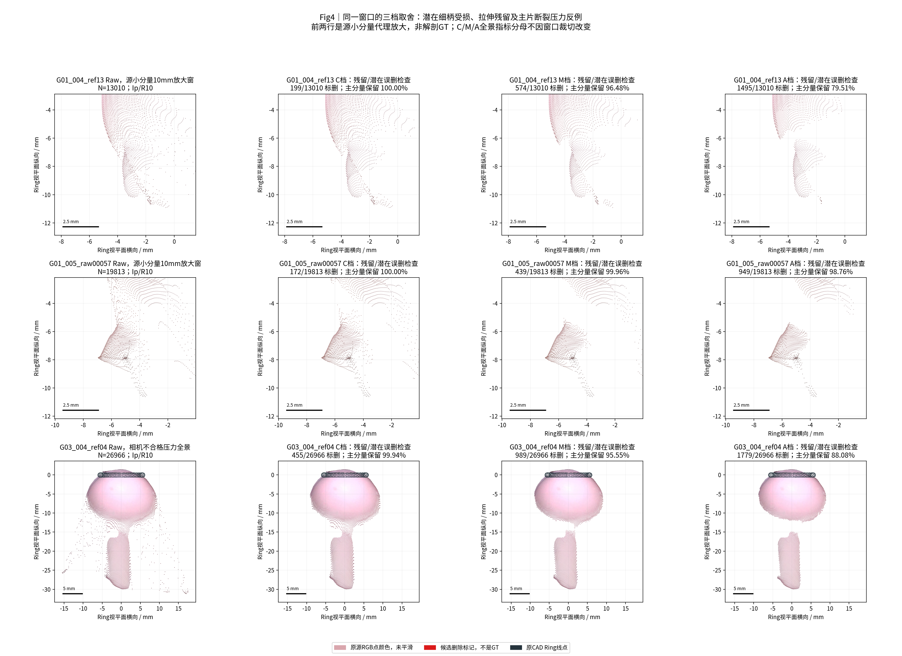

# TASK-PHASEC-SPARSE-STRETCH-CLEAN-VIS-001｜恢复原三维可视化与稀疏拉伸清理

日期：2026-10-26（Asia/Shanghai）。状态：**ENGINEERING_COMPLETE / EXPERIMENTAL / C档仅推荐人工复核预览 / 无稳定全自动阈值 / 等待验收**。分支：`exp/TASK-PHASEC-SPARSE-STRETCH-CLEAN-VIS-001`。

## 中文摘要

本轮先找到并原样包装了人工认可的C0绘图函数，建立默认入口`visualization/real_p0_renderer.py`；真实P0、源RGB色、连续点列、三维CAD Ring线点、物理比例与原视角均保留。包装器与原函数对真实004_ref13的输出像素完全一致。没有使用上一轮黑色横条光栅风格，也没有用平滑/插值/新曲面恢复空间感。

随后使用8独立组、9视频、13参考的213,654个冻结原点，复用上轮kNN间距与源邻接透视拉伸，完成预先冻结的C/M/A三档联合阈值。候选必须**同时**在相对局部采样间距与相对拉伸上异常；没有仅凭低密度、Mask边缘或密集曲面真假删点。保存Raw、全点候选标记与每档Cleaned及原点/原面索引，全部原始资产不变。

**正结果：** C=(3倍,3倍)可明显削弱004的部分下方破碎延伸；005也移除部分稀疏拉伸点，未主动裁去连续大曲面。C/M/A分别派生删除1,840/4,867/10,450点，所有档位的紧密采样对照点删除均为0。图1–4采用原绘图函数、固定Raw窗口与相机配置，保留残留和失败。

**负结果：** 三档都未在G01六参考同时满足预设保留门槛。C仍与细柄代理及Ring近邻重叠；G02在C仅删48点时就损失原最大分量6.682%面积并出现内部删除片候选。M/A有更明显的主片切断与局部点列损失。尚未找到同时充分消除延伸并稳定保护细小结构的区间，不能推广成无人审核清理。

**唯一推荐：C=(3,3)，限定为人工核验的实验预览。** 它是已测三档中最保守的一档，不是认证正确的阈值；对Ring/细柄受影响的局部必须查看Raw/标记/Cleaned，不能自动并入正式主面或融合。真实解剖误删率和自主三维精度均NOT_EVALUABLE。密集曲面真实性未研究，GT未使用，没有上游重推、跨面融合、ICP或Dxy修改。

## 1. 原可视化的定位、版本与恢复证据

原脚本确实存在：`/home/liu/ring_first_3d/experiments/TASK-PHASEC-C0-M0-E0-001/code/visualize.py`，SHA256为`c586024a82a6ba0fc00168f76a2f942cb4b9f4ea98b24e9ad182c9f933885231`。实际生成认可`Fig1_004_raw_and_C0.png`和`Fig3_005_Ring_below_layers.png`的关键函数是`basis(angle)`、`view(...)`、`limits(...)`。这两张原PNG也进入本轮[输入哈希清单](provenance/INPUT_MANIFEST.json)。

固定公开入口：[real_p0_renderer.py](../../visualization/real_p0_renderer.py)，使用说明见[visualization/README.md](../../visualization/README.md)。入口优先AST加载原脚本三个函数，避免执行旧实验入口；原脚本缺失时使用[逐字提取三函数副本](../../visualization/_phasec_c0_view_frozen.py)。原脚本存在但哈希变化则拒绝渲染，不静默替换。函数文本SHA与全部参数见[renderer provenance](../../visualization/real_p0_renderer_provenance.json)。没有上传旧算法脚本全文，只有本轮授权的绘图函数片段与新包装/清理脚本。

| 绘图项目 | 恢复的原配置 |
| --- | --- |
| 004全景/默认斜视 | azimuth=-65°，elevation=22° |
| 005认可局部侧视 | (0°,0°)；本轮图2严格使用该视角 |
| 点云与颜色 | 全部真实原点；源u/v对应RGB；原观察方向深度排序scatter |
| 点标记大小 | 0.8；不体素下采样、不插值、不平滑 |
| CAD Ring | 原OBJ；原顶点步长7仅作Ring线点显示；点大小0.4；颜色#26343d |
| 范围与比例 | 原limits()公式，Raw联合范围中心、最大跨度×0.56；毫米等比例轴，原1/2.5/5mm比例尺 |
| 样式 | 原网格alpha=0.15；Noto CJK；DPI160；不重建或伪造光照表面 |
| 前后对照 | 每行共用Raw范围、angle、size；不会按Cleaned重新缩放 |

这是一种对真实三维点做原有观察投影与排序的scatter绘制，并非新增光线追踪Mesh渲染。源RGB和密集原采样形成原来认可的连续表面观感，孔洞和断裂仍如实存在。CAD Ring按原函数绘制，未改成黑色填充条。原方式也不是完整三维遮挡真值，不能将观感当几何准确性。

[13项小检查](metrics/small_tests.json)含真实004_ref13的原函数/包装器逐像素一致性、三个函数AST完全一致、共同Raw窗口一致、联合条件、UNKNOWN保留、相对尺度不变性及内部删除片检查。最终[197项核验](metrics/validation.json)通过。默认入口只固定可视化；不把清理C档设为正式自动处理默认。

## 2. 输入身份、边界与审计

G01六参考来自已冻结ICF原始P0；G02–G08各一参考来自已有`P0_RAW_OPEN`及像素身份文件。所有原坐标、三角面、Mask、RGB、相机、HERO和上轮D0/D1场均按SHA核验。G08旧缓存名含004，但actual_video=005，按[输入身份](metrics/input_identity.csv)登记，没有变换数据。G01两视频保持各自Ring局部坐标，不能当两个独立物理样本。

[INPUT_MANIFEST](provenance/INPUT_MANIFEST.json)冻结109份输入/源码；本轮算法、三个阈值、来源及渲染在实算前提交，之后未改清理规则。只新增局部采样锚和阈值派生状态；没有重新计算HERO、Ring-First或D0/D1。新代码的I/O防护拒绝读取GT/Oracle/.blend和写入旧科研/DXY目录。组名/名义尺寸不参与规则切换。

| 审计项目 | 必须汇报 |
| --- | --- |
| 目标组数 | 8独立物理组 / 9视频 / 13参考 / 213,654原点；三档共39份派生试验 |
| 本算法独立成功 | 字段与派生输出8/8组、13/13参考；数值输出不等于正确清理 |
| 本算法失败 | 输入/执行失败0/13；本轮局部锚UNKNOWN=0/213,654；没有稳定全自动阈值，真实误删与精度NaN |
| 历史测量值回退 | 0；没有读历史测量值、S0/V2、Dxy或GT补齐；只复用授权P0与几何字段 |
| 失败组及具体原因 | 39行[失败清单](metrics/failure_ledger.csv)、图3/4；逐组风险见第5–7节 |
| 最终统计样本 | 全13参考均保留在统计；正常2组/7参考、有限2组/2参考、不合格4组/4参考分开，未只报漂亮组 |
| 是否使用GT选择算法 | 否；GT模式NONE；原3档运行前冻结，源码/参数SHA见输入manifest；未开展GT评价 |

## 3. 三档阈值：定义与适用条件

完整[parameters.json](parameters.json)与[运行前协议](PROTOCOL.md)已公开。代码：[run.py](code/run.py)。对每个原点，复用`knn_k_distance_mm`（k=12）及`adjacency_perspective_stretch_max`。前者除冻结源轴向Z，去除一阶透视深度采样差；后者已将原像素8邻接三维边长除平均Z与相机射线像素步长。不使用上轮可能自解释错误曲面的PCA切平面分数来强制删点。

在31×31源像素窗口内，仅使用**同一Polyp源Mask连通分量**，分别取上述两特征的25百分位作为局部采样锚，每项至少32个有效点。间距比`q=(k12_distance/Z)/local_q25`；拉伸比`s=perspective_stretch_max/local_q25`。局部锚并不是“真实正常面”的标签，持续平滑的延长结构也可能被该锚接受，这是已知失败模式。

本轮局部锚UNKNOWN=0只表示这两个局部比值的采样支持充足；上轮D0/D1的NaN原样保留，没有回填，也不意味着那些点在本轮变成可信真表面。两轮的有效支持定义不同，不比较UNKNOWN数量来宣称改善。

候选为`q≥a AND s≥b`；只稀疏、只拉伸、仅Mask边缘均不足以删除。三个档位C=(3,3)、M=(2,2)、A=(1.5,1.5)，窗口/百分位/最小支持不变；C候选⊆M⊆A。没有绝对毫米截断，没有SOR/ROR或旧固定边长过滤的重搜，没有根据密集曲面真伪、多参考冲突或GT选择删点。

推荐C只适用于本轮源分辨率、相机和局部采样可追溯的场景，作为**人工审查预览**。需要逐个检查细柄、Ring和残留延伸；相机不合格组仅压力测试。没有获批自动阈值，不据此焊接或融合。不能从三个离散档位声称已找到连续稳定区间。

## 4. Raw / 候选标记 / Cleaned与指标含义

每参考本地`local_results/<id>/`保存：`Raw.ply`；三个`Candidate_Marked_<tier>.ply`（全部原点、候选着红）；三个`Cleaned_<tier>.ply`；三个`Cleaned_<tier>_original_faces.ply`；一个完整来源NPZ。共143份派生资产，其[逐文件SHA](provenance/OUTPUTS_FROZEN.json)已冻结，未公开上传完整资产。

来源NPZ的Raw XYZ与上一轮逐位一致，保存group/actual_video/reference_frame/source_u/source_v、候选掩码、Cleaned原点索引及原面索引。Cleaned不移动任何留下的点，只去掉候选；Mesh只保留顶点均未标删的原三角面，不补孔、不重采样、不焊接。PLY为毫米显示序列化，NPZ是精确来源与坐标基准。原HERO/P0/Mesh始终原位只读。

原最大面连通分量以共享原边定义，评价：①该分量剩余面积/原面积；②其中最大剩余连续片/原面积。二者可不同：切成两块仍可留下很大总面积。这个“主体”是拓扑代理，通常偏向头部，并不保证包含真实细柄或所有真实侧面。

新增边界边是Cleaned边界与Raw边界原索引之差，修边也会增加，不能一律称新孔。内部删除片候选指原有面引用的被删点连通片不接触原边界，是潜在内孔/断裂证据；不同档位的片可合并或接通外边界，因此其数量未必单调。它不是独立解剖损伤真值。

异常延伸对照固定为：源深度归一k12间距在本参考上四分位且原透视拉伸≥4的原点集合，**只评价、不参与删除**。其清除比例是代理移除量，不是错误检测准确率。柄部代理是源Mask最大分量以外可见分量底20%图像行；Ring近邻沿用源Mask≤3px；紧密采样对照为每参考`k12/Z≤原中位数`的106831个观测点，所有39试验删除0。后者只说明该对照保留，不认证密集曲面真假，也不能代表所有人工定义的密集面逐点标签。

## 5. 三档总量、逐组与连续性结果

P0冻结对照始终删除0、原点213,654、相对原主体面积与连续片100%；本轮输出不覆盖它。上轮D0/D1仅作为冻结特征来源，未将其候选或分数当真实错误标签来选择本轮阈值。

| 档位 | 间距比≥ | 拉伸比≥ | 删除点/全部原点 | 原稀疏拉伸代理删点/代理N | 内部删除片候选 | 紧密对照删除 |
| --- | --- | --- | --- | --- | --- | --- |
| C | 3.0 | 3.0 | 1840/213654 (0.861%) | 1840/13722 | 1 | 0 |
| M | 2.0 | 2.0 | 4867/213654 (2.278%) | 4718/13722 | 3 | 0 |
| A | 1.5 | 1.5 | 10450/213654 (4.891%) | 8975/13722 | 20 | 0 |

上表总量是所有参考暴露账本，不是213,654个独立解剖样本。三档分别还残留11,882/9,004/4,747个原稀疏拉伸代理点（原代理13,722点），不能说延伸已清完。候选更多、删除更多或画面更整洁，都不是几何正确性提升证据。

| 物理组 | 形态/环 | 相机条件 | 参考数 | 原点暴露N | C删除 | M删除 | A删除 |
| --- | --- | --- | --- | --- | --- | --- | --- |
| G01 | Ip/R10 | NORMAL_CONDITIONAL | 6 | 98843 | 1254 (1.269%) | 3292 (3.331%) | 7193 (7.277%) |
| G02 | Ip/R10 | LIMITED_STRESS | 1 | 3885 | 48 (1.236%) | 95 (2.445%) | 212 (5.457%) |
| G03 | Ip/R10 | UNQUALIFIED_STRESS | 1 | 26966 | 455 (1.687%) | 989 (3.668%) | 1779 (6.597%) |
| G04 | Is/R10 | UNQUALIFIED_STRESS | 1 | 3663 | 0 (0.000%) | 69 (1.884%) | 208 (5.678%) |
| G05 | Is/R10 | UNQUALIFIED_STRESS | 1 | 31600 | 65 (0.206%) | 297 (0.940%) | 647 (2.047%) |
| G06 | IIa/R10 | NORMAL_CONDITIONAL | 1 | 9282 | 0 (0.000%) | 1 (0.011%) | 23 (0.248%) |
| G07 | Is/R5 | UNQUALIFIED_STRESS | 1 | 19784 | 16 (0.081%) | 96 (0.485%) | 225 (1.137%) |
| G08 | IIa/R10 | LIMITED_STRESS | 1 | 19631 | 2 (0.010%) | 28 (0.143%) | 163 (0.830%) |

正常条件沿用源相机合格且bundle≥3帧合格：仅G01/G06，共2独立组7参考。G02/G08源合格但可用相机帧少，记LIMITED；G03/G04/G05/G07源不合格，记UNQUALIFIED。相机条件不是独立位姿GT。正常C/M/A删1,254/3,293/7,216（108,125原点）；LIMITED删50/123/375（23,516）；UNQUALIFIED删536/1,451/2,859（82,013）。[组宏与形态/环条件表](metrics/stratified_results.csv)始终分开，不把压力测试计入可靠性成功率。

下表每个三元格依次是C / M / A。全部[39行完整指标](metrics/reference_results.csv)还含原/剩余面数、原面积、面积移除、Mask边界及各代理分母，便于独立审查。

| 参考 | 原点N | 删点 C/M/A | 原最大分量面积保留 C/M/A | 最大剩余连续片保留 C/M/A | 新增边界边 C/M/A | 内部删除片 C/M/A |
| --- | --- | --- | --- | --- | --- | --- |
| G01_004_ref03 | 24343 | 413 / 867 / 1814 | 98.576% / 91.088% / 76.974% | 98.576% / 91.088% / 76.974% | 66 / 439 / 813 | 0 / 0 / 3 |
| G01_004_ref08 | 14029 | 190 / 531 / 1280 | 99.958% / 98.508% / 89.515% | 99.958% / 98.508% / 89.515% | 13 / 328 / 651 | 0 / 2 / 0 |
| G01_004_ref13 | 13010 | 199 / 574 / 1495 | 100.000% / 96.482% / 79.511% | 100.000% / 96.482% / 79.396% | 6 / 308 / 618 | 0 / 1 / 3 |
| G01_005_raw00057 | 19813 | 172 / 439 / 949 | 100.000% / 99.963% / 98.762% | 100.000% / 99.963% / 98.762% | 28 / 249 / 542 | 0 / 0 / 2 |
| G01_005_raw00459 | 12775 | 134 / 389 / 740 | 99.820% / 97.179% / 93.543% | 99.820% / 97.179% / 93.543% | 17 / 172 / 321 | 0 / 0 / 0 |
| G01_005_raw00745 | 14873 | 146 / 492 / 915 | 99.495% / 98.032% / 95.164% | 99.495% / 98.032% / 95.164% | 17 / 128 / 342 | 0 / 0 / 1 |
| G02_004_ref04 | 3885 | 48 / 95 / 212 | 93.318% / 88.274% / 81.086% | 93.318% / 88.274% / 80.703% | 50 / 83 / 155 | 1 / 0 / 2 |
| G03_004_ref04 | 26966 | 455 / 989 / 1779 | 99.943% / 95.547% / 88.082% | 99.943% / 71.455% / 65.918% | 31 / 475 / 880 | 0 / 0 / 2 |
| G04_004_ref04 | 3663 | 0 / 69 / 208 | 100.000% / 92.339% / 84.933% | 100.000% / 92.149% / 84.823% | 0 / 65 / 128 | 0 / 0 / 0 |
| G05_004_ref04 | 31600 | 65 / 297 / 647 | 99.771% / 97.710% / 93.947% | 99.771% / 97.710% / 93.917% | 34 / 226 / 460 | 0 / 0 / 1 |
| G06_004_ref04 | 9282 | 0 / 1 / 23 | 100.000% / 99.974% / 99.730% | 100.000% / 99.974% / 99.730% | 0 / 2 / 40 | 0 / 0 / 0 |
| G07_004_ref04 | 19784 | 16 / 96 / 225 | 99.771% / 98.429% / 95.771% | 99.771% / 98.361% / 95.748% | 6 / 42 / 156 | 0 / 0 / 5 |
| G08_005_ref04 | 19631 | 2 / 28 / 163 | 100.000% / 99.655% / 96.961% | 100.000% / 99.655% / 96.961% | 0 / 13 / 155 | 0 / 0 / 1 |

## 6. G01细柄与Ring：保留证据及未解决风险

| 参考 | C删柄部代理/代理N | C删Ring近邻/近邻N | C删最大源分量/分量N | C面分量数 Raw→Clean | C边界边 Raw→Clean | C移除原面面积mm² |
| --- | --- | --- | --- | --- | --- | --- |
| G01_004_ref03 | 140/2302 | 33/1720 | 23/13441 | 6→4 | 1091→1060 | 2.037 |
| G01_004_ref08 | 63/1136 | 2/1352 | 1/8471 | 8→8 | 917→909 | 0.547 |
| G01_004_ref13 | 61/1074 | 12/1333 | 0/7978 | 10→10 | 901→901 | 0.211 |
| G01_005_raw00057 | 36/845 | 0/1685 | 0/15834 | 10→10 | 1208→1202 | 0.856 |
| G01_005_raw00459 | 0/435 | 100/1377 | 4/10829 | 3→3 | 858→855 | 0.647 |
| G01_005_raw00745 | 0/539 | 72/1562 | 14/12278 | 10→10 | 942→942 | 0.514 |
| G02_004_ref04 | 0/0 | 0/0 | 48/3885 | 1→1 | 244→245 | 1.190 |
| G03_004_ref04 | 21/603 | 39/1040 | 419/24082 | 4→4 | 1107→1104 | 1.142 |
| G04_004_ref04 | 0/0 | 0/9 | 0/3663 | 1→1 | 227→227 | 0.000 |
| G05_004_ref04 | 5/2097 | 50/1741 | 56/21487 | 5→4 | 1152→1146 | 0.668 |
| G06_004_ref04 | 0/507 | 0/1340 | 0/7048 | 2→2 | 731→731 | 0.000 |
| G07_004_ref04 | 0/666 | 0/1090 | 16/16719 | 4→4 | 912→910 | 0.228 |
| G08_005_ref04 | 0/805 | 0/1233 | 2/15646 | 3→3 | 914→914 | 0.000 |

C在004_ref13删199/13,010点（1.530%），原最大分量100%保留；但柄部代理删61/1,074，Ring近邻删12/1,333。最大分量完整不能替代细柄检查。004_ref03 C删413/24,343，原最大分量保留98.576%，柄部代理删140/2,302。图1中不合理破碎延伸明显减弱，但局部仍有残留，不能据此确认每个删除点都错。

005_raw00057 C删172/19,813，最大分量100%保留；柄部代理删36/845，Ring近邻0/1,685。raw00459/raw00745 C分别删134/12,775、146/14,873，Ring近邻删100/1,377、72/1,562，是不能自动接受的边界风险。所有档位紧密采样对照0删除，图2连续大曲面总体保持；没有研究其真实性，也没有因人工怀疑它而整体裁掉。任何同时触发本轮双异常规则的局部只能作为稀疏拉伸候选，不能被解释为“密集面已证错误”。



Fig1：004三个原参考，Raw、C候选标记、C派生Cleaned。使用原(-65°,22°)视角及源RGB，三参考共用Raw视域；Ring三维线点与连续表面均可辨认。标记列保留全部原点，右列才是实验性移除；没有把残留藏在重新缩小的画窗外。



Fig2：005三个原参考复用认可图3的(0°,0°)原侧视与Ring绘图，三状态完全同尺度。部分稀疏点列被削弱，顶部与底部连续结构仍保留；密集未知面的真伪不在本轮评价中。

## 7. 失败、阈值稳定性与推荐边界

| 场景 | 真实试验结果 | 科研判断 |
| --- | --- | --- |
| G01细柄与环邻近 | C在四个参考柄部代理有重叠，另外005两个参考Ring近邻响应明显；G01六参考均至少一项工程守门未过 | 代理并非逐点真柄，不能称已证误删，也不能跳过风险自动通过 |
| 004_ref13积极档 | A删1,495点，原主分量面积仅79.511%，局部点列被切开，内部删除片3 | 不推荐靠更积极阈值追求清得干净 |
| G02有限相机条件 | C仅删48/3,885，却保留主体93.318%，内部删除片1；M主体进一步降至88.274% | 小删除率不保证安全；M内片数0也可能因开口接到外边界，不能反称改善 |
| G03相机不合格 | M保留原主分量总面积95.547%，最大剩余连续片却只有71.455%；A为88.082%/65.918% | 明确的原表面连通片切断压力反例，不推断其是真实物理损伤 |
| G04/G06 | C删0；G06原拉伸代理为0，M删1个Ring近邻点 | 无动作不是检测成功；不能将其记作清理正确 |
| G07 R5压力 | C删16，M/A删96/225，A内部删除片5 | R5仅一不合格相机组，不能宣称环尺寸泛化 |
| G08有限条件 | C只删2点且无原面改变，原代理371点中仍残369 | 低风险与清除有效性是两回事 |



Fig3：Ip/Is/IIa、R10/R5，固定原斜视和共同毫米视域。G02的边界风险、G04/G06无动作、G07少量响应均保留，没有只展示漂亮组。G03/G05/G08也均完成试验，指标见全组表，未因四PNG选图而从分母排除。



Fig4：004_ref13与005_raw00057的源小分量代理10mm窗口，Raw/C/M/A保持同窗同视角；放大不是解剖GT。最后一行G03压力全景显示M/A将原主片切开。图中标题的“主分量保留”是总面积，最大连续片更低，具体见第5节，避免将面积保留误认为连通性保留。

本轮预先冻结的工程守门为：原主体面积/最大连续片各≥99%；柄部代理、Ring近邻删点各≤1%；紧密对照≤0.1%；内部删除片0。这些只是风险门槛，不是几何真值。G01在三个档位都没有六参考全通过。人工判断优先，当前图4所见连续点列损失与保守档代理重叠仍需人工验收，不能为成功而临时放宽门槛。

因此只推荐C=(3,3)作为**可回退、逐局部审阅的预览档**；原Raw始终是正式冻结对照。不存在本轮已验证的无人审核清理阈值，也不声称3倍附近形成稳定区间。没有追加更小/更大阈值、复杂模型或特定组例外来挽救结论。M/A只保留为对照与失败证据，不设为默认。

## 8. 工程完成、科学结论与NOT_EVALUABLE

工程完成：原风格恢复有源码/函数/像素证据；三档39份结果、Raw/标记/Cleaned、原索引及全部小表完成；197项核验确认留下的Mesh是原顶点/原面的精确子集，没有修形或新增面；旧科研与DXY的HEAD/index/status及既有未提交文件SHA未变。

科学上支持的结论：局部间距与拉伸的联合异常能削弱一部分人指出的破碎延伸；单一删除率无法反映结构保留。尚未证明真实几何精度改善、真实柄部安全或跨形态/环尺寸的通用清理能力。仅视觉改善的部分是异常点列减少与原三维表现恢复，不能拿它替代准确性评价。

GT模式**NONE**，无Oracle ICP、GT拟合、形状模板或参数挑选。真实清理准确率、真实误删率、真实可见覆盖、自主三维精度、ARE/MAE/p95/最大临床误差全部NaN/NOT_EVALUABLE；本轮不做物理尺寸提取。源小分量是可能真实结构的检查代理；被删代理点不等于已证实误删真实柄部。密集未知曲面没有被赋予真实/错误标签。

## 9. 复现命令、源码与产物索引

执行环境Python3.12，实际版本见[requirements.txt](requirements.txt)。公开脚本包括[run.py](code/run.py)、[analyze.py](code/analyze.py)、[figures.py](code/figures.py)、[validate.py](code/validate.py)、[小检查](code/test_small.py)、[独立复现包装](code/reproduce.py)及仓库固定renderer。完整原数据仍只在已冻结本地路径，公开仓库没有这些资产，单独下载仓库不能运行完整实算。

在当前已具备冻结资产的环境中，下面命令将代码/参数复制到**新的实验目录**，拒绝覆盖已存在目录，然后依次执行小检查、输入冻结、三档清理、统计、四图和核验；不会重推HERO、估计相机或上传。

```bash
cd /home/liu/ring_first_3d
PY3D=/home/liu/polyp_research/ring_anchor_3d/.venv/bin/python
EXPERIMENT=experiments/TASK-PHASEC-SPARSE-STRETCH-CLEAN-VIS-001
PYTHONDONTWRITEBYTECODE=1 "$PY3D" "$EXPERIMENT/code/reproduce.py" \
  --output-name TASK-PHASEC-SPARSE-STRETCH-REPLAY-001
```

本轮各阶段已实际执行并核验；复现包装做了CLI检查，未为了包装再次重复13参考清理实算。固定renderer独立调用例子（保存Raw；`--state marked/cleaned --marks ... --tier C`可查看派生状态，共同范围仍由Raw确定）：

```bash
PYTHONDONTWRITEBYTECODE=1 "$PY3D" visualization/real_p0_renderer.py \
  --points experiments/TASK-PHASEC-DENSITY-MULTIGROUP-001/local_fields/G01_004_ref13_fields.npz \
  --rgb /home/liu/polyp_research/ring_anchor_3d/experiments/surface_fusion_v1/inputs/real_rgb_013.png \
  --ring /home/liu/polyp_research/ring_anchor_3d/experiments/surface_fusion_v2/inputs/R10_ring.obj \
  --output "$EXPERIMENT/runtime/renderer_raw_replay.png"
```

本地完整三状态：`/home/liu/ring_first_3d/experiments/TASK-PHASEC-SPARSE-STRETCH-CLEAN-VIS-001/local_results/`。每参考`Raw_Marked_Cleaned_identities.npz`是来源主索引；检查标记例子`--marks "$EXPERIMENT/local_results/G01_004_ref13/Raw_Marked_Cleaned_identities.npz" --state marked --tier C`。独立绘图入口同一源文件的Raw范围固定，多参考共同窗口则使用本轮figures.py。

公开范围：脚本/三函数片段、配置、唯一技术报告、小表与来源SHA、四PNG。完整RGB/Mask、视频、PLY/NPZ、模型和实验缓存未上传。[结果索引](RESULT_INDEX.md)、[公开文件清单](provenance/PUBLICATION_MANIFEST.json)、[图像配置](provenance/FIGURE_CONFIG.json)、[图像哈希](provenance/FIGURE_MANIFEST.json)、[源码哈希](provenance/EXECUTION_SOURCES.json)可交叉核验。

实际增量提交：

- 实现/配置/小检查：[`f86ebfd09c182d5002d55e834185f42a6738e7eb`](https://github.com/zheng1524/ring-first-3d/commit/f86ebfd09c182d5002d55e834185f42a6738e7eb)。
- 三档指标与四PNG：[`428bd42f25cbcaa3ef61fc44e6c4a7dc8f20c357`](https://github.com/zheng1524/ring-first-3d/commit/428bd42f25cbcaa3ef61fc44e6c4a7dc8f20c357)。
- 本报告/索引提交的最终SHA由交付消息与本文件所在GitHub提交记录提供，避免自引用SHA；本地远程读回回执另存。

本轮完成后停止。没有自动进入密集曲面真实性、融合、ICP、跨视频配准或新的上游实验；下一轮由用户与PM验收后另行授权。
