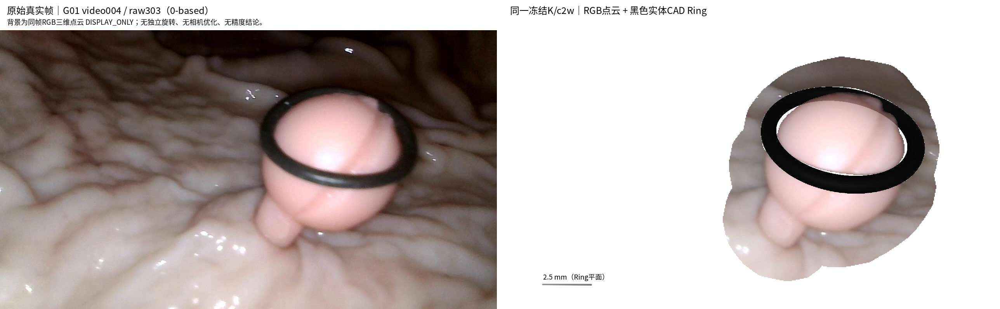
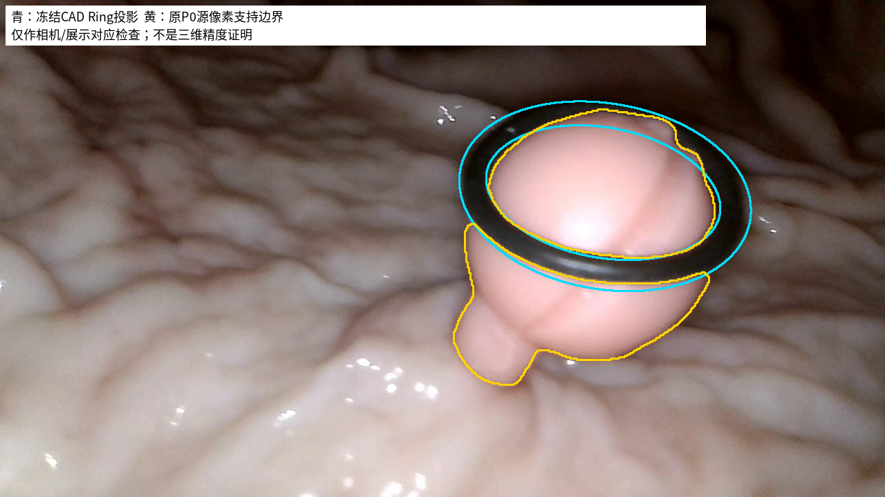

# TASK-PHASEC-VIDEO-SCENE-VIS-001｜004同视角样图

日期：2026-10-26。状态：**004_SAMPLE_READY / DISPLAY_ONLY / 等待人工验收**。纠正后仅执行G01 video004；005和其余批量保持暂停，早先试图保留本地、不作为本次交付。

## 中文摘要

选用已有`004_ref03 / raw303`（0-based），该真实帧斜向、主体与周围组织完整。真实帧与三维图均使用原画幅1280×720和同一冻结针孔相机；完整c2w含滚转，不再独立旋转、look-at Ring、居中或放大三维视角。保留24,343个原P0点；背景使用同帧冻结深度反投影的30,336个局部RGB三维点，与息肉合并为同一个点绘制artist。Ring为原OBJ的黑色不透明实体三角网格，位置、朝向和尺寸未改。

四张PNG已生成并复现。背景深度没有独立认证，标记DISPLAY_ONLY；本轮不评价重建精度、不优化相机、不修复几何。轮廓叠加中仍有CAD与实拍边缘的局部差异，原样保留供人工检查。

## 四张交付图

| 文件 | 用途 |
| --- | --- |
| [Selected_Real_Frame.png](figures/G01_004_same_camera/Selected_Real_Frame.png) | 原视频解码的完整真实帧，未裁剪/标注 |
| [Local_3D_Scene.png](figures/G01_004_same_camera/Local_3D_Scene.png) | 同视角P0＋实体CAD Ring＋局部背景点云 |
| [Real_vs_3D.png](figures/G01_004_same_camera/Real_vs_3D.png) | 两张1280×720图直接并排，不独立缩放或裁剪 |
| [Projection_Overlay.png](figures/G01_004_same_camera/Projection_Overlay.png) | 青色CAD内外轮廓；黄色原P0源像素支持边界 |





叠加仅检查展示相机及可观察对应。黄色是原点支持边界，不是独立真实解剖标签；源点从同一深度/相机反投影后回投的自一致性不能验证深度。已有针孔模型未补充畸变拟合，CAD轮廓差异也没有通过移动Ring或调整相机消除，不宣称像素级真实精确对齐或三维精度。

## 相机、来源和统一点云接口

- 真实视频：`GP_Ip_12.0mm_closed_R10_single_refY_004.mp4`，原始帧号303，参考ID `004_03`。选帧只服务展示，未使用GT或M0/清理分数。
- P0：`independent_confidence_fusion_v1/points/004_ref03_Polyp_source.npz`，开放Mesh与冻结深度/RGB/Mask/camera_bundle的完整路径、SHA见[INPUT004](provenance/INPUT004.json)与[所选参考](provenance/SELECTED004.json)。相机是原bundle第3项，c2w逐值不变。
- 源640×360内参`fx=fy=490, cx=319.5, cy=179.5`；原画幅内参`fx=fy=980, cx=639.5, cy=359.5`，仅按像素中心`target=(source+0.5)*2-0.5`缩放，不改变物理焦距估计或位姿。
- 息肉和背景通过[real_p0_renderer.py](../../visualization/real_p0_renderer.py)的`view_camera_rgb → draw_rgb_points`合并一次调用：源RGB、size=0.8、alpha=1、linewidth=0、相同深度排序和投影。不是将背景作为图片或贴图平面插入场景。
- 实体Ring接口：[same_camera_scene.py](../../visualization/same_camera_scene.py)。原CAD为16,384顶点、32,768面，世界Z厚度约1.2mm；同一K/c2w射线首交渲染，命中alpha=1，孔洞alpha=0。CAD没有独立旋转或变换。
- 比例尺为Ring平面指定位置的2.5mm三维线段投影，透视图不能据此当作全画面统一mm/px。

[SCENE004.json](metrics/SCENE004.json)保存完整内参、c2w、源身份、点数和样式。矩阵变换以同一Ring局部毫米系进行，绘图不修改世界XYZ。

## 背景缺失原因与修正

旧试图`ref08/raw676`实际有210,939个背景点，其中24,385个在Polyp源像素45px邻域；不恰当的Ring世界Z范围[-6,2]及径向窗口将它们压到仅23点。背景数据并不缺失，旧点大小/透明度也与息肉不同。详见[背景诊断](metrics/BACKGROUND_DIAGNOSIS.json)。旧正交look-at方式没有使用完整的真实帧相机，也已停止用于本次对照。

当前`ref03/raw303`从同帧Mask=0和有效冻结深度得到198,076个背景点，按源像素距Polyp≤45px展示30,336点；无世界Z/径向截断、无近似平面、无平滑或人工补面。所有背景源像素与Polyp源像素交集为0，没有把息肉下方可疑点改称背景。两次选帧不同，23与30,336不是同输入的算法性能对比。

| 来源层 | 原始/可用点 | 进入展示 | CAD条件可见点 | 原资产删除 |
| --- | --- | --- | --- | --- |
| Polyp P0 | 24,343 | 24,343，显示裁剪0 | 23,465 | 0 |
| Background | 198,076 | 30,336，源像素邻域 | 29,853 | 0 |

878个P0点与483个展示背景点仅被当前CAD条件遮挡隐藏，不是删除或几何修复。背景使用已有HERO深度，未重新推理；其三维真实性未独立验证，展示自然不意味着深度正确。

## 核验、边界与停止

32项[来源/渲染检查](metrics/VALIDATION004.json)通过：原输入SHA、c2w/K、全部原点、背景Mask身份与RGB、共享单artist、实际CAD厚度/孔洞/不透明性、左右原像素画幅，以及旧科研/Dxy/原工作树状态保持不变。在独立输出目录复现后，四PNG逐字节相同，见[复现检查](metrics/REPLAY_CHECK.json)。这些属于工程一致性，不是三维精度评价。

| 审计项目 | 汇报 |
| --- | --- |
| 目标组数 | 当前纠正范围1物理组、1视频、1参考；其余暂停 |
| 本算法独立成功 | 展示输出1/1；不代表自主重建或测量成功 |
| 本算法失败 | 计算失败0/1；背景几何真实性、真实重建精度NOT_EVALUABLE |
| 历史测量值回退 | 0；仅复用任务指定原P0、RGB/Mask、深度、相机与CAD |
| 失败/限制及证据 | 旧背景窗口与旧观察相机错误已查明；当前CAD局部边缘差异见叠加图，背景未获独立几何认证 |
| 最终统计样本 | 仅004/raw303；完整原P0分母24,343，背景各支持集分列 |
| 是否使用GT选择算法 | 否，GT模式NONE；未读取GT形状或拟合，不做精度/误删/测量误差统计 |

没有修改P0、清理算法/阈值、Ring-First、HERO或Dxy；没有ICP、跨视频融合、几何优化。原`basis/view/limits`仍逐字保留，针孔接口只是投影扩展。后续视频在本样图获得人工验收前不执行。

## 版本、复现和增量上传

Raw绘图v1.0.0已单独进入main：[02dee8092dce9f89d050bccca35aa51768988645](https://github.com/zheng1524/ring-first-3d/commit/02dee8092dce9f89d050bccca35aa51768988645)，不含未验收清理代码。相机接口v1.1.0-camera-preview仅在本任务分支，尚未合入main。

代码/配置：[2dffe90cf2300ac9182401dbf4e194059c6a6d37](https://github.com/zheng1524/ring-first-3d/commit/2dffe90cf2300ac9182401dbf4e194059c6a6d37)；四图/核验：[d54f1b672b054a35e7388e90bda19c70712766d7](https://github.com/zheng1524/ring-first-3d/commit/d54f1b672b054a35e7388e90bda19c70712766d7)。本报告最终提交SHA在交付消息与本文件GitHub记录中给出。[结果索引](RESULT_INDEX.md)列出全部本次产物。

当前冻结资产环境中复现到一个新目录：

```bash
cd /home/liu/ring_first_3d_scene_vis
PYTHONDONTWRITEBYTECODE=1 OPENBLAS_NUM_THREADS=1 OMP_NUM_THREADS=2 \
  /home/liu/polyp_research/ring_anchor_3d/.venv/bin/python \
  experiments/TASK-PHASEC-VIDEO-SCENE-VIS-001/code/scene004.py \
  --output-root /tmp/scene004-human-review-01 --no-publish
```

原数据路径须可读，输出目录存在且非空会拒绝覆盖。依赖见[requirements](requirements.txt)，使用已有Open3D vendor。完整三维点层和旧试图留在本地，未公开视频、权重或完整NPZ/GLB缓存。当前本地样图路径：`/home/liu/ring_first_3d_scene_vis/experiments/TASK-PHASEC-VIDEO-SCENE-VIS-001/local_scenes/G01_004_same_camera_ref03/`。

**完成004样图后停止，等待人工验收。**
