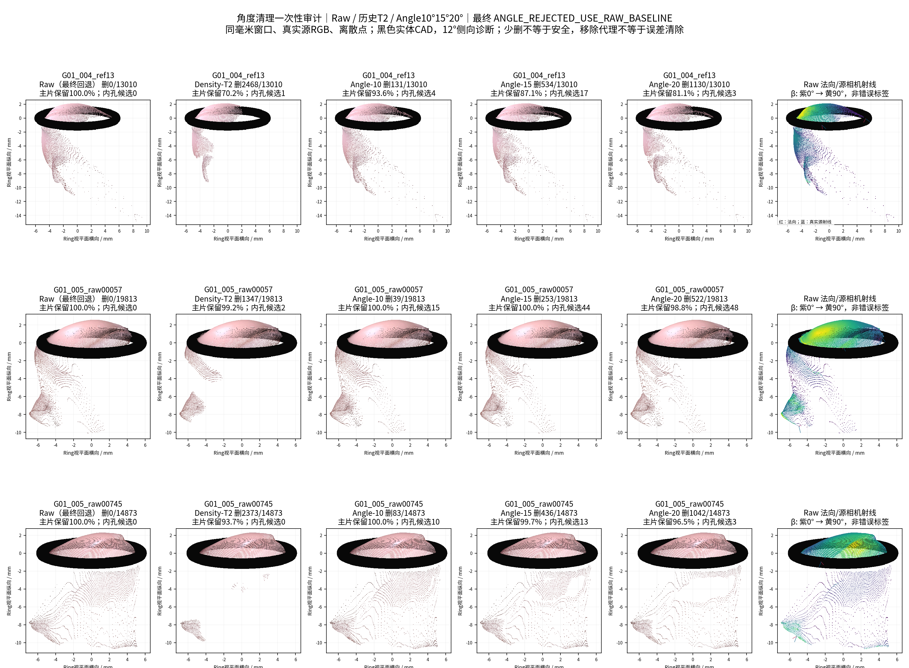
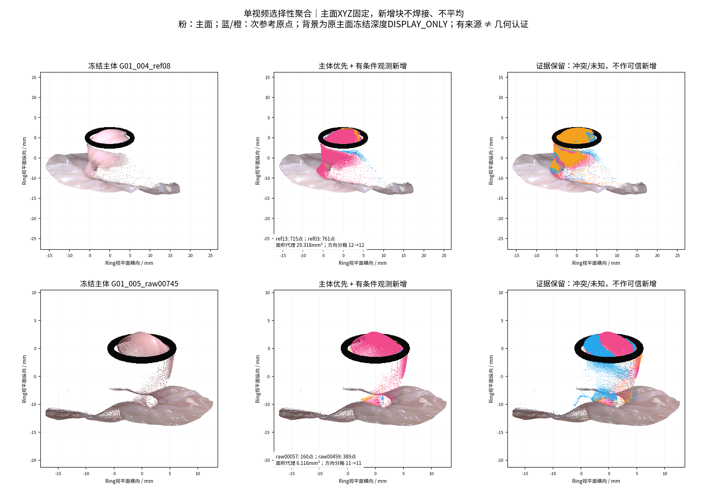
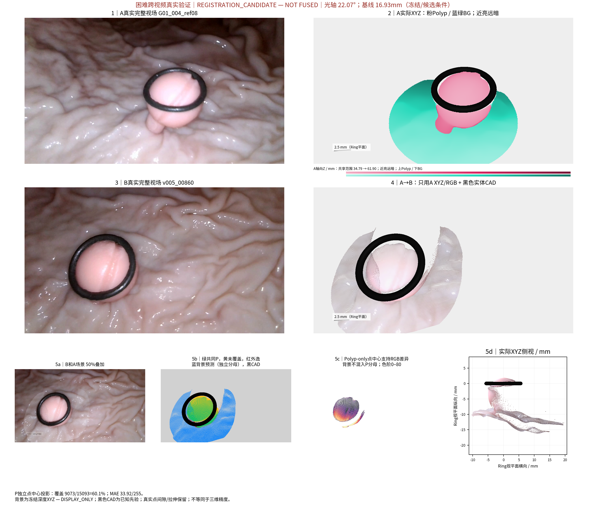
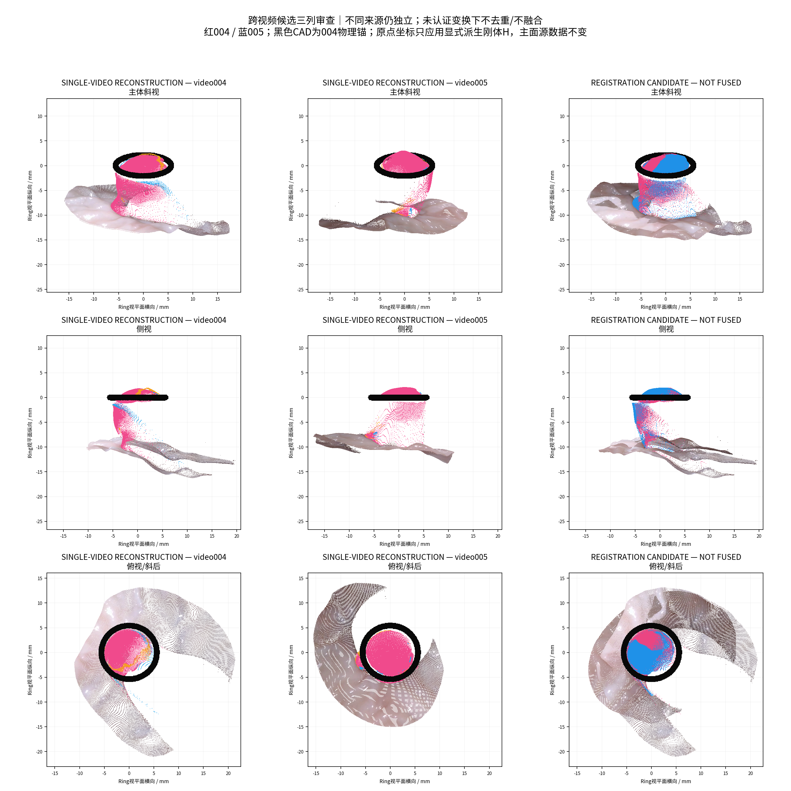

# 掠视角清理与选择性三维聚合

任务：`TASK-PHASED-GRAZING-SELECTIVE-AGGREGATION-001` · 2026-10-29 · `REPORTED / EXPERIMENTAL — 等待人工验收`。研究者授权的新派生实验，不代表正式科学基线认证。

| 验收层级 | 实际结论 |
| --- | --- |
| 工程执行 | A–E、两单视频场景、跨视频候选、真实留出验证完成；4组/9参考 |
| 角度清理 | `ANGLE_REJECTED_USE_RAW_BASELINE`；停止角度优化并继续聚合 |
| 主体/新增块 | 004 ref08、005 raw00745；均 `PRIMARY_AMBIGUOUS`，另保留一个平行主体 |
| 新可见观测 | 004/005条件新增1476/549原点；有源图和选择帧支持，尚非真实解剖认证 |
| 方向增益 | 24个方向分箱中12→12、11→11；没有已证实的新方向分箱 |
| 跨视频 | `REGISTRATION CANDIDATE — NOT FUSED`；无新的可信H改善证据 |
| 物理精度 | `NOT_EVALUABLE`；GT/Oracle未读取，H95/正式Dxy未计算或修改 |

中文摘要：本轮只读复用四组九份冻结P0，在原面法向上完成10°、15°、20°掠视角清理对照，并在清理失败后连续完成主体重评、锚点检查、主面反向投影及选择性聚合。角度方法虽比历史T2少损失细柄代理，仍产生内部孔洞和主体连续性损伤，故全部回退Raw。004、005分别保留1476、549个有来源的新增原点；独立帧覆盖有不同程度增加，但共同支持RGB误差略升，方向分箱不增加，部分新增块仍碎裂或遮挡原主体。因此新增面积只能称采样面积代理，不能认证为真实新表面。跨视频新匹配不足，保留历史变换及联合候选、不强行融合。所有原始几何、相机及旧科研修改保持不变。

## 来源、规则与完整分母

当前工作树 `/home/liu/ring_first_3d_grazing`，起点 `a46754dc7b301e58cc46e05493b915948dd45537`，独立分支 `exp/TASK-PHASED-GRAZING-SELECTIVE-AGGREGATION-001`。本轮人工转交[正式任务](TASK.md)优先于过时门禁；没有修改仓库保护状态、正式baseline或主线。启动时读取AGENTS、协同规范、README、BASELINE清单及历史FINAL_AUDIT副本。复用Density/Sparse/ABS/Incremental/View-Audit既有缓存；没有重跑其清理搜索、HERO、相机、Hull或完整重建。

执行前[136份输入及SHA](provenance/INPUTS_FROZEN.json)、[规则/源码冻结](provenance/RULES_FROZEN.json)与首阶段提交 `d717a46388c9b8cf4bd856ea9ebdfbfb989890cd` 已保存并push。[实际输入身份](provenance/CASES.json)、[选择/留出帧](provenance/TARGETS_FROZEN.json)、[最终执行源码](provenance/FINAL_SOURCE_MANIFEST.json)可复核。四项工程修补均记录于[执行说明](provenance/EXECUTION_NOTES.json)，不改变参数或已有数值结果：输出字典重复状态键、空背景颜色维度、零值与None区分、无新匹配时明确历史候选回退身份。

| 审计项目 | 本轮汇报 |
| --- | --- |
| 目标组数 | 4个独立物理组，5段视频，9参考，147,540次原点观测暴露；004/005只算G01一组 |
| 本算法独立成功 | 4/4组字段和诊断；仅G01具备多参考，2/2单视频有条件聚合输出；不是4组融合成功 |
| 本算法失败 | 清理采纳0/2激活视频；跨视频认证0/1组；G06/G07/G08多参考NOT_EVALUABLE；物理精度4/4组NaN |
| 历史测量值回退 | 0；Raw是本任务显式清理回退基线，不是历史测量值回填 |
| 失败组及具体原因 | 全9参考及阶段见[失败表](metrics/failure_ledger.csv)与真实图 |
| 最终统计样本 | 全9参考×5版本=45条；90条清理投影；49条场景对照；均非独立病例数 |
| 是否使用GT选择算法 | 否；GT模式NONE，I/O防护拒绝GT/Oracle/.blend及向旧目录写入 |

| 物理组 | 形态/环 | 视频/参考 | 原点暴露 | 相机/可做范围 |
| --- | --- | --- | --- | --- |
| G01 | Ip/R10 | 2/6 | 98843 | NORMAL_CONDITIONAL；两视频各三参考 |
| G06 | IIa/R10 | 1/1 | 9282 | NORMAL_CONDITIONAL；单参考，只诊断 |
| G07 | Is/R5 | 1/1 | 19784 | UNQUALIFIED_CAMERA_STRESS；不入正常成功率 |
| G08 | IIa/R10 | 1/1 | 19631 | LIMITED_STRESS；单参考，只诊断 |

所有XYZ逐位等于原始P0来源文件；面索引保留。G08实际视频005，不因旧文件名含004而改身份。背景直接读取上轮冻结的近端椭圆display缓存，不重做反投影、不移动点；`BACKGROUND_FROM_FROZEN_DEPTH — DISPLAY_ONLY`。背景与息肉存在距离/错层时照实显示。

## A：一次性角度实验与Raw回退

β=asin(|n·v|)，v取**每点原来源相机中心到该点**的单位射线。n为Raw原三角面面积加权顶点法向，一次计算。旧16邻PCA法向仅作一次诊断对照，不重估或调法向算法。法向资格：至少3个原面、合向量/面积和≥0.85、已有PCA非平面性≤0.1、切向特征值比≥0.02、源邻接拉伸≤8；现有Ring邻近/Mask边界代理不因β被强删。这不是用边界直接删点。全部可靠性、角度、原点ID、UV及候选掩码本地保留。

固定Angle10/15/20；Density-T2严格使用004=49.21594809052892、005=58.17189372286792点/mm²，r=0.4mm、球内**其他**点数/(πr²)，与历史删除索引逐位相同。其他组没有激活T2，表内0表示NO_HISTORICAL_THRESHOLD，不是密度方法通过。未增加Angle+Density组合。

选择原则预先冻结：005稀疏拉伸代理中位移除≥25%，每个G01参考的细柄代理保留≥90%、原主片最大剩余连续面积≥95%、内部删除片≤3、选择帧覆盖损失≤3个百分点；只从三档中选最低合格角度，否则Raw。这里是结构风险比较，不是真实标签或认证精度；未使用旧0.3mm、3px/6px门槛拒绝聚合。

| G01版本 | 删除/98843原点 | 最差主连续片保留 | 最多内部删除片候选/参考 | 最低细柄代理保留 |
| --- | --- | --- | --- | --- |
| Raw | 0 | 100.00% | 0 | 100.00% |
| Density-T2 | 11137 | 70.23% | 2 | 49.72% |
| Angle-10 | 524 | 93.56% | 18 | 98.33% |
| Angle-15 | 2532 | 87.05% | 44 | 94.63% |
| Angle-20 | 5921 | 72.81% | 48 | 83.99% |

| 参考/相机 | 原点N | T2删除 | Angle10/15/20删除 | Angle10/15/20主片保留 | Angle10/15/20内部删除片 |
| --- | --- | --- | --- | --- | --- |
| G01_004_ref03 / NORMAL_CONDITIONAL | 24343 | 1394 | 95 / 566 / 1906 | 97.2% / 88.5% / 72.8% | 18 / 21 / 27 |
| G01_004_ref08 / NORMAL_CONDITIONAL | 14029 | 2042 | 79 / 512 / 1029 | 98.3% / 91.6% / 86.8% | 14 / 11 / 10 |
| G01_004_ref13 / NORMAL_CONDITIONAL | 13010 | 2468 | 131 / 534 / 1130 | 93.6% / 87.1% / 81.1% | 4 / 17 / 3 |
| G01_005_raw00057 / NORMAL_CONDITIONAL | 19813 | 1347 | 39 / 253 / 522 | 100.0% / 100.0% / 98.8% | 15 / 44 / 48 |
| G01_005_raw00459 / NORMAL_CONDITIONAL | 12775 | 1513 | 97 / 231 / 292 | 100.0% / 100.0% / 98.6% | 8 / 7 / 10 |
| G01_005_raw00745 / NORMAL_CONDITIONAL | 14873 | 2373 | 83 / 436 / 1042 | 100.0% / 99.7% / 96.5% | 10 / 13 / 3 |
| G06_004_ref04 / NORMAL_CONDITIONAL | 9282 | 0 | 0 / 0 / 0 | 100.0% / 100.0% / 100.0% | 0 / 0 / 0 |
| G07_004_ref04 / UNQUALIFIED_STRESS | 19784 | 0 | 12 / 393 / 1497 | 99.0% / 90.1% / 74.7% | 11 / 2 / 5 |
| G08_005_ref04 / LIMITED_STRESS | 19631 | 0 | 0 / 96 / 781 | 100.0% / 97.1% / 85.8% | 0 / 2 / 4 |

Angle10/15/20对005稀疏拉伸代理的中位移除仅5.55%/18.70%/23.03%。Angle10相对最保守，004细柄代理保留≥99.38%，但004_ref13原主连续片仍损失6.44%，005_raw00057有15个内部删除片候选；不能因总体删点少称安全。Angle20对004细柄代理最差保留83.99%，仍未清完005大片异常。真实短柄的逐点标签不存在，这些都是Mask连通结构代理，不能称真实误删率。内部删除片是潜在孔洞/断裂证据，不等于独立解剖孔洞数量。

[完整45条面积、边界、角度、细柄/Ring支持集和共同支持RGB](metrics/cleaning_comparison.csv)、[90条跨帧清理评价](metrics/cleaning_cross_view_validation.csv)、[分区域角度分布](metrics/normal_region_distributions.csv)。清理只删受影响原面，不补面，全部Raw/Marked/Cleaned PLY与面索引本地保留。

可靠法向支持集内的六参考头部代理β中位数为43.97°–59.43°，稀疏拉伸代理为11.53°–12.85°，的确存在掠视关联；完整分母见区域角度表。法向由预测自身估计，这既不是错误标签，也没有证明只靠角度能安全清理。

**A结论：无获胜清理方法。停止角度研究，实际后续输入全部Raw；B–E已经完成。**

## B：主体重新评估，不固定历史答案

按质量准入→可靠原面面积5mm²分档→可靠法向方向覆盖→主体连续性→选择帧解释排序。质量要求选择帧点覆盖≥55%、RGB MAE≤60/255、可靠点比例≥50%及原来源相机合格。方向只用可靠法向，法向朝源相机定向，8方位×3仰角、每箱面积代理≥2%才算覆盖。相邻面积档/同质量保留PRIMARY_AMBIGUOUS，首位与次位都完整跑D–E；不是强行认证唯一答案。

| 场景 | 候选/排名 | 质量准入 | 可靠原面面积代理mm² | 方向分箱/24 | 选择帧覆盖 | RGB MAE/255 |
| --- | --- | --- | --- | --- | --- | --- |
| G01_004 | G01_004_ref08 #1 | True | 146.483 | 12 | 83.87% | 15.118 |
| G01_004 | G01_004_ref13 #2 | True | 147.296 | 12 | 79.94% | 13.388 |
| G01_004 | G01_004_ref03 #3 | True | 144.839 | 11 | 85.06% | 28.782 |
| G01_005 | G01_005_raw00745 #1 | True | 112.368 | 11 | 89.85% | 22.046 |
| G01_005 | G01_005_raw00057 #2 | True | 106.706 | 11 | 84.73% | 31.966 |
| G01_005 | G01_005_raw00459 #3 | True | 101.801 | 10 | 93.32% | 5.853 |
| G06_004 | G06_004_ref04 #1 | True | 79.844 | 8 | 96.48% | 9.898 |
| G07_004 | G07_004_ref04 #1 | False | 110.634 | 10 | 82.76% | 40.921 |
| G08_005 | G08_005_ref04 #1 | True | 226.851 | 8 | 96.63% | 15.055 |

004以ref08为工作主体，ref13平行诊断；005以raw00745为工作主体，raw00057平行诊断。raw00459没有被固定沿用。可靠面积只是预测可见面的采样代理，未认证真实解剖。G06/G08只有一个候选；G07质量未通过，仍作为压力场景保留，不能称可信自动主面选择成功。各主体几何冻结后位移0mm、无平均/覆盖/深度修正。

## C：锚点、坐标与有限配准

同视频保留冻结Ring坐标下身份变换，主动运行区域均衡SIFT+RANSAC/PnP作派生诊断。源XYZ使用最近≤2px的**实际原点**，不插值深度。4×3图像格，每类每格≤12匹配、远背景每格≤4且总量不超过Polyp+近端背景；每5个匹配留出1个。只测seed0/17、1000次、8px RANSAC，不搜索更多方法。PnP只产生独立H，不修改冻结K/c2w；当前数据不足以把这些局部数值解认证为全场刚体改进，正式单视频输入继续身份变换并保留深度冲突。

同视频004_ref03→ref08只有8个均衡对应，PnP留出中位2.61→4.90px；ref13→ref08为22个，1.95→1.77px但只有3个Polyp对应，数值微降不能说明深度层一致。005 raw57→raw745仅2个、raw459→raw745仅6个均衡对应，没有满足本次拟合分母条件的PnP新解。完整[锚点诊断](metrics/anchor_diagnostics.csv)。

跨视频新工作主面raw745↔ref08的SIFT未获得可用对应，因此**没有新H可证明改善**。两个历史LightGlue/LightGlue-PnP候选均保留；无新训练残差可选择，依预先顺序保留第一个历史H作展示诊断，而非伪称最优残差新解。[变换/方向](metrics/crossvideo_candidate.json)与[验收](metrics/crossvideo_decision.json)。

进一步审计原LightGlue缓存136匹配（117可用）：可追溯到原004_ref08 XYZ的Polyp只有训练2/历史留出1；近端背景17/18；远端背景54/25。固定历史H的近背景历史留出中位2.60px，Polyp单个历史留出为26.71px，约对应其深度处2.12mm横向尺度，**不能由此唯一推出轴向误差**。不是因超过3/6px自动拒绝，而是息肉锚点分母不足、不能验证不同区域的一致性和新初值稳定性。[缓存对应诊断](metrics/cached_anchor_diagnostics.csv)。

H方向为005→004，单位mm；Ring中心差0.154mm，法向差2.602°，尺度奇异值均为1。圆环旋转对称性不解除绕法向歧义。背景匹配较好不等于Polyp正确。

## D–E：反向投影、连续区域与选择性聚合

固定主面原XYZ/原三角面，向每个次参考实际相机射线投影，用原面z-buffer、源Polyp Mask和真实CAD遮挡区分EXPLAINED/NOVEL_CANDIDATE/OCCLUDED/GEOMETRIC_CONFLICT/UNKNOWN。目标原点与主面都覆盖时，深度差容忍仅作分类：max(0.5mm,3×Z/min(fx,fy))。它是采样条件下的深度一致性诊断尺度，不是精度上界，**不是三维最近距离否决新增**。相同深度与大幅冲突分开；主面没有解释的区域才进新增候选。

NOVEL由源像素8邻接提取；候选块≥3点、≥50%可靠法向、预先冻结的另一真实选择帧Polyp Mask支持≥65%，其中逐点获得该视角支持者加入。小结构不因面积小被删除；不满足者留在证据层。目标图Mask只作为显式观察支持，目标RGB未用于重着色；留出帧未参与新增块选择。规则是工程启发式，可产生错误新增，**两幅图Mask重叠不能独立证明三维真实性**。

| 场景/次参考 | EXPLAINED | NOVEL | OCCLUDED | CONFLICT | UNKNOWN | 接受原点 | 接受面积代理mm² |
| --- | --- | --- | --- | --- | --- | --- | --- |
| G01_004/ref13 | 5183 | 1118 | 320 | 6389 | 0 | 715 | 18.669 |
| G01_004/ref03 | 2283 | 2963 | 878 | 18219 | 0 | 761 | 10.649 |
| G01_004_alternate/ref08 | 5944 | 1089 | 439 | 6557 | 0 | 511 | 8.689 |
| G01_004_alternate/ref03 | 15607 | 3753 | 878 | 4105 | 0 | 12 | 0.041 |
| G01_005/raw00057 | 10454 | 3165 | 452 | 5742 | 0 | 160 | 1.927 |
| G01_005/raw00459 | 10387 | 816 | 354 | 1218 | 0 | 389 | 4.189 |
| G01_005_alternate/raw00745 | 8476 | 2422 | 316 | 3659 | 0 | 646 | 4.365 |
| G01_005_alternate/raw00459 | 4907 | 1095 | 354 | 6419 | 0 | 465 | 3.381 |

| 场景 | 工作主面 | 新增候选块/接受块 | 接受原点 | 采样面积暴露代理mm² | 方向分箱 |
| --- | --- | --- | --- | --- | --- |
| G01_004 | G01_004_ref08 | 38/6 | 1476 | 29.318 | 12→12 |
| G01_004_alternate | G01_004_ref13 | 31/7 | 523 | 8.730 | 12→12 |
| G01_005 | G01_005_raw00745 | 64/15 | 549 | 6.116 | 11→11 |
| G01_005_alternate | G01_005_raw00057 | 24/7 | 1111 | 7.746 | 11→11 |
| G06_004 | G06_004_ref04 | 0/0 | 0 | 0.000 | 8→8 |
| G07_004 | G07_004_ref04 | 0/0 | 0 | 0.000 | 10→10 |
| G08_005 | G08_005_ref04 | 0/0 | 0 | 0.000 | 8→8 |

本表是**相对主面投影关系**分类，不是真实几何标签。UNKNOWN仅保留给无有效投影、出界或被清理输入；这些原点在自己的来源相机内均有效，故此表为0。它绝不表示真实几何全部已知：未接受NOVEL、冲突块、不可靠法向和Type-1真实性仍明确未认证，并在证据场景单独保留。主面自身EXPLAINED也只是本路线的固定参考，不是独立多视角认证。

004工作主体发现4081候选点/38块，接受1476点/6块；005为3981点/64块，接受549点/15块。所有原点/UV/参考/角度/法向/清理标记/分类/刚体H保存在源NPZ，[3659行新增来源索引](metrics/accepted_source_index.csv)还包含两个歧义平行场景，不能加到工作主体数中重复计算。

**连续性局限：** 004新增中218点法向不可靠，005为123点，因规则按区域可靠比例准入而保留；它们仍是条件候选。完整原面三顶点都接受后，004两次参考有9+11个面连通分量，005为7+14，分别有103/135个接受点未被完整接受原面引用。源像素连续不保证单一连续三维面。新增之间还有单向投影可疑重复暴露23/14点，因此29.318/6.116mm²为原面面积按顶点分摊的**采样暴露代理**，既非唯一表面积，也非认证新增面积。[连续性/旧规则审计](metrics/novel_continuity_and_old_rule_audit.csv)、[新增间重叠](metrics/addition_overlap_audit.csv)。

**旧方法为何没接收：** 本轮004/005接受点中1106/305点距离主原面>0.3mm，但这仅是事后解释，不参与新选择。旧面标签在这些点周围同时含CONFLICT/UNKNOWN/DUPLICATE，不能把所有新增都归因于旧规则保守。005主体已变化，旧面与新点级面积定义也不同。上轮0.737/0.840mm²是严格原面/子片面积，本轮29.318/6.116不能直接相除宣称增益倍数。旧筛选确实排除了部分有来源候选，但几何冲突仍是真实瓶颈。无需焊接、无TSDF/Poisson、没有生成新曲面。

## 真实跨视角评价：覆盖增益与代价分开

所有方法使用相同目标Polyp全Mask分母，实际源点中心z-buffer、CAD遮挡0.002mm，RGB来自各自原参考；没有目标B重上色、插值补孔、选择性抹除。新增点会改变某些像素前景winner，即使主面坐标不动，也可能出现错误遮挡。单视频选择视角参与过主面/新增判断，单列；历史留出是此次不用于生成的真实视角，但不是整个项目全新的盲测。下表全部是点中心投影，**不混入旧三角面光栅化或背景像素**。

| 场景/目标 | 方法 | 目标分母 | 覆盖N/% | 各自支持RGB MAE | 与主体共同N | 共同主体→本方法MAE | Mask外预测N |
| --- | --- | --- | --- | --- | --- | --- | --- |
| G01_004/004_15 | primary | 12966 | 10232 / 78.91% | 22.034 | 10232 | 22.034→22.034 | 459 |
| G01_004/004_15 | core | 12966 | 10826 / 83.50% | 23.073 | 10232 | 22.034→23.136 | 592 |
| G01_004/004_15 | evidence | 12966 | 11837 / 91.29% | 33.306 | 10232 | 22.034→32.075 | 1262 |
| G01_004/004_15 | historical_B | 12966 | 12107 / 93.37% | 32.390 | 10232 | 22.034→31.603 | 1271 |
| G01_004/004_15 | historical_C | 12966 | 12064 / 93.04% | 32.485 | 10211 | 22.045→31.655 | 1271 |
| G01_005/v005_00834 | primary | 14804 | 13172 / 88.98% | 10.574 | 13172 | 10.574→10.574 | 162 |
| G01_005/v005_00834 | core | 14804 | 13196 / 89.14% | 10.939 | 13172 | 10.574→10.874 | 222 |
| G01_005/v005_00834 | evidence | 14804 | 13550 / 91.53% | 21.844 | 13172 | 10.574→21.150 | 1178 |
| G01_005/v005_00834 | historical_B | 14804 | 13992 / 94.51% | 31.028 | 13172 | 10.574→30.791 | 1181 |
| G01_005/v005_00834 | historical_C | 14804 | 12517 / 84.55% | 31.010 | 11821 | 10.241→30.714 | 1181 |
| G01_005/v005_00860 | primary | 15093 | 13025 / 86.30% | 9.869 | 13025 | 9.869→9.869 | 202 |
| G01_005/v005_00860 | core | 15093 | 13078 / 86.65% | 10.267 | 13025 | 9.869→10.211 | 265 |
| G01_005/v005_00860 | evidence | 15093 | 13463 / 89.20% | 21.971 | 13025 | 9.869→21.250 | 1222 |
| G01_005/v005_00860 | historical_B | 15093 | 14079 / 93.28% | 31.984 | 13025 | 9.869→31.878 | 1227 |
| G01_005/v005_00860 | historical_C | 15093 | 12535 / 83.05% | 32.019 | 11648 | 9.372→31.980 | 1227 |

004 raw1191帧(004_15)覆盖78.91%→83.50%，+4.59个百分点；共同支持10232像素MAE22.034→23.136。005 raw834为88.98%→89.14%、raw860为86.30%→86.65%；共同支持13172/13025像素MAE10.574→10.874、9.869→10.211。新增视野有限，颜色解释略恶化，不能称三维精度提升。证据层更高覆盖伴随显著RGB误差/外逸，明确不作为可信聚合结果。照明、反光、Mask与位姿偏差都可能影响RGB；不能把全部差异归深度。

[49条场景验证含选择帧、全部失败及B/C](metrics/cross_view_validation.csv)，[每来源新增在留出帧的新增覆盖/前遮挡](metrics/novel_independent_view_support.csv)。004 ref13→004_15小角度、005 raw57→raw860约14.52°、G06约6.38°、G08约3.44°、G07约1.90°均保留，没有看RGB误差后挑目标。G07必须按UNQUALIFIED_CAMERA_STRESS解读；其他单参考不能记为多参考成功。

标准五面板复用SameCameraScene/real_p0_renderer；Panel2保持粉Polyp、蓝绿Background，共同A轴向Z明暗范围、近亮远暗；Panel4只用A的RGB/真实XYZ。Polyp/Background共用点方法；黑色Ring始终是真实CAD射线首交实体，不是二维画圈。下图是困难跨视频22.07°真实检验；原点孔洞和异常不裁掉。它是**单个A参考**的标准A→B图，数值勿混同上表多来源聚合。

## 跨视频候选与停止

单视频形成后，仍对历史H下两向NOVEL/冲突继续诊断，并保存联合点云GLB。004聚合→005两个留出覆盖65.34%/64.05%，005聚合→004留出73.92%；虽可展示，Polyp对应分母和新变换稳定性不足，保持NOT_FUSED。没有因小像素门槛停止，也没有因历史失败拒绝新实验；实际做了有限匹配/PnP、新增发现和真实视角检查。没有充分的新约束就停止跨视频优化，未制造第三个融合成功模型。[双向分类](metrics/crossvideo_reverse_projection.csv)、[双向真实验证](metrics/crossvideo_validation.csv)。

## Q1–Q10直接回答

1. **哪档最好？** 没有净收益获胜者；Angle10仅最少损伤，不优于Raw，T2也未获认证。
2. **005异常和004细柄？** 没有显著完整清除005大片异常；Angle20损失004柄部代理，Angle10仍损主片/产生孔洞候选。
3. **是否回退并继续？** 是，全部Raw，A后B–E/单视频/跨视频诊断完整执行。
4. **选什么主体？** 工作主体004 ref08、005 raw00745；质量准入后按可靠面积/方向/连续性/跨帧解释排序；两者都保留歧义平行主体。
5. **多少候选？** 004为4081原点/38块，005为3981/64块；接受1476/6和549/15，均为条件观测来源。
6. **旧方法为何拒绝？** 同时存在旧距离/探针规则较保守、深度冲突、坐标/遮挡不确定与重复；未独立验证前不能只怪融合器。
7. **是否连续有来源？** 来源身份逐点成立；源像素候选块连续，但完整原面连接仍碎裂，不能称单一连续面。
8. **是否增加方向和可见区？** 004独立投影覆盖有可辨增益，005很小；方向分箱均未增加，真实新解剖面尚未认证。
9. **跨视频改善/聚合？** 无新可信变换改善。仅历史候选联合场景，NOT_FUSED；不能由背景低残差推出息肉融合有效。
10. **下一步优先？** 唯一优先建议：在冻结相机下，补强息肉同区域的独立真实跨帧对应与局部深度一致性审查，首先检查本轮新增块造成的前遮挡；证据成立后才讨论局部修正。当前不优先焊接、推广更多形态或扩大角度阈值搜索。

## 复现、可访问结果和交付边界

本地根目录：`/home/liu/ring_first_3d_grazing/experiments/TASK-PHASED-GRAZING-SELECTIVE-AGGREGATION-001`。直接打开[HTML图库](visualizations/index.html)，按视频/跨视频/角度清理/聚合阶段浏览。[结果总索引](RESULT_INDEX.md)列全部图、原点状态与22个本地GLB。原始点与Mesh始终原位只读；GLB用米序列化，精确NPZ仍为毫米。GLB包含各点源参考/原点ID和黑色实体Ring，完整几何默认LOCAL_ONLY。

核心三维入口：

| 场景 | 本地文件（不公开完整几何） |
| --- | --- |
| G01_004/core | /home/liu/ring_first_3d_grazing/experiments/TASK-PHASED-GRAZING-SELECTIVE-AGGREGATION-001/local_results/scene_exports/G01_004_core.glb |
| G01_004/evidence | /home/liu/ring_first_3d_grazing/experiments/TASK-PHASED-GRAZING-SELECTIVE-AGGREGATION-001/local_results/scene_exports/G01_004_evidence.glb |
| G01_005/core | /home/liu/ring_first_3d_grazing/experiments/TASK-PHASED-GRAZING-SELECTIVE-AGGREGATION-001/local_results/scene_exports/G01_005_core.glb |
| G01_005/evidence | /home/liu/ring_first_3d_grazing/experiments/TASK-PHASED-GRAZING-SELECTIVE-AGGREGATION-001/local_results/scene_exports/G01_005_evidence.glb |
| G01_004_005/registration_candidate_not_fused | /home/liu/ring_first_3d_grazing/experiments/TASK-PHASED-GRAZING-SELECTIVE-AGGREGATION-001/local_results/scene_exports/G01_004_005_registration_candidate_not_fused.glb |

[复现命令](REPRODUCE.md)、[脚本](code/reproduce.py)、[渲染器版本与SHA](provenance/RENDERER_MANIFEST.json)、[344份本地派生资产索引](metrics/LOCAL_ASSET_INDEX.csv)。12项小测试和463项完整性核验通过；136份冻结输入及10个受保护工作区的HEAD/index/status/既有脏文件哈希一致。这只证明实现与数据保护，不认证科学正确性。纯工程修补/展示标签已有记录；法向、参数、主面和新增选择没有根据GT或渲染好坏再调。

仅上传新任务源码、规则、小表/来源索引、四张核心真实PNG、报告和图库入口。完整图/GLB/PLY/NPZ保留本地并有SHA；不上传原视频、权重、完整旧科研源码/缓存。未更改Dxy、Ring-First、HERO、P0、相机、CAD、历史清理或历史融合。源码/结果/报告三阶段commit记录见[提交索引](provenance/DELIVERY_COMMITS.json)；最终报告commit由聊天和仓库HEAD给出，避免自引用SHA。

**本轮已停止。等待研究者与PM人工验收；不自动开展新的深度修正、融合或扩组。**
