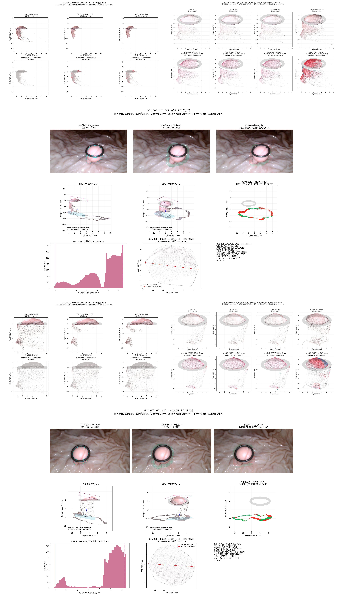
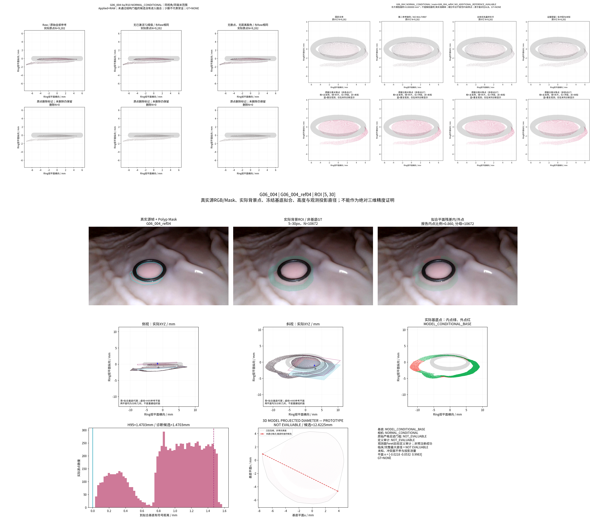
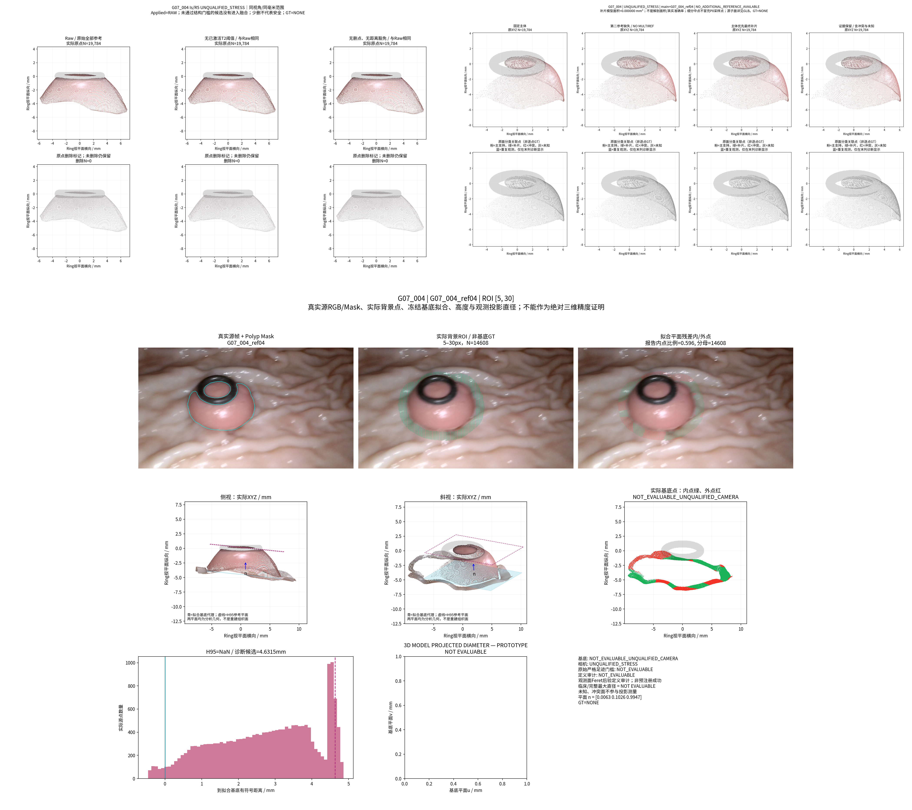
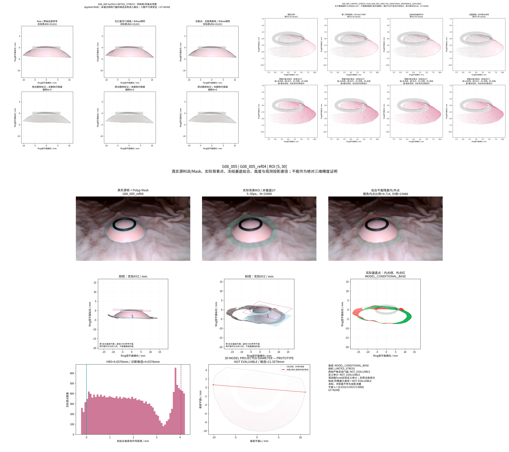

# TASK-PHASED-INCREMENTAL-FUSION-MULTIGROUP-001

## 中文摘要与直接结论

**完成四组实验执行与交付；尚未证明跨组清理、融合稳定有效，等待人工验收。** 本轮处理G01/G06/G07/G08共4独立物理组、5个视频局部场景、9参考、147,540个原始来源点。仅G01有多参考，其余三组只能完成单参考诊断，不能冒充三组融合成功。复用既有T2并加一次距离豁免，恢复1,314个候选点，但剩余9,823个删除候选仍损失细柄代理、产生孔洞风险，最终全部保留Raw。固定主体并对混合覆盖原面一级细分，004/005分别增加0.737/0.840mm²条件性源补片；留出覆盖提升很小，碎片增多。高度10/27条件具备数值基底支持，所有三维Dxy正式原型仍NOT_EVALUABLE。原始P0、相机、HERO、密度模块与正式Dxy均未修改，GT=NONE。

**回答最终问题：尚不能认定已在多个独立测量组上稳定保留更多真实表面。** G01有来源明确的小幅模型补片增量，三组缺多参考，不能检验融合通用性。高度已具备可解释、可审查的几何图；三维Feret数学候选与端点也可审查，但完整投影支持/极值观测证据不足，不能强行输出可评价直径，更不能宣称临床准确性。

## 本地结果入口与版本

**统一可视化目录：**

`/home/liu/ring_first_3d_incremental/experiments/TASK-PHASED-INCREMENTAL-FUSION-MULTIGROUP-001/visualizations/`

[打开本轮可视化文件夹](/home/liu/ring_first_3d_incremental/experiments/TASK-PHASED-INCREMENTAL-FUSION-MULTIGROUP-001/visualizations/) · [直接打开 index.html](/home/liu/ring_first_3d_incremental/experiments/TASK-PHASED-INCREMENTAL-FUSION-MULTIGROUP-001/visualizations/index.html) · [本地总览联系表](/home/liu/ring_first_3d_incremental/experiments/TASK-PHASED-INCREMENTAL-FUSION-MULTIGROUP-001/visualizations/Overview_Contact_Sheet.png)

若客户端不能点击本地链接，复制以上绝对路径到文件管理器或本机浏览器。HTML集中展示五个场景的15张独立核心图、27张完整基底条件图、总览和十个GLB链接，包含失败，不需要查找零散日志。

分支：`exp/TASK-PHASED-INCREMENTAL-FUSION-MULTIGROUP-001`；起点 `053a32ecdb69ada1fe937e9e4b697775f3b43634`。本轮用户明确任务及最小授权记录见 [TASK](TASK.md)、[AGENTS](../../AGENTS.md)。沿用PHASE_D_RESEARCH_AUTHORIZED，不创建科学baseline tag、不合并主线。原始资产、未验收科研成果和Dxy工作区只读；本轮不执行跨视频配准或合并G01的004/005。

[实际来源/SHA](provenance/INPUTS.json) · [补充身份核验](provenance/SUPPLEMENTAL_INPUT_AUDIT.json) · [规则冻结](provenance/RULES_FROZEN.json) · [配置](config.json) · [原执行协议](PROTOCOL.md) · [复现入口](REPRODUCE.md) · [全部本地资产SHA](provenance/LOCAL_ASSET_INDEX.csv)。

## 简短历史资产审计

| 资产 | 原有方法 | 本轮复用 | 核查结论/限制 |
| --- | --- | --- | --- |
| Density-Multigroup | r=0.4mm邻居计数、rho、k12、邻接字段 | 只读九份冻结字段 | rho=排除自身的邻居数/(πr²)，点/mm²；字段SHA与此前ABS输入一致，没有重算密度 |
| Sparse-Stretch | C/M/A联合相对阈值及损伤记录 | 仅历史对照和拓扑/源分量函数 | 不重新运行C/M/A或SOR/ROR参数搜索 |
| ABS-Density | 视频绝对密度门控、T1/T2/T3、Final | 复用T2索引/阈值与原结构验收 | Final=Raw是明确拒绝候选或未激活，不是忘记应用清理 |
| 最新Phase-D | 主面评分、0.3mm/30°去重、来源层 | 复用评分与几何接口，最小局部细分 | 旧主面不移动；旧补面过严和碎片风险作为对照 |
| 历史B/C | 直接叠加/置信融合 | 原几何只读评价 | 只在G01可比较，不重跑融合器，不当作独立GT |
| 历史高度ROI | 原背景RANSAC平面、H95及失败 | G01十八条件原平面及可用性直接复用 | 004原0/9、005原4/9完全保留；不放宽门槛重拟合 |
| G06/G07/G08缓存 | HERO_native、gallery、P0 | 原P0与背景反投影 | 每组只有一个深度参考；相机数组8×4×4不是8份深度 |
| 真实XYZ绘图 | real_p0_renderer与原C0函数 | 原样调用点绘制核心 | 真RGB/真实原点；不把细分中点冒充新的P0采样点 |

历史深度native为二维数组(352,640)，gallery/P0为同一ref04的派生与显示尺寸适配。没有足够额外参考的其他组可替换后三组，因此保留其独立单参考结果及缺失证据，未启动HERO补算。[八组资产清单](metrics/asset_inventory.csv)、[清理历史审计](metrics/cleaning_history_audit.csv)。

另发现并记录历史留出身份错误：G06旧`raw229/key01`实际属于HERO输入[0,1,2]，旧P2却标为未参与输入；其92.2%覆盖只能解释为条件一致性，不能继续当独立深度输入留出。本轮在误差前固定G06合格key03/raw473、G08合格key03/raw531；G07选定key06只作不合格相机诊断。旧文件未修改。[纠正记录](provenance/HISTORICAL_CORRECTIONS.json)、[目标冻结](provenance/TARGETS_FROZEN.json)。

## 四组分母与条件

| 物理组 | 形态/环 | 独立视频/参考 | 来源点暴露N | 相机条件 | 可检验多参考融合 |
| --- | --- | --- | --- | --- | --- |
| G01 | Ip/R10 | 2/6 | 98843 | NORMAL_CONDITIONAL | 仅G01两个视频分别检验 |
| G06 | IIa/R10 | 1/1 | 9282 | NORMAL_CONDITIONAL | 缺次参考 / NOT_EVALUABLE |
| G07 | Is/R5 | 1/1 | 19784 | UNQUALIFIED_STRESS | 缺次参考 / NOT_EVALUABLE |
| G08 | IIa/R10 | 1/1 | 19631 | LIMITED_STRESS | 缺次参考 / NOT_EVALUABLE |

G01两视频只计一个物理组，保持各自LOCAL FRAME。G08旧文件含004命名，但actual_video为005，按永久来源绑定处理。点数是重复观察暴露数，不是独立解剖点。NORMAL、LIMITED、UNQUALIFIED分开解读；G07不能计入可靠性成功率。组名/名义直径未参与参数选择或预测回填。

## A：既有密度清理及距离豁免

固定复用原T2：004为 **49.21594809052892**、005为 **58.17189372286792 点/mm²**；严格按rho<T。其他三组没有已激活T2，保持Raw；G06无需清理，G07/G08历史为证据不足，不能由文件存在或删点0认作已完成有效清理。不存在新的阈值搜索、密度网络或Mask边缘直接删除。

距离豁免只做一次：被原T2标记点距离另一参考T2保留原面≤0.3mm，且在冻结选择帧具有源RGB/Mask条件支持、没有明确前冲突。没有其他参考时不虚构豁免。完整1,314条来源、对应原面ID和距离见 [豁免证据](metrics/A_exemption_evidence.csv)，完整三维见证点仅本地保存。这是预测一致性，不是真实结构标签。

| 参考 | 原N | T2删点 | 豁免N | 候选删点 | 细柄代理删除/N | 剩余主体最大片占比 | 内部删除片候选 | 实际采用 |
| --- | --- | --- | --- | --- | --- | --- | --- | --- |
| G01_004_ref03 | 24343 | 1394 | 10 | 1384 | 328/2302 | 99.95% | 0 | Raw |
| G01_004_ref08 | 14029 | 2042 | 473 | 1569 | 362/1136 | 100.00% | 11 | Raw |
| G01_004_ref13 | 13010 | 2468 | 482 | 1986 | 372/1074 | 99.09% | 7 | Raw |
| G01_005_raw00057 | 19813 | 1347 | 23 | 1324 | 278/845 | 100.00% | 2 | Raw |
| G01_005_raw00459 | 12775 | 1513 | 187 | 1326 | 97/435 | 100.00% | 0 | Raw |
| G01_005_raw00745 | 14873 | 2373 | 139 | 2234 | 165/539 | 99.60% | 3 | Raw |
| G06_004_ref04 | 9282 | 0 | 0 | 0 | 0/507 | 100.00% | 0 | Raw |
| G07_004_ref04 | 19784 | 0 | 0 | 0 | 0/666 | 100.00% | 0 | Raw |
| G08_005_ref04 | 19631 | 0 | 0 | 0 | 0/805 | 100.00% | 0 | Raw |

G01原T2共11,137个删除候选，距离豁免恢复1,314个，剩9,823个。可见异常延伸有所缩减，但六参考细柄代理损失仍超过原10%允许量，部分出现11/7/2/3个内部删除片候选；恢复点也可能把原删区分裂成更小的内孔候选。故原结构检查仍不通过，**两个激活视频均未自动采纳，实际融合输入保持Raw**。没有因整体删除率高而拒绝，也没有把少删当成安全。

细柄代理来自源Mask连通结构，不是逐点真实标签；不能把代理损失率叫真实误删率。最终Raw保留所有既有小结构是工程事实，不等于证明它们全部真实。候选只标记/派生原索引，清理Mesh只删引用被删点的原面，不补孔、不移动原点。[完整损伤表](metrics/A_cleaning.csv)、[视频采用决定](metrics/A_decisions.csv)。本轮停止该清理分支进一步优化。

## B：固定主体、原面内增量补片与证据保留

主面沿用统一五项评分：0.4选择帧覆盖、0.2源RGB解释、0.2最大连续原面面积比例、0.1非前冲突比例、0.1非原T2风险比例，差<0.03保留AMBIGUOUS。G01选ref08/raw00459，未人工固定答案；后三组只有一个候选，不能把“自动选中”算作成功选择。[全部逐项分数](metrics/B_main_scores.csv)。G07虽有数值分数，其相机不合格，主体仍是UNKNOWN，不能跨组比较分数来认证正确性。

主体一旦确定，原顶点/原面均固定，位移 **0mm**、不平均、不做非刚性或ICP。次参考继续用7探针、0.3mm和30°局部法向检查重复；阈值不是三维误差上界。有条件支持的非重叠面加入，冲突另层，未知不计可信增益。

最小修改有两项，四组规则一致：①原点投到同一选择像素时，首表面0.3mm内的等深原点也可有条件支持，不再只承认唯一z-buffer winner；RGB≤40/255且B Mask为Polyp。②只对部分覆盖的次参考原三角面最多一级1→4中点细分，子面具有原父面ID/重心权重、严格在原面内且逐父面面积守恒。子面7探针均未覆盖、至少2/3顶点有观测支持、无明确前冲突及未豁免密度风险才加入。中点不是新增观测；诊断散点仍只显示真实原P0 XYZ。来源GLB可查看精确子面。

| 独立场景 | 主面 | 主面Raw→Applied模型面积mm² | 新增补片mm² | 其中部分重叠回收mm² | 重复观测曝光mm² | 冲突曝光mm² | 未知曝光mm² |
| --- | --- | --- | --- | --- | --- | --- | --- |
| G01_004 | G01_004_ref08 | 154.977→154.977 | 0.737010 | 0.139382 | 46.104 | 207.551 | 104.883 |
| G01_005 | G01_005_raw00459 | 112.638→112.638 | 0.839956 | 0.006913 | 78.538 | 110.045 | 82.686 |
| G06_004 | G06_004_ref04 | 80.466→80.466 | 0.000000 | 0.000000 | 0.000 | 0.000 | 1.569 |
| G07_004 | G07_004_ref04 | 113.474→113.474 | 0.000000 | 0.000000 | 0.000 | 0.000 | 113.474 |
| G08_005 | G08_005_ref04 | 229.385→229.385 | 0.000000 | 0.000000 | 0.000 | 0.000 | 6.207 |

以上面积仅描述当前源模型组成/多次曝光，**不是本轮研究的真实息肉表面积**，不计算完整表面积或体积。单参考组重复/冲突数值为0，含义是没有其他参考可比较，不是证明没有几何错误。

| 场景 | 次参考 | 提供的条件补片mm² |
| --- | --- | --- |
| G01_004 | G01_004_ref13 | 0.691959 |
| G01_004 | G01_004_ref03 | 0.045051 |
| G01_005 | G01_005_raw00745 | 0.528169 |
| G01_005 | G01_005_raw00057 | 0.311787 |

相对上一轮严格新增0.111595/0.293217mm²，本轮为0.737010/0.839956mm²。只有其中 **0.139382/0.006913mm²** 可直接归为混合父面内保留下来的子片；其余变化还包括像素支持与2/3规则，不能把全部增量归因于细分，更不能称真实新增表面已认证。

每场景输出两类GLB：`primary_priority`为完整固定主体＋条件补片；`evidence_preserved`再含来源独立的CONFLICT/UNKNOWN对象，重复几何不加入但观测记录永久保留。未知对象是审计层，不是可信补片。次参考细分边与未细分邻面可出现T形连接；不同来源未焊接，因此不能声称形成单一连续表面。

| 场景 | 方法 | 面数 | 分量 | 最大分量占比 | 非流形边 |
| --- | --- | --- | --- | --- | --- |
| G01_004 | primary | 26621 | 8 | 50.77% | 0 |
| G01_004 | core | 26761 | 39 | 50.53% | 0 |
| G01_004 | evidence | 97976 | 267 | 18.55% | 0 |
| G01_004 | B | 97879 | 24 | 17.84% | 0 |
| G01_004 | C | 96048 | 21 | 48.21% | 586 |
| G01_005 | primary | 24030 | 3 | 72.13% | 0 |
| G01_005 | core | 24195 | 9 | 71.59% | 0 |
| G01_005 | evidence | 70995 | 260 | 29.50% | 0 |
| G01_005 | B | 89776 | 23 | 22.95% | 0 |
| G01_005 | C | 76256 | 19 | 66.78% | 1993 |

004主体8分量→CORE39，005为3→9；证据场景267/260分量。**主体自身未受损，但新增部分碎片增多，连续性并未全面改善。** 与C相比零非流形也不能等同于几何修复；不同来源索引未焊接会改变拓扑分母。

## 可见覆盖、历史B/C及共同支持

评价为Polyp-only诊断，两类投影分开：真实原点z-buffer与已有原三角面/可追溯子面的光栅化。颜色只来自各源参考；原面内RGB插值明确标记，不用目标B重上色、补洞或抹去Mask外预测。选择帧已参与主面/补片判断，不能当独立验证；G01另用此前冻结留出raw1191、raw834/raw860，但它们不是全流程新盲测。历史B/C只读取原几何，未重跑融合器。

| 场景 | 方法 | 目标 | B Polyp分母 | 原点覆盖% | 源面覆盖% | 各自支持RGB MAE/255 |
| --- | --- | --- | --- | --- | --- | --- |
| G01_004 | primary | 004_15 | 12966 | 79.11 | 87.32 | 21.037 |
| G01_004 | core | 004_15 | 12966 | 79.65 | 87.64 | 21.015 |
| G01_004 | evidence | 004_15 | 12966 | 92.16 | 93.50 | 33.807 |
| G01_004 | B | 004_15 | 12966 | 93.44 | 94.33 | 34.733 |
| G01_004 | C | 004_15 | 12966 | 93.11 | 94.33 | 34.754 |
| G01_005 | primary | v005_00834 | 14804 | 71.74 | 86.56 | 16.492 |
| G01_005 | primary | v005_00860 | 15093 | 69.36 | 85.49 | 17.871 |
| G01_005 | core | v005_00834 | 14804 | 71.89 | 86.60 | 16.493 |
| G01_005 | core | v005_00860 | 15093 | 69.49 | 85.53 | 17.869 |
| G01_005 | evidence | v005_00834 | 14804 | 84.04 | 92.77 | 24.012 |
| G01_005 | evidence | v005_00860 | 15093 | 82.06 | 91.96 | 25.058 |
| G01_005 | B | v005_00834 | 14804 | 94.52 | 93.48 | 32.856 |
| G01_005 | B | v005_00860 | 15093 | 93.29 | 92.62 | 33.953 |
| G01_005 | C | v005_00834 | 14804 | 84.56 | 93.48 | 32.321 |
| G01_005 | C | v005_00860 | 15093 | 83.06 | 92.62 | 33.429 |

004原面留出覆盖87.32%→87.64%，005为86.56%→86.60%、85.49%→85.53%，增量仅约0.32/0.04个百分点。原有共同支持上的primary/CORE RGB MAE完全相同：004 N=11,322，21.0366；005 N=12,815/12,903，16.4924/17.8711。增加的是少量未覆盖像素，未证明原有几何精度改善。

证据场景与B/C在共同支持上的RGB解释有所改善：004 B→evidence在12,123像素为34.734→33.807；005 raw834在13,734像素为32.947→24.012，raw860在13,879像素为34.050→25.058。但覆盖仍低于B，且包含未解冲突，不以颜色误差下降认证三维精度。曝光、反光和相机误差同样影响RGB。[42条完整覆盖/拓扑指标](metrics/E_visible_coverage.csv)、[36条同支持比较](metrics/E_common_support.csv)保留独立与共同分母、p95、最大值及Mask外预测。

G06/G08选择视角原面覆盖96.47%/97.20%只是一致性诊断；没有次参考，primary/second/core/evidence四者相同，不能重复计为四次成功。G07全部为不合格几何压力测试。

## C：基底、高度及全部失败条件

严格沿用真实邻近Background、Mask外5–30/45/60px ROI、0.3mm RANSAC、300次、seed0、至少100点且内点≥50%。不使用Ring平面。G01原18份平面系数和可用性直接复用，004仍0/9、005仍4/9，未重拟合制造成功；其他组在同法下拟合一次。相机不合格者即使数值内点率高也不可作为可用基底。

基底满足 `nᵀ(x−p0)=0`，点高为 `h=nᵀx+d`，H95为真实原点有符号距离的95百分位；主面/补片原点暴露数分别保存，细分中点不参加H95，不是面积加权或独立解剖采样。拟合基底和沿法向H95偏移的平面在图中明确为**解析参考几何，不是新增重建组织面**。

| 场景/源参考 | ROI px | 背景N | 报告内点N/比例 | 基底法向 n | H95 mm / 状态 |
| --- | --- | --- | --- | --- | --- |
| G01_004_ref03 | [5, 30] | 12201 | 5500/0.4508 | 0.2859,0.0073,0.9582 | NOT_EVALUABLE_BASE_FIT_REJECTED |
| G01_004_ref03 | [5, 45] | 21987 | 8473/0.3854 | 0.2714,0.0555,0.9609 | NOT_EVALUABLE_BASE_FIT_REJECTED |
| G01_004_ref03 | [5, 60] | 31959 | 11752/0.3677 | 0.1353,0.2452,0.9600 | NOT_EVALUABLE_BASE_FIT_REJECTED |
| G01_004_ref08 | [5, 30] | 10787 | 4790/0.4441 | 0.1704,0.1691,0.9708 | NOT_EVALUABLE_BASE_FIT_REJECTED |
| G01_004_ref08 | [5, 45] | 18498 | 7334/0.3965 | 0.1580,0.1701,0.9727 | NOT_EVALUABLE_BASE_FIT_REJECTED |
| G01_004_ref08 | [5, 60] | 26552 | 9437/0.3554 | 0.1416,0.1679,0.9756 | NOT_EVALUABLE_BASE_FIT_REJECTED |
| G01_004_ref13 | [5, 30] | 10269 | 5083/0.4950 | 0.0895,0.1958,0.9766 | NOT_EVALUABLE_BASE_FIT_REJECTED |
| G01_004_ref13 | [5, 45] | 17755 | 7593/0.4277 | 0.0940,0.1978,0.9757 | NOT_EVALUABLE_BASE_FIT_REJECTED |
| G01_004_ref13 | [5, 60] | 25556 | 9423/0.3687 | 0.0943,0.1982,0.9756 | NOT_EVALUABLE_BASE_FIT_REJECTED |
| G01_005_raw00057 | [5, 30] | 10778 | 4861/0.4510 | 0.1035,0.1625,0.9813 | NOT_EVALUABLE_BASE_FIT_REJECTED |
| G01_005_raw00057 | [5, 45] | 20072 | 8535/0.4252 | 0.0777,0.1574,0.9845 | NOT_EVALUABLE_BASE_FIT_REJECTED |
| G01_005_raw00057 | [5, 60] | 29608 | 11458/0.3870 | 0.0295,0.1553,0.9874 | NOT_EVALUABLE_BASE_FIT_REJECTED |
| G01_005_raw00459 | [5, 30] | 9687 | 5208/0.5376 | -0.1469,0.1845,0.9718 | 12.5216 |
| G01_005_raw00459 | [5, 45] | 17743 | 8190/0.4616 | -0.1327,0.1837,0.9740 | NOT_EVALUABLE_BASE_FIT_REJECTED |
| G01_005_raw00459 | [5, 60] | 25979 | 10925/0.4205 | 0.2490,0.1337,0.9592 | NOT_EVALUABLE_BASE_FIT_REJECTED |
| G01_005_raw00745 | [5, 30] | 10528 | 5510/0.5234 | -0.0977,0.1311,0.9865 | 12.6301 |
| G01_005_raw00745 | [5, 45] | 19648 | 10289/0.5237 | -0.0725,0.0943,0.9929 | 12.4760 |
| G01_005_raw00745 | [5, 60] | 28701 | 14614/0.5092 | -0.0635,0.0911,0.9938 | 12.5048 |
| G06_004_ref04 | [5, 30] | 10672 | 9179/0.8601 | -0.0218,-0.0532,0.9983 | 1.4703 |
| G06_004_ref04 | [5, 45] | 20382 | 16418/0.8055 | -0.0248,-0.0552,0.9982 | 1.5732 |
| G06_004_ref04 | [5, 60] | 30914 | 22176/0.7173 | -0.0332,-0.0590,0.9977 | 1.5801 |
| G07_004_ref04 | [5, 30] | 14608 | 8700/0.5956 | 0.0063,0.1026,0.9947 | NOT_EVALUABLE_UNQUALIFIED_CAMERA |
| G07_004_ref04 | [5, 45] | 26285 | 14097/0.5363 | -0.0114,0.1227,0.9924 | NOT_EVALUABLE_UNQUALIFIED_CAMERA |
| G07_004_ref04 | [5, 60] | 38741 | 20839/0.5379 | -0.0047,0.1256,0.9921 | NOT_EVALUABLE_UNQUALIFIED_CAMERA |
| G08_005_ref04 | [5, 30] | 15466 | 11049/0.7144 | 0.0318,0.0415,0.9986 | 4.0376 |
| G08_005_ref04 | [5, 45] | 27011 | 17637/0.6530 | 0.0155,0.0404,0.9991 | 4.1693 |
| G08_005_ref04 | [5, 60] | 39883 | 25300/0.6344 | 0.0100,0.0193,0.9998 | 4.2388 |

合计10/27条件可保留为模型条件高度、17/27不可评价；其中G07三条件数值拟合通过但相机不合格。按独立组为G01部分可用、G06可用、G08有限条件可用，G07失败，不能将10条件当10个病例。

| 场景 | 可用/全部ROI条件 | H95中位数mm | 可用条件范围mm | 解释 |
| --- | --- | --- | --- | --- |
| G01_004 | 0/9 | NaN / NOT_EVALUABLE | NaN / NOT_EVALUABLE–NaN / NOT_EVALUABLE | 仅ROI/参考敏感度，不是真实误差 |
| G01_005 | 4/9 | 12.5132 | 12.4760–12.6301 | 仅ROI/参考敏感度，不是真实误差 |
| G06_004 | 3/3 | 1.5732 | 1.4703–1.5801 | 仅ROI/参考敏感度，不是真实误差 |
| G07_004 | 0/3 | NaN / NOT_EVALUABLE | NaN / NOT_EVALUABLE–NaN / NOT_EVALUABLE | 仅ROI/参考敏感度，不是真实误差 |
| G08_005 | 3/3 | 4.1693 | 4.0376–4.2388 | 仅ROI/参考敏感度，不是真实误差 |

G06 1.470–1.580mm、G08 4.038–4.239mm的变化来自同一参考的重叠ROI，不是跨参考独立重复性。G01_005仅4/9的12.476–12.630mm不能忽略其余失败来宣称稳定。背景本身来自预测深度，基底解剖真实性与位姿误差仍未独立验证。实际ROI、内外点、侧/斜视、法向、H95参考平面和距离直方图每条件均有图，不只交付数字。[完整高度字段](metrics/C_height_geometry.csv)。

## D：三维投影直径原型及定义审计

正式Dxy工程未导入、调用或修改。本任务仅把观测支持面沿合格基底法向投影，在平行基底的二维坐标中求凸包最远顶点对（最大Feret），标记 `3D MODEL PROJECTED DIAMETER — PROTOTYPE`。端点、三维原点/原边中点来源、基底系数、模型和排除区域完整保存。CONFLICT/UNKNOWN不参与测量；没有未知背面、闭合网格或体积。

初始协议另设80%支持面比例及80%凸包填充条件，原严格 **27基底×3模型=81条均NOT_EVALUABLE**。需要澄清：凸包填充率不是用户定义的已观测区域直径的数学必要条件，真实凹陷/孔洞也会降低它。因此后续另作**公开的后验定义审计**，保留原模型、阈值、候选值和严格结果，不以此冒充事前成功，并检查两个最大端点是否真有原观测支持。去掉凸包完整性的误解后，本轮仍没有可评价成功：G06两个端点均缺少选择帧支持，G08一个缺少支持，G01还受基底/模型支持不足影响，G07相机不合格。

端点缺少该视角支持不等于证明它是错误点，可能还涉及遮挡、Mask边界和相机误差；当前证据不能强行认证。数学候选保留便于人工审查，**不计独立测量数值成功**。不存在用小阈值变化让0.798通过0.8的操作，也没有依据GT或名义尺寸改规则。

| 场景（主源ROI5–30） | 模型 | 仅数学候选mm | 端点观测支持 | 最终原型状态 |
| --- | --- | --- | --- | --- |
| G01_004 | primary | 10.2932 | [True, True] | NOT_EVALUABLE |
| G01_004 | second | 10.2932 | [True, True] | NOT_EVALUABLE |
| G01_004 | core | 10.4565 | [True, False] | NOT_EVALUABLE |
| G01_005 | primary | 10.2111 | [False, False] | NOT_EVALUABLE |
| G01_005 | second | 10.2111 | [False, False] | NOT_EVALUABLE |
| G01_005 | core | 10.2111 | [False, False] | NOT_EVALUABLE |
| G06_004 | primary | 12.6225 | [False, False] | NOT_EVALUABLE |
| G06_004 | second | 12.6225 | [False, False] | NOT_EVALUABLE |
| G06_004 | core | 12.6225 | [False, False] | NOT_EVALUABLE |
| G07_004 | primary | NaN / NOT_EVALUABLE | [] | NOT_EVALUABLE |
| G07_004 | second | NaN / NOT_EVALUABLE | [] | NOT_EVALUABLE |
| G07_004 | core | NaN / NOT_EVALUABLE | [] | NOT_EVALUABLE |
| G08_005 | primary | 21.3579 | [False, True] | NOT_EVALUABLE |
| G08_005 | second | 21.3579 | [False, True] | NOT_EVALUABLE |
| G08_005 | core | 21.3579 | [False, True] | NOT_EVALUABLE |

无次参考组的三个模型是同一几何别名，不是三个独立重建。G06候选约12.623mm、G08约21.35mm均保留端点诊断，但正式Dproj为NaN；不能将其作为临床最大直径。全部81条件及来源见 [原严格结果](metrics/D_projected_diameter.csv)、[后验定义审计](metrics/D_observed_surface_definition_audit.csv)。未获得独立GT，MdARE、GT-MAE、p95/最大真实误差及物理准确率全部NOT_EVALUABLE；历史测量回退为0。

## 四组真实图、模型与复现

每场景三张独立核心图：Raw/历史密度候选/距离豁免；主面→第二参考→最终补片→证据场景；基底和H95/Dxy几何。末列分类图的蓝色仅表示归档的重复观测，不加入最终几何。源RGB行与分类诊断行分开，分类不是逐点GT。

G01：上下分别为004/005，未进行跨视频配准或融合。保留异常长尾、短小结构、重复/冲突层和失败基底；所有源XYZ以原毫米尺度显示。

G06：无已激活清理阈值，只有一个参考；三ROI高度可解释，三维直径候选端点未获足够支持。不能称多参考融合或真实测量成功。

G07：不合格相机压力测试，数值平面不作物理基底认证，模型整体UNKNOWN，不计可靠性成功。

G08：actual_video=005，有限相机条件，单参考；高度为条件原型，直径极值缺支持。四组同规则，不按外观单独调参。

绘图继续调用 `visualization/real_p0_renderer.py` 和原C0绘图核心，真实点大小0.08、alpha=1、CAD alpha=0.15、等比例毫米轴。源RGB、孔洞和断裂保留；分类/深度色只作明确诊断，不用贴图、平滑或新点掩盖结构。CAD保持原几何，GLB使用黑色不透明实体；R10/R5外径约12.4/7.4mm、实体厚度约1.2mm。Polyp与背景为同一冻结Ring局部系，背景实际XYZ不为连接基底而移动；解析平面箭头始终单独标记。侧/斜视为虚拟诊断，不冒充源帧同相机重投影。[显示参数](provenance/VISUALIZATION_PARAMETERS.json)。

每场景本地有两份可独立查看GLB，坐标按标准米序列化，源XYZ单位毫米：

| 场景 | 模型 | 实际字节 | SHA256 |
| --- | --- | --- | --- |
| G01_004 | primary_priority | 7196480 | `0261209d16fd71f81f16c519188e69f0a9aa2f2d76f6a8a3b4c778bd57f13901` |
| G01_004 | evidence_preserved | 12958932 | `500d44f159f4e0da556d086167bd178a625ff8d9dc625177bd5e7083eb0968e7` |
| G01_005 | primary_priority | 6872468 | `ba8ab80a47443897cd58328d2f82e02f03e4934bd5eb84d00e8a07afcc0e2a3a` |
| G01_005 | evidence_preserved | 10686376 | `0bbf23fdb5e5507a5c1192534c42796d35501e1420ca668146ddc9ad930c33c1` |
| G06_004 | primary_priority | 3387288 | `26f7feaa55eaa461c2e4db4a302264862b05dd8c3b37c43fd63702180935601a` |
| G06_004 | evidence_preserved | 3387288 | `d9604eccaef08593d2b535eb9a2a9a17cb2bf3c0a16fe5ce4398798cb587b988` |
| G07_004 | primary_priority | 5761460 | `5adcc40caa2a95ac4df0accfd502e4a831a8fb648041bbf04fc9fcec2ee9bd7a` |
| G07_004 | evidence_preserved | 5761460 | `eacfca64d875d1abe1f8f946589eacc4640ce491ecaba21325873258550e5d00` |
| G08_005 | primary_priority | 6056252 | `505b010b586833f71d7d00df955776f48e53f33aa061664467d4ba6f9d2ef3c6` |
| G08_005 | evidence_preserved | 6056256 | `ca70027475a4aa865a4461f4bfaf5c3abb6890306fd184f607ed4e9f67580938` |

真实目录：`/home/liu/ring_first_3d_incremental/experiments/TASK-PHASED-INCREMENTAL-FUSION-MULTIGROUP-001/local_results/GLB/`。文件名为场景ID加`_primary_priority.glb`或`_evidence_preserved.glb`。十份模型、原P0/原Mesh、密度候选、删除/豁免原因、父面重心来源及完整图像均保留本地；未上传完整几何、视频、权重或缓存。[GLB路径/SHA清单](metrics/GLB_INDEX.csv)、[完整本地结果索引](provenance/LOCAL_ASSET_INDEX.csv)。

解析小测试14项及结果级检查 **389项通过**：[small_tests](metrics/small_tests.json)、[VALIDATION](metrics/VALIDATION.json)。覆盖原XYZ/RGB/相机身份、原阈值、豁免见证、逐父面面积守恒、重心来源、主体不动、真实点绘制、源RGB预测、GLB独立重载/黑色实体CAD/米单位/背景来源，以及六个受保护工作区HEAD/index/完整状态和既存修改。工程核验不能证明几何准确性。[保护状态](metrics/PROTECTED_WORKSPACES.json)。

复现命令见 [REPRODUCE](REPRODUCE.md)，支持核验当前结果或复制本任务小代码到全新目录回放，拒绝覆盖既有实验。本轮逐段执行完成，未额外声称已做第二遍全流程重放。源码与算法参数事前冻结；后续颜色/布局/定义审计及补充身份核验均保留各自记录，没有伪称后验工作是预注册证据。[最终源码SHA](provenance/FINAL_SOURCE_MANIFEST.json)。

## 跨组八项审计与固定表

| 问题 | 结论 |
| --- | --- |
| 主面优先跨形态合理吗 | G01保住既有主体；其他组只有一个候选，不能证明跨形态选择有效 |
| 密度清理稳定减少异常吗 | 候选减少稀疏延伸，但保护检查失败，实际采纳0/2激活视频；不能推广 |
| 真实小面被删吗 | 有细柄代理和内孔风险，无真实标签，真实误删率NOT_EVALUABLE；Raw未永久删除 |
| 融合增加支持面吗 | G01新增0.737/0.840mm²条件源面和少量留出覆盖，真实几何增益未认证；三组缺参考 |
| 去重系统偏差吗 | 0.3mm是模型重叠启发式；部分父面回收有效，边界碎片/T连接仍多；跨组偏差无法检验 |
| 哪些组深度冲突严重 | G01两个视频冲突层仍大；单参考组不能由冲突计数0宣称无错层 |
| 高度哪些可用/失败 | G01_004 0/9、G01_005 4/9、G06 3/3、G08 3/3条件原型；G07 0/3 |
| 三维Dxy哪里可评价 | 正式原型0/81条件、0/4独立组；数学候选和端点不计成功 |

| 审计项目 | 必须汇报 |
| --- | --- |
| 目标组数 | 4独立组、5视频场景、9参考、147540来源点；G01两视频不计两样本 |
| 本算法独立成功 | 工程结果4/4组；两类场景5/5各输出；高度条件原型10/27、涉及3/4组；不是测量正确率 |
| 本算法失败 | 2/2激活视频未采纳清理；3/4组缺多参考；17/27高度条件不可评价；Dxy81/81条件NaN |
| 历史测量值回退 | **0**，未读取S0/V2/旧照片直径/正式Dxy预测；仅复用用户批准的冻结资产、原平面方法 |
| 失败组及具体原因 | G01细柄风险/深度冲突/碎片/部分基底失败；G06/G08缺参考及极值支持不足；G07相机不合格，均有图 |
| 最终统计样本 | 所有4组、27基底和81模型-基底条件全部保留；条件重复不能当独立病例 |
| 是否使用GT选择算法 | **否，GT=NONE**，未使用Oracle/GT姿态、名义直径或真实误差选参数 |

## 下一轮建议与停止

**唯一优先建议：经PM与研究者批准后，为G06补齐两个可追溯参考深度/开放面，使用现有冻结相机与HERO，先获得第二个正常条件多参考组。** 当前最大跨组证据缺口是独立参考不足，继续改阈值或只看单参考漂亮图片无法补足。也需要人工核验本轮G01删区/小结构和Feret候选端点；本轮没有把这些人工待判定内容变成自动成功。

本轮不执行该补算，不重新优化密度、不修改Dxy，不继续跨视频配准、复杂融合、背面或体积研究。完成报告/上传后停止，等待验收。

已完成前序增量提交（最终文档提交SHA见Git记录及聊天回执，避免自引用）：

- `19aba36e83a39623cbea2c30b57c5387110d680b Phase D incremental: preserve four-group evidence, geometry diagnostics and four real review sheets`
- `706005bafacf44fd02b6778919c1c7ba14e34b9a Phase D incremental: freeze four-group source audit, original-threshold reuse and traceable surface rules`
