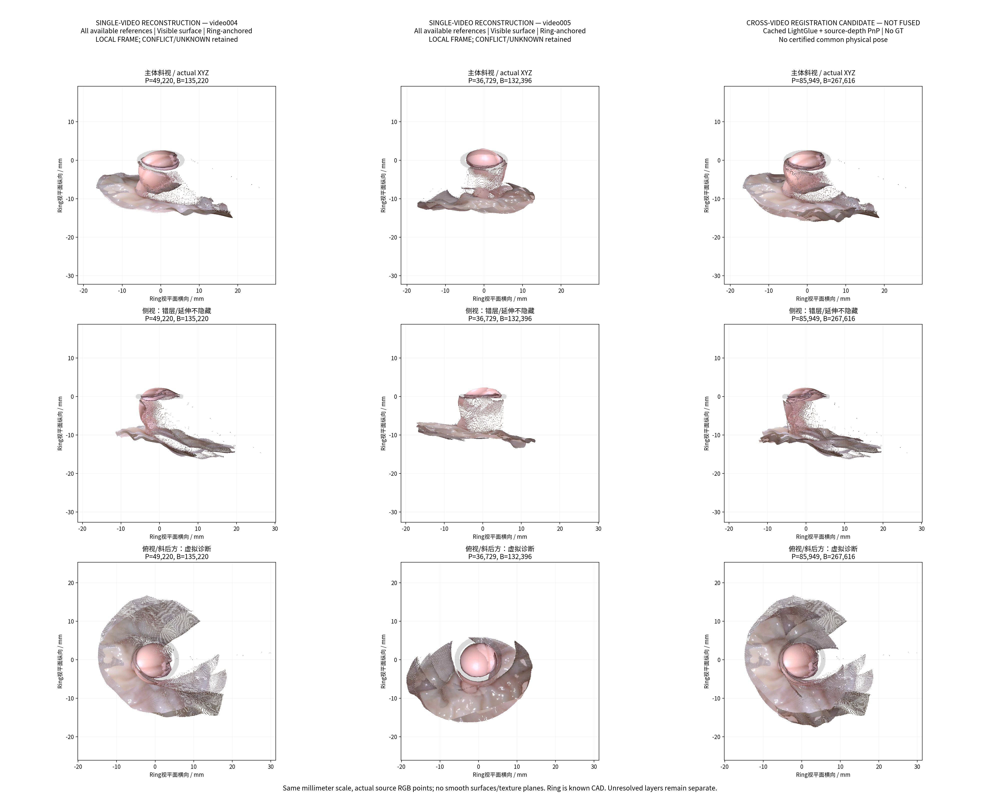
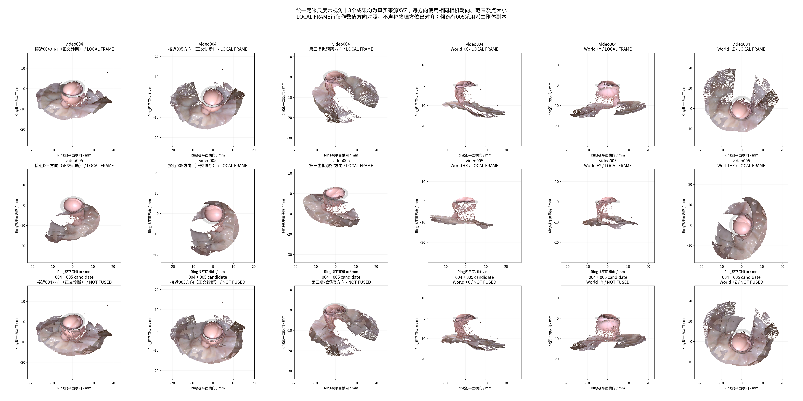
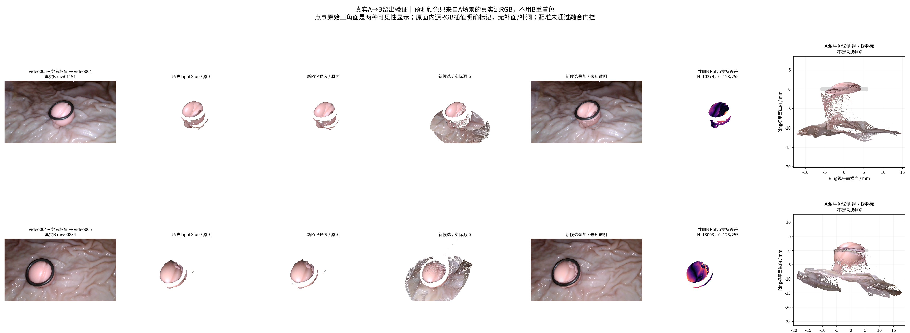
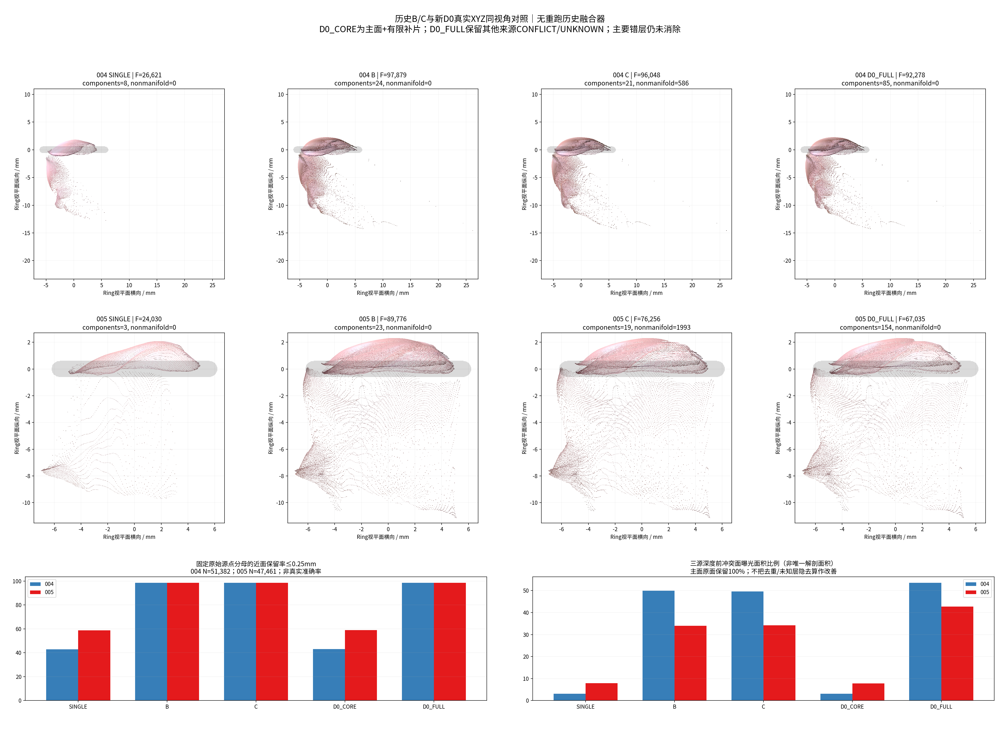

# TASK-PHASED-MAIN-SURFACE-CROSSVIDEO-001：技术报告

状态：**实验执行完成，部分科学目标未达成；D2 = NOT_FUSED，等待人工验收。** GT/Oracle：**NONE**。目标为 **1 个独立物理组、2 段视频、6 个冻结参考**，没有扩展到 G06/Is。工程核验通过不等于测量准确性认证。

## 首页：八个直接回答

1. **004：已经形成三来源的完整开放场景。** 自动选 ref08 为主面，保留 ref03/ref13 的非重复补片及 CONFLICT/UNKNOWN 层、真实背景和 CAD。主面全部原点/原面保留。新增条件性源三角面仅 **0.1116 mm²**；不能宣称比最佳单参考获得了显著更多的独立可信真表面。
2. **005：同样形成三来源开放场景。** 主面 raw00459，另两参考仍有来源层；新增条件性源面 **0.2932 mm²**。Ring 下方未知大曲面、孔洞和异常延伸没有被修复或裁掉。
3. **相对 B/C：来源与冲突分层更可审计，保留主面，005 的共同支持 RGB 一致性好于 B/C；连续性没有全面改善。** D0_FULL 的连通分量增至 004 **85**、005 **154**，高于 B 的 24/23、C 的 21/19；004 留出图像解释略差，005 覆盖低于 B。非流形边为 0 不能证明错层已消除。
4. **得到数值 H 候选，尚未得到可信跨视频配准。** 五个 GICP 终点都越过 Ring 界限；一种缓存 LightGlue＋源背景深度 PnP 备用在三个固定子样本上较稳定，Ring 中心差 **0.614 mm**、法向差 **3.138°**。第三参考背景留出反而劣于历史LG/RoMa，图像留出也有正有负；只能保留诊断候选，不宣称新H全面改善历史姿态。
5. **跨视频成果是来源分层的配准候选叠加，未执行 D2。** 独立可信新增唯一面积为 **NOT_EVALUABLE**，不能把叠加点数或两个源面的面积和作为增益。
6. **主要未解问题是局部深度层与背景预测不一致。** 005→004 和 004→005 的前冲突源面曝光分别为 **23.639/99.132 mm²（23.85%）**、**58.529/118.228 mm²（49.50%）**。004 细长延伸、005 环下稀疏侧曲面、基底背景分层以及顶部重复层仍保留。遮挡后方/未观测区域标 UNKNOWN，不能全部判错。
7. **高度尚不能稳定提取；源面面积可计算，真实唯一面积尚不可认证。** 004 基底拟合可用 **0/9**，高度 NaN；005 可用 **4/9**，候选 p95 高度中位数 **12.516 mm**，仅限这些条件。主面＋严格分离补片的模型面面积为 **155.089/112.931 mm²**，不是自主重建绝对精度或真实解剖面积。
8. **下一轮只推荐改善单视频的局部深度冲突处理与保守补面。** 优先解决“保留连续主面但次参考去重碎裂、新增可信面极少”的瓶颈；本轮不追加配准算法、不推广 G06/Is，也不继续清理参数搜索。

## 中文摘要与阶段结论

本轮在研究者明确授权下解除任务级工程管理阻碍，沿用 Ring-First→HERO→冻结毫米 XYZ，实施可解释主面评分、原三角面去重/条件性补片、背景优先有界 GICP、单一视觉对应 PnP 备用及低成本组织基底指标原型。所有源 XYZ、正式相机、密度清理结果和 Dxy 不变。两个独立场景与第三个 NOT_FUSED 候选均有可单独打开的本地 GLB；四张公开核心图均来自实际数据。

工程实现成功；科学证据只支持“可追溯地整理多参考”和部分 RGB 一致性改善。没有证据支持全面连续性改善、跨视频选择性融合通过或稳定物理测量。原有漂亮同帧重投影不作为三维精度证据。此次不是新融合器替代 B/C，也没有重跑 B/C、B1、TSDF、Hull 或训练任何模型。

| 阶段 | 分母与实际执行 | 结论 |
| --- | --- | --- |
| D0 | 2/2 视频，6/6 参考，98,843 个原始 P0 点 | 三来源开放场景；主面条件性选择；新增可信真面不可独立认证 |
| D1 GICP | 5/5 固定初值 | 全部 STOPPED_RING_BOUNDS，保留 deprecated_candidate |
| D1 唯一备用 | 136 缓存匹配中 17 个质量/背景支持，3/3 固定子样本 | seed0 候选保留，未使用留出误差选 seed |
| D1 留出 | 8 个姿态候选 × 3 个方向/目标条件 = 24 条 | 同一套固定目标；双向覆盖与像素/物理横向量级都报告 |
| D2 | 1/1 视频对审查；0/1 执行融合 | NOT_FUSED；冲突面积证据不支持继续 |
| D3 | 6 参考 × 3 ROI = 18 条 | 4/18 基底模型可用，004 0/9、005 4/9；非真实测量成功率 |

## 授权、来源和坐标

任务分支 `exp/TASK-PHASED-MAIN-SURFACE-CROSSVIDEO-001`，从 `a992fd62dfb3c4027c09ba4855e4ebf1eed50dba` 隔离创建。按 [研究者原始授权](TASK.md) 最小修改 README/AGENTS/协作规范/BASELINE 计划，记录 `PHASE_D_RESEARCH_AUTHORIZED`；**旧科学 baseline 仍未认证，没有创建 baseline tag 或合并主线**。

六参考都属于 `GP_Ip_12.0mm_closed_R10_single_refY`；组名仅标识输入，不作为算法/参数切换依据。相机历史条件 `NORMAL_CONDITIONAL` 是资产审计身份，不是本轮认证。004 与 005 原生坐标各自为 LOCAL FRAME；只有第三个候选场景对 005 作新的刚体副本变换，原源数据不动。

| 参考 | 真实原始帧号 | P0 点 | 原三角面 | XYZ / RGB / K/c2w |
| --- | --- | --- | --- | --- |
| G01_004_ref03 | 303 | 24,343 | 46,805 | 冻结来源，完整路径/SHA 见 CASES 与 INPUTS |
| G01_004_ref08 | 676 | 14,029 | 26,621 | 冻结来源，完整路径/SHA 见 CASES 与 INPUTS |
| G01_004_ref13 | 1043 | 13,010 | 24,453 | 冻结来源，完整路径/SHA 见 CASES 与 INPUTS |
| G01_005_raw00057 | 57 | 19,813 | 37,730 | 冻结来源，完整路径/SHA 见 CASES 与 INPUTS |
| G01_005_raw00459 | 459 | 12,775 | 24,030 | 冻结来源，完整路径/SHA 见 CASES 与 INPUTS |
| G01_005_raw00745 | 745 | 14,873 | 28,016 | 冻结来源，完整路径/SHA 见 CASES 与 INPUTS |

Polyp XYZ 直接来自已核验冻结 P0，与开放 Mesh 顶点一致（历史 PLY 浮点序列化差异在原容差内）；源 RGB 按原 `(group, actual_video, reference_frame, source_u, source_v)` 读取。Background 仅由同参考 Mask=0、有效原 HERO 深度和冻结 K/c2w 反投影，完整背景与所有选区索引本地保存。没有近似背景、贴图平面或移动点来连接基底。CAD 中心线半径 **5.6 mm**，截面半径 **0.6 mm**，未重建 Ring。

[输入 SHA](provenance/INPUTS.json) · [六参考身份](provenance/CASES.json) · [受控复制接口](provenance/CONTROLLED_COPIES.json) · [最终源码 SHA](provenance/FINAL_SOURCE_MANIFEST.json) · [实际运行环境](provenance/RUNTIME.json)。复用的旧代码仅作只读调用、受控函数抽取或既有自身模块复制，不把辅助函数称作完整融合器。

## D0：主面、开放补片与历史 B/C

事前规则见 [PROTOCOL](PROTOCOL.md)、[config](config.json)、[冻结源码](provenance/SOURCE_RULES_FROZEN.json)。统一得分为：0.4×选择帧 Polyp 覆盖＋0.2×截断 RGB 解释分＋0.2×最大原面连通面积比例＋0.1×非前冲突点比例＋0.1×非冻结 Type-2 风险点比例。差值 <0.03 才 AMBIGUOUS。本轮两视频第一/第二差均大于阈值，未人工指定主面；该分数只评价已冻结投影条件下的可用性，不认证解剖真实。

| 候选 | 综合分 | 选择帧覆盖 | RGB解释分 | 最大原连通面积比例 | 非前冲突比例 | 非冻结T2风险比例 |
| --- | --- | --- | --- | --- | --- | --- |
| G01_004_ref03 | 0.6771 | 0.8510 | 0.6400 | 0.5038 | 0.1367 | 0.9427 |
| G01_004_ref08 | 0.7839 | 0.8397 | 0.8110 | 0.5077 | 0.9884 | 0.8544 |
| G01_004_ref13 | 0.7018 | 0.7999 | 0.8323 | 0.5346 | 0.2744 | 0.8103 |
| G01_005_raw00057 | 0.7134 | 0.8473 | 0.6005 | 0.6378 | 0.3365 | 0.9320 |
| G01_005_raw00459 | 0.8877 | 0.9338 | 0.9267 | 0.7213 | 0.9638 | 0.8816 |
| G01_005_raw00745 | 0.7877 | 0.8989 | 0.7243 | 0.6565 | 0.6797 | 0.8404 |

选中 004_ref08、005_raw00459。已有正式 Final_Cleaned 在这六份输入中逐点等于 Raw，故本轮没有额外删点、改清理规则或把历史 T2 候选当成最终删点。原主面全部保留，即使部分面为 UNKNOWN/CONFLICT。没有可靠局部对应的次参考不做单视频 ICP。

次参考用原面三个顶点、重心及三个边中点共 7 个探针，距离≤0.3 mm 且法向兼容≤30°才标重复。前冲突优先保留为 CONFLICT；补片需所有探针非重叠、原顶点在选择帧有 Mask/源色支持且无前冲突和冻结风险。其他面为 UNKNOWN。**0.3 mm 不是源几何误差上界，去重会误判真正差异，因此所有未显示重复面的原始索引仍保留。** 没有平均、焊接、补面或创造三角面。

| 视频 | 主面原面积 mm² | 条件支持主面面积 mm² | 条件性新增面 / 面积 mm² | 主面原面损失 | 真实唯一新增面积 |
| --- | --- | --- | --- | --- | --- |
| 004 | 154.977 | 22.385 | 14 / 0.111595 | 0 / 主面全部原面 | NOT_EVALUABLE |
| 005 | 112.638 | 40.679 | 61 / 0.293217 | 0 / 主面全部原面 | NOT_EVALUABLE |

这里的“支持”全部是模型/图像条件支持，不是逐点 GT。新增严格分离源面只占主面约 0.072%/0.260%，尚未达到显著可信覆盖提升。004 短柄没有独立真实标签；主面不删面保护了其已有几何，次参考相应区域保持来源/冲突，不宣称真实细柄已认证。005 底部小结构和密集可疑侧面同样保留，不在本轮判真或清理。

所有来源的面状态及空间冲突详见 [D0_004](metrics/D0_004.json)、[D0_005](metrics/D0_005.json)、[逐参考冲突表](metrics/multireference_conflicts.csv)。三视频参考各自保持冻结位姿，错层证据不通过局部刚体强行修正。

历史 B=三参考直接叠加，C=历史置信融合，均原样读取。SINGLE 为本轮评分选中单参考；CORE=完整主面＋有限条件补片；FULL=CORE＋未被判重复的其他来源 CONFLICT/UNKNOWN。下表是开放源面拓扑，面积分母为每个方法当前原面曝光和，不是真实去重解剖面积。

| 视频 | 方法 | 原面数 | 分量 | 最大分量面积占比 | 非流形边 | 边界边 | 固定源点≤0.25mm近面率 | 前冲突曝光比例 |
| --- | --- | --- | --- | --- | --- | --- | --- | --- |
| 004 | SINGLE | 26,621 | 8 | 50.77% | 0 | 917 | 42.892% | 3.06% |
| 004 | B | 97,879 | 24 | 17.84% | 0 | 2909 | 98.618% | 49.90% |
| 004 | C | 96,048 | 21 | 48.21% | 586 | 2949 | 98.616% | 49.56% |
| 004 | D0_CORE | 26,635 | 10 | 50.73% | 0 | 933 | 42.994% | 3.05% |
| 004 | D0_FULL | 92,278 | 85 | 18.21% | 0 | 4258 | 98.616% | 53.57% |
| 005 | SINGLE | 24,030 | 3 | 72.13% | 0 | 858 | 58.806% | 7.84% |
| 005 | B | 89,776 | 23 | 22.95% | 0 | 3008 | 98.601% | 33.95% |
| 005 | C | 76,256 | 19 | 66.78% | 1993 | 3059 | 98.601% | 34.20% |
| 005 | D0_CORE | 24,091 | 7 | 71.94% | 0 | 903 | 59.030% | 7.82% |
| 005 | D0_FULL | 67,035 | 154 | 29.15% | 0 | 4315 | 98.597% | 42.78% |

固定源点分母始终为 **004 N=51,382；005 N=47,461**；近面率是原点到当前模型的距离诊断，不是真实覆盖/准确率。FULL 去重后近面率仍约98.6%，但分量/边界显著增加，**碎片化失败不能被“非流形边归零”掩盖**。C 的合并拓扑与本轮保留不同来源索引的拓扑定义不同，零非流形不等于几何更正确。前冲突比例反而高于 B/C，既有分母变化，也说明大量冲突未解；绝对曝光冲突面积仅小幅减少，不能宣称修正深度。

| 视频 | 方法 | 留出目标 | 目标Polyp像素分母 | 实际点覆盖 | 原面覆盖 | 各自支持RGB MAE /255 |
| --- | --- | --- | --- | --- | --- | --- |
| 004 | SINGLE | 004_15 | 12966 | 79.11% | 87.32% | 21.04 |
| 004 | B | 004_15 | 12966 | 93.07% | 94.33% | 34.73 |
| 004 | C | 004_15 | 12966 | 92.75% | 94.33% | 34.75 |
| 004 | D0_CORE | 004_15 | 12966 | 78.98% | 87.42% | 21.04 |
| 004 | D0_FULL | 004_15 | 12966 | 92.19% | 93.78% | 35.07 |
| 005 | SINGLE | v005_00834 | 14804 | 71.74% | 86.56% | 16.49 |
| 005 | SINGLE | v005_00860 | 15093 | 69.36% | 85.49% | 17.87 |
| 005 | B | v005_00834 | 14804 | 94.30% | 93.48% | 32.86 |
| 005 | B | v005_00860 | 15093 | 93.11% | 92.62% | 33.95 |
| 005 | C | v005_00834 | 14804 | 84.34% | 93.48% | 32.32 |
| 005 | C | v005_00860 | 15093 | 82.88% | 92.62% | 33.43 |
| 005 | D0_CORE | v005_00834 | 14804 | 71.06% | 86.60% | 16.49 |
| 005 | D0_CORE | v005_00860 | 15093 | 68.80% | 85.53% | 17.87 |
| 005 | D0_FULL | v005_00834 | 14804 | 85.31% | 92.97% | 26.45 |
| 005 | D0_FULL | v005_00860 | 15093 | 83.60% | 92.12% | 27.53 |

各自支持误差不能直接当配对改善。共同原面支持比较：004 的 B→FULL 在 N=12,160 像素上 MAE **34.820→35.068**（略差）；005 raw834 的 B→FULL 在 N=13,763 上 **32.928→26.451**，raw860 的 N=13,904 上 **34.015→27.535**（较好）。但同一共同支持上 FULL 仍明显劣于选中 SINGLE：004 **21.037→34.859**；005 raw834 **16.492→27.439**、raw860 **17.871→28.569**。这些变化可能涉及不同来源曝光/反光和可见性，不能全部归因于三维深度。完整点/原面两种支持、p95/最大值在 [PAIRED_COMMON_SUPPORT](metrics/PAIRED_COMMON_SUPPORT.csv)。

## D1：有界 GICP、可观测性与唯一备用

配准背景 ROI 独立于显示 ROI：基底源像素下20%作为仅定位近邻背景的代理，显示椭圆 scale=2.0、纵横比0.75，保留基底12px接触见证点，远端限制仅用于显示；**配准**使用 scale=2.5 的独立选区、同视频另一拟合参考轴向一致≤0.5 mm、去高光/过暗、局部深度梯度≤0.8 mm。没有固定世界Z裁切。完整背景全部保存，即使显示范围之外也不改坐标。基底像素代理不等于真实组织基底。

拟合参考为 004_ref08＋ref03、005_raw00459＋raw00057；第三参考 ref13/raw00745作条件几何留出。每0.25mm体素只取一个原点用于工作采样，未下采样交付场景；工作点 **12,488 / 13,341**，留出背景 **20,816 / 53,640**。冻结选择、各参考完整分母见 [D1_FIT_SELECTION_FROZEN](provenance/D1_FIT_SELECTION_FROZEN.json) 和 [背景支持表](metrics/background_registration_support.csv)。

采用 Open3D 0.19 原生 GeneralizedICP＋Huber(0.3mm)，对应距离1mm、协方差邻域0.8mm/maxNN30，每5次迭代检查，最多60次。Ring 约束在初始化与终点边界检查实施，**没有伪称在 GICP 目标函数中加入了 CAD 精确优化项**。中心≤1mm、法向≤5°、相对初值 yaw≤10°。两历史 FULL_LightGlue/FULL_RoMa，加纯Ring平均yaw及±5°共5初值；无无限搜索或尺度变化。

| 候选 | Ring中心差 mm | 法向差 ° | 训练005→004点到面 p50 mm | 同支持 p95 mm | 界内 | 身份 |
| --- | --- | --- | --- | --- | --- | --- |
| HISTORICAL_FULL_LightGlue | 0.154 | 2.602 | 0.652 | 2.836 | True | HISTORICAL_UNCHANGED |
| HISTORICAL_FULL_RoMa | 0.115 | 2.536 | 0.674 | 2.794 | True | HISTORICAL_UNCHANGED |
| GICP_FULL_LightGlue | 1.183 | 4.360 | 0.257 | 2.198 | False | STOPPED_RING_BOUNDS |
| GICP_FULL_RoMa | 1.131 | 4.356 | 0.258 | 2.201 | False | STOPPED_RING_BOUNDS |
| GICP_RingYaw | 1.085 | 4.427 | 0.261 | 2.352 | False | STOPPED_RING_BOUNDS |
| GICP_RingYaw_minus5 | 1.275 | 5.026 | 0.300 | 2.251 | False | STOPPED_RING_BOUNDS |
| GICP_RingYaw_plus5 | 1.009 | 4.606 | 0.251 | 2.295 | False | STOPPED_RING_BOUNDS |
| CACHED_LIGHTGLUE_PNP_SEED0 | 0.614 | 3.138 | 0.514 | 2.723 | True | PNP_RANSAC_THREE_FIXED_SUBSAMPLES |

GICP 残差从历史约0.65–0.67mm降到0.25–0.30mm，但全部破坏 Ring 位置界限，故不采用。背景几何特征值比约 **0.00322**，接近薄层；条件信息矩阵含人造 Ring 先验，并不能证明真实yaw可观测。额外有限11档 Ring固定yaw诊断只检查剩余自由度：最优附近5%目标带跨度 **8°**，未作为正式姿态或用留出RGB挑角度。[yaw诊断](metrics/D1_yaw_observability.json)。失败GICP变换、轨迹及最优残差预览均保留为 deprecated_candidate。

失败归因为两视频背景预测层不一致、近共面退化和错误对应吸引，而非简单“像素超过3px”。因此仅尝试一种约束机制不同的备用：只读既有 `LightGlue_004_08__v005_00459.npz`，源/目标图像SHA与640×360工作尺寸核对；136候选中17个源背景深度质量点、分布于8个80px格。使用 **004源深度XYZ＋005缓存UV** PnP/RANSAC（300次、6px、置信0.99）并仅在其内点上LM精修。不运行新匹配器、不用005目标深度来估计H、不修改正式相机。

事前固定80%三个子样本 seed0/1/2，primary=seed0，不按留出效果选最优。每次13个内点；相对seed0旋转≤3°、平移≤0.5mm。它克服部分目标深度不一致，但仍依赖未独立认证的缓存视觉对应和004源深度，不能认为是独立GT。photo001/2/3缓存RGB存在，位姿均UNREGISTERED、光学模式UNKNOWN，本轮未强制估姿或融合。[备用详情](metrics/D1_backup_PnP.json) · [照片状态](metrics/auxiliary_photo_status.json)。

当前实际展示候选为 `CACHED_LIGHTGLUE_PNP_SEED0`。`D1_decision.json` 的旧 `best_candidate` 是原GICP阶段训练几何优选历史候选，**正式本轮输出指针看 `primary_output_candidate` 与 [D1_display_candidate](metrics/D1_display_candidate.json)**，不能混淆两者。

方向明确：`X_004 = R × X_005 + t`，列向量，输入/平移单位 **mm**，`det(R)=1`，不缩放。

```text
 0.0268344270  0.9987730032 -0.0416221290  0.0571118530
-0.9990455721  0.0253596623 -0.0355644810 -0.0478998677
-0.0344653203  0.0425367562  0.9985002584 -0.6089860530
 0.0000000000  0.0000000000  0.0000000000  1.0000000000
```

三个 GLB 用 glTF 标准米序列化（仅单位转换），跨视频005节点平移为上述t/1000，原生004/005 GLB各自节点均单位变换。跨视频GLB只有一个004坐标的CAD实体。一个圆环不能独立确定绕法向旋转；上述H只是保留的候选，不是测量级部署真姿态。

未参加GICP拟合的第三参考背景也单独评价，不用这些数值重新选H；分母始终为005的53,640点、004的20,816点。它们仍是冻结深度模型条件验证，不能当作独立真实几何标签。

| 候选 | 背景留出方向 | 源点分母 | 最近点 p50/p95 mm | 点到面 p50/p95 mm | 最近点≤0.5mm比例 |
| --- | --- | --- | --- | --- | --- |
| HISTORICAL_FULL_LightGlue | 005→004 | 53640 | 1.571/7.282 | 0.992/4.100 | 15.05% |
| HISTORICAL_FULL_LightGlue | 004→005 | 20816 | 1.071/3.401 | 0.773/2.065 | 23.65% |
| HISTORICAL_FULL_RoMa | 005→004 | 53640 | 1.552/7.295 | 0.964/4.047 | 16.28% |
| HISTORICAL_FULL_RoMa | 004→005 | 20816 | 1.064/3.390 | 0.744/2.030 | 25.60% |
| CACHED_LIGHTGLUE_PNP_SEED0 | 005→004 | 53640 | 1.681/7.406 | 1.243/4.492 | 6.70% |
| CACHED_LIGHTGLUE_PNP_SEED0 | 004→005 | 20816 | 1.196/3.514 | 0.900/2.032 | 9.41% |

完整八候选双向共16行见 [D1_BACKGROUND_HELDOUT](metrics/D1_BACKGROUND_HELDOUT.csv)。新PnP候选在第三参考背景上**两向均劣于历史LG/RoMa**：相对LG最近点中位数 **1.571→1.681mm、1.071→1.196mm**，≤0.5mm支持比例 **15.05%→6.70%、23.65%→9.41%**。这不是已改善配准的证据，背景跨参考泛化失败必须保留。背景预测分层/视角差异、近共面和有限视觉匹配均可能参与；目前不能仅凭这些残差唯一归因到相机或深度，也不据此事后挑另一个更漂亮的变换。

## 真实跨帧、跨视频验证及 D2 停止依据

D0选择帧为004 key10/raw822、005 raw516；D1留出为004 key15/raw1191、005 raw834/raw860，**在图像误差计算前冻结**，都不在六参考HERO输入帧并集。[TARGETS_FROZEN](provenance/TARGETS_FROZEN.json)。这些相机历史上参与过位姿估计，因此是本轮优化/深度输入留出，不是全流程盲测。

A 在此指对应视频的三参考源场景，颜色逐点来自其各原参考RGB；没有给整面重新取B颜色。点投影处理正深度、边界、z-buffer与原CAD遮挡；未知透明，B Mask仅用于评价分母。额外原始三角面光栅化只在已有原面内对A的源顶点RGB作重心插值，不补面、不补洞；它与稀疏点投影分开报告，不能把像素填充当几何改进。

| 姿态 | 方向/目标 | B Polyp分母 | 点覆盖 | 原面覆盖 | 各自支持RGB MAE | 边界p50 px | 逐点深度横向量级p50 mm |
| --- | --- | --- | --- | --- | --- | --- | --- |
| HISTORICAL_FULL_LightGlue | 005→004_15 | 12966 | 76.05% | 86.40% | 37.88 | 5.00 | 0.404 |
| HISTORICAL_FULL_LightGlue | 004→v005_00834 | 14804 | 88.32% | 93.29% | 39.59 | 2.00 | 0.143 |
| HISTORICAL_FULL_LightGlue | 004→v005_00860 | 15093 | 87.77% | 93.08% | 40.53 | 2.00 | 0.142 |
| HISTORICAL_FULL_RoMa | 005→004_15 | 12966 | 75.79% | 86.57% | 37.89 | 5.00 | 0.406 |
| HISTORICAL_FULL_RoMa | 004→v005_00834 | 14804 | 88.05% | 93.00% | 39.18 | 2.00 | 0.143 |
| HISTORICAL_FULL_RoMa | 004→v005_00860 | 15093 | 87.63% | 92.74% | 40.07 | 2.00 | 0.145 |
| CACHED_LIGHTGLUE_PNP_SEED0 | 005→004_15 | 12966 | 75.98% | 84.64% | 28.26 | 5.50 | 0.427 |
| CACHED_LIGHTGLUE_PNP_SEED0 | 004→v005_00834 | 14804 | 85.21% | 88.98% | 39.83 | 3.60 | 0.264 |
| CACHED_LIGHTGLUE_PNP_SEED0 | 004→v005_00860 | 15093 | 84.42% | 88.63% | 40.98 | 4.00 | 0.285 |

物理横向量级对每个预测边界点分别按其轴向深度/focal换算，再汇总；**不是用统一mm/px、不等于轴向深度误差**，边界包含开放孔洞边也会影响结果。完整分位数与双向边界见 [D1_heldout](metrics/D1_heldout.csv)。005→004 RGB改善但覆盖略降；004→005覆盖和边界均略差于历史，不能只挑有利方向。

| 共同支持方向 | 显示方式 | 共同像素N | 历史LG MAE /255 | 新PnP MAE /255 | 历史p95→新p95 |
| --- | --- | --- | --- | --- | --- |
| 005→004_15 | point | 8641 | 34.74 | 26.50 | 96.67→65.00 |
| 005→004_15 | triangle | 10379 | 35.78 | 28.23 | 95.70→73.00 |
| 004→v005_00834 | point | 11788 | 36.05 | 37.47 | 84.33→88.00 |
| 004→v005_00834 | triangle | 13003 | 39.97 | 39.98 | 84.33→87.33 |
| 004→v005_00860 | point | 11905 | 37.06 | 38.38 | 88.33→92.67 |
| 004→v005_00860 | triangle | 13205 | 41.00 | 41.15 | 88.00→91.67 |

RGB残差同时受曝光、反光、源视角和相机误差影响。上述结果不把全部差异归因于深度；相同支持能避免通过缩小评价像素制造低误差，也不自动消除姿态/光照混杂。

候选Polyp主面＋补片的005→004最近原面距离 p50/p95为 **0.439/1.095mm（N=12,500）**；反向 **0.575/2.163mm（N=13,787）**，≤0.3mm比例 **31.24%/25.57%**。这是条件最近面距离，不代表已确认物理重叠区域的真误差。跨视频前冲突定义为 `r = z_A→B − z_B < −0.5mm`（D0同视频的阈值为0.3mm）。源深度可观测点分母分别11,369/11,045；前冲突点2,010/5,032，轴向残差p50 **+0.561/−0.348mm**，长尾仍大。面曝光以“原面任一顶点可观测/有前冲突”定义，边缘分类存在离散保守性；禁止把曝光面积叫真实唯一面积。[全部重叠与冲突](metrics/D1_overlap_conflicts.csv)。

事前D2约束包括Ring、稳定性、背景可用性、相对历史留出覆盖下降≤5个百分点/边界恶化≤2px，以及前冲突面曝光≤15%。备用通过Ring和小扰动稳定性，但前冲突 **23.85%/49.50%**，故 [D2_gate](metrics/D2_gate.json) 明确 **NOT_FUSED**。没有仅因3px阈值拒绝，也没有为获得第三个GLB强行融合。

## D3：真实组织基底与模型面积原型

每参考在距Polyp Mask 5–30、5–45、5–60px的真实背景中，以固定RANSAC（0.3mm、300次、seed0）拟合局部平面。至少100点、内点比例≥0.5才保留高度原型。平面朝Polyp主体定向，报告全原Polyp点的有符号距离p95；**Ring平面没有参与基底估计**。

| 视频 | 计划条件 | 可用条件 | 高度p95原型中位数 mm | 成功条件范围宽 mm | 主面＋分离补片模型面积 mm² | 真实唯一面积/完整体积 |
| --- | --- | --- | --- | --- | --- | --- |
| 004 | 9 | 0 | NOT_EVALUABLE | NOT_EVALUABLE | 155.089 | NOT_EVALUABLE |
| 005 | 9 | 4 | 12.516 | 0.149 | 112.931 | NOT_EVALUABLE |

004全部9个基底模型未通过内点比例，物理高度为NaN；候选拟合值仍归档但不混入成功统计。005只有raw00459的一档及raw00745三档，共4/9，范围 **12.479–12.628mm**，不允许忽略另5/9失败来宣称稳定。局部基底平面偏移±0.25mm使高度直接变化∓0.25mm；投影到原平面的锚点下，法向±1°使这4个条件高度变化约 **−0.044至+0.041mm**。ROI和参考更换失败率、基底解剖真实性及深度错层才是主要未解风险。

原D3法向扰动代码曾绕不在拟合平面上的中位内点锚点旋转，混入零角度平面偏移；该项已单独修正，**未重拟合基底/修改高度预测**。旧法向扰动值保留但不作结论，修正值见 [D3_height_sensitivity_corrected](metrics/D3_height_sensitivity_corrected.csv)；零角度与原高度一致已检验。全部18条件、输入点数、平面参数、失败和残差见 [D3_height_ROI_trials](metrics/D3_height_ROI_trials.csv)。

面积只计算完整主面与7探针严格分离原补片，避免直接累计三参考面。原主面中也含UNKNOWN/CONFLICT；0.3mm去重和有限探针不能证明解剖唯一性，因此 **155.089/112.931mm²只是来源可追溯的模型面面积**。跨视频去重观测面积、真实基底面积、完整表面积和体积均NOT_EVALUABLE。后续定义：基底面积需确认组织附着边界及组织面；完整表面积需独立观测背面；体积需经验证的闭合边界与基底封闭假设，不能从当前开放场景推算。

未读取GT，故中位绝对相对误差、GT-MAE、p95/最大GT误差均NOT_EVALUABLE。通用stats的MAE字段在高度分布中仅是输入绝对值均值，绝不能解释为真实测量误差。历史GT/Oracle指标未用于选主面、估H、阈值、物理预测或改相机。

## 四张核心真实图与逐层检查



图1：两个LOCAL FRAME单视频场景均含三个来源；第三列005采用派生PnP变换副本，明确NOT_FUSED。全部源RGB离散点、同毫米范围和点大小，诊断CAD透明显示避免遮挡。保留环下侧面、破碎/稀疏延伸及背景间隙。



图2：接近004、接近005、第三虚拟方向及Ring X/Y/Z；每方向三行共用物理范围、方向与0.08点大小。LOCAL FRAME两行只作数值方向对照，未冒称跨视频物理方位已认证。底部与后方视角暴露重复层和断裂。



图3：005场景→004 raw1191与004场景→005 raw834。依次为真实B、历史LG原面预测、新PnP原面预测、新候选真实点预测、透明叠加、共同B-Polyp支持差异（固定0–128/255）及实际XYZ侧视。侧视为诊断虚拟视角；B未用于预测着色。另一个固定目标raw860也完整计入表格和本地结果。



图4：SINGLE/B/C/FULL真实XYZ侧视对照，公开非流形、碎片、覆盖与冲突比例的负面结果。004异常长尾和005环下曲面没有从显示中隐藏。最大物理范围受真实异常点决定，各视频内固定，不用缩小裁剪制造改进。

每个场景本地完整保留 L1来源Polyp XYZ、L2原深度背景XYZ、L3原点联合、L4联合＋CAD、L5同冻结相机展示；原始六份Raw另有逐点精确归档。L1–L4仅实际点，无贴图平面、补洞或平滑Mesh替代。L5才允许0.8点大小和黑色不透明实体CAD，与并列真实主参考帧共K/c2w，不作为准确性证据。每场景另存±1mm左右平移近相机三视角、XYZ三视角，均RGB/深度双行。跨视频L1/L2是在派生H下的来源点副本，注明NOT_FUSED。

沿用 `visualization/real_p0_renderer.py` 版本 **1.1.0-camera-preview**；原C0绘图源 `.../TASK-PHASEC-C0-M0-E0-001/code/visualize.py` SHA256 `c586024a82a6ba0fc00168f76a2f942cb4b9f4ea98b24e9ad182c9f933885231`。通过已冻结绘图核心直接画XYZ，不重新设计点云风格。原始脚本、wrapper及相机/诊断接口的实际SHA全部在INPUTS和绘图provenance中。完整点数与参数见 [VISUAL_LAYER_INDEX](metrics/VISUAL_LAYER_INDEX.json)、[DIAGNOSTIC_VIEW_INDEX](metrics/DIAGNOSTIC_VIEW_INDEX.json)。

## 本地三个GLB、实现核验与复现

| GLB 文件（同一 local_results/GLB/） | 字节 | SHA256 | 状态 |
| --- | --- | --- | --- |
| video004_single_video_complete_visible.glb | 8289252 | `e09c35a71a6d2d2403f152ec69a14fef5919cdd6b292ae5275231ab9012b2530` | SINGLE_VIDEO_COMPLETE_OPEN_MULTISOURCE_NOT_GEOMETRY_CERTIFIED |
| video005_single_video_complete_visible.glb | 7344900 | `dc0b5c8d037e0ec6cf0e27586c988022146f981e0187c207e0883c4784709e69` | SINGLE_VIDEO_COMPLETE_OPEN_MULTISOURCE_NOT_GEOMETRY_CERTIFIED |
| video004_video005_registration_candidate.glb | 15050900 | `5aa7fb747bec29c38903a3e94166530c50e5332a48a004a183b54fe9adf00d92` | CROSS_VIDEO_REGISTRATION_CANDIDATE_NOT_FUSED |

实际目录：`/home/liu/ring_first_3d_phase_d/experiments/TASK-PHASED-MAIN-SURFACE-CROSSVIDEO-001/local_results/GLB/`。大体积GLB、完整XYZ/NPZ、视频与权重均未公开上传；[RESULT_INDEX](RESULT_INDEX.md) 提供每场景全部结果入口，[实际本地资产清单](provenance/LOCAL_RESULT_INDEX.csv)逐文件记录路径、SHA和大小。POINTS背景及无面原点的来源身份已写入GLB mesh extras；修补导出器遗漏元数据前后，三份几何/RGB二进制缓冲区SHA完全一致。所有GLB重载后核验原面/源点对应、原RGB、原Ring尺寸/厚度和节点变换。

16项解析与源像素自检、**292项结果级核验通过**，详见 [small_tests](metrics/small_tests.json)、[VALIDATION](metrics/VALIDATION.json)。旧科研工作区、Dxy及三个历史worktree的HEAD、index、完整status和既存未提交文件SHA均与启动快照一致：[保护核验](metrics/PROTECTED_WORKSPACES_VERIFIED.json)。原始资产SHA也逐项复核。工程测试不提供独立几何准确性证据。

源码执行版本与后续状态/元数据修订均留有精确归档，见 [SOURCE_VERSION_HISTORY](provenance/SOURCE_VERSION_HISTORY.json)，没有用后改代码冒充事前冻结。D0算法参数、预测和初值在相应阶段计算前冻结；源码初次提交曾因TASK原文Markdown行尾空格检查延迟，未据此改参数或重选结果。复现入口及实际执行范围见 [REPRODUCE](REPRODUCE.md)，不声称已额外完成第二遍全流程回放。

## 固定科研审计表

| 审计项目 | 本轮汇报 |
| --- | --- |
| 目标组数 | 1个独立物理组；2视频；6参考；1个跨视频对；18个基底条件 |
| 本算法独立成功 | D0工程输出2/2，D1数值候选1/1但正式融合0/1；D3原型4/18条件、1/2视频；没有已验证的真实测量成功率 |
| 本算法失败 | GICP 5/5越界；D2 1/1不通过；D3 14/18条件NaN（004 9/9，005 5/9） |
| 历史测量值回退 | **0**；没有S0/V2/旧照片直径回填；允许历史H作为明确标记对照/初值，不冒充新预测 |
| 失败组及具体原因 | G01：局部深度层/基底不一致、近共面退化、碎片化；见图1–4及D0/D1/D2/D3逐项表 |
| 最终统计样本 | 所有6参考/24留出条件/18基底条件均报告；原型汇总只含4可用条件，同时保留全体分母 |
| 是否使用GT选择算法 | **否，GT=NONE**；阶段参数/SHA冻结、I/O守卫和来源链记录 |

分类结论：**工程实现成功**＝来源层、有限配准/投影/GLB与复现核验；**科学证据支持的改善**＝005相对B/C的共同支持RGB一致性、极小条件补片；**仅展示收益**＝更完整的多层局部场景和可旋转候选；**失败/人工待判**＝004/005真实短柄与未知曲面、深度错层、次参考碎片化、H测量级可信性、真实唯一面积和稳定组织基底。

## 增量上传与停止

已完成的前序增量提交：

- `45d8cc5cf78d741eb22d98cd058252a8665308e9 Phase D: preserve multireference scenes, diagnose bounded registration, publish four real review figures`
- `fe9e045aadaac8de49d6d8ea0e897abb866bf4f9 Phase D: record explicit research authorization and freeze bounded source-aware protocol`

本报告与最终索引属于后续文档增量，实际最终SHA以分支Git记录及交付回执为准（避免文件对自身提交SHA的循环引用）。仅上传本任务必要代码/配置、小型指标/来源清单及四张已批准的真实PNG，不上传完整科研缓存和大模型。

**唯一下一轮建议：单视频局部冲突感知补面。** 冻结当前主面与相机，先以原面邻接保护次参考连续补片，对真实重叠/错层建立局部来源证据，评估能否减少去重碎片并增加独立可支持的覆盖。该建议不构成已执行实验；不能仅换更平滑渲染、增加ICP方法或扩组来代替解决局部冲突。

本轮已停止，不自动进入D2、扩组、再次密度清理、Dxy改动或下一轮研究，等待PM与研究者共同验收。
