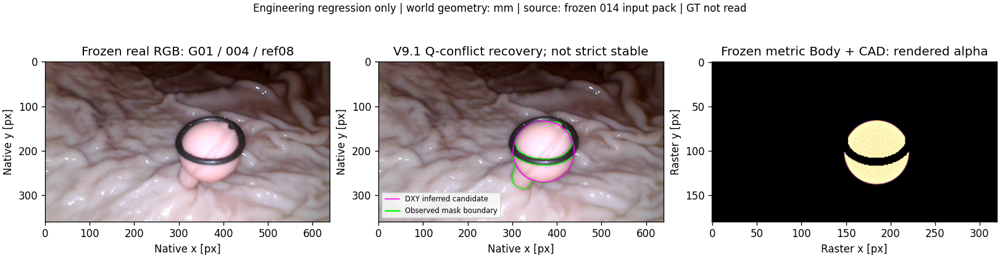

# TASK-RESEARCH-HARNESS-STORAGE-001

2026-11-16。本轮将官方 DXY 像素几何、015/016/MAX/HERO 独立选视角、014 公制 Renderer 封装为最小共享包，核心通过固定源码 SHA 的 API/AST 调用复用，不迁移完整优化器，不研究新三维算法。Preflight、11 项坐标/身份契约、三个真实模块 Smoke 以及 Contour/GeometryGuard 兼容调用在清理前后全部通过。测试仅覆盖冻结 G01、单张渲染和一组四视角支持子集，不等于全组科学验收。审计 40 个项目目录后未证明任何整个 checkout 可删，只删除 70 个已核验浏览器缓存文件；发现旧版本响应后先作精确压缩归档，扣除归档净减少 122,880,000 个分配字节，约 0.123 GB。全部旧目录、失败证据、checkpoint 和受保护目录保留。main 通过独立轻量发布分支准备，不整体合并历史实验。

## 冻结与工程实现

- 注册表基线 `fa649fa1cf20b111bfdb8489e8af20ba90339bba`；科研源快照 `5636aaebd61a3d53b69f528692c4c7095df46508`；DXY `75d58ca5b643fb4d8e0eb887b45ad0f056b0bb95`。
- 首批可执行提交 `c8c3b3b7aa695d5494162af9494e7e88ac01495e` 已推送。最终源码逐文件 SHA 见 [REUSE_AFTER.json](REUSE_AFTER.json)，源锁见 [source_lock.json](../../src/ring_first_3d/source_lock.json)。
- 独立目录 `/home/liu/ring_first_3d_harness`，不修改 `/home/liu/polyp_research` 或 `/home/liu/new-polyp-dxy`。新 Git 对象库通过 alternates 只读访问登记的源对象；它不是旧对象的独立备份，原对象库必须保留。
- Phase 0、Phase 2 清单/结果哈希冻结于 [存储审计](../../maintenance/storage/PHASE0_FREEZE.json) 和 [测试冻结](../../maintenance/storage/PHASE2_FREEZE.json)；原清单未改写。逐阶段记录见 [TEST_RESULTS.json](TEST_RESULTS.json)。

| 共享能力 | 实现与历史核心 | 实际状态 |
| --- | --- | --- |
| DXY T01/T03/T04 | 直接正式 measure_frame；适配输出/来源，T04 原生 basis 契约 | 可调用；center/basis 精确复现，限定像素输出，不消费毫米直径生成 Body |
| 视角 T10/T11/T12/T13 | 原质量/贪心/配额/权重/覆盖/support AST；独立 strategy dispatch | 可调用；015、016、MAX IDs/数值与冻结结果匹配，T13 四视角子集匹配 |
| Renderer T24 | 原 tensor/mesh/renderer/Case；不导入历史 common | 可调用；真实 mm Body/Ring/K/c2w，保留半像素、容量修复、detach visibility |
| T31/T34 | 原 ContourDistance、GeometryGuard 及必要 helper | 兼容实测；有限梯度、空位移检查、超 tau 拒绝；未迁移完整优化器 |

详细 API、各 strategy 的历史上限与前缀语义、源对象供应、环境变量、失败行为见 [Harness](../../docs/RESEARCH_EXECUTION_HARNESS.md)。新 Codex 先查注册表→固定输入/数学契约→Preflight/Smoke→授权大实验→独立评价。注册表可作为正式工程定位入口，不能作为科学路线批准文件。

## 真实测试

环境：Python 3.12.13、Torch 2.7.1+cu128、PyTorch3D 0.7.9、RTX 3060 Laptop GPU、Open3D 0.19.0、python-fcl 0.7.0.11；完整版本/依赖路径见 [PREFLIGHT_AFTER.json](PREFLIGHT_AFTER.json)。233 个真实输入文件被 SHA 核验（014 全 pack、015/016/MAX 清单和四个真实 SIFT 缓存），无重新分割/训练/大型重建。部分历史 pack 继承已有主体先验；仅作 Renderer 输入，不是本轮独立科学预测。

| 检查 | 分母与结果 | 容差/关键证据 |
| --- | --- | --- |
| Preflight | 3/3 检查 PASS | 55 个 DXY Python 文件，11 个历史核心/参考文件；640×360，mm，proper c2w；014 FIT 101 / HOLDOUT 7 |
| 数学/身份/防污染契约 | 11/11 PASS | basis、半像素 K、c2w/w2c、mm/m、Ring CAD、axial Z/range、投影反投影、重复/留出/hash 拒绝 |
| DXY | 1/1 实样本数值复现 | center=(370.3316949381891, 201.9950848145673) px；basis diag 68.81245848330812 px；atol 1e-7 px |
| View Selection | 015/016/MAX 3 个完整冻结列表 + 1 个 T13 四视角子集 PASS | ID 完全一致，016 权重 1e-12；MAX 18 个目标，proxy 面积 1e-8；support score 1e-8 |
| Renderer | 1/1 实视角 PASS（108 输入相机已核验） | loss≈0.008583566；投影 max abs≈1.58e-5 px，阈值 0.001；visibility 无梯度、顶点梯度有限且非零 |
| T31/T34 | 1/1 兼容场景 PASS | 103 轮廓样本；no-op 无拒绝，自交 0；0.02 mm 平移超 tau=0.01 被 STEP_TRUST 拒绝 |

清理前后结果分别见 [SMOKE_BEFORE.json](SMOKE_BEFORE.json) / [SMOKE_AFTER.json](SMOKE_AFTER.json)、[CONTRACTS_AFTER.json](CONTRACTS_AFTER.json)。每项保留输入身份、实际耗时、数值容差、实测结果；TEST_RESULTS 合并前后环境、源码审计和存储检查。参考由官方 API/原始 AST 独立生成，不调用公共 adapter，不在测试中重生成或覆盖。

左：冻结 RGB；中：绿色为分割观测边界，紫色是 DXY 推断候选，不是真实完整隐藏轮廓；环接触不能自动当真实息肉边界。该样本 quality=Q_conflict_recovery、strict_stable=false。右：既有公制 Body/Ring 的前向 alpha，仅作工程回归，不能凭图证明精度或完整背面。

### 发现与修复

1. 初始环境路径缺 scikit-image/FCL，分别读取已登记 E4 evolution/PMGR-R1 packages 后通过，没有写受保护环境或假装依赖存在。
2. Ring 单元测试最初将 outer radius 写成 7.4 而非 6.2 mm；修正测试输入，未改变 CAD 契约。
3. MAX G01 旧池 227 条记录中 `G01_v005_raw00756` 重复且所有字段/可见性完全相同。选择接口仍拒绝重复，显式迁移函数仅折叠逐字段/逐元素一致的记录并留审计，226 个唯一来源复现原 18 个选择与面积；冲突重复拒绝测试通过。未修改科学贪心模型。
4. raw renderer reference 与 adapter 的 float32 归一化运算次序使 alpha SHA 不同；alpha 总和差约 0.000244、loss 差约 9.31e-10，均低于预设容差。没有以 SHA 一致冒充数值一致。

初始失败与修复保留在 [TEST_ATTEMPTS.json](TEST_ATTEMPTS.json)，未删失败记录。

## 清理与保存

审计 39 个既有项目目录和 1 个新任务 checkout；原 39 个共用同一 Git 对象库。ACTIVE 2，UNIQUE_RESEARCH_ASSET 38，整 checkout VERIFIED_REDUNDANT 0。所有目录虽无 remote-tracking 未覆盖的分支提交，仍有独有 ignored/未跟踪资产；6 个 task-local packages 为现用依赖，未证明有废弃独立 venv。完整逐目录字段见 [PROJECT_WORKTREE_AUDIT.csv](../../maintenance/storage/PROJECT_WORKTREE_AUDIT.csv)。

实际只 unlink 70 个旧实验浏览器 HTTP 缓存文件，5 个空 cache 目录保留，目录删除数 **0**。初查 11 个响应与现存源不一致，先保存完整缓存 gzip 归档并逐成员读回 SHA；可能唯一的旧版本内容仍可恢复，不将“浏览器缓存”作为直接可删的充分证据。归档必须保留为 LOCAL_ONLY；单机可靠备份不等于异地容灾。

| 空间口径 | 数值 |
| --- | ---: |
| Phase 0 可用 | 7,201,165,312 B |
| unlink 前（已经建立归档）可用 | 6,844,403,712 B |
| unlink 后可用 | 7,069,904,896 B |
| unlink 窗口 df 增量 | 225,501,184 B |
| 删除文件分配字节 | 225,529,856 B |
| 新归档分配字节 | 102,649,856 B |
| **净释放，扣除保留归档** | **122,880,000 B = 0.12288 GB** |

df 受其他系统活动与工程新文件影响；净释放按逐文件分配块扣除必要归档统计，不把整个任务前后的可用空间差当清理收益，也未扣工程源码/新 Git 对象开销。完整 [空间回执](../../maintenance/storage/STORAGE_BEFORE_AFTER.md)、[逐项删除回执](../../maintenance/storage/DELETION_LOG.csv)、[备份清单](../../maintenance/storage/CACHE_BACKUP_MANIFEST.json) 均已保存。

保留资产完整复核 3,173 条（3,169 个 checkpoint/weight，4 个源 GLB），总逻辑 802,191,238 B，另保留 20 个缓存对应源文件与旧版本归档。39 个旧目录 HEAD/状态签名未变，悬空 3da9852b25fd82f4f158299a264d9a433aa572da 仍可读；旧 15 组重复、TSDF/NF/MonoSDF 失败证据、旧 visualizations、大型 tar/NPZ/环境全部保留。存在未证实外部备份的唯一科研资产，因此不删除相关目录；风险与恢复边界见 [REMAINING_CANDIDATES](../../maintenance/storage/REMAINING_CANDIDATES.md)。

## 科研审计固定表

| 审计项目 | 必须汇报 |
| --- | --- |
| 目标组数 | 新科学测量 0；工程回归 1 个冻结 G01，非全组科学实验 |
| 本算法独立成功 | 新科学预测 0；工程三个核心模块 3/3 真实调用通过 |
| 本算法失败 | 无新测量；测量 NaN/独立误差统计不适用；初始工程失败逐项记录在 TEST_ATTEMPTS |
| 历史测量值回退 | 0；既有 Body 只作明确登记的 Renderer 输入，不作新路线预测 |
| 失败组及具体原因 | 无新增测量失败组；环境缺依赖、重复身份和测试 fixture 错误见上及 TEST_ATTEMPTS；精选图仅工程证据 |
| 最终统计样本 | 工程真实样本 1/1；T13 仅四视角子集；无科学成功组误差统计 |
| 是否使用 GT 选择算法 | 否；未读 GT 几何或测量，源码/输入/reference/测试结果已冻结 |

独立覆盖率、中位绝对相对误差、MAE、p95、最大误差、共同成功组配对比较均为 **N/A（未开展新科学测量）**。本轮没有融合对照，也未读取历史 S0/V2/直径生成新预测。工程数值输出成功不等于测量正确。

## 管理交付与限制

工程入口为 PROJECT_HOME→注册表→Harness；共享晋升范围按 MODULE_PROMOTION_POLICY。完整优化器、HERO 推理/清理、联合 BA、主体拟合和可视化发布仍需分别工程化及验证，科研路线与基线验收仍由人工批准。未来用固定 source ID/SHA 复用成熟核心，先契约/Smoke，Git 只提交必要代码、配置、指标、精选图与资产索引，避免重复实现和重复上传全量实验。

main 轻量方案：基于 `02dee8092dce9f89d050bccca35aa51768988645` 新建 `release/research-harness-001`，只添加注册表/架构文档、共享包、必要测试入口与本任务精选报告；省略完整历史实验、数据/环境和破坏性清理脚本。遗漏的历史报告/源码引用改为固定 commit 链接，源核心由显式只读目录或固定 Git 对象提供。main 本身不覆盖、不直接推送；发布验证和完整 SHA 补充于 MAIN_READY_RELEASE.json。
