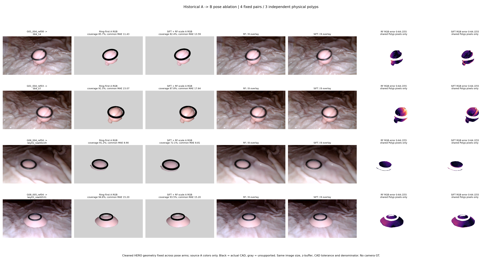
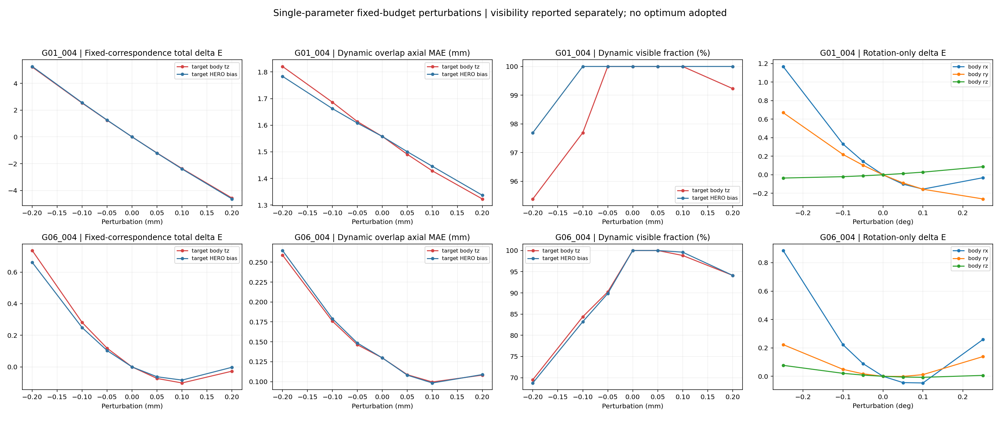
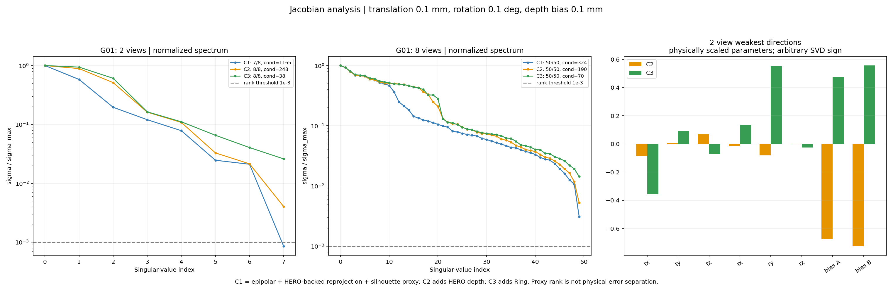
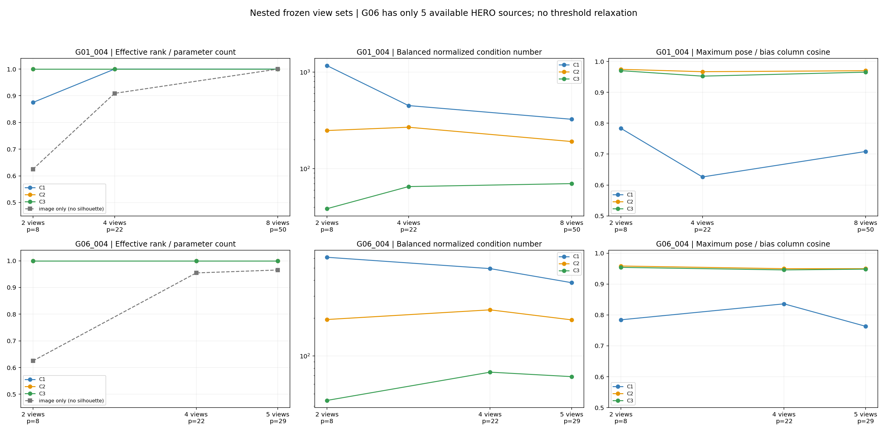

# Ring-First 位姿消融与相机—HERO 深度可辨识性诊断

研究者追加要求的大视角版本：[大视角图库](visualization_large_angle/index.html) · [覆盖率/轮廓误差说明](METRICS_EXPLAINED.md) · [新帧对结果与失败](LARGE_ANGLE_UPDATE.md)。原帧对与原始结论保留。

研究者要求的新版显示已完成：[原Panel2五面板 + SIFT图库](visualization_panel2_sift/index.html)；[复用与检查说明](VISUALIZATION_UPDATE.md)。原四张科研图及全部数值保留。

2026-11-04（Asia/Shanghai）。任务 `TASK-RING-FIRST-POSE-DEPTH-IDENTIFIABILITY-001`，独立分支 `exp/TASK-RING-FIRST-POSE-DEPTH-IDENTIFIABILITY-001`，父提交50239b5。状态：实验 A、B 的冻结 CPU 诊断完成；未证明绝对相机精度或真实误差归因，不升级相机资格或重建主线。原始 HERO、K/c2w、Mask、CAD、DXY 和历史清理没有修改；没有训练、新 HERO、融合或补全。

## 结论先行

实验 A：同一 HERO 表面下，Ring-First 在四个历史帧对的覆盖和轮廓误差上均优于 `SIFT + RF-scale`。共同区域 RGB MAE 只在首个 G01 ref08→r14 明显更低；ref03→r07 的 SIFT 更低，G06/G08 接近。因此证据支持 Ring-First 的几何解释优势，但不支持“所有真实 RGB 都更准”，更没有独立位姿 GT 可认证绝对精度。

实验 B：相机 body-Z 平移与每视角统一轴向深度偏差的局部响应高度相似，C2 最大列余弦约0.95–0.97。Ring 提高最弱奇异值并降低条件数；增加视角后改善不单调，强耦合仍在。**不能将局部代理矩阵满秩写成真实相机误差与 HERO 误差已稳定分离。** 两个双视角配置都没有通过全部资格条件的 HERO-backed RGB 2D 对应，故其现实误差归因属于“证据不足 / 无法充分评价”，并非结构性不可辨识的证明。

## 固定审计表

| 审计项目 | 必须汇报 |
| --- | --- |
| 目标组数 | 实验A：G01/G06/G08三物理组、4个固定同视频帧对、Raw/Cleaned两版本×两位姿；实验B：G01/G06两组、6个嵌套视角集×3约束消融 |
| 本算法独立成功 | SIFT 4/4返回R及平移方向；16/16图像投影臂有输出；18/18雅可比/SVD数值完成。这些不是相机真值或测量准确性成功 |
| 本算法失败 | 无独立相机/形状GT，绝对误差NaN；双视角可靠HERO-backed RGB对应0；G06只有5份HERO，未伪造6–8视角；测量未执行，3组均NaN |
| 历史测量值回退 | 0；未读S0/历史V2测量、照片直径或旧融合几何来补结果 |
| 失败组及具体原因 | G01大深度冲突与稀少对应；G06视角数量不足/稀少对应；G08仅A对照，未伪称B验证。见FAILURE_LEDGER.md、Fig1–4及逐项CSV |
| 最终统计样本 | A为全部4对，3个独立物理组；B为全部6配置/18臂。绝对MedARE/MAE/p95/max均NaN/NOT_EVALUABLE；测量共同成功N=0；图像配对共同N逐对列出，历史融合输入为0 |
| 是否使用 GT 选择算法 | 否；PROTOCOL及源码/输入SHA在A/B前冻结；主实验标准未改。去轮廓代理是显式追加诊断，不覆盖原结果 |

## 资产、版本与阶段记录

按最新v1.0及SDF候选v0.2/v0.3核对实际代码。v0.3为上轮训练状态记录，不代表新的清理或相机算法。E3-A/B/C/D0报告和 Phase-B SIFT/RootSIFT 审计只读取真实数据/方法来源；没有执行包含合成GT的旧主程序。旧方法可能有共享模型或RGB家族，来源不是独立统计试验。

当前实际清理输入是人工认可V6及N0固定A2派生链；G08复用最近多息肉任务已冻结同规则输入。**不把旧 Type-2 密度清理再叠加一次**，也不将文件名字“Type-2”当作新算法版本。A/Cleaned采用该原生有效性经半像素中心映射到历史归档顶点，只移除已屏蔽顶点所关联的显示面，不移动顶点、不重三角化、不填洞；Raw全部原面同时保留对照。

第一阶段：复现历史首对 G01_004_ref08→004_14，再执行 G01 ref03→004_07、G06 ref04→key01_raw00229、G08 ref04→key03_raw00531。选择直接来自历史P2和view-eval冻结清单，不依据本轮输出。首对 Raw 的 RGBA、Z、Face ID、重心坐标、CAD深度和valid全部与历史NPZ逐位一致。历史真正 A→B 内核是 `TASK-VIEW-OBSERVABILITY-GT-EVAL-001/code/reprojection.py:render`，通过AST逐字调用；`visualization/real_p0_renderer.py`提供相机投影/射线辅助，不被误称为完整重投影实现。

第二、三阶段：相同首对建立残差、冻结对应、中心差分、单参数/二维扰动及SVD。第四阶段：G01增加到4/8参考，G06增加到4/5参考。G01第2视角为历史B=r14，后续按已有N0 CORE及冻结次序嵌套，不按新结果排序。G06确有5份合法原始HERO，6–8测试标记 NOT_EVALUABLE_SOURCE_COUNT，不换组/造输入。

源码与版本、资产SHA及资格见 `provenance/INPUT_MANIFEST.json`、`HISTORICAL_CODE_AND_VERSION.json`、`metrics/SOURCE_IDENTITY.csv`。原生深度352×640，归档RGB/Mask360×640，640×360原内参不变；轴向Z/mm、c2w相机→Ring世界/mm、整数像素中心、半像素尺寸映射，未混用裁剪坐标。

## 实验 A：原生 SIFT 与尺度辅助 SIFT

复用已有真实SIFT缓存，缺少的帧对只运行CPU SIFT：8000特征、contrast=.01、双向ratio=.72、固定seed0；同类别非Ring、非高光（minRGB<245）。固定空间分组约20%留出，不用于本质矩阵拟合；归一化两图K，OpenCV findEssentialMat(RANSAC2px/.999/2000)→recoverPose。拟合完全不读RF的R、t方向或HERO深度。

`A-S0`只返回相对R和单位t方向，公制位姿 NOT_EVALUABLE。`A-S1`仅借用冻结RF相对平移的长度，保持SIFT的R和t方向，名为 **SIFT + RF-scale**；固定A相机，由该相对变换生成B派生相机，CAD始终留在原A世界。不是独立公制SIFT或多视角SfM；本轮未另做SfM/独立尺度锚定。

相对变换 `T_B<-A=inv(c2w_B)@c2w_A`，SIFT派生 `c2w_B=c2w_A@inv(T_B<-A_SIFT)`。预测API没有B RGB/Mask/HERO参数：只用相同A顶点、原面、A原图顶点颜色重心插值、同深度排序、同CAD首次交点+.05mm。B组织遮挡没有独立认证，标记UNKNOWN，不假装CAD解决组织可见性。B图像可用于SIFT估计及后验评价，所以不是整个流程独立留出。

| 来源A | SIFT匹配 | 拟合 | E内点 | 正深度内点 | R差异° | t方向差异° | SIFT视差中位° |
| --- | --- | --- | --- | --- | --- | --- | --- |
| G01_004_ref08 | 103 | 85 | 81 | 81 | 1.625 | 7.875 | 8.328 |
| G01_004_ref03 | 80 | 62 | 58 | 58 | 2.317 | 4.418 | 7.508 |
| G06_004_ref04 | 39 | 28 | 25 | 25 | 1.913 | 19.795 | 8.133 |
| G08_005_ref04 | 192 | 147 | 125 | 125 | 1.471 | 17.926 | 4.507 |

所有数值“差异”均相对RF，不是绝对误差。4/4恢复成功属于本轮4对数值输出分母，不能推广到所有视频。退化、空间覆盖、留出Sampson结果完整保存在 `A_POSES.json` / `SIFT_AND_RF_POSES.csv`，不根据位姿或RGB好坏选分支。

Cleaned主表各项按 RF / SIFT 顺序，RGB MAE单位0–255，轮廓误差单位pixel：

| 历史帧对 | 双方共同Polyp像素 | 共同RGB MAE | 固定B Mask覆盖 | 双向轮廓MAE px |
| --- | --- | --- | --- | --- |
| G01_004_ref08 → 004_14 | 9794 | 11.428 / 13.587 | 85.66% / 82.42% | 2.885 / 4.786 |
| G01_004_ref03 → 004_07 | 11457 | 23.072 / 17.642 | 91.52% / 87.84% | 1.924 / 3.664 |
| G06_004_ref04 → key01_raw00229 | 5789 | 8.897 / 8.811 | 91.16% / 72.06% | 1.206 / 5.233 |
| G08_005_ref04 → key03_raw00531 | 16559 | 15.200 / 15.195 | 94.56% / 93.51% | 1.502 / 2.186 |

Raw/Cleaned完整16行及median/p95/max、外逸、未知、CAD遮挡、全部目标分母见 `REPROJECTION_ERRORS.csv`；每臂自身支持RGB只作补充，主比较严格使用双方共同支持。预测轮廓包括原面孔洞和缺失边缘，未缩小评价区域。上方没有把低覆盖换取的低RGB误差宣称优势。四对而非三个独立G01样本：G01占两对，跨组不做4例独立显著性检验。

## 实验 B：参数、规范与残差

固定A相机、K、公制尺度、Ring世界与CAD物理尺寸；其他相机采用右/body扰动 `T_i=T_i0 exp([δt_mm, δω_rad])`，参数顺序平移xyz再旋转xyz，每个来源另有原生轴向统一偏差b/mm，含A的b。扰动只存在CPU诊断副本，不写回相机或HERO。参数数目 `6(n−1)+n`，2/4/8视角为8/22/50，G06五视角为29。没有未固定的全局SE3/尺度参数；C1不含Ring，并不凭“坐标尺度固定”就额外添加尺度观测。

参数归一化：平移0.1mm、旋转0.1°、深度0.1mm。残差噪声尺度分别：极线2px、二维重投影2px、轮廓3px、深度.25mm、Ring3px；它们是冻结可解释诊断尺度，**未经标定的误差代理，不是实测噪声方差或置信度**。每个模态再除sqrt(该模态标量数)，防止简单堆更多深度像素支配总误差；同时完整报告仅单位/噪声尺度化、未按数量平衡的谱。

实际向量由以下独立行组成，空块保留为空，不填充假对应：

- epipolar：真实SIFT对应，独立RGB-only F共识，不以RF误差选点；有向每对最多64。深度偏差不进入此块。
- reprojection：有原生有效HERO、实际Polyp RGB对应、非高光且通过投影/CAD/目标可见性资格的源点，二维残差；每有向对最多64。用原生整数Pixel ID深度和原生射线，目标匹配保持原RGB子像素坐标；没有将背景的HERO未知深度补成Polyp。
- silhouette：原Polyp Mask边缘的合法原生深度点，离Ring>2px，投向目标后处在目标轮廓8px带内，对目标有符号距离；每对最多32。它是**视角相关轮廓代理**，不是已认证同一材料点；不能单独认证物理可辨识性。
- depth：每源确定性均匀最多1024个原生合法点作候选，投到目标实际射线；目标为原生深度最近像素，目标Mask内部>2px、非高光、有效深度、CAD前，且候选不在目标首次表面后方超过.25mm；每对最多128。前方自由空间矛盾保留；后方遮挡/无深度/未知排除。基准处冻结目标Pixel ID与可见性，r=Z_i→j−(D_j+b_j)。它是HERO一致性，不是真实表面GT。
- ring：固定真实Mask的可见Ring边缘（远离Polyp及图像边界），实际CAD解析torus表观轮廓，与基准最近轮廓法向投影的有符号2D残差，每相机最多128。相机按Ring世界yaw规范化后求解析轮廓，消除离散轮廓采样凭空制造的yaw信息；实际CAD与torus误差<1e−4mm，全球Ring轴yaw不变性检查<1e−8px。该参数化只去掉已知Ring几何对称性，不删除真实图像约束。

`B-C1 = epipolar + reprojection + silhouette`；`B-C2 = C1 + depth`；`B-C3 = C2 + ring`。C1的HERO-backed2D点和轮廓本身依赖既有HERO，只是不包含跨HERO深度一致性块；没有冒称“纯RGB位姿认证”。同源相关性、Mask离散化及不可靠对应仍是现实限制。

`r(0)`及每行身份保存在本地 `FIXED_OBSERVATIONS.npz`。中央差分在物理归一参数y的h=.01/.005/.0025执行（对应平移/深度.001/.0005/.00025mm，旋转.001/.0005/.00025°）；全6配置都满足冻结差分门槛。最细两档矩阵相对差最大约0.00531，95%列相对差亦通过。基准附近不重新选对应、不在J中切换遮挡；另在全部扰动重新统计可见性。

单参数固定预算为平移/深度±.05/.1/.2mm、旋转±.05/.1/.25°；共112个标量扰动记录（含各参数零点），以及两组各25点tz/bias网格和5点最弱方向真实扰动。不进行求最优位姿或深度的联合优化。`B_GRADIENTS.csv`同时给出dE/d归一参数和dE/d物理参数；物理旋转导数单位为每rad。

## B 数值结果与分级

| 组 | 视角 | 约束 | J维度 | rank@1e−3 | 条件数 | 最小奇异值 | 最大pose/bias列余弦 |
| --- | --- | --- | --- | --- | --- | --- | --- |
| G01_004 | 2 | C1 | 192×8 | 7/8 | 1164.64 | 0.000541 | 0.7837 |
| G01_004 | 2 | C2 | 322×8 | 8/8 | 247.61 | 0.002840 | 0.9746 |
| G01_004 | 2 | C3 | 578×8 | 8/8 | 38.42 | 0.018443 | 0.9703 |
| G01_004 | 4 | C1 | 898×22 | 22/22 | 448.80 | 0.001885 | 0.6261 |
| G01_004 | 4 | C2 | 2033×22 | 22/22 | 267.95 | 0.003162 | 0.9670 |
| G01_004 | 4 | C3 | 2545×22 | 22/22 | 65.12 | 0.013276 | 0.9526 |
| G01_004 | 8 | C1 | 4219×50 | 50/50 | 323.79 | 0.001994 | 0.7086 |
| G01_004 | 8 | C2 | 10124×50 | 50/50 | 190.46 | 0.003390 | 0.9701 |
| G01_004 | 8 | C3 | 11148×50 | 50/50 | 69.90 | 0.009480 | 0.9654 |
| G06_004 | 2 | C1 | 128×8 | 8/8 | 609.04 | 0.001138 | 0.7843 |
| G06_004 | 2 | C2 | 384×8 | 8/8 | 194.95 | 0.003594 | 0.9585 |
| G06_004 | 2 | C3 | 640×8 | 8/8 | 44.34 | 0.016738 | 0.9541 |
| G06_004 | 4 | C1 | 951×22 | 22/22 | 494.99 | 0.001752 | 0.8360 |
| G06_004 | 4 | C2 | 2487×22 | 22/22 | 232.70 | 0.003729 | 0.9499 |
| G06_004 | 4 | C3 | 2999×22 | 22/22 | 74.39 | 0.011937 | 0.9459 |
| G06_004 | 5 | C1 | 1496×29 | 29/29 | 382.36 | 0.001863 | 0.7632 |
| G06_004 | 5 | C2 | 4056×29 | 29/29 | 193.66 | 0.003684 | 0.9498 |
| G06_004 | 5 | C3 | 4696×29 | 29/29 | 68.53 | 0.010683 | 0.9484 |

有效秩扫描1e−2/1e−3/1e−4/1e−6及1e−8均保留。在1e−2阈值，所有C2比全参数少1个有效方向，而C3仍满秩：Ring确实改善了本模型的弱方向，并非只看总梯度接近零。不过C2/C3的最高位姿—深度列余弦仍约.95–.97，Ring后也没有降到弱耦合。

视角数增加不代表条件数必然改善。G01 C3条件数38.42→65.12→69.90，G06为44.34→74.39→68.53；参数也从8增长至50/29。C2在部分配置改善，但不是单调；不把原始rank从8增至50称作可辨识性提高。

特别限制：双视角 reprojection块均为0行；不少RGB特征在背景，不能拿未知背景深度构造点对应。主C1还含轮廓代理，故额外报告去掉silhouette的逐块谱，原三组结果不被覆盖。IMAGE_ONLY双视角rank5/8，其中b_A/b_B完全未被观察，剩余相对平移尺度方向也没有RGB信息；这是**该残差/参数模型的结构性零列与相对尺度不可观测**，不是已证明真实息肉几何普遍不可辨识。加入深度但去轮廓时，G01双视角条件数278.18→216.69（再加Ring），比主表247.61→38.42的改善弱很多，表明轮廓代理假设不能忽略。

分级：C1的零列可明确定位；C2表现出弱方向和强耦合；C3在冻结低维代理模型上局部数值秩较好。但现有对应及相机资格不足以给“真实误差已稳定分开”结论，现实归因仍应保留 **INSUFFICIENT_EVIDENCE / 无法充分评价**。没有将此状态写为结构性不可辨识，也没有伪造绝对误差估计或归因比例。所有视角原资格保留：

| 来源 | 当前Camera Gate | View Partition | 研究入组 |
| --- | --- | --- | --- |
| G01_004_ref08 | INSUFFICIENT_EVIDENCE | G01_video004_B3 | CONDITIONAL_RESEARCH_INPUT |
| G01_004_growth_r14 | INSUFFICIENT_EVIDENCE | G01_video004_B4 | CONDITIONAL_RESEARCH_INPUT |
| G01_004_ref13 | INSUFFICIENT_EVIDENCE | G01_video004_B5 | CONDITIONAL_RESEARCH_INPUT |
| G01_004_ref03 | INSUFFICIENT_EVIDENCE | G01_video004_B2 | CONDITIONAL_RESEARCH_INPUT |
| G01_004_new_r00 | INSUFFICIENT_EVIDENCE | G01_video004_B1 | CONDITIONAL_RESEARCH_INPUT |
| G01_004_growth_r06 | INSUFFICIENT_EVIDENCE | G01_video004_B3 | CONDITIONAL_RESEARCH_INPUT |
| G01_004_growth_r10 | INSUFFICIENT_EVIDENCE | G01_video004_B5 | CONDITIONAL_RESEARCH_INPUT |
| G01_004_growth_r04 | INSUFFICIENT_EVIDENCE | G01_video004_B3 | CONDITIONAL_RESEARCH_INPUT |
| G06_004_ref04 | INSUFFICIENT_EVIDENCE | G06_video004_B2 | CONDITIONAL_RESEARCH_INPUT |
| G06_004_growth_r01 | CONDITIONAL_USABLE | G06_video004_B1 | CONDITIONAL_RESEARCH_INPUT |
| G06_004_growth_r06 | INSUFFICIENT_EVIDENCE | G06_video004_B3 | CONDITIONAL_RESEARCH_INPUT |
| G06_004_growth_r03 | CONDITIONAL_USABLE | G06_video004_B2 | CONDITIONAL_RESEARCH_INPUT |
| G06_004_new_r00 | INSUFFICIENT_EVIDENCE | G06_video004_B1 | CONDITIONAL_RESEARCH_INPUT |

## 实际扰动的几何响应

表中depth RMS采用固定残差点及固定分母；dynamic MAE及可见点数单列，避免切换遮挡制造误差下降：

| 组 | 扰动 | 总E | 固定深度RMS mm | 动态深度MAE mm | 动态可见/基准点 |
| --- | --- | --- | --- | --- | --- |
| G01_004 | baseline | 21.250357 | 1.585242 | 1.557556 | 130/130 |
| G01_004 | tz_mm +0.1mm | 18.884149 | 1.489011 | 1.428595 | 130/130 |
| G01_004 | bias_mm +0.1mm | 18.853771 | 1.488520 | 1.445701 | 130/130 |
| G06_004 | baseline | 0.624963 | 0.152031 | 0.129705 | 256/256 |
| G06_004 | tz_mm +0.1mm | 0.523658 | 0.115868 | 0.099516 | 253/256 |
| G06_004 | bias_mm +0.1mm | 0.541833 | 0.116149 | 0.098284 | 255/256 |

G01中两种+.1mm扰动的总E都由21.25降至约18.9，产生相近改善；它们并不能告诉我们究竟相机还是HERO更“错”。G06同样如此，但可见覆盖略降，不能只看MAE。±.2mm和±.25°的一些扰动已有非线性/可见性变化；用于J的小步长已交叉验证，不把大扰动差分当局部导数。最弱方向的实际联合扰动、线性预测偏差及25点网格见 `B_JOINT_PERTURBATIONS.json`；没有采用其中最佳点，也未输出“修正后相机”。

本地补充实际XYZ诊断图：`local_results/B_3D_Conflict_Diagnostic.png`，显示原清理后两来源全部点、黑色CAD、投影冲突点及一次+.1mm诊断副本，未删除困难面或改动原始坐标。它是敏感性图，不是新融合/重建。

## 四个科研问题的直接回答

1. Ring-First是否更好解释B？**覆盖/轮廓证据支持，RGB不一致支持；不能宣称绝对更准。** 首对RF共同MAE11.43 vs SIFT13.59，但第二G01反例23.07 vs17.64必须保留。
2. 小幅位姿会否改变HERO冲突？**会。** 实际+.1mm轴向扰动已明显改变固定深度残差和可见覆盖，但这不是该位姿更真实的证明。
3. 位姿与统一深度偏差高度耦合？**是，局部响应及列余弦提供证据。** 常数b只是低维诊断，不覆盖逐像素HERO误差。
4. 增视角及Ring能否减弱？**Ring改善弱方向；增加视角不保证单调改善，强耦合仍保留。** 现有真实观测不足以稳定完成物理误差分离，不能因为A部分支持RF就宣称全局几何已可辨识。

## 图与交付

全部代码、冻结配置、帧对/输入SHA、CSV、谱和六份完整C3雅可比随小型交付提交；原始预测NPZ、全部18份J/原始观测及补充图在本地 `/home/liu/ring_first_3d_pose_depth/experiments/TASK-RING-FIRST-POSE-DEPTH-IDENTIFIABILITY-001/local_results/`，不复制大型原始模型/视频。C1/C2可由C3按模态行切片完整重算。参见REPRODUCE.md。155项身份/不可变性与关键数学检查通过；不把这些工程检查当科学准确性PASS。

官方参考：[OpenCV SIFT](https://docs.opencv.org/4.x/da/df5/tutorial_py_sift_intro.html)、[calib3d findEssentialMat / recoverPose](https://docs.opencv.org/4.x/d9/d0c/group__calib3d.html)。本地实际版本与配置见交付索引；官方文档说明恢复的t只有方向，不具有独立尺度。

完成诊断后停止，等待研究者/PM审核。不会据此自动恢复MonoSDF、NeuralFusion或执行相机—深度联合优化。
