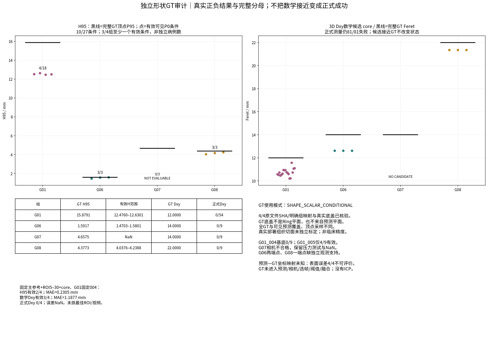
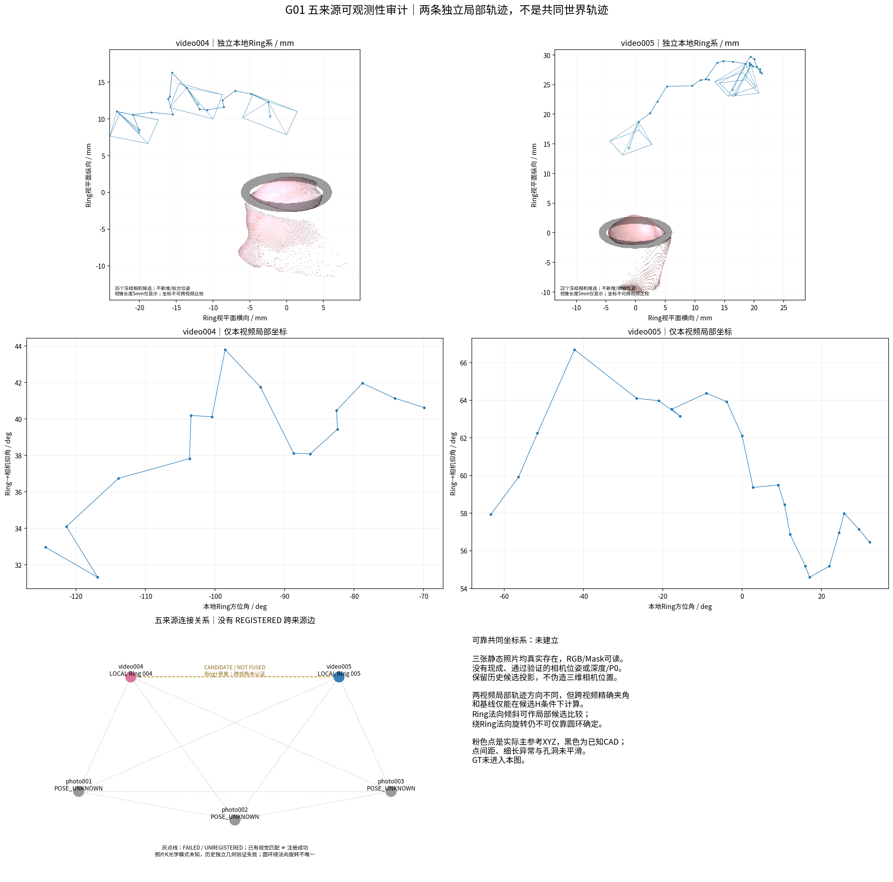
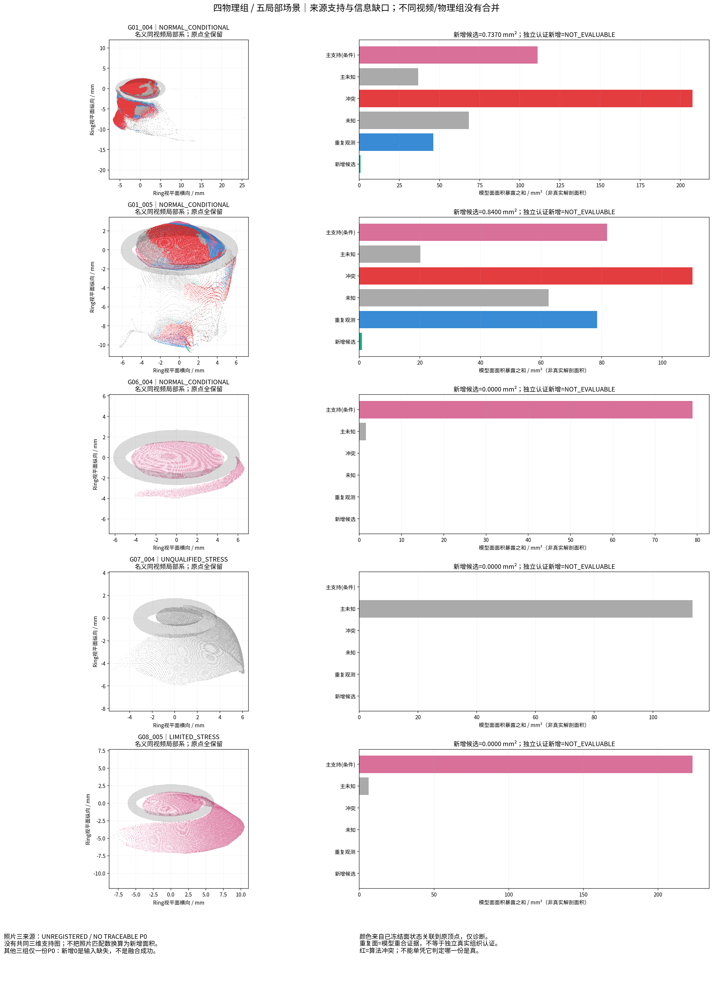
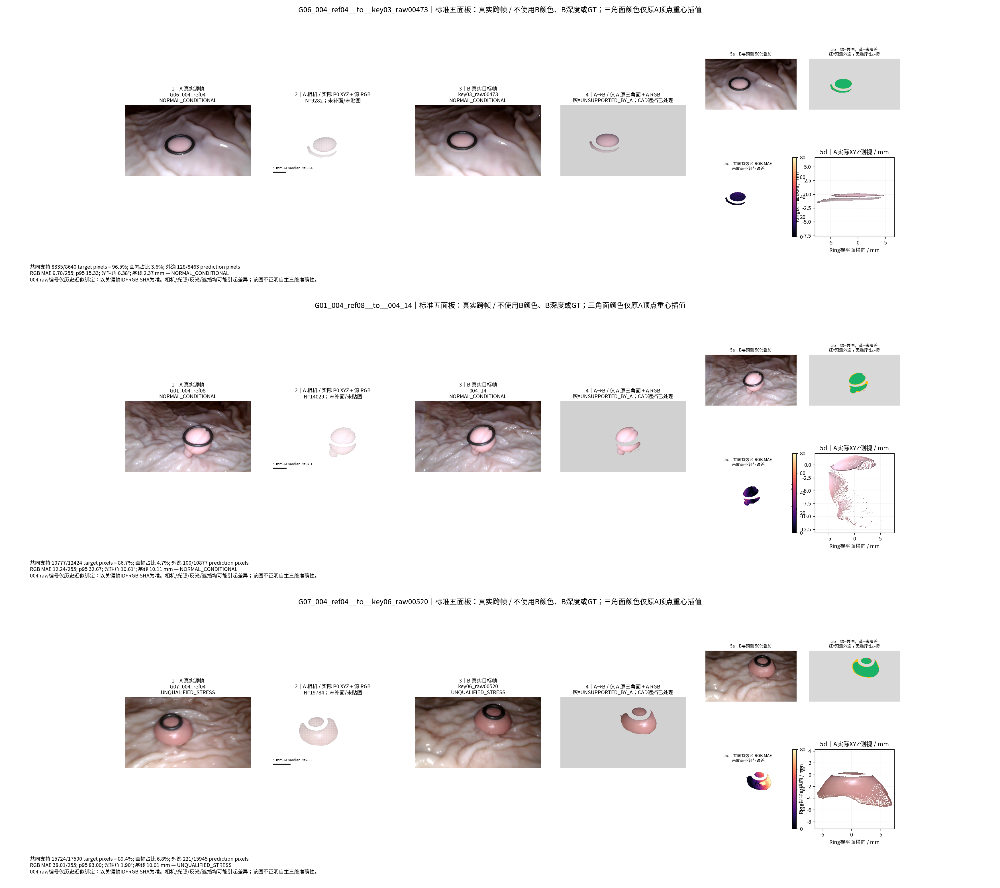

# TASK-VIEW-OBSERVABILITY-GT-EVAL-001

状态：**REPORTED / EXPERIMENTAL — SHAPE-SCALAR GT CONDITIONAL; NO NEW FUSION**；等待PM与研究者验收。日期：2026-10-28（Asia/Shanghai）。

## 中文摘要

本轮冻结上一轮298项预测资产，仅对四个物理组开展GT与可观测性评价，不重跑重建或融合。四组Blender原文件、单位和实际平坦底盖均已核验，但真实部署坐标和组织切面对应仍未知。27个高度条件中10个有数值：G06/G08与形状GT较接近，G01_005明显偏低，004基底及G07相机条件失败。72个Dxy数学候选可比较，81个正式状态仍全为不可评价。审计21个原始来源和62个冻结相机帧，完成22张标准A→B图；照片及跨视频只保留历史候选。证据表明参考间深度不一致、注册未认证和观测支持不足共同限制融合，不能只归因于融合阈值。全部原始点、旧结果及正式Dxy未改。

## 快速查看与复现身份

真实仓库根：`/home/liu/ring_first_3d_view_eval`；新分支`exp/TASK-VIEW-OBSERVABILITY-GT-EVAL-001`；任务从已实存、干净的上一轮`67ad7cc51a7f8e132d5e77e58deebf6d331efbba`创建独立worktree。正式baseline仍未认证，沿用用户明确科研授权；没有更改相机/HERO/P0/清理/正式Dxy。先读AGENTS、COLLAB标准、README、BASELINE清单和旧FINAL_AUDIT副本。

本地结果：[目录](/home/liu/ring_first_3d_view_eval/experiments/TASK-VIEW-OBSERVABILITY-GT-EVAL-001/) · [HTML图库](/home/liu/ring_first_3d_view_eval/experiments/TASK-VIEW-OBSERVABILITY-GT-EVAL-001/visualizations/index.html) · [全部图](/home/liu/ring_first_3d_view_eval/experiments/TASK-VIEW-OBSERVABILITY-GT-EVAL-001/figures/) · [22张五面板](/home/liu/ring_first_3d_view_eval/experiments/TASK-VIEW-OBSERVABILITY-GT-EVAL-001/figures/A_to_B/)。GitHub：[实验目录](https://github.com/zheng1524/ring-first-3d/tree/exp/TASK-VIEW-OBSERVABILITY-GT-EVAL-001/experiments/TASK-VIEW-OBSERVABILITY-GT-EVAL-001)。指标与完整索引见[RESULT_INDEX](RESULT_INDEX.md)，复现见[REPRODUCE](REPRODUCE.md)。第一阶段真实提交`ef00b45`保存源码/协议/冻结配对；后续真实SHA由git日志给出，不在被其自身提交的报告中伪造自引用SHA。

预测快照在本轮首次打开GT前形成，298文件SHA+7份表快照；预测仍来自上一轮同一路线，历史值回退0。所有Raw/候选/主面core/证据层、来源索引、相机与高度方法原样保留。以前任务曾读取GT，本轮不是严格从未接触GT的盲测。

## A｜形状GT独立评价与边界

配对依据是历史明确用户认可的物理组映射和原文件SHA，**不是根据文件名、形状或误差猜配对**。实际Blender只读导出4/4，与历史顶点/面完全一致。四个底盖均为有正面积、单连通、欧拉数1的平面盘，其余顶点在上方；按冻结0.0001mm容差，以实际作者底盖和+Z法向定义基底。

| 组 | 原顶点 | 真实底盖原面 | 底盖面积mm² | 连通盘/欧拉数 | GT最大高度mm | GT H95mm |
| --- | --- | --- | --- | --- | --- | --- |
| G01 | 1857 | 62 | 11.7421 | 1/1 | 16.1003 | 15.8791 |
| G06 | 1921 | 126 | 153.8763 | 1/1 | 1.6000 | 1.5917 |
| G07 | 5558 | 126 | 153.8761 | 1/1 | 4.7176 | 4.6575 |
| G08 | 1921 | 126 | 379.9802 | 1/1 | 4.4000 | 4.3773 |

GT配对授权证据另保留旧人工任务原文的明确确认及SHA（见`provenance/GT_PAIRING_EVIDENCE.json`）；它是历史身份依据，不是本轮新算法指令，不能放宽当前GT隔离边界。

GT模式为 **SHAPE_SCALAR_CONDITIONAL**：作者底盖不是预测平面或Ring平面；真实部署的组织切面是否严格等于该底盖仍无独立证明。GT全部原网格顶点与可见P0源点具有不同采样权重/覆盖。报告同数学定义的标量差，不称完整自主/临床精度。未计算或使用GT对齐；自主表面距离 **4/4 NOT_EVALUABLE**，作者文件均无对应部署Ring。无需以其他组替换这四个可靠形状配对。

| 物理组 | GT H95 mm | 有效预测H95范围 mm | 有效条件 / 全条件 | 相机条件 |
| --- | --- | --- | --- | --- |
| G01 | 15.8791 | [12.476040867638016, 12.630082542578124] | 4/18 | NORMAL_CONDITIONAL |
| G06 | 1.5917 | [1.4703098303730098, 1.5801444247722118] | 3/3 | NORMAL_CONDITIONAL |
| G07 | 4.6575 | NaN / NOT_EVALUABLE | 0/3 | UNQUALIFIED_STRESS |
| G08 | 4.3773 | [4.0376495253133715, 4.23875789774408] | 3/3 | LIMITED_STRESS |

G01_005仅4/9有效，高度偏低3.2491–3.4031mm（约20.5–21.4%）；G01_0049/9基底失败。G06误差−0.1214至−0.0116mm；G08 −0.3396至−0.1385mm。不能只展示后两组隐藏G01/G07。G07虽GT基底可定义，预测相机不合格仍NaN。

| 组 | GT Feret mm | 全部数学候选范围 mm | 数学候选数 | 全条件数 | 正式成功 | 主要限制 |
| --- | --- | --- | --- | --- | --- | --- |
| G01 | 12.0000 | [10.211078014025192, 11.57021784919287] | 54 | 54 | 0 | 基底/表面支持/端点条件失败 |
| G06 | 14.0000 | [12.62254466532105, 12.623883982220798] | 9 | 9 | 0 | 两端点独立支持均失败 |
| G07 | 14.0000 | NaN / NOT_EVALUABLE | 0 | 9 | 0 | 相机不合格，候选也NaN |
| G08 | 22.0000 | [21.350058761860222, 21.357873727356992] | 9 | 9 | 0 | 一端点独立支持失败 |

**Dxy数学比较72/81，正式成功0/81、0/4组。** G06候选约12.623mm而GT14.000mm（约−9.84%）；G08约21.35mm而GT22.000mm（约−2.95%）。G08接近不解除一端点无独立支持的失败；G06两端点均不通过。G01还受基底/面支持影响，G07无支持面候选。完整原始验收状态与后验定义审计状态均保留，未用GT修正端点。

独立组汇总事先固定：上一轮main、ROI5–30、core；G01固定场景序列首个004，**不因GT把005替补成病例成功**。

| 预指定独立组统计 | 有效/目标组 | MAE mm | 中位绝对误差mm | 中位绝对相对误差% | p95绝对误差mm | 最大绝对误差mm | RMSE mm |
| --- | --- | --- | --- | --- | --- | --- | --- |
| H95 | 2/4 | 0.2305 | 0.2305 | 7.6939 | 0.3287 | 0.3396 | 0.2550 |
| 3D Dxy数学候选 | 3/4 | 1.1877 | 1.3775 | 9.8390 | 1.5269 | 1.5435 | 1.2506 |
| 3D Dxy正式测量 | 0/4 | NaN / NOT_EVALUABLE | NaN / NOT_EVALUABLE | NaN / NOT_EVALUABLE | NaN / NOT_EVALUABLE | NaN / NOT_EVALUABLE | NaN / NOT_EVALUABLE |

这组摘要的有效高度只有2/4，不能外推四组可靠性。全部10/27有效条件和72/81候选的描述统计另列[gt_summary](metrics/gt_summary.json)，不能当作独立病例样本。共同有高度及候选的组为G06/G08；不对不同物理指标强行做算法优劣配对。[全部27高度条件](reports/GT_HEIGHT_EVALUATION.md)和[81 Dxy条件](reports/GT_DXY_EVALUATION.md)包含失败/NaN。

## B｜四组来源和五来源G01可观测性

共审计21个原始来源（8视频、13照片）、62个已有相机帧、9个冻结P0。只有G01有两视频各三独立参考面，其他三个任务场景各一份P0；额外原视频/照片缺现成可追溯相机/深度/P0，未重新推理。13张照片已实际读取并检查原图；Ring、息肉、背景可见不代表有三维位姿。G08还存在第四张静态jpg，已纳入清单，不冒充P0。

G01五来源：video004/video005各有独立Ring局部系；photo001/002/003有真实RGB、Mask和历史多算法匹配，但光学模式未知，K490只是候选；正式位姿均UNREGISTERED，无现成可靠照片深度/表面。旧V13三照片候选数10/8/10，验证通过均0；本轮没有重估相机。

| 来源 | 冻结帧/元数据合格 | 光轴对本地Ring法向倾角 min/median/max° | 同视频最大光轴夹角° | 同视频最大基线mm | 条件 |
| --- | --- | --- | --- | --- | --- |
| G01_video004 | 16/16 | [43.99839685254667, 47.14935995003443, 48.32653294347] | 27.5646 | 26.8071 | NORMAL_CONDITIONAL |
| G01_video005 | 22/15 | [24.17704315683897, 26.489352566787176, 28.2380535222396] | 14.8121 | 27.2407 | NORMAL_CONDITIONAL |
| G06_video004 | 8/4 | [51.07415945699602, 52.45707125402782, 56.79819213209264] | 33.4398 | 14.3886 | NORMAL_CONDITIONAL |
| G07_video004 | 8/0 | [38.63669812717897, 39.55523526389749, 41.95879045315902] | 3.3262 | 17.6403 | UNQUALIFIED_STRESS |
| G08_video005 | 8/2 | [48.90593736558385, 57.440427079129556, 64.4783858377767] | 23.5187 | 24.0969 | LIMITED_STRESS |

004法向倾角44.0–48.3°、00524.2–28.2°，局部候选值明显不同，真实图亦有不同环/主体投影；这支持观察方向有差异。两段视频没有可靠统一yaw/平移；不报告可靠跨视频3D基线，不能将两条局部轨迹叠加为真实世界轨迹。480对表中条件内参考数值和未注册来源空值严格分开。跨视频候选条件数值单列candidate栏。

图中相机位置/视锥只来自实际冻结矩阵；照片不画虚构相机。REGISTERED仅适用于同视频名义局部候选系，不代表独立相机GT；图中没有REGISTERED跨来源边。三张照片虽可用历史位姿作诊断投影，仍未进入正式共同坐标。

## 来源表面支持与融合受限原因

原始模型面积、条件重复面、冲突、未知、候选新增均复用上一轮来源索引，在同视频局部系统计；跨视频/照片不计算可靠重叠面积。004/005条件候选新增分别0.73701/0.83996mm²，独立认证真实新增均 **NOT_EVALUABLE**；G06/07/08只有单输入，无互补面可用于融合。面积是有来源的模型面暴露，不是新增解剖组织面积或点数。

004冲突207.5514、未知104.8827、重复46.1037mm²；005冲突110.0452、未知82.6861、重复78.5382mm²（原始多参考面暴露和，重复不是独立认证组织）。照片没有深度且未注册，所有photo-only三维面积为NaN，不是0。

12个有向同视频深度比较揭示：00403→08中位|Δz|0.7666mm，共同目标深度21736源点中仅986在0.3mm内；反向08→03为0.8380mm、535/13277。00557→459为0.8032mm、4773/17558；459→745为0.2648mm、6459/12164。全部源点/目标有效深度分母见[冲突表](metrics/within_video_depth_conflicts.csv)。这是相机条件下的**模型深度不一致**，含可见性、HERO和相机误差，不能直接判定哪片是真或把全部残差归给HERO。

融合规则也有可量化限制：上轮仅混合父面细分直接回收0040.13938/0050.00691mm²候选，条件支持变更也影响其余增益。因此“融合规则完全没有影响”和“只要放宽融合阈值就能完整重建”均证据不足。当前主要瓶颈：**跨来源注册未认证 + 同视频深度不一致 + 真实支持未知**；观测不足在单参考组明确，但不能单独解释G01全部低增益。

## C｜标准A→B五面板

共110条配对/缺失记录：22个实际渲染（14同视频、2跨视频候选、6视频→照片候选），88条缺乏必要几何/姿态未执行。原16视频配对在本轮图像误差计算前冻结；照片补充在16视频结果之后、任何照片误差之前冻结全部6个既有LightGlue/f490候选，两个视频scope×三张照片全纳入，无误差择优。反向照片→视频因无照片P0不能执行，不用视频面冒充照片几何。照片目标曾参与旧候选位姿拟合，其本轮RGB图仅为fit-target诊断，绝非新的独立留出位姿认证；旧独立检查另列`metrics/photo_pose_candidates.csv`和`metrics/cached_correspondence_evidence.csv`，不能用当前图像接近推翻旧失败状态。

Panel1 A真实帧；Panel2同A相机的实际P0 XYZ与A源RGB/毫米比例；Panel3 B真实帧；Panel4原始A开放三角面射线投影、A顶点RGB重心插值，无纹理平面/新三角面；Panel5 50%叠加、共同/未覆盖/外逸支持、共同有效差异、实际XYZ毫米侧视。B RGB/Mask只在预测写盘后读取用于比较，预测接口无B图像/Mask/深度参数。原面z-buffer和黑色已知CAD深度处理遮挡，不知道的B组织遮挡不假称已解决。

灰区UNSUPPORTED_BY_A不计误差但单报目标覆盖；外逸预测不抹去，单报完整分母；颜色误差不直接等于深度误差。三角面投影与点标记覆盖不同，不拿其覆盖差当几何改善。同帧A→A只在小测试核验，绝不当独立精度证据。004 raw编号历史不一致/不能唯一绑定，所有图按固定缓存key+RGB SHA追溯，raw仅线索。

| 配对 | 姿态状态 | 共同 / B目标像素 | B目标覆盖 | 外逸 / 全预测像素 | RGB MAE /255 | 角度°(条件) | 基线mm(条件) |
| --- | --- | --- | --- | --- | --- | --- | --- |
| G01_004_ref03__to__004_07 | FROZEN_CAMERA_CONDITIONAL | 12654/13769 | 91.90% | 343/12997 | 22.4683 | 7.3902 | 11.8742 |
| G01_004_ref03__to__004_10 | FROZEN_CAMERA_CONDITIONAL | 12635/14543 | 86.88% | 357/12992 | 29.6426 | 10.6129 | 14.7459 |
| G01_004_ref08__to__004_14 | FROZEN_CAMERA_CONDITIONAL | 10777/12424 | 86.74% | 100/10877 | 12.2420 | 10.6058 | 10.1104 |
| G01_004_ref08__to__004_10 | FROZEN_CAMERA_CONDITIONAL | 12852/14543 | 88.37% | 137/12989 | 14.8323 | 2.2534 | 4.4030 |
| G01_004_ref13__to__004_07 | FROZEN_CAMERA_CONDITIONAL | 12328/13769 | 89.53% | 225/12553 | 18.5997 | 10.6219 | 9.9557 |
| G01_004_ref13__to__004_10 | FROZEN_CAMERA_CONDITIONAL | 12926/14543 | 88.88% | 198/13124 | 13.6412 | 6.9515 | 4.9939 |
| G01_005_raw00057__to__v005_00172 | FROZEN_CAMERA_CONDITIONAL | 15487/16385 | 94.52% | 130/15617 | 19.9817 | 2.2692 | 5.7053 |
| G01_005_raw00057__to__v005_00516 | FROZEN_CAMERA_CONDITIONAL | 10993/12656 | 86.86% | 486/11479 | 32.4092 | 4.8877 | 19.0709 |
| G01_005_raw00459__to__v005_00688 | FROZEN_CAMERA_CONDITIONAL | 12972/14844 | 87.39% | 261/13233 | 25.1040 | 6.0457 | 7.8309 |
| G01_005_raw00459__to__v005_00516 | FROZEN_CAMERA_CONDITIONAL | 11445/12656 | 90.43% | 111/11556 | 5.4759 | 0.6491 | 2.1683 |
| G01_005_raw00745__to__v005_00516 | FROZEN_CAMERA_CONDITIONAL | 11424/12656 | 90.27% | 81/11505 | 22.2750 | 6.5510 | 7.8099 |
| G06_004_ref04__to__key03_raw00473 | FROZEN_CAMERA_CONDITIONAL | 8335/8640 | 96.47% | 128/8463 | 9.7043 | 6.3846 | 2.3744 |
| G07_004_ref04__to__key06_raw00520 | UNQUALIFIED_CAMERA_STRESS | 15724/17590 | 89.39% | 221/15945 | 38.0103 | 1.9038 | 10.0149 |
| G08_005_ref04__to__key03_raw00531 | FROZEN_CAMERA_CONDITIONAL | 17551/18057 | 97.20% | 106/17657 | 15.2007 | 3.4372 | 4.7980 |
| G01_004_ref08__to__video005_v005_00516 | CANDIDATE_ONLY | 11008/12656 | 86.98% | 124/11132 | 21.0377 | 22.5971 | 10.3043 |
| G01_005_raw00459__to__video004_004_10 | CANDIDATE_ONLY | 9256/14543 | 63.65% | 627/9883 | 21.0494 | 23.2528 | 14.3712 |
| G01_004_ref08__to__photo_001_LG490_candidate | CANDIDATE_ONLY | 15623/18269 | 85.52% | 55/15678 | 12.6216 | 4.6801 | 6.9738 |
| G01_004_ref08__to__photo_002_LG490_candidate | CANDIDATE_ONLY | 15420/18124 | 85.08% | 28/15448 | 22.9943 | 21.5697 | 14.6095 |
| G01_004_ref08__to__photo_003_LG490_candidate | CANDIDATE_ONLY | 17040/23486 | 72.55% | 706/17746 | 21.2389 | 22.6633 | 20.2062 |
| G01_005_raw00459__to__photo_001_LG490_candidate | CANDIDATE_ONLY | 13180/18269 | 72.14% | 660/13840 | 25.3387 | 19.4877 | 12.1666 |
| G01_005_raw00459__to__photo_002_LG490_candidate | CANDIDATE_ONLY | 16276/18124 | 89.80% | 245/16521 | 14.4419 | 12.0899 | 8.3075 |
| G01_005_raw00459__to__photo_003_LG490_candidate | CANDIDATE_ONLY | 12831/23486 | 54.63% | 999/13830 | 26.8515 | 39.2853 | 22.9762 |

“较好/有限/困难”以预先已有的NORMAL G06、G01有角差P2配对、UNQUALIFIED G07条件选择代表，不是本轮误差最低的择优结果，更不是三维成功率。所有22图在[本地图库](/home/liu/ring_first_3d_view_eval/experiments/TASK-VIEW-OBSERVABILITY-GT-EVAL-001/visualizations/index.html)。跨视频反向覆盖63.6%，照片候选覆盖54.6–89.8%；较好颜色对齐也不能认证未观测背面、轴向深度或部署相机。

## D｜失败分类、已知与假设

| 失败类型 | 判断 | 证据 | 限制 |
| --- | --- | --- | --- |
| OBSERVABILITY_LIMITED | 部分支持，不能单独解释G01低增益 | G06/G07/G08仅一份独立P0；G01未观测背面、照片未接入；无完整真实可见性GT | 相机方向差异不直接等价新增面 |
| REGISTRATION_FAILED | 有数据支持 | 两视频只有候选H；三照片所有历史正式位姿为空，独立验证未通过 | Ring轮廓不确定法向轴旋转，背景近似平面可退化 |
| DEPTH_INCONSISTENT | 同视频模型不一致得到支持 | 12个有向参考深度对；00403→08中位/Δz/0.7666mm、00557→459为0.8032mm | 深度/相机误差、遮挡均可能，不独断归因HERO |
| FUSION_RULE_LIMITED | 有限工程证据 | 上一轮混合原面一次细分直接恢复0.13938/0.00691mm²候选 | 新增不是独立认证组织面；不继续放宽阈值 |
| SURFACE_SUPPORT_UNCERTAIN | 强支持 | 004/005未知/冲突模型面积多；全GT无真实部署对应 | 不能认证真假或把条件补片叫真实新增 |
| MESH_TOPOLOGY_ISSUE | 支持 | 004主面8→core39分量；0053→9；非流形0不保证连续 | 来源独立碎片/T连接仍存在 |
| PHYSICAL_METRIC_UNRELIABLE | 支持 | 17/27高度条件失败；81/81正式Dxy失败；GT显示G01高度明显偏低 | GT底盖与真实组织基底未认证，完整/可见定义差异 |

详细验收定义：[FUSION_ACCEPTANCE_DEFINITION](reports/FUSION_ACCEPTANCE_DEFINITION.md)。工程执行成功包括资产冻结、独立GT导出、22真实重投影、来源/分母审计；科学支持的新事实是形状标量偏差、条件轨迹差异和参考间深度差。**没有宣称新的融合、清理或测量改善**；视觉接近仅一致性证据。真实组织基底/部署坐标/互补真实面积仍待认证。

## E｜顶层研究设计者交接与下一轮边界

[TOP_LEVEL_RESEARCH_HANDOFF](research/TOP_LEVEL_RESEARCH_HANDOFF.md)给出当前主线、真实结果、全部来源、GT身份和待解问题；要求RA独立查原论文/arXiv/开放全文/官方代码，逐方法核查数据、坐标、尺度、成功/失败前提。Codex没有以一次关键词搜索替代文献评审。

仅建议交PM/RA评审两项：①独立认证既有跨源相机及照片光学模式/内参，解决圆环旋转对称和背景退化的证据缺口；②以可靠相机为前提，评审成熟多视图深度一致性/联合约束，解释现有错层再讨论融合。均未自动执行，不预先采纳重大新路线。

应停止：C/M/A或绝对密度无界阈值搜索；靠Ring+近似平面背景反复ICP择优；GT/Oracle修正式预测；以平滑、点数或同帧重投影充当精度；为“成功”放松Feret端点/基底条件。没有证据表明仅改网格焊接就能解决当前错层。

## 固定科研审计表

| 审计项目 | 必须汇报 |
| --- | --- |
| 目标组数 | 4独立物理组；5已有局部场景；9P0，不把G01两视频当两病例 |
| 本算法独立成功 | 本轮不产新预测；旧H95数值10/27条件、3/4组至少一条件；固定病例条件2/4；正式3D Dxy0/81、0/4 |
| 本算法失败 | H95 17/27条件NaN；固定病例2/4 NaN；正式Dxy81/81 NaN；表面误差4/4不可评价 |
| 历史测量值回退 | 0；不读取S0/历史V2/旧照片直径补值 |
| 失败组及具体原因 | G01_004基底9/9；G01_0055/9基底，剩余高度低；G06端点支持；G07相机；G08端点且LIMITED。逐行CSV/本地图库保留 |
| 最终统计样本 | 固定病例高度G06/G08=2/4；数学Dxy G01/G06/G08=3/4；正式Dxy0/4。ROI不作独立病例 |
| 是否使用GT选择算法 | 否；298文件预测快照早于首次GT读取；原参数/正式状态不变；旧GT暴露已披露 |

## 最终十问

1. **H95差异？** G01有效005比形状GT低3.25–3.40mm；G06低0.012–0.121mm；G08低0.139–0.340mm。004基底和G07相机失败。10/27而非27/27可评价。
2. **Dxy差异与有效性？** 全数学候选G01比GT低0.430–1.789mm；G06低1.376–1.377mm；G08低0.642–0.650mm；G07无候选。正式81/81失败不因GT接近解除。
3. **两视频方向真不同？** 冻结局部倾角范围分离，图像投影也不同；准确跨视频相对旋转/基线仍未认证。
4. **照片能接入？** 当前不能正式接入；已有候选投影全部CANDIDATE，K模式/独立验证/深度缺失。
5. **五来源各支持什么？** 各视频内部三参考分别提供条件主面、重复、冲突和小量候选新增；照片仅图像对应，无可认证三维新增。分来源表不合并未知坐标。
6. **为何融合新增少？** 未认证注册、参考深度错层、重复/未知支持占比大与保守规则共同限制，不只是点少或焊接问题。
7. **主要瓶颈？** 当前注册与深度/相机联合几何优先，支持不确定；单参考组另有观测资产不足。
8. **事实和假设？** 文件/数值/渲染与失败分母为事实；真实新面、误差具体来源、真实组织基底和部署姿态仍假设/未认证。
9. **下一轮1–2方向？** 先相机/照片模式独立认证，再由RA审查多视图深度一致性成熟方案；不自动执行。
10. **停止什么？** 无界阈值/ICP、GT反调、漂亮网格与同帧误差充精度、失败样本回填。

验证和发布清单见`metrics/VALIDATION.json`及`provenance/FINAL_SOURCE_MANIFEST.json`。完整GT/视频/XYZ/缓存均LOCAL_ONLY，GitHub仅源码/表/协议/报告和四精选PNG。本轮结束后停止，等待人工验收。
